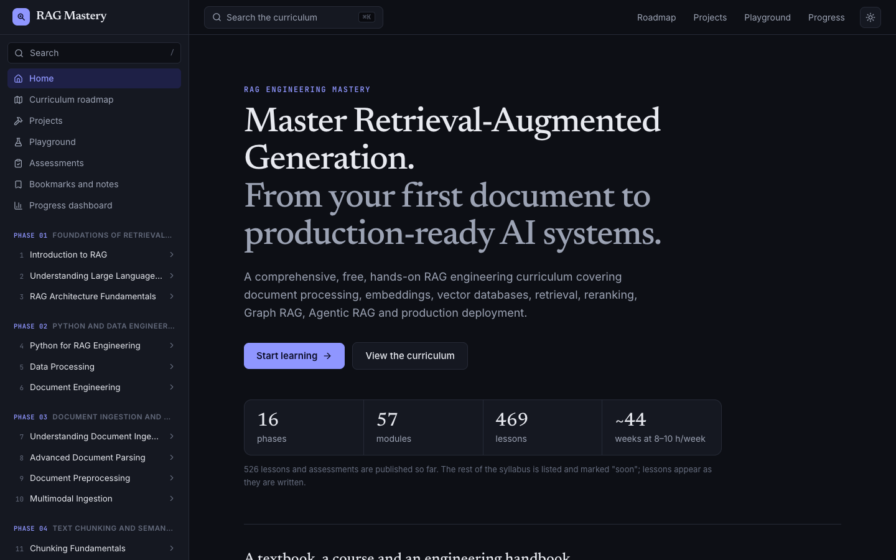
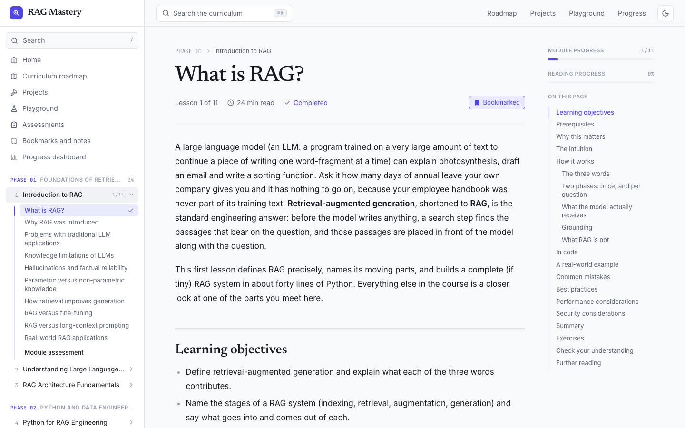

<div align="center">



# RAG Engineering Mastery

**From fundamentals to production-ready retrieval systems.**

*Learn. Retrieve. Reason. Build. Deploy.*

A free, textbook-style curriculum for becoming a RAG engineer: document processing, chunking, embeddings, vector databases, retrieval, reranking, Graph RAG, Agentic RAG, evaluation, security and production deployment.

**16 phases · 57 modules · 469 lessons · 15 projects · 20 interactive visualisers**

</div>

---

## Status

The platform and the full curriculum are published.

| | |
| --- | --- |
| Phases | 16 |
| Modules | 57, each with a module assessment |
| Lessons | 469 |
| Phase exams | 16 |
| Projects | 15 (3 with complete end-to-end implementations) |
| Interactive visualisers | 20 |

Lessons run roughly 4,000 to 6,000 words including code, real output and a quiz. Code was run in a local sandbox whenever it could be; blocks that need an API key, a server (for example Redis, PostgreSQL, Elasticsearch, Weaviate, Milvus, Pinecone, a cloud account) or an uninstalled library are written against the library's documented API and are labelled "not executed" in the text. Citations and arXiv identifiers were written from memory; spot-check them before relying on them. Run `npm run check` to validate all content.

## Features

- **Textbook lessons** with one consistent structure: objectives, prerequisites, intuition, mechanism, mathematics, code with real output, a production scenario, common mistakes, best practices, performance, security, exercises with hidden solutions, a quiz and references.
- **Diagrams and maths.** Mermaid and KaTeX render inline and follow the theme.
- **Twenty interactive visualisers** that compute the real algorithm in the browser (TF-IDF, BM25, RRF, MMR, NDCG, HNSW search and more), in the playground and embedded in lessons.
- **Fifteen projects** with architecture, folder structure, complete code, tests and expected results.
- **Assessments.** A scored quiz in every lesson, a module assessment (quiz, conceptual questions, coding exercises, a design challenge, troubleshooting scenarios) and a phase exam. Best scores are kept.
- **Progress.** Mark lessons complete, see module, phase and overall progress, resume where you left off, export and import everything as JSON.
- **Bookmarks and notes** on every lesson and project.
- **Search** across phases, modules, lessons, projects, visualisers and full lesson text, with <kbd>⌘</kbd> <kbd>K</kbd> or <kbd>/</kbd>.
- **Light and dark themes**, responsive from phone to desktop.
- **No backend and no account.** Everything is stored in the browser's `localStorage`.



## Getting started

You need Node.js 20 or newer.

```bash
npm install
npm run dev       # dev server at http://localhost:5173
npm run build     # type-check and build to dist/
npm run preview   # serve the production build
npm run check     # validate all lesson, assessment, exam and project Markdown
```

The site is a single-page app: when hosting it, serve `index.html` for unknown paths.

## Project structure

```
src/
├── App.tsx                    # routes
├── data/
│   ├── curriculum.ts          # every phase, module and lesson (single source of truth)
│   ├── projects.ts            # the 15 projects
│   └── visualizers.ts         # the 20 visualisers
├── content/                   # lesson Markdown, one folder per module
│   ├── introduction-to-rag/
│   │   ├── what-is-rag.md
│   │   └── assessment.md      # module assessment
│   └── _exams/phase-01.md     # phase exams
├── projects/                  # project tutorials (Markdown)
├── components/
│   ├── Layout, Sidebar, SearchDialog, Article (TOC, notes, progress bars)
│   ├── Markdown, CodeBlock, Mermaid, Quiz, Trace
│   └── visualizers/           # kit.tsx plus the visualisers, grouped by topic
├── lib/
│   ├── content.ts             # discovers and lazy-loads Markdown
│   ├── store.ts               # progress, bookmarks, notes, scores, theme, export/import
│   └── ragmath.ts             # TF-IDF, BM25, RRF, MMR, NDCG used by the visualisers
└── pages/                     # Home, Roadmap, ModulePage, LessonPage, Projects, ProjectPage,
                               # Playground, Assessments, ExamPage, Library, Progress
public/check-content.mjs       # content validator (npm run check)
public/AUTHORING.md             # how to write lessons, assessments, exams and projects
```

## Writing content

Read [public/AUTHORING.md](public/AUTHORING.md). In short: find the lesson in `src/data/curriculum.ts`, create `src/content/<module-slug>/<lesson-slug>.md` with the standard sections, run every code example and paste its real output, then run `npm run check`. The lesson appears in the sidebar, search, roadmap and progress totals automatically.

## Tech stack

React 19, TypeScript, Vite, Tailwind CSS 4, React Router, react-markdown (remark-gfm, remark-math, rehype-katex, rehype-highlight, rehype-slug), Mermaid, KaTeX, Recharts and Lucide icons. Code examples in the lessons are Python; generation examples use the Anthropic SDK and embeddings use local Sentence Transformers models.
