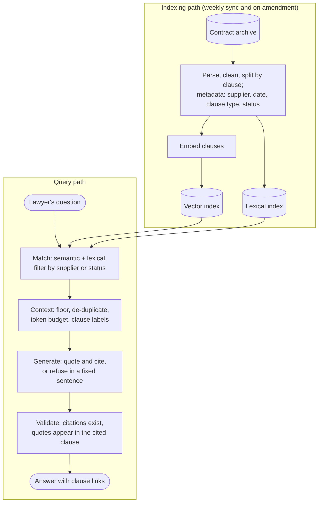

This exam covers the whole of Phase 1, **Foundations of Retrieval-Augmented Generation**: the modules [Introduction to RAG](/learn/introduction-to-rag), [Understanding Large Language Models](/learn/understanding-large-language-models) and [RAG Architecture Fundamentals](/learn/rag-architecture-fundamentals). Answer the 30 multiple-choice questions without looking anything up; a score of 21 or more (70%) is a pass, and anything you get wrong tells you which lesson to revisit. Then attempt the design problem and the debugging problem on paper before opening the worked answers. Allow about 90 minutes in total.

```quiz
[
  {
    "q": "Which statement best describes retrieval-augmented generation?",
    "options": [
      "Training a language model on a company's documents so that it memorises them",
      "Finding relevant text at question time and giving it to the model in the prompt, so the answer is based on that text",
      "Storing every past answer and returning the stored answer to repeated questions",
      "Asking several models the same question and returning the majority answer"
    ],
    "answer": 1,
    "why": "RAG leaves the model's weights unchanged. It retrieves relevant passages when the question arrives and places them in the prompt for the model to answer from."
  },
  {
    "q": "A model with a training cutoff in early 2025 is asked about a policy Meridian introduced last month. Without retrieval, what is the most likely outcome?",
    "options": [
      "The model reports that the policy does not exist",
      "The model searches the internet for the policy",
      "The model produces a plausible answer that is not based on the actual policy",
      "The model returns an error because the question is after its cutoff"
    ],
    "answer": 2,
    "why": "The model has no knowledge of events after its cutoff, or of private documents at any time, but it will usually still produce fluent text. That text reflects what is typical, not what is true for Meridian."
  },
  {
    "q": "What is a hallucination, in the sense used in this curriculum?",
    "options": [
      "Output that is fluent and plausible but not supported by fact or by the supplied sources",
      "Any answer the user disagrees with",
      "A response that takes too long to generate",
      "A refusal to answer a question"
    ],
    "answer": 0,
    "why": "The defining features are fluency and lack of support. It is a consequence of generating likely text rather than looking facts up."
  },
  {
    "q": "Which is an example of non-parametric knowledge?",
    "options": [
      "Grammar the model learned during training",
      "Facts encoded in the model's weights",
      "The model's vocabulary of tokens",
      "The employee handbook stored in a searchable index outside the model"
    ],
    "answer": 3,
    "why": "Parametric knowledge lives in the weights. Non-parametric knowledge lives in an external store that can be read, updated and cited without retraining the model."
  },
  {
    "q": "Why is non-parametric knowledge easier to keep up to date than parametric knowledge?",
    "options": [
      "External stores are always smaller than models",
      "Models forget their training data after deployment",
      "Changing a document in a store takes effect at the next retrieval; changing what the weights encode requires training",
      "Non-parametric knowledge does not need to be embedded"
    ],
    "answer": 2,
    "why": "Updating an index is a data operation measured in seconds or minutes. Updating weights means fine-tuning or retraining, which is slow, costly and hard to verify."
  },
  {
    "q": "Retrieval improves generation by conditioning the model on evidence. Which statement about its limits is correct?",
    "options": [
      "If the retrieved passages are irrelevant or wrong, the answer can still be wrong",
      "Once retrieval is added, hallucination is impossible",
      "Retrieval only helps models with small context windows",
      "Retrieval improves fluency but not factual accuracy"
    ],
    "answer": 0,
    "why": "The model answers from what it is given. Good evidence makes good answers likely; bad or missing evidence does not, and the model may still add unsupported content."
  },
  {
    "q": "Meridian's policies change every few weeks and every answer must point to its source document. Which approach fits best?",
    "options": [
      "Fine-tune a model on the handbook each quarter",
      "Rely on the base model's general knowledge of HR policy",
      "Fine-tune weekly and ask the model to recall where it learned each fact",
      "RAG over the current documents, with citations"
    ],
    "answer": 3,
    "why": "Frequent change favours an index that can be updated without training, and citations require identifiable source passages, which fine-tuned weights cannot provide."
  },
  {
    "q": "For which need is fine-tuning the more natural tool than RAG?",
    "options": [
      "Answering from documents that change daily",
      "Making the model consistently follow a specialised output style or task format",
      "Citing the paragraph an answer came from",
      "Restricting answers to documents a user may read"
    ],
    "answer": 1,
    "why": "Fine-tuning changes how a model behaves: style, format, task skill. RAG changes what it knows at question time. The two are complementary."
  },
  {
    "q": "A team considers skipping retrieval and placing all its documentation, 150,000 tokens, in every prompt. At 20,000 requests a day, how many input tokens a day would the documents alone account for, compared with a 3,000-token retrieved context?",
    "options": [
      "300 million against 6 million",
      "3 billion against 6 million",
      "3 billion against 60 million",
      "150 million against 3 million"
    ],
    "answer": 2,
    "why": "150,000 x 20,000 = 3 billion tokens a day; 3,000 x 20,000 = 60 million. Long-context prompting is simple, but every request pays for the whole corpus."
  },
  {
    "q": "Which task is the weakest fit for RAG?",
    "options": [
      "A support assistant answering from product manuals",
      "A legal research tool searching case documents",
      "An internal assistant answering HR policy questions",
      "Rewriting a paragraph the user has pasted in to make it more formal"
    ],
    "answer": 3,
    "why": "The rewriting task needs no external knowledge: everything required is already in the prompt. RAG helps when the answer depends on information the model does not have."
  },
  {
    "q": "At each step of generation, what does a language model compute?",
    "options": [
      "A probability distribution over its vocabulary for the next token",
      "The single correct next word",
      "A complete sentence, which is then checked for grammar",
      "A list of documents to consult"
    ],
    "answer": 0,
    "why": "The model scores every token in its vocabulary; a sampling step then chooses one, it is appended to the input, and the process repeats."
  },
  {
    "q": "Byte-pair encoding builds its vocabulary by repeatedly merging the most frequent adjacent pair of symbols. What follows for a rare word such as an internal project code name?",
    "options": [
      "It cannot be represented and is dropped",
      "It is mapped to a single unknown token",
      "It is split into several subword tokens",
      "It is converted to the nearest common word"
    ],
    "answer": 2,
    "why": "Common strings earn their own tokens through merges. Rare strings are composed from smaller pieces, so they cost more tokens but are still representable."
  },
  {
    "q": "Why are model limits and prices stated in tokens and not in words or characters?",
    "options": [
      "Tokens are always exactly four characters long",
      "Tokens are the units the model actually reads and writes, and the number per word varies with the text",
      "Words cannot be counted reliably by a computer",
      "Tokens are the same across all model families"
    ],
    "answer": 1,
    "why": "The model's computation is per token. The words-to-tokens ratio depends on language and content, and tokenisers differ between model families, so only a token count is exact."
  },
  {
    "q": "What property of embeddings makes semantic search possible?",
    "options": [
      "Every text is mapped to a unique integer",
      "Longer texts get longer vectors",
      "Embeddings store the original text in compressed form",
      "Texts with similar meaning are mapped to vectors that lie close together"
    ],
    "answer": 3,
    "why": "Because distance in the vector space reflects similarity of meaning, the chunks nearest a query vector are the ones most likely to be about the same thing."
  },
  {
    "q": "What does self-attention do within a transformer?",
    "options": [
      "It lets each token's representation draw on the other tokens in the context, weighted by relevance",
      "It removes unimportant tokens from the input",
      "It selects which documents to retrieve",
      "It converts tokens into characters"
    ],
    "answer": 0,
    "why": "Attention computes, for each position, a weighted combination of information from other positions, which is how a word's representation comes to reflect its context."
  },
  {
    "q": "A transformer block consists of which main parts?",
    "options": [
      "A tokeniser and a vector index",
      "An encoder for questions and a decoder for documents",
      "A self-attention layer and a feed-forward network, with residual connections and normalisation",
      "A retrieval layer followed by a ranking layer"
    ],
    "answer": 2,
    "why": "Each block applies attention to mix information between positions and a feed-forward network to transform each position, with residual connections and normalisation to keep training stable. Blocks are stacked many times."
  },
  {
    "q": "What does this print?\n```python\nwindow, system, question, reserve = 8000, 500, 300, 1000\nprint((window - system - question - reserve) // 400)\n```\nHere `reserve` is space kept for the answer and each chunk is 400 tokens.",
    "options": ["20", "15", "17", "18"],
    "answer": 1,
    "why": "8,000 - 500 - 300 - 1,000 = 6,200 tokens remain for chunks, and 6,200 // 400 = 15. The window is shared by the input and the output."
  },
  {
    "q": "What does this print?\n```python\nimport numpy as np\nlogits = np.array([2.0, 1.0, 0.0])\np = np.exp(logits) / np.exp(logits).sum()\nprint(p.round(2), int(p.argmax()))\n```",
    "options": [
      "[0.5 0.33 0.17] 0",
      "[0.67 0.24 0.09] 2",
      "[2. 1. 0.] 0",
      "[0.67 0.24 0.09] 0"
    ],
    "answer": 3,
    "why": "Softmax turns the logits into probabilities of about 0.67, 0.24 and 0.09. The largest belongs to index 0, which is what greedy decoding would choose."
  },
  {
    "q": "What is the effect of lowering the sampling temperature towards zero?",
    "options": [
      "The distribution sharpens, so the most likely token is chosen almost every time",
      "The model becomes factually accurate",
      "The context window becomes larger",
      "Unlikely tokens become more probable"
    ],
    "answer": 0,
    "why": "Dividing logits by a small temperature exaggerates their differences. Output becomes more repeatable, but the most likely token is not necessarily a true one."
  },
  {
    "q": "In a RAG request, where do the standing rules (answer only from the sources, cite, refuse if absent) belong, and where do the retrieved chunks go?",
    "options": [
      "Both in the system prompt",
      "Rules in the user message; chunks in the system prompt",
      "Rules in the system prompt; chunks and the question in the user message",
      "Rules in the assistant message; chunks in the system prompt"
    ],
    "answer": 2,
    "why": "The system prompt carries instructions that hold for every request. The context and the question change per request and travel in the user message."
  },
  {
    "q": "A RAG answer takes 7 seconds, of which retrieval takes 0.2. The answer is 350 tokens long. What is the most effective way to make the response feel faster?",
    "options": [
      "Use a faster vector index",
      "Stream the output and ask for more concise answers",
      "Reduce top-k from 5 to 4",
      "Embed the query twice"
    ],
    "answer": 1,
    "why": "Output tokens are generated one after another, so generation dominates. Streaming shows text as it is produced, and a shorter answer takes less time to generate."
  },
  {
    "q": "Which limitation of language models does RAG not remove?",
    "options": [
      "Lack of knowledge of private documents",
      "Lack of knowledge of events after the training cutoff",
      "Inability to point to a source for a claim",
      "The possibility that the model misreads or contradicts the text it was given"
    ],
    "answer": 3,
    "why": "RAG supplies knowledge and sources. The model can still misuse them, which is why answers are validated after generation."
  },
  {
    "q": "In the traditional RAG architecture, which statement about the two paths is correct?",
    "options": [
      "The indexing path runs when documents change; the query path runs for every question",
      "The indexing path runs for every question; the query path runs nightly",
      "Both paths run for every question",
      "The query path builds the index and the indexing path reads it"
    ],
    "answer": 0,
    "why": "Document-dependent work is precomputed on the indexing path. Question-dependent work is done on the query path at request time."
  },
  {
    "q": "An ingestion job is re-run after a crash and the index ends up with two copies of many chunks. Which design property was missing?",
    "options": [
      "A larger embedding dimension",
      "A reranking stage",
      "Idempotent writes: stable chunk IDs with upserts",
      "A higher top-k"
    ],
    "answer": 2,
    "why": "If the same chunk always receives the same ID and writes overwrite existing IDs, running the job twice leaves the index as it was after one complete run."
  },
  {
    "q": "What does this print?\n```python\nscores = {\"a\": 0.2, \"b\": 0.9, \"c\": 0.5}\nprint(sorted(scores, key=scores.get, reverse=True)[:2])\n```",
    "options": ["['a', 'c']", "['b', 'c']", "['b', 'a']", "['a', 'b']"],
    "answer": 1,
    "why": "Sorting the keys by score, highest first, gives b, c, a. The top-k cut with k = 2 keeps b and c."
  },
  {
    "q": "Why must the query be embedded with the same model that embedded the chunks?",
    "options": [
      "To reduce the cost of embedding",
      "Because the index stores the model's name in every vector",
      "Because different models always produce vectors of different sizes, which causes an error",
      "Because vectors from different models are not in the same space, so similarities between them are meaningless"
    ],
    "answer": 3,
    "why": "Similarity only means something between vectors produced the same way. Mixed models can fail silently when the dimensions happen to match."
  },
  {
    "q": "Staff often search for runbooks by code (\"NET-114\") and also ask conversational policy questions. Which matching set-up handles both kinds of query?",
    "options": [
      "Embedding search only, with a larger model",
      "Lexical search only, with stemming",
      "Lexical and semantic matching together, with their rankings merged",
      "No retrieval; a larger context window"
    ],
    "answer": 2,
    "why": "Lexical matching is exact on identifiers and blind to paraphrase; semantic matching is the reverse. Their failures are complementary."
  },
  {
    "q": "A context builder is given ten retrieved chunks and a budget of 1,200 tokens. Which order of operations is sound?",
    "options": [
      "Apply a relevance floor, remove duplicates, select within the budget, then label and delimit",
      "Select within the budget, then remove duplicates and low-scoring chunks",
      "Label and delimit all ten, then cut the string at 1,200 tokens",
      "Concatenate all ten and let the model ignore what it does not need"
    ],
    "answer": 0,
    "why": "Filtering and de-duplicating first means the budget is spent only on distinct, relevant chunks. Cutting an assembled string risks slicing a fact or a delimiter in half."
  },
  {
    "q": "Which post-generation check can be done exactly, by code, with no second model?",
    "options": [
      "Whether the answer is helpful",
      "Whether each cited source label was among those supplied in the request",
      "Whether the cited source truly supports each claim in every case",
      "Whether the user will be satisfied"
    ],
    "answer": 1,
    "why": "Checking labels against the request's label map is a set-membership test. Judging support is a question of meaning and needs heuristics or a judge model."
  },
  {
    "q": "A handbook page is edited at 09:00 and the index is re-synchronised at 02:00 each night using content hashes. Which statement is correct?",
    "options": [
      "The answer changes at 09:00 because retrieval reads the live page",
      "The nightly sync will re-embed the entire handbook",
      "The edit is ignored until the embedding model is changed",
      "Until the sync runs, answers cite the old text; the sync then re-embeds only the chunks whose content changed"
    ],
    "answer": 3,
    "why": "The index is a snapshot, so the page is stale until the next sync. Per-chunk hashes confine the work to the chunks whose text differs."
  }
]
```

## Design problem

Meridian's legal team wants an assistant, **AskContracts**, over its archive of 12,000 supplier contracts averaging 15 pages each. Lawyers will ask questions such as "which contracts allow termination with less than 30 days' notice?" and "what is the liability cap in the Northwind agreement?". About 40 contracts are added or amended each week. Answers must quote the clause they rely on, and a wrong answer presented confidently is considered worse than no answer. Three proposals are on the table:

- **A.** Fine-tune a model on the contract archive.
- **B.** Put the relevant contracts in a long context window for each question.
- **C.** Build a RAG system.

Evaluate the three proposals, choose one, and outline the architecture of your choice: both paths, how a question is matched to clauses, how the context is built, what the model is instructed to do and how the system stays current. Say which of the two example questions your design handles well and which it does not, and why. Assume about 500 tokens per page.

<details><summary>Show worked answer</summary>

**Sizing first.** 12,000 contracts of 15 pages at about 500 tokens a page is $12{,}000 \times 15 \times 500 = 90$ million tokens. One contract is about 7,500 tokens.

**Proposal A, fine-tuning.** Rejected as the primary mechanism. Fine-tuning teaches behaviour and general patterns; it does not give reliable verbatim recall of specific clauses, and knowledge in weights cannot be cited: the model cannot point to the clause it "remembers". Forty changed contracts a week would mean continual retraining, and an amended clause would coexist in the weights with its superseded version. The requirement to quote the governing clause, and the high cost of confident error, both rule it out. (Fine-tuning could later help with a behaviour, such as a house style for clause summaries.)

**Proposal B, long context.** The archive is 90 million tokens, far beyond any context window, so "the relevant contracts" must first be chosen, which is retrieval under another name. For a question about one named contract, placing that whole contract (about 7,500 tokens) in the prompt is feasible and is in fact a reasonable strategy. As a general design it fails on cost and selection: every request pays for everything included, and choosing what to include is the hard part.

**Proposal C, RAG.** Chosen. Knowledge stays in an external store that can be updated weekly without training; answers are built from identifiable clauses that can be quoted and checked; and a refusal is available when the clauses retrieved do not answer the question.

**Architecture.**



- *Indexing path.* Contracts are parsed and split along clause boundaries, because a clause is the unit a lawyer cites and a focused chunk gives a focused embedding. Each chunk carries metadata: contract ID, supplier name, effective date, clause heading and a status (in force or superseded). Chunks are embedded once, offline, and written with stable IDs and upserts so a re-run cannot duplicate them. A content hash per chunk lets the weekly sync re-embed only new and amended clauses and delete superseded ones.
- *Matching.* Supplier names and clause numbers are exact strings, so lexical matching is needed beside semantic matching, with the rankings merged. "Northwind" in the question becomes a metadata filter on supplier. The status field filters out superseded versions. The query is embedded with the same model as the clauses.
- *Context construction.* A relevance floor, de-duplication (contracts built from a template share near-identical clauses, so the contract ID must be part of the label), selection under a token budget computed from the input limit less the system prompt, question and margin, and short labels mapped in code to contract and clause.
- *Generation.* The system prompt holds the contract: answer only from the supplied clauses, quote the governing text, cite the label after each statement, and reply with a fixed refusal sentence if the clauses do not answer the question. The clauses and the question go in the user message. Reliability comes from this contract and from validation, not from sampling settings.
- *Validation.* Every cited label must have been supplied; every quotation must appear verbatim in the clause it cites; every figure must appear in the cited clause. On failure: one retry, then the refusal. Given the stated cost of confident error, answers are validated before display instead of being streamed unchecked.
- *Staying current.* A sync after each batch of amendments, a freshness target agreed with the legal team, logging of the clause digests behind every answer, and an evaluation set of real questions with their governing clauses, run before any change to chunking, models or prompts.

**The two example questions.**

"What is the liability cap in the Northwind agreement?" is a **lookup**: one contract, one clause. A filter on supplier plus clause-level retrieval finds it, and the answer quotes it. The design handles this well.

"Which contracts allow termination with less than 30 days' notice?" is an **aggregation** over the whole archive. Top-k retrieval returns the k most similar clauses, not *every* matching contract, so the answer would be a plausible partial list presented as complete, which is exactly the confident error the legal team fears. The traditional architecture is the wrong tool. The sound approach is offline: during indexing, extract the notice period from each contract's termination clause into a structured field, and answer such questions with a filter or query over that field, returning the list with links. Until that exists, the assistant should say that it can show examples but cannot guarantee completeness.

**Trade-offs acknowledged.** Clause-level chunks can lose context (a cap defined by reference to a schedule elsewhere); including the clause heading and, where budget allows, neighbouring clauses mitigates this. Two indexes cost more to maintain than one. A strict validation policy will produce some refusals on answerable questions, which the evaluation set should measure.

</details>

## Debugging problem

A junior engineer has written the first prototype of AskMeridian. The retrieval and prompt-building code is below; the model is then called with `max_tokens=40` and no system prompt. Testers report four symptoms:

1. Asked "How many days of annual leave do I get?", the assistant answered "Full-time employees in the UK are entitled to 28 days", which is not Meridian's policy.
2. Answers never cite a source.
3. Longer answers stop in the middle of a sentence.
4. Response time grows as more documents are added, even though the index "is built already".

```python
import numpy as np
from sklearn.feature_extraction.text import TfidfVectorizer

CHUNKS = [
    "Annual leave is 25 days per year.",
    "Up to 5 unused days carry over and must be used by 31 March.",
    "Staff may work remotely up to 3 days a week.",
    "The home-office equipment budget is £400.",
    "Expenses must be submitted within 30 days.",
    "Passwords must be rotated every 90 days.",
]


def retrieve(question, k=2):
    vectoriser = TfidfVectorizer()
    matrix = vectoriser.fit_transform(CHUNKS + [question])
    scores = (matrix[:-1] @ matrix[-1].T).toarray().ravel()
    order = np.argsort(scores)[:k]
    return [CHUNKS[i] for i in order]


def build_prompt(question, chunks):
    context = " ".join(chunks)[:60]
    return f"{context}\n\n{question}\nAnswer helpfully."


question = "How many days of annual leave do I get?"
print(build_prompt(question, retrieve(question)))
```

This is the prompt it produces for the test question:

```output
The home-office equipment budget is £400. Up to 5 unused day

How many days of annual leave do I get?
Answer helpfully.
```

Find every fault, connect each to the symptoms, and write a corrected version of the two functions.

<details><summary>Show worked answer</summary>

**Reading the evidence.** The printed prompt contains a sentence about the equipment budget and a fragment about carry-over, cut off mid-word. The chunk that answers the question, "Annual leave is 25 days per year.", is absent. Everything downstream follows from that.

**Fault 1: the ranking is upside down.** `np.argsort(scores)` sorts ascending, so `[:k]` takes the *least* similar chunks. It should be `np.argsort(-scores)[:k]`. This explains symptom 1: the model was given nothing about the annual allowance and no instruction to stay within the sources, so it answered from its parametric knowledge. The figure it gave is plausible general knowledge about UK employment and unconnected to Meridian's handbook: a textbook hallucination in the RAG sense, caused by a retrieval fault.

**Fault 2: the vectoriser is refitted on every request, with the question included.** `fit_transform(CHUNKS + [question])` redoes the offline work (learning the vocabulary and IDF weights, vectorising every chunk) for each question. That is symptom 4: cost per request grows with the corpus. It also lets the question alter the IDF weights, so chunk vectors change from one question to the next. Fit once on the chunks, offline; call `transform` on the question, online.

**Fault 3: the context is cut by characters.** `" ".join(chunks)[:60]` slices the joined string at 60 characters. Limits are in tokens, not characters; the slice cuts mid-word; and joining with spaces leaves no boundary between chunks. A half-sentence such as "Up to 5 unused day" invites the model to complete it from memory. Select whole chunks under a budget measured in tokens (or, in a toy, words).

**Fault 4: no labels and no delimiters.** The chunks are anonymous text, so there is nothing to cite. That is symptom 2. Wrap each chunk in a delimiter carrying a short label.

**Fault 5: no grounded-answer contract.** "Answer helpfully" encourages the model to answer whatever it is given. There is no system prompt telling it to use only the sources, to cite, or to refuse in a fixed form. Symptoms 1 and 2 again.

**Fault 6: no relevance floor and no refusal path.** The function always returns k chunks. A question the corpus cannot answer still produces a prompt, and the model will answer.

**Fault 7: `max_tokens=40`.** The output limit is far too small for a normal answer, so generation stops when the limit is reached. That is symptom 3. Raise it (1,024 is a reasonable default for short answers) and check the stop reason so a cut-off answer is never shown as complete.

**Corrected version.**

```python
import numpy as np
from sklearn.feature_extraction.text import TfidfVectorizer

CHUNKS = [
    "Annual leave is 25 days per year.",
    "Up to 5 unused days carry over and must be used by 31 March.",
    "Staff may work remotely up to 3 days a week.",
    "The home-office equipment budget is £400.",
    "Expenses must be submitted within 30 days.",
    "Passwords must be rotated every 90 days.",
]

SYSTEM = ("Answer using only the text inside the <source> tags and cite the source id, "
          "like [S1], after each fact. If the sources do not contain the answer, reply "
          "exactly: I don't know based on the provided sources.")

vectoriser = TfidfVectorizer(stop_words="english")
matrix = vectoriser.fit_transform(CHUNKS)             # offline: once, on the chunks only


def retrieve(question, k=2, min_score=0.2):
    q = vectoriser.transform([question])              # online: transform, never fit
    scores = (matrix @ q.T).toarray().ravel()
    order = np.argsort(-scores)[:k]                   # highest score first
    return [CHUNKS[i] for i in order if scores[i] >= min_score]


def build_prompt(question, chunks, max_words=60):
    blocks, used = [], 0
    for chunk in chunks:                              # whole chunks only, within a budget
        cost = len(chunk.split())
        if used + cost > max_words:
            continue
        blocks.append(f'<source id="S{len(blocks) + 1}">\n{chunk}\n</source>')
        used += cost
    return "\n".join(blocks) + f"\n\nQuestion: {question}"


for question in ["How many days of annual leave do I get?", "What is the dress code?"]:
    chunks = retrieve(question)
    if not chunks:
        print(f"{question}\n-> no model call: I don't know based on the provided sources.")
    else:
        print(build_prompt(question, chunks) + "\n")
```

```output
<source id="S1">
Annual leave is 25 days per year.
</source>

Question: How many days of annual leave do I get?

What is the dress code?
-> no model call: I don't know based on the provided sources.
```

The correct chunk is now retrieved, labelled and delimited; the vectoriser is fitted once; the unanswerable question is refused without a model call. The model call itself would pass `SYSTEM` as the system prompt and the built prompt as the user message, with an adequate `max_tokens`, and the answer would then go through a citation check before display.

**The order of investigation matters.** The most visible symptom was a wrong answer from the model, and the tempting response was to edit the prompt. Printing the prompt showed that the right text never reached the model. Check the stages in pipeline order: is the answer in the corpus, was it retrieved, did it reach the context, and only then, what did the model do with it.

</details>
