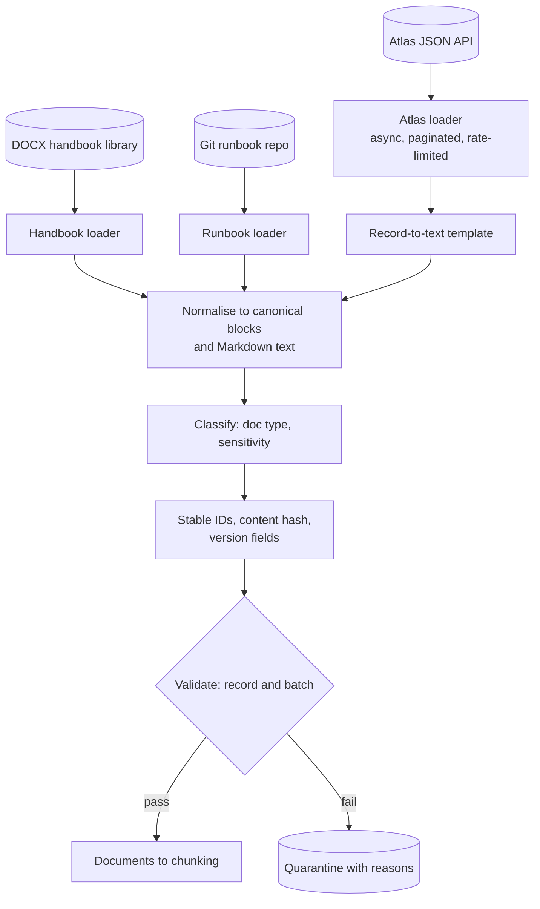

This exam covers the whole of Phase 2, **Python and Data Engineering Foundations**: the modules [Python for RAG Engineering](/learn/python-for-rag-engineering), [Data Processing](/learn/data-processing) and [Document Engineering](/learn/document-engineering). Answer the 30 multiple-choice questions without looking anything up or running any code; a score of 21 or more (70%) is a pass, and every question you get wrong points to a lesson worth revisiting. Then attempt the design problem and the debugging problem on paper before opening the worked answers. Allow about 90 minutes in total.

```quiz
[
  {
    "q": "What does this code print?\n```python\ndef add_tag(tag, tags=[]):\n    tags.append(tag)\n    return tags\n\nprint(add_tag(\"hr\"), add_tag(\"it\"))\n```",
    "options": [
      "['hr'] ['it']",
      "['hr', 'it'] ['hr', 'it']",
      "['hr'] ['hr', 'it']",
      "A TypeError, because a list cannot be a default value"
    ],
    "answer": 1,
    "why": "A default value is evaluated once, when the function is defined, so both calls append to the same list. Both printed names refer to that one list, which holds both tags by the time print runs. Use None as the default and create a new list inside the function."
  },
  {
    "q": "A function is declared as `def chunk(text: str, size: int) -> list[str]` and is called as `chunk(\"abc\", \"500\")`. What happens when the call runs?",
    "options": [
      "Python raises a TypeError before the body runs, because \"500\" is not an int",
      "Python converts \"500\" to 500 automatically",
      "The call fails at import time",
      "Nothing checks the hint at run time; the body runs with a string and fails or misbehaves only where it uses size as a number"
    ],
    "answer": 3,
    "why": "Type hints are not enforced by the interpreter. A static checker such as mypy would flag the call, but at run time the string is passed through unchanged."
  },
  {
    "q": "A Pydantic v2 model has a field `n: int`. What do `Model(n=\"3\")` and `Model(n=\"abc\")` do in the default (lax) mode?",
    "options": [
      "The first stores the integer 3; the second raises a ValidationError",
      "Both raise a ValidationError",
      "Both store the strings unchanged",
      "The first stores the string \"3\"; the second stores 0"
    ],
    "answer": 0,
    "why": "In lax mode Pydantic coerces a numeric string to an int and rejects a string that cannot be parsed. A plain dataclass would store \"3\" unchanged, because it performs no validation at all."
  },
  {
    "q": "Ten embedding requests each wait about one second on the network. They are written as coroutines and run with `asyncio.gather`, but each coroutine calls the blocking `requests.post`. Roughly how long does the batch take?",
    "options": [
      "About 1 second, because gather runs coroutines concurrently",
      "About 0.1 seconds",
      "About 10 seconds, because each blocking call holds the event loop until it returns",
      "It never finishes, because requests cannot be imported in async code"
    ],
    "answer": 2,
    "why": "Concurrency in asyncio only happens at await points. A blocking call inside a coroutine stops the whole event loop, so the requests run one after another. Use an async client such as httpx.AsyncClient and await it."
  },
  {
    "q": "An ingestion job calls an external API that sometimes returns HTTP 429, 503 and 401. Which retry policy is correct?",
    "options": [
      "Retry all three immediately until they succeed",
      "Retry 429 and 503 with exponential backoff and jitter, honouring Retry-After if present; do not retry 401, which needs a credential fix",
      "Retry only 401, because the token may refresh itself",
      "Never retry; log every error and move on"
    ],
    "answer": 1,
    "why": "429 (rate limited) and 503 (temporarily unavailable) are transient. 401 means the credentials are wrong; retrying cannot fix it and only adds load and delay."
  },
  {
    "q": "What is the main purpose of a lock file (for example `uv.lock`, `poetry.lock` or a fully pinned requirements file)?",
    "options": [
      "To stop other users from editing the project",
      "To record only the packages you imported directly",
      "To encrypt the project's dependencies",
      "To record the exact version of every package, including transitive dependencies, so every install reproduces the same environment"
    ],
    "answer": 3,
    "why": "Version ranges in a project file allow different installs to resolve to different versions. A lock file pins the full resolved set, which is what makes builds reproducible."
  },
  {
    "q": "Why does each RAG project get its own virtual environment?",
    "options": [
      "So that its packages and versions are isolated from other projects and from the system Python",
      "Because Python cannot import packages outside a virtual environment",
      "To make the code run faster",
      "Because virtual environments encrypt API keys"
    ],
    "answer": 0,
    "why": "Two projects often need incompatible versions of the same library. A virtual environment gives each project its own site-packages directory, so installing for one cannot break the other."
  },
  {
    "q": "A pipeline must be able to swap its embedding provider without changing the code that calls it. Which design supports that best?",
    "options": [
      "An if/elif chain on a provider name inside every function that embeds text",
      "A global variable holding the provider's API key",
      "A small interface (an abstract base class or a Protocol) with an embed method, implemented once per provider and passed in",
      "Copying the pipeline once per provider"
    ],
    "answer": 2,
    "why": "Callers depend on the interface, not on a concrete class. A new provider is one new implementation; nothing that uses it changes, and tests can pass in a fake."
  },
  {
    "q": "A loader yields documents one at a time with `yield` instead of returning a list. What is the main benefit for a corpus of 200,000 files?",
    "options": [
      "Each document is parsed faster",
      "Memory stays roughly constant, because only the document being processed needs to be held, and processing can start before loading finishes",
      "The documents are automatically de-duplicated",
      "It makes the loader thread-safe"
    ],
    "answer": 1,
    "why": "A generator produces items lazily. A list would hold every document in memory at once and delay the first embedding until the last file had been read."
  },
  {
    "q": "What does this code print?\n```python\nimport re\nprint(re.findall(r\"<b>(.*)</b>\", \"<b>a</b> and <b>c</b>\"))\n```",
    "options": [
      "['a', 'c']",
      "['a']",
      "[]",
      "['a</b> and <b>c']"
    ],
    "answer": 3,
    "why": "`.*` is greedy: it matches as much as possible and backtracks only as far as the last `</b>`. The non-greedy `.*?` would give ['a', 'c']. For real HTML, use a parser rather than a regex."
  },
  {
    "q": "Why should a CSV file be read with the csv module (or pandas) rather than `line.split(\",\")`?",
    "options": [
      "Because split is slower than the csv module",
      "Because split cannot handle numbers",
      "Because fields may be quoted and contain commas or line breaks, which naive splitting breaks apart",
      "Because CSV files are binary"
    ],
    "answer": 2,
    "why": "The row `a,\"b, c\",d` has three fields. Splitting on commas gives four pieces, with stray quotation marks. A CSV parser applies the quoting rules."
  },
  {
    "q": "`json.loads(text)` on an export file raises `JSONDecodeError: Extra data: line 2 column 1`. The file has one JSON object per line. What is the fix?",
    "options": [
      "Parse each non-empty line separately, because the file is JSON Lines, not a single JSON document",
      "Open the file in binary mode",
      "Wrap the call in try/except and ignore the error",
      "Use `json.load` instead of `json.loads`"
    ],
    "answer": 0,
    "why": "JSON Lines holds one complete JSON value per line. As a whole, the file is not one valid JSON document, so the parser stops after the first object with \"Extra data\"."
  },
  {
    "q": "Text extracted from an internal web page with BeautifulSoup's `get_text()` contains the navigation menu, cookie banner and inline JavaScript. What is the right fix?",
    "options": [
      "Lower-case the text before indexing",
      "Remove the unwanted elements (script, style, nav, footer and similar) or select the main content element before extracting text",
      "Switch to a regular expression that deletes everything between angle brackets",
      "Index it anyway; the embedding model will ignore boilerplate"
    ],
    "answer": 1,
    "why": "get_text returns the text of every element. Boilerplate repeated on every page pollutes chunks and matches many queries, so it must be removed structurally before extraction."
  },
  {
    "q": "pypdf returns an empty or almost empty string for every page of a 40-page PDF that looks normal on screen. What is the most likely explanation?",
    "options": [
      "The PDF is encrypted with a strong password",
      "pypdf only reads the first page by default",
      "The text is in a font pypdf does not support",
      "The pages are scanned images with no text layer, so the text must be recovered with OCR"
    ],
    "answer": 3,
    "why": "Text extraction reads the text objects stored in the PDF. A scanned document stores pictures of pages, so there is nothing to extract until OCR recognises the characters."
  },
  {
    "q": "A policy in DOCX format keeps its eligibility rules in a table. A script builds the document text from `doc.paragraphs` in python-docx. What happens to the table?",
    "options": [
      "Its text is missing, because `doc.paragraphs` holds only the body's top-level paragraphs; table cells are reached through `doc.tables`",
      "It is included as tab-separated text",
      "It is included as Markdown",
      "python-docx raises an error on documents that contain tables"
    ],
    "answer": 0,
    "why": "Paragraphs inside table cells belong to the cells, not to the document body. Extraction must walk the tables as well, ideally in document order."
  },
  {
    "q": "A Markdown runbook is to be chunked. Why is it worth parsing the Markdown (headings, lists, code blocks) rather than treating it as plain text?",
    "options": [
      "Parsed Markdown is smaller to store",
      "Embedding models cannot read the # character",
      "The structure gives natural chunk boundaries and section titles that can be kept as metadata, and keeps code blocks intact",
      "Markdown must be converted to HTML before any embedding model can use it"
    ],
    "answer": 2,
    "why": "Headings mark where topics start and end, and a heading path such as \"VPN > Troubleshooting\" is valuable context for a chunk. Splitting blindly can cut a code block or a list in half."
  },
  {
    "q": "Which behaviour is expected of a responsible web scraper collecting documentation pages?",
    "options": [
      "Requesting every page in parallel as fast as possible to finish quickly",
      "Ignoring robots.txt for internal documentation",
      "Spoofing a browser user agent to avoid blocks",
      "Checking robots.txt and the site's terms, limiting the request rate, and caching pages so they are not fetched repeatedly"
    ],
    "answer": 3,
    "why": "Scraping puts load on someone else's server. Respecting robots.txt and terms, throttling and caching keeps the scraper polite and keeps it from being blocked."
  },
  {
    "q": "A chunk displays \"The equipment budget is £400\". What went wrong?",
    "options": [
      "The source document contains a typing error",
      "UTF-8 bytes were decoded as Latin-1 or Windows-1252, so the two bytes of the pound sign became two separate characters",
      "The embedding model added a character",
      "The text was normalised with NFKC"
    ],
    "answer": 1,
    "why": "In UTF-8 the pound sign is two bytes, C2 A3. Decoded one byte per character as Latin-1 or cp1252, C2 becomes \"Â\" and A3 becomes \"£\". This is mojibake; decode with the encoding the bytes were written in."
  },
  {
    "q": "The strings \"é\" (one code point) and \"e\" followed by a combining acute accent look identical but compare unequal. What makes them compare equal?",
    "options": [
      "Calling `.lower()` on both",
      "Encoding both as ASCII with errors ignored",
      "Normalising both to the same Unicode normal form, for example NFC, before comparing or hashing",
      "Nothing; they are different characters"
    ],
    "answer": 2,
    "why": "Unicode allows composed and decomposed forms of the same character. Normalising to one form makes equal-looking text byte-identical, which matters for de-duplication, hashing and lexical search."
  },
  {
    "q": "Two documents have word sets {annual, leave, 25, days} and {leave, 25, days, carry}. What is their Jaccard similarity?",
    "options": [
      "0.6",
      "0.75",
      "0.5",
      "0.8"
    ],
    "answer": 0,
    "why": "The intersection has 3 words (leave, 25, days) and the union has 5, so 3 / 5 = 0.6. MinHash estimates this quantity cheaply for near-duplicate detection at scale."
  },
  {
    "q": "Every page of an extracted PDF ends with \"Meridian Confidential, Page N of 40\". Why remove it before chunking?",
    "options": [
      "It reveals that the document is confidential",
      "It is repeated noise that breaks paragraphs across page boundaries and adds the same text to many chunks, distorting matching",
      "Embedding models cannot embed numbers",
      "PDF footers are always encoded incorrectly"
    ],
    "answer": 1,
    "why": "Repeated headers and footers interrupt sentences that cross a page break and make otherwise unrelated chunks share text. They belong in cleaning, before chunk boundaries are chosen."
  },
  {
    "q": "An indexing pipeline assigns each document `str(uuid.uuid4())` every time it runs and upserts by that ID. What happens on the second nightly run?",
    "options": [
      "Every document gets a new ID, so the upsert inserts a second copy instead of overwriting the first",
      "Nothing; uuid4 returns the same value for the same document",
      "The vector store rejects the documents as duplicates",
      "Only changed documents are re-inserted"
    ],
    "answer": 0,
    "why": "uuid4 is random. An upsert only overwrites when the ID matches, so random IDs turn every re-run into a batch of new documents. Derive the ID from something stable, for example uuid5 of a namespace and the canonical source path."
  },
  {
    "q": "Which metadata field must be copied onto every chunk of a document, not just stored on the document record?",
    "options": [
      "The file size in bytes",
      "The name of the loader class that read the file",
      "The access-control field (who may read it), because retrieval filters at chunk level",
      "The time the loader started"
    ],
    "answer": 2,
    "why": "The vector store searches chunks. A permission that exists only on a parent record cannot be applied as a filter at retrieval time, so a chunk could be returned to a user who may not see its document."
  },
  {
    "q": "The same policy exists as an HTML wiki page and as a DOCX attachment. After loading, the two texts differ only in whitespace and list bullet characters. Why does normalising both into one canonical structure matter?",
    "options": [
      "It makes the files smaller on disk",
      "It is required by the embedding model's licence",
      "It translates both into English",
      "Identical content then produces identical text, so content hashes, duplicate detection and chunk boundaries agree across formats"
    ],
    "answer": 3,
    "why": "If format differences survive into the text, the same content hashes differently, de-duplication misses it and chunking splits it differently, so the index holds near-duplicates."
  },
  {
    "q": "A document classifier labels each incoming file as policy, runbook, product doc or FAQ. For one file, its highest predicted probability is 0.41. What should the pipeline do?",
    "options": [
      "Use the top label anyway; a classifier is always right about its top choice",
      "Assign \"unknown\" and send the file to review (or a default route) because the confidence is below the agreed threshold",
      "Delete the file",
      "Assign all four labels"
    ],
    "answer": 1,
    "why": "Low confidence means the label is likely wrong, and a wrong type sends the document down the wrong route (parser, chunker, access rules). An explicit abstain path with review is safer than a forced guess."
  },
  {
    "q": "AskMeridian tells one user the laptop refresh cycle is 4 years and another that it is 3 years. Both answers cite the handbook. What is the most likely cause?",
    "options": [
      "The superseded 2023 handbook is still indexed alongside the current one, and retrieval is not restricted to current versions",
      "The model's temperature is too high",
      "The embedding model cannot represent numbers",
      "The chunk size is too small"
    ],
    "answer": 0,
    "why": "The 2023 handbook said 4 years; the current one says 3. With both indexed and no is_current filter or validity dates, either version can be retrieved and quoted."
  },
  {
    "q": "A batch of documents passes schema validation, but this night's run produced 120 documents where the previous ten runs each produced about 4,000. What should a well-designed validation stage do?",
    "options": [
      "Nothing; every document is individually valid",
      "Delete the previous index and replace it with the 120 documents",
      "Fail or hold the batch for review, because a sudden volume drop usually means an upstream fault, and publishing it could delete thousands of valid documents",
      "Retry the run until it produces 4,000 documents"
    ],
    "answer": 2,
    "why": "Record-level checks cannot see a missing export or a broken connector. Batch-level checks compare the run with history and stop a sync that would treat thousands of missing documents as deleted."
  },
  {
    "q": "Validation rejects a document because its extracted text is empty. What should happen to it?",
    "options": [
      "Silently drop it, so the logs stay clean",
      "Index it with an empty text field so that its ID exists",
      "Retry the same extraction forever",
      "Write it to a quarantine store with the reason, and count it in the run report, so it can be fixed and re-ingested"
    ],
    "answer": 3,
    "why": "A silently dropped document becomes an unanswerable question that nobody can explain. Quarantine keeps the evidence, the reason and a path back into the index."
  },
  {
    "q": "The Atlas error-code catalogue is ingested as one document per code. A user asks \"how many error codes relate to the VPN?\". Why does top-k retrieval answer this poorly?",
    "options": [
      "Error codes cannot be embedded",
      "Top-k returns only the k most similar records, not every matching one, so a count built from them is incomplete; a count belongs in a query over the structured data",
      "The question is too short to embed",
      "The catalogue should have been stored as a PDF"
    ],
    "answer": 1,
    "why": "Retrieval selects a small, similar sample. Aggregations (counts, sums, \"list all\") need every matching row, which a filter or SQL query over the original records provides exactly."
  },
  {
    "q": "A CSV of Meridian laptops has the columns model, owner, purchase_date and status. Which ingestion choice is most sensible?",
    "options": [
      "Concatenate the whole file into one document and embed it",
      "Embed only the column headers",
      "Turn each row into a short sentence that keeps the column names with their values, and keep the fields as metadata for exact filtering",
      "Embed each cell as a separate chunk"
    ],
    "answer": 2,
    "why": "A row rendered as \"Model: X. Owner: Y. Purchased: 2024-03-01. Status: active.\" keeps each value's meaning, and structured metadata allows exact filters such as status = active that similarity search cannot guarantee."
  }
]
```

## Design problem

Meridian wants a single ingestion layer that feeds AskMeridian's indexing pipeline from three sources:

- **The employee handbook**, maintained by the HR team as about 60 DOCX files in a document library. Policies are revised a few times a year; each revision carries an effective date, and the superseded 2023 handbook is still in the library.
- **The IT runbooks**, about 900 Markdown files in a Git repository, identified by runbook IDs such as NET-114. Files are sometimes moved between folders.
- **The Atlas error-code catalogue**, about 3,000 records served by a paginated JSON API that allows a limited number of requests per minute and occasionally returns HTTP 503.

Some HR policies are restricted to managers. The ingestion runs nightly. Design the ingestion layer, from source to the documents handed to chunking. Cover: how each source is loaded; the internal document model and its metadata; how document IDs are formed; how versions and deletions are handled; validation and what happens to failures; and how the Python service is structured and made reproducible. Say what you would deliberately leave out of retrieval altogether.

<details><summary>Show worked answer</summary>

**Shape of the solution.** Three loaders, one canonical document model, then shared stages (normalise, classify, identify, validate) before anything reaches chunking. Everything source-specific is confined to the loaders; everything after them sees one type.



**Loaders.** Each loader is a class implementing one small interface (a `lazy_load()` generator yielding documents), so the pipeline does not care where a document came from and tests can substitute a fake.

- *Handbook:* python-docx, walking paragraphs **and tables** in document order, because eligibility rules often sit in tables. Heading styles become heading blocks.
- *Runbooks:* read from a checkout of the repository; parse the Markdown so headings, lists and code blocks survive as structure. The runbook ID comes from front matter or the file name.
- *Atlas:* an async client (for example `httpx.AsyncClient`) that follows pagination, limits concurrency to stay under the rate limit, and retries 503 and 429 with exponential backoff and jitter, honouring `Retry-After`. A 4xx other than 429 is not retried; it fails the run loudly, because it means the request or the credentials are wrong.

**Canonical document model.** A Pydantic model with `doc_id`, `text` (canonical Markdown rendered from blocks), and metadata: `source_system`, `source_uri`, `title`, `doc_type`, `owner_team` (HR, Platform), `effective_from`, `effective_to`, `is_current`, `version`, `language`, `allowed_groups`, `content_hash` and `ingested_at`. Dates are ISO 8601; `doc_type` and `owner_team` use controlled vocabularies. `allowed_groups` (for example `["all-staff"]` or `["managers"]`) is copied onto every chunk later, because retrieval filters at chunk level.

**Identifiers.** Derived, never random:

- Handbook: `uuid5(NAMESPACE, "handbook:" + policy_key)`, where the policy key is a stable identifier from the library (its item ID), not the file name, which HR may change.
- Runbooks: `uuid5(NAMESPACE, "runbook:" + runbook_id)`. Keying on NET-114 rather than the path means a move between folders keeps the same ID; the path is metadata.
- Atlas: `uuid5(NAMESPACE, "atlas:" + code)`.

`uuid5` is deterministic and gives the UUID format a vector store such as Qdrant accepts as a point ID. Chunk IDs are derived from the document ID and position. The content hash (SHA-256 of the canonical text) decides whether a document needs re-chunking and re-embedding at all.

**Versions and deletions.** Handbook revisions are kept as versions with `effective_from` and `effective_to`. The default retrieval filter is `is_current = true`, which keeps the 2023 handbook's 4-year laptop cycle, £250 equipment budget and 09:00 to 17:00 support hours out of everyday answers; older versions stay available for an explicit "what was the policy in 2023?" question if that is a requirement, and are otherwise excluded from the index. A document that disappears from its source is not deleted on the first missing night: it is marked with a tombstone and removed once the absence is confirmed, so a transient connector fault does not wipe the index.

**Classification.** `doc_type` mostly comes from the source (each source is one type), so rules suffice; the useful classification is **sensitivity** for the handbook, from the library's permission settings, not guessed from content. A document whose access cannot be determined is quarantined, never indexed as public.

**Validation.** Record-level: schema (required fields, types, controlled vocabularies), non-empty text above a minimum length, a plausible ratio of letters to symbols (catches failed extraction), duplicate IDs within the batch. Batch-level: document count per source compared with recent runs; a drop beyond a set fraction holds the whole batch for a human, because publishing it would tombstone hundreds of valid documents. Failures go to a quarantine table with the source URI, the stage, the reason and the raw input reference; the run report gives counts per source and per reason.

**The service.** One Python package with the loaders, models and stages as modules; type hints throughout and checked in CI; dependencies declared in `pyproject.toml` and pinned by a lock file; a virtual environment per developer and a container image for the nightly job; credentials for the document library and the Atlas API read from environment variables or a secret store, never committed. Unit tests run the stages on small fixture files, including a DOCX with a table, a moved runbook and a JSON page with a 503 injected by a fake client.

**What stays out of retrieval.** Counting and listing questions over Atlas ("how many VPN error codes are there?") are answered from the structured records with a query, not by top-k retrieval, so the Atlas records also stay available in a table. Superseded handbook versions are not in the default index.

**Trade-offs.** Keeping all versions makes as-of questions possible but adds filtering to every query and risks stale answers if a filter is forgotten; latest-only is simpler and safer when nobody needs history. Holding a batch on a volume drop sometimes delays a legitimate large deletion until a person approves it, which is the right way round for a system people trust for policy answers.

</details>

## Debugging problem

Meridian's first ingestion script loads a wiki export and an Atlas dump and writes them to an index (a list stands in for the vector store). It runs every night. After two nights, people report four symptoms:

1. Every search returns the same passage twice.
2. Every citation says the source is `it/vpn.md`, whatever the passage is about.
3. The remote-work answer quotes the equipment budget as "£400".
4. Questions about error codes E-4021 and E-4012 are never answered, and there is nothing about them in the logs.

```python
import json
import uuid

# Raw bytes as they arrive from the wiki export and the Atlas API dump.
FILES = {
    "handbook/leave.md": "Annual leave is 25 days. Up to 5 unused days carry over.".encode("utf-8"),
    "handbook/remote.md": "Remote work: up to 3 days a week. Equipment budget £400.".encode("utf-8"),
    "it/vpn.md": "VPN is required on public Wi-Fi.".encode("utf-8"),
    "atlas/codes.jsonl": (
        '{"code": "E-4021", "text": "VPN client out of date."}\n'
        '{"code": "E-4012", "text": "VPN certificate expired."}\n'
    ).encode("utf-8"),
}

INDEX = []  # stands in for the vector store


def make_doc(path, text, metadata={}):
    metadata["source"] = path
    return {"id": str(uuid.uuid4()), "text": text, "metadata": metadata}


def load_all():
    docs = []
    for path, raw in FILES.items():
        try:
            text = raw.decode("cp1252")
            if path.endswith(".jsonl"):
                records = json.loads(text)
                text = " ".join(r["text"] for r in records)
            docs.append(make_doc(path, text))
        except Exception:
            continue
    return docs


def nightly_run():
    for doc in load_all():
        INDEX.append(doc)


nightly_run()
nightly_run()
print("records in index:", len(INDEX))
for rec in INDEX[:4]:
    print(rec["metadata"]["source"], "|", rec["text"])
```

```output
records in index: 6
it/vpn.md | Annual leave is 25 days. Up to 5 unused days carry over.
it/vpn.md | Remote work: up to 3 days a week. Equipment budget £400.
it/vpn.md | VPN is required on public Wi-Fi.
it/vpn.md | Annual leave is 25 days. Up to 5 unused days carry over.
```

Find every fault, connect each to a symptom, and write a corrected version.

<details><summary>Show worked answer</summary>

**Reading the evidence.** Four files went in; six records came out, and none of them is from Atlas. Three distinct documents appear, each twice, all labelled with the same source.

**Fault 1: random IDs and an append-only index (symptom 1).** `uuid.uuid4()` gives every document a new random ID on every run, and `INDEX.append` adds rather than overwrites. Two runs produce two copies of everything, and the copies, being identical, fill the top of every result list. Fix both halves: derive the ID deterministically (`uuid.uuid5` over a fixed namespace and a stable key such as the path or the error code), and write by ID so that a re-run overwrites (an upsert; here a dictionary keyed by ID).

**Fault 2: a mutable default argument (symptom 2).** `metadata={}` is evaluated once, when `make_doc` is defined. Every call that omits the argument mutates the same dictionary, so every document's `metadata` is literally the same object, and its `source` is whatever the last call wrote: `it/vpn.md`. Use `metadata=None` and build a new dictionary inside the function.

**Fault 3: the wrong text encoding (symptom 3).** The bytes are UTF-8, but the script decodes them as Windows-1252. The pound sign is two bytes in UTF-8 (C2 A3), which cp1252 reads as two characters, "£". Decode as UTF-8, strictly, so that a file in another encoding raises an error that is reported, instead of becoming mojibake that is indexed.

**Fault 4: JSON Lines parsed as one JSON document (symptom 4).** `json.loads` on the whole file reads the first object, finds a second one, and raises `JSONDecodeError: Extra data`. Parse each line on its own. A related design fault: joining both error codes into one document would make them a single retrieval unit; each code should be its own document with its own ID.

**Fault 5: a blanket `except Exception: continue` (why symptom 4 was silent).** The decode error is swallowed with no log line and no count, so the Atlas file vanishes every night without trace. Catch only the exceptions you expect, record each failure with its path and reason, and report the failures at the end of the run (in a real pipeline, write them to a quarantine store and alert when the count is unusual).

**Corrected version.** With the same `FILES` dictionary:

```python
import json
import uuid

NAMESPACE = uuid.UUID("6f1c2a52-3d4e-4b8a-9c11-2b7d5e0a9f43")  # fixed once, never regenerated
INDEX = {}  # id -> record: writing an existing id overwrites (an upsert)


def make_doc(doc_id, text, metadata=None):
    metadata = dict(metadata or {})  # a fresh dict for every document
    return {"id": doc_id, "text": text, "metadata": metadata}


def load_all():
    docs, failures = [], []
    for path, raw in FILES.items():
        try:
            text = raw.decode("utf-8")  # strict: bad bytes raise instead of turning into mojibake
            if path.endswith(".jsonl"):
                for line_no, line in enumerate(text.splitlines(), start=1):
                    if not line.strip():
                        continue
                    record = json.loads(line)  # JSON Lines: one object per line
                    doc_id = str(uuid.uuid5(NAMESPACE, f"atlas:{record['code']}"))
                    docs.append(make_doc(doc_id, f"{record['code']}: {record['text']}",
                                         {"source": path, "line": line_no}))
            else:
                doc_id = str(uuid.uuid5(NAMESPACE, f"wiki:{path}"))
                docs.append(make_doc(doc_id, text, {"source": path}))
        except (UnicodeDecodeError, json.JSONDecodeError, KeyError) as exc:
            failures.append((path, f"{type(exc).__name__}: {exc}"))
    return docs, failures


def nightly_run():
    docs, failures = load_all()
    for doc in docs:
        INDEX[doc["id"]] = doc
    for path, reason in failures:
        print("FAILED", path, reason)
    return len(docs), len(failures)


print("run 1:", nightly_run())
print("run 2:", nightly_run())
print("records in index:", len(INDEX))
for rec in INDEX.values():
    print(rec["id"][:8], rec["metadata"]["source"], "|", rec["text"])
```

```output
run 1: (5, 0)
run 2: (5, 0)
records in index: 5
608bfa35 handbook/leave.md | Annual leave is 25 days. Up to 5 unused days carry over.
3cb8c2b0 handbook/remote.md | Remote work: up to 3 days a week. Equipment budget £400.
942ae9cb it/vpn.md | VPN is required on public Wi-Fi.
fd127c5e atlas/codes.jsonl | E-4021: VPN client out of date.
2ad5b374 atlas/codes.jsonl | E-4012: VPN certificate expired.
```

Two runs now leave five records, not ten: the second run overwrote the first because the IDs are the same. Each record carries its own source, the pound sign is intact, and each Atlas code is a separate, findable document. Because the IDs come from `uuid5`, they are valid UUIDs, which is the form vector stores such as Qdrant accept as point IDs.

**What remains.** This version still never removes a document that disappears from the source, and it validates nothing beyond decoding. A production version adds delete handling (tombstones confirmed over more than one run), a content hash to skip unchanged documents, and the record- and batch-level validation described in [Data validation](/learn/document-engineering/data-validation).

</details>
