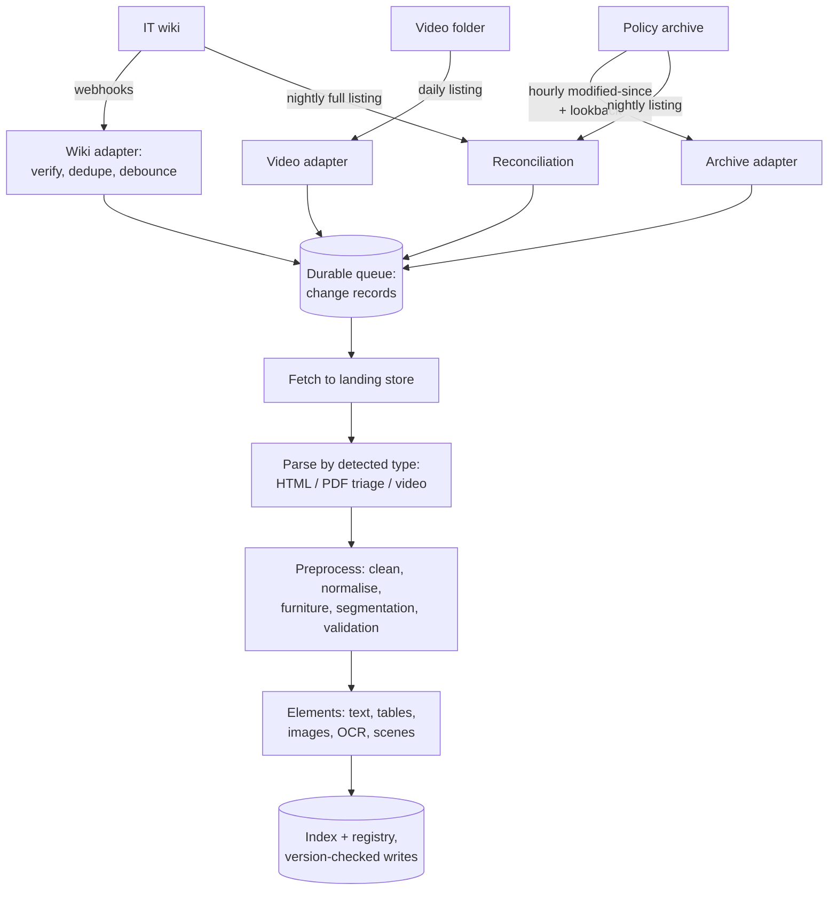

This exam covers the whole of Phase 3, **Document Ingestion and Processing**: the modules [Understanding Document Ingestion](/learn/understanding-document-ingestion), [Advanced Document Parsing](/learn/advanced-document-parsing), [Document Preprocessing](/learn/document-preprocessing) and [Multimodal Ingestion](/learn/multimodal-ingestion). Answer the 28 multiple-choice questions without looking anything up or running any code; a score of 20 or more (about 70%) is a pass, and every question you get wrong points to a lesson worth revisiting. Then attempt the design problem and the debugging problem on paper before opening the worked answers. Any timings, token counts or prices are assumptions for arithmetic practice, not quotes from any provider. Allow about 90 minutes in total.

```quiz
[
  {"q": "Why do many ingestion systems list a source and fetch documents as two separate operations?", "options": ["Because fetching is always free", "Because listings with version markers let you skip fetching unchanged documents, and complete listings reveal deletions", "Because sources forbid fetching without listing first", "Because listing returns the document text"], "answer": 1, "why": "Listing is cheap and carries version information; comparing it with what you hold tells you what to fetch and what has disappeared."},
  {"q": "A batch job runs 20 workers, each taking 0.5 s per document, against a source that allows 30 requests per second. What is the throughput?", "options": ["30 documents per second", "40 documents per second", "10 documents per second", "600 documents per second"], "answer": 0, "why": "X = min(c / t, r) = min(20 / 0.5, 30) = min(40, 30) = 30. The rate limit binds, so extra workers would not help."},
  {"q": "An incremental sync uses a modified-since watermark. Some records commit late with timestamps earlier than the saved watermark and are never ingested. What is the standard fix?", "options": ["Run the sync less often", "Switch to a larger page size", "Re-read a lookback window behind the watermark, relying on idempotent writes", "Delete the watermark after each run"], "answer": 2, "why": "A lookback window re-reads recent history so late commits and clock skew are caught; idempotent, version-checked writes make the re-reads harmless."},
  {"q": "Why key a change stream by document ID?", "options": ["It compresses the messages", "It spreads each document's changes evenly over all partitions", "It makes the stream exactly-once", "All changes to one document land in one partition, in order"], "answer": 3, "why": "Ordering is guaranteed only within a partition. Keying by document ID keeps each document's changes in order; there is no order across partitions."},
  {"q": "A document is deleted (a tombstone is processed) and then a delayed update for the same document arrives. What prevents the update from resurrecting it?", "options": ["The sink keeps the deleted document's version and rejects older updates", "Deleting the partition", "Processing tombstones last", "Acknowledging the update before applying it"], "answer": 0, "why": "A version-checked sink that remembers the version of the deletion can recognise the late update as stale."},
  {"q": "In event-driven ingestion, why treat each webhook event as a hint and fetch the document's current state?", "options": ["Events are always encrypted", "Events can be duplicated, reordered or lost, so the current state from the source is the truth to apply", "Fetching is required by HTTP", "Events never contain document identifiers"], "answer": 1, "why": "Applying event payloads in arrival order goes wrong with duplicates and disorder. Coalescing events and fetching current state, with a version check, is robust."},
  {"q": "An ingestion stage receives 50 documents per second and each spends 4 seconds in it. By Little's law, how many documents are in the stage on average?", "options": ["12.5", "54", "200", "46"], "answer": 2, "why": "L = lambda x W = 50 x 4 = 200."},
  {"q": "Why must PDF text extractors reconstruct reading order?", "options": ["PDF text is stored as images", "A PDF stores positioned glyphs in whatever order its generator emitted them, with no notion of columns or paragraphs", "Reading order is stored only in metadata", "PDFs store text in reverse order"], "answer": 1, "why": "Content-stream order is arbitrary; columns, paragraphs and reading order must be inferred from positions and fonts."},
  {"q": "Apache Tika detects a file's type from its content. Why route on the detected type rather than the file extension?", "options": ["Extensions can be wrong or missing, and routing on them sends files to the wrong parser", "Extensions are case-sensitive", "Detection is faster than reading a file name", "Tika cannot read extensions"], "answer": 0, "why": "Magic bytes and container inspection reflect what the file is; an extension is only a claim."},
  {"q": "At 300 DPI, how many pixels tall is a 10-point letter height, using h = s / 72 x r?", "options": ["About 24 px", "About 30 px", "About 42 px", "About 72 px"], "answer": 2, "why": "h = 10 / 72 x 300 = 41.7 pixels. Lower resolutions shrink letters until recognition suffers; upsampling adds no detail."},
  {"q": "Using the approximation of width x height / 750 tokens, how many input tokens does a 1500 x 1000 pixel image cost?", "options": ["About 2,000", "About 1,500", "About 750", "About 20,000"], "answer": 0, "why": "1500 x 1000 / 750 = 2000. Treat the formula as an approximation to check against current documentation."},
  {"q": "Which Unstructured PDF strategy adds a layout model and table-structure recognition on top of the text layer?", "options": ["fast", "ocr_only", "hi_res", "auto always"], "answer": 2, "why": "fast uses the text layer only; hi_res adds layout detection and table structure; ocr_only is for scans; auto chooses between them."},
  {"q": "A learned layout model returns several overlapping boxes for one paragraph. What is the standard clean-up?", "options": ["Keep the largest box", "Average all the boxes", "Discard the page", "Apply a score threshold, then non-maximum suppression based on intersection over union"], "answer": 3, "why": "Thresholding removes weak detections; non-maximum suppression keeps the best box among heavily overlapping ones."},
  {"q": "On an HTML page without semantic landmarks, which feature best separates navigation blocks from prose?", "options": ["Font size", "Link density: the share of a block's characters inside links", "Number of paragraphs", "Alphabetical order of class names"], "answer": 1, "why": "Navigation and boilerplate are mostly links; prose has few. Link density is a cheap, robust signal."},
  {"q": "In a text-cleaning pipeline, why repair mojibake first?", "options": ["It is the slowest step", "Other steps such as whitespace and character filtering can destroy the byte patterns that mojibake repair needs", "Mojibake only occurs at the start of documents", "It is required by Unicode"], "answer": 1, "why": "Repairs depend on recognising the mis-decoded sequences; earlier normalisation or filtering can break them irreparably."},
  {"q": "Why keep both an NFC display form and an aggressive match key (NFKC, case folding, punctuation folding)?", "options": ["NFKC is slower to store", "NFC cannot be embedded", "The match key erases differences that are sometimes meaningful, so it suits hashing and matching but not quoting", "Display text must be upper case"], "answer": 2, "why": "Compatibility normalisation and folding are great for de-duplication and keyword matching but can change what the author wrote; store and quote the NFC form."},
  {"q": "What is the most reliable way to identify running headers and footers in a PDF?", "options": ["Delete the first and last line of every page", "Delete every line containing a number", "Delete lines shorter than five words", "Find edge-of-page lines whose digit-insensitive signature repeats on many pages, restricted to the margin bands"], "answer": 3, "why": "Repetition plus position is far more reliable than either alone; digit-insensitive signatures let 'Page 3 of 12' and 'Page 4 of 12' match."},
  {"q": "A language detector labels the three-word chunk \"VPN E-4021 update\" as Dutch with 0.97 probability. What is the right policy?", "options": ["Trust it, since the probability is high", "Apply a minimum length before trusting any label, and return 'und' (undetermined) for short or code-like text", "Translate the chunk to Dutch", "Drop the chunk"], "answer": 1, "why": "Detector confidence is badly calibrated on short text; minimum lengths and an undetermined label avoid confident nonsense."},
  {"q": "Where should a chunk's access permissions come from?", "options": ["The source system only", "Inference by a language model", "File properties", "The document's title page"], "answer": 0, "why": "Permissions are a security decision owned by the source system; inferring them or reading them from content is unsafe."},
  {"q": "A validation gate finds a document whose extracted text is 95% shorter than the previous version's. What is the usual graded response?", "options": ["Index it and warn nobody", "Delete the previous version", "Quarantine it for review rather than indexing or silently dropping it", "Reject the entire batch permanently"], "answer": 2, "why": "A sudden large drop usually means an extraction failure; quarantine keeps it out of the index without losing it."},
  {"q": "Which data structure does a segmenter use to build a heading hierarchy that tolerates skipped levels?", "options": ["A stack of open sections", "A hash map keyed by font size", "A queue of paragraphs", "A sorted list of page numbers"], "answer": 0, "why": "Pushing and popping open sections by level builds heading paths and handles a jump from level 1 to level 3 gracefully."},
  {"q": "A 400-row table has a 24-token header and rows whose values average 8 tokens. Roughly how many times larger are self-contained row records than the bare CSV?", "options": ["2 times", "3 times", "4 times", "8 times"], "answer": 2, "why": "For large tables the ratio tends to (h + v) / v = (24 + 8) / 8 = 4."},
  {"q": "On a logarithmic axis, the tick 10 is at y = 400 and the tick 100 at y = 200. What value does a point at y = 300 have?", "options": ["55", "50", "10", "About 31.6"], "answer": 3, "why": "Half-way in pixels is half-way in log10: log10 v = 1.5, so v = 10^1.5, about 31.6. Reading the axis as linear gives 55, a large silent error."},
  {"q": "A diagram's edges mean \"calls\". Which NetworkX function lists every component affected if component X fails?", "options": ["descendants(G, X)", "ancestors(G, X)", "neighbors(G, X)", "degree(G, X)"], "answer": 1, "why": "Components that can reach X along call edges depend on it; those are X's ancestors. Descendants answer 'what does X depend on?'."},
  {"q": "A transcript's reference has 40 words; the ASR output has 4 substitutions, 2 deletions and 2 insertions. What is the word error rate?", "options": ["0.20", "0.15", "0.10", "0.25"], "answer": 0, "why": "WER = (4 + 2 + 2) / 40 = 0.20. Normalise both texts the same way before comparing."},
  {"q": "Why read only de-duplicated keyframes of a slide presentation video, rather than every sampled frame?", "options": ["Frames between scene changes show the same content, so reading them all multiplies cost without adding information", "OCR engines reject consecutive frames", "Keyframes have higher resolution", "Sampled frames have no timestamps"], "answer": 0, "why": "A scene is a stretch where the picture stays the same; one read per distinct keyframe captures it."},
  {"q": "On a noisy scan where ink is about 1% of pixels, Otsu's method marks 35% of the page as ink. What is the most likely fix?", "options": ["Render at a lower DPI", "Use more histogram bins", "Denoise with a small median filter before computing the threshold", "Skip binarisation and OCR the colour image"], "answer": 2, "why": "Noise widens the paper's grey-level hump; with ink rare, splitting the paper scores higher than separating ink. Denoising first restores the ink-paper split."},
  {"q": "Query token vectors' best-match scores against a page's patches are 0.7, 0.9 and 0.4. What is the page's MaxSim score?", "options": ["0.9", "2.0", "0.67", "0.4"], "answer": 1, "why": "MaxSim sums the best match of each query token: 0.7 + 0.9 + 0.4 = 2.0."}
]
```

## Design problem

Meridian's IT team wants AskMeridian to cover three new sources:

- **The IT wiki**: about 4,000 HTML pages, edited daily. The wiki can send a webhook when a page is created, edited or deleted, and has an API that lists all pages with a last-modified timestamp and a version number.
- **The policy archive**: about 3,000 PDFs in a document store, a mix of born-digital files and scanned signed copies, some with tables. The store has no change notifications; it can list files with modification times.
- **Training recordings**: about 150 screen-recorded how-to videos, 5 to 20 minutes each, without captions, plus a new video or two each week.

Answers must be current within an hour for the wiki and within a day for the others, must cite precisely (page and section, or a timestamp), and must never show content from a document the user cannot access in the source. Design the ingestion, parsing, preprocessing and multimodal handling. Draw the architecture, and explain your choices of ingestion mode, parsing route and representation for each source, and how deletions and permissions are handled.

<details><summary>Show worked answer</summary>

**Architecture.** Each source gets an adapter that emits the same thin change record (source, document ID, version, change type) onto a durable queue. One shared, idempotent pipeline consumes the queue: fetch to a landing store, parse by detected type, preprocess, extract multimodal elements, chunk, embed, write to the index with a version check, and record the result in a document registry.



**IT wiki: event-driven with reconciliation.** Webhooks meet the one-hour freshness target with no polling cost. Verify each webhook's signature, deduplicate, and debounce per page (a quiet period plus a maximum wait) because pages are edited in bursts; then fetch the page's current version through the API rather than trusting the event payload. A nightly full listing reconciles: it catches lost events and, by comparing the listing with the registry, detects deletions whose events were missed. Parse HTML by finding the main content (landmarks, else link density), keeping heading paths as metadata, tables as Markdown plus row records, and code blocks fenced. Screenshots in pages go through the image pipeline: filter decorations, attach captions, describe with verbatim visible text, store originals.

**Policy archive: incremental pull.** The archive has no notifications, so poll hourly with a modified-since watermark and a lookback window, writing idempotently; this comfortably meets the one-day target. Watermarks cannot see deletions, so the nightly reconciliation does a guarded mark-and-sweep (refusing to delete if the listing is suspiciously short). Triage each PDF page by text-layer size, image coverage and a text-quality check: born-digital pages use the text layer with layout-aware parsing and header and footer removal; scanned pages go to the OCR pipeline (300 DPI render, denoise, binarise, deskew, word boxes with confidence, context-limited digit correction, low-confidence lines flagged). Tables become row records with a stored structured copy. Extract effective dates and versions as metadata so superseded policies can be filtered or labelled.

**Training recordings: daily batch.** A daily listing finds new videos. Transcribe with voice activity detection and a vocabulary hint of product and system names, apply a glossary, and parse into timed cues. Detect scenes by pixel difference with a minimum scene length; read de-duplicated keyframes with a vision model for verbatim on-screen text; align cues to scenes by overlap; chunk by scene with on-screen text first; attach deep links and thumbnails. Screen recordings are the expensive part, so keyframe reads are cached by perceptual hash.

**Representation and citations.** All three sources produce elements in one schema (document, modality, section path or time range, location, surrogate, payload, provenance, confidence), embedded with one model and a contextual header. Citations come from the location fields: wiki page and section, PDF page and section, video timestamp link.

**Permissions.** Each adapter reads permissions from its source system and stores them on every element; retrieval filters by the user's identity before ranking. Permission changes are changes: the wiki's webhooks and the reconciliation listings carry them, and a permission change re-writes element metadata without re-parsing. Nothing infers permissions from content.

**Validation.** A quality gate before indexing checks for empty or truncated text, encoding damage, over-removal by preprocessing, missing metadata and OCR confidence; failures are quarantined, and batch-level statistics are compared with the previous run per source.

</details>

## Debugging problem

Two weeks after the policy archive from the design problem goes live, three complaints arrive:

1. Answers about expenses contain fragments such as "MERIDIAN INTERNAL Page 7 of 12" in the middle of quoted sentences.
2. A user asks about the home-office equipment budget and is told £250, citing a policy that HR says was withdrawn from the archive ten days ago. The current figure is £400.
3. Questions about laptop returns find nothing, although HR confirms a scanned "Laptop return form" policy is in the archive. The registry shows the document was ingested successfully, with 14 characters of text.

For each complaint, give the most likely cause and the fix, and say what monitoring would have caught it earlier.

<details><summary>Show worked answer</summary>

**1. Page furniture in chunks.** The running header "MERIDIAN INTERNAL" and the page footer are being kept as body text, and because page breaks fall mid-sentence, they end up inside quoted sentences. Either header and footer removal is not running on this source's parsing route (a common outcome when a new route bypasses a shared step), or its repetition threshold is too strict for short documents. Fix: run furniture removal on every PDF route, using digit-insensitive signatures of edge lines that repeat across a large share of pages, restricted to the margin bands, and rejoin sentences across page breaks before chunking. Re-process the affected documents from the landing store; no re-fetch is needed. Monitoring: a validation check that counts the most frequent lines per document and flags any that repeat on most pages; a corpus-level check for identical short strings appearing in a large share of chunks.

**2. A withdrawn policy still answered.** The incremental sync uses a modified-since watermark, which cannot see deletions: a removed file simply stops appearing. The withdrawn policy's chunks are still in the index. (The £250 figure is also the superseded 2023 handbook's value, so this may be an old version that should have been retired.) The nightly reconciliation that should catch deletions is either not running or its mark-and-sweep guard is blocking deletion, for example because the listing count fell below the guard's threshold for an unrelated reason. Fix: check the reconciliation job's logs and guard decisions, run it, and confirm the policy's elements are removed; also make sure effective and superseded dates are extracted as metadata so retrieval can prefer current versions. Monitoring: reconciliation drift (documents in the index but not in the source) as a tracked metric with an alert, plus an alert when the reconciliation job has not completed for more than a day.

**3. A scanned policy with almost no text.** Fourteen characters is the signature of a scanned page with a small digital stamp (something like "Page 1 of 1" plus a reference). Triage treated the page as having a usable text layer because it checked only "is there any text?", so OCR never ran and the body of the form was never read. Fix: triage on a minimum character count combined with image coverage (and a text-quality check), so that pages with little text and mostly image go to OCR; then re-process the archive's PDFs from the landing store. Monitoring: a data-quality gate that quarantines documents whose text is implausibly short for their page count (for example, fewer than 100 characters per page), and a dashboard of characters per page by source, on which this document would have stood out immediately.

The common thread: each failure was silent, produced a "successful" ingestion record, and would have been caught by validation and reconciliation metrics rather than by user complaints.

</details>
