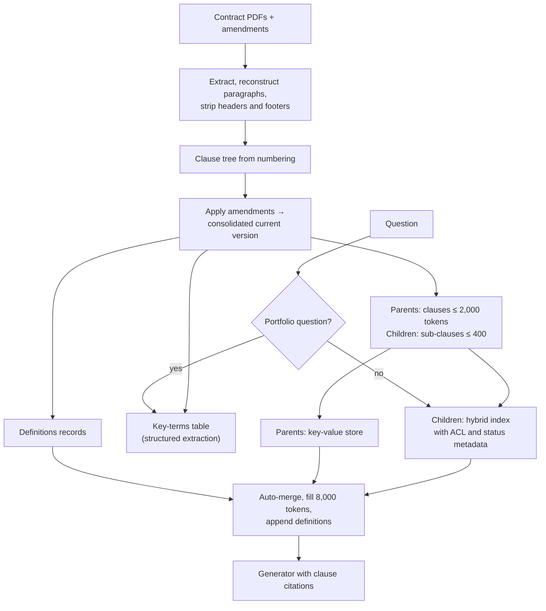

This exam covers the whole of Phase 4, **Text Chunking and Semantic Segmentation**: the modules [Chunking Fundamentals](/learn/chunking-fundamentals), [Advanced Chunking Strategies](/learn/advanced-chunking-strategies) and [Chunking Optimisation](/learn/chunking-optimisation). Answer the 28 multiple-choice questions without looking anything up or running any code; a score of 20 or more (about 70%) is a pass, and every question you get wrong points to a lesson worth revisiting. Then attempt the design problem and the debugging problem on paper before opening the worked answers. Allow about 90 minutes in total.

```quiz
[
  {
    "q": "A 3,000-token document is embedded whole with a model whose input limit is 512 tokens. What happens to the last 2,500 tokens?",
    "options": [
      "They are averaged into the vector with lower weight",
      "The library raises an error",
      "They are truncated and have no influence on the vector, usually without any warning",
      "They are embedded as a second vector automatically"
    ],
    "answer": 2,
    "why": "Encoders truncate input at their limit. The vector represents only the beginning of the document, so later text is invisible to search."
  },
  {
    "q": "In an idealised model where a document covers m unrelated topics equally, how does a query about one topic's cosine similarity with the whole-document vector scale?",
    "options": [
      "It falls as 1 / sqrt(m)",
      "It stays constant",
      "It falls as 1 / m squared",
      "It rises with m"
    ],
    "answer": 0,
    "why": "The document vector is the normalised sum of m orthogonal unit topic vectors, so its component along any one topic is 1 / sqrt(m). This dilution is why mixed-topic chunks match poorly."
  },
  {
    "q": "Why should chunk size be counted with the embedding model's own tokeniser?",
    "options": [
      "Because characters cannot be counted reliably",
      "Because the generator requires it",
      "Because all tokenisers produce the same counts anyway",
      "Because the binding limit is the embedding model's input length in its tokens, and other tokenisers can disagree substantially"
    ],
    "answer": 3,
    "why": "Different tokenisers split text differently, especially code, logs and non-English text. A size measured in another unit can silently exceed the embedding limit."
  },
  {
    "q": "A pipeline decodes token windows from an uncased WordPiece tokeniser back into text to form chunks. What is the likely problem?",
    "options": [
      "Chunks become longer than the limit",
      "Chunk text is lower-cased and re-spaced, so it no longer matches the source exactly",
      "Chunks are embedded twice",
      "Decoding is too slow to be practical"
    ],
    "answer": 1,
    "why": "Uncased WordPiece lower-cases and normalises text. Use the tokeniser's offset mapping to slice the original string instead of decoding."
  },
  {
    "q": "Roughly how many characters per token does English prose typically average, and why does it matter for character-based chunking?",
    "options": [
      "About 1; characters and tokens are interchangeable",
      "About 20; characters vastly overstate size",
      "About 4 to 4.5 for prose but much less for logs and identifiers, so character limits must be sized from the densest content with a margin",
      "It is always exactly 4, so character limits can be converted exactly"
    ],
    "answer": 2,
    "why": "Character-based sizes only estimate tokens. Dense content such as identifiers and logs has far fewer characters per token, so the same character limit can exceed the token limit."
  },
  {
    "q": "Fixed windows of size s with overlap o are used. What is the guarantee about answer spans?",
    "options": [
      "Any span of at most o + 1 tokens lies wholly inside some chunk",
      "Any span of at most s tokens lies wholly inside some chunk",
      "No span is ever split",
      "Spans shorter than o are always split"
    ],
    "answer": 0,
    "why": "With overlap o, a span of length L is guaranteed whole when o >= L - 1. Longer spans are split with a probability given by the formula in the overlap lesson."
  },
  {
    "q": "Which is a known weakness of naive full-stop sentence splitting?",
    "options": [
      "It cannot handle paragraphs",
      "It produces chunks that are too large",
      "It requires a GPU",
      "Abbreviations, decimal numbers and similar patterns create false sentence boundaries"
    ],
    "answer": 3,
    "why": "'e.g.', 'Dr.' and '3.5' contain full stops that do not end sentences. Segmenters such as Punkt or model-based ones handle these better, but still need checking."
  },
  {
    "q": "Paragraph-based chunking is applied to text extracted from PDFs and produces chunks that cut mid-sentence. What is the most likely cause?",
    "options": [
      "The paragraphs are too short",
      "The embedding model is too small",
      "Line breaks from the PDF layout were treated as paragraph breaks, so paragraphs must be reconstructed first",
      "The overlap is too small"
    ],
    "answer": 2,
    "why": "PDF extraction often emits hard line breaks at every line. Without paragraph reconstruction, the splitter sees 'paragraph' boundaries in the middle of sentences."
  },
  {
    "q": "How does recursive character splitting choose where to split a piece of text?",
    "options": [
      "It uses the first separator in its list that occurs in the piece, splits on it, and recurses with finer separators only into pieces still too long",
      "It always splits at the exact character limit",
      "It embeds every sentence and cuts at the largest semantic change",
      "It asks a language model"
    ],
    "answer": 0,
    "why": "The separator hierarchy (blank line, newline, space, empty string by default in LangChain) is tried in order, and small pieces are then re-packed greedily up to the size limit."
  },
  {
    "q": "In LangChain's recursive splitter, why might the overlap between two chunks be smaller than chunk_overlap, or zero?",
    "options": [
      "Because overlap is applied only to the first chunk",
      "Because overlap is formed from whole trailing pieces, and a piece that does not fit within the overlap is not carried over",
      "Because overlap is measured in tokens while size is in characters",
      "Because overlap is disabled by default"
    ],
    "answer": 1,
    "why": "Splitters that pack pieces treat chunk_overlap as a maximum, carrying over as many whole trailing pieces as fit. If the last piece is longer than the overlap, nothing is carried."
  },
  {
    "q": "Semantic chunking places a boundary wherever the distance between adjacent sentence embeddings exceeds the 95th percentile of that document's distances. Roughly how long are the chunks on average?",
    "options": [
      "About 5 sentences",
      "About 95 sentences",
      "About 2 sentences",
      "About 20 sentences"
    ],
    "answer": 3,
    "why": "Five per cent of gaps become boundaries, so on average one boundary per 1 / 0.05 = 20 sentences. Semantic chunks therefore still need a separate size cap."
  },
  {
    "q": "Which statement about semantic chunking is most accurate?",
    "options": [
      "It needs no size limits because topics are always short",
      "It always outperforms recursive splitting",
      "It costs an extra embedding pass, has no inherent size control, and its benefit varies across published comparisons, so it should be tested against a simpler baseline",
      "It only works on code"
    ],
    "answer": 2,
    "why": "Semantic boundaries follow the document's own distances, not a size, and the evidence for consistent gains is mixed. Measure before adopting it."
  },
  {
    "q": "A knowledge base mixes FAQ entries, release notes and long policy documents. What does document-aware chunking do?",
    "options": [
      "Routes each document type to a chunker that uses its natural unit (a Q&A pair, a version entry, a section) and falls back to a safe default",
      "Applies one chunk size to everything",
      "Embeds whole documents only",
      "Removes metadata to keep chunks small"
    ],
    "answer": 0,
    "why": "Each type has a unit that answers a typical question on its own; a router detects the type and dispatches to the right chunker."
  },
  {
    "q": "In structure-aware chunking, a 40-row table is too large for one chunk. What is the right way to divide it?",
    "options": [
      "Cut it at the character limit like prose",
      "Split it between rows and repeat the header row (and caption) in every piece",
      "Drop the rows that do not fit",
      "Convert it to a single sentence"
    ],
    "answer": 1,
    "why": "A row without its header is a list of unlabelled values. Oversized atomic elements are divided at their own joints with the shared context repeated."
  },
  {
    "q": "Why does heading-based chunking prepend a heading path such as 'Benefits > Eligibility' rather than just 'Eligibility'?",
    "options": [
      "Because embedding models require at least two headings",
      "Because it makes chunks longer, which improves recall",
      "Because repeated titles like 'Eligibility' appear under many sections, and the path disambiguates them",
      "Because the path replaces the need for metadata"
    ],
    "answer": 2,
    "why": "The same heading text recurs across a document. The full path tells the retriever and the generator which 'Eligibility' a chunk belongs to."
  },
  {
    "q": "Which failure is typical when RecursiveCharacterTextSplitter is configured with Markdown separators?",
    "options": [
      "It never splits at headings",
      "It refuses files longer than 10,000 characters",
      "It converts Markdown to HTML",
      "It can cut through fenced code blocks and mistake lines such as shell comments starting with '#' for headings"
    ],
    "answer": 3,
    "why": "The splitter sees strings, not parsed structure, so fences and comments are not protected. A Markdown parser's block structure avoids this."
  },
  {
    "q": "What is the recommended unit for chunking source code?",
    "options": [
      "Complete syntactic units from the syntax tree (functions, methods, classes), with decorators and a class header kept with their definitions",
      "Fixed 500-character windows",
      "One chunk per line",
      "Whole repositories"
    ],
    "answer": 0,
    "why": "Code is a tree. Chunking along it keeps every chunk a valid, complete unit; separator-based splitting orphans decorators and cuts bodies."
  },
  {
    "q": "A sliding window has size W = 300 and stride S = 200 over a document of N = 1,000 tokens. Using n = ceil((N - W) / S) + 1, how many windows are there?",
    "options": ["4", "5", "6", "3"],
    "answer": 1,
    "why": "(1000 - 300) / 200 = 3.5, which rounds up to 4; plus 1 gives 5 windows."
  },
  {
    "q": "What is the central engineering rule for agentic chunking with a language model?",
    "options": [
      "Let the model rewrite every chunk in its own words",
      "Trust the model's output, since it understands the document",
      "Ask the model for decisions such as sentence ranges and titles, then validate coverage, order and size in code before indexing",
      "Use the model only for documents with headings"
    ],
    "answer": 2,
    "why": "Decisions can be checked against the source; generated text can silently omit or invent content. Validation and a deterministic fallback make the approach safe."
  },
  {
    "q": "In a chunk-size sweep, small chunk sizes show a ceiling of 0.55 and a hit rate at equal budget of 0.55. What should you change?",
    "options": [
      "The embedding model",
      "The reranker",
      "The query rewriting",
      "The chunker: answers are being split, so add overlap, cut at sentence boundaries, or use larger units"
    ],
    "answer": 3,
    "why": "When the hit rate equals the ceiling, the retriever found every answer that survived chunking. The failures are splits, which only chunking changes fix."
  },
  {
    "q": "At a fixed stride, lengthening the window from 256 to 320 tokens changes which of the following?",
    "options": [
      "Embedded tokens and the guaranteed-intact span length, but not the number of vectors",
      "The number of vectors only",
      "Nothing, because overlap is unchanged",
      "The number of vectors and the stride"
    ],
    "answer": 0,
    "why": "Vector count is about T / s. A longer window at the same stride embeds more tokens per vector and gives an overlap of 64, guaranteeing spans up to 65 tokens."
  },
  {
    "q": "A dynamic-programming boundary chooser minimises the sum over chunks of a boundary penalty plus a squared size deviation. What is the size term for?",
    "options": [
      "To force every chunk to exactly the target size",
      "To stop the optimiser cutting at every strong boundary regardless of size, which would produce stubs or very uneven chunks",
      "To make the algorithm run faster",
      "To protect numbers from being cut"
    ],
    "answer": 1,
    "why": "Boundary penalties alone reward many cuts at good boundaries. The squared term makes small deviations cheap and large ones expensive, balancing the two goals."
  },
  {
    "q": "Why did adding 'Meridian Employee Handbook (2023, superseded)' to the embedded text of old chunks fail to stop them being returned?",
    "options": [
      "Because headers are never embedded",
      "Because the year was in the wrong format",
      "Because validity is a rule: a few words barely move a vector and queries rarely ask for 'current', whereas a metadata filter excludes stale chunks outright",
      "Because the header was too short"
    ],
    "answer": 2,
    "why": "Similarity ranks; it does not exclude. In the experiment the header even made stale chunks match better. A status filter removed them completely."
  },
  {
    "q": "Parent-child chunking stores parents in a separate key-value store. What must the update procedure for a changed document do?",
    "options": [
      "Upsert the new children only",
      "Delete the parents only",
      "Re-embed the parents",
      "Delete the document's children by doc_id, delete its parents, write new parents, then write new children"
    ],
    "answer": 3,
    "why": "Renamed or removed sections produce new IDs, so upserts leave stale records. The order ensures no child ever points at a missing parent."
  },
  {
    "q": "Auto-merging retrieval uses a threshold of 0.5. A parent has 6 children, 2 of which were retrieved. What is sent?",
    "options": [
      "The two children individually",
      "The parent",
      "Nothing",
      "All six children individually"
    ],
    "answer": 0,
    "why": "The coverage ratio is 2 / 6 = 0.33, below 0.5, so the children are not merged into the parent."
  },
  {
    "q": "How does late chunking differ from contextual retrieval?",
    "options": [
      "They are the same technique",
      "Late chunking encodes the whole document once and pools each chunk's token vectors; contextual retrieval asks a language model to write context that is prepended to each chunk's text",
      "Late chunking needs an LLM call per chunk; contextual retrieval does not",
      "Contextual retrieval stores many vectors per chunk"
    ],
    "answer": 1,
    "why": "Late chunking changes how vectors are computed and adds no text; contextual retrieval changes the text that is embedded, at the cost of a model call per chunk."
  },
  {
    "q": "Answer = 20 tokens. Retrieved chunks cover 100 distinct tokens, including 15 answer tokens. What are token precision and IoU?",
    "options": [
      "0.75 and 0.15",
      "0.15 and 0.75",
      "0.15 and about 0.143",
      "0.20 and about 0.143"
    ],
    "answer": 2,
    "why": "Precision = 15 / 100 = 0.15. IoU = 15 / (20 + 100 - 15) = 15 / 105, about 0.143. Recall would be 15 / 20 = 0.75."
  },
  {
    "q": "Why is a paired bootstrap the right way to compare two chunkers on one question set?",
    "options": [
      "Because it needs no labelled questions",
      "Because it always shows a significant difference",
      "Because it removes the need for intrinsic metrics",
      "Because both chunkers are scored on the same questions, so per-question differences cancel question difficulty, and resampling them gives an interval for the mean difference"
    ],
    "answer": 3,
    "why": "Pairing removes the large question-to-question variation from the comparison. An interval that includes zero means the data do not show a difference."
  }
]
```

## Design problem

Meridian's legal team wants AskMeridian to answer questions about the company's **customer contracts**: about 4,000 PDF contracts of 10 to 80 pages each (roughly 60 million tokens in total), each with numbered clauses and sub-clauses ("12.3(b)"), defined terms in a definitions section ("'Services' means..."), schedules containing pricing tables, and amendments that modify earlier clauses ("Clause 8.2 is deleted and replaced with..."). Typical questions: "What is the liability cap in the Acme contract?", "Which contracts allow termination for convenience?", "What notice period applies under clause 14 of the Globex agreement?". Contracts are confidential: each is visible only to the account team and the legal team. The embedding model accepts 512 tokens; the generator budget for retrieved text is 8,000 tokens.

Design the chunking for this collection. Cover: parsing and the unit of chunking; parent and child definitions and sizes; boundary rules and protected spans; context (including defined terms and amendments); query-time strategy; permissions; and how you would evaluate the design before launch. Say what you would deliberately not answer with top-k retrieval.

<details><summary>Show worked answer</summary>

**Parsing first.** Contracts are PDFs, so the first risk is extraction: hard line breaks, headers and footers on every page, and tables split across pages. Reconstruct paragraphs, strip running headers and footers, and recover the clause hierarchy from the numbering pattern (1, 1.1, 1.1(a)), which is far more reliable in contracts than font-based heading detection. Tables in schedules are extracted as tables. Each contract becomes a tree: contract, clause, sub-clause, with schedules as separate subtrees.

**Parents and children.**

- *Parents:* top-level clauses (for example "14 Termination"), capped at 2,000 tokens so that at least four fit in the 8,000-token budget; longer clauses are split at sub-clause boundaries, each part repeating the clause title.
- *Children:* sub-clauses (14.1, 14.2(a)), merged up to about 300 tokens when very short, split at sentences when longer than 400. Pricing schedules are chunked by table rows with the header and the schedule title repeated.
- Children are cut inside parents, carry `contract_id`, `clause_number`, `parent_id`, `version`, and the contract's access-control list.

**Boundaries and protected spans.** Cuts only between sub-clauses or sentences; never inside clause references ("clause 12.3(b)"), monetary amounts, dates, percentages or defined-term quotations. Numbered lists inside a sub-clause stay whole if they fit.

**Context.**

- *Subject:* index text is "Customer name contract > 14 Termination > 14.2" plus the sub-clause. The customer name is the most important context, because almost every question names the customer and clause text never does.
- *Defined terms:* store the definitions section as its own records, and at query time append the definitions of capitalised terms that appear in the retrieved clauses (a lookup, not a search). This restores referent context precisely without bloating every chunk.
- *Amendments:* this is validity context, so it belongs in data, not in text. Parse amendment documents into structured operations (clause deleted, replaced, inserted) and apply them to produce a consolidated current version of each contract; index the consolidated version with `status = current`, keep originals with `status = superseded` for history questions. Show the generator "as amended on date" in the prompt header.
- *Late chunking* is not suitable here as the main tool: clauses refer to definitions and other clauses tens of pages away, beyond any single pass of a 512-token model.

**Query time.** Hybrid retrieval (dense plus keyword, because clause numbers and party names are exact strings). If the query names a customer, filter on `contract_id`; if it names a clause number, also fetch that clause directly by metadata. Retrieve about 40 children, auto-merge into clauses at a coverage threshold of 0.5 (with a minimum of two hits), rank by best child, fill 8,000 distinct tokens, fall back to the sub-clause with its clause title when a clause does not fit, send in clause order with "Customer > clause (as amended)" headers.

**Permissions.** Access-control lists come from the contract management system, are copied to every parent and child, and are applied as a filter inside every search; the parent fetch re-checks them. A contract whose permissions cannot be resolved is not indexed.

**What not to answer with top-k retrieval.** Portfolio questions ("Which contracts allow termination for convenience?", "What is the average liability cap?") need every contract considered, not the top 40 chunks. Extract key terms (liability cap, termination rights, notice periods, governing law) into a structured table during ingestion, validated by the legal team on a sample, and answer such questions with a query over that table, citing the clauses.



**Evaluation before launch.** Intrinsic: parse quality on a sample (clause numbering recovered, no header or footer text in chunks), no chunk over 510 tokens, no cut inside protected spans, every clause present (coverage), amendment application checked against a hand-built set of amended contracts. Extrinsic: 300 or more questions written with the legal team, labelled with answer spans and evidence lists (clause plus any definitions needed), stratified by question type; token recall, whole@k at the 8,000-token budget, wrong-contract rate, wrong-version rate, and paired bootstrap comparisons for each design choice (for example auto-merge against parent retrieval). Permission tests: for each test user, verify that no retrieved chunk belongs to a contract they cannot see.

**Trade-offs.** Consolidating amendments is significant work and a source of errors of its own, but answering from unconsolidated contracts would present deleted clauses as current, which is worse. Clause-level parents can exceed budgets for long clauses, hence the cap and the fallback. The structured key-terms table duplicates information and must be kept in sync, but it is the only reliable way to answer questions about all contracts at once.

</details>

## Debugging problem

The Platform team changed AskMeridian's IT-runbook ingestion in one release: they replaced the recursive splitter with a semantic chunker (95th-percentile breakpoints over sentence embeddings), raised the maximum chunk size from 400 to 900 tokens to "let semantic chunks be as long as their topic", added a 20-token context header to every chunk, and switched from upserting changed runbooks to re-ingesting the whole collection nightly. The embedding model's limit is 512 tokens.

Since the release:

1. Answers to questions about later steps of long procedures are often wrong or missing, while questions about the start of procedures are fine.
2. The nightly job's chunk count for runbooks is about 10 per cent higher each night than the night before, although runbooks rarely change.
3. A few chunks consist of a single heading line or a single sentence such as "Run the following command:".
4. The intrinsic dashboard shows the clean-cut rate unchanged at 0.98.

Diagnose each symptom, explain why the clean-cut rate did not reveal the problems, and propose fixes with the checks that would have caught them.

<details><summary>Show worked answer</summary>

**Symptom 1: truncation.** Semantic chunks follow topics, so a long procedure can become a single chunk of up to 900 tokens. The embedding model reads at most about 510 text tokens, and the 20-token header uses some of those, so roughly the first 490 tokens of the body are embedded and the rest of the procedure is invisible to search. Questions about early steps match; questions about later steps match only by accident. *Fix:* cap chunks at the embedding limit minus special tokens and header (about 480 tokens of body here), splitting oversized semantic chunks at step boundaries with the procedure title repeated; or keep long procedures as parents and index steps as children. *Check:* an ingestion gate that fails if any chunk's token count plus header plus special tokens exceeds the model limit.

**Symptom 2: growing chunk count.** Re-ingesting the whole collection without deleting the previous night's records duplicates everything that has new IDs. If chunk IDs include anything that changes from run to run (a random UUID, a timestamp, an embedding-dependent boundary position, since semantic boundaries can shift slightly when neighbouring text or the model changes), each run adds a near-copy of part of the collection. A roughly constant 10 per cent growth suggests that about a tenth of chunk IDs differ between runs, which fits semantic boundaries moving on documents with small edits or non-deterministic sentence splitting. *Fix:* replace-by-document (delete each runbook's records by `doc_id`, then write the new ones), deterministic IDs derived from document, version and position, and a clean-up of existing duplicates. *Check:* a gate comparing chunk count per collection with the previous run, and a "one version per document" invariant.

**Symptom 3: stubs.** A percentile threshold makes a boundary wherever adjacent sentences are unusually distant. A heading line and the lead-in "Run the following command:" are both semantically distant from what follows (a command block embeds very differently from prose), so the chunker cuts right after them, orphaning the heading and separating the lead-in from its command. Semantic chunking has no minimum size and no notion of keep-with-next. *Fix:* enforce a minimum chunk size by merging stubs with the following chunk, add keep-with-next rules (a heading or a line ending in a colon stays with the next element), and treat code blocks as atomic elements. *Check:* a stub count (chunks under, say, 20 tokens) and an "after-heading" cut count in the boundary histogram.

**Why the clean-cut rate missed all three.** It measures whether cuts fall at sentence ends or line starts. Every semantic cut is between sentences, so the rate stays high, yet the cuts are in the wrong places (after headings and lead-ins), the chunks are too long for the model, and duplicates do not affect it at all. A single intrinsic metric is not a quality gate: size against the model limit, stubs, after-heading cuts, chunk counts against the previous run and version invariants are all needed.

**Was the release a good idea at all?** Each change was made at once, so their effects cannot be separated. The team should revert to the previous configuration, then reintroduce one change at a time behind the extrinsic suite (token recall and whole@k at a fixed budget, paired bootstrap against the previous configuration), with the intrinsic gates above in the ingestion job. In particular, semantic chunking should be kept only if it measurably beats the recursive baseline on runbook questions, which the published evidence does not guarantee.

</details>
