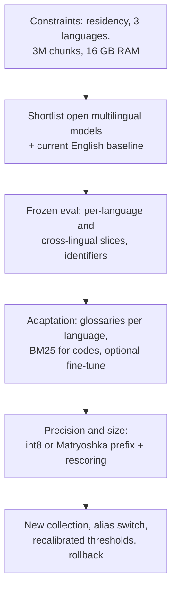

This exam covers the whole of Phase 5, **Embeddings and Vector Representations**: the modules [Embedding Fundamentals](/learn/embedding-fundamentals), [Embedding Models](/learn/embedding-models), [Embedding Mathematics](/learn/embedding-mathematics) and [Embedding Optimisation](/learn/embedding-optimisation). Answer the 30 multiple-choice questions without looking anything up or running any code; a score of 21 or more (70%) is a pass, and every question you get wrong points to a lesson worth revisiting. Then attempt the design problem and the debugging problem on paper before opening the worked answers. Allow about 90 minutes in total.

```quiz
[
  {
    "q": "Two different words are represented as one-hot vectors over a vocabulary. What is their cosine similarity?",
    "options": [
      "1, because both vectors have length 1",
      "It depends on how related the words are",
      "0, because they share no non-zero position",
      "-1, because they are different words"
    ],
    "answer": 2,
    "why": "One-hot vectors for different words are orthogonal, so every pair of distinct words is equally unrelated. Learned dense embeddings fix this."
  },
  {
    "q": "Which idea underlies learning word and sentence embeddings from unlabelled text?",
    "options": [
      "The distributional hypothesis: words that occur in similar contexts tend to have similar meanings",
      "Zipf's law: word frequency is inversely proportional to rank",
      "The triangle inequality",
      "The Johnson-Lindenstrauss lemma"
    ],
    "answer": 0,
    "why": "Co-occurrence statistics carry meaning, which is what word2vec, GloVe and later contextual models exploit."
  },
  {
    "q": "Roughly what is the typical magnitude of the cosine between two random unit vectors in 384 dimensions?",
    "options": [
      "About 0.5",
      "About 0.05 (on the order of 1 divided by the square root of 384)",
      "Exactly 0",
      "About 0.9"
    ],
    "answer": 1,
    "why": "Random high-dimensional directions are nearly perpendicular; the cosine's standard deviation is about 1/sqrt(d), roughly 0.051 for d = 384. This is a useful noise baseline."
  },
  {
    "q": "A chunk of about 445 tokens is embedded with a model whose maximum sequence length is 256. What happens?",
    "options": [
      "The library raises an error",
      "The model averages two 256-token windows",
      "The vector becomes longer",
      "Tokens beyond the limit are silently ignored, so content near the end cannot influence the vector"
    ],
    "answer": 3,
    "why": "Truncation is silent. Questions answered only by the cut-off part will not retrieve the chunk."
  },
  {
    "q": "Why does averaging the embeddings of many sentences on different topics into one document vector hurt retrieval of a specific fact?",
    "options": [
      "Averaging makes vectors non-normalisable",
      "Each topic's signal is diluted by the others, so the document vector is only moderately similar to a question about any one of them",
      "Averages cannot be stored in a vector database",
      "Averaging changes the dimensionality"
    ],
    "answer": 1,
    "why": "A mean of several directions points between them. That suits routing or deduplication, not answering a narrow question."
  },
  {
    "q": "Which pair is an embedding model most likely to score as highly similar even though their meanings conflict?",
    "options": [
      "\"Annual leave is 25 days\" and \"Annual leave is not 25 days\"",
      "\"Reset your VPN\" and \"Expenses need receipts\"",
      "\"Laptop refresh\" and \"Pacific Ocean\"",
      "\"Password rotation\" and \"Holiday carry-over\""
    ],
    "answer": 0,
    "why": "Negations and changed numbers alter few tokens, so topical similarity stays high. Embeddings capture shared topic and wording more reliably than logical content."
  },
  {
    "q": "In a Sentence Transformers model, what does masked mean pooling do?",
    "options": [
      "Averages every token vector including padding",
      "Takes the vector of the first token only",
      "Averages the token vectors of real tokens, excluding padding positions",
      "Selects the token with the largest norm"
    ],
    "answer": 2,
    "why": "The attention mask excludes padding, so the sentence vector does not depend on how much the batch was padded."
  },
  {
    "q": "Which item is NOT part of an index's embedding contract?",
    "options": [
      "The model name and revision",
      "Query and document prefixes",
      "Normalisation and the similarity function",
      "The number of replicas of the vector database"
    ],
    "answer": 3,
    "why": "The contract covers everything that determines whether two vectors are comparable: model, version, preprocessing, prefixes, dimensionality, normalisation. Replication does not affect the vectors."
  },
  {
    "q": "How should the BGE v1.5 English query instruction be used?",
    "options": [
      "Prepend it to both queries and passages",
      "Prepend it to short queries only, not to the passages being indexed",
      "Append it to passages only",
      "It must never be used with v1.5"
    ],
    "answer": 1,
    "why": "The instruction is a query-side prefix for retrieval; passages are embedded without it."
  },
  {
    "q": "With the Cohere embed API, a team indexes documents with `input_type=\"search_document\"`. What should queries use?",
    "options": [
      "`search_query`",
      "`search_document`, to match the index",
      "`classification`",
      "No input type"
    ],
    "answer": 0,
    "why": "Cohere's retrieval models are asymmetric: documents and queries use different input types, and mismatching them degrades retrieval."
  },
  {
    "q": "Why do cosine scores from E5 models tend to cluster in a high, narrow band (roughly 0.7 to 1.0) even for unrelated pairs?",
    "options": [
      "E5 vectors are not normalised",
      "E5 uses Euclidean distance internally",
      "The model was trained with a low softmax temperature, so only relative order mattered, not absolute values",
      "E5 has fewer dimensions than other models"
    ],
    "answer": 2,
    "why": "A low temperature lets training succeed with small cosine gaps, so absolute scores are compressed. Thresholds must therefore be set per model."
  },
  {
    "q": "A team requests shortened vectors from a hosted model by truncating the full vectors themselves. What must they do before using cosine or dot-product search?",
    "options": [
      "Nothing; truncated unit vectors are still unit length",
      "Multiply by the original dimension",
      "Convert them to int8",
      "Renormalise each truncated vector to unit length"
    ],
    "answer": 3,
    "why": "A prefix of a unit vector is shorter than 1, by an amount that differs between vectors, so dot products would mix direction with leftover length."
  },
  {
    "q": "A Portuguese question must retrieve an English handbook passage. What kind of retrieval is this?",
    "options": [
      "Monolingual retrieval",
      "Cross-lingual retrieval",
      "Multilingual retrieval where each language is searched separately",
      "Sparse retrieval"
    ],
    "answer": 1,
    "why": "Query and document are in different languages, which needs a model aligned across languages, or translation."
  },
  {
    "q": "Why should you pin a local embedding model to a specific revision?",
    "options": [
      "So that a new upload cannot silently change the vectors and break comparability with the index",
      "Because unpinned models run on the CPU only",
      "Because pinning makes embedding faster",
      "Because Hugging Face requires it"
    ],
    "answer": 0,
    "why": "A changed revision changes the vectors. Mixed vectors in one index give confident nonsense with no error."
  },
  {
    "q": "Loading an open-weight model requires `trust_remote_code=True`. What is the main risk?",
    "options": [
      "The model will be slower",
      "Embeddings will not be normalised",
      "Python code shipped with the model runs on your machine",
      "The model will use more memory"
    ],
    "answer": 2,
    "why": "Remote code executes with your process's permissions. Enable it only for trusted publishers, review the code and pin the revision."
  },
  {
    "q": "What does this code print?\n```python\nimport numpy as np\na = np.array([3.0, 4.0]); b = np.array([6.0, 8.0])\nprint(a @ b, round(float(a @ b / (np.linalg.norm(a) * np.linalg.norm(b))), 2))\n```",
    "options": [
      "50.0 0.5",
      "50.0 1.0",
      "25.0 1.0",
      "1.0 50.0"
    ],
    "answer": 1,
    "why": "The dot product is 18 + 32 = 50. The vectors point in the same direction (b = 2a), so the cosine is 1.0 regardless of length."
  },
  {
    "q": "For unit vectors, what is the relation between squared Euclidean distance and cosine similarity?",
    "options": [
      "Squared distance equals 1 minus the cosine",
      "They are unrelated",
      "Squared distance equals the cosine squared",
      "Squared distance equals 2 minus 2 times the cosine"
    ],
    "answer": 3,
    "why": "Expanding the squared length of a minus b gives 1 + 1 - 2 a.b. For unit vectors the two measures produce the same ranking."
  },
  {
    "q": "What does this code print?\n```python\nimport numpy as np\nu = np.array([1.0, 0.0]); v = np.array([0.5, np.sqrt(0.75)])\nprint(round(float(np.linalg.norm(u - v)), 3))\n```",
    "options": [
      "1.0",
      "0.5",
      "0.707",
      "1.414"
    ],
    "answer": 0,
    "why": "Both are unit vectors with cosine 0.5, so the squared distance is 2 - 2(0.5) = 1 and the distance is 1.0."
  },
  {
    "q": "An index stores unnormalised vectors and searches by inner product. What happens to long vectors?",
    "options": [
      "Nothing; inner product ignores length",
      "They are ranked lower",
      "They score higher for every query, regardless of direction, which can create hubs",
      "They are rejected by the index"
    ],
    "answer": 2,
    "why": "The dot product is length times length times cosine, so vector length inflates scores unless the model was trained for inner product."
  },
  {
    "q": "Embeddings from a model have an average pairwise cosine of 0.6 across unrelated texts. What property does this indicate?",
    "options": [
      "Perfect uniformity",
      "Anisotropy: the vectors occupy a narrow cone rather than spreading over the sphere",
      "Hubness has been removed",
      "The vectors are orthogonal"
    ],
    "answer": 1,
    "why": "Random directions would average near zero. A high average cosine means the embeddings share a common direction."
  },
  {
    "q": "Why are t-SNE and UMAP unsuitable for reducing embeddings before retrieval?",
    "options": [
      "They only work on two dimensions",
      "They cannot handle more than 1,000 points",
      "They require labelled data",
      "They preserve local neighbourhoods for visualisation but not global distances, and do not give a stable mapping for new queries"
    ],
    "answer": 3,
    "why": "Retrieval needs a consistent transform applied to documents and queries alike, such as PCA, random projection or Matryoshka truncation."
  },
  {
    "q": "A model's AUC for separating relevant from irrelevant query-chunk pairs is 0.9. What does that mean?",
    "options": [
      "A randomly chosen relevant pair outscores a randomly chosen irrelevant pair 90% of the time",
      "90% of queries retrieve the right chunk first",
      "The similarity threshold should be 0.9",
      "Scores above 0.9 are relevant"
    ],
    "answer": 0,
    "why": "AUC is the probability that a relevant pair's score exceeds an irrelevant pair's, independent of any threshold."
  },
  {
    "q": "Why does the best similarity score for a query tend to rise as the corpus grows, even for questions the corpus cannot answer?",
    "options": [
      "Larger corpora use larger models",
      "With more chunks, the maximum of many noisy scores is higher, so some irrelevant chunk scores well by chance",
      "Normalisation changes with corpus size",
      "It does not; scores are fixed per query"
    ],
    "answer": 1,
    "why": "The maximum of more draws is larger. A fixed 'no answer' threshold therefore drifts in meaning as the index grows."
  },
  {
    "q": "In a bake-off of 16 queries, model X scores hit@1 = 0.94 and model Y 0.81. What is the most defensible conclusion?",
    "options": [
      "X is clearly better and should be deployed",
      "Y is better because it is more conservative",
      "The difference is two queries; enlarge the evaluation and compare with a paired interval before deciding",
      "Hit@1 is meaningless"
    ],
    "answer": 2,
    "why": "Each query is worth 0.0625, so a 0.13 difference is two queries, well within noise for a set this small."
  },
  {
    "q": "Which statement about InfoNCE with in-batch negatives is correct?",
    "options": [
      "Larger batches give each query more negatives, and duplicate positives in a batch create false negatives",
      "Batch size affects only training speed",
      "Each query sees exactly one negative",
      "Negatives must be generated by an LLM"
    ],
    "answer": 0,
    "why": "With batch size B each query has B - 1 in-batch negatives; if another row shares its positive, that correct passage is treated as a negative."
  },
  {
    "q": "Why is a false negative more damaging in contrastive training than an easy negative?",
    "options": [
      "False negatives are slower to encode",
      "Easy negatives are removed automatically",
      "False negatives change the temperature",
      "A false negative is highly similar to the query, so it receives the largest push away from the query in its row"
    ],
    "answer": 3,
    "why": "The gradient on a negative is proportional to its softmax probability. A relevant passage mislabelled as a negative has a high one."
  },
  {
    "q": "What does Generative Pseudo Labeling (GPL) need from you to adapt a retriever to a new domain?",
    "options": [
      "Thousands of human-labelled query-passage pairs",
      "Unlabelled passages from the domain, plus a query generator and a cross-encoder teacher",
      "A larger embedding model",
      "Only a glossary"
    ],
    "answer": 1,
    "why": "GPL generates queries for unlabelled passages, mines negatives, and labels margins with a cross-encoder, then trains with MarginMSE."
  },
  {
    "q": "A Matryoshka-trained model is truncated from 768 to 128 dimensions for the index. Which statement is true?",
    "options": [
      "Query embedding becomes six times faster",
      "Truncated vectors need no renormalisation",
      "Index memory and per-comparison cost fall about six-fold, while embedding cost is unchanged",
      "Documents can be truncated to 128 and queries kept at 768"
    ],
    "answer": 2,
    "why": "The model still computes the full vector; savings are in storage and search. Queries and documents must use the same truncated size, renormalised."
  },
  {
    "q": "Documents are stored as int8 with per-dimension calibration ranges. Which scoring keeps ranking closest to float32?",
    "options": [
      "A float32 query against dequantised documents",
      "An int8 query against int8 documents with an integer dot product",
      "Hamming distance between int8 codes",
      "Comparing only the signs"
    ],
    "answer": 0,
    "why": "Asymmetric scoring undoes each dimension's shift and scale; the plain integer dot product ignores them and adds a document-dependent offset."
  },
  {
    "q": "After fine-tuning the embedding model, what must happen before it serves production queries?",
    "options": [
      "Nothing, if the dimensionality is unchanged",
      "Only new documents are embedded with the new model",
      "The query cache is cleared",
      "The whole corpus is re-embedded into a new index, thresholds are recalibrated, and the switch is made with a rollback path"
    ],
    "answer": 3,
    "why": "Every vector moved during training, and the score distribution changed. Mixing old and new vectors, or reusing old thresholds, silently degrades retrieval."
  }
]
```

## Design problem

Meridian is opening offices in Lisbon and Warsaw. Within a year, AskMeridian must serve questions in English, Portuguese and Polish over a corpus that is mostly English (handbook, IT runbooks, product documentation for Meridian Sync, Relay and Reports) plus a growing set of Portuguese and Polish HR addenda. Constraints: document text may not leave Meridian's network; the index will grow from 200,000 to about 3 million chunks; each search replica has 16 GB of RAM for vectors; staff paste Atlas error codes and use internal shorthand in all three languages; and the Platform team must be able to show that the change did not make English answers worse. Design the embedding layer: the model selection procedure, the evaluation, any adaptation, the vector precision and dimensionality, and the rollout. Justify each choice and state the trade-offs.

<details><summary>Show worked answer</summary>

**Selection.** Residency rules out hosted embedding APIs, so the candidates are open-weight multilingual retrieval models that run on Meridian's hardware. Hard constraints: cross-lingual retrieval (Portuguese and Polish questions against English passages), a maximum input length at least the chunk size, a commercial-use licence, and query latency within budget on the deployment hardware. Shortlist two or three [multilingual models](/learn/embedding-models/multilingual-embeddings) of different sizes plus the current English model as the baseline for English, and read each card for prefixes, pooling and normalisation.

**Evaluation.** Extend the frozen evaluation set with per-language slices: existing English queries; Portuguese and Polish queries written by native speakers asking the same kinds of questions, labelled with the same English chunks (cross-lingual); queries against the new addenda (monolingual Portuguese and Polish); and an identifier slice in each language. Pool the top results of every candidate for judgement. Report every slice separately with paired intervals against the baseline; an average across languages would hide an English regression.



**Adaptation.** Add a glossary per language for shorthand, owned by the local HR and IT contacts, and a BM25 index (with language-appropriate analysers) for Atlas codes and product names; measure each. If a meaning-shift gap remains on the cross-lingual slices, fine-tune the chosen model on pairs from logs and on synthetic queries generated by a self-hosted LLM in each language, with hard negatives filtered by a multilingual cross-encoder, and wrap the loss in `MatryoshkaLoss` to keep truncation available.

**Precision and dimensionality.** Arithmetic first: at 768 dimensions in float32, 3 million vectors need $3{,}000{,}000 \times 768 \times 4 \approx 9.2$ GB, which fits 16 GB today but leaves little room for index overhead and growth. int8 with asymmetric scoring needs about 2.3 GB and is usually close to lossless; measure recall against float32 per slice. If the model is Matryoshka-trained, a 256-dimensional int8 prefix needs about 0.8 GB, with full vectors on disk for rescoring if needed. Choose the smallest representation whose per-slice quality stays within the paired interval of float32.

**Rollout.** Treat it as a new model: re-embed everything into a new collection, record the full embedding contract (model revision, prefixes, size, quantisation ranges), recalibrate "I don't know" thresholds per language because score distributions differ, run the end-to-end evaluation, and switch an alias with the old collection kept for rollback. Monitor per-language score distributions and refusal rates after launch.

**Trade-offs.** A single multilingual model is simpler than per-language indexes but may lose a little English quality; the English slice decides whether that is acceptable. Query translation into English is an alternative worth including in the bake-off, at the cost of a translation step per query. Compression saves RAM at a small, measured quality cost; fine-tuning gives the largest gains for shorthand but adds a model to own and retrain.

</details>

## Debugging problem

A developer at Meridian prototypes a new retrieval service. To "save memory" it keeps only the first 64 numbers of each vector, and it copies the "I don't know" threshold from an earlier prototype built on an E5 model. The handbook is indexed as one long chunk. Users report three problems: almost every question gets "I don't know"; when they lower the threshold to see what is retrieved, some top results are wrong (an Atlas error question returns the support-desk hours); and questions about expenses never find the handbook, although the expenses rule is in it.

```python
import numpy as np
from sentence_transformers import SentenceTransformer

model = SentenceTransformer("sentence-transformers/all-MiniLM-L6-v2", device="cpu")

intro = ("This handbook explains how Meridian works. " +
         "Please read every section carefully and ask your manager if anything is unclear. " * 30)
CHUNKS = {
    "handbook-all": intro + "Expenses must be submitted within 30 days; anything over £75 needs a receipt.",
    "leave":        "Annual leave is 25 days a year. Up to 5 unused days carry over and must be used by 31 March.",
    "remote":       "Staff may work remotely up to 3 days a week. The home-office equipment budget is £400.",
    "vpn":          "Use the VPN whenever you connect from public Wi-Fi.",
    "support":      "The support desk is open 08:00 to 18:00 UK time.",
    "e4021":        "Atlas error E-4021: the VPN client is out of date. Update it from the IT portal.",
}
DIM = 64              # "we only need 64 numbers per vector to save memory"
THRESHOLD = 0.80      # copied from the team's E5-based prototype

ids = list(CHUNKS)
index = model.encode(list(CHUNKS.values()), normalize_embeddings=True)[:, :DIM]

def retrieve(question):
    q = model.encode(question, normalize_embeddings=True)[:DIM]
    scores = index @ q
    best = int(np.argmax(scores))
    verdict = "answer" if scores[best] >= THRESHOLD else "I don't know"
    return f"{verdict:<13} top={ids[best]:<13} score={scores[best]:.3f}"

for question in ["How long do I have to submit expenses?",
                 "How many days of annual leave do I get?",
                 "Can I work from home?",
                 "What does E-4021 mean?"]:
    print(f"{question:<42} -> {retrieve(question)}")
```

```output
How long do I have to submit expenses?     -> I don't know  top=leave         score=0.033
How many days of annual leave do I get?    -> I don't know  top=leave         score=0.124
Can I work from home?                      -> I don't know  top=remote        score=0.062
What does E-4021 mean?                     -> I don't know  top=support       score=-0.002
```

Find every bug, explain how each produces the symptoms, and fix them.

<details><summary>Show worked answer</summary>

There are three independent bugs.

**1. Truncation without Matryoshka training or renormalisation.** `[:, :DIM]` keeps the first 64 of 384 dimensions *after* normalisation. all-MiniLM-L6-v2 is not Matryoshka-trained, so the first 64 coordinates hold only part of the information: rankings degrade, which is why "What does E-4021 mean?" returns the support-desk chunk. And the truncated vectors are no longer unit length (a 64-dimensional prefix of these vectors has a length of roughly 0.4), so every score shrinks to a fraction of a cosine: the top scores above are between −0.002 and 0.124. Even correct results fall below any sensible threshold.

**2. A threshold from another model.** Cosine scores are on a model-specific scale. E5 models produce compressed, high scores (often 0.7 to 1.0 even for unrelated text), so 0.8 may have been reasonable there. all-MiniLM-L6-v2 gives relevant pairs much lower scores. With this threshold, the service would refuse most questions even after bug 1 is fixed.

**3. One long chunk past the model's input limit.** The handbook chunk is about 445 tokens; the model's `max_seq_length` is 256. Everything after the cut-off, including the expenses rule at the end, never reaches the vector. That is why expenses questions cannot find the handbook. Removing bug 1 alone does not fix it: with full vectors and this chunk, the expenses question's top result is the leave chunk.

**Fix.** Use full, normalised vectors (or a model trained for truncation, renormalising after truncating, and saving memory with int8 instead); chunk the handbook so that every chunk fits within the model's input limit; and set the threshold from this model's score distribution on labelled questions (see [Similarity distributions](/learn/embedding-mathematics/similarity-distributions)). The value 0.30 below stands in for that calibration.

```python
CHUNKS = {
    "intro":        intro,
    "expenses":     "Expenses must be submitted within 30 days; anything over £75 needs a receipt.",
    "leave":        "Annual leave is 25 days a year. Up to 5 unused days carry over and must be used by 31 March.",
    "remote":       "Staff may work remotely up to 3 days a week. The home-office equipment budget is £400.",
    "vpn":          "Use the VPN whenever you connect from public Wi-Fi.",
    "support":      "The support desk is open 08:00 to 18:00 UK time.",
    "e4021":        "Atlas error E-4021: the VPN client is out of date. Update it from the IT portal.",
}
THRESHOLD = 0.30      # set from this model's scores on labelled questions

ids = list(CHUNKS)
index = model.encode(list(CHUNKS.values()), normalize_embeddings=True)

def retrieve(question):
    q = model.encode(question, normalize_embeddings=True)
    scores = index @ q
    best = int(np.argmax(scores))
    verdict = "answer" if scores[best] >= THRESHOLD else "I don't know"
    return f"{verdict:<13} top={ids[best]:<13} score={scores[best]:.3f}"
```

```output
How long do I have to submit expenses?     -> answer        top=expenses      score=0.719
How many days of annual leave do I get?    -> answer        top=leave         score=0.795
Can I work from home?                      -> answer        top=remote        score=0.396
What does E-4021 mean?                     -> answer        top=e4021         score=0.331
```

Every question now retrieves the right chunk. Two scores sit close to the threshold: "Can I work from home?" (0.396, a paraphrase of "work remotely") and the error-code question (0.331). That is a warning, not a success: identifier queries are where dense similarity is weakest, so add a BM25 index for codes and calibrate the threshold on a proper labelled set rather than four questions. To prevent recurrence, record the model, revision, dimensionality, normalisation and threshold together as the index's embedding contract, assert that every chunk's token count is within `max_seq_length` at indexing time, and refuse to start the service if its configuration differs from the index's.

</details>
