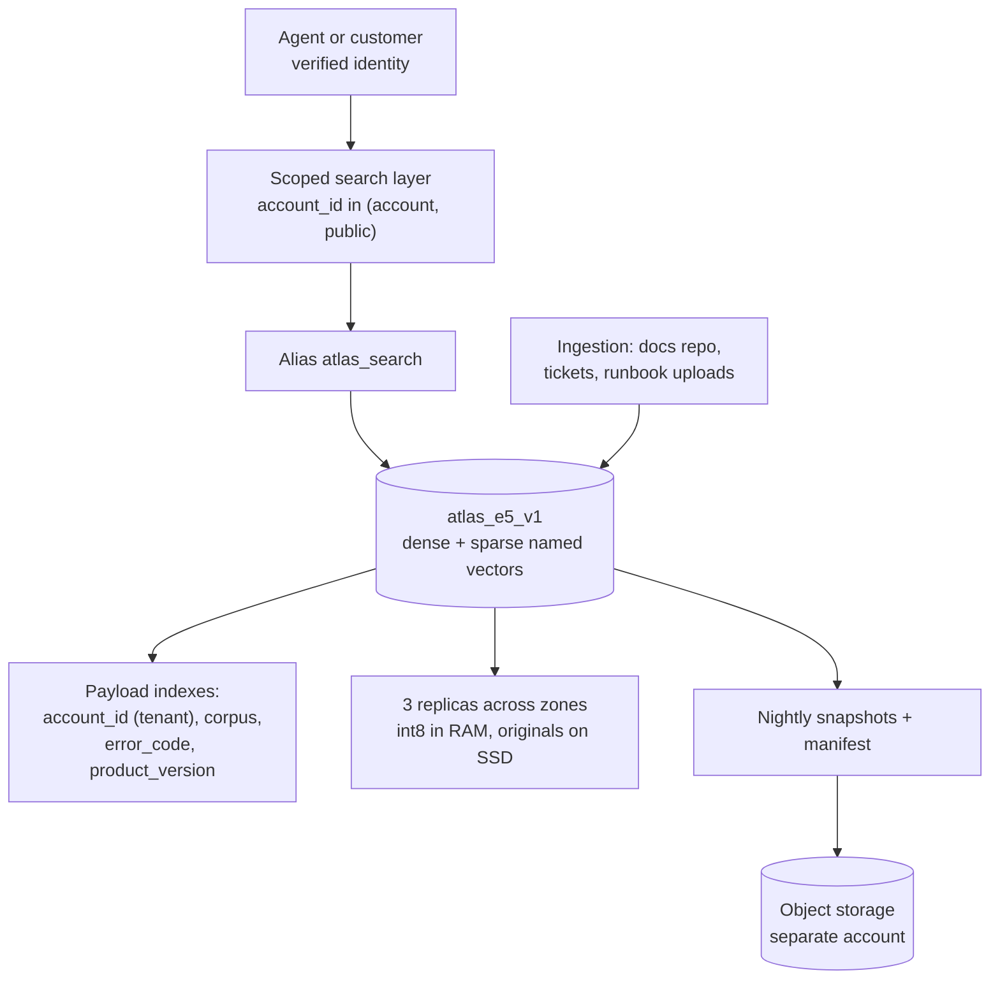

This exam covers the whole of Phase 6, **Vector Databases and Indexing**: the modules [Vector Database Fundamentals](/learn/vector-database-fundamentals), [Vector Database Ecosystem](/learn/vector-database-ecosystem), [Vector Indexing Algorithms](/learn/vector-indexing-algorithms) and [Advanced Vector Database Engineering](/learn/advanced-vector-database-engineering). Answer the 28 multiple-choice questions without looking anything up or running any code; a score of 20 or more (70%) is a pass, and every question you get wrong points to a lesson worth revisiting. Then attempt the design problem and the debugging problem on paper before opening the worked answers. Allow about 90 minutes in total.

```quiz
[
  {
    "q": "Which of these does a vector database add beyond what a NumPy array of embeddings already gives you?",
    "options": [
      "The ability to compute a dot product",
      "Automatic chunking of documents",
      "Better embeddings",
      "Durable storage, identifiers and payloads, filtering, updates and an index for fast search"
    ],
    "answer": 3,
    "why": "An array can be scored; a database also persists, identifies, filters, updates and indexes the vectors so search stays fast and correct as data changes."
  },
  {
    "q": "A collection holds 10 million vectors of 1,024 dimensions in float32. How much memory do the raw vectors need?",
    "options": [
      "About 4 GB",
      "About 10 GB",
      "About 41 GB",
      "About 410 GB"
    ],
    "answer": 2,
    "why": "10,000,000 x 1,024 x 4 bytes = 40,960,000,000 bytes, about 41 GB, before any index or payload."
  },
  {
    "q": "All stored vectors and the query have length 1. Which statement is true?",
    "options": [
      "Cosine similarity, inner product and L2 distance all give the same ranking",
      "Only cosine and L2 agree",
      "Inner product ranks longer vectors higher",
      "L2 distance ranks in the opposite order to cosine"
    ],
    "answer": 0,
    "why": "For unit vectors the inner product equals the cosine, and squared L2 distance is 2 minus 2 times the cosine, so all three order results identically (L2 ascending, the others descending)."
  },
  {
    "q": "What is the main purpose of a write-ahead log in a vector database?",
    "options": [
      "To speed up similarity search",
      "To compress vectors",
      "To record each change durably before it is applied, so that a crash can be recovered by replaying the log",
      "To store backups in another region"
    ],
    "answer": 2,
    "why": "Logging first makes acknowledged writes survive a crash; it is not a backup, which must live elsewhere."
  },
  {
    "q": "A point is deleted from a segment-based store. What happens immediately?",
    "options": [
      "The segment is rewritten without the point",
      "The point is marked with a tombstone and hidden from results; space is reclaimed later by the optimiser",
      "The HNSW graph is rebuilt",
      "Nothing until the next restart"
    ],
    "answer": 1,
    "why": "Tombstones make deletes cheap; vacuuming or merging segments later reclaims space and repairs index structures."
  },
  {
    "q": "A policy document shrinks from 6 chunks to 4. Which procedure leaves no orphans and never makes the document unfindable?",
    "options": [
      "Upsert the 4 new chunks with the old positional IDs",
      "Delete every chunk of the document, then insert the new ones",
      "Insert the new chunks with the new version in the payload, then delete the document's chunks whose version is not the new one",
      "Update the vectors of chunks 0 to 3 and leave 4 and 5"
    ],
    "answer": 2,
    "why": "Writing first avoids a gap; deleting by 'this document, not this version' removes the old tail and any leftovers from failed runs."
  },
  {
    "q": "What does this code print?\n```python\ntrue_top = {1, 2, 3, 4, 5}\nreturned = [1, 2, 9, 4, 7]\nprint(len(true_top & set(returned)) / len(true_top))\n```",
    "options": [
      "0.4",
      "0.6",
      "0.8",
      "1.0"
    ],
    "answer": 1,
    "why": "Three of the five true neighbours (1, 2, 4) were returned, so recall@5 is 3/5 = 0.6."
  },
  {
    "q": "When is a flat (exhaustive) index the right choice in production?",
    "options": [
      "When the collection is small enough that a full scan meets the latency budget, or as ground truth for measuring recall",
      "Never; it is only for teaching",
      "Only when vectors are binary",
      "When the collection has more than a billion vectors"
    ],
    "answer": 0,
    "why": "A flat index has perfect recall and no build cost; for small collections or per-tenant subsets, its scan is fast enough, and it is the reference for evaluating approximate indexes."
  },
  {
    "q": "Why do tree structures such as k-d trees stop helping for exact search on 384-dimensional embeddings?",
    "options": [
      "They cannot store floating-point numbers",
      "They only work with L1 distance",
      "In high dimensions distances concentrate, so pruning rarely excludes branches and the search visits most of the data",
      "They require the vectors to be normalised"
    ],
    "answer": 2,
    "why": "The curse of dimensionality makes nearest and farthest distances similar, so bounding-box pruning fails and the tree degenerates towards a full scan."
  },
  {
    "q": "An IVF index has nlist = 4,096 over 10 million vectors in roughly equal lists. With nprobe = 16, about how many stored vectors does one query score, besides the centroids?",
    "options": [
      "About 2,400",
      "About 39,000",
      "About 625,000",
      "10 million"
    ],
    "answer": 1,
    "why": "Each list holds about 10,000,000 / 4,096, roughly 2,441 vectors; 16 lists give about 39,000 comparisons, plus 4,096 to rank the centroids."
  },
  {
    "q": "Why can IVF miss a true nearest neighbour even with exact distance computations inside each list?",
    "options": [
      "Because k-means discards some vectors",
      "Because lists are searched in random order",
      "Because IVF uses Hamming distance",
      "Because the neighbour may sit in a list whose centroid is not among the nprobe nearest to the query"
    ],
    "answer": 3,
    "why": "The boundary problem: a query near the edge of a cell has neighbours in adjacent cells; raising nprobe searches more of them at more cost."
  },
  {
    "q": "Which HNSW parameter can be changed per query, trading latency for recall, without rebuilding the index?",
    "options": [
      "M",
      "efConstruction",
      "The distance metric",
      "efSearch (ef)"
    ],
    "answer": 3,
    "why": "efSearch is the size of the candidate list during search. M and efConstruction shape the graph at build time, and the metric is fixed."
  },
  {
    "q": "Raising HNSW's M from 16 to 32 typically does what?",
    "options": [
      "Adds more links per node: higher recall at a given ef, more memory, slower builds",
      "Reduces memory use",
      "Has no effect after the first layer",
      "Converts the index to IVF"
    ],
    "answer": 0,
    "why": "M sets the number of neighbours per node; more links mean better connectivity and recall at the cost of memory and build time."
  },
  {
    "q": "Product quantisation splits 768-dimension float32 vectors into 96 sub-vectors, each encoded with an 8-bit code. How many bytes does each encoded vector take, and what is the compression ratio?",
    "options": [
      "96 bytes, 32 times smaller",
      "768 bytes, 4 times smaller",
      "8 bytes, 384 times smaller",
      "384 bytes, 8 times smaller"
    ],
    "answer": 0,
    "why": "96 sub-vectors x 1 byte = 96 bytes, versus 768 x 4 = 3,072 bytes in float32: a factor of 32."
  },
  {
    "q": "int8 scalar quantisation of float32 embeddings reduces vector memory by about what factor, and how is lost accuracy usually recovered?",
    "options": [
      "2 times; by raising M",
      "8 times; by retraining the embedding model",
      "4 times; by rescoring the top candidates with the full-precision vectors",
      "16 times; by using a flat index"
    ],
    "answer": 2,
    "why": "One byte instead of four per dimension. Searching with quantised vectors and rescoring a short candidate list with originals (often on disk) recovers most of the recall."
  },
  {
    "q": "A team plots recall@10 against p99 latency for several efSearch values. What should they choose?",
    "options": [
      "The highest recall regardless of latency",
      "The lowest latency regardless of recall",
      "The setting where recall stops improving much while latency still fits the budget, measured on their own data and filters",
      "The library's default, because benchmarks have tuned it"
    ],
    "answer": 2,
    "why": "The curve flattens: past a point, extra latency buys little recall. The right point depends on the latency budget and must be measured on representative queries."
  },
  {
    "q": "A FAISS IndexFlatIP is filled with embeddings that were NOT normalised. What do its scores mean?",
    "options": [
      "Cosine similarity",
      "Probabilities",
      "Euclidean distance",
      "Raw inner product, which also rewards vector length"
    ],
    "answer": 3,
    "why": "IndexFlatIP computes inner products. They equal cosines only if the vectors are unit length; normalise first (for example with faiss.normalize_L2) for cosine behaviour."
  },
  {
    "q": "A pgvector HNSW index was built with vector_cosine_ops. Which ORDER BY can use it?",
    "options": [
      "ORDER BY embedding <-> query",
      "ORDER BY embedding <#> query",
      "ORDER BY 1 - (embedding <=> query) DESC",
      "ORDER BY embedding <=> query"
    ],
    "answer": 3,
    "why": "The operator must match the operator class, and the order must be ascending by distance. Ordering by an expression or another operator makes the planner fall back to a scan."
  },
  {
    "q": "A Chroma collection was created without a distance setting, and code treats the returned numbers as similarities ('higher is better'). What goes wrong?",
    "options": [
      "Nothing; Chroma returns cosine similarities by default",
      "The default space is squared L2, which returns distances where smaller is better, so the code ranks or thresholds backwards",
      "Chroma refuses to answer queries without a distance setting",
      "Chroma returns inner products, which are always negative"
    ],
    "answer": 1,
    "why": "Chroma's default space is l2 (squared Euclidean), a distance. Choose the space deliberately and interpret scores accordingly."
  },
  {
    "q": "An integration test upserts a record into a Pinecone serverless index and immediately queries for it. It fails intermittently. Why?",
    "options": [
      "Upserts are acknowledged when durably logged, and become searchable a short time later",
      "Pinecone rejects queries during upserts",
      "The test must use a different namespace for reads",
      "Serverless indexes do not support upserts"
    ],
    "answer": 0,
    "why": "Serverless writes are eventually consistent; tests should poll with a timeout rather than assume immediate visibility."
  },
  {
    "q": "In Weaviate's hybrid search, what does alpha = 1 mean?",
    "options": [
      "Pure keyword (BM25) search",
      "An equal blend of keyword and vector scores",
      "Pure vector search",
      "Reranking with a cross-encoder"
    ],
    "answer": 2,
    "why": "alpha weights the vector side: 1 is pure vector search, 0 is pure keyword search."
  },
  {
    "q": "Why should Qdrant payload indexes for filter fields be created before a bulk load?",
    "options": [
      "Qdrant cannot add payload indexes later",
      "So that filter-aware graph links are built along with the HNSW graph, instead of requiring index rebuilds afterwards",
      "Because payload indexes reduce vector memory",
      "Because aliases require them"
    ],
    "answer": 1,
    "why": "Indexes can be added later, but the extra links that keep filtered walks connected are built during graph construction; creating indexes first avoids a second round of work."
  },
  {
    "q": "A filter matches 1% of points and an application post-filters the top 200 unfiltered results to return 10. What happens?",
    "options": [
      "It returns about 2 results on average, and not necessarily the best matching ones",
      "It reliably returns 10 results",
      "It returns 200 results",
      "It returns an error"
    ],
    "answer": 0,
    "why": "Expected survivors are 200 x 0.01 = 2. Restrictive filters need pre-filtered exact search or filter-aware indexing."
  },
  {
    "q": "Results from three namespaces, each embedded with the same model and metric, are merged by score. When is the merged top 10 exactly the global top 10?",
    "options": [
      "Always, whatever each namespace returns",
      "When each namespace returns its own top 10 and searches exactly",
      "Only when the namespaces have equal sizes",
      "Never; rank fusion is required"
    ],
    "answer": 1,
    "why": "Any global winner is in its own partition's top 10, so merging each partition's full top k gives the exact answer, provided scores are comparable."
  },
  {
    "q": "A three-node Qdrant cluster has replication factor 3 and write_consistency_factor 2. One node fails. What still works?",
    "options": [
      "Nothing; writes need all replicas",
      "Reads only",
      "Writes only",
      "Reads and writes, and cluster metadata changes, because two of three nodes remain"
    ],
    "answer": 3,
    "why": "Two replicas can still confirm writes (W = 2), reads can use either live replica, and Raft has a majority of two out of three."
  },
  {
    "q": "A collection is split into 24 shards and every query fans out to all of them. Each shard exceeds its p99 latency 1% of the time. About how often does a query wait for at least one slow shard?",
    "options": [
      "1%",
      "Under 5%",
      "About 21%",
      "About 76%"
    ],
    "answer": 2,
    "why": "1 - 0.99^24 is about 0.214. Fan-out turns rare per-shard slowness into common query slowness."
  },
  {
    "q": "A backup taken at 02:00 is restored at 10:00. Ingestion resumes from its own cursor, which says 09:55. What is wrong, and what prevents it?",
    "options": [
      "Nothing is wrong",
      "The backup should have been taken with read consistency set to all",
      "The HNSW graph must be rebuilt",
      "Changes between 02:00 and 09:55 stay missing; storing the ingestion watermark in the backup manifest and replaying from it prevents this"
    ],
    "answer": 3,
    "why": "The restored data reflects 02:00, but the pipeline believes everything up to 09:55 is indexed. Rewinding to the backup's watermark and replaying closes the gap."
  },
  {
    "q": "A hybrid-storage layout keeps int8 vectors and HNSW links in RAM and float32 originals on SSD. What is the main cost compared with keeping everything in RAM?",
    "options": [
      "Recall falls permanently because originals are lost",
      "Rescoring reads a short candidate list of full vectors from SSD, adding I/O latency per query",
      "Payload filtering stops working",
      "Writes become impossible"
    ],
    "answer": 1,
    "why": "Search runs on compressed vectors in memory; only the top candidates are rescored from disk, trading some latency for a large memory saving."
  }
]
```

## Design problem

Meridian is building **Atlas Support Search**, a retrieval service for its Atlas platform's customer support team and, later, for customers themselves. The corpus:

- **Atlas product documentation and the error-code catalogue** (codes such as E-4021): about 40,000 chunks, updated with each weekly release.
- **Resolved support tickets**: about 6 million chunks today, growing by about 150,000 a month; each ticket belongs to one customer account.
- **Customer-uploaded runbooks**: from about 1,200 customer accounts, between 50 and 300,000 chunks each.

Requirements: support agents search documentation plus any one customer's tickets and runbooks; customers (in phase two) search only their own data plus public documentation. Exact error codes must be findable. The service must survive the loss of a node, restore within two hours from any data-loss incident, and move to a new embedding model next year without downtime. Embeddings are 768-dimensional; the team runs its own infrastructure.

Choose a database and index, design collections, tenancy, filtering and storage, size the deployment, and describe replication, backup and the model migration. State the trade-offs.

<details><summary>Show worked answer</summary>

**Database.** A dedicated vector database the team can operate, with payload indexes, filter-aware HNSW, quantisation, replication, snapshots and aliases. Qdrant fits (and is what the rest of Meridian runs); Milvus or Weaviate would also work. pgvector is plausible for the documentation alone but harder at the ticket volume with selective filters. FAISS alone is not a service: it lacks payloads, filtering beyond ID selection, replication and updates as a database operation.

**Collections.** One collection per embedding model, behind an alias: `atlas_search` pointing at `atlas_e5_v1`, say. Documentation, tickets and runbooks share it because agents search them together and they share one model; a `corpus` payload field (`docs`, `ticket`, `runbook`) distinguishes them. A separate collection would make every agent query a two-collection merge.

**Tenancy and filtering.** `account_id` on every ticket and runbook chunk; public documentation carries `account_id = "public"`. Every query goes through a scoped layer that adds `account_id IN (<verified account>, "public")` from the caller's identity (for agents, the account they selected and are authorised for, recorded in an audit log). Keyword payload indexes on `account_id` (with `is_tenant=True`), `corpus`, `product_version` and `error_code`, created before loading. The planner uses exact search for small accounts; filter-aware links handle the rest. The handful of very large accounts (the 300,000-chunk ones) can move to dedicated shard keys if their load disturbs others.

**Exact codes.** Dense retrieval alone often blurs E-4021 and E-4012. Store a sparse lexical vector (BM25-style) as a named vector alongside the dense one and fuse rankings, and also index `error_code` as a keyword so that a query containing a code can filter or boost exactly.

**Sizing.** About 6 million chunks today, 7.8 million in a year: float32 vectors $7.8 \times 10^6 \times 3{,}072 \approx 24$ GB. With int8 quantised vectors in RAM (about 6 GB) plus graph links and payload indexes, and float32 originals on SSD for rescoring, a single node holds it comfortably; sharding is not needed yet. Use a modest over-sharding (for example 4 shards) so that growth beyond one node's capacity is a shard move later.

**Replication.** Three nodes in three zones, replication factor 3, write consistency factor 2; reads at consistency 1 for search and majority for admin flows that verify their own writes.

**Backup and recovery.** Nightly snapshots from every node to object storage in a separate account, immutable for a bounded retention, with a manifest (configuration, model, pipeline version, counts, checksum, ingestion watermark). Changes are replayable from the ticket system and the docs repository, so the effective RPO is minutes. Restore into a new collection, verify parity and golden queries (including error-code queries), re-apply the deletion log, replay from the watermark, switch the alias. Restore drills measure the two-hour RTO; rebuild from source (re-embedding 6 million chunks) is the fallback, not the plan.

**Model migration.** Record a watermark, bulk-build `atlas_newmodel_v1` with payload indexes first, replay or dual-write changes, run parity and an offline evaluation including exact-code and per-account queries, switch the alias, dual-write through a rollback window.



**Trade-offs.** One shared collection makes agent queries simple and keeps overhead low, but makes the scoped layer security-critical, so it gets tests and an outbound check. Int8 in RAM saves memory at a small, measurable recall cost that rescoring recovers. Hybrid dense-plus-sparse retrieval adds a second representation to maintain but is the established way to keep exact identifiers findable. Not sharding today keeps fan-out at one; the over-sharded layout keeps that decision cheap to revisit.

</details>

## Debugging problem

The Platform team moves a smaller service, the AskMeridian handbook search, from Qdrant to PostgreSQL with pgvector so that permissions can be enforced in the database. The table holds 120,000 chunks with a 384-dimension `embedding` column, a `groups` column, and an HNSW index created with `vector_cosine_ops`. The vectors are normalised. After the migration three problems appear.

1. Searches restricted to the `managers` group (about 3% of rows) often return 1 or 2 chunks instead of the 5 requested.
2. One endpoint, which computes `ORDER BY embedding <-> :query LIMIT 5`, takes about 800 ms, while others take a few milliseconds.
3. The "I don't know" rule, which refuses to answer when the best score is below 0.3, now refuses almost nothing, including clearly unrelated questions.

Diagnose each problem and give a fix.

<details><summary>Show worked answer</summary>

**1. Short results for managers.** The query applies `WHERE 'managers' = ANY(groups)` to rows produced by the HNSW index scan. The index scan produces candidates in similarity order up to `hnsw.ef_search` (40 by default), and only about 3% of them pass the filter: about $40 \times 0.03 = 1.2$ on average, which matches the symptom. This is post-filtering inside the database. Fixes, in order of preference: in pgvector 0.8 and later, enable iterative index scans (`SET hnsw.iterative_scan = relaxed_order` or `strict_order`) so the scan continues until enough rows pass; raise `hnsw.ef_search` for these queries; or, since 3% of 120,000 is only about 3,600 rows, let the planner use exact search for this group (a partial index or a B-tree/GIN index on `groups` plus a sequential scoring of the matching rows is fast at that size). Measure filtered recall against an exact query for each group size.

**2. The slow endpoint.** The index was built with `vector_cosine_ops`, which serves only the cosine distance operator `<=>`. Ordering by `<->` (L2 distance) cannot use it, so PostgreSQL scans and sorts all 120,000 rows. Because the vectors are normalised, L2 and cosine give the same ranking, so change the query to `ORDER BY embedding <=> :query`, and confirm with `EXPLAIN` that the plan shows the HNSW index scan.

**3. The threshold.** In Qdrant with cosine distance, the score is a similarity where higher is better, so "refuse if best < 0.3" made sense. pgvector's `<=>` returns cosine **distance**, $1 - \cos\theta$, where smaller is better. The code now compares distances to 0.3: a relevant chunk at distance 0.2 counts as "below 0.3" (refuse), while unrelated chunks at distances of 0.6 to 0.9 pass, and the rule's meaning is inverted. Select `1 - (embedding <=> :query) AS similarity` for the threshold check (keep ordering by the distance so the index is used), and re-calibrate the threshold on labelled questions rather than copying it, since the old value came from a different system's score scale.

**Prevention.** A migration checklist that compares, on a fixed evaluation set, recall per filter class, latency per endpoint (with `EXPLAIN` for each query shape), and the distribution of top scores before and after; any change of database is a change of score semantics until proven otherwise.

</details>
