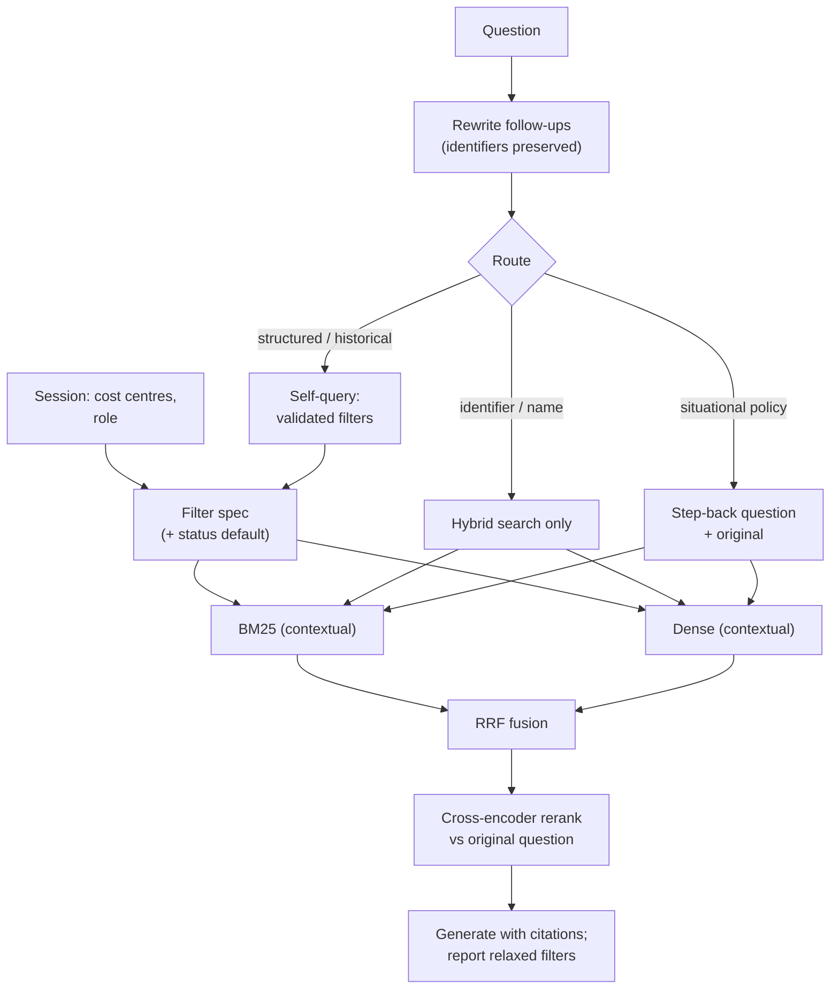

This exam covers the whole of Phase 7, **Retrieval Systems and Search Engineering**: the modules [Retrieval Fundamentals](/learn/retrieval-fundamentals), [Dense Retrieval](/learn/dense-retrieval), [Sparse Retrieval](/learn/sparse-retrieval), [Hybrid Search](/learn/hybrid-search) and [Advanced Retrieval](/learn/advanced-retrieval). Answer the 28 multiple-choice questions without looking anything up or running any code; a score of 20 or more (about 70%) is a pass, and every question you get wrong points to a lesson worth revisiting. Then attempt the design problem and the debugging problem on paper before opening the worked answers. Any timings, token counts or prices are assumptions for arithmetic practice, not quotes from any provider. Allow about 90 minutes in total.

```quiz
[
  {"q": "Why does a retriever's output depend only on the order its scoring function produces, not on the scores' absolute values?", "options": ["Because scores are always probabilities", "Because top-k keeps the k highest-ranked chunks, so any order-preserving change to the scores returns the same chunks", "Because vector databases discard scores", "Because cosine similarity is always between 0 and 1"], "answer": 1, "why": "Doubling or shifting every score leaves the ranking, and therefore the top-k, unchanged."},
  {"q": "A query has 4 relevant chunks in the corpus. The top 10 results contain 3 of them. What are Recall@10 and Precision@10?", "options": ["0.75 and 0.3", "0.3 and 0.75", "0.75 and 0.75", "0.3 and 0.3"], "answer": 0, "why": "Recall@10 = 3 / 4 relevant found; Precision@10 = 3 / 10 results that are relevant."},
  {"q": "In a retrieval cascade, why is the candidate pool's recall called a ceiling?", "options": ["Because rerankers increase recall beyond it", "Because the pool is always larger than top-k", "Because later stages can only reorder and cut the pool; a chunk missing from it cannot be recovered", "Because it is measured at k = 1"], "answer": 2, "why": "Rerankers and filters see only the candidates; any relevant chunk not generated is lost for good."},
  {"q": "A retrieval service has a median latency of 40 ms and a 99th-percentile latency of 400 ms. A request fans out to 5 such calls in parallel and waits for all. Which statement is right?", "options": ["The request's latency is the median, 40 ms", "The request's latency is the sum, 200 ms", "Fan-out has no effect on tail latency", "The slowest of the 5 calls sets the request's latency, so tail latency is hit far more often than for a single call"], "answer": 3, "why": "With parallel fan-out, the request waits for the slowest call; the chance that at least one of five hits the tail is much higher than one in a hundred."},
  {"q": "Which query is dense retrieval most likely to get wrong?", "options": ["What is the error code E-4021 in Atlas?", "How much holiday do I get?", "Can I work from a café?", "What should I do if my laptop is stolen?"], "answer": 0, "why": "Dense embeddings capture what text is about; one digit of an identifier barely moves the vector, so E-4012 and E-4021 can swap."},
  {"q": "An E5-family model's documentation says to prefix queries with 'query: ' and passages with 'passage: '. A team omits the prefixes. What usually happens?", "options": ["An error is raised at encoding time", "Retrieval quality drops without any error", "The index becomes incompatible with cosine distance", "Nothing; prefixes are cosmetic"], "answer": 1, "why": "Asymmetric models were trained with the prefixes; omitting them silently degrades matching."},
  {"q": "Why must the query and the documents be embedded with the same model?", "options": ["To save memory", "Because vector databases check the model name", "Because each model defines its own vector space; vectors from different models are not comparable even if their dimensions match", "Because only one model can be loaded at a time"], "answer": 2, "why": "Coordinates mean different things in different models' spaces; similarities across them are meaningless."},
  {"q": "Embeddings are normalised to unit length. Which statement is true?", "options": ["Dot product, cosine similarity and Euclidean distance all give the same ranking", "Only cosine similarity can be used", "Euclidean distance ranks in reverse order to cosine", "Dot product becomes meaningless"], "answer": 0, "why": "For unit vectors, the dot product equals the cosine, and squared Euclidean distance is 2 minus twice the cosine, so all three order results identically."},
  {"q": "A dense retriever always returns 5 chunks, even for 'what is the canteen menu on Friday?', which no document covers. What does this illustrate?", "options": ["A bug in the HNSW index", "Dense search has no notion of 'no answer'; it returns the nearest neighbours however far they are, so thresholds or an 'I don't know' path are needed", "The query embedding was not normalised", "Top-k was set too high"], "answer": 1, "why": "Nearest neighbours always exist; relevance has to be judged separately."},
  {"q": "What does an inverted index map?", "options": ["Documents to their embeddings", "Terms to the lists of documents (postings) that contain them", "Queries to cached results", "Chunks to their parent documents"], "answer": 1, "why": "Postings lists let keyword search touch only the documents that contain the query's terms."},
  {"q": "In TF-IDF, a term appears in 1 of 6 documents, and another term in 4 of 6. With idf = ln(N/df), which has the larger IDF, and roughly by how much?", "options": ["The common term, by about 2x", "They are equal", "The rare term: ln 6 = 1.79 against ln 1.5 = 0.41, more than 4x", "The rare term, by exactly 4x"], "answer": 2, "why": "IDF rewards rare terms: ln(6/1) is about 1.79 and ln(6/4) about 0.41."},
  {"q": "In BM25, what does the parameter k1 control?", "options": ["How quickly repeated occurrences of a term stop adding score (term-frequency saturation)", "How strongly long documents are penalised", "The number of results returned", "The IDF smoothing constant"], "answer": 0, "why": "k1 sets saturation, with a ceiling of k1 + 1 per term; b controls length normalisation."},
  {"q": "In BM25, setting b = 0 means what?", "options": ["Term frequency is ignored", "IDF is ignored", "Documents are fully normalised by length", "Document length has no effect on scores"], "answer": 3, "why": "b scales length normalisation from none (0) to fully proportional (1)."},
  {"q": "Why are BM25 scores from two different search engines not directly comparable?", "options": ["One of them must be wrong", "Implementations differ in details such as the IDF formula and its treatment of common terms, and scores depend on corpus statistics", "BM25 is non-deterministic", "Because BM25 scores are probabilities"], "answer": 1, "why": "Scores reflect each implementation's variant and each corpus's statistics; only rankings within one system are meaningful."},
  {"q": "A user searches 'pasword reset'. Which retriever is more likely to cope with the misspelling, all else equal?", "options": ["A dense retriever, since the subword pieces of 'pasword' still embed near 'password'", "BM25 with a standard analyser", "An exact-match keyword filter", "Neither can ever cope"], "answer": 0, "why": "A literal term matcher finds no 'pasword' postings; subword tokenisation lets embeddings place the misspelling close to the correct word."},
  {"q": "What is the Reciprocal Rank Fusion score of a document ranked 1st by one retriever and 3rd by another, with k = 60?", "options": ["1/61 x 1/63", "1/61 + 1/63, about 0.0323", "(1 + 3) / 60", "1/4"], "answer": 1, "why": "RRF sums 1/(k + rank) over the lists in which the document appears."},
  {"q": "Why does RRF not need score normalisation, while weighted score fusion does?", "options": ["RRF uses only ranks, so the retrievers' incompatible score scales never meet", "RRF normalises internally with min-max", "Weighted fusion uses ranks too", "RRF only works with two retrievers"], "answer": 0, "why": "Ranks are on the same scale for every retriever; raw BM25 scores and cosines are not, so weighted fusion must normalise first."},
  {"q": "Min-max normalisation before weighted fusion has which weakness?", "options": ["It cannot handle negative scores", "It is slower than RRF by orders of magnitude", "It always gives the best chunk of each list a 1, however weak that list's best match really is", "It requires labelled data"], "answer": 2, "why": "Min-max depends on the extremes of each list; a list of poor matches still gets a top score of 1."},
  {"q": "Expanding the sparse query with terms from the dense retriever's top results raised sparse recall but lowered hybrid recall. Why is that plausible?", "options": ["Because expansion always lowers recall", "Because BM25 cannot handle long queries", "Because RRF ignores the sparse list", "Because it correlates the two retrievers' errors, so the sparse side stops finding what the dense side misses"], "answer": 3, "why": "Hybrid search gains from complementary failures; feeding dense results into the sparse query makes them fail together."},
  {"q": "Which statement about a hybrid system's filters is correct?", "options": ["Applying permission filters to the vector search is enough", "Filters must be enforced in every candidate generator, including the keyword index, or restricted chunks can enter through the unfiltered branch", "Filters should be applied after fusion only", "Keyword indexes cannot be filtered"], "answer": 1, "why": "Leaks usually come through a second path; one filter specification should be compiled for every backend."},
  {"q": "A version filter status = current is best treated as which kind of metadata use?", "options": ["A small ranking boost", "Part of the embedded text only", "A constraint with an explicit override for historical questions", "A result-grouping rule"], "answer": 2, "why": "Current and superseded versions are near-paraphrases; only a constraint excludes the old one reliably, and history questions override it explicitly."},
  {"q": "'And what about contractors?' arrives as the second turn of a conversation about the home-office budget. Which technique fixes retrieval for it?", "options": ["Query rewriting into a standalone question", "HyDE", "Multi-vector retrieval", "Contextual retrieval"], "answer": 0, "why": "Conversational follow-ups depend on earlier turns; rewriting makes them self-contained before retrieval."},
  {"q": "Which pairing of technique and question is best?", "options": ["Step-back prompting for 'What does E-4012 mean?'", "HyDE for 'R-310 Relay'", "Query decomposition for 'How many days of annual leave do I get?'", "Query decomposition for 'Which product owns E-4021, and what is its support plan for SAML SSO?'"], "answer": 3, "why": "That question has two dependent parts; the others are identifier or single-fact lookups that the techniques would only add noise to."},
  {"q": "In step-back prompting, why is the original query still retrieved alongside the step-back question?", "options": ["To double the number of results", "Because the step-back question cannot be embedded", "Because specific details such as error codes and product names often identify the right page, and the step-back question drops them", "Because the generator needs two queries"], "answer": 2, "why": "The step-back question adds recall for the governing rule; the original preserves precision on particulars."},
  {"q": "HyDE starts retrieving superseded handbook pages for 'when can I ring IT?'. What is the underlying fix?", "options": ["Generate more hypothetical passages", "Exclude superseded documents with a metadata constraint on every query", "Remove the query from the HyDE average", "Raise top-k"], "answer": 1, "why": "Hypothetical passages reflect conventional practice, matching older versions; eligibility belongs in a filter, not in the embedding."},
  {"q": "A self-query model outputs a filter on the field 'groups' with value 'admins'. What should happen?", "options": ["Reject it: permission fields are not in the model's schema, and permissions come from the session on the server", "Apply it, since the model inferred it from the question", "Apply it only if results are empty", "Relax it if it returns nothing"], "answer": 0, "why": "The model must never write or relax access-control conditions."},
  {"q": "Contextual retrieval adds what latency at query time?", "options": ["One model call per query", "One model call per retrieved chunk", "One extra vector search", "Essentially none; the model calls happen at indexing time"], "answer": 3, "why": "Contexts are generated once per chunk during indexing; queries run against the contextualised indexes as usual."},
  {"q": "Under multi-vector retrieval with max aggregation, a document with many generated questions has an advantage over one with few, even when neither is relevant. Why?", "options": ["Because max sums the scores", "Because more vectors give more chances that one lies close to an unrelated query by chance", "Because grouping favours larger groups", "Because summaries score higher than questions"], "answer": 1, "why": "Max takes the best of m draws; more draws raise the expected maximum, so keep vector counts per kind similar."}
]
```

## Design problem

Meridian's Finance team wants a search-and-answer assistant over its own collection, separate from AskMeridian. The corpus is about 40,000 documents: expense and procurement policies (current and superseded versions), supplier contracts (PDF, long, many clauses that refer back to defined terms such as "the Supplier" or "the Services"), invoices identified by codes such as INV-2025-00417, and a frequently asked questions page. Users are finance staff and budget holders across the company. Typical questions are:

- "INV-2025-00417 status?" and "contracts with Brightline Logistics" (identifiers and names);
- "do I need a receipt for a £60 taxi?" and "I paid for a team lunch on my card on 3 March, is it too late to claim?" (policy, often situational);
- "which supplier contracts renew in the next 90 days and have a termination notice longer than 60 days?" (structured, compound);
- "what did the 2023 expenses policy say about client entertainment?" (historical).

Budget holders may see only contracts for their own cost centres; finance staff see everything. Answers must cite the clause or policy section. Interactive answers should start within about 3 seconds. Design the retrieval system: indexing, query handling, fusion, filtering and evaluation. Draw it, and justify which Phase 7 techniques you use where, and which you leave out.

<details><summary>Show worked answer</summary>

**Indexing.**

- **Chunking and metadata.** Policies split by section; contracts split by clause, with each clause's metadata recording contract ID, supplier, cost centre, renewal date, notice period in days, status and effective dates. Invoices are records rather than prose: their fields (code, supplier, amount, status, cost centre) go into structured metadata, and a short text rendering is indexed for search. Every chunk carries `cost_centres` and `status`.
- **Contextual retrieval for contracts.** Contract clauses refer to defined terms ("the Supplier shall give 90 days' notice"); a generated context such as "Brightline Logistics freight contract, clause 14: termination notice" makes them findable by name and topic in both indexes. Prompt caching makes the per-contract cost modest, because each contract is a shared prefix for all its clauses. Contexts are regenerated whenever a contract is amended.
- **Two indexes.** A BM25 index with an analyser that keeps codes such as `INV-2025-00417` whole, and a dense index with a retrieval-trained model (with its documented query and passage prefixes). Both index context plus chunk; original chunks are stored for citation.
- **FAQ as multi-vector.** Each FAQ entry is indexed under its text and the question it answers, grouped by entry ID with max aggregation.



**Query handling.**

- **Identifier and name lookups** take the fast path: no model call before retrieval, hybrid search where BM25 finds the exact code or supplier name. Pure dense retrieval would confuse neighbouring invoice numbers.
- **Situational policy questions** get a step-back question ("What are the deadlines and receipt rules for expense claims?") retrieved alongside the original, merged by RRF. The generator is told to state the rule, then apply it to the user's facts (3 March to today).
- **Structured and compound questions** go to self-query: the model writes validated conditions over `renewal_date`, `notice_days`, `doc_type` and `status` ("renews within 90 days" becomes a date range computed from today; "notice longer than 60 days" becomes `notice_days > 60`). This is a filter problem, not a similarity problem; similarity alone cannot express "longer than 60 days". If the question also asks for prose ("and what are the termination terms?"), the filtered set is then searched semantically.
- **Historical questions** override the `status = current` default via a validated `year` or `status` condition from self-query.
- **Not used:** HyDE (identifier-heavy traffic and invented clause numbers are a liability) and multi-query on every question (step-back covers the situational class; add paraphrase variants only if evaluation shows wording failures).

**Filtering and security.** One typed filter specification per request: cost-centre restriction from the session (absent for finance staff), the status default, and validated self-query conditions. It is compiled for the BM25 index, the dense index, the FAQ grouping query and the document store used to fetch full clauses. The cost-centre condition is never model-written and never relaxed; scope conditions can be relaxed with a note to the generator.

**Latency.** Assumed budget: a router decision with rules (negligible) or a small model (a few hundred milliseconds), one step-back or self-query call (a few hundred milliseconds, only on routed questions), parallel BM25 and dense search (tens of milliseconds), and a cross-encoder over about 50 candidates (tens to a hundred milliseconds on suitable hardware). That leaves most of the 3 seconds for the generator's time to first token. Identifier lookups skip the model call entirely.

**Evaluation.** A labelled set stratified by the four question types, with Recall@K of the candidate pool (the ceiling), Recall@K and precision after reranking, and per-type comparisons with and without each technique. Add invariant tests: for users of each cost centre, no returned chunk belongs to another cost centre, across every path. Add version-conflict cases (current and superseded paraphrases) and identifier near-misses (INV codes differing by one digit).

</details>

## Debugging problem

AskMeridian's hybrid retriever (BM25 plus dense, fused with RRF, then a cross-encoder) was performing well. Three changes were deployed in one release:

1. The dense embedding model was upgraded to a newer version from the same family.
2. Weighted score fusion with min-max normalisation and $\alpha = 0.7$ (tuned last quarter) replaced RRF.
3. Query expansion was added to the BM25 side, using terms from the dense retriever's top 5 results.

Since the release, three kinds of complaint have appeared. (a) Questions with error codes ("E-4012 Atlas") often return the page for E-4021. (b) Questions that no document answers ("canteen menu Friday?") now produce confident answers from unrelated chunks, where previously the generator usually said it did not know. (c) Some questions return chunks from the old 2023 handbook. Diagnose each complaint, say how you would confirm it, and give the fixes.

<details><summary>Show worked answer</summary>

**Start by separating the changes.** Three simultaneous changes make attribution impossible from complaints alone. Re-run the labelled evaluation set with each change toggled independently (old and new model, RRF and weighted fusion, expansion on and off), and look at per-category results and at the candidate pool's recall before reranking. Keep this release discipline in future: one retrieval change per evaluation.

**(a) Error codes swap.** Likely cause: query expansion. Terms from the dense top 5 for "E-4012 Atlas" include tokens from the E-4021 page (dense retrieval blurs neighbouring codes), so the expanded BM25 query now matches E-4021 strongly and the sparse side stops being the reliable identifier matcher; the two retrievers' errors have become correlated. Weighted fusion with $\alpha = 0.7$ then lets the dense side dominate further. **Confirm:** log the expanded queries for identifier questions and compare BM25 rankings with and without expansion. **Fix:** skip expansion for queries containing identifier patterns, weight expansion terms below the user's own terms, and draw expansion terms from a curated glossary rather than from the dense results.

**(b) Confident answers to unanswerable questions.** Likely cause: min-max normalisation. It gives the best chunk of each list a score of 1 however weak the match, so a fused score that used to be low for a hopeless query now looks high; any threshold or "low confidence" signal built on fused scores is broken. The new embedding model also has a different similarity distribution, so any cosine threshold tuned on the old model is now wrong. **Confirm:** compare the distribution of top fused scores (and of raw top cosines) for answerable and unanswerable queries before and after. **Fix:** recalibrate relevance thresholds on the new model; base the "no answer" decision on raw or calibrated scores (or the cross-encoder's score), not min-max-normalised fused scores; and re-tune $\alpha$ on labelled queries, because a weight tuned last quarter for another model is not valid now. Returning to RRF is reasonable until re-tuning is done.

**(c) Superseded handbook chunks.** None of the three changes should affect eligibility, which reveals the real bug: superseded documents were never excluded by a constraint. The old setup happened to rank current pages above their superseded paraphrases; the new model or fusion shifted similarities enough to flip some pairs. **Confirm:** run the version-conflict test cases and check the filter actually sent to each backend; verify that both the BM25 and the vector queries carry it. **Fix:** a `status = current` constraint with an explicit override for historical questions, compiled for every backend, plus regression tests with current and superseded paraphrases.

**After the fixes**, re-index if needed (a new embedding model requires re-embedding the whole corpus; check that this was done and that no vectors from the old model remain, since vectors from different models are not comparable), re-run the stratified evaluation, and add every complaint as a regression case.

</details>
