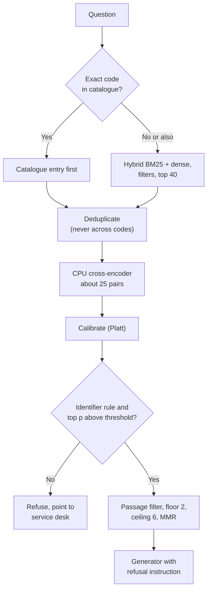

This exam covers the whole of Phase 8, **Reranking and Retrieval Optimisation**: the modules [Reranking Fundamentals](/learn/reranking-fundamentals), [Reranking Models](/learn/reranking-models) and [Advanced Retrieval Optimisation](/learn/advanced-retrieval-optimisation). Answer the 28 multiple-choice questions without looking anything up or running any code; a score of 20 or more (about 70%) is a pass, and every question you get wrong points to a lesson worth revisiting. Then attempt the design problem and the debugging problem on paper before opening the worked answers. Allow about 90 minutes in total.

```quiz
[
  {
    "q": "Why can a bi-encoder search a million chunks in milliseconds while a cross-encoder cannot?",
    "options": [
      "Bi-encoders use smaller vocabularies",
      "A bi-encoder's chunk vectors are computed offline and compared with a cheap dot product; a cross-encoder must run a forward pass for every query-chunk pair at query time",
      "Cross-encoders only run on GPUs",
      "Bi-encoders skip tokenisation"
    ],
    "answer": 1,
    "why": "Factorising the score into separate query and chunk encodings is what allows precomputation and nearest-neighbour search. A cross-encoder's score depends on both texts together."
  },
  {
    "q": "What does a typical cross-encoder reranker take as input?",
    "options": [
      "The query and the passage as one sequence, so every query token can attend to every passage token",
      "Two separately computed embedding vectors",
      "The passage only, with the query appended to the output",
      "A list of passages, scored jointly"
    ],
    "answer": 0,
    "why": "Joint encoding of the pair is what gives a cross-encoder its accuracy, and also why nothing can be precomputed."
  },
  {
    "q": "A BERT-style cross-encoder has a 512-token limit for the pair. A chunk of 900 tokens has its answer near the end. What happens?",
    "options": [
      "The model reads the whole chunk at reduced resolution",
      "The library raises an error",
      "The end of the chunk is truncated and never seen, so the chunk may score as irrelevant",
      "The model automatically windows the chunk"
    ],
    "answer": 2,
    "why": "Text beyond the limit is silently cut. Long chunks need windowing or shorter chunks."
  },
  {
    "q": "A reranker returns scores for three candidates. You apply a sigmoid to the scores before sorting. How does the order change?",
    "options": [
      "It reverses",
      "Negative scores move to the end regardless of size",
      "It becomes alphabetical",
      "It does not change, because the sigmoid is strictly increasing"
    ],
    "answer": 3,
    "why": "A monotone transformation preserves order. The sigmoid changes the range, not the ranking, and does not make scores calibrated probabilities."
  },
  {
    "q": "The first stage's Recall@50 is 0.78 and a perfect reranker is added. What is the best achievable Recall@5 after reranking?",
    "options": [
      "0.78",
      "1.0",
      "0.078",
      "0.95"
    ],
    "answer": 0,
    "why": "Reranking only reorders candidates; anything the first stage missed cannot be recovered. Recall@N is a ceiling."
  },
  {
    "q": "Which filters belong before reranking rather than after it?",
    "options": [
      "Score thresholds",
      "Unconditional filters such as permissions, tenancy and document status",
      "MMR diversification",
      "Token-budget packing"
    ],
    "answer": 1,
    "why": "Unconditional filters should remove candidates before money and time are spent scoring them, and before they can influence later decisions. Score-dependent steps must come after scoring."
  },
  {
    "q": "A team's reranker improves NDCG on web-style queries but hurts on queries containing Atlas error codes. What is the best response?",
    "options": [
      "Remove the reranker entirely",
      "Lower the candidate depth to 5",
      "Measure regressions by query type and consider routing identifier queries around the reranker or fine-tuning on in-domain pairs",
      "Apply a sigmoid to the scores"
    ],
    "answer": 2,
    "why": "Rerankers can hurt on content unlike their training data. Segment the evaluation, then route or adapt."
  },
  {
    "q": "In the hosted Cohere Rerank API, why must you map results back through each result's index?",
    "options": [
      "Results are returned sorted by relevance, not in input order",
      "Indices are random identifiers",
      "The API changes document text",
      "Scores are returned without documents"
    ],
    "answer": 0,
    "why": "The response lists results from most to least relevant, each with the index of the input document it refers to."
  },
  {
    "q": "A hosted reranker call times out under load. What should a production wrapper do?",
    "options": [
      "Retry indefinitely until it succeeds",
      "Return an error to the user",
      "Wait without a deadline",
      "Fall back to the first-stage order within an overall deadline, and record the fallback rate"
    ],
    "answer": 3,
    "why": "A degraded ranking is better than a failed request. Monitoring the fallback rate shows when the dependency is unhealthy."
  },
  {
    "q": "Which is a data-governance concern specific to hosted rerankers?",
    "options": [
      "They cannot read Markdown",
      "Every candidate chunk is sent to another company's infrastructure, so access filtering and data terms must be checked first",
      "They ignore the query",
      "They always cache your documents permanently"
    ],
    "answer": 1,
    "why": "Candidates may contain confidential data. Filter by access rights before sending, and review the provider's data handling terms."
  },
  {
    "q": "BGE rerankers are trained with a softmax over one positive and several hard negatives per query. What does this imply about their raw scores?",
    "options": [
      "They are calibrated probabilities",
      "They are always between 0 and 1",
      "Shifting all of a query's scores by a constant does not change the loss, so absolute score levels are not anchored",
      "They are identical across queries"
    ],
    "answer": 2,
    "why": "Softmax is invariant to adding a constant to all scores, so the training does not fix the absolute level. Use scores for ordering, or calibrate before thresholding."
  },
  {
    "q": "A long document is reranked in sliding windows. For a factual question whose answer sits in one section, which aggregation is usually most appropriate?",
    "options": [
      "MaxP: the document's score is its best window's score",
      "FirstP: score only the first window",
      "MeanP: average all windows",
      "Sum of all window scores"
    ],
    "answer": 0,
    "why": "MaxP rewards one strong section. FirstP equals truncation, and MeanP penalises long documents with one good section."
  },
  {
    "q": "How does ColBERT score a document against a query?",
    "options": [
      "One dot product between two pooled vectors",
      "A cross-attention pass over the concatenated texts",
      "BM25 over token embeddings",
      "For each query token, the maximum similarity with any document token, summed over query tokens"
    ],
    "answer": 3,
    "why": "This is MaxSim, the late-interaction operator. Token vectors are computed separately, so documents can be encoded offline."
  },
  {
    "q": "What is the main cost of late-interaction models such as ColBERT compared with single-vector bi-encoders?",
    "options": [
      "Query-time latency far above a cross-encoder",
      "Storage: one vector per token rather than one per chunk",
      "They require labelled data at query time",
      "They cannot be used for reranking"
    ],
    "answer": 1,
    "why": "Multi-vector indexes are much larger; compression such as ColBERTv2's residual encoding reduces the cost."
  },
  {
    "q": "A cascade has a first stage, a light reranker and a heavy reranker. How should the light reranker be judged?",
    "options": [
      "By NDCG@3 alone",
      "By its latency alone",
      "Mainly as a filter: by how many relevant candidates survive it to the heavy reranker",
      "By the number of candidates it removes"
    ],
    "answer": 2,
    "why": "Early rerankers should have survival near 1 for relevant items; the heavy reranker decides final order. Losses at each boundary multiply."
  },
  {
    "q": "Which statement about MMR is correct?",
    "options": [
      "It selects candidates greedily, scoring each by λ times relevance minus (1 − λ) times its maximum similarity to those already selected",
      "It removes every candidate with cosine above 0.9",
      "It needs aspect labels for each query",
      "It changes the scores of the first selected candidate"
    ],
    "answer": 0,
    "why": "MMR is a greedy trade-off between relevance and redundancy against the already-selected set."
  },
  {
    "q": "Rank-weighted context precision, as defined in RAGAS-style evaluation, is high for a context whose useful passages are ranked 1st and 2nd followed by four irrelevant passages. What does that tell you about the four irrelevant ones?",
    "options": [
      "They must be relevant after all",
      "Context recall must be low",
      "They were filtered out",
      "Nothing: the metric does not penalise useless passages ranked after the last useful one"
    ],
    "answer": 3,
    "why": "Context precision rewards useful passages ranked early. Noise after the last useful passage needs plain precision to show up."
  },
  {
    "q": "What does claim-level context recall measure?",
    "options": [
      "The share of retrieved passages that are relevant",
      "The share of claims in an approved reference answer that the final context supports",
      "The share of the generated answer's claims supported by the context",
      "The rank of the first useful passage"
    ],
    "answer": 1,
    "why": "It audits the context against a marking scheme of facts. Checking the generated answer against the context is faithfulness."
  },
  {
    "q": "How should unanswerable questions be handled when averaging context recall?",
    "options": [
      "Score them as 1",
      "Score them as 0",
      "Exclude them, report how many, and evaluate abstention separately",
      "Score them by their top retrieval score"
    ],
    "answer": 2,
    "why": "With no reference claims the ratio is 0/0. Either fixed value distorts the average."
  },
  {
    "q": "An HR notice quotes two of the three sentences of a handbook paragraph. Which measure is most suitable for recognising it as redundant?",
    "options": [
      "Shingle containment: the share of the smaller text's shingles found in the larger",
      "Jaccard similarity of shingles",
      "Embedding cosine above 0.95",
      "Exact hash of normalised text"
    ],
    "answer": 0,
    "why": "Jaccard is diluted by the paragraph's extra sentence; containment asks whether the smaller text is inside the larger. The texts are not identical, so the exact hash fails."
  },
  {
    "q": "Why should query-time deduplication compare each candidate with a cluster's head rather than every member?",
    "options": [
      "To save memory",
      "Because heads are always exact copies",
      "Because embeddings require it",
      "Because near-duplicate similarity is not transitive, and comparing with every member lets clusters grow along chains of small edits"
    ],
    "answer": 3,
    "why": "Single-link clustering can merge passages that are not redundant with the representative. Exact fingerprints are safe to match against any member."
  },
  {
    "q": "Which change makes a cross-encoder's raw scores a calibrated probability of relevance on your data?",
    "options": [
      "Applying a sigmoid",
      "Fitting a Platt or isotonic map on labelled pairs from your own candidate pool",
      "Min-max scaling within each query",
      "Increasing the candidate depth"
    ],
    "answer": 1,
    "why": "Calibration is learned from labelled outcomes in the population where scores will be used. The others only change range or depth."
  },
  {
    "q": "Calibration data for a reranker should be split into fitting and evaluation sets by what?",
    "options": [
      "By query, so candidates of one query are not on both sides",
      "By pair, at random",
      "By score, high scores for fitting",
      "By passage length"
    ],
    "answer": 0,
    "why": "Pairs from one query share its difficulty; a pair split leaks it and overstates calibration quality."
  },
  {
    "q": "A team swaps rerankers. Their passage threshold is written as 'calibrated probability at least 0.3'. What must they do?",
    "options": [
      "Nothing",
      "Change the threshold to the new model's median score",
      "Refit the calibration map for the new model on the existing labelled pairs and check reliability; the threshold can stay at 0.3",
      "Relabel all pairs from scratch"
    ],
    "answer": 2,
    "why": "Labels belong to pairs, not models, so they can be reused. The map is model-specific; the probability threshold is not."
  },
  {
    "q": "Including an irrelevant passage costs 1; dropping a relevant one costs 3. Above what calibrated probability should passages be kept?",
    "options": [
      "0.75",
      "0.5",
      "0.33",
      "0.25"
    ],
    "answer": 3,
    "why": "Keep when p is at least C_noise / (C_noise + C_miss) = 1 / 4."
  },
  {
    "q": "At an abstention threshold, 60 of 200 questions are answered, 6 of them wrongly. What are coverage and selective risk?",
    "options": [
      "Coverage 0.3, risk 0.03",
      "Coverage 0.3, risk 0.1",
      "Coverage 0.6, risk 0.1",
      "Coverage 0.7, risk 0.06"
    ],
    "answer": 1,
    "why": "Coverage = 60/200 = 0.3. Selective risk is computed among answered questions: 6/60 = 0.1."
  },
  {
    "q": "Why do questions such as 'What does error E-5310 mean?' (when only E-4021 is documented) defeat score thresholds?",
    "options": [
      "They contain digits, which rerankers cannot read",
      "They are off-topic",
      "They share topic and nearly every word with a passage that does not answer them, so they can score like answerable questions",
      "They have no retrieved passages"
    ],
    "answer": 2,
    "why": "A substituted code changes the answer but barely changes the match. An identifier rule and generator-side refusal are the effective defences."
  },
  {
    "q": "Which pipeline order is most defensible for the stage between retrieval and generation?",
    "options": [
      "Filter by permission and version, remove duplicates, rerank, calibrate and threshold, diversify, pack into the token budget",
      "Rerank, pack, then filter by permission",
      "Diversify, then remove duplicates, then filter by permission",
      "Threshold raw first-stage scores, then rerank"
    ],
    "answer": 0,
    "why": "Unconditional filters first, cheap deduplication before the expensive reranker, score-dependent decisions after scoring and calibration, then diversity and packing."
  }
]
```

## Design problem

Meridian's IT team wants a dedicated search-and-answer service over the **IT runbooks and the Atlas error-code catalogue**: about 6,000 runbook pages and 2,500 error-code entries, many of which differ only in the code and one remediation step (E-4021 and E-4012 are both VPN client errors). Runbooks exist in a wiki and as a nightly PDF export, and old runbook versions are retained for audit. Questions mix exact lookups ("What does E-4021 mean?"), procedural questions ("How do I re-enrol a laptop in device management?") and multi-part questions ("Why does the VPN drop on hotel Wi-Fi, and who do I contact out of hours?"). The service must answer within 1.5 seconds at the 95th percentile, must not answer about undocumented error codes, and runs on CPU-only machines. A hosted reranker is permitted, but runbooks may contain internal hostnames.

Design the retrieval and optimisation stages from the first-stage retriever to the generator. Cover: first-stage retrieval and candidate depth; whether to rerank, with what, and where; duplicate and version handling; calibration and thresholds for passages and for abstention; diversity; and how you would evaluate and monitor the design.

<details><summary>Show worked answer</summary>

**First stage.** Hybrid retrieval: BM25 over a field that preserves codes as single tokens (so "E-4021" is not split into "e" and "4021"), plus dense retrieval for procedural phrasing, merged by chunk ID with Reciprocal Rank Fusion. Candidate depth is chosen from a sweep of Recall@N on labelled questions against reranker latency; a plausible starting point is 40 fused candidates. Permission and version filters are applied in the first stage, on metadata.

**Duplicates and versions.** Index wiki and PDF copies but store fingerprints, source, document lineage ID, effective date and character spans per chunk. Superseded versions are filtered unless the question asks about history. Query-time deduplication runs before reranking: fingerprints, shingle containment above about 0.8 against cluster heads, and joining of overlapping windows. The representative is the wiki copy (more current, per the runbook owners) unless they disagree, in which case the cluster is logged. Error-code entries differ only in the code and one step, so containment would merge E-4021 and E-4012; the deduplicator therefore never merges chunks whose extracted identifiers differ.

**Reranking.** A small open cross-encoder (a MiniLM-sized model) on CPU over about 25 unique candidates fits the latency budget better than a large model; measure it. A hosted reranker is ruled out unless the provider's data terms allow internal hostnames, or hostnames are masked before sending, which can hurt relevance. Evaluate regressions by query type, because rerankers trained on web data can mishandle codes; if exact-lookup queries regress, route them: when the question contains a code that exactly matches one catalogue entry, return that entry first without reranking.

**Calibration and thresholds.** Fit a Platt map on labelled pairs from the 25-candidate pool, split by question, versioned with the reranker. Passage threshold from the agreed cost ratio (for example, losing evidence three times as bad as noise gives 0.25), with a floor of 2 and a ceiling of 6. Abstention: an identifier rule (any code in the question must appear in the top passage) plus a calibrated top-score threshold chosen on held-out questions including near misses (undocumented codes, other products), plus a generator refusal instruction.

**Diversity.** Multi-part questions are where context recall is lost. Apply MMR with a high λ to the survivors, on embedding similarity for both terms, or decompose clearly multi-part questions into sub-queries and merge. Keep at most two chunks per runbook page.



**Evaluation and monitoring.** A labelled set of a few hundred real questions per query type, with reference claims (context recall at every stage), pair labels (calibration, context precision), and near-miss and off-topic questions (coverage and selective risk). Report latency percentiles per stage. In production: abstention rate by query type, top-score percentiles, deduplication rate and conflict log, reranker fallback rate, and a weekly labelled sample. Trade-offs to state: deeper candidates raise the recall ceiling but cost reranker time on CPU; a higher abstention bar lowers wrong answers but refuses more colloquial questions.

</details>

## Debugging problem

After a deployment that changed three things at once (chunk size from 600 to 250 tokens, candidate depth from 20 to 60, and a new calibration map fitted on the old candidate pool), AskMeridian shows the following over one week compared with the week before:

- First-stage Recall@N on the regression set: up from 0.86 to 0.93.
- Claim-level context recall on the final context: down from 0.91 to 0.83, mostly on two-part questions.
- Abstention rate: down from 9% to 4%.
- Selective risk on the weekly labelled sample: up from 0.04 to 0.11.
- Reranker p95 latency: up from 180 ms to 520 ms.

Explain each symptom and propose fixes, in priority order.

<details><summary>Show worked answer</summary>

**Higher first-stage recall, lower final-context recall.** Smaller chunks and a deeper pool let the first stage find more evidence, but the final context, still cut to the same $k$, now loses it. With 250-token chunks, the two halves of an answer live in separate chunks, and the top $k$ fills with near-copies and neighbouring windows about the first half (handbook, wiki copy, FAQ). The waterfall would show the drop at the cut. Fix: deduplicate (fingerprints, containment, window joining) before the cut, consider a larger $k$ now that chunks are smaller (the token cost per chunk fell), and add light MMR for two-part questions.

**Abstention down, selective risk up.** The calibration map was fitted on the 20-candidate pool. The 60-candidate pool adds many low-ranked negatives, lowering the base rate of relevance, so the old map over-predicts relevance; and smaller chunks shift reranker scores. Over-predicted probabilities clear the abstention threshold more often, so the system answers more questions, including near misses: abstention falls and selective risk rises. Fix first, because it causes wrong answers: refit the map on labelled pairs from the new pool (reuse old labels, add labels for ranks 21 to 60 and for new chunks), check the reliability table on held-out questions, and re-run the threshold sweep. Until then, roll back the calibration map and threshold, or the candidate depth.

**Latency up.** The reranker now scores three times as many pairs; even with shorter chunks, the cost grows with pairs. Fix: deduplicate before reranking (fewer unique pairs), choose depth from a recall-versus-latency sweep rather than tripling it, or add a cheap first reranker as a filter in a cascade.

**Process.** Three coupled changes in one release made attribution guesswork. Release them separately behind flags, with the stage-by-stage recall waterfall, calibration check and latency report as release gates.

**Priority.** (1) Restore safety: roll back or refit calibration, since wrong answers rose. (2) Restore completeness: deduplication and $k$. (3) Restore latency: deduplicate before reranking and resize the pool.

</details>
