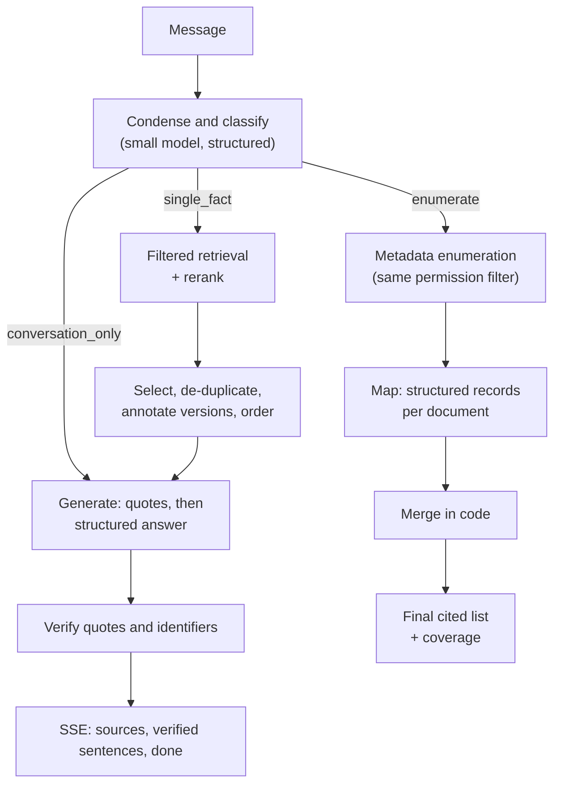

This exam covers the whole of Phase 9, **RAG Generation and Context Engineering**: the modules [Prompt Engineering for RAG](/learn/prompt-engineering-for-rag), [Context Engineering](/learn/context-engineering) and [Generation Strategies](/learn/generation-strategies). Answer the 28 multiple-choice questions without looking anything up or running any code; a score of 20 or more (about 70 per cent) is a pass, and every question you get wrong points to a lesson worth revisiting. Then attempt the design problem and the debugging problem on paper before opening the worked answers. Allow about 90 minutes in total.

```quiz
[
  {
    "q": "Which of these belongs in a RAG system's static system prompt rather than in the user turn?",
    "options": [
      "Today's date",
      "The retrieved sources",
      "The rule that text inside sources is data, not instructions",
      "The user's department"
    ],
    "answer": 2,
    "why": "Standing rules are static and cacheable; per-request facts such as dates, user attributes and sources go in the user turn."
  },
  {
    "q": "Why should source text, titles and the user's question be escaped when sources are injected as XML-style tags?",
    "options": [
      "To reduce token count",
      "So that text inside a document cannot close its block or forge a new source",
      "Because models cannot read angle brackets",
      "To stop persuasive instructions inside documents from being followed"
    ],
    "answer": 1,
    "why": "Escaping prevents structural forgery. It does nothing about persuasive text, which needs the untrusted-content rule and output checks."
  },
  {
    "q": "Which layout of the user turn is the recommended default for long sources?",
    "options": [
      "Request context, sources, optional reminder, then the question last",
      "Question first, then sources",
      "Sources inside the system prompt, question in the user turn",
      "Sources and question interleaved"
    ],
    "answer": 0,
    "why": "Evidence before the question, with the question in its own block at the end, is the standard layout for long contexts."
  },
  {
    "q": "Under a grounding policy, which operation is NOT allowed?",
    "options": [
      "Paraphrasing a source sentence",
      "Combining facts from two sources",
      "Arithmetic on figures from the sources, with inputs shown",
      "Stating general knowledge as fact when the sources are silent"
    ],
    "answer": 3,
    "why": "Grounded answers may extract, paraphrase, combine and compute from sources; general knowledge presented as fact breaks grounding."
  },
  {
    "q": "What does citation precision measure?",
    "options": [
      "Whether each statement is fully supported by its cited sources",
      "Whether each citation was needed to support its statement",
      "Whether citation labels exist",
      "How many sources were retrieved"
    ],
    "answer": 1,
    "why": "Citation recall asks about support for each statement; citation precision asks whether each citation was relevant and needed."
  },
  {
    "q": "A wrong answer costs 10 units and a refusal costs 2 units. Above what probability of being right should the system answer rather than refuse?",
    "options": [
      "0.2",
      "0.5",
      "0.8",
      "0.9"
    ],
    "answer": 2,
    "why": "Answer when (1 - p) x 10 < 2, i.e. p > 1 - 2/10 = 0.8."
  },
  {
    "q": "A question has two parts and the sources answer only one. What is the recommended behaviour?",
    "options": [
      "Refuse the whole question",
      "Answer from general knowledge for the missing part",
      "Answer the covered part with citations and state specifically, without a citation, what the sources do not cover",
      "Ask the user to split the question"
    ],
    "answer": 2,
    "why": "Partial answers keep what is supported and name the gap; a full refusal wastes the covered part."
  },
  {
    "q": "Why should the answer format be produced as one canonical form (for example restricted Markdown with [S#] markers) and rendered per channel in code?",
    "options": [
      "So that one model output can be rendered safely and consistently for web, chat and other channels",
      "Because models cannot produce HTML",
      "To make answers shorter",
      "Because Markdown is required by the API"
    ],
    "answer": 0,
    "why": "The model controls logical shape; the application controls presentation and sanitisation for each channel."
  },
  {
    "q": "Model-generated Markdown is rendered in a web page. Which precaution is essential?",
    "options": [
      "Allow raw HTML so formatting is preserved",
      "Render images from any URL",
      "Trust links because they came from cited sources",
      "Sanitise the output, disable raw HTML and allowlist link hosts"
    ],
    "answer": 3,
    "why": "Generated Markdown is an output channel an injected document can influence; sanitise it like any untrusted input."
  },
  {
    "q": "What is the difference between a model's nominal and effective context length?",
    "options": [
      "Nominal is what it accepts; effective is what it uses well on your task, which you must measure",
      "They are the same thing",
      "Effective length is always larger",
      "Nominal length counts only output tokens"
    ],
    "answer": 0,
    "why": "Accepting a long input is not the same as using all of it reliably; set working budgets from measurements."
  },
  {
    "q": "Why is greedy selection by marginal value per token, with a penalty for similarity to chunks already chosen, often better than a plain 0/1 knapsack on reranker scores?",
    "options": [
      "Knapsack cannot be solved exactly",
      "Knapsack's additive values reward packing repeated evidence; the similarity penalty favours complementary chunks",
      "Greedy always finds the optimum",
      "Knapsack ignores token costs"
    ],
    "answer": 1,
    "why": "Additive value treats two copies of the same fact as twice as useful; discounting redundancy fixes that."
  },
  {
    "q": "For a model with a U-shaped position profile, which ordering of five chunks ranked 1 to 5 is edges-first?",
    "options": [
      "1 2 3 4 5",
      "5 4 3 2 1",
      "1 3 5 4 2",
      "3 1 2 4 5"
    ],
    "answer": 2,
    "why": "Edges-first puts rank 1 first, rank 2 last, rank 3 second, rank 4 second to last, leaving the weakest in the middle."
  },
  {
    "q": "A procedure's steps are retrieved as five chunks with scores out of order. How should they be ordered in the context?",
    "options": [
      "By score, highest first",
      "Edges-first",
      "Randomly, to avoid position bias",
      "In document order, grouped, whatever the scores say"
    ],
    "answer": 3,
    "why": "Sequential content such as procedures needs grouped document order to be read correctly."
  },
  {
    "q": "Why does sentence-level extractive compression sometimes drop exactly the sentence that matters?",
    "options": [
      "Because scoring sentences in isolation misses sentences whose meaning depends on neighbours, such as pronoun sentences and qualifiers",
      "Because extractive compression rewrites the text",
      "Because it always keeps the first sentence only",
      "Because compression increases token count"
    ],
    "answer": 0,
    "why": "'It does not apply to contractors' scores poorly alone; dependency rules or windowed scoring keep such sentences."
  },
  {
    "q": "Why is shingle containment better than Jaccard similarity for detecting a short FAQ snippet copied inside a long handbook section?",
    "options": [
      "Containment is faster",
      "Jaccard ignores word order",
      "Containment measures how much of the smaller text appears in the larger, while Jaccard is diluted by the larger text's size",
      "Jaccard only works on numbers"
    ],
    "answer": 2,
    "why": "A snippet fully inside a long section has high containment but low Jaccard, because the union is dominated by the long text."
  },
  {
    "q": "Two passages are identical except that one says E-4021 and the other E-4012. What should de-duplication do?",
    "options": [
      "Merge them, since they are near-duplicates",
      "Keep both: an identifier guard prevents merging passages that differ in a code, amount or date",
      "Keep whichever is shorter",
      "Drop both"
    ],
    "answer": 1,
    "why": "Merging two different facts is far worse than keeping a duplicate."
  },
  {
    "q": "Using utility u = r x a x 2^(-t/h), a chunk has relevance 0.8, authority 1.0, age 730 days and half-life 730 days. What is u?",
    "options": [
      "0.8",
      "0.2",
      "0.6",
      "0.4"
    ],
    "answer": 3,
    "why": "Freshness is 2^(-1) = 0.5, so u = 0.8 x 1.0 x 0.5 = 0.4."
  },
  {
    "q": "What did Liu and colleagues (2023) report in 'Lost in the Middle' for the models they tested?",
    "options": [
      "Accuracy was highest when the answer passage was in the middle",
      "Accuracy was roughly U-shaped over the answer's position, best near the start or end",
      "Position had no effect",
      "Accuracy rose steadily with context length"
    ],
    "answer": 1,
    "why": "The U-shaped curve is the finding; later models are often flatter, so measure your own."
  },
  {
    "q": "In basic RAG, what is the most likely effect of raising k from 5 to 20 without reranking?",
    "options": [
      "Higher coverage, but more distractors, more input tokens and a longer time to first token",
      "Lower coverage",
      "No change in cost",
      "Fewer distractors"
    ],
    "answer": 0,
    "why": "More chunks means more evidence present and more noise, cost and latency; choose k from a coverage measurement."
  },
  {
    "q": "A contractor asks about the home-office budget, and the £400 employee budget chunk is retrieved. The user's role is known from the identity provider. What should context-aware generation do with that chunk?",
    "options": [
      "Keep it and let the model decide",
      "Annotate it as superseded",
      "Filter it out, because it does not apply to this user's audience",
      "Ask the user whether they are a contractor"
    ],
    "answer": 2,
    "why": "With the role known, a source whose audience excludes the user should not be able to produce the answer."
  },
  {
    "q": "In quote-first citation, a quote is found verbatim, but in a different supplied source from the one it names. How should it be classified?",
    "options": [
      "Verified",
      "Not found",
      "Number mismatch",
      "Wrong source"
    ],
    "answer": 3,
    "why": "The words exist but are misattributed; this can sometimes be repaired by re-pointing the citation."
  },
  {
    "q": "Map-reduce over 64 documents with fan-in 4. How many calls in total, counting map and reduce?",
    "options": [
      "64",
      "85",
      "68",
      "128"
    ],
    "answer": 1,
    "why": "64 map calls plus reduce levels of 16, 4 and 1 calls: 64 + 21 = 85."
  },
  {
    "q": "Why is the refine strategy a poor choice for summarising 200 documents under a latency target?",
    "options": [
      "Its sequential depth equals the number of documents",
      "It cannot keep source ids",
      "It needs a larger context window than stuff",
      "It cannot be used with streaming"
    ],
    "answer": 0,
    "why": "Each refine call waits for the previous one, so 200 documents means 200 sequential calls."
  },
  {
    "q": "A RAG response schema builds the citation field as an enum of this request's labels. What does this achieve under constrained decoding?",
    "options": [
      "It guarantees every claim is supported",
      "It removes the need for a refusal status",
      "It makes citations to unsupplied sources impossible to generate",
      "It shortens the answer"
    ],
    "answer": 2,
    "why": "Invalid labels are masked out during decoding. Support still has to be checked separately."
  },
  {
    "q": "Which JSON repair is safe to apply automatically to model output?",
    "options": [
      "Completing a truncated final record",
      "Translating Python literals such as None and True",
      "Filling missing required fields with defaults",
      "Removing a trailing comma before a closing bracket"
    ],
    "answer": 3,
    "why": "Only repairs with exactly one meaning are safe; the others invent or alter data."
  },
  {
    "q": "In a streaming RAG service, why send a sources event before the first text delta?",
    "options": [
      "Retrieval has finished before generation starts, so the interface can show what the answer is based on at no extra cost",
      "The model API requires it",
      "Sources must be validated first",
      "It reduces output tokens"
    ],
    "answer": 0,
    "why": "Sending sources early improves perceived speed and trust."
  },
  {
    "q": "In a multi-turn conversation, which text should be embedded for retrieval on a follow-up?",
    "options": [
      "The follow-up exactly as typed",
      "A standalone rewrite of the follow-up that resolves its references from recent history",
      "The entire conversation",
      "The previous answer"
    ],
    "answer": 1,
    "why": "Pronouns and ellipses carry no retrieval signal; the whole conversation drifts to the first topic."
  }
]
```

## Design problem

Meridian's Legal team wants an assistant for staff questions about the company's data-protection policies: about 300 documents (policies, procedures, guidance notes and records of decisions), many with superseded versions, some applying only to particular departments. Requirements:

- Answers in a chat panel, with first text in about a second and follow-up questions supported.
- Every claim must be traceable to an exact passage, because answers may be quoted in audits.
- When sources conflict (an old guidance note against a current policy), the answer must say so.
- Questions such as "which procedures mention international transfers?" must list every relevant document, not the five most similar.
- Staff must never see content from documents restricted to other departments.

Design the context and generation side of the system: prompts, context selection and ordering, conflict handling, citation strategy, synthesis for enumerating questions, structured output, streaming and conversation handling. Draw the architecture, give the context budget for a typical chat request, and state the main trade-offs.

<details><summary>Show worked answer</summary>

**Routing.** A small, fast model condenses each message into a standalone query and classifies it (`single_fact`, `enumerate`, `conversation_only`) with structured output. Enumerating questions go to a synthesis route; conversational turns ("shorter, please") skip retrieval.

**Retrieval and permissions.** Every retrieval applies a department and access filter inside the vector store query, before ranking. The synthesis route enumerates documents by metadata (document type, topic tags, status) within the same filter.

**Context engineering for chat.**

- *Selection*: rerank the top 30 candidates with a cross-encoder; select greedily by marginal value per token with a redundancy penalty, under a floor; reserve coverage for each part of a multi-part question.
- *De-duplication*: chunk ids, then versions, then containment and embedding similarity, with an identifier guard for clause numbers, dates and amounts.
- *Annotation, not removal, of superseded versions*: current versions are preferred by default; superseded ones are admitted only when the question concerns change or history, and always carry `status="superseded"` and an effective date.
- *Ordering*: grouped document order for procedures and clauses; otherwise rank order measured for the chosen model (edges-first only if a position sweep shows a U-shaped profile).
- *Budget* (assumed figures for illustration): system prompt about 600 tokens (cached); request context 50; history window of 3 exchanges, about 450; sources up to 4,000 (about 8 chunks of 500); question 50; total input about 5,150, with `max_tokens` around 800 for the answer and quotes.

**Prompting.** The static system prompt states the grounding policy, quote-first citation format, conflict rule ("if sources disagree, give the current policy's position with its citation and say an older document differs"), the exact refusal sentence and partial-answer behaviour, and the untrusted-content rule. Per-request facts (date, department) go in `request_context`.

**Citations.** Quote-first: the model emits quotes tagged with source labels, then the answer citing them; code verifies each quote against its named source with exact numbers, dates and clause ids. Alternatively native citations, if provider lock-in is acceptable; either way the claim text gets exact checks on identifiers.

**Structured output.** The final answer object holds `status`, `claims` (text, quote ids, source labels restricted to the request's labels), `conflicts` and `not_covered`; cross-field rules are validated with Pydantic.

**Streaming.** SSE events: status, sources (titles, versions, links from the label map), then verified sentences only, then `done` with validation results and withheld count. Sentence-level release is justified by the audit requirement.

**Synthesis route.** Enumerate candidate documents by metadata; map step per document extracts structured records (`mentions_topic`, the quoted passage, section id); merge in code; final call writes the list with citations; report coverage ("checked 41 procedures; 9 mention international transfers"). Not streamed token by token; a progress status is streamed instead.

**Conversation.** Stored history keeps answer text without markers plus resolved document ids; a running summary covers older turns; follow-ups are condensed before retrieval.



**Trade-offs.** Quote-first and sentence-level release add output tokens and a little latency in return for auditable answers. Annotating rather than dropping superseded documents lets the assistant explain changes, at the price of distractor risk, which the conflict rule and authority metadata manage. The enumeration route is slower and costlier per question, so it is used only for questions classified as enumerating. The condense step adds latency to follow-ups only. Greedy, redundancy-aware selection costs a reranker pass but keeps the context small, which helps time to first token and reduces lost-in-the-middle risk.

</details>

## Debugging problem

After an update, AskMeridian's answers about IT procedures have become worse. The change log for the release lists: the reranker's candidate count raised from 20 to 50; selection changed from "top 5 after reranking" to "fill the budget of 6,000 tokens in rerank order"; a new compression step that keeps the top-scoring sentences of each chunk; and the conversation store switched to replaying full assistant answers. Symptoms reported:

1. For "what does E-4012 mean?", answers now sometimes say the VPN client is out of date (which is E-4021).
2. Procedural answers ("how do I reinstall the VPN certificate?") skip steps or give them out of order.
3. In longer conversations, citations sometimes open a document that does not contain the cited fact.
4. Average input tokens per request have roughly doubled, and time to first token has risen.

Identify the likely cause of each symptom, the evidence you would look at to confirm it, and the fix.

<details><summary>Show worked answer</summary>

**1. E-4012 answered with E-4021's meaning.** Likely cause: filling a 6,000-token budget in rerank order admits many more near-relevant chunks, including the E-4021 passage, which is worded almost identically; a topical distractor now sits in the context, and the model confuses the codes. De-duplication without an identifier guard could make it worse by merging the two passages. *Evidence*: the context manifest for affected requests (which chunks, in what order, with scores); check whether E-4021's chunk is present, and whether any merged chunk lost its code. *Fix*: restore a relevance floor and redundancy-aware selection rather than filling the budget; add or verify the identifier guard in de-duplication; add an exact identifier check in post-processing (an answer about E-4012 must cite a source containing "E-4012").

**2. Steps skipped or out of order.** Likely cause: the new compression keeps top-scoring sentences per chunk, scored in isolation, so steps that score low ("Then restart the client.") are dropped; and rerank-order filling places procedure chunks by score rather than in document order. *Evidence*: compare compressed and uncompressed chunk text for procedure questions; check chunk order against section order. *Fix*: exempt procedural content (by document type) from sentence-level compression or use windowed scoring with dependency rules; order procedure chunks in grouped document order; add regression questions whose answers depend on every step.

**3. Citations opening the wrong document in long conversations.** Likely cause: replaying full assistant answers reintroduced old `[S#]` markers, whose labels referred to earlier turns' sources; the model copies them into new answers, where the same label names a different chunk. *Evidence*: affected answers occur only after the first turn, and the wrong citations use labels that match markers in replayed history. *Fix*: strip markers from replayed answers, store resolved document ids separately, and add a multi-turn regression case.

**4. Input tokens doubled and slower first token.** Likely cause: "fill the budget" always uses close to 6,000 tokens of sources, where "top 5" used fewer; full answer replay adds history; the reranker's larger candidate set adds latency before generation. Compression saves some tokens but not enough to offset filling. *Evidence*: per-region token counts from the context manifest (system, history, sources) before and after the release; time spent in reranking. *Fix*: make the budget a ceiling, not a target, with a floor and redundancy penalty; window and summarise history; check whether 50 candidates measurably improves coverage over 20 on the labelled set and revert if not.

The general lesson: the release changed several context-engineering stages at once. Each symptom maps to one stage, and the per-request context manifest is what makes the mapping possible; future changes should be rolled out one stage at a time against the regression set.

</details>
