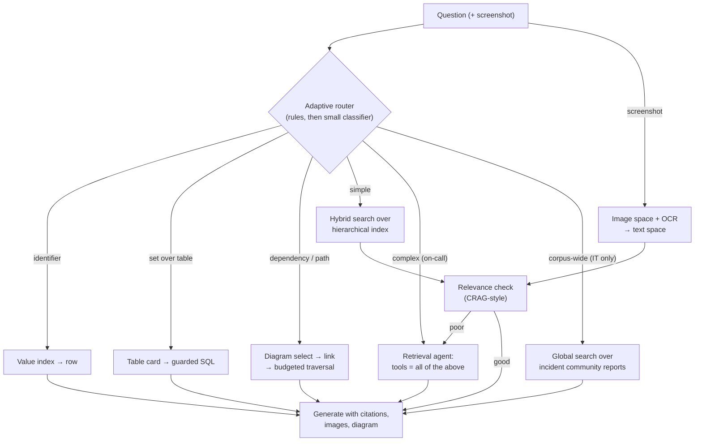

This exam covers the whole of Phase 10, **Advanced RAG Architectures**: the modules [Advanced RAG Patterns](/learn/advanced-rag-patterns), [Graph RAG](/learn/graph-rag), [Hierarchical RAG](/learn/hierarchical-rag), [Agentic RAG](/learn/agentic-rag) and [Multimodal RAG](/learn/multimodal-rag). Answer the 28 multiple-choice questions without looking anything up or running any code; a score of 20 or more (about 70%) is a pass, and every question you get wrong points to a lesson worth revisiting. Then attempt the design problem and the debugging problem on paper before opening the worked answers. Any timings, token counts, failure rates or prices are assumptions for arithmetic practice, not quotes from any provider. Allow about 90 minutes in total.

```quiz
[
  {"q": "Which assumption of naive RAG do almost all the advanced patterns in this phase relax?", "options": ["That embeddings are normalised", "That one fixed pipeline (one search, top k, generate) suits every question and that whatever is retrieved is trusted", "That the generator is a language model", "That documents are chunked"], "answer": 1, "why": "Corrective, adaptive, agentic and other patterns all change either the fixed path or the blind trust in retrieved chunks."},
  {"q": "In Corrective RAG (CRAG), what happens when the retrieval evaluator grades the retrieved documents as incorrect?", "options": ["The answer is generated anyway, with a warning", "The question is rejected", "The top-k is doubled and the same index is searched again", "The retrieved documents are discarded and the system turns to a different source, such as web search in the original paper"], "answer": 3, "why": "CRAG's corrective action for an 'incorrect' grade is to replace the evidence from another source; 'ambiguous' combines both."},
  {"q": "What does Self-RAG require that Corrective RAG does not?", "options": ["A generator trained to emit reflection tokens that decide when to retrieve and critique relevance and support", "A vector database", "A web search API", "A knowledge graph"], "answer": 0, "why": "Self-RAG builds retrieval decisions and critiques into a specially trained model; CRAG adds a separate evaluator to an ordinary pipeline."},
  {"q": "Adaptive-RAG routes questions by predicted complexity. Which three strategies does it choose between?", "options": ["Dense, sparse and hybrid search", "Local, global and DRIFT search", "No retrieval, single-step retrieval and multi-step retrieval", "Parent, child and summary retrieval"], "answer": 2, "why": "A small classifier sorts questions into three complexity levels mapped to no, single-step and multi-step retrieval."},
  {"q": "In Speculative RAG, which model reads the retrieved passages?", "options": ["Only the large verifier", "Only the small drafter, each draft from a different subset; the large model checks drafts without reading the passages", "Both models read every passage", "Neither; passages go to a reranker only"], "answer": 1, "why": "The split keeps the large model's prompt short: it verifies drafts and their rationales rather than reading all the evidence."},
  {"q": "RAG-Fusion generates several versions of a question and retrieves for each. A chunk is ranked 1st for one version and 2nd for another. With reciprocal rank fusion and k = 60, what is its fused score (to five decimal places)?", "options": ["0.03252", "0.03279", "0.01639", "0.06557"], "answer": 0, "why": "1/61 + 1/62 = 0.016393 + 0.016129 = 0.032522."},
  {"q": "Which question does a knowledge graph answer more reliably than similarity search over chunks?", "options": ["'What is the annual leave allowance?'", "'Summarise the expenses policy'", "'What does E-4021 mean?'", "'Which team owns the system that indexes the IT runbooks?', whose answer joins facts stated in different documents"], "answer": 3, "why": "The answer requires following two relationships across documents; no single chunk resembles the question and contains the answer."},
  {"q": "After extraction, 'AskMeridian', 'Ask Meridian' and 'the AskMeridian assistant' became three separate nodes. Which stage failed?", "options": ["Chunking", "Community detection", "Entity resolution during graph construction", "Reranking"], "answer": 2, "why": "Graph construction must decide which mentions are the same entity; without resolution, paths through the entity fragment."},
  {"q": "In Microsoft's GraphRAG, which method answers 'what are the main themes across all IT incident reports?'", "options": ["Global search: a map-reduce pass over community reports", "Local search from the entities in the question", "Basic vector search over text units", "Shortest-path search between two entities"], "answer": 0, "why": "Corpus-wide questions have no starting entity; global search summarises across pre-written community reports."},
  {"q": "What does GraphRAG's indexing pipeline use the Leiden algorithm for?", "options": ["Extracting entities from text", "Detecting a hierarchy of communities of densely connected entities, each of which gets a written report", "Ranking chunks by similarity", "Resolving duplicate entities"], "answer": 1, "why": "Leiden optimises modularity to group entities into communities, and a model writes a summary report for each community."},
  {"q": "What does this print?\n```python\nimport networkx as nx\ng = nx.DiGraph([(\"Chat API\", \"Retriever\"), (\"Retriever\", \"Qdrant\"), (\"Ingest\", \"Qdrant\")])\nprint(sorted(g.predecessors(\"Qdrant\")), sorted(nx.ancestors(g, \"Qdrant\")))\n```", "options": ["['Retriever'] ['Chat API', 'Retriever']", "['Ingest', 'Retriever'] ['Ingest', 'Retriever']", "[] ['Chat API', 'Ingest', 'Retriever']", "['Ingest', 'Retriever'] ['Chat API', 'Ingest', 'Retriever']"], "answer": 3, "why": "Predecessors are one hop back; ancestors are every node with a directed path to Qdrant, including Chat API through Retriever."},
  {"q": "Why is hybrid graph-vector retrieval the usual production form of Graph RAG?", "options": ["Graphs cannot be queried without vectors", "Vector databases require graphs", "The graph follows relationships precisely but misses everything never extracted as an entity or edge, which vector search over text still covers", "It halves storage"], "answer": 2, "why": "Each covers the other's blind spot: relationships for the graph, unextracted text for the vector index."},
  {"q": "In parent-child retrieval, what is matched and what is returned?", "options": ["Parents are matched and children returned", "Small child chunks are matched for precision, and their larger parent sections are returned for context", "Summaries are matched and documents returned", "Both are matched and the best is returned"], "answer": 1, "why": "Small units give sharp matches; larger units give the generator enough context to answer."},
  {"q": "The current handbook and the superseded 2023 handbook contain nearly identical paragraphs, and answers sometimes cite the old one. Which Hierarchical RAG technique addresses this most directly?", "options": ["Document-level retrieval: rank or filter documents (with their status) before searching chunks within them", "Recursive retrieval", "Increasing chunk overlap", "Multi-query retrieval"], "answer": 0, "why": "When chunks match equally well, the decision must be made at document level, where version and status live."},
  {"q": "What risk do summary indexes introduce that other hierarchical indexes do not?", "options": ["Summaries cannot be embedded", "Summaries are always longer than documents", "The index contains text a model invented, which can be wrong or omit things, so summaries need provenance and should not be cited as source text", "They prevent keyword search"], "answer": 2, "why": "Every other node is source text; a summary is generated, so it can introduce errors that retrieval then presents as evidence."},
  {"q": "Recursive retrieval follows references from one node to another. Which safeguard is essential?", "options": ["A larger embedding model", "Disabling metadata filters", "Returning only the first reference", "A depth limit and cycle detection, since documents can reference each other in loops"], "answer": 3, "why": "Without limits, mutually referencing documents cause unbounded expansion of the context."},
  {"q": "Multi-resolution retrieval indexes sentences, sections and document outlines together. What problem does it solve?", "options": ["Questions differ in the granularity of their answer, so one fixed resolution answers some questions well and others badly", "Slow embedding", "Duplicate documents", "Prompt injection"], "answer": 0, "why": "'What does E-4012 mean?' needs a sentence; 'what does the runbook cover?' needs an outline; mixing levels lets each question find its level."},
  {"q": "What distinguishes agentic retrieval from a fixed pipeline?", "options": ["It uses a vector database", "The model decides at run time whether to search, what and where to search, and whether the evidence is enough or another search is needed", "It always performs exactly three searches", "It never uses tools"], "answer": 1, "why": "Agentic retrieval moves retrieval decisions from design time to run time, at the cost of more model calls and variability."},
  {"q": "In tool-based retrieval, why are a tool's name and description described as prompts?", "options": ["They are sent to the vector database", "They are ignored by the model", "The model chooses tools and arguments by reading them, so their wording directly shapes when and how the tool is called", "They set the temperature"], "answer": 2, "why": "Tool definitions are part of the model's input; vague descriptions produce wrong or missing tool calls."},
  {"q": "A query router is unsure whether a question belongs to the handbook or the IT runbooks. What is a sound policy?", "options": ["Always pick the handbook", "Refuse to answer", "Pick at random", "Search both (or a general index) when the router's confidence is below a threshold, accepting extra cost to protect route recall"], "answer": 3, "why": "Missing the right index is usually worse than an extra search; a fallback for low-confidence routes protects recall."},
  {"q": "In iterative search, what is query drift?", "options": ["The embedding model changing over time", "Successive queries wandering away from the user's original question as each is formed from the last results", "Cache invalidation", "The index growing between searches"], "answer": 1, "why": "Each new query is built from what was just found, so without anchoring to the original question the search can follow a tangent."},
  {"q": "A retrieval agent makes 6 tool calls per run, each failing independently with probability 0.02. Roughly what fraction of runs meet at least one failure?", "options": ["11%", "2%", "6%", "12%"], "answer": 0, "why": "1 - 0.98^6 is about 0.114: small per-call failure rates compound across a run, which is why retries and graceful degradation matter."},
  {"q": "An agent succeeds on a task with probability 0.9 per run. What is pass^3, the probability that three independent runs all succeed?", "options": ["0.999", "0.9", "0.27", "0.729"], "answer": 3, "why": "pass^k = p^k = 0.9^3 = 0.729; it measures reliability across users, each of whom gets one run."},
  {"q": "'How many Meridian Sync error codes are there?' is answered from the top 2 retrieved table rows, but 3 rows match. What is the right fix?", "options": ["Raise k to 3", "Use a bigger embedding model", "Route set questions to SQL over the structured copy of the table, or send the whole table when it is small", "Add a reranker"], "answer": 2, "why": "Top-k cannot guarantee completeness for set questions because the number of matching rows is unknown; queries over the data can."},
  {"q": "Why does a diagram retriever parse the direction of a question ('what depends on X' versus 'what does X depend on') instead of relying on embeddings of edge statements?", "options": ["Sentence embeddings are nearly insensitive to which entity is subject and which object, so 'A calls B' and 'B calls A' look almost identical", "Edge statements cannot be embedded", "Direction is stored only in images", "Graph databases require it"], "answer": 0, "why": "Direction has to be applied in traversal (ancestors or descendants), because similarity search cannot tell the two apart."},
  {"q": "In a Qdrant collection with named vectors `text` and `image`, how should a text chunk with no image be stored?", "options": ["With a zero `image` vector", "Twice, once per space", "With only its `text` vector; named vectors are optional per point", "In a separate collection only"], "answer": 2, "why": "Omitting the vector keeps the chunk out of image searches and saves memory; placeholder vectors pollute search."},
  {"q": "Handbook chunks (CLIP text vectors) and photos (CLIP image vectors) share one space and are ranked by raw cosine. The correct photo never appears. Why?", "options": ["CLIP cannot embed photos", "The modality gap: text-text cosines are systematically higher than text-image cosines, so text crowds out images", "Photos need higher dimensions", "Cosine similarity is undefined across modalities"], "answer": 1, "why": "Contrastive models place the two modalities in separate regions; mixed rankings need per-modality normalisation, separate spaces, or routing."},
  {"q": "Why do audio and video RAG systems store start and end timestamps with every transcript segment?", "options": ["To compress the audio", "Because embeddings require them", "To sort results alphabetically", "So that answers can cite and deep-link to the exact moment, and align what was said with what was shown"], "answer": 3, "why": "Timestamps make segments addressable for citation and playback, and provide the key for aligning transcript and visual tracks."}
]
```

## Design problem

Meridian's IT team wants an **incident assistant** inside AskMeridian for staff and on-call engineers. Its sources are: the IT runbooks (about 600 documents, deeply structured into incident types, procedures and steps, many with screenshots); an error-code table (about 1,500 rows covering the VPN client, Meridian Sync and Meridian Relay); about 300 architecture and process diagrams, most authored in Mermaid; and a few thousand closed incident reports written as free text.

Typical questions:

- "What does E-4021 mean?" and "my VPN shows this error" with a screenshot attached;
- "What is affected if the Qdrant cluster goes down?";
- "How many Relay error codes relate to webhooks?";
- "Our Sync clients keep failing behind the office proxy after last week's change; what should I check?" (multi-step, may need several searches);
- "What kinds of incident have we had most often this year, broadly?" (corpus-wide).

Staff questions should be answered within about 3 seconds; on-call engineers accept up to about 20 seconds for complex questions. Answers must cite sources, and incident reports are visible only to the IT department. Design the system: indexes and stores, how a question is routed, which Phase 10 patterns you use for which questions, and how you keep cost and failure under control. Draw it and justify what you leave out.

<details><summary>Show worked answer</summary>

**Stores and indexes.**

- **Runbooks as a hierarchical index**: steps as children, procedures as parents, a document level with a short summary per runbook, so that "what should I check" questions can be matched at step level and answered with the whole procedure (parent-child), and broad questions can match a runbook summary (multi-resolution). Summaries carry provenance and are never cited as source text.
- **One Qdrant collection, one point per element**, with a `text` named vector for every chunk and surrogate (runbook steps, screenshot descriptions with OCR text, table row records, table cards, diagram summaries and neighbourhood records) and an `image` named vector for screenshots only. Payload: `modality`, `doc_id`, `acl`, `asset_uri`, hierarchy pointers.
- **The error-code table** in a read-only SQL store, with a value index on the `code` column and a table card in the vector index.
- **Diagram graphs** stored as JSON per diagram, plus a component alias table.
- **Incident reports** in their own collection with an `acl` restricting them to IT, and an offline **GraphRAG-style index** (entities, communities and community reports) built over them nightly for corpus-wide questions. The reports are few thousand, so the indexing cost is bounded.



**Routing and patterns per question.**

- **Identifiers** ("E-4021") go to the value index: exact, cheap, no model call before generation. A screenshot is embedded into the image space and OCR text is sent to the text space and the value index, which separates E-4021 from E-4012 where the visual vector cannot.
- **Dependency questions** go to the diagram path: select by summary similarity plus entity coverage, link "Qdrant cluster" via aliases, take ancestors with a node budget, state the arrow convention in the prompt and show the diagram.
- **Set questions over the table** go to guarded SQL: read-only role, allow-listed table, one statement, row limit, timeout; the SQL is kept with the answer.
- **Simple questions** take the advanced RAG path (hybrid search, rerank, parent expansion), with a CRAG-style lightweight relevance check: if nothing relevant is found, escalate rather than answer from weak context.
- **Complex questions from on-call engineers** go to a retrieval agent whose tools are the paths above (runbook search, error lookup, diagram traversal, incident search), with a step budget (say 6 tool calls), a token budget, iterative search anchored to the original question, and verification that every cited chunk was actually retrieved.
- **Corpus-wide questions** go to global search over incident community reports, available only to IT users.

**Cost and failure control.** The router sends most traffic down cheap deterministic paths; only on-call complex questions pay for the agent. Every tool call has a timeout and limited retries with backoff; on a tool failure the agent receives the error as an observation and can try another path; when the budget is exhausted, it answers with what it has and says what it could not check. Permissions are applied as filters in every path, including inside agent tools, never by the model.

**Left out.** Self-RAG (needs a specially trained generator), Speculative RAG (contexts here are short after routing, so the drafting split saves little), and a merged organisation-wide graph of all diagrams (entity resolution across 300 diagrams and staleness risk outweigh the benefit; per-diagram graphs with a component index suffice).

**Evaluation.** A labelled set stratified by the five question types, with routing accuracy as its own metric; for the agent, outcome, trajectory and efficiency metrics, and pass^k over repeated runs, since each engineer gets one run.

</details>

## Debugging problem

AskMeridian's on-call assistant uses a retrieval agent with three tools (`search_runbooks`, `lookup_error`, `search_incidents`), a step budget of 8 tool calls, and an Adaptive-RAG-style router that sends "complex" questions to the agent and others to a single-step pipeline. A new release changed three things: the router's classifier was retrained on new labels, the `lookup_error` tool's description was rewritten to be "more concise", and the runbook index was rebuilt with summary nodes for every procedure.

Since the release: (a) average cost per question has roughly tripled, and many simple questions such as "what does E-4012 mean?" run the agent to its full budget of 8 calls; (b) the agent's answers about error codes are often correct but cite a procedure summary instead of the runbook step, and some summaries contain a step that the runbook does not have; (c) the offline evaluation shows the same success rate as before on single runs, yet engineers report that the same question gives a good answer one time and a poor one the next. Diagnose each complaint and propose fixes.

<details><summary>Show worked answer</summary>

**First, separate the changes.** Three changes in one release make attribution guesswork. Re-run the evaluation with each change toggled independently and look at per-question-type results, the router's confusion matrix, and the agent's trajectories (which tools were called, with which arguments, how many times).

**(a) Tripled cost, simple questions using the full budget.** Two likely causes that compound. The retrained router probably labels more simple questions as complex (check its confusion matrix on a held-out set, and the share of traffic it sends to the agent before and after). And once in the agent, the rewritten `lookup_error` description may no longer say clearly that it takes an exact code and returns its meaning, so the model calls `search_runbooks` instead, gets near-miss passages (E-4021 for E-4012, since dense search blurs neighbouring codes), and keeps searching until the budget runs out. Confirm from trajectories: count `lookup_error` calls per error-code question before and after. Fixes: restore an explicit description ("Look up an error code such as E-4012; returns its exact meaning and the runbook step"), add a rule-based fast path for identifier-shaped questions before the router, recalibrate the router's threshold using the cost-weighted decision rule, and add a stall detector that stops the agent when successive searches return no new documents.

**(b) Citing summaries, and an invented step.** The new summary nodes match error-code questions well (they are dense with the procedure's vocabulary), so they outrank the step-level chunks, and the agent cites them. A summary is model-written text: one of them contains a step that is not in the runbook, a hallucination now presented as evidence. Fixes: treat summary nodes as routing aids only, resolving any matched summary to its source procedure before generation (retrieve by summary, generate from the source); never allow a summary to be cited; validate summaries against their sources at indexing (every step mentioned must appear in the procedure) and regenerate failures; keep provenance on every node.

**(c) Same single-run success rate, but inconsistent answers.** The evaluation measures pass@1 on one run per task, which hides variance. Each engineer gets one run, so the relevant measure is reliability across runs, pass^k. If a task succeeds with probability 0.8, pass@1 is 0.8 but pass^3 is only about 0.51. The new router and tool description likely made trajectories more variable (sometimes `lookup_error` is chosen, sometimes not). Fix: run each evaluation task several times, report pass^k and its confidence interval alongside pass@1, compare versions on the same task set with repeated runs, and reduce variance at the source with the fast path and clearer tools from (a).

**After the fixes**, add every complaint as a regression task with repeated runs, monitor online the share of questions routed to the agent, the mean tool calls per run and the summary-citation rate, and ship future retrieval changes one at a time.

</details>
