This exam covers the whole of Phase 12, **RAG Evaluation and Testing**: the modules [Retrieval Evaluation](/learn/retrieval-evaluation), [Generation Evaluation](/learn/generation-evaluation), [RAG Evaluation Frameworks](/learn/rag-evaluation-frameworks) and [Testing and Benchmarking](/learn/testing-and-benchmarking). Answer the 28 multiple-choice questions without looking anything up or running any code; a score of 20 or more (about 70 per cent) is a pass, and every question you get wrong points to a lesson worth revisiting. Then attempt the design problem and the debugging problem on paper before opening the worked answers. Allow about 90 minutes in total.

```quiz
[
  {
    "q": "A query has 3 relevant chunks; 2 of them appear in the top 5. What is Recall@5?",
    "options": ["0.40", "0.67", "1.00", "0.33"],
    "answer": 1,
    "why": "Recall@K is relevant items retrieved in the top K divided by all relevant items: 2/3."
  },
  {
    "q": "In the same query, what is Precision@5?",
    "options": ["0.40", "0.67", "0.20", "0.60"],
    "answer": 0,
    "why": "Precision@K is relevant items in the top K divided by K: 2/5."
  },
  {
    "q": "Four queries have their first relevant result at ranks 1, 3, none in the list, and 2. What is the MRR?",
    "options": ["0.611", "0.458", "0.500", "0.333"],
    "answer": 1,
    "why": "Reciprocal ranks are 1, 1/3, 0 and 1/2; their mean is 1.833/4, about 0.458."
  },
  {
    "q": "Why is DCG divided by the ideal DCG to give NDCG?",
    "options": [
      "To make the metric faster to compute",
      "To convert it to a probability of relevance",
      "So that queries with different numbers and grades of relevant items are scored on a comparable 0-to-1 scale",
      "To penalise long result lists"
    ],
    "answer": 2,
    "why": "Normalising by the best achievable DCG for each query makes scores comparable across queries."
  },
  {
    "q": "Every test question has exactly one relevant chunk. How do Hit@5 and Recall@5 compare?",
    "options": [
      "Hit@5 is always lower",
      "They are unrelated",
      "Recall@5 is always lower",
      "They are equal for every question"
    ],
    "answer": 3,
    "why": "With one relevant item, retrieving it gives both a value of 1; missing it gives both 0."
  },
  {
    "q": "You compare two retrievers on 15 metrics at the 5% level, and nothing truly differs. About how likely is at least one 'significant' result?",
    "options": ["About 54%", "5%", "About 15%", "About 75%"],
    "answer": 0,
    "why": "1 minus 0.95 to the power 15 is about 0.54; correct for multiple comparisons or pre-register one primary metric."
  },
  {
    "q": "What was the main design goal of the BEIR benchmark?",
    "options": [
      "Measuring generation faithfulness",
      "Measuring retrieval latency",
      "Evaluating retrievers zero-shot across many heterogeneous datasets and domains",
      "Ranking LLM judges"
    ],
    "answer": 2,
    "why": "BEIR collects diverse retrieval datasets to test how well models generalise beyond their training domain."
  },
  {
    "q": "What does faithfulness measure?",
    "options": [
      "Whether the answer is true in the world",
      "The share of the answer's claims supported by the context the generator was given",
      "Whether the answer addresses the question",
      "Whether citations are formatted correctly"
    ],
    "answer": 1,
    "why": "Faithfulness checks the answer against its context, not against the world or the question."
  },
  {
    "q": "The retriever returns the superseded 2023 handbook and the system faithfully answers that laptops are refreshed every 4 years. Which metric catches the error?",
    "options": [
      "Faithfulness",
      "Context relevance",
      "Answer relevance",
      "Answer correctness against a current reference answer"
    ],
    "answer": 3,
    "why": "The answer is faithful and on topic; only comparison with a correct reference reveals it is wrong."
  },
  {
    "q": "An answer is fully grounded in the handbook but does not address what was asked. Which metric is designed for this failure?",
    "options": ["Answer relevance", "Faithfulness", "Recall@K", "Citation precision"],
    "answer": 0,
    "why": "Answer relevance asks whether the answer addresses the question actually asked."
  },
  {
    "q": "What does context relevance need that Recall@K does not?",
    "options": [
      "A reference answer",
      "Pre-judged relevance labels for every chunk",
      "Nothing beyond the question and the context the generator received, which a grader judges directly",
      "A human annotator for every query"
    ],
    "answer": 2,
    "why": "Context relevance grades the delivered context against the question, without a golden list of relevant chunks."
  },
  {
    "q": "A hallucination detector has high precision on a test set where 44% of sentences are hallucinated. In production only 5% are. What happens to its precision?",
    "options": [
      "It stays the same",
      "It falls, because false positives from the large majority of good sentences become a bigger share of the flags",
      "It rises",
      "It becomes undefined"
    ],
    "answer": 1,
    "why": "Precision depends on the base rate; at low prevalence even a small false-positive rate produces many false flags."
  },
  {
    "q": "A statement is true and the context contains a source supporting it, but the source it cites does not. What is this?",
    "options": [
      "A hallucination",
      "A retrieval failure",
      "A faithfulness failure of the whole answer",
      "A citation error (misattribution): citation accuracy fails although the statement is supported"
    ],
    "answer": 3,
    "why": "Citation accuracy checks that each cited source supports its statement, which is what users verify."
  },
  {
    "q": "How should answer correctness score a question the corpus cannot answer?",
    "options": [
      "Leave it out",
      "Correct only if the system declines or says the information is not available",
      "Correct if the answer is fluent",
      "Correct if any document is cited"
    ],
    "answer": 1,
    "why": "For unanswerable items the reference is a refusal; a confident answer is wrong."
  },
  {
    "q": "In the RAGAS library, which metric compares the retrieved context against a reference (ground-truth) answer?",
    "options": ["Faithfulness", "Context recall", "Answer relevancy", "None of them"],
    "answer": 1,
    "why": "Context recall checks whether the reference answer's statements can be attributed to the retrieved context, so it needs a reference."
  },
  {
    "q": "TruLens popularised the 'RAG triad'. Which three evaluations make it up?",
    "options": [
      "Recall, precision and MRR",
      "Latency, cost and tokens",
      "Context relevance, groundedness and answer relevance",
      "Correctness, fluency and safety"
    ],
    "answer": 2,
    "why": "The triad checks each link: context against question, answer against context, answer against question."
  },
  {
    "q": "What is a distinctive feature of DeepEval's design?",
    "options": [
      "LLM evaluations are written as test cases with metrics and thresholds, run in a pytest-like way",
      "It only computes BLEU and ROUGE",
      "It is a vector database",
      "It requires LangChain"
    ],
    "answer": 0,
    "why": "DeepEval frames evaluation as unit-test-style assertions, which suits CI regression gates."
  },
  {
    "q": "Why are tracing tools such as Arize Phoenix and LangSmith useful for evaluation, not only for debugging?",
    "options": [
      "They replace human labels",
      "They make generation deterministic",
      "They compute NDCG automatically",
      "They record each request's retrieved context and outputs, so production traces can be sampled into datasets and scored"
    ],
    "answer": 3,
    "why": "Evaluation needs the exact context and answer; traces capture both and connect online behaviour to offline datasets."
  },
  {
    "q": "A framework upgrade changes the default judge prompt behind its faithfulness metric. What is the consequence?",
    "options": [
      "Scores before and after the upgrade are not comparable unless re-run with one version",
      "Nothing, the metric name is unchanged",
      "Scores become more accurate automatically",
      "Only latency changes"
    ],
    "answer": 0,
    "why": "LLM-based metrics are defined by their prompt and judge model; pin and record versions with every score."
  },
  {
    "q": "Why build a custom evaluation pipeline instead of using a framework's metrics as they are?",
    "options": [
      "Frameworks cannot run offline",
      "Domain-specific checks (required facts, refusal rules, role-based access) and full control over versions and validation are often needed",
      "Custom pipelines need no labels",
      "Frameworks do not support Python"
    ],
    "answer": 1,
    "why": "Frameworks provide good building blocks; organisation-specific criteria and validated judges usually need your own code."
  },
  {
    "q": "Why should golden labels point at documents with evidence quotes rather than chunk IDs?",
    "options": [
      "Chunk IDs change when chunking changes, and quotes make stale labels detectable",
      "Quotes are required by NDCG",
      "Chunk IDs are confidential",
      "Quotes are smaller"
    ],
    "answer": 0,
    "why": "Evidence quotes are mapped to chunks at evaluation time and are checked against the current corpus."
  },
  {
    "q": "Why should a synthetic question that a BM25 round-trip check cannot match be reviewed rather than dropped?",
    "options": [
      "BM25 is always wrong",
      "Dropping costs more",
      "It may be a valid hard question, such as a paraphrase with no shared words; dropping such items makes the set easier",
      "Reviewing improves BM25"
    ],
    "answer": 2,
    "why": "Round-trip filters remove the vocabulary-mismatch questions a test set most needs."
  },
  {
    "q": "Why use grouped splitting when building development and test sets from logs?",
    "options": [
      "It balances slices",
      "It is faster",
      "It makes test sets larger",
      "Near-duplicate questions must not land on both sides, or the test set rewards memorising the development set"
    ],
    "answer": 3,
    "why": "Users ask the same question many ways; grouping keeps siblings together."
  },
  {
    "q": "A candidate breaks 4 items and fixes none; McNemar's one-sided p is 0.0625. What should a regression gate do?",
    "options": [
      "Pass, because p is above 0.05",
      "Apply critical-item and tolerance rules, and show the four items to a reviewer; small suites cannot reach significance",
      "Rerun until p is below 0.05",
      "Ignore regressions under five items"
    ],
    "answer": 1,
    "why": "Significance-only gates let clear regressions through when discordant counts are small."
  },
  {
    "q": "A 50/50 A/B test ends with 10,400 users in A and 9,600 in B. What should you do first?",
    "options": [
      "Investigate sample ratio mismatch before interpreting any result",
      "Ship the better arm",
      "Reweight B by 10,400/9,600",
      "Extend the test until the split evens out"
    ],
    "answer": 0,
    "why": "This split is extremely unlikely by chance; the arms differ in more than the treatment."
  },
  {
    "q": "Two annotators agree on 90% of items, and each labels 95% as pass. Which is true?",
    "options": [
      "Agreement is excellent",
      "Kappa equals 0.9",
      "Kappa cannot be computed for binary labels",
      "Chance agreement is about 0.905, so kappa is near zero"
    ],
    "answer": 3,
    "why": "With a dominant category, expected agreement is high; check agreement on the rare category."
  },
  {
    "q": "A judge has sensitivity 0.95 and specificity 0.70 and reports a pass rate of 0.75. What is the Rogan–Gladen corrected estimate?",
    "options": ["About 0.75", "About 0.85", "About 0.69", "About 0.62"],
    "answer": 2,
    "why": "(0.75 + 0.70 - 1) / (0.95 + 0.70 - 1) = 0.45 / 0.65, about 0.69; a lenient judge hides part of a drop."
  },
  {
    "q": "A benchmark's judgements were pooled from BM25's top 10 only. How is a dense retriever affected?",
    "options": [
      "Its score is understated, because relevant documents it finds outside the pool are unjudged and count as non-relevant",
      "Its score is overstated",
      "It is unaffected",
      "Only its latency is affected"
    ],
    "answer": 0,
    "why": "Pool from diverse systems and report Judged@k to detect this bias."
  }
]
```

## Design problem

Meridian is extending AskMeridian to the Atlas platform documentation and the IT runbooks for all 400 staff, with role-based access: engineers may see internal Atlas runbooks, other staff may not. The Platform team asks you to design the **evaluation programme** for the extension: what is measured, with which data, by what tooling, when, and how the evaluation itself is kept trustworthy. Constraints: two runbook owners can spare about four hours a week each for labelling; the team already traces requests in production; the model provider's costs are acceptable for nightly runs of a few hundred items but not for scoring every production request. Produce the architecture, the metrics for retrieval and generation with the data each needs, the test suites and when each runs, the release and online process, and the main trade-offs.

```mermaid
flowchart TD
    T[("Production traces<br/>(question, role, context, answer)")] --> S["Sample + PII removal"]
    S --> L["Owner labelling:<br/>gold docs, evidence, facts, role"]
    X["Synthetic items<br/>(coverage, reviewed)"] --> P
    L --> P[("Item pool, versioned")]
    P --> SP["Grouped, stratified split"]
    SP --> DEV[("Development")]
    SP --> HO[("Held-out")]
    P --> AC["Access-control suite<br/>(per role)"]
    DEV --> CI["Per-PR gate: retrieval metrics,<br/>assertions, per-item diff"]
    AC --> CI
    DEV --> N["Nightly: generation metrics<br/>with validated judges"]
    HO --> R["Release decision"]
    H["Monthly human labels"] --> JV["Judge validation"]
    JV --> N
    T --> O["Online: judge-scored sample,<br/>guardrails, escalations"]
```

<details><summary>Show worked answer</summary>



**Data.** Golden items sampled from traces of staff questions about Atlas and the runbooks, with personal data removed, each labelled by a runbook owner with document-level evidence quotes, graded relevance, required facts, an answerable flag, slices (error code, how-to, troubleshooting, out of scope) and the asking **role**. At about 5 minutes per item, 8 hours a week labels roughly 90 items a week, so a 300-item pool takes about a month; synthetic items (personas, filtered, round-trip failures reviewed) fill coverage gaps for runbooks nobody has asked about, tagged and mostly kept in development. Grouped, stratified split into development and held-out; held-out access limited; quarterly rotation of fresh traces into held-out.

**Retrieval metrics.** Recall@5 and NDCG@5 (the pipeline passes 5 chunks), Hit@5 for single-answer questions, MRR for identifier lookups, all per slice and per role, computed by one versioned script; paired comparisons with bootstrap intervals and McNemar's test for pass/fail metrics.

**Generation metrics.** Faithfulness (claim-level, against the delivered context), answer correctness against required facts (including refusals for unanswerable items), answer relevance, citation accuracy, and context relevance on failures to attribute fault between retrieval and generation. These use LLM judges, built in a custom pipeline or on a framework such as RAGAS or DeepEval, with judge model and prompt pinned and versioned.

**Judge validation.** 150 owner-labelled items (oversampling failures), split into development and held-out halves; report sensitivity, specificity and kappa per criterion; re-validate each quarter or when a judge changes; report corrected rates alongside raw ones.

**Suites and cadence.** Every commit: component tests and retrieval assertions, including must-retrieve for critical error codes and **must-not-retrieve for internal runbooks when queried as a non-engineer** (the access-control suite runs with real role credentials). Every pull request: retrieval metrics against the stored baseline with per-item diffs and per-slice tolerances. Nightly and on generation changes: the generation metrics on the development set, with caching keyed on versions and hashes. Release: one held-out run, paired with production.

**Online.** 400 staff cannot power a user-level A/B test for small effects, so online evaluation is a judge-scored random sample of traces (say 50 a day), tracked with guardrails (95th-percentile latency, refusal rate, error rate), escalations to the support desk, and staged rollouts. Traces feed the next labelling batch.

**Trustworthiness.** Staleness checks after every re-ingestion; versioned golden set, judge and metric scripts recorded with every score; coverage matrix reviewed monthly; sampled human review of judge verdicts.

**Trade-offs.** Labelling hours are the binding constraint, so synthetic items buy early coverage at the cost of easier questions, and are reported separately. Judges make nightly generation evaluation affordable but must be validated, which spends some of the same labelling budget. Small user numbers rule out precise A/B tests, so decisions rest on offline evaluation, which makes the held-out discipline and the access-control suite essential.

</details>

## Debugging problem

A release of AskMeridian changed two things: a new chunker, and a re-indexing script rewritten to support it. The evaluation report shows Hit@5 up from 0.82 to 0.90, faithfulness up from 0.91 to 0.94, and answer correctness down from 0.78 to 0.71. The release went out because two of three headline metrics improved. A week later, HR reports that staff are being told the laptop refresh cycle is 4 years and the home-office equipment budget is £250. Diagnose what happened, explain why each metric moved the way it did, and say what should change in the evaluation process.

<details><summary>Show worked answer</summary>

**What happened.** The rewritten re-indexing script dropped the metadata filter that excludes the superseded 2023 handbook (4-year laptop cycle, £250 budget). Its chunks are back in the index and, for some phrasings, rank in the top 5.

**Why Hit@5 rose.** Two effects, both misleading. Some golden items were labelled against the 2023 handbook and never re-checked after the current handbook took effect on 1 January 2025; their evidence quotes match the superseded chunks, so retrieving those chunks now counts as a hit. And document-level gold labels that do not distinguish versions count a chunk from either version of "the laptop policy" as a hit. The new chunker may also genuinely help some items, but the per-item diff would show which.

**Why faithfulness rose.** Faithfulness checks the answer against the context it was given. When the context contains the 2023 text, "every 4 years" is perfectly faithful. Larger chunks from the new chunker may also make more claims supportable. Faithfulness cannot detect wrong sources.

**Why correctness fell.** Correctness compares answers with current reference facts, so it is the only metric that caught answers drawn from superseded text. Its drop should have blocked the release.

**How to confirm.** Per-item diff of correctness: newly failing items cluster in the HR policy slice on topics that changed between handbooks. Inspect their retrieved chunks for the superseded document ID. Run the staleness check: items whose evidence no longer appears in the current documents are the ones inflating Hit@5. Context relevance graded against current policy would also flag the superseded chunks.

**What should change.**

1. A **must-not-retrieve assertion** for every superseded document, run against each new index before it is swapped in.
2. **Staleness checks** after every re-ingestion, blocking evaluation until stale items are re-labelled; version-aware gold labels.
3. A **gate** that blocks on any per-slice correctness drop beyond tolerance, regardless of other metrics improving, with newly failing items listed first in the report.
4. **One change per pull request**: chunker and re-indexing script separately, so each has its own comparison.
5. Never ship on "two of three metrics improved": metrics measure different things, and the one that measures what users experience (correct answers) outranks proxies.

</details>
