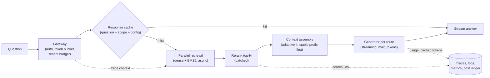

This exam covers the whole of Phase 13, **RAG Observability and Performance Engineering**: the modules [RAG Observability](/learn/rag-observability), [Performance Optimisation](/learn/performance-optimisation) and [Cost Engineering](/learn/cost-engineering). Answer the 28 multiple-choice questions without looking anything up or running any code; a score of 20 or more (about 70 per cent) is a pass, and every question you get wrong points to a lesson worth revisiting. Then attempt the design problem and the debugging problem on paper before opening the worked answers. All prices and timings are hypothetical. Allow about 90 minutes in total.

```quiz
[
  {
    "q": "In distributed tracing, what is the relationship between a trace and a span?",
    "options": [
      "A span is a collection of traces from one service",
      "A trace records one request end to end as a tree of spans, each a timed operation with attributes",
      "They are two names for the same thing",
      "A trace is a log line and a span is a metric"
    ],
    "answer": 1,
    "why": "A trace groups every span belonging to one request; each span times one operation and records its attributes and parent."
  },
  {
    "q": "The retrieval service and the generation service run in separate processes. How does the generation service's span join the same trace as the retrieval span?",
    "options": [
      "Both services use the same log file",
      "The trace context (trace ID and parent span ID) is propagated with the call, for example in a W3C `traceparent` header",
      "Spans are matched afterwards by timestamp",
      "The generation service creates a new trace and links it by user ID"
    ],
    "answer": 1,
    "why": "Context propagation carries the trace and parent identifiers across process boundaries so the receiving span becomes a child in the same trace."
  },
  {
    "q": "Why are structured (for example JSON) logs with a request identifier preferred over free-text log lines in a RAG service?",
    "options": [
      "They are smaller",
      "They can be filtered, aggregated and joined across stages by field, such as all events for one request",
      "Free text cannot contain numbers",
      "They are required by HTTP"
    ],
    "answer": 1,
    "why": "Fields make logs queryable; a shared request ID lets you reconstruct one request across retrieval, generation and checks."
  },
  {
    "q": "Which signal is most useful for detecting that retrieval quality is degrading in production, without labelled data?",
    "options": [
      "CPU utilisation of the vector database",
      "A shift in the distribution of top retrieval or reranker scores, and a rising rate of queries whose best score falls below a floor",
      "The number of documents in the index",
      "The average answer length"
    ],
    "answer": 1,
    "why": "Score distributions and low-score rates move when queries or the corpus drift away from what retrieval handles well; they need no labels."
  },
  {
    "q": "A team stores only one trace in a hundred, chosen at the start of each request. What do they lose that tail-based sampling would keep?",
    "options": [
      "Nothing; sampling is unbiased",
      "Most traces of rare errors and very slow requests, because the keep-or-drop decision is made before the outcome is known",
      "All successful requests",
      "The trace IDs"
    ],
    "answer": 1,
    "why": "Head-based sampling decides before the request runs; tail-based sampling can keep every error and slow trace after seeing the outcome."
  },
  {
    "q": "What is the most reliable source of token counts for a cost dashboard?",
    "options": [
      "Characters divided by four",
      "A tokenizer from a different vendor",
      "The usage figures returned with each model response, recorded per call with stage and model",
      "The provider's monthly invoice only"
    ],
    "answer": 2,
    "why": "Response usage figures are what the provider bills; recording them per call, with stage and model, allows attribution."
  },
  {
    "q": "Finance wants AskMeridian's spend split by department. What must the cost-tracking pipeline record on every model call?",
    "options": [
      "The full prompt text",
      "Attribution tags such as tenant or department, route and stage, alongside the token usage",
      "The user's password hash",
      "Only the total tokens"
    ],
    "answer": 1,
    "why": "Spend can only be grouped by dimensions recorded at call time; tags plus usage give per-department cost."
  },
  {
    "q": "An answer is wrong. The trace shows the correct chunk was retrieved at rank 2 and included in the prompt. Where does failure analysis place this failure first?",
    "options": [
      "Retrieval: the chunk was missing",
      "Generation or context assembly: the evidence reached the model but was not used correctly",
      "Ingestion: the document was not indexed",
      "Infrastructure: the request timed out"
    ],
    "answer": 1,
    "why": "If the evidence was in the prompt, the failure is downstream of retrieval: in how the context was assembled or how the model used it."
  },
  {
    "q": "What is the main privacy risk of logging full prompts in a RAG system?",
    "options": [
      "Logs become slower to query",
      "Prompts contain retrieved document text and user questions, which may include personal or restricted data, so logs inherit their sensitivity",
      "Prompts cannot be compressed",
      "There is no risk if logs are in JSON"
    ],
    "answer": 1,
    "why": "Logs copy the documents and questions; they need access control, redaction and retention limits like the sources."
  },
  {
    "q": "Why is p95 latency usually a better service-level target than mean latency for a RAG assistant?",
    "options": [
      "It is always lower",
      "It describes the slow experiences that a meaningful share of users actually have, which the mean hides",
      "It ignores network time",
      "Providers only report p95"
    ],
    "answer": 1,
    "why": "Latency distributions are skewed; the mean can look fine while one request in twenty is very slow."
  },
  {
    "q": "Streaming the answer token by token mainly improves which quantity?",
    "options": [
      "Total generation time",
      "Time until the user sees the first words",
      "Cost per request",
      "Retrieval recall"
    ],
    "answer": 1,
    "why": "Streaming shows output as it is generated; it reduces perceived latency, not the total time or the cost."
  },
  {
    "q": "Dense retrieval takes 80 ms and BM25 takes 30 ms. If they are run in parallel instead of in sequence, what is the approximate retrieval latency before fusion?",
    "options": ["30 ms", "50 ms", "80 ms", "110 ms"],
    "answer": 2,
    "why": "Parallel independent work takes as long as the slowest branch, not the sum."
  },
  {
    "q": "What does this code print?\n```python\nimport asyncio, time\n\nasync def call(d):\n    await asyncio.sleep(d)\n\nasync def main():\n    t = time.perf_counter()\n    await asyncio.gather(call(0.2), call(0.3), call(0.1))\n    print(round(time.perf_counter() - t, 1))\n\nasyncio.run(main())\n```",
    "options": ["0.1", "0.3", "0.6", "It raises an error"],
    "answer": 1,
    "why": "gather runs the three waits concurrently, so the total is about the longest, 0.3 seconds."
  },
  {
    "q": "Why does sorting texts by length before batching speed up embedding a corpus?",
    "options": [
      "Shorter texts are more important",
      "Each batch is padded to its longest member, so grouping similar lengths reduces wasted padding computation",
      "Models require sorted input",
      "It improves embedding quality"
    ],
    "answer": 1,
    "why": "Padding tokens cost compute but carry no information; similar-length batches minimise them."
  },
  {
    "q": "A semantic cache's similarity threshold is lowered to raise its hit rate. What is the main risk?",
    "options": [
      "Higher storage cost",
      "Returning a cached answer to a different question that happens to be similar in wording",
      "Slower cache lookups",
      "The cache stops expiring"
    ],
    "answer": 1,
    "why": "A looser threshold matches questions that differ in a crucial detail, serving confidently wrong answers."
  },
  {
    "q": "Which normalisation is generally safe for an exact-match query cache key?",
    "options": [
      "Removing all numbers",
      "Lower-casing and collapsing whitespace",
      "Replacing words with synonyms",
      "Dropping negations such as \"not\""
    ],
    "answer": 1,
    "why": "Case and whitespace rarely change meaning; numbers, synonyms and negations can."
  },
  {
    "q": "Why might moving query embedding for single, short queries to a GPU not reduce latency much?",
    "options": [
      "GPUs cannot run transformers",
      "For one short input, fixed overheads such as data transfer and kernel launches can dominate; GPUs shine on large batches",
      "GPUs are always slower than CPUs",
      "Embeddings must be computed in 64-bit"
    ],
    "answer": 1,
    "why": "GPU advantages come from parallel work on large batches; a single short query leaves most of the device idle."
  },
  {
    "q": "A pipeline's p95 latency is 4.2 s with a target of 3 s. Traces show generation at 2.6 s, reranking 50 candidates at 0.9 s, retrieval 0.2 s and the rest 0.5 s. Which change is most likely to meet the target without touching the model?",
    "options": [
      "Caching query embeddings",
      "Reranking fewer candidates or running the reranker on faster hardware",
      "Lowering the BM25 parameter k1",
      "Logging less"
    ],
    "answer": 1,
    "why": "Reranking is the largest stage you can change without touching generation; halving it saves about 0.45 s, more than any other non-model option, though meeting 3 s may also need streaming or shorter outputs."
  },
  {
    "q": "With 300-token chunks and 60 tokens of overlap, roughly how much does overlap multiply the tokens embedded for long documents?",
    "options": ["1.20", "1.25", "1.50", "5.00"],
    "answer": 1,
    "why": "Windows advance 240 tokens, so interior tokens are embedded 300 / 240 = 1.25 times."
  },
  {
    "q": "A RAG request uses 2,500 input tokens and 250 output tokens; output costs four times input. What share of the cost is output?",
    "options": ["About 9%", "About 29%", "About 50%", "About 80%"],
    "answer": 1,
    "why": "Output is 250 x 4 = 1,000 input-token equivalents; 1,000 / 3,500 is about 29%."
  },
  {
    "q": "Why does a tenant budget reserve the worst-case cost of a request before calling the model?",
    "options": [
      "To pay the provider in advance",
      "So that concurrent requests cannot all pass the balance check and overspend together",
      "Because actual cost is unknown afterwards",
      "To make the call faster"
    ],
    "answer": 1,
    "why": "Reservation makes the balance reflect in-flight requests; settlement afterwards replaces the estimate with the actual cost."
  },
  {
    "q": "A small model costs 0.003 per question and a large one 0.012. What is the break-even escalation rate of a small-then-large cascade?",
    "options": ["25%", "50%", "75%", "100%"],
    "answer": 2,
    "why": "1 - C_s / C_L = 1 - 0.25 = 0.75; above it, the cascade costs more than the large model alone."
  },
  {
    "q": "A model measures 93% on 200 evaluation questions against a 92% bar. Which statement is most accurate?",
    "options": [
      "It clearly clears the bar",
      "The standard error is about 1.8 points, so the measurement cannot show it clears the bar",
      "It clearly fails the bar",
      "The bar is irrelevant at this sample size"
    ],
    "answer": 1,
    "why": "SE = sqrt(0.93 x 0.07 / 200) = 0.018; the one-sided 95% lower bound is about 0.90."
  },
  {
    "q": "Why does 4-bit weight quantisation speed up decoding for a self-hosted model at small batch sizes?",
    "options": [
      "It reduces the number of output tokens",
      "Decoding is limited by reading the weights from memory, and 4-bit weights are a quarter of the bytes of 16-bit ones",
      "4-bit arithmetic is exact",
      "It removes the KV cache"
    ],
    "answer": 1,
    "why": "Each token reads every weight; fewer bytes per weight means less memory traffic per token."
  },
  {
    "q": "With a cache-write multiplier of 1.25 and a read multiplier of 0.10, how many reuses of a cached prompt prefix are needed to save money?",
    "options": ["At least one", "At least three", "At least ten", "Caching never saves money"],
    "answer": 0,
    "why": "Break-even is (1.25 - 1) / (1 - 0.10) = 0.28 reuses, so a single reuse already saves."
  },
  {
    "q": "A route gets one request every 20 minutes on average and the prompt cache lifetime is 5 minutes. About what fraction of requests find the prefix still cached?",
    "options": ["About 5%", "About 22%", "About 63%", "About 95%"],
    "answer": 1,
    "why": "lambda = 0.05 per minute, tau = 5, so P(warm) = 1 - e^-0.25 = 0.22."
  },
  {
    "q": "Configuration A is cheaper and less accurate than B; neither dominates the other. Failed answers have a known follow-up cost. Which comparison decides between them?",
    "options": [
      "Cost per call only",
      "Accuracy only",
      "Cost per request plus failure rate times the cost of a failure",
      "Total tokens per request"
    ],
    "answer": 2,
    "why": "Expected total cost includes the cost of failures; it can make the more expensive configuration the cheaper one overall."
  },
  {
    "q": "Suppose a cross-encoder reranker lets the generator receive 3 chunks instead of 10 with similar recall. What is the general lesson?",
    "options": [
      "Rerankers always reduce quality",
      "Spending a little on a cheaper upstream stage can save more on the expensive downstream stage",
      "Fewer chunks always means lower quality",
      "Reranking only affects latency"
    ],
    "answer": 1,
    "why": "Better ordering concentrates evidence in fewer chunks, cutting generator input tokens, which usually cost far more than reranking compute."
  }
]
```

## Design problem

AskMeridian is being opened to 2,000 staff across two companies. The product owner sets three targets: p95 time to first token under 1.5 seconds and p95 total response time under 6 seconds; a monthly model budget that is roughly four times today's for about ten times the traffic; and the ability to explain, within a day, why any individual answer was wrong. Design the observability, performance and cost architecture. Say what you would instrument, how a request flows, which optimisations you would apply in which order, and how budgets are enforced. State your assumptions.

<details><summary>Show solution</summary>

**Assumptions.** Generation dominates both latency and spend. Traffic is skewed towards common policy and IT questions. Documents have access scopes. The provider supports streaming, prompt caching and usage reporting.



**Observability.** One trace per request with spans for the gateway, cache lookup, each retriever, reranking, context assembly and generation, with context propagated across services. Span attributes: retrieved document IDs and versions, scores and ranks, the context manifest (which chunks went in, with token counts by region), model, rung of the degradation ladder, token usage including cached tokens, and stop reason. Tail-based sampling keeps every error, every slow request and every answer with negative feedback; the rest are sampled. Prompt text is stored separately with redaction and short retention. This is what makes "why was this answer wrong?" answerable within a day: the trace shows whether the evidence was retrieved, whether it reached the prompt, and what the model did with it.

**Performance, in order.** (1) Stream every answer: the cheapest way to meet the time-to-first-token target. (2) Run dense and sparse retrieval concurrently and batch the reranker; set the reranker's candidate count from measured latency. (3) Put the static instructions first, as a stable cached prefix, which shortens prefill. (4) Response cache for repeated, non-personal questions. (5) Cap output length per route, which cuts total response time and cost together. GPU acceleration for embedding and reranking only if measured stage latency justifies it.

**Cost.** Per-route generator chosen on a golden set with uncertainty bounds; prompt caching verified through cached-read metrics; response cache with permission-scoped keys and provenance-based invalidation; per-request ceilings and `max_tokens`; tenant budgets with reserve and settle and a degradation ladder; ingestion with content hashing and batch interfaces.

**Trade-offs.** Rich traces cost storage and carry sensitive data, so sampling and retention rules are part of the design. Response caching and per-route models add invalidation and evaluation work. Cheaper rungs and smaller models must be evaluated per route, and every dashboard of cost must sit next to a dashboard of quality, so that savings are never bought with unmeasured quality loss.

</details>

## Debugging problem

A week after three changes shipped together (a semantic response cache, a retry policy for model timeouts, and a switch to a cheaper generator for HR questions), the team sees: model spend up about 30% instead of down; p95 total latency up from 5 to 9 seconds; and a cluster of user reports that answers about expenses mention annual leave. Traces are available. Work out what is probably happening and how you would confirm and fix each symptom.

<details><summary>Show solution</summary>

**Wrong answers.** Answers about expenses that mention leave, after a semantic cache launch, point to false cache hits: questions such as "how many days do I have to submit expenses?" matching cached answers to "how many days of annual leave do I have?" above a too-loose similarity threshold. *Confirm* by filtering traces for cache hits on the reported questions and comparing the cached question with the new one. *Fix* by raising the threshold, adding a verification step (compare key entities or route labels before serving), or falling back to exact matching for policy questions; invalidate the affected entries.

**Latency.** A rise in p95 but not necessarily in the median suggests a tail effect. The new retry policy is the prime suspect: if a timeout triggers a full retry after a long wait, a timed-out request now costs the timeout plus a second complete generation. *Confirm* from traces: look at slow requests and count generation spans per trace. *Fix* with a shorter timeout tuned to the model's normal latency, a cap of one retry, a backoff with jitter, and streaming so that slow generations still show progress; investigate why timeouts happen (long outputs, provider rate limits).

**Spend.** Spend should have fallen with a cheaper HR model and a cache, so something is adding calls or tokens. Retries add full-price calls. The cheaper model may be producing longer answers or more reasoning tokens, or failing more often, so that users rephrase and ask again. The cache may be breaking the prompt cache if its integration changed the prompt prefix. *Confirm* by comparing, per route and before and after: calls per request, output tokens per call, cached-read share, and requests per user session. *Fix* each finding: bound retries; cap `max_tokens` and check reasoning effort on the new model; restore a stable cached prefix; re-evaluate the HR model on the golden set, comparing cost per successful answer rather than cost per call.

**The process lesson.** Three changes shipped together made attribution hard. Ship cost and performance changes one at a time behind flags, with before-and-after dashboards of cost, latency and quality per route.

</details>
