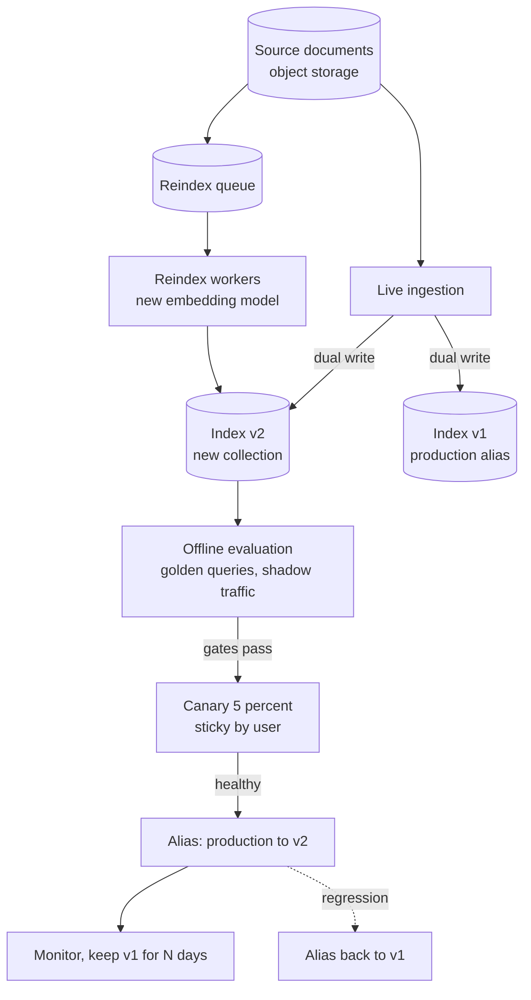

This exam covers the whole of Phase 14, **Production RAG and MLOps**: the modules [Backend Engineering](/learn/backend-engineering), [Deployment](/learn/deployment), [CI/CD and MLOps](/learn/ci-cd-and-mlops) and [Production Architecture](/learn/production-architecture). Answer the 29 multiple-choice questions without looking anything up or running any code; a score of 21 or more (about 70 per cent) is a pass, and each wrong answer points to a lesson worth revisiting. Then work through the design problem and the debugging problem on paper and compare your answers with the worked ones.

```quiz
[
  {"q": "A FastAPI endpoint declares a Pydantic request model. A client sends a JSON body with a missing required field. What does FastAPI return by default?", "options": ["A 200 response with null fields", "A 500 error from the server", "A 422 response describing which field failed validation", "A 401 response"], "answer": 2, "why": "FastAPI validates the body against the model before your function runs, and returns a 422 response with the validation errors when it fails."},
  {"q": "An `async def` endpoint calls a blocking function that takes 2 seconds (for example a synchronous embedding call). What is the consequence under load?", "options": ["FastAPI automatically moves the call to a thread", "The call fails with a timeout error", "Only that request is slow; others are unaffected", "The event loop is blocked for 2 seconds, so every request on that worker waits"], "answer": 3, "why": "An async def endpoint runs on the event loop. Blocking code in it stalls the loop. Declare the endpoint with def, or run the blocking call in a thread, so it runs off the loop."},
  {"q": "Which media type is used for a server-sent-events stream of answer tokens?", "options": ["text/event-stream", "multipart/form-data", "application/problem+json", "application/json"], "answer": 0, "why": "Server-sent events use text/event-stream, with each event as lines of text separated by a blank line."},
  {"q": "A JWT is signed with RS256. How does the API verify it?", "options": ["By decoding it; signatures are optional", "With the same shared secret used to sign", "With the issuer's public key, plus checks of the expiry, audience and issuer claims", "By calling the database for the password"], "answer": 2, "why": "RS256 is asymmetric: the issuer signs with a private key and services verify with the public key. Verification must also check claims such as exp, aud and iss."},
  {"q": "What is the purpose of a Problem Details response (RFC 9457) from a RAG API?", "options": ["To give clients one machine-readable error format with a type, title, status and detail", "To compress responses", "To authenticate users", "To stream partial answers"], "answer": 0, "why": "A consistent error body lets clients distinguish a client error from a retryable server error without parsing free text."},
  {"q": "Which HTTP status best tells a client that it is sending too many requests and when to try again?", "options": ["500", "404", "400 with no header", "429 with a Retry-After header"], "answer": 3, "why": "429 means too many requests, and Retry-After tells the client how long to wait."},
  {"q": "Running `asyncio.gather` over three coroutines that each `await asyncio.sleep(1)` takes about how long in total?", "options": ["It raises an error", "3 seconds", "About 1 second", "0 seconds"], "answer": 2, "why": "The coroutines wait concurrently on the event loop, so the total is about the longest, not the sum."},
  {"q": "In a Dockerfile for a Python RAG service, why copy requirements.txt and install dependencies before copying the application source?", "options": ["So the slow dependency layer stays cached when only source files change", "To make the image smaller by half", "To run the tests earlier", "Docker requires that order"], "answer": 0, "why": "Layers are cached in order. If the dependency layer comes before frequently changing source, edits to the code do not trigger a reinstall."},
  {"q": "What does a multi-stage Docker build give a RAG service?", "options": ["Automatic scaling", "Faster model inference", "Several containers at once", "A final image that contains the runtime and the built artefacts but not the build tools"], "answer": 3, "why": "Build tools and caches stay in earlier stages, so the image that ships is smaller and has a smaller attack surface."},
  {"q": "In Docker Compose, the API container starts before the database is ready to accept connections and crashes. Which fix is most appropriate?", "options": ["Define a health check on the database and make the API depend on it with condition service_healthy", "Run both in one container", "Restart the API forever", "Add sleep 60 to the entrypoint"], "answer": 0, "why": "A health check expresses real readiness, and depends_on with service_healthy makes Compose wait for it, instead of guessing a delay."},
  {"q": "In Kubernetes, a replica is loading a 1.5 GB model and is not yet able to serve. Which probe keeps traffic away without restarting it?", "options": ["No probe", "A startup script that sleeps", "Liveness probe failing", "Readiness probe failing"], "answer": 3, "why": "A failing readiness probe removes the pod from the Service's endpoints without killing it. A failing liveness probe restarts the container."},
  {"q": "The Horizontal Pod Autoscaler has 5 pods, a measured metric of 12 per pod and a target of 8. About how many pods does the rule ask for?", "options": ["10", "6", "7", "8"], "answer": 3, "why": "ceil(5 x 12 / 8) = ceil(7.5) = 8."},
  {"q": "Which Kubernetes object suits a self-hosted vector database node that needs a stable identity and its own persistent volume?", "options": ["A StatefulSet with volume claims", "A ConfigMap", "A Job", "A Deployment with emptyDir"], "answer": 0, "why": "A StatefulSet gives each pod a stable name and its own persistent volume claim, which stateful databases require."},
  {"q": "What does a managed vector database take off your hands, and what does it not?", "options": ["It removes the need to choose chunking and embeddings", "It guarantees retrieval quality", "It makes backups unnecessary in all cases", "It handles operations such as hardware, upgrades and replication, but you still own data modelling, access control, cost and the exit strategy"], "answer": 3, "why": "Managed means someone else runs the cluster. Schema design, tenancy, spend, lock-in and retrieval quality remain your responsibility."},
  {"q": "Where should an API key for the language-model provider live in a deployed container?", "options": ["Hardcoded in the Dockerfile", "In the image's environment as a default value committed to Git", "In a secret store or Kubernetes Secret injected at runtime", "In the README"], "answer": 2, "why": "Secrets must stay out of images and repositories; inject them at runtime from a secret manager or a Secret, with access limited."},
  {"q": "A team wants to test their retrieval code in CI on every commit without a GPU or a server. Which approach is best?", "options": ["Skip tests for retrieval code", "Run only manual checks", "Call the production vector database from CI", "Use test doubles for slow dependencies (fake embedder, in-memory store) and keep a small set of contract tests against a real local store"], "answer": 3, "why": "Fast, deterministic tests need cheap stand-ins for the slow parts, with a few contract tests to confirm the stand-ins behave like the real thing."},
  {"q": "A new embedding model with different vectors is adopted. What must happen to the index?", "options": ["Normalise the old vectors", "Nothing; vectors are interchangeable", "Re-embed every chunk into a new index version, because queries and chunks must come from the same model", "Only re-embed the queries"], "answer": 2, "why": "Different models produce different vector spaces. Mixed spaces give meaningless similarities, so the whole corpus is re-embedded into a new versioned index."},
  {"q": "Index versioning with aliases: what does promoting a new index to production normally involve?", "options": ["Renaming the code repository", "Restarting the vector database", "Deleting the old collection first", "Pointing the production alias at the new, validated collection while keeping the old one for rollback"], "answer": 3, "why": "An alias swap is a single reference change that is quick to reverse as long as the previous collection is still there."},
  {"q": "What is the main benefit of a blue-green deployment for a RAG release?", "options": ["A complete green stack can be validated on shadow traffic and golden queries, then switched in by changing one reference, with instant fallback to blue", "It removes the need for tests", "It makes index builds faster", "It halves the compute bill"], "answer": 0, "why": "Both stacks exist at the same time, so the new one is checked before users see it, and rolling back is the reverse switch."},
  {"q": "You roll back a release by re-pointing the alias at last week's index. What can still be wrong?", "options": ["Git history is lost", "Nothing; the old index is identical to current data", "Documents added or deleted since then are missing or resurrected, and the query encoder or prompts may no longer match the old index", "The alias cannot be changed"], "answer": 2, "why": "An index is a snapshot tied to a model and a time. A rollback must restore the whole matching bundle and reconcile data changes, not just the pointer."},
  {"q": "What does `git bisect` help with in a RAG repository?", "options": ["Merging branches", "Compressing history", "Splitting an index", "Finding the commit that introduced a regression by testing between a good and a bad commit"], "answer": 3, "why": "Bisect does a binary search over commits, using a test (for example a retrieval metric threshold) to find the first bad one."},
  {"q": "Which change should require evaluation results in CI before merging?", "options": ["A change to chunk size, a prompt or the embedding model", "A change to a code comment", "A change to a log message", "A change to the README"], "answer": 0, "why": "Those settings change answers without changing the code's structure, so they need evidence from an evaluation set, not just unit tests."},
  {"q": "Eight workers take 4 seconds per message. A backlog of 6,000 messages exists and 0.5 per second still arrive. About how long does the backlog take to drain?", "options": ["About 3 hours", "It never drains", "About 1 hour 6 minutes", "About 50 minutes"], "answer": 2, "why": "mu = 8/4 = 2 per second, so T = 6000 / (2 - 0.5) = 4,000 s, about 67 minutes."},
  {"q": "Why must ingestion workers be idempotent when the queue gives at-least-once delivery?", "options": ["Because the queue deletes messages early", "Because workers run on a GPU", "Because acknowledgements are optional", "Because messages can be delivered more than once, and repeated processing must not create duplicate chunks"], "answer": 3, "why": "A crash after the write but before the acknowledgement causes redelivery. Deterministic identifiers and upserts make the repeat harmless."},
  {"q": "A RAG API is I/O-bound and CPU stays at 15 per cent while latency climbs. Which autoscaling metric is most appropriate?", "options": ["CPU utilisation", "In-flight requests per replica", "Disk usage", "Image size"], "answer": 1, "why": "CPU does not reflect saturation for a service that mostly waits. In-flight requests per replica does."},
  {"q": "A query is sent to 5 shards and each must return k = 10. What does the router do next?", "options": ["Asks one shard only", "Returns all 50 results", "Merges the 50 candidates and keeps the best 10", "Keeps the first 10 results that arrive"], "answer": 2, "why": "The true top 10 could sit anywhere, so each shard returns 10 and the router keeps the overall best 10 (valid when scores are comparable)."},
  {"q": "Which load-balancing choice generally gives the best tail latency for requests of very different durations?", "options": ["Least-connections or power of two choices", "Sending everything to one replica", "Round-robin", "Random"], "answer": 0, "why": "Policies that look at in-flight load avoid piling long requests onto the same replica and route around slow ones."},
  {"q": "Replication and backup differ in that:", "options": ["Replication copies destructive changes to every node, so only an isolated, point-in-time backup can undo a deletion", "Backups are faster than replication", "Replication protects against ransomware but backup does not", "They are the same thing"], "answer": 0, "why": "Replication is for availability. A mistaken deletion or ransomware is replicated just as faithfully, so recovery needs copies the damage cannot reach."},
  {"q": "A system recovers as follows: infrastructure takes 20 minutes; then the index (50), database (25) and queue (10) in parallel; then the API (10). What is the achievable recovery time?", "options": ["115 minutes", "80 minutes", "55 minutes", "50 minutes"], "answer": 1, "why": "Critical path: 20 + 50 + 10 = 80 minutes. The parallel branches do not add up."}
]
```

## Design problem

AskMeridian's embedding provider announces that the model behind its current embeddings will be retired in four months. The Platform team must move AskMeridian (handbook, IT runbooks, around 40,000 chunks, 400 daily users) to a new embedding model without downtime, without degrading answer quality and with the ability to go back. Design the migration and release process. Cover: how the new index is built, how ingestion continues to work meanwhile, how the new index is validated, how traffic is switched, what the rollback looks like and what you would monitor afterwards. Include a diagram and state your assumptions.

<details>
<summary>Show worked answer</summary>

**Principle.** Query and chunk vectors must come from the same model, so this is a full re-embedding into a new, versioned index and a coordinated switch of the query encoder, not an in-place edit. The old index stays untouched until the new one has proven itself.



**1. Build.** Create a new collection with a name that encodes the model and date. Record a manifest with the model identifier, dimension, chunking settings and source snapshot. Enqueue every document to a reindex queue; workers chunk and embed with the new model and upsert with deterministic chunk identifiers, so retries and redeliveries are safe. Use a pool separate from live ingestion and a rate limit that respects the embedding provider's quota. With 40,000 chunks, embedding time is a few minutes to under an hour at a modest rate; compute it from the provider's documented limits, since the exact figure is an assumption.

**2. Keep ingestion correct meanwhile.** Updates and deletions arriving during the build are dual-written to v1 and v2 (the v2 write uses the new model), and deletions are also appended to a deletion log. After the bulk build, reconcile: scan the source for documents modified since the build snapshot and re-ingest them, then re-apply the deletion log, so v2 matches the source.

**3. Validate before users see it.** Run a golden query set with known relevant documents against both indexes and compare recall at k and MRR; require that no important query category regresses beyond an agreed threshold. Run shadow traffic: send real queries to v2 in the background and compare the retrieved sets and answer quality scores with v1. Check latency and memory (a different dimension changes memory: vectors times dimension times 4 bytes) and that the manifest matches what the query service will load.

**4. Switch.** The query service must load the matching encoder. Deploy it as a green stack that points at v2 with the new model (blue-green), canary 5 per cent of users with sticky assignment, watch the metrics below, then move the production alias. Never mix the new encoder with the old index; a start-up check compares the manifest's model identifier and dimension with the configured encoder and refuses to start on a mismatch.

**5. Rollback.** Keep v1, the old encoder configuration and the prompts for a period (for example two weeks). Rolling back means pointing the alias and the encoder configuration back to v1 together. Because v2 was dual-written, v1 is still current and no reconciliation is needed. If dual-writing had been skipped, a rollback would need the same reconcile step as the forward path.

**6. Monitor.** Retrieval-quality proxies (the share of questions with no result above a similarity threshold, citation click-through or thumbs-down rate), latency percentiles, error rates, token cost and embedding-provider error rates, with automatic alerts against pre-migration baselines. Decommission v1 only after the window ends and a final restore test of the v2 backup has passed.

**Assumptions and trade-offs.** Dual-writing doubles ingestion cost for the migration window but makes rollback trivial. Shadow traffic adds provider cost but is the closest approximation to real queries. If the corpus were far larger, you would rebuild in tenant or document batches and judge readiness per batch.

</details>

## Debugging problem

AskMeridian's retrieval API runs as six pods in Kubernetes. Since a release that added a local reranker, the pods restart every few minutes under the Monday-morning load. `kubectl describe pod` shows `Liveness probe failed: context deadline exceeded` followed by `Container ... failed liveness probe, will be restarted`. Metrics show CPU at 100 per cent on the pods, request latency climbing to 40 seconds before each restart, and the error rate rising after each restart. The endpoint code is:

```python
@app.post("/ask")
async def ask(req: AskRequest):
    query_vec = embedder.encode([req.question])[0]          # local model, about 30 ms of CPU
    hits = await vector_store.search(query_vec, k=20)
    ranked = reranker.predict([(req.question, h.text) for h in hits])   # local cross-encoder, about 600 ms of CPU
    return await generate(req.question, top_chunks(hits, ranked))

@app.get("/healthz")
async def healthz():
    return {"status": "ok"}
```

The Deployment has `livenessProbe` on `/healthz` with a 1-second timeout and 3 failures allowed, a single Uvicorn worker per pod, and a CPU limit of 1 core.

Explain what is happening and why the pods restart, list the changes you would make in order of priority, and say how you would verify the fix.

<details>
<summary>Show worked answer</summary>

**Diagnosis.** `ask` is an `async def` endpoint, but `embedder.encode` and especially `reranker.predict` are synchronous, CPU-bound calls. They run on the event loop and block it for about 630 ms per request. With one worker per pod, each pod can process only about 1.6 requests per second of that work, and while one request is in its blocking section nothing else on the loop runs, including the `/healthz` handler. Under Monday load, requests queue up and the loop is busy almost all the time; the probe's request waits behind them, takes longer than its 1-second timeout, and after three failures the kubelet restarts the container. The restart drops in-flight requests (the error spike), the surviving pods take the extra load and fail their probes in turn, and the cycle repeats. The 100 per cent CPU is the reranker; the 40-second latencies are queueing behind the blocked loop.

**Changes, in priority order.**

1. **Get the blocking work off the event loop.** Either declare the heavy parts to run in worker threads (`await run_in_threadpool(...)` or `asyncio.to_thread`) or make the endpoint a plain `def` so FastAPI runs it in its thread pool. Because the models are CPU-bound and PyTorch releases the global interpreter lock in its native code, threads give real parallelism up to the core count; the health endpoint now stays responsive.
2. **Separate liveness from load.** A liveness probe should answer "is the process wedged?", so make it cheap and independent of the work, and give it a realistic timeout (for example 2 to 3 seconds), a longer period and a higher failure threshold. Add a readiness probe so that a saturated or warming pod is taken out of rotation without being killed. Add a startup probe for model loading.
3. **Size for the real cost.** Capacity is cores divided by CPU time per request: with a 1-core limit and about 0.63 s of CPU each, a pod handles about 1.6 requests per second at 100 per cent utilisation, and about 1 per second at the 60 to 70 per cent planning level. Compute replicas from peak load (at 15 requests per second you need about 15 pods at that utilisation, or a cheaper reranking step), raise the CPU limit or use accelerators, and rerank fewer candidates (20 candidates cost about 600 ms; 10 would cost roughly half) or move the reranker to its own scalable pool, called by the API.
4. **Autoscale on the right signal.** Scale on in-flight requests per pod or request queue time rather than CPU (which is already pinned), with a scale-up that is fast and a scale-down that is slow, and a minimum replica count that covers the Monday peak.
5. **Protect the service when overloaded.** Add a concurrency limit and fast load shedding (429 or 503 with `Retry-After`) so excess requests are refused quickly rather than queued for 40 seconds, and graceful shutdown so restarts finish in-flight requests.

**Verification.** Reproduce in staging with a load test at the Monday request rate. Before the fix, the health endpoint's latency should rise with load; after, it should stay in the low milliseconds while `/ask` latency reflects its own work. Watch probe failures, restart counts, in-flight requests, CPU per pod and p95 latency across the test and again on the next Monday. Add a regression test that issues a health request while several `/ask` requests are in flight and asserts a fast reply.

</details>
