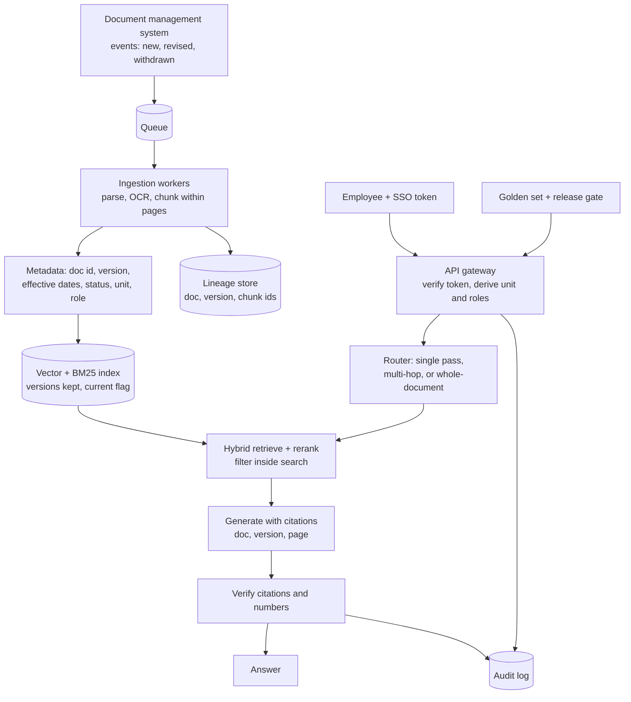

This exam covers the whole of Phase 16, **Advanced Research and Capstone Engineering**: the modules [Advanced RAG Research](/learn/advanced-rag-research), [Enterprise RAG System Design](/learn/enterprise-rag-system-design) and [Capstone Projects](/learn/capstone-projects). Answer the 28 multiple-choice questions without looking anything up or running code; a score of 20 or more (about 70 per cent) is a pass. Then attempt the design problem and the debugging problem on paper before opening the worked answers. Numerical questions state their assumptions: treat them as the whole truth for the question, not as real prices or limits.

```quiz
[
  {
    "q": "Which statement best separates established RAG practice from active research?",
    "options": [
      "Anything published on arXiv is established",
      "Hybrid retrieval with reranking and measured evaluation is widely used; many agentic and reasoning-based variants are still being validated",
      "Graph RAG is established and dense retrieval is experimental",
      "Research results transfer unchanged to any corpus"
    ],
    "answer": 1,
    "why": "Hybrid retrieval, reranking and golden-set evaluation are mainstream engineering. Many newer designs have results on specific benchmarks and need validating on your own data before you rely on them."
  },
  {
    "q": "REALM (Guu et al., 2020) is notable because it",
    "options": [
      "pretrained a language model together with a retriever, so that retrieval is learned during pretraining",
      "replaced the Transformer with a recurrent network",
      "used only keyword retrieval",
      "removed the need for any training data"
    ],
    "answer": 0,
    "why": "REALM trains a masked language model jointly with a knowledge retriever, backpropagating through retrieval, which is the core idea of retrieval-augmented pretraining."
  },
  {
    "q": "A RETRO-style model (Borgeaud et al., 2022) differs from ordinary prompt-stuffing RAG mainly in that it",
    "options": [
      "retrieves only at the end of generation",
      "never uses neighbouring text",
      "needs no retrieval database",
      "incorporates retrieved chunks inside the network through cross-attention during training and inference"
    ],
    "answer": 3,
    "why": "RETRO retrieves neighbour chunks for pieces of the input and attends to them through chunked cross-attention, rather than only pasting text into the prompt."
  },
  {
    "q": "A team has 40 stable pages of policy and low traffic. Which argument most favours putting everything in the prompt instead of building retrieval?",
    "options": [
      "Retrieval is always more accurate",
      "The corpus fits comfortably in the context window, so retrieval adds machinery and a failure mode without a size benefit",
      "Long contexts never cost money",
      "Models ignore the order of text in the context"
    ],
    "answer": 1,
    "why": "When the corpus is small and fits, a long-context prompt avoids chunking and retrieval errors. Cost per query and per-user access control are the counterweights, and they must be checked."
  },
  {
    "q": "The 'lost in the middle' finding (Liu et al., 2023) suggests that when relevant information is placed in a long context, models",
    "options": [
      "use all positions equally",
      "attend only to the final token",
      "often use information at the start or end more reliably than information in the middle",
      "cannot read more than 2,000 tokens"
    ],
    "answer": 2,
    "why": "Performance on multi-document tasks was observed to fall when the relevant passage sat in the middle of a long context, which is why ordering and selection of context matter."
  },
  {
    "q": "In dense passage retrieval training with in-batch negatives, a batch has 32 question-passage pairs, one positive each, and no extra hard negatives. How many negative passages does each question see?",
    "options": [
      "1",
      "32",
      "0",
      "31"
    ],
    "answer": 3,
    "why": "Each question treats the other 31 questions' positive passages as negatives."
  },
  {
    "q": "A retriever fine-tuned on 5,000 synthetic question-passage pairs scores much higher on a test set built from the same generator. What is the main risk in believing the improvement?",
    "options": [
      "Fine-tuning can only lower scores",
      "The test set shares the training distribution, so the gain may not transfer to real user queries",
      "Synthetic data cannot be used for embeddings",
      "Higher scores prove better generation"
    ],
    "answer": 1,
    "why": "A test drawn from the training generator measures fit to that distribution. Real queries differ, so evaluate on held-out, realistic queries."
  },
  {
    "q": "In ColBERT-style late interaction, the relevance score of a document for a query is computed by",
    "options": [
      "a single dot product between two pooled vectors",
      "BM25 over the token ids",
      "running a cross-encoder over the pair",
      "summing, over query tokens, the maximum similarity to any document token"
    ],
    "answer": 3,
    "why": "MaxSim takes, for each query token embedding, its best match among the document's token embeddings, then sums these maxima."
  },
  {
    "q": "A query has two token vectors and a document three, with similarity matrix rows [0.9, 0.1, 0.2] and [0.3, 0.8, 0.4]. What is the MaxSim score?",
    "options": [
      "1.7",
      "1.2",
      "2.4",
      "0.85"
    ],
    "answer": 0,
    "why": "Row maxima are 0.9 and 0.8, and their sum is 1.7."
  },
  {
    "q": "What is the principal storage cost of late interaction compared with a single-vector-per-passage index?",
    "options": [
      "It stores nothing but text",
      "It cannot be stored on disk",
      "It stores one vector per token, so the index is much larger",
      "It stores one vector per corpus"
    ],
    "answer": 2,
    "why": "Keeping per-token embeddings multiplies the number of vectors by roughly the passage length in tokens, before any compression."
  },
  {
    "q": "A question needs 'the manager of the team that owns system X'. Which planning approach most directly addresses it?",
    "options": [
      "A single larger k",
      "Decomposing into sequential sub-questions where the second depends on the first answer",
      "Removing stopwords",
      "Lowering the similarity threshold"
    ],
    "answer": 1,
    "why": "The second lookup uses information from the first. Iterative or sequential planning, or a graph walk, handles this; a larger k does not."
  },
  {
    "q": "Interleaving retrieval with reasoning steps, as in IRCoT (Trivedi et al., 2022), is aimed at",
    "options": [
      "reducing the vector dimension",
      "multi-step questions where each reasoning step suggests what to retrieve next",
      "removing the need for a language model",
      "caching embeddings"
    ],
    "answer": 1,
    "why": "Each step of a chain of thought is used to retrieve evidence for the next step, which helps questions that cannot be answered from one search."
  },
  {
    "q": "A paper reports that a new RAG variant beats a baseline by 4 points on one benchmark. What is the most responsible reading?",
    "options": [
      "It will improve your system by 4 points",
      "It is a hypothesis to test on your data, with the baseline, the metric and the sample size checked",
      "It is false",
      "It makes the baseline obsolete"
    ],
    "answer": 1,
    "why": "Benchmark gains depend on data, baselines, tuning effort and metrics. Replicating on your own golden set is the only reliable test."
  },
  {
    "q": "Which requirement belongs in a non-functional requirements list for an enterprise RAG system?",
    "options": [
      "Answers cite their sources",
      "The system can ingest PDFs",
      "The 95th-percentile time to first token is under 2 seconds",
      "Users can ask questions in English"
    ],
    "answer": 2,
    "why": "Latency targets describe how well the system performs, which is what non-functional requirements capture. The others describe what it does."
  },
  {
    "q": "Why should requirements gathering include an inventory of access-control rules before choosing an architecture?",
    "options": [
      "Access rules decide the colour of the interface",
      "Permissions determine where filtering must live and may force index partitioning, which is costly to retrofit",
      "Access rules only matter after launch",
      "Vector databases ignore permissions"
    ],
    "answer": 1,
    "why": "Whether permissions are per tenant, group or document changes the index design and filtering strategy, so it is a first-order architectural input."
  },
  {
    "q": "A prototype RAG pipeline retrieves, then generates once. When is moving to an agentic design most justified?",
    "options": [
      "When latency must be minimised",
      "When most questions need several dependent retrievals and a single pass measurably fails them",
      "When the corpus is tiny",
      "Always, because agents are newer"
    ],
    "answer": 1,
    "why": "Agents add latency, cost and failure modes. They are justified when measured failures of the single-pass pipeline are caused by questions that need iteration."
  },
  {
    "q": "A vector database is being chosen. Which criterion is a genuine fit question rather than a brand preference?",
    "options": [
      "Whether it supports the metadata filtering your access model needs, applied inside the search",
      "Whether its logo is familiar",
      "Whether it was released most recently",
      "Whether it has the most GitHub stars"
    ],
    "answer": 0,
    "why": "Filtered search semantics, scale, operations burden and cost against your requirements decide fit. Popularity does not."
  },
  {
    "q": "There are 5,000,000 chunks embedded with a 384-dimensional model stored as 32-bit floats. About how large are the raw vectors, ignoring index overhead?",
    "options": [
      "About 7.7 GB",
      "About 770 MB",
      "About 77 GB",
      "About 1.9 GB"
    ],
    "answer": 0,
    "why": "5,000,000 x 384 x 4 bytes = 7.68 billion bytes, about 7.7 GB. An index such as HNSW adds overhead on top."
  },
  {
    "q": "With the same 5,000,000 vectors, 8-bit scalar quantisation of each dimension reduces the raw vector storage to roughly",
    "options": [
      "7.7 GB",
      "3.8 GB",
      "1.9 GB",
      "0.5 GB"
    ],
    "answer": 2,
    "why": "One byte per dimension instead of four reduces the vectors to a quarter, about 1.9 GB, at some cost in recall that must be measured."
  },
  {
    "q": "Peak load is 5 queries per second and the mean time per query in the system is 1.2 seconds. How many queries are in flight on average at peak?",
    "options": [
      "4.2",
      "0.24",
      "6",
      "1.2"
    ],
    "answer": 2,
    "why": "Little's law: L = lambda x W = 5 x 1.2 = 6."
  },
  {
    "q": "Which is the most reliable way to scale read throughput for a vector search that is CPU-bound and read-heavy?",
    "options": [
      "Add replicas so queries are spread across copies of the index",
      "Increase the embedding dimension",
      "Disable the filter",
      "Reduce the golden set"
    ],
    "answer": 0,
    "why": "Replication adds read capacity and availability. Sharding addresses data too big for one node, which is a different problem."
  },
  {
    "q": "An availability target of 99.95 percent over 30 days leaves an error budget of about",
    "options": [
      "2.2 minutes",
      "216 minutes",
      "4.3 minutes",
      "21.6 minutes"
    ],
    "answer": 3,
    "why": "(1 - 0.9995) x 43,200 minutes = 21.6 minutes."
  },
  {
    "q": "Assume 3 USD per million input tokens. A service handles 2,000 questions a day for 30 days with 4,000 input tokens each. What is the monthly input cost?",
    "options": [
      "72 USD",
      "7,200 USD",
      "720 USD",
      "7.2 USD"
    ],
    "answer": 2,
    "why": "60,000 questions x 4,000 tokens = 240 million tokens, and 240 x 3 = 720 USD. Output tokens would add to this."
  },
  {
    "q": "A capstone brief for a PDF assistant should specify what happens for a scanned page. The best requirement is",
    "options": [
      "Scanned pages are ignored silently",
      "The system reports which pages have no extractable text and does not claim to answer from them",
      "The system guesses the content",
      "The model reads the filename"
    ],
    "answer": 1,
    "why": "Honest failure is a requirement: the user must learn that those pages were not read, rather than discover it through wrong answers."
  },
  {
    "q": "In the enterprise knowledge base capstone, why must a search method require a Principal argument?",
    "options": [
      "To make the code shorter",
      "So that no code path can search without access control, making the secure path the only path",
      "Because vector databases demand it",
      "To speed up queries"
    ],
    "answer": 1,
    "why": "Defence by construction: if the type signature requires the verified principal, forgetting the filter is not possible."
  },
  {
    "q": "A hybrid scorecard shows hybrid beats dense on keyword queries but loses to it on paraphrases. Which response is most defensible?",
    "options": [
      "Declare hybrid the winner by overall average",
      "Report per type, then weight, route by query type or accept the trade-off knowingly, with held-out evidence",
      "Remove BM25",
      "Remove the golden set"
    ],
    "answer": 1,
    "why": "Fusion can raise the floor and lower the ceiling. The decision should rest on the query mix and held-out measurement, not an overall average."
  },
  {
    "q": "A multimodal test run uses a stub image embedder that ignores pixels. What may the report claim?",
    "options": [
      "Image retrieval quality is good",
      "Image retrieval quality is measured as 100 percent",
      "The pipeline code works; image quality was not measured",
      "Charts are supported"
    ],
    "answer": 2,
    "why": "A stub verifies plumbing only. Claims about image retrieval need the real model on real pages."
  },
  {
    "q": "Which metric best tests whether a Graph RAG retriever can answer a three-hop question?",
    "options": [
      "Whether the top result is relevant",
      "Evidence completeness: whether all documents in the gold chain are in the context",
      "Average cosine similarity",
      "Index size"
    ],
    "answer": 1,
    "why": "A chain needs every link. Partial evidence leaves the question unanswerable even when each retrieved document is relevant."
  },
  {
    "q": "An agent run must always end with a defined status. Which design achieves this regardless of the model's output?",
    "options": [
      "A prompt asking the model to stop",
      "Step, search and spend limits and repeat detection enforced in code before each action",
      "A larger context window",
      "Retrying until the model stops"
    ],
    "answer": 1,
    "why": "Guarantees must come from code. A prompt is a request and a confused model can ignore it."
  },
  {
    "q": "A release gate passes a change, yet users report answers citing superseded documents. The most likely root cause is that",
    "options": [
      "The gate was too strict",
      "The golden set contained no questions where superseded and current documents compete",
      "The vector database was too fast",
      "Faithfulness was above its floor"
    ],
    "answer": 1,
    "why": "A gate can only fail on what the golden set measures. Each reported failure should become a permanent golden-set question."
  }
]
```

## Design problem

Brightwater Bank has 5,000 staff and wants an internal policy assistant over about 2 million pages of policies, procedures, product terms and regulatory circulars. Documents are revised often; each revision supersedes the last, and regulators may ask "what did the assistant tell this employee on this date, and from which document version?". Access varies: retail staff may not see investment-banking procedures. Answers must cite document and version. Leadership asks whether they should skip retrieval and use a long-context model with the whole corpus in the prompt.

Write the design. Cover requirements, the long-context question with numbers, architecture, access control, evaluation, capacity and cost with stated assumptions, reliability, and the main trade-offs.

<details><summary>Show worked answer</summary>

**Requirements.** Functional: answer from current documents with citations to document, version and page; support "as of date" questions; refuse when the corpus does not contain the answer. Non-functional (assumed targets): 99.5 percent monthly availability, p95 time to first token under 2 seconds, p95 full response under 8 seconds, index freshness within 15 minutes of a revision, citation validity of 100 percent on the golden set, and a complete audit record (user, question, retrieved chunk ids with versions, answer, model, timestamp) retained for the period compliance specifies. Access: per business unit and, for some documents, per role.

**Long context versus RAG, with numbers.** Two million pages at roughly 500 tokens a page is about 1 billion tokens, thousands of times beyond any context window, so the whole corpus cannot go in the prompt. Even a 200-page subset for one question is about 100,000 tokens: at an assumed 3 USD per million input tokens that is 0.30 USD per question, against roughly 0.012 USD for 4,000 tokens of retrieved context, a ratio of about 25. Per-user access control is also impossible to enforce by pasting documents into a prompt, whereas retrieval can filter before anything reaches the model. Long context remains useful *inside* the design, for questions about one or two long documents, where a whole-document read can beat chunk retrieval; the router sends those to a document-level path. The decision is therefore RAG for the corpus, with long context as a targeted tool.



**Architecture.** Event-driven ingestion from the document management system through a queue and idempotent workers (content hash per document version). Chunks never cross pages and carry document id, version, effective-from and effective-to dates, status (current, superseded, withdrawn), business unit and role. A revision indexes the new version and marks the old one superseded rather than deleting it, because regulators may ask what the assistant said on a past date; retrieval filters on `status = current` by default and on effective dates for "as of" questions. Retrieval is hybrid dense plus BM25 (policy and product codes are exact-match heavy), fused by RRF, then cross-encoder reranking of about 20 candidates. A router sends most questions down the single-pass path, multi-document or dependent questions to a bounded agentic path with the guards from the agentic capstone, and "summarise this one document" to a whole-document long-context call.

**Access control.** The token's verified claims (unit, roles) produce the filter, applied inside both retrievers; the search method requires the principal; missing metadata means invisible; caches are keyed by unit, roles and index version. The agentic path inherits the same filtered search. Withdrawn documents are filtered for everyone except an audit role.

**Evaluation.** A golden set of at least 200 questions, stratified by type (single fact, procedure, comparison across documents, "as of" date, unanswerable) and by principal (retail, investment banking, compliance), including superseded-document traps and access attacks. Metrics: recall@k and MRR per type; evidence completeness for multi-document questions; citation validity; faithfulness on a human-reviewed sample; a count of answers citing a non-current document (must be zero for non-"as of" questions); a leakage property test across all principals; and latency and cost per question. Release gate on every change, plus a weekly run against live traffic samples, which grows the set.

**Capacity and cost (assumptions).** 2 million pages at about 4 chunks per page gives 8 million chunks; keeping three versions on average gives up to 24 million. At 768 dimensions in 32-bit floats, raw vectors are 24,000,000 x 768 x 4 = about 73.7 GB, before index overhead and payloads; 8-bit scalar quantisation cuts the vectors to about 18 GB at some recall cost to be measured, and filtering `current` reduces what most queries touch. Load: 5,000 users at 4 questions a day in 8 hours is about 0.7 queries per second on average, perhaps 3 at peak; at 6 seconds per query, Little's law gives about 18 in flight at peak, which sets worker and model-concurrency limits and motivates streaming. Cost: with 20,000 questions a day, 4,000 input and 400 output tokens each, and assumed prices of 3 and 15 USD per million tokens, each question costs about 0.018 USD, or about 360 USD a day and roughly 7,900 USD over 22 working days; model choice and context size are the levers, and a cache for exact repeats is safe while a semantic cache needs its own accuracy and access tests.

**Reliability.** Replicated index nodes across zones; sharding by corpus size as it grows; a queue that absorbs ingestion bursts; degraded modes (retrieval-only results with a banner if the model fails; read-only service if ingestion is down); health versus readiness probes; error budget of about 216 minutes a month at 99.5 percent, spent deliberately on deployments; blue-green index swaps with the previous index retained for rollback; and a rehearsed disaster-recovery restore from backups and the lineage store.

**Trade-offs.** Keeping superseded versions satisfies audit and as-of questions but makes the current-flag filter mandatory and increases storage by roughly the version count. Reranking adds a few hundred milliseconds and is justified by citation precision; the golden set must show the gain. A router adds a component that can misroute; its accuracy needs its own labelled set, with single-pass as the safe default. Quantisation saves memory but can lose recall. A hosted model API simplifies operations but raises data-handling and residency questions that compliance must approve; self-hosting inverts that. Fine-tuning a retriever to bank vocabulary may help but needs held-out realistic queries to prove it, and is not part of version one.

</details>

## Debugging problem

Brightwater's team fine-tuned their embedding model on 8,000 synthetic question-passage pairs generated by an LLM from the policy corpus. On the held-out portion of the same synthetic set, recall@5 rose from 0.71 to 0.89. They deployed it, re-embedded everything, and after two weeks the help desk reports that questions using newly launched product names and staff nicknames for products often retrieve the wrong policy. The weekly live-traffic sample shows recall@5 of 0.64, lower than the 0.71 the old model scored on the same sample. Latency and error rates are unchanged. The team asks you what went wrong and what to do.

<details><summary>Show worked answer</summary>

**Diagnosis.** Three causes plausibly combine, in order of likelihood.

1. **Evaluation did not measure the deployment distribution.** The 0.89 was measured on held-out pairs from the *same synthetic generator* as the training data. The generator wrote tidy questions using the documents' own vocabulary, so the improvement measures fit to that style. Real users use nicknames, abbreviations and new product names that the generator never produced. The gain was real on its test and irrelevant to the traffic.
2. **Overfitting and domain shift in the fine-tuned model.** Fine-tuning on a fixed corpus can pull representations toward the training vocabulary and degrade generalisation to terms absent from training. New product names appear in documents added after fine-tuning, so the model has no learned association for them, and may have lost some of the base model's broader robustness. Possible lexical gaps are exactly what a keyword component would cover.
3. **A missing lexical safety net or a stale configuration.** If retrieval is dense-only, a new identifier or nickname has no fallback. Also check that *all* chunks were re-embedded with the new model and that queries use it; a mix of old and new vectors in one index is a classic cause of sudden degradation, with no errors and no latency change.

**How to confirm.**

- Run the live-traffic sample through the old and the new model side by side and bucket queries: those containing terms not in the training corpus (new products, nicknames) against the rest. Expect the regression to concentrate in the first bucket.
- Check the index: count vectors by embedding-model version; the number should be one. Verify the query path uses the same model name and normalisation.
- Compare with BM25 and hybrid on the same sample. If BM25 retrieves the new product names well, the lexical gap is confirmed.
- Look at the synthetic training set: what share of questions contain no abbreviations or nicknames, and how similar are they to their source passages? Measure lexical overlap between question and passage; if it is high, the training taught lexical matching dressed up as semantics.

**Fix, in order.**

1. **Contain.** Roll back to the previous model and index version (retained for exactly this), or route to the old model, and confirm recall on the sample returns to 0.71. Do this first; diagnosing under live degradation is the more expensive path.
2. **Repair the evaluation.** Build a golden set from real queries, including nicknames, new products and abbreviations, and keep it disjoint from any training data. Make a gate that requires the candidate to beat the baseline on this set, per query type, before deployment.
3. **Retrain properly.** Add real or realistically perturbed queries (nicknames, abbreviations) and hard negatives mined from the corpus, hold out a realistic test set, and compare against the base model with hybrid retrieval, since a hybrid of the base model and BM25 may beat a fine-tuned dense-only model with far less risk. Consider a periodic re-fine-tuning or a lighter adaptation if the vocabulary keeps changing.
4. **Add safety nets.** Hybrid retrieval with BM25 for identifiers and new terms; a query-log check that flags queries whose top score is low; and a synonym or alias table for staff nicknames maintained with the product team.
5. **Operate.** Track the live-sample recall weekly as a monitored metric with an alert, so a regression like this is caught in days, and record the model version in every trace.

**Lesson.** A strong benchmark number on a convenient test set is a hypothesis about production, not evidence of it. The control that would have prevented this incident is a gate on realistic held-out queries, and the control that limits the damage is a rollback that takes minutes.

</details>
