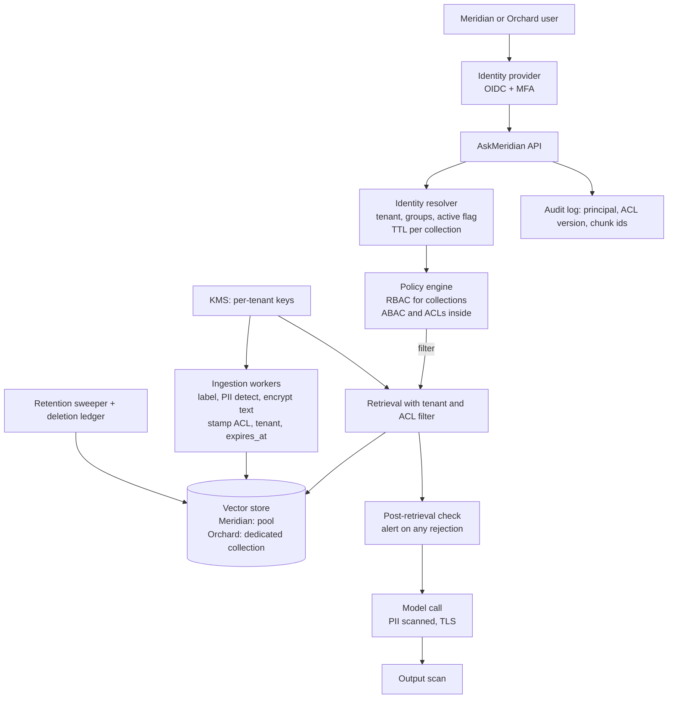

This assessment covers the whole module: authentication and identity freshness, authorisation models, role-based access control, document-level permissions, tenant isolation, encryption, PII detection and data retention. It has a quiz of 18 questions, open conceptual questions, three coding exercises with runnable solutions, an architecture design challenge and three troubleshooting scenarios. The pass mark for the quiz is 13 out of 18 (about 72 percent). Attempt the open questions before opening the model answers; the solutions are reference answers, not the only acceptable ones.

```quiz
[
  {"q": "Which statement correctly distinguishes OAuth 2.0 from OpenID Connect?", "options": ["OAuth 2.0 is for mobile apps only", "OpenID Connect delegates API access and OAuth 2.0 identifies users", "OAuth 2.0 delegates API access; OpenID Connect adds a standard layer for learning who the user is", "They are two names for the same protocol"], "answer": 2, "why": "OAuth 2.0 is a delegated-authorisation framework that does not define user identity. OpenID Connect adds the ID token and userinfo to provide authentication."},
  {"q": "A JWT's signature verifies and it has not expired. What does that establish about its `groups` claim?", "options": ["That the groups are currently correct", "That the identity provider issued exactly this payload at issue time, which may now be stale", "That the user is still employed", "That the groups were checked against the directory on this request"], "answer": 1, "why": "A signature proves origin and integrity at issue time. Membership can change before expiry, so sensitive collections need a fresher source such as a directory lookup."},
  {"q": "A Slack bot calls AskMeridian with its own service token and no indication of which user it acts for. What should the API grant?", "options": ["The bot's default all-staff access", "The access of the most recent user", "Read access to every collection, because the bot is trusted", "No document access"], "answer": 3, "why": "A service that cannot name the user it acts for must get the safe zero value. Defaults that grant access turn mistakes into disclosures, and this is the confused-deputy risk."},
  {"q": "Under deny-overrides with default deny, a request matches one allow rule and one deny rule. The decision is:", "options": ["Deny", "Allow", "Whichever rule is listed first", "An error"], "answer": 0, "why": "Any matching deny wins, regardless of order. That is what lets broad grants coexist with narrow exceptions."},
  {"q": "What does this code print?\n```python\nroles = {\"employee\": {\"read:handbook\"}, \"hr\": {\"read:cases\"}}\nparents = {\"hr\": [\"employee\"]}\ndef perms(r):\n    p = set(roles[r])\n    for q in parents.get(r, []):\n        p |= perms(q)\n    return p\nprint(sorted(perms(\"hr\")))\n```", "options": ["['read:cases']", "['read:handbook']", "['read:cases', 'read:handbook']", "[]"], "answer": 2, "why": "The hr role holds read:cases and inherits read:handbook from employee, so the union is both, sorted alphabetically."},
  {"q": "Which placement is the primary access control for a RAG system, with the others as backstops?", "options": ["A system prompt telling the model to hide restricted facts", "A permission filter applied inside retrieval, derived from the verified principal", "A classifier on the generated answer", "A warning banner for users"], "answer": 1, "why": "Filtering inside retrieval keeps forbidden chunks from ever reaching the model. The other options act on text the model has already seen, or do not enforce anything."},
  {"q": "Access depends on 6 products, 5 regions and 2 plan tiers. Encoding each combination as a role needs how many roles?", "options": ["13", "30", "36", "60"], "answer": 3, "why": "Combinations multiply: 6 x 5 x 2 = 60 roles, versus 13 attribute values. This is role explosion."},
  {"q": "Where should nested group membership be resolved when filtering chunks by ACL?", "options": ["On the query side, producing the user's full principal set", "At ingestion, into usernames written on every chunk", "Inside the language model", "In the browser"], "answer": 0, "why": "Query-side resolution makes membership changes immediate and avoids re-indexing. Index-side expansion forces a rewrite of chunk ACLs on every change."},
  {"q": "What does this code print?\n```python\nhits = [(\"a\", \"hr\"), (\"b\", \"all\"), (\"c\", \"hr\"), (\"d\", \"all\")]  # ranked best first\nallowed = {\"all\"}\nprint([h[0] for h in hits[:3] if h[1] in allowed])\n```", "options": ["['b', 'd']", "['b']", "['a', 'c']", "[]"], "answer": 1, "why": "This is post-filtering: take the top 3 (a, b, c) and then drop forbidden ones, leaving only b. The permitted d, ranked fourth, is never reached."},
  {"q": "A user may read 5 percent of the corpus. A post-filter fetches 100 candidates. Roughly how many permitted results do you expect, assuming independence?", "options": ["100", "50", "5", "0.5"], "answer": 2, "why": "Expected permitted candidates are n x p = 100 x 0.05 = 5, and with variance the result is short of 5 roughly half the time."},
  {"q": "A semantic cache is shared by all tenants and returns a stored answer when a new query is similar enough. What is the risk?", "options": ["Cached answers become too short", "A tenant can receive an answer built from another tenant's documents", "The cache cannot store vectors", "Queries become slower"], "answer": 1, "why": "Similarity of two questions says nothing about who asked. Without the tenant in the key, a similar question from another tenant can hit the stored entry."},
  {"q": "The tenant is bound in a ContextVar in the request thread, and a task is submitted to a ThreadPoolExecutor worker that calls require_tenant(). What happens?", "options": ["It sees the request's tenant", "It sees the last tenant any thread used", "It receives a default tenant", "It raises, because the worker's context is empty, so the code fails closed"], "answer": 3, "why": "Pool worker threads start with an empty context. Tenant-scoped code therefore fails loudly unless the tenant is passed or the context is copied deliberately."},
  {"q": "Which threat is NOT addressed by encryption at rest of the vector database's disks?", "options": ["An authorised application querying without a tenant filter", "A stolen disk", "A leaked backup file", "A decommissioned drive"], "answer": 0, "why": "The database decrypts transparently for any authorised client, so a missing filter leaks with encryption on. Encryption at rest protects storage taken without the running service."},
  {"q": "What does crypto-shredding accomplish?", "options": ["It overwrites free disk space", "It removes entries from the vector index", "Destroying a tenant's key makes every copy of that tenant's encrypted data unreadable, including backups", "It re-encrypts data with a stronger algorithm"], "answer": 2, "why": "Without the key, ciphertext in any copy is unreadable. It works only for data encrypted under that key and with no plaintext copies elsewhere."},
  {"q": "What does this print?\n```python\ndef luhn_ok(s):\n    total = 0\n    for i, ch in enumerate(reversed(s)):\n        d = int(ch) * (2 if i % 2 else 1)\n        total += d - 9 if d > 9 else d\n    return total % 10 == 0\nprint(luhn_ok(\"4111111111111111\"), luhn_ok(\"4111111111111112\"))\n```", "options": ["True True", "True False", "False True", "False False"], "answer": 1, "why": "4111111111111111 is a widely used test card number that satisfies the Luhn check. Changing the last digit breaks the check digit, so the second call returns False."},
  {"q": "A corpus has 1,000,000 chunks, 2 percent contain PII, and the detector has recall 0.90. How many PII-containing chunks go undetected?", "options": ["200", "1,000", "20,000", "2,000"], "answer": 3, "why": "PII chunks: 1,000,000 x 0.02 = 20,000. Missed: 20,000 x (1 - 0.90) = 2,000."},
  {"q": "What does this print?\n```python\nnow = 1000\nitems = {\"a\": 900, \"b\": 1000, \"c\": 1100, \"d\": None}\nprint(sorted(k for k, v in items.items() if v is not None and v <= now))\n```", "options": ["['a']", "['a', 'b']", "['a', 'b', 'd']", "['a', 'b', 'c']"], "answer": 1, "why": "Items a and b have expiry at or before now. c is in the future and d has no expiry (None), which is excluded, as a null expiry should never match an age-based sweep."},
  {"q": "Retention is 14 days, the sweep runs daily, and backups are kept for 30 days. What is the worst-case time until the data is gone from all backups?", "options": ["14 days", "30 days", "45 days", "44 days"], "answer": 2, "why": "Retention plus sweep interval plus backup retention: 14 + 1 + 30 = 45 days."}
]
```

## Conceptual questions

1. **The confused deputy.** AskMeridian's Slack bot calls the API with a long-lived service key and passes the Slack user's email in a JSON field. Explain what is wrong and how to fix it.

<details><summary>Show model answer</summary>

The API trusts an unverified claim: any caller holding the key (or any compromised service) can pass any email and receive that person's access, and nothing checks that the account is active. The bot is a confused deputy: privileged on its own behalf, acting for users without carrying their authority. The fix has three parts. The bot obtains a short-lived, signed token that identifies the user (token exchange or an on-behalf-of flow with the identity provider), so the API verifies a `sub` rather than reading a field. The API resolves groups and the `active` flag from the directory with a TTL chosen per collection sensitivity. And the bot's own credential is demoted so that, without an `act_for` subject, it has no document access. Both identities go into the audit log.

</details>

2. **Choosing the model.** For each requirement, say whether RBAC, ABAC, document ACLs or relationship-based access control is the best fit and why: (a) all HR partners may search the HR case collection; (b) access to pricing notes depends on product, region and tier; (c) a design document is shared with three named colleagues and a team folder; (d) a manager may read reports for people below them in the organisation chart.

<details><summary>Show model answer</summary>

(a) RBAC: a stable job function maps to a collection. (b) ABAC: three independent attributes would cause role explosion, so write rules over attributes stamped on chunks. (c) Document ACLs mirrored from the source system: the audience is specific to the document. (d) Relationship-based: access follows a hierarchy that changes with the org chart, which a graph models naturally, with the caveat that retrieval needs a list-objects capability or denormalised ACLs to build a filter. Real systems combine them: RBAC for collections, ACLs and attributes inside.

</details>

3. **Freshness.** A colleague proposes caching directory lookups for an hour to reduce load. Discuss the trade-off and propose a policy.

<details><summary>Show model answer</summary>

The TTL is exactly the staleness window: a removed group membership or a disabled account stays effective for up to an hour. The load saving is real but small, since lookups scale with users divided by TTL, not with questions. Propose a TTL per collection: about a minute for HR and finance collections, perhaps 15 minutes for general documentation. Add a push path for revocations (a small shared store of revoked subjects checked on every request), fail closed when the directory is unreachable for sensitive collections, allow bounded stale-if-error for low-sensitivity ones, and single-flight lookups so expiry does not stampede the directory.

</details>

4. **What encryption does and does not do.** A security reviewer asks whether "the vector database is encrypted, so embeddings are safe". Give a precise answer.

<details><summary>Show model answer</summary>

Disk and snapshot encryption protects against theft of storage or backups without the running service, which is valuable. It does not protect against an authorised client asking the wrong question, which is how most RAG leaks happen, so access control is the control for that. Embeddings are also not anonymous: published inversion research recovers much of the original text from dense embeddings, so the vector index should be protected like the source documents. Vectors cannot practically be encrypted and still searched, so the design is to encrypt text payloads at the application level with per-tenant keys, keep vectors and filter fields in clear behind strict access control, and document the residual risk.

</details>

5. **Retention, hold and deletion.** Distinguish a retention schedule, a legal hold and a deletion request, and explain why backups complicate all three.

<details><summary>Show model answer</summary>

A retention schedule is a standing rule that says how long a category is kept. A legal hold suspends the schedule for data needed for litigation or investigation and must be placed before data expires. A deletion request is an individual's request to erase their data, which may be refused or limited by other obligations. Backups are immutable copies on their own schedule, so deleted data persists there until the backup expires. The options are short documented backup retention, crypto-shredding with per-tenant or per-subject keys, and a deletion ledger replayed after every restore so deleted data is not resurrected. Guarantees should be stated as worst-case bounds: retention plus sweep interval plus backup retention.

</details>

## Coding exercises

1. **Pre-filter versus post-filter.** Build a corpus of 1,000 random unit vectors where 5 percent of chunks are readable by `group:hr` and the rest by `group:all-staff`. Implement `search(query, principals, k, mode)` with `mode="pre"` and `mode="post"`. Over 200 random queries, measure how many of the 5 requested results are missing, for a user who is only in `group:hr`.

<details><summary>Show solution</summary>

```python
import numpy as np

rng = np.random.default_rng(0)
N, DIM, K = 1000, 16, 5
vectors = rng.normal(size=(N, DIM))
vectors /= np.linalg.norm(vectors, axis=1, keepdims=True)
# 5 percent of chunks are readable by "hr"; the rest by "all-staff"
acl = np.where(rng.random(N) < 0.05, "group:hr", "group:all-staff")


def search(query, principals, k=K, mode="pre"):
    scores = vectors @ query
    allowed = np.isin(acl, list(principals))
    if mode == "pre":
        scores = np.where(allowed, scores, -np.inf)             # forbidden chunks are never candidates
        top = np.argsort(-scores)[:k]
        return [int(i) for i in top if np.isfinite(scores[i])]
    top = np.argsort(-scores)[:k]                               # post: take top k, then drop
    return [int(i) for i in top if allowed[i]]


hr_only = {"group:hr"}
shortfall = {"pre": 0, "post": 0}
for _ in range(200):
    q = rng.normal(size=DIM); q /= np.linalg.norm(q)
    for mode in shortfall:
        shortfall[mode] += K - len(search(q, hr_only, mode=mode))
print("share of corpus readable by hr:", round(float((acl == "group:hr").mean()), 3))
print("average results missing out of", K, "-> pre:", shortfall["pre"] / 200, "| post:", shortfall["post"] / 200)
```

```output
share of corpus readable by hr: 0.048
average results missing out of 5 -> pre: 0.0 | post: 4.74
```

With 4.8 percent of the corpus readable, the post-filter loses nearly all of its five results on average, while the pre-filter always returns five. The pre-filter sets forbidden scores to negative infinity before ranking, so they can never be candidates.

</details>

2. **A permission-safe cache.** Write an answer cache whose key includes a hash of the caller's principals, a policy version and the normalised query. Show that the same user hits, another user misses, and bumping the policy version invalidates the entry.

<details><summary>Show solution</summary>

```python
import hashlib


class PolicyCache:
    """Answer cache whose key includes the caller's principals and the policy version."""

    def __init__(self):
        self.store, self.policy_version = {}, 1

    def _key(self, principals, query):
        who = hashlib.sha256("|".join(sorted(principals)).encode()).hexdigest()[:12]
        return (who, self.policy_version, query.strip().lower())

    def get(self, principals, query):
        return self.store.get(self._key(principals, query))

    def put(self, principals, query, answer):
        self.store[self._key(principals, query)] = answer

    def bump_policy_version(self):
        self.policy_version += 1       # any permission change makes every old entry unreachable


c = PolicyCache()
hr, eng = {"user:maya", "group:hr"}, {"user:raj", "group:engineering"}
c.put(hr, "What are the pay bands?", "Bands E4 to E6")
print("same user, same question :", c.get(hr, "  what are the PAY bands? "))
print("other user               :", c.get(eng, "What are the pay bands?"))
c.bump_policy_version()
print("after a permission change:", c.get(hr, "What are the pay bands?"))
```

```output
same user, same question : Bands E4 to E6
other user               : None
after a permission change: None
```

Two design notes. Keying on the principal set makes hits per-audience, which lowers the hit rate; users with identical principal sets (for instance everyone in the same groups) share entries, which is safe. The policy version makes revocation take effect without scanning the cache; old entries simply become unreachable and expire.

</details>

3. **Validated card redaction.** Implement `redact_cards(text)` that replaces digit strings of 13 to 19 digits (allowing spaces or hyphens) with `[CARD]` only when they pass the Luhn check. Test it on a real-looking test card, an order number that fails Luhn, two cards in one sentence and a phone number.

<details><summary>Show solution</summary>

```python
import re

def luhn_ok(digits):
    total = 0
    for i, ch in enumerate(reversed(digits)):
        d = int(ch) * (2 if i % 2 else 1)
        total += d - 9 if d > 9 else d
    return total % 10 == 0

CARD = re.compile(r"\b\d(?:[ -]?\d){12,18}\b")

def redact_cards(text):
    def sub(m):
        return "[CARD]" if luhn_ok(re.sub(r"\D", "", m.group())) else m.group()
    return CARD.sub(sub, text)      # re.sub handles offsets for us

cases = [
    ("Refund card 4111 1111 1111 1111 today.", "Refund card [CARD] today."),
    ("Order 5012 3456 7890 1234 shipped.", "Order 5012 3456 7890 1234 shipped."),
    ("Cards 4242-4242-4242-4242 and 4111111111111111.", "Cards [CARD] and [CARD]."),
    ("Phone 020 7946 0958 is not a card.", "Phone 020 7946 0958 is not a card."),
]
for text, expected in cases:
    out = redact_cards(text)
    print("PASS" if out == expected else "FAIL", "|", out)
print(luhn_ok("4111111111111111"), luhn_ok("4111111111111112"))
```

```output
PASS | Refund card [CARD] today.
PASS | Order 5012 3456 7890 1234 shipped.
PASS | Cards [CARD] and [CARD].
PASS | Phone 020 7946 0958 is not a card.
True False
```

Passing a function to `re.sub` avoids manual offset bookkeeping. The Luhn check is what spares the order number, and the digit-count bounds exclude the 11-digit phone number. A passing Luhn check proves only internal consistency, not that the card is real, so keep treating Luhn-valid digit strings as card data.

</details>

## Architecture design challenge

**Brief.** Meridian wants to open AskMeridian to a partner company, Orchard, whose staff will upload and query their own contracts, while Meridian staff continue to use the handbook, IT runbooks and a new HR case collection. Requirements: Orchard must never see Meridian content and vice versa; within Meridian, HR cases are visible only to HR partners and their permissions follow the source system; contracts contain personal data; Orchard may demand deletion of everything within 60 days of termination, including backups; Meridian's auditors want to see who retrieved what. Design the system and justify the trade-offs.

<details><summary>Show reference design</summary>



**Identity.** Both populations sign in through their own identity provider via OIDC (federation for Orchard), and the API derives `tenant` and `sub` from the verified token, never from the request. Groups and the `active` flag come from a directory lookup with a short TTL for HR and contracts, and revocations are pushed to a small shared store checked on every request. Services act on behalf of users only with an `act_for` subject.

**Authorisation.** RBAC decides which collections a user may search (handbook and runbooks for all Meridian staff, HR cases for `hr-partner`, contracts for Orchard's `contract-analyst`). Inside a collection, document ACLs mirrored from the source (with groups resolved on the query side) and ABAC attributes (classification) decide chunk visibility. One policy engine compiles the principal to a filter; a post-retrieval check re-evaluates every chunk and alerts on any rejection. Denial looks like "nothing found".

**Isolation.** Meridian content lives in a pooled collection with a tenant filter; Orchard, a regulated external party with a deletion promise, gets a dedicated collection, so isolation and deletion are physical. All caches are keyed by tenant, principal set and policy version; the tenant context is bound once at the edge and fails closed in workers. Canary documents in two test tenants are checked by a scheduled leak test as each other.

**Encryption.** TLS with verification on every hop. Chunk text is encrypted at the application layer with per-tenant data keys wrapped by per-tenant KMS keys, with tenant and chunk id as associated data. Vectors and filter fields stay in clear, protected by disk encryption, network isolation and access control; the threat model records that vectors can be partially inverted.

**PII and retention.** Ingestion runs validated patterns plus an NER layer; card and national-ID numbers block ingestion, health content routes to the HR-only collection, other names are pseudonymised in logs. Every chunk carries `expires_at`, `tenant` and a lineage id. A sweeper covers index, summaries, caches, history and traces, honours legal holds, reports and verifies. For Orchard, termination triggers an immediate tenant delete plus destruction of the tenant key. With a daily sweep and 35-day backups the worst case is $0 + 1 + 35 = 36$ days, within 60, and crypto-shredding makes backups unreadable at once. A deletion ledger is replayed after any restore.

**Audit.** Each answer logs the principal, acting-for subject, tenant, policy and ACL versions and the chunk ids retrieved (never the text), kept under its own retention period.

**Trade-offs.** A dedicated collection for Orchard costs a fixed overhead but gives the strongest isolation and the simplest deletion; the pooled Meridian collection is cheap but depends on the filter and the second wall. Short directory TTLs improve revocation at the cost of more lookups (manageable: users divided by TTL). Application-level payload encryption costs searchability of the payload, so titles and classifications stay in clear. Strict deny-by-default sometimes hides content a user thinks they should see; that appears as support tickets and is the right failure direction. Routing HR content to a restricted collection preserves usefulness that redaction would destroy, at the price of relying on the permission system.

</details>

## Troubleshooting scenarios

1. **A departed contractor can still query finance documents.** A contractor's account was disabled on Friday. On Monday the audit log shows AskMeridian answering her questions from the finance wiki until Friday evening and again on Saturday. The token lifetime is 60 minutes.

<details><summary>Show diagnosis and fix</summary>

Likely causes, in order of checking. (1) The API trusts the `groups` claim inside tokens and never checks the `active` flag, so a valid, unexpired token keeps working; tokens may even be refreshed if the identity provider does not refuse refresh for disabled users. (2) A long directory cache TTL (or an hour-long identity cache) preserves the old groups. (3) The wiki's own ACL sync lags, so chunks keep the contractor's group. Saturday access suggests a refresh token or a very long-lived session, since a 60-minute access token would have expired. Fix: look up `active` and groups at request time with a short TTL for finance, fail closed on a disabled account, add a push path for revocations, ensure the identity provider revokes refresh tokens on disable, and set a propagation-delay metric for ACL sync with alerting. Add a test that disables a user and asserts denial within the TTL.

</details>

2. **Narrow-access users get "I don't know" while admins get good answers.** After rollout, members of a small team report that the assistant says it cannot find answers that exist in their team's documents. The same questions work for administrators. Recall metrics in the evaluation suite look fine.

<details><summary>Show diagnosis and fix</summary>

The evaluation suite is probably run as an administrator, so it never exercises the filter. The symptoms match post-filtering: the retriever takes the global top-k, then drops chunks the user cannot read, leaving little or nothing for users who may read only a small fraction of the corpus (and whose topic-correlated queries retrieve mostly forbidden neighbours). Check by running a failing query as the affected user with the filter logged, and compare candidate counts before and after filtering. Fix: apply the ACL as a pre-filter inside the vector search, with a payload index on the ACL field; confirm recall for the narrowest realistic user against an exact filtered scan; and add per-persona runs (including the narrowest user) to the evaluation suite so a regression is visible.

</details>

3. **A customer quotes another customer's discount.** A customer receives an answer quoting a discount that belongs to another tenant. Code review finds the tenant filter on every vector query, tests pass and the logs show correct tenant ids on retrieval.

<details><summary>Show diagnosis and fix</summary>

Since retrieval is correct, look at everything *after* and *beside* it. The prime suspect is a semantic or answer cache keyed on query similarity without the tenant: a similar question from another tenant returned a stored answer without running retrieval at all, which is why retrieval logs look clean. Other suspects are per-tenant prompt templates filled from a shared example pool, and a tracing or memory component keyed globally. Confirm by checking whether the leaked answer appears with a cache-hit marker, and reproduce with two canary tenants. Fix: key every cache by tenant (read from the bound context, failing if absent), scope prompt examples per tenant, add the inventory of components that store tenant text, and add a canary leak test to the release gate. Review the incident for notification duties, and invalidate the cache.

</details>
