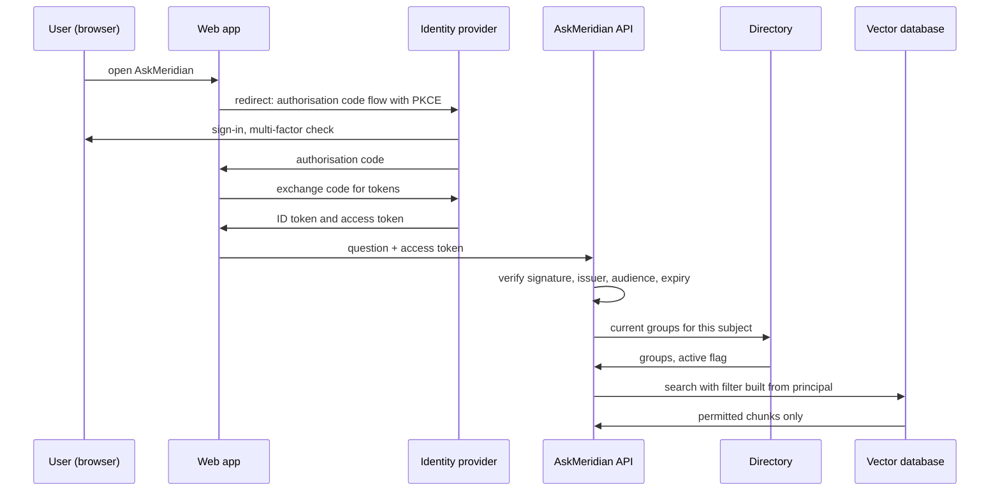

Every access-control decision in a RAG system starts from one fact: **who is asking?** If the system cannot answer that reliably, nothing built on top of it (roles, document permissions, tenant filters) means anything, because each of them is a function of the caller's identity. **Authentication** is the process of establishing that identity and carrying it, intact and fresh, to the place where documents are retrieved. This lesson is about the enterprise side of that process: single sign-on, identity providers, the claims in a token and how stale they get, and how identity travels through a pipeline that includes background workers, bots and a language model.

The mechanics of verifying a bearer token in an API (signature, issuer, audience, expiry, FastAPI dependencies) are covered in [Authentication](/learn/backend-engineering/authentication) in the backend phase, and this lesson does not repeat them. Here the question is bigger: where does the token come from, what does it actually prove, how do group memberships reach the retriever, and what happens when a person leaves the company on a Friday afternoon.

## Learning objectives

- Distinguish authentication from authorisation and name the roles of OAuth 2.0, OpenID Connect, SAML and SCIM in an enterprise sign-in.
- Trace a request from browser login to the retrieval filter and identify which component vouches for the identity at each hop.
- Explain why a validly signed token can still carry stale permissions, and choose a freshness strategy for group memberships.
- Model service accounts and delegated ("on behalf of") calls so that no background process ever holds more document access than the user it acts for.
- Implement an identity resolver with cached directory lookups, disabled-user denial and delegation, and test its staleness window.

## Prerequisites

- [Authentication](/learn/backend-engineering/authentication): verifying API keys and signed tokens in a FastAPI service.
- [Prompt injection](/learn/rag-security-fundamentals/prompt-injection): why text inside the model's context can never be trusted to carry identity.
- [Retrieval pipeline](/learn/rag-architecture-fundamentals/retrieval-pipeline): where in the pipeline identity will eventually be used.

## Why this matters

A conventional web application usually has a clear moment at which access is checked: the user asks for a page or a record, and the code checks the permission. A RAG system dissolves that moment. The user types a question in natural language; a retriever searches thousands of chunks the user never named; and a language model composes an answer that blends several of them. There is no single "record" to guard. The only way to protect the content is to make the retrieval step itself identity-aware, and that is only possible if the identity arrives there.

Three failures follow when authentication is treated as a login screen and nothing more.

- **Identity is lost on the way.** A web front end authenticates the user, then calls the RAG service with its own service credential. The service sees only "the web front end", which is allowed to see everything, so every user effectively has everyone's access. This is the classic **confused deputy** problem: a privileged intermediary acting on a less privileged person's request without carrying that person's authority.
- **Identity is stale.** The token says the user belongs to the `finance` group. They moved to a different team an hour ago, but the token is valid for another 50 minutes, and the group list inside it was frozen at login. The retriever dutifully honours a membership that no longer exists.
- **Identity is forgeable by a side door.** Somewhere a convenience header (`X-User-Id`) or a request field (`"tenant": "acme"`) is trusted because "only our own services call this". Then one compromised service, or one server-side request forgery bug, becomes a way to impersonate anyone.

None of these needs a clever attack. All of them are ordinary design shortcuts, which is why they appear so often in real incident reports.

## The intuition

Think of a large office building. At the front desk you show a passport and are issued a **badge**. The desk's job is authentication: it checks that you are who you claim, once, with care. After that, every door in the building trusts the badge rather than asking for the passport again. The badge carries a few facts, such as your name, your department and an expiry time, and the door readers can verify that the badge is genuine without phoning the front desk.

That arrangement is efficient, and it has three built-in weaknesses that map exactly onto the failures above. A badge printed on Monday still says "Finance" on Friday, even if you changed department on Wednesday. A badge stays valid until it expires even if you are dismissed at noon, unless someone remembers to deactivate it centrally and the doors check. And if a contractor's van is allowed through the gate on the strength of the company logo, the people in the van get in without badges at all.

Authentication engineering is the discipline of deciding, for each of those weaknesses, how much risk you accept: how long a badge lives, which facts go on it versus which are looked up at the door, and who may vouch for whom.

## How it works

### Authentication and authorisation are different questions

**Authentication** answers "who is this?" and **authorisation** answers "what may they do?" (the next lesson, [Authorisation](/learn/access-control-and-privacy/authorisation)). They are separate components with separate failure modes. A system can authenticate perfectly and still leak, because it authorises nothing; and it can have a superb permission model fed by a spoofable identity. Throughout this module, authentication produces one object, the **principal** (the verified identity plus the attributes that authorisation needs), and every later check consumes it.

### The enterprise standards in one table

Large organisations do not let each application keep its own passwords. They run an **identity provider** (IdP), such as Microsoft Entra ID, Okta, Google Workspace or Keycloak, and applications delegate sign-in to it. Several overlapping standards are involved, and confusing them is a common source of muddled designs.

| Standard | What it is | Role in a RAG deployment |
| --- | --- | --- |
| **OAuth 2.0** (RFC 6749) | A framework for **delegated authorisation**: an application obtains an *access token* that lets it call an API. It deliberately says nothing about who the user is | The access token your API accepts |
| **OpenID Connect (OIDC)** | A thin identity layer on top of OAuth 2.0. It adds an *ID token* (a signed JWT describing the user), a `/userinfo` endpoint and a discovery document | How a modern web or mobile app signs the user in and learns who they are |
| **SAML 2.0** | An older XML-based single sign-on protocol, still very common in large enterprises | How the IdP asserts identity to some applications; many products offer it as their enterprise sign-in option |
| **SCIM 2.0** (RFC 7643, 7644) | A REST API for **provisioning**: creating, updating and deactivating users and groups in downstream systems | How user and group changes propagate *out* of the IdP into your system |
| **JWKS** (RFC 7517) | A published set of public keys, in JSON | How your API verifies the IdP's token signatures without sharing a secret |

OAuth 2.0 is the one most often misused. An access token proves that *someone* authorised *some client* to call the API with certain scopes; treating it as proof of who is at the keyboard, without OIDC's ID token or a userinfo call, is a recurring design error. For browser and mobile applications the recommended flow is the **authorisation code flow with PKCE** (RFC 7636), in which the app redirects the user to the IdP, receives a short-lived one-time code, and exchanges it for tokens along with a secret it generated at the start (the PKCE verifier) so that an intercepted code is useless.

### From login to retrieval



Read it as a chain of vouching. The IdP vouches for the user to the web app. The web app passes the access token on rather than substituting its own credential. The API verifies the IdP's signature, so it can trust the claims without having seen the password. The API then goes to the directory for facts that must be current. Finally the API, not the client and not the model, builds the retrieval filter from the principal it has just constructed.

### What is inside a token, and how fresh is it

An access token for a person is typically a JWT whose payload holds **claims**: `sub` (the stable subject identifier), `iss` (issuer), `aud` (audience), `exp` (expiry), and often profile claims such as email, `tid` or a tenant, and `groups` or `roles`. Two facts about those claims drive the design.

First, a signature proves only that the IdP said it **at issue time**. Everything in the token is a snapshot. Second, JWT validation is local: no call is made to the IdP, which is what makes tokens cheap, and also why you cannot *recall* one. A token whose owner was dismissed at noon still verifies correctly until `exp`.

There are three practical strategies for group membership, and real systems mix them.

1. **Trust the token's groups, keep tokens short.** Access tokens live 5 to 15 minutes; a refresh token (held by the web app, not the API) obtains new ones, and the IdP can refuse to refresh once the user is disabled. The staleness window equals the token lifetime. Simple, no extra calls. A limit: some IdPs omit group claims when a user belongs to very many groups (Entra ID, for example, replaces the list with a pointer to an API call beyond a size limit), so a design that relies on claims alone can silently lose memberships.
2. **Look groups up at request time**, from the IdP's API or your own synchronised copy (populated by SCIM or a directory sync), cached for a short **TTL**. The staleness window is the cache TTL, and you control it. This also lets you check the `active` flag, so a disabled user is refused even though the token is still valid.
3. **Introspect or subscribe.** OAuth token introspection (RFC 7662) asks the IdP "is this token still active?" on each request or on a cache; event-based schemes (such as OpenID's Shared Signals work, which is still maturing) let the IdP push revocations. These shrink the window further at the cost of a dependency on the IdP's availability.

The right answer depends on how sensitive the content is. HR records that include salary bands justify a lookup with a 60-second TTL; the public product documentation does not.

> [!KEY]
> A valid signature answers "did the IdP say this?". It does not answer "is it still true?". Decide deliberately how long a stale fact is acceptable, and look up the facts that cannot wait.

### Service accounts and delegation

Not every caller is a person. A nightly ingestion job, an evaluation harness and a Slack bot all call the system. They authenticate with **service credentials**: the OAuth *client credentials* grant (the client authenticates with its own secret or a signed assertion and receives a token for itself), or platform identities such as cloud workload identity that issue short-lived tokens with no stored secret.

The rule that prevents confused-deputy bugs is simple to state: **a service principal has its own, minimal rights, and when it acts for a user it carries that user's identity as well, and is limited to that user's access.** Concretely:

- The ingestion worker's principal can *write* to the index and can read nothing back through the question-answering path.
- The Slack bot calls `/ask` with its own credential **and** the user it is acting for (OAuth 2.0 token exchange, RFC 8693, defines an `actor` and `subject` for exactly this; many systems implement a simpler custom claim). The API resolves the user's groups, not the bot's.
- If the user is inactive, the delegated call fails even though the bot's own token is fine.

Where the bot cannot say *who* it is acting for, it gets no document access at all rather than a default.

### The language model has no identity

The model never authenticates, and nothing it says can be treated as a credential. A prompt that says "the user is an administrator" proves nothing, since attackers can write that sentence too (see [Prompt injection](/learn/rag-security-fundamentals/prompt-injection)). The consequences are architectural:

- Identity is applied **before** the model, by constraining retrieval. It is never applied by asking the model to withhold things.
- Tools that an agent calls must receive the *principal*, injected by your code, not an identifier produced by the model. A tool signature like `read_document(user_id, doc_id)` where the model fills in `user_id` is a vulnerability; `read_document(doc_id)` with the principal taken from the request context is not.
- Tokens must never appear in prompts, logs, traces or error messages. Observability pipelines are a favourite place for bearer tokens to leak, because debugging a failed call tempts people to log the whole request.

### Other credentials worth knowing

- **API keys** identify an application, not a person: store only a hash, show the key once, scope it narrowly, and make it rotatable.
- **Mutual TLS** gives each service a cryptographic identity inside a service mesh.
- **Multi-factor authentication** happens at the IdP, but the token may carry authentication-context claims (`acr`, `amr`) that let you demand a stronger sign-in for sensitive collections.

## In code

The example builds the piece that most tutorials skip: an **identity resolver** that sits between "the token verified" and "the retriever runs". It takes the verified claims and returns a complete `Identity`. It fetches groups from a directory through a TTL cache, refuses disabled users, gives service principals no document access by default, and supports delegation. A fake directory and an injected clock let us watch the staleness window without waiting.

It uses only the standard library. To verify the tokens that feed it, see the backend lesson; to verify a real IdP's tokens, see the unrun block afterwards.

```python
from copy import deepcopy
from dataclasses import dataclass, field
from typing import Callable


@dataclass(frozen=True)
class Identity:
    subject: str
    kind: str                      # "user" or "service"
    groups: frozenset
    acting_for: str | None = None  # set when a service acts on behalf of a user


class Denied(Exception):
    pass


@dataclass
class Directory:
    """Stand-in for the identity provider's user and group API (SCIM, Graph, LDAP...)."""
    users: dict = field(default_factory=dict)  # subject -> {"active": bool, "groups": set}
    calls: int = 0

    def lookup(self, subject):
        self.calls += 1
        return self.users.get(subject)


class IdentityResolver:
    def __init__(self, directory: Directory, ttl_seconds: int, clock: Callable[[], float]):
        self.directory, self.ttl, self.clock = directory, ttl_seconds, clock
        self._cache: dict[str, tuple[float, dict | None]] = {}

    def _record(self, subject):
        hit = self._cache.get(subject)
        if hit and self.clock() - hit[0] < self.ttl:
            return hit[1]
        rec = deepcopy(self.directory.lookup(subject))  # a snapshot, not a live reference
        self._cache[subject] = (self.clock(), rec)
        return rec

    def resolve(self, claims: dict) -> Identity:
        """`claims` come from an already-verified token."""
        subject = claims["sub"]
        if claims.get("typ") == "service":
            # A service may only act for a user if the token says so, and the user must be active.
            on_behalf = claims.get("act_for")
            if on_behalf is None:
                return Identity(subject, "service", frozenset())          # no document access at all
            user = self._record(on_behalf)
            if not user or not user["active"]:
                raise Denied(f"{on_behalf} is not an active user")
            return Identity(subject, "service", frozenset(user["groups"]), acting_for=on_behalf)
        user = self._record(subject)
        if not user or not user["active"]:
            raise Denied(f"{subject} is disabled or unknown")
        return Identity(subject, "user", frozenset(user["groups"]))


if __name__ == "__main__":
    now = [0.0]
    d = Directory({"maya": {"active": True, "groups": {"all-staff", "finance"}}})
    r = IdentityResolver(d, ttl_seconds=300, clock=lambda: now[0])
    claims = {"sub": "maya"}
    show = lambda i: (i.subject, i.kind, sorted(i.groups), i.acting_for)

    print("t=0     ", show(r.resolve(claims)))
    d.users["maya"]["groups"].discard("finance")      # Maya moves teams in the directory
    now[0] = 120
    print("t=120   ", sorted(r.resolve(claims).groups), "<- still cached, directory calls =", d.calls)
    now[0] = 301
    print("t=301   ", sorted(r.resolve(claims).groups), "<- refreshed, directory calls =", d.calls)

    d.users["maya"]["active"] = False                  # she leaves the company
    now[0] = 700
    try:
        r.resolve(claims)
    except Denied as e:
        print("t=700    denied:", e)

    d.users["raj"] = {"active": True, "groups": {"all-staff", "it"}}
    print("service ", show(r.resolve({"sub": "ingest-worker", "typ": "service"})))
    print("delegate", show(r.resolve({"sub": "slack-bot", "typ": "service", "act_for": "raj"})))
```

```output
t=0      ('maya', 'user', ['all-staff', 'finance'], None)
t=120    ['all-staff', 'finance'] <- still cached, directory calls = 1
t=301    ['all-staff'] <- refreshed, directory calls = 2
t=700    denied: maya is disabled or unknown
service  ('ingest-worker', 'service', [], None)
delegate ('slack-bot', 'service', ['all-staff', 'it'], 'raj')
```

### Reading the output

Maya's `finance` membership was removed in the directory at time 120, but the resolver served the cached copy until the TTL of 300 seconds elapsed, so for up to five minutes she kept access she should not have had. That window is the price of the cache, and it is a number you chose, not an accident. At t=301 the lookup was repeated (`calls = 2`) and her groups corrected themselves. When she was deactivated, the next refresh refused her, even though her token (not shown) would still have verified.

The ingestion worker resolves to an identity with **no groups**, so any retrieval filter built from it matches nothing. The Slack bot resolves to Raj's groups, and the `acting_for` field preserves who is really behind the call, which the audit log needs.

### Important lines

- `deepcopy` in `_record` stores a snapshot. Without it the cache would hold a live reference to the directory's dictionary and silently reflect changes, hiding the staleness the TTL is supposed to bound. (We hit exactly this bug while writing the demo.)
- `self.clock() - hit[0] < self.ttl` uses an injected clock, so tests can advance time. Never call `time.time()` directly in logic you need to test.
- A missing or inactive user raises `Denied`. The resolver never returns a default identity; failure is **closed**.
- A service with no `act_for` gets an empty group set, not a default group. "No access" is the safe zero value.

### Verifying a real identity provider's tokens

Production tokens from an IdP are signed with the IdP's private key, and you verify them with its public keys, fetched from its JWKS endpoint. PyJWT's documented client does this, and caches keys. This block was **not executed** here, because RS256 verification needs the `cryptography` package, which is not installed in the sandbox, and a live IdP. Replace the placeholders with your tenant's values.

```python
import jwt

JWKS_URL = "https://login.example.com/.well-known/jwks.json"  # from the IdP's discovery document
jwks_client = jwt.PyJWKClient(JWKS_URL)


def verify_idp_token(token: str) -> dict:
    signing_key = jwks_client.get_signing_key_from_jwt(token)   # picks the key by the token's `kid`
    return jwt.decode(
        token,
        signing_key.key,
        algorithms=["RS256"],                  # pinned; never taken from the token header
        audience="api://askmeridian",          # the audience registered for this API
        issuer="https://login.example.com/",   # exact string from the discovery document
        options={"require": ["exp", "iat", "iss", "aud", "sub"]},
    )
```

Feed the returned claims into `IdentityResolver.resolve`. Pin the algorithm list to what your IdP actually uses: letting a token choose its own algorithm is the root of the "algorithm confusion" attacks that the backend lesson demonstrates.

### Common errors

- **Issuer mismatch by a trailing slash.** `https://login.example.com` and `https://login.example.com/` are different strings to a verifier. Copy the issuer exactly from the discovery document.
- **Wrong audience.** An access token minted for the Graph API is correctly rejected by yours; the web app must request a token for *your* API's audience.
- **Missing groups.** Token group claims silently omitted for large memberships. Test with a user in many groups, and fall back to a directory lookup.

### Extending it

Replace `Directory` with a client for your IdP or a table kept in sync by SCIM; add a **version counter** in the directory so a revoked user invalidates the cache immediately rather than at TTL; emit an audit event whenever `resolve` denies; and key a second cache on the token's `jti` to remember explicit revocations.

## A real-world example

The Platform team at Meridian ships AskMeridian's Slack bot. In the first version the bot authenticates to the API with a long-lived API key and passes the Slack user's email in a JSON field. It works well and everyone is pleased, until a security review asks two questions. What stops a Slack workspace guest, whose email address ends in `@meridian.example`, from being passed through as staff? And what happens to a contractor whose account is disabled on their last day: does the bot stop answering them?

The answers are "nothing" and "no". The API trusts the email field because the bot is "internal", and it never asks the directory whether the account is active, because the key is valid. The fix has three parts. The bot now exchanges the user's Slack identity for a short-lived token minted by the company IdP, so the API receives a verified `sub`. The API resolves groups and the `active` flag through the resolver above, with a 60-second TTL for the HR collection and 15 minutes for public documentation. And the bot's own credential is demoted: it can call `/ask` only with an `act_for` subject, and has no document access when it does not.

The result is not a more elaborate system, but one in which each hop is vouched for by something that can be verified. The review's two scenarios become tests: a guest token is rejected at signature verification, and a disabled contractor gets a `Denied` within one TTL. The Platform team also adds a log line recording the `acting_for` subject on every call, because incident responders will want it later.

## Common mistakes

- **Trusting an identity header from an internal caller.** One compromised or confused service then impersonates anyone. Accept identity only as a verified credential, and have internal services propagate the user's token or a signed assertion.
- **Using the front end's service credential for retrieval.** The retriever sees one all-powerful caller and every user inherits its access (the confused deputy). Propagate the user's identity.
- **Treating an OAuth access token as proof of who the user is.** Without OIDC's ID token or userinfo, you know a client was authorised, not which person is present.
- **Baking groups into long-lived tokens.** Memberships freeze at issue time, and a removed permission survives for the token's lifetime. Keep tokens short or look groups up.
- **Defaulting to access.** An unknown user falling back to an "all-staff" identity turns every lookup failure into a disclosure. Fail closed.
- **Letting the model supply identity.** Any tool argument that names a user or tenant, produced by generated text, can be steered by injected content.
- **Logging tokens.** Bearer tokens in request logs are usable by anyone who can read the logs. Redact `Authorization` headers and query strings at the logging layer.

## Best practices

- Delegate sign-in to the organisation's IdP using OIDC (or SAML where required); do not store passwords in the RAG system.
- Verify tokens fully and pin accepted algorithms, issuer and audience; fetch signing keys from the JWKS endpoint and cache them with rotation in mind.
- Build one `Principal` or `Identity` object at the edge, make it immutable, and pass it explicitly to every layer that needs it.
- Choose a freshness policy per collection and write the staleness window down; use directory lookups for anything sensitive.
- Give service accounts the smallest rights, no default document access, and a required `act_for` when they query on a user's behalf; record both identities in audit logs.
- Prefer workload identity or short-lived credentials over static secrets, and rotate what must remain static.
- Require stronger authentication (MFA, recent sign-in) for sensitive collections using the claims the IdP provides.
- Test the unhappy paths: disabled user, expired token, wrong audience, missing groups, directory outage (the resolver should fail closed).

## Performance considerations

Authentication sits on the hot path of every question, so cost matters, but it is small if designed sensibly. Local JWT verification with a cached public key costs microseconds to a fraction of a millisecond; a directory lookup is a network round trip, perhaps 5 to 50 milliseconds depending on the provider (an assumption to measure, not a guarantee).

The TTL cache converts that cost into a hit rate. If 400 staff each ask 20 questions a day, a 5-minute TTL means at most one lookup per user per 5 minutes of activity: a person asking in bursts triggers one lookup per burst rather than per question. For 400 users active continuously, that is at most $400 \times (3600/300) = 4{,}800$ lookups an hour, about 1.3 per second, whatever the question rate. Shrinking the TTL to 60 seconds raises the ceiling to 6.7 per second, still small, and buys a staleness window one-fifth as long. Use a single-flight guard (one in-flight lookup per subject) so that a burst of concurrent requests does not stampede the directory when a cache entry expires. Cache denials briefly too, or a disabled user hammering the endpoint turns into a directory load test.

Fail-closed has an availability cost: if the directory is down, requests for non-cached users fail. Decide whether that is acceptable for each collection. A common compromise is to serve a cached identity beyond its TTL for low-sensitivity collections for a bounded "stale-if-error" period, and never for sensitive ones.

## Security considerations

- Treat authentication as the root of trust: compromise here defeats every later control, so protect the IdP, enforce MFA and monitor sign-in anomalies.
- Reject unsigned and wrongly signed tokens before any parsing of claims that influences behaviour; claims in an unverified token are attacker-controlled input.
- Rate-limit and lock out repeated failures per account and per source to slow credential stuffing, and return the same generic error for every authentication failure.
- Keep audit records of who authenticated, from where, and on whose behalf, ready for the [Audit logs](/learn/enterprise-rag-governance/audit-logs) lesson.
- Rotate signing keys, and keep a tested procedure for revoking everything after a suspected compromise.

## Summary

- Authentication establishes who is asking; every later access decision is a function of that identity, so it must arrive at the retriever verified and fresh.
- OIDC signs the user in, OAuth 2.0 delegates API access, SAML serves older enterprise SSO and SCIM provisions users and groups. A valid token proves what the IdP said at issue time, not what is true now.
- Control staleness explicitly: short tokens, TTL-cached directory lookups or introspection, chosen per collection by sensitivity.
- Service accounts get minimal rights of their own; when they act for a user they carry that user's identity and are bounded by it.
- The model has no identity: apply identity by constraining retrieval in code, and never let generated text supply a user or tenant.

## Exercises

1. **Conceptual.** A teammate says "the token is signed, so the `groups` claim is trustworthy." Explain what the signature does and does not establish, and name two ways the claim can still be wrong.

<details><summary>Show solution</summary>

The signature proves that the identity provider issued exactly this payload, unmodified. It does not prove the payload is *current*: the groups reflect the moment of issue, and the token cannot be recalled before `exp`. It can be wrong because (1) the user's membership changed after issue, or the account was disabled; and (2) the IdP omitted or truncated the claim for users with very many groups, so the retriever sees fewer groups than the user truly has (a fail-closed error, but a real one). A third is that a *service* token's claims describe the service, not the person it is acting for.

</details>

2. **Calculation.** AskMeridian has 400 staff, each continuously active. The directory lookup is cached per user with a TTL of 120 seconds. What is the maximum lookup rate, and how long can a removed group membership persist?

<details><summary>Show solution</summary>

Each user triggers at most one lookup per TTL: $400 / 120 \approx 3.3$ lookups per second at the ceiling. A removal is invisible for at most the TTL, 120 seconds (plus the lookup's own latency). Halving the TTL doubles the ceiling to about 6.7 per second and halves the window.

</details>

3. **Design.** The nightly ingestion job and an evaluation harness both need to call AskMeridian. The harness must run real questions as a few test users. Describe the principals you would create and what each can do.

<details><summary>Show solution</summary>

Create two service principals. `ingest-worker` has write access to the index and no read access through `/ask`; its resolver output has no groups. `eval-harness` may call `/ask` only with an `act_for` that is one of a fixed list of synthetic test users, who exist in the directory with known groups (for example `test-hr`, `test-contractor`). The harness therefore exercises real filters without holding any broader access, and its calls are tagged with both identities in audit logs. Neither principal uses a human's credentials.

</details>

4. **Code.** Extend `IdentityResolver` so that a user whose directory record has `"revoked_at"` later than the token's `iat` claim is denied immediately, regardless of the cache. Sketch the change and say what state it needs.

<details><summary>Show solution</summary>

```python
def resolve(self, claims):
    ...
    user = self._record(subject)
    if user and user.get("revoked_at", 0) > claims["iat"]:
        raise Denied("token issued before revocation")
```

This still depends on the cached record, so to be immediate the revocation must be *pushed*: a revocation event handler writes `revoked_at` into a small shared store (for example Redis) that `resolve` reads on every call, outside the TTL cache. The store only needs `subject -> timestamp` and entries can expire after the longest token lifetime.

</details>

## Check your understanding

```quiz
[
  {"q": "Which statement best distinguishes OAuth 2.0 from OpenID Connect?", "options": ["OAuth 2.0 is for browsers, OpenID Connect is for servers", "OAuth 2.0 delegates API access; OpenID Connect adds a standard way to learn who the user is", "OpenID Connect replaced the need for access tokens", "OAuth 2.0 encrypts tokens, OpenID Connect signs them"], "answer": 1, "why": "OAuth 2.0 is a delegated-authorisation framework and says nothing about user identity. OpenID Connect layers an ID token and userinfo on top of it to provide authentication."},
  {"q": "A user is dismissed at noon. Their access token expires at 12:50 and your API only verifies the JWT locally. What happens at 12:30?", "options": ["The request is refused because the IdP revoked the token", "The request succeeds, because local verification cannot see the dismissal", "The request fails because the user's groups changed", "The request succeeds only if the token was issued after noon"], "answer": 1, "why": "JWT verification is local and stateless, so a valid unexpired token verifies regardless of later events. A directory or introspection check is needed to refuse it earlier."},
  {"q": "The Slack bot calls /ask with only its own service token and no `act_for` claim. What should the resolver return?", "options": ["The bot's default group, all-staff", "An identity with no document access", "The groups of the most recent human user", "An error that includes the bot's secret"], "answer": 1, "why": "A service that cannot name the user it acts for gets the safe zero value: no groups, so no filter matches. Defaults that grant access convert mistakes into disclosures."},
  {"q": "Why must a tool such as `read_document(user_id, doc_id)` not take `user_id` as a model-generated argument?", "options": ["The model cannot produce strings", "Generated text can be influenced by injected content, so the model could be steered to name another user", "User IDs are too long for tool calls", "It makes the call slower"], "answer": 1, "why": "The principal must be injected by your code from the verified request context. Anything the model writes is steerable by prompt injection."},
  {"q": "A resolver caches directory lookups for 300 seconds. What is the maximum time a removed group membership can still be honoured (ignoring lookup latency)?", "options": ["0 seconds", "150 seconds", "300 seconds", "Until the token expires, always"], "answer": 2, "why": "The cache serves the stale record until the TTL elapses, so the window is the TTL. That is the cost of the cache and a number you choose."}
]
```

## Further reading

- OpenID Connect Core 1.0 specification, on the OpenID Foundation website (openid.net): the authoritative description of ID tokens and the authorisation code flow.
- RFC 6749, "The OAuth 2.0 Authorization Framework", and RFC 7636, "Proof Key for Code Exchange by OAuth Public Clients" (datatracker.ietf.org).
- RFC 8725, "JSON Web Token Best Current Practices", and RFC 8693, "OAuth 2.0 Token Exchange" (datatracker.ietf.org).
- RFC 7644, "System for Cross-domain Identity Management: Protocol" (SCIM), for provisioning and deprovisioning users and groups.
- OWASP Authentication Cheat Sheet and Session Management Cheat Sheet (cheatsheetseries.owasp.org).
- PyJWT documentation (pyjwt.readthedocs.io), for `PyJWKClient` and `decode` options.
