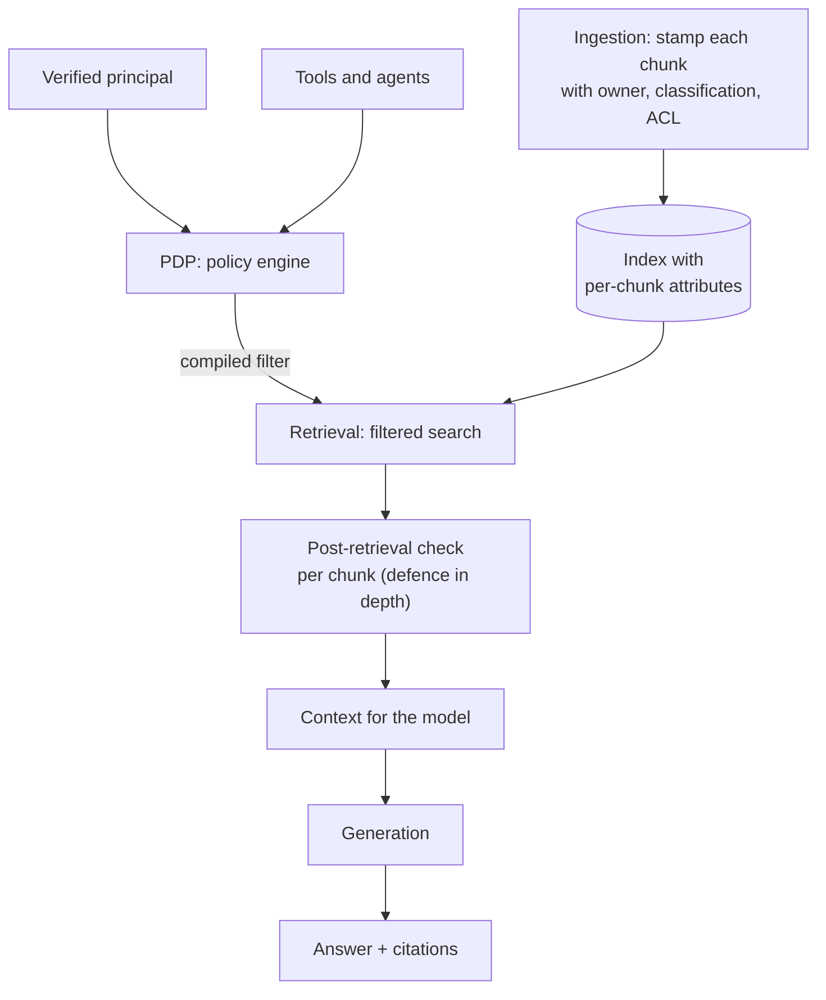

Once the system knows who is asking, it must decide what that person may read. **Authorisation** is the decision procedure: given a verified identity, an action and a resource, return allow or deny. In a conventional application the decision guards a record or a page. In a RAG system the "resource" is a ranked list of chunks the user never named, the "action" is usually just *read*, and the consumer of the allowed content is a language model that will paraphrase it. That changes where the decision must be enforced, how its rules are expressed and what can leak even when the check is correct.

This lesson builds the general machinery: the decision model, the main families of access-control models, the principles that make a policy safe, and a small attribute-based policy engine you can run. The next two lessons specialise it: [Role-based access control](/learn/access-control-and-privacy/role-based-access-control) for permissions grouped into roles, and [Document-level permissions](/learn/access-control-and-privacy/document-level-permissions) for the filters that carry those decisions into the vector index.

## Learning objectives

- Describe an authorisation decision as subject, action, resource and context, and name the policy enforcement point, decision point, information point and administration point.
- Compare ACLs, RBAC, ABAC and relationship-based access control, and pick one for a stated requirement.
- Apply deny-by-default, deny-overrides and least privilege to a policy, and predict the decision for a given request.
- Identify the places in a RAG pipeline where authorisation must be enforced, and explain why filtering the model's answer is not one of them.
- Implement a policy engine whose rules can be compiled into a retrieval filter, and verify the two agree by exhaustive test.

## Prerequisites

- [Authentication](/learn/access-control-and-privacy/authentication): the verified principal that authorisation consumes.
- [Retrieval pipeline](/learn/rag-architecture-fundamentals/retrieval-pipeline): the stages at which a check can be placed.
- [Metadata](/learn/vector-database-fundamentals/metadata): the per-chunk fields a policy will evaluate.
- [Filtering](/learn/vector-database-fundamentals/filtering): how a vector database applies a condition during search.

## Why this matters

An unauthorised disclosure through a RAG system is unusually easy to cause and unusually hard to notice. It is easy because the system is *designed* to find relevant text across everything it has indexed: if a salary spreadsheet is in the same index as the leave policy, a question phrased close enough to the spreadsheet's content retrieves it, with no one having "requested" the file. It is hard to notice because the output is fluent prose with no obvious provenance: nobody sees a spreadsheet open, only a confident sentence.

The traditional safeguard, a permission check in front of each protected resource, does not map onto this. There is no endpoint per document. So the check has to move into retrieval (never retrieve what the caller may not read), and the rules that drive it must be expressible in a form the retriever can use. Teams that skip this design step usually fall back on one of two bad defences: telling the model in the system prompt not to reveal restricted material (which fails to prompt injection and ordinary paraphrase), or maintaining a separate index per audience (which works until audiences overlap, and then multiplies cost and drift).

## The intuition

Picture a research library with a reading room, a reference librarian and locked cabinets. The librarian is excellent at finding material on any topic. The library has a rule, though: she must never carry out of the stacks anything the visitor is not allowed to read.

There are two ways to run this. In the first, she fetches everything relevant, lays it on the desk, and a security guard crosses out anything forbidden before the visitor looks. That is a decent second line of defence, but the visitor can sometimes tell, from the gaps, that a forbidden item exists, and if the guard is distracted, it goes through. In the second, the librarian is handed the visitor's pass first and simply never goes to the cabinets the pass does not cover. Nothing forbidden ever reaches the desk.

A well-built system does the second thing as its main control and keeps the first as a backstop. What the librarian needs in order to do this is a *pass* (authentication), and a clear, consistent rule book (the policy) that says which passes open which cabinets. This lesson is about the rule book.

## How it works

### The decision model

Every authorisation decision has the same four inputs and one output.

- **Subject**: the principal making the request, with attributes (groups, department, employment type, clearance).
- **Action**: what they want to do (`read`, `ingest`, `delete`, `export`). For retrieval it is nearly always `read`, but ingestion and administration are separate actions with separate rules.
- **Resource**: the thing acted on, with attributes (owning department, classification, source system, tenant).
- **Context**: facts about the request itself (time, network location, device state, the sign-in strength from authentication).

The output is **allow** or **deny**, ideally with the reason. The XACML standard and NIST's guide to attribute-based access control (SP 800-162) name the components that take part, and the vocabulary is useful because it separates concerns that code tends to tangle:

| Component | Job | In AskMeridian |
| --- | --- | --- |
| **Policy Enforcement Point (PEP)** | Intercepts the request and enforces the decision | The search layer that adds the filter; the post-retrieval check |
| **Policy Decision Point (PDP)** | Evaluates the policy and returns allow or deny | The policy engine (a library or a service) |
| **Policy Information Point (PIP)** | Supplies attributes the PDP needs | The identity resolver, the document metadata store |
| **Policy Administration Point (PAP)** | Where policy is authored and versioned | A repository of policy files with code review |

The practical lesson is to keep the PEP thin and the PDP central. If every service re-implements the rules in its own code, they drift, and an audit has to read all of them. If the rules live in one engine and every enforcement point calls it, a change is made once.

### The families of model

Four models appear repeatedly. Real systems combine them.

**Access control lists (ACLs)** attach to each resource a list of who may do what: "this document: maya, group `hr`, read". They are simple, precise and what most file systems and document stores already use. They scale badly in the other direction (answering "what can Maya read?" means scanning every list), and they push the burden of correctness onto whoever edits the list. For RAG they matter because the source systems (SharePoint, Google Drive, Confluence) *already have* ACLs, and the usual job is to copy them into the index faithfully. That is the subject of the [document-level permissions](/learn/access-control-and-privacy/document-level-permissions) lesson.

**Role-based access control (RBAC)** grants permissions to roles and roles to people. It matches how organisations think ("HR business partner", "support engineer") and keeps administration manageable. Its weakness is that roles are coarse and multiply when exceptions arrive. The [next lesson](/learn/access-control-and-privacy/role-based-access-control) covers it in depth.

**Attribute-based access control (ABAC)** writes rules over attributes: "employees may read internal documents; nobody may read a document above their clearance; contractors may not read confidential material". Rules are compact and can express conditions roles cannot (time, location, classification). The costs are that the rule set is code that needs testing, and that explaining "why was I denied?" requires tracing rules. ABAC fits RAG well because chunks naturally carry attributes as metadata.

**Relationship-based access control (ReBAC)** grants access through relationships in a graph: a document belongs to a folder, the folder belongs to a team, Maya is a member of the team, therefore Maya can read the document. Google's Zanzibar paper (Pang et al., 2019, "Zanzibar: Google's Consistent, Global Authorization System") describes this at scale, and open-source systems such as OpenFGA and SpiceDB implement the idea. ReBAC models "shared with", folder inheritance and organisational hierarchy naturally, which is exactly how enterprise content permissions behave. Its challenge for RAG is that a retrieval filter needs a *list of allowed things*, whereas a ReBAC engine is best at answering "may this user read this document?" one pair at a time; listing every readable document is an additional query type ("list objects") with its own cost.

Policy engines let you write ABAC and ReBAC-style rules as data rather than code. Open Policy Agent (policy language Rego) and AWS's Cedar are two widely used examples; they are named here so you recognise them, not because this lesson depends on them.

### Principles that make a policy safe

1. **Deny by default.** If no rule allows the request, deny. A new document class that nobody wrote a rule for is then invisible rather than public.
2. **Deny overrides allow.** When one rule allows and another denies, deny wins. This lets you write broad grants ("employees read internal documents") together with narrow exceptions ("never above your clearance") without worrying about rule order.
3. **Least privilege.** Grant the minimum needed for the job, to people and to service accounts, and review it.
4. **Complete mediation.** Every access goes through the check; there is no side path (a debug endpoint, a cache, a bulk export) that skips it.
5. **Fail closed.** If the PDP cannot decide (attributes missing, service down), the answer is deny, not allow.
6. **Separate policy from code, and test it.** A policy that cannot be exercised in a unit test will be wrong in production.

### Where a RAG system must enforce



Five enforcement points, in order of importance:

1. **Ingestion-time labelling.** Authorisation can only use attributes that exist. Every chunk is stamped when indexed with the owner, classification and, for document-level permissions, the allowed principals. An unlabelled chunk is a defect; the pipeline should refuse to index it or quarantine it with a restrictive default label.
2. **Retrieval-time filtering (the main control).** The principal is turned into a filter that the vector database applies *during* search, so forbidden chunks are never candidates. This is the PEP that matters.
3. **Post-retrieval checking (the backstop).** Before chunks enter the prompt, run the PDP on each one again. It costs a few microseconds per chunk and catches filter bugs, stale index labels and misconfigured collections. It should be treated as a canary: a chunk removed here means the primary control failed, and that deserves an alert.
4. **Tool and agent calls.** Anything an agent can read or do (fetch a document by ID, run a SQL query, call another service) must go through the same engine, with the principal injected by your code rather than supplied by the model.
5. **Derived artefacts.** Caches, conversation history, summaries and logs contain derived content. Each must be keyed or scoped to the principal or to a policy version, or it becomes a bypass.

### Why you cannot authorise the answer

It is tempting to generate the answer from all the retrieved material and then "check" whether the answer discloses something forbidden. This cannot be made reliable. The answer is free text, a paraphrase can disclose a fact without containing any of the forbidden words, and classifying "does this sentence reveal the salary band?" is itself an unreliable model judgement. Authorisation has to happen on the *inputs* to the model, where the objects are discrete and the rules are decidable. What an output filter can usefully do is catch accidental leakage of patterns such as personal data, which is the subject of [PII detection](/learn/access-control-and-privacy/pii-detection) and the [output validation](/learn/rag-security-fundamentals/output-validation) lesson.

### Side channels: leaks that need no document

Even with a correct filter, the system can leak the *existence* or *shape* of forbidden material.

- **Differential error messages.** "You do not have access to the salary document" confirms the document exists. For restricted material, "I could not find anything about that" should be indistinguishable from a true miss.
- **Counts and facets.** "47 results, 3 hidden from you" discloses volume. Compute counts only over permitted content.
- **Citations and titles.** A citation list that names a restricted source's title leaks it even if the text is withheld. Cite only from permitted chunks.
- **Timing.** A query that matches many forbidden documents and a query that matches none can differ measurably in latency if the filter is applied late; filtering inside the index narrows that gap, though it does not close it.
- **Suggestions.** "Did you mean ..." and autocomplete drawn from the full index leak vocabulary. Build them from permitted content or from a public list.

### Time: checks can go stale

A decision is true at one moment. Between the check and the use, permissions may change: a conversation that retrieved a document at 09:00 still holds its text in history at 09:30 after access was revoked at 09:10. Decide what your system promises. A common answer is "decisions are fresh for the duration of a single request; conversation history is re-authorised or truncated when a session resumes". For highly sensitive collections, scope cached answers to a **policy version** (a counter bumped on any permission change) so a revocation invalidates them.

## In code

The example is a small ABAC engine for AskMeridian with three properties. Policy is **data** (a list of named rules, each with an effect and a condition), the decision is **explainable** (it returns the rule that decided), and the same policy can be **compiled into a retrieval filter**, with a test proving the engine and the filter agree on every combination. It uses only the standard library; run it with `python policy.py`.

```python
from dataclasses import dataclass
from typing import Callable

LEVELS = {"public": 0, "internal": 1, "confidential": 2, "restricted": 3}


@dataclass(frozen=True)
class Subject:
    id: str
    employment: str           # "employee" | "contractor"
    groups: frozenset
    clearance: str = "internal"


@dataclass(frozen=True)
class Resource:
    id: str
    owner_group: str          # the department that owns the document
    classification: str


@dataclass(frozen=True)
class Rule:
    name: str
    effect: str               # "allow" | "deny"
    when: Callable[[Subject, Resource], bool]


RULES = [
    Rule("deny-above-clearance", "deny",
         lambda s, r: LEVELS[r.classification] > LEVELS[s.clearance]),
    Rule("deny-contractor-confidential", "deny",
         lambda s, r: s.employment == "contractor" and LEVELS[r.classification] >= LEVELS["confidential"]),
    Rule("allow-public", "allow", lambda s, r: r.classification == "public"),
    Rule("allow-employee-internal", "allow",
         lambda s, r: s.employment == "employee" and r.classification == "internal"),
    Rule("allow-owning-group", "allow", lambda s, r: r.owner_group in s.groups),
]


def decide(subject, resource, rules=RULES):
    """Return (effect, rule_name). Any matching deny wins; no match means deny."""
    matched = [r for r in rules if r.when(subject, resource)]
    for r in matched:
        if r.effect == "deny":
            return "deny", r.name
    for r in matched:
        return "allow", r.name
    return "deny", "default-deny"


DOCS = [
    Resource("handbook-leave", "hr", "internal"),
    Resource("press-kit", "marketing", "public"),
    Resource("salary-bands", "hr", "confidential"),
    Resource("m-and-a-memo", "exec", "restricted"),
    Resource("vpn-runbook", "it", "internal"),
]

PEOPLE = [
    Subject("maya (employee, hr)", "employee", frozenset({"hr"}), "confidential"),
    Subject("raj (employee, it)", "employee", frozenset({"it"}), "internal"),
    Subject("cleo (contractor, hr)", "contractor", frozenset({"hr"}), "confidential"),
]

if __name__ == "__main__":
    print(f"{'subject':24}{'document':16}{'decision':8} rule")
    for s in PEOPLE:
        for d in DOCS:
            effect, rule = decide(s, d)
            print(f"{s.id:24}{d.id:16}{effect:8} {rule}")
        print()
    # Defence in depth: authorise each retrieved chunk again before it reaches the prompt.
    retrieved = ["handbook-leave", "salary-bands", "m-and-a-memo", "vpn-runbook"]
    by_id = {d.id: d for d in DOCS}
    raj = PEOPLE[1]
    kept = [i for i in retrieved if decide(raj, by_id[i])[0] == "allow"]
    print("retrieved:", retrieved)
    print("kept for raj:", kept)
```

```output
subject                 document        decision rule
maya (employee, hr)     handbook-leave  allow    allow-employee-internal
maya (employee, hr)     press-kit       allow    allow-public
maya (employee, hr)     salary-bands    allow    allow-owning-group
maya (employee, hr)     m-and-a-memo    deny     deny-above-clearance
maya (employee, hr)     vpn-runbook     allow    allow-employee-internal

raj (employee, it)      handbook-leave  allow    allow-employee-internal
raj (employee, it)      press-kit       allow    allow-public
raj (employee, it)      salary-bands    deny     deny-above-clearance
raj (employee, it)      m-and-a-memo    deny     deny-above-clearance
raj (employee, it)      vpn-runbook     allow    allow-employee-internal

cleo (contractor, hr)   handbook-leave  allow    allow-owning-group
cleo (contractor, hr)   press-kit       allow    allow-public
cleo (contractor, hr)   salary-bands    deny     deny-contractor-confidential
cleo (contractor, hr)   m-and-a-memo    deny     deny-above-clearance
cleo (contractor, hr)   vpn-runbook     deny     default-deny

retrieved: ['handbook-leave', 'salary-bands', 'm-and-a-memo', 'vpn-runbook']
kept for raj: ['handbook-leave', 'vpn-runbook']
```

### Reading the output

Three rows deserve attention. Maya reads `salary-bands` because her group owns it, *and* her clearance is high enough: the allow and the deny-overrides rule both had to be satisfied. Cleo, a contractor in HR, is denied `salary-bands` by a deny rule even though `allow-owning-group` also matches, which is deny-overrides doing its job. And Cleo is denied `vpn-runbook` with `default-deny`: no rule granted access to an internal document owned by IT to a contractor, so nothing did. The reason string makes each decision explainable, which is what support staff and auditors will ask for.

The last two lines show the backstop. A retriever returned four chunks for Raj; the per-chunk check kept two. In a healthy system the primary filter would already have removed the other two, and the backstop would log nothing.

### Compiling the policy into a filter

A per-chunk check is the safety net. The primary control is a filter the vector database can evaluate, so the forbidden chunks never become candidates. For this particular policy the filter can be derived mechanically from the subject:

```python
from itertools import product

from policy import LEVELS, Resource, Subject, decide


def compile_filter(s: Subject) -> dict:
    """Turn the policy into a filter over resource metadata (what a vector database can evaluate)."""
    ceiling = LEVELS[s.clearance]
    if s.employment == "contractor":
        ceiling = min(ceiling, LEVELS["confidential"] - 1)
    levels = [name for name, n in LEVELS.items() if n <= ceiling]
    grants = [{"classification": ["public"]}, {"owner_group": sorted(s.groups)}]
    if s.employment == "employee":
        grants.append({"classification": ["internal"]})
    return {"must": {"classification": levels}, "any_of": grants}


def matches(f: dict, r: Resource) -> bool:
    attrs = {"classification": r.classification, "owner_group": r.owner_group}
    ok = lambda cond: all(attrs[k] in v for k, v in cond.items())
    return ok(f["must"]) and any(ok(g) for g in f["any_of"])


subjects = [Subject(f"{e}-{g}-{c}", e, frozenset(g), c)
            for e, g, c in product(["employee", "contractor"], [(), ("hr",), ("it", "hr")], LEVELS)]
resources = [Resource("r", o, c) for o, c in product(["hr", "it", "exec"], LEVELS)]
bad = [(s.id, r.owner_group, r.classification) for s in subjects for r in resources
       if (decide(s, r)[0] == "allow") != matches(compile_filter(s), r)]
print("checked", len(subjects) * len(resources), "pairs; disagreements:", len(bad))
print(compile_filter(Subject("cleo", "contractor", frozenset({"hr"}), "confidential")))
```

```output
checked 288 pairs; disagreements: 0
{'must': {'classification': ['public', 'internal']}, 'any_of': [{'classification': ['public']}, {'owner_group': ['hr']}]}
```

The `must` clause is the ceiling that the two deny rules impose, written as the set of classifications still permitted. The `any_of` clause is the union of the allow rules. Cleo's filter reads: "classification is public or internal, **and** (public, or owned by `hr`)". The exhaustive test enumerates 24 subjects against 12 resource shapes (288 pairs) and proves the compiled filter and the engine never disagree. That test is the most valuable thing in the example: **the engine and the filter are two implementations of one policy, and they will drift unless a test pins them together.** In a real system the filter would be translated into your vector database's native condition syntax, as the next lesson shows with Qdrant.

### Common errors

- **A deny rule that forgets a case.** The compiled filter and the engine disagree for combinations nobody thought of. Enumerate the attribute space in a test, as above.
- **Rule order mattering.** If your engine returns the first match, adding a rule can change old decisions. Deny-overrides removes order dependence; check you implemented it, not "first match wins".
- **Missing attributes treated as absent.** `r.classification` is `None` for an unlabelled chunk; `LEVELS[None]` raises. Decide what happens (the safe answer is to treat unlabelled as the highest classification, or to refuse to index) rather than letting an exception become a fail-open `except: pass`.

### Extending it

Add an `action` field to the request and rules (so `ingest` and `delete` have separate rules), load rules from YAML under version control, include a policy version in every decision log entry, and swap the hand-written compile step for a policy engine that offers partial evaluation. (OPA documents partial evaluation, which reduces a policy to the conditions that remain unknown; whether it suits your data layer needs checking against your engine.)

## A real-world example

The Platform team at Meridian wants AskMeridian to cover three sources instead of one: the employee handbook (HR), IT runbooks, and a new finance wiki that includes unreleased pricing. The first design follows the path of least effort: one index, a system prompt that says "do not discuss content marked CONFIDENTIAL", and chunk text that begins with the marker.

A test by the security engineer breaks it in an afternoon. She asks, "Summarise the plan for Meridian Relay pricing next year", and the assistant, receiving the confidential chunk because the retriever does not know about markers, obligingly summarises it while noting that the content is confidential. She then phrases a question as a roleplay and gets the figures with no caveat. The system prompt is a request, not a control.

The redesign moves the decision out of the model. Each chunk is stamped at ingestion with `owner_group` and `classification` from the source system's labels, and the pipeline refuses chunks it cannot label. A policy file defines rules like the example's, reviewed through the normal pull-request process. The search layer compiles the principal into a filter; a post-retrieval check re-evaluates every chunk and raises an alert on any rejection. Refusal wording for "nothing found" is identical whether the content is absent or forbidden. The security engineer's roleplay test is added to the regression suite, together with the exhaustive filter-versus-engine test. Retrieval for the finance wiki is simply invisible to anyone outside the finance group.

## Common mistakes

- **Using the system prompt as access control.** The model can be talked out of any instruction; the content was already in its context. Enforce before the model sees text.
- **Filtering the answer instead of the inputs.** Paraphrase defeats output filtering, and the check itself is a fallible classifier. Authorise chunks.
- **One implementation per service.** Three services each re-implement "can this user read this?" and diverge. Centralise the PDP.
- **Allow-by-default for unlabelled content.** The most recently added source is exposed until someone notices. Default to deny or quarantine.
- **Leaking existence.** A distinct "access denied" message, a citation title or a result count discloses restricted material. Make denial look like absence.
- **No backstop and no alert.** If only one layer checks, its bug is invisible. Add a second check and treat its rejections as incidents.
- **Forgetting derived stores.** Caches and chat history outlive the permission. Scope them to the principal or a policy version.

## Best practices

- Write the policy as data in version control; review changes like code; test it with an exhaustive or property-based suite.
- Use deny by default and deny overrides, and make every decision return the reason.
- Enforce at ingestion (labels), retrieval (filter), post-retrieval (backstop), tools and derived artefacts.
- Keep one PDP and several thin PEPs; inject the principal from the verified request context.
- Choose the model that fits the data: ACLs mirrored from sources, RBAC for coarse roles, ABAC for classifications and conditions, ReBAC for sharing and hierarchy.
- Log decisions with principal, resource, rule, policy version and request ID, and treat unexpected backstop rejections as security events.
- Make "forbidden" indistinguishable from "not found" in messages, counts, citations and suggestions.

## Performance considerations

A decision is cheap if the policy is simple. The engine above evaluates at most five predicates per pair, a few microseconds in Python; checking $k=10$ retrieved chunks adds a fraction of a millisecond, negligible against retrieval and generation. Cost appears in two places.

First, **attribute fetching**. If deciding needs a database call per chunk (to fetch the owner's team, say), a 10-chunk check costs 10 round trips. Denormalise the attributes the policy needs onto the chunk at ingestion, so the PDP reads them from the retrieved payload with no further call. The trade-off is that a change in the source (a document's classification is raised) must propagate to the index, which is an ACL-synchronisation concern covered in [Document-level permissions](/learn/access-control-and-privacy/document-level-permissions), not a performance one.

Second, **filter selectivity**. The filter the PDP produces becomes part of every vector query, and a very restrictive filter can slow or degrade approximate search, as [Metadata filtering](/learn/advanced-vector-database-engineering/metadata-filtering) explains. A user who can read 2 percent of the corpus is the hard case. Measure recall and latency for your most restricted realistic user, not for an administrator.

Cache decisions per request, not across requests, unless you version the cache key by policy version and identity freshness.

## Security considerations

- The policy is itself sensitive and high-value: restrict who may edit it, require review, and keep an immutable history.
- Treat attribute sources as part of the trust boundary. If a user can edit their own `department` attribute, ABAC is decoration.
- Enforce authorisation on administrative and ingestion actions separately: the ability to *add* documents is the ability to poison the index, as the [Data poisoning](/learn/rag-security-fundamentals/data-poisoning) lesson discusses.
- Prevent bypass paths: debug endpoints, evaluation harnesses with admin credentials, and bulk exports all need the same mediation.
- Test with adversarial prompts and with direct API calls, not only through the happy-path UI.

## Summary

- An authorisation decision takes subject, action, resource and context and returns allow or deny with a reason; separate the enforcement points from a central decision point.
- ACLs, RBAC, ABAC and ReBAC each fit different data; enterprise RAG usually mirrors source ACLs and layers roles and attributes on top.
- Safe policies deny by default, let deny override allow, grant least privilege, and fail closed.
- Enforce at ingestion, retrieval and tool calls, and add a post-retrieval backstop; never rely on the prompt or on filtering the answer.
- Guard against side channels (messages, counts, citations, timing), and pin the engine and the compiled filter together with an exhaustive test.

## Exercises

1. **Conceptual.** Explain why "the system prompt tells the model not to reveal confidential content" is not an authorisation control, and name the control that is.

<details><summary>Show solution</summary>

By the time the prompt applies, the confidential chunk is already inside the model's context; the instruction is a request that competes with the user's text and with any injected text, and a paraphrase or roleplay can extract the content. The control is to never place the chunk in the context: enforce at retrieval with a filter derived from the principal, backed by a per-chunk post-retrieval check.

</details>

2. **Prediction.** Using the policy above, what does `decide` return for a contractor with clearance `internal` and groups `{"it"}` reading a resource owned by `it` with classification `internal`? Name the rule.

<details><summary>Show solution</summary>

`("allow", "allow-owning-group")`. The deny rules do not match (internal is not above clearance, and it is below confidential). `allow-employee-internal` does not match because the subject is a contractor, but `allow-owning-group` does, since `it` is in the subject's groups.

</details>

3. **Design.** A user asks a question whose only relevant document is restricted. Design the response, the log entry and the alert (if any), assuming the primary filter works.

<details><summary>Show solution</summary>

The filter excludes the document, so retrieval returns whatever permitted material is relevant, possibly nothing. The answer uses the same wording as any "no relevant information found" response, with no count or citation hinting at the hidden document. The log records the principal, the query, the filter's policy version and the number of chunks returned. No alert is raised: nothing failed. An alert is raised only if the post-retrieval check *removes* a chunk, because that means the filter was bypassed or wrong.

</details>

4. **Code.** Add a rule that allows `read` of `confidential` resources to subjects whose sign-in used multi-factor authentication, and explain what you must change in `compile_filter` and the test.

<details><summary>Show solution</summary>

Add `mfa: bool` to `Subject` and a rule `Rule("allow-confidential-mfa", "allow", lambda s, r: s.mfa and r.classification == "confidential")` (the clearance deny rule still applies, so MFA alone never exceeds clearance). In `compile_filter`, append `{"classification": ["confidential"]}` to `grants` when `s.mfa` is true. Extend the test's subject enumeration with `mfa in (False, True)` so the 288 pairs double to 576; the disagreement count must remain zero. If it does not, the compiled filter has not captured the new rule.

</details>

## Check your understanding

```quiz
[
  {"q": "Two rules match a request: one allows, one denies. Under deny-overrides, the decision is:", "options": ["Allow, because allow rules are listed first", "Deny, regardless of order", "Whichever rule was written most recently", "Undefined; the engine must raise an error"], "answer": 1, "why": "Deny-overrides means any matching deny wins. That lets broad grants and narrow exceptions coexist without depending on rule order."},
  {"q": "Which placement is the primary control for RAG access, with the others serving as backstops?", "options": ["Filtering the generated answer", "A system prompt instruction", "A filter applied inside retrieval, derived from the principal", "A banner telling users not to ask about restricted topics"], "answer": 2, "why": "Retrieval-time filtering keeps forbidden chunks from ever becoming candidates. Output filtering and prompts act on text that has already reached the model."},
  {"q": "A chunk is rejected by the post-retrieval check although the retrieval filter ran. What does this indicate?", "options": ["Normal operation; the check exists to do the real filtering", "The primary filter failed or the index labels are stale, so it should raise an alert", "The model is overloaded", "The user typed an invalid query"], "answer": 1, "why": "If the primary control worked, the backstop never rejects anything. A rejection means a bug, a misconfiguration or stale metadata, and is a security signal."},
  {"q": "Which response leaks information even though no restricted text is shown?", "options": ["\"I could not find anything about that.\"", "\"3 further results are hidden because you lack access.\"", "A refusal identical to the no-results message", "An answer built only from permitted chunks"], "answer": 1, "why": "A count of hidden results discloses that restricted material relevant to the query exists. Forbidden should look like absent."},
  {"q": "Why is relationship-based access control awkward for building a retrieval filter?", "options": ["It cannot express group membership", "It answers pairwise questions well, but a filter needs the full list of readable objects", "It requires machine learning", "It cannot represent folders"], "answer": 1, "why": "A ReBAC engine is best at checking whether one user may read one object. A search filter needs a set of allowed objects or principals, which requires an extra list-objects query or denormalised ACLs."}
]
```

## Further reading

- NIST Special Publication 800-162, "Guide to Attribute Based Access Control (ABAC) Definition and Considerations" (nist.gov).
- Pang et al., 2019, "Zanzibar: Google's Consistent, Global Authorization System" (USENIX ATC).
- OASIS eXtensible Access Control Markup Language (XACML) specification, for the PEP, PDP, PIP and PAP vocabulary.
- Open Policy Agent documentation (openpolicyagent.org) and the Cedar policy language documentation (cedarpolicy.com).
- OWASP Authorization Cheat Sheet (cheatsheetseries.owasp.org).
- OWASP Top 10 for LLM Applications, entries on excessive agency and sensitive information disclosure (owasp.org).
