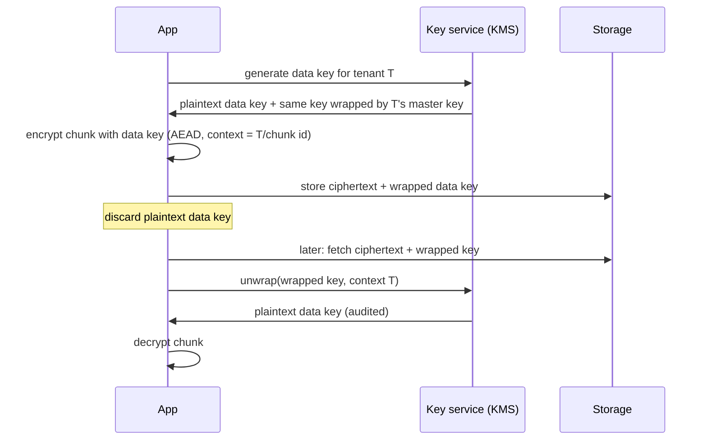

Encryption is the control people reach for first and understand least. It is essential: a stolen disk, a leaked backup or an eavesdropper on the network should yield nothing readable. But it is also narrower than it sounds. Encryption protects data against people who get at the *storage* or the *wire*; it does nothing against an authorised application that asks the wrong question, which is how most RAG leaks happen. This lesson explains what encryption does and does not protect in a RAG system, how to encrypt the parts that matter (the network paths, the stored text, the keys and the backups), and why the vectors themselves are the awkward part.

You will meet **envelope encryption**, the pattern behind almost every cloud key-management service, and **crypto-shredding**, which turns "delete a tenant's data everywhere, including backups" from a hope into a single operation. Runnable code demonstrates both with a deliberately toy cipher so you can see the key hierarchy work; the production calls are given separately and clearly marked as not executed.

## Learning objectives

- Distinguish encryption in transit, at rest and in use, and state which threats each one addresses and which it does not.
- Explain envelope encryption, key rotation by re-wrapping, and crypto-shredding, and sketch a per-tenant key design for a RAG index.
- Explain why embedding vectors are not anonymous, and decide what to encrypt in a vector database and what to leave in the clear.
- Calculate the risk of random-nonce reuse in an authenticated cipher such as AES-GCM and state the practical limit.
- Implement and test a key hierarchy that binds each ciphertext to its context and becomes unreadable when a tenant key is destroyed.

## Prerequisites

- [Tenant isolation](/learn/access-control-and-privacy/tenant-isolation): the per-tenant boundary that per-tenant keys reinforce.
- [Document-level permissions](/learn/access-control-and-privacy/document-level-permissions): the access control that encryption complements and does not replace.
- [Vector storage](/learn/vector-database-fundamentals/vector-storage): what a vector database physically stores.
- [Embeddings](/learn/understanding-large-language-models/embeddings): the vectors whose confidentiality is in question.

## Why this matters

Consider the places a RAG system keeps or moves a company's text: the browser, the API, the ingestion workers, the vector database's disks, its snapshots, an object store of source files, the logs, and the call to a model provider. Each is a place where someone other than the intended reader might get at bytes: a misconfigured storage bucket, a decommissioned drive, a network tap, a backup copied to a laptop, an engineer with infrastructure access. Encryption turns each of those events from a disclosure into a non-event, *if* the keys are kept elsewhere.

Without it, a breach of a snapshot is a breach of every document in the index. With the wrong kind of it, the team believes it is protected when it is not: "the database is encrypted at rest" does not stop a user with a valid session from retrieving someone else's chunk, and it does not stop a developer's query from returning plaintext, because the database decrypts transparently for any authorised client. Understanding that distinction keeps encryption in its proper place as one control among several.

There is also an operational reason. Regulations and customer contracts increasingly ask for deletion on request, including from backups. Deleting a row from a live index is easy; finding it in thirty days of snapshots is not. Encryption with per-tenant or per-subject keys offers a different route: destroy the key and every copy becomes unreadable.

## The intuition

Think of a safe-deposit room. The bank keeps documents in individual boxes. Each box has its own key, given to the customer. The bank also has a master vault that holds spare copies of customers' box keys, and that vault is protected by the strongest security the bank has.

Now consider what this arrangement provides. Someone who carries off a box, or photographs the corridor, gets nothing. Replacing a customer's lock costs one key, not a re-filing of every document. If a customer leaves the bank and the bank destroys their key, the box's contents are unrecoverable by anyone, even from the building's archived plans. And the master vault is audited: every time a key is fetched, it is logged.

Envelope encryption is this arrangement in software: each data set has its own **data key**; data keys are themselves encrypted by a **master key** that lives in a hardened key-management service, which logs each use. The boxes can be anywhere (cheap storage, backups, other regions) because they are useless without keys that stay in one tightly controlled place.

## How it works

### Three states of data

| State | Threat addressed | Typical mechanism |
| --- | --- | --- |
| **In transit** | Eavesdropping, tampering and impersonation on the network | TLS between every pair of components; mutual TLS inside a cluster |
| **At rest** | Theft of disks, snapshots, backups and object-store contents | Disk or volume encryption, storage-service encryption, application-level encryption |
| **In use** | An attacker or operator reading memory while data is processed | Confidential-computing hardware enclaves; operationally niche and not assumed in this lesson |

A RAG system has more network hops than most applications, and each needs TLS: client to API, API to vector database, API to key service, workers to object storage, and API to the model provider. Modern TLS (versions 1.2 and 1.3) with certificate verification enabled is the baseline; disabling verification "to make the self-signed certificate work" is a widespread mistake that turns TLS into theatre, because anyone on the path can then impersonate the server.

### What encryption at rest does not protect

> [!WARNING]
> Transparent encryption at rest protects against someone who obtains the storage *without* the running service. It gives no protection against anyone who can talk to the running service as an authorised client. A leak caused by a missing tenant filter or a stale ACL occurs with encryption fully enabled.

That is why this lesson sits after the access-control lessons. Encryption is a second wall behind authorisation, not a substitute for it. It addresses a different set of attackers: a lost laptop, an exposed backup bucket, a malicious or careless insider with storage access, a cloud-provider-level incident.

### Envelope encryption

Encrypting everything directly with a master key is impractical: the master key would be used constantly, and a hardware key service cannot encrypt gigabytes quickly. **Envelope encryption** uses two layers.



1. The **key-encryption key** (KEK) or master key lives in a key-management service (KMS) or hardware security module (HSM). It never leaves; it only wraps and unwraps.
2. The app obtains a **data-encryption key** (DEK), either generating one and asking the KMS to wrap it, or asking the KMS to generate and return both forms.
3. Data is encrypted locally with the DEK, quickly and at any size.
4. The ciphertext is stored with the **wrapped DEK**, which is useless without the KMS.
5. To read, the app asks the KMS to unwrap the DEK (an audited, access-controlled call), then decrypts locally.

Benefits follow directly. **Rotation** of the master key means re-wrapping the small DEKs, not re-encrypting the data. **Access control and audit** concentrate on the KMS: who may unwrap which key, and every unwrap is logged. **Granularity** is cheap: per-tenant or per-collection DEKs cost nothing to create.

### Authenticated encryption and context binding

Use **authenticated encryption with associated data (AEAD)**, such as AES-256-GCM or ChaCha20-Poly1305. Plain encryption hides content but not tampering; AEAD also produces a tag that fails verification if the ciphertext or the **associated data** (AAD) changes. The AAD is data you do not encrypt but want bound to the ciphertext: use the tenant and chunk identifier. Then an attacker (or a bug) that copies one row's ciphertext into another row, or another tenant's, fails authentication instead of decrypting to plausible-looking text belonging to the wrong place. KMS services offer the same idea under the name *encryption context*.

Two rules complete the picture. **Never reuse a nonce with the same key** in GCM: doing so breaks both secrecy and integrity. And **never invent your own cipher or construction**; use the AEAD primitive from a maintained library.

### Per-tenant keys and crypto-shredding

Giving each tenant its own KEK has three payoffs. A key-policy mistake or a compromised credential exposes one tenant's data rather than all. A customer can bring or hold their own key (variously called BYOK or HYOK, depending on whether the provider or the customer controls it), a common enterprise requirement. And **crypto-shredding** becomes possible: when the tenant leaves, or a deletion request arrives, **destroy the key**. Every copy of that tenant's encrypted data, in live storage, in snapshots, in backups on the other side of the world, becomes computationally unreadable at once. Real KMS products typically enforce a scheduled deletion delay for safety, so plan for the waiting period and say so to your customer; and it only works if the data was encrypted *with that key* and no plaintext copies exist (logs, caches and exports remain your responsibility).

### The awkward part: vectors

A RAG index stores text and its embedding. Text is easy to encrypt at the application level before storing it in a payload. Vectors are not, for two reasons.

**You cannot search what you have encrypted.** Nearest-neighbour search needs to compute distances between the query vector and stored vectors. Standard encryption destroys that structure. Schemes exist that compute on encrypted data (homomorphic encryption) or leak partial order information, but they are far slower or weaker than plaintext search and are not the practical default for production vector databases. So vectors normally sit in the clear in the database's memory and indexes, protected by disk encryption and access control.

**Vectors are not anonymous.** It is tempting to say "we store only embeddings, so the content is safe". Research says otherwise. Morris, Kuleshov, Shmatikov and Rush (2023, "Text Embeddings Reveal (Almost) As Much As Text") showed that an iterative procedure can reconstruct, in their experiments, a large majority of short text inputs exactly from dense embeddings, and a good approximation of longer ones. The details depend on the embedding model and the text length, but the conclusion for practice is firm: **treat the vector store as being as sensitive as the source documents.** A leaked vector index is a leaked corpus, with some loss.

The practical design, therefore, is:

- **Encrypt the text payload** at the application level with per-tenant data keys, so the database and its snapshots hold ciphertext for the readable content.
- **Keep the vectors and filter fields in the clear** inside the vector database, and protect them with disk encryption, network isolation, strict authorisation and tenant partitions.
- Accept the residual exposure explicitly in your threat model, and do not describe the system as "fully encrypted".
- Where the corpus is too sensitive for that residual risk, use dedicated infrastructure per tenant or on-premises deployment, rather than expecting cryptography to resolve it.

Application-level payload encryption has a cost in functionality: you cannot use full-text search, keyword filters or [hybrid storage](/learn/advanced-vector-database-engineering/hybrid-storage) features on the encrypted field. Keep searchable fields (classification, tenant, ACL, document id) in clear metadata and encrypt only the human-readable content.

### Transit to the model provider

Retrieved chunks leave your infrastructure for the model provider over TLS. Decide in advance whether your data-processing agreement covers the content (read the provider's current terms on retention and training, which vary by product and tier), whether some classes of text must go only to a self-hosted model, and whether you log prompts, since logs reintroduce plaintext at rest ([Data retention](/learn/access-control-and-privacy/data-retention) covers how long).

### Key management hygiene

Keep keys in a KMS or secret manager, never in code, images or the index. Separate who can encrypt from who can decrypt, rotate on a schedule and after any suspected exposure, back keys up separately and with equal care (lost keys mean lost data), and alert on unusual unwrap volume, an early sign of mass exfiltration.

## The mathematics

Randomly chosen nonces make AES-GCM simple to use but carry a quantifiable risk, which is why standards limit how many messages one key may encrypt.

**Intuition.** Each encryption picks a random 96-bit nonce. If two messages under the same key ever receive the same nonce, security collapses for those messages. With $n$ messages and $2^{96}$ possible nonces, this is the birthday problem: collisions appear far sooner than the nonce space suggests.

For $n$ messages and $b$ nonce bits, the probability of at least one repeated nonce is approximately:

$$
P_{\text{collision}} \approx \frac{n(n-1)}{2 \cdot 2^{b}} \approx \frac{n^{2}}{2^{b+1}}
$$

where $n$ is the number of encryptions under one key and $b = 96$ for the standard GCM nonce. The approximation is accurate while $P$ is small.

**Worked example.** A tenant's key encrypts $n = 10^8$ chunks over its lifetime. Then $P \approx 10^{16} / 2^{97} \approx 10^{16} / 1.58 \times 10^{29} \approx 6.3 \times 10^{-14}$. At $n = 2^{32} \approx 4.3 \times 10^{9}$, the limit NIST SP 800-38D gives for random nonces under one key, $P \approx 2^{64}/2^{97} = 2^{-33}$, about $1.2 \times 10^{-10}$ by the formula above (the same order of magnitude as the $2^{-32}$ bound the standard states).

```python
from math import log2

def p_collision(n, bits=96):
    """Birthday approximation for a repeated random nonce among n messages: n(n-1)/2 / 2^bits."""
    return n * (n - 1) / 2 / 2 ** bits

for n in (10**6, 10**8, 2**32):
    p = p_collision(n)
    print(f"n = {n:>13,}: P(collision) ~ {p:.2e} (2^{log2(p):.1f})")
```

```output
n =     1,000,000: P(collision) ~ 6.31e-18 (2^-57.1)
n =   100,000,000: P(collision) ~ 6.31e-14 (2^-43.8)
n = 4,294,967,296: P(collision) ~ 1.16e-10 (2^-33.0)
```

Per-tenant data keys help here too: spreading encryptions over many keys keeps each key far below the limit. For very large volumes under a single key, use a construction with larger nonces or derive a fresh key per object, as the libraries' documentation for extended-nonce modes describes.

## In code

Two examples. The first runs anywhere and shows the *key management logic*. The second shows the real calls and was not run.

### A runnable key hierarchy (with a toy cipher)

The `cryptography` package was not available in the environment used to write this lesson, so the runnable example builds a **toy** cipher from the standard library's HMAC and SHA-256: an HMAC-derived keystream XOR for secrecy and an HMAC tag over the associated data, nonce and ciphertext for integrity. It is a teaching stand-in with the *interface* of an AEAD (`seal` and `unseal` with associated data), and it must not be used to protect real data. What it demonstrates faithfully is the architecture: a fake KMS holding one master key per tenant, one wrapped data key per tenant, ciphertext bound to its row, and crypto-shredding.

```python
import hashlib
import hmac
import os


def _stream(key: bytes, nonce: bytes, n: int) -> bytes:
    out, counter = b"", 0
    while len(out) < n:
        out += hmac.new(key, nonce + counter.to_bytes(8, "big"), hashlib.sha256).digest()
        counter += 1
    return out[:n]


def seal(key: bytes, plaintext: bytes, aad: bytes) -> bytes:
    enc_key, mac_key = (hmac.new(key, label, hashlib.sha256).digest() for label in (b"enc", b"mac"))
    nonce = os.urandom(12)
    ct = bytes(a ^ b for a, b in zip(plaintext, _stream(enc_key, nonce, len(plaintext))))
    tag = hmac.new(mac_key, aad + nonce + ct, hashlib.sha256).digest()
    return nonce + ct + tag


def unseal(key: bytes, blob: bytes, aad: bytes) -> bytes:
    enc_key, mac_key = (hmac.new(key, label, hashlib.sha256).digest() for label in (b"enc", b"mac"))
    nonce, ct, tag = blob[:12], blob[12:-32], blob[-32:]
    expect = hmac.new(mac_key, aad + nonce + ct, hashlib.sha256).digest()
    if not hmac.compare_digest(tag, expect):
        raise ValueError("authentication failed: wrong key, wrong context, or tampered data")
    return bytes(a ^ b for a, b in zip(ct, _stream(enc_key, nonce, len(ct))))


class FakeKms:
    """Holds one key-encryption key per tenant. Real KMS keys never leave the service."""

    def __init__(self):
        self._keks = {}

    def create_key(self, tenant):
        self._keks[tenant] = os.urandom(32)

    def wrap(self, tenant, dek):
        return seal(self._keks[tenant], dek, aad=tenant.encode())

    def unwrap(self, tenant, wrapped):
        if tenant not in self._keks:
            raise KeyError(f"key for {tenant} has been destroyed")
        return unseal(self._keks[tenant], wrapped, aad=tenant.encode())

    def destroy_key(self, tenant):
        del self._keks[tenant]


class EncryptedChunkStore:
    def __init__(self, kms):
        self.kms, self.rows, self.wrapped_deks = kms, {}, {}

    def put(self, tenant, chunk_id, text):
        if tenant not in self.wrapped_deks:                     # one data key per tenant, wrapped by the KMS
            self.wrapped_deks[tenant] = self.kms.wrap(tenant, os.urandom(32))
        dek = self.kms.unwrap(tenant, self.wrapped_deks[tenant])
        self.rows[(tenant, chunk_id)] = seal(dek, text.encode(), aad=f"{tenant}/{chunk_id}".encode())

    def get(self, tenant, chunk_id, row_key=None):
        dek = self.kms.unwrap(tenant, self.wrapped_deks[tenant])
        blob = self.rows[row_key or (tenant, chunk_id)]
        return unseal(dek, blob, aad=f"{tenant}/{chunk_id}".encode()).decode()


if __name__ == "__main__":
    kms = FakeKms()
    kms.create_key("kestrel"); kms.create_key("orchard")
    store = EncryptedChunkStore(kms)
    store.put("kestrel", "c1", "Kestrel renewal pricing is fixed for 24 months.")
    store.put("orchard", "c1", "Orchard renewal includes a volume discount.")

    blob = store.rows[("kestrel", "c1")]
    print("ciphertext bytes   :", len(blob), "| plaintext visible:", b"pricing" in blob)
    print("kestrel reads      :", store.get("kestrel", "c1"))
    store.put("kestrel", "c2", "Kestrel support contact is on the Enterprise plan.")
    c2 = store.rows[("kestrel", "c2")]
    store.rows[("kestrel", "c2")] = blob                        # an attacker moves c1's ciphertext into row c2
    try:
        store.get("kestrel", "c2")
    except ValueError as e:
        print("swapped row        :", e)
    store.rows[("kestrel", "c2")] = c2
    try:   # ...or copies Kestrel's ciphertext into Orchard's row
        store.rows[("orchard", "c1")] = blob
        store.get("orchard", "c1")
    except ValueError as e:
        print("swapped tenant     :", e)
    tampered = bytearray(blob); tampered[20] ^= 1
    store.rows[("kestrel", "c1")] = bytes(tampered)
    try:
        store.get("kestrel", "c1")
    except ValueError as e:
        print("tampered ciphertext:", e)
    store.rows[("kestrel", "c1")] = blob
    kms.destroy_key("kestrel")                                   # crypto-shredding
    try:
        store.get("kestrel", "c1")
    except KeyError as e:
        print("after shredding    :", e)
```

```output
ciphertext bytes   : 91 | plaintext visible: False
kestrel reads      : Kestrel renewal pricing is fixed for 24 months.
swapped row        : authentication failed: wrong key, wrong context, or tampered data
swapped tenant     : authentication failed: wrong key, wrong context, or tampered data
tampered ciphertext: authentication failed: wrong key, wrong context, or tampered data
after shredding    : 'key for kestrel has been destroyed'
```

### Reading the output

The stored blob is 91 bytes for a 47-byte plaintext: a 12-byte nonce, the ciphertext (same length as the plaintext) and a 32-byte tag. The string "pricing" cannot be found in it. The owner reads her chunk normally. Three attacks then fail loudly. Moving the ciphertext of chunk `c1` into the row for `c2` fails because the associated data (`kestrel/c2`) no longer matches the one used to seal it; copying it into another tenant's row fails because that tenant's data key differs; flipping a single bit fails the tag. Finally, after the tenant's master key is destroyed, even the legitimate reader gets nothing: the wrapped data key can no longer be unwrapped, so **every copy of every Kestrel chunk, wherever it was stored, is now unreadable.** That single `destroy_key` call is crypto-shredding.

### Important lines

- `aad=f"{tenant}/{chunk_id}".encode()` binds each ciphertext to its location, which is what turns swapped rows into errors rather than silent wrong answers.
- `os.urandom(12)` gives a fresh random nonce per encryption, as AES-GCM requires; a real AEAD would take the same.
- The plaintext data key exists only inside `put` and `get` and is never stored; only the wrapped key is.

### The production calls (not executed)

The following was **not run**: the `cryptography` package was not available in that environment, and the KMS call needs a cloud account and credentials. It is written against the libraries' documented interfaces; the key id is a placeholder. In real use, prefer your cloud SDK's higher-level envelope-encryption helper where one exists.

```python
import os

import boto3
from cryptography.hazmat.primitives.ciphers.aead import AESGCM

kms = boto3.client("kms")  # credentials come from the environment or an instance role
KEY_ID = os.environ["TENANT_KEK_ID"]   # the tenant's key in the KMS


def encrypt_chunk(tenant: str, chunk_id: str, text: str) -> dict:
    data_key = kms.generate_data_key(
        KeyId=KEY_ID, KeySpec="AES_256", EncryptionContext={"tenant": tenant}
    )
    nonce = os.urandom(12)                                   # 96-bit random nonce, new for every message
    aad = f"{tenant}/{chunk_id}".encode()
    ciphertext = AESGCM(data_key["Plaintext"]).encrypt(nonce, text.encode(), aad)
    return {"wrapped_key": data_key["CiphertextBlob"], "nonce": nonce, "ct": ciphertext}


def decrypt_chunk(tenant: str, chunk_id: str, record: dict) -> str:
    plaintext_key = kms.decrypt(
        CiphertextBlob=record["wrapped_key"], EncryptionContext={"tenant": tenant}
    )["Plaintext"]
    aad = f"{tenant}/{chunk_id}".encode()
    return AESGCM(plaintext_key).decrypt(record["nonce"], record["ct"], aad).decode()
```

This version asks the KMS for a new data key per chunk, which keeps each key far below the nonce limit but adds a KMS call per chunk; in practice you would cache one data key per tenant per time window (as the runnable example does) and rotate it, trading calls for exposure. Your exact output will differ; a failed `decrypt` raises `cryptography.exceptions.InvalidTag`.

### TLS verification, checked

For the transit side, Python's default `ssl` context is already strict, which you can check:

```python
import ssl
ctx = ssl.create_default_context()
print("verify_mode   :", ctx.verify_mode.name)
print("check_hostname:", ctx.check_hostname)
print("min version   :", ctx.minimum_version.name)
```

```output
verify_mode   : CERT_REQUIRED
check_hostname: True
min version   : TLSv1_2
```

Certificate verification and hostname checking are on, and the minimum protocol version is TLS 1.2 (on the Python version used here; older versions may differ). Libraries built on this context (such as `httpx` and `requests`) inherit the behaviour. The common error is switching it off (`verify=False`, `CERT_NONE`) to get past a self-signed certificate; the correct fix is to give the client the issuing certificate authority, for example through `verify="/path/to/ca.pem"`.

### Common errors

- **`InvalidTag` on decrypt.** The key, nonce, ciphertext or associated data differs from what was used to encrypt; often the AAD string was rebuilt differently on read and write.
- **Encrypting the field you need to filter on.** Keep filter fields in clear metadata.
- **Storing the plaintext data key** beside the ciphertext "for convenience", which cancels the design.

## A real-world example

The Platform team at Meridian prepares AskMeridian for its first external pilot: a partner company will upload its own contracts. The security questionnaire arrives with three questions: is data encrypted in transit and at rest; can the partner's data be destroyed on termination, including backups; and can Meridian staff read it?

The first answer is easy: TLS between every component with verification on, and encrypted cloud disks under the Qdrant cluster. The second and third are not, because disk encryption is transparent to anyone with a database login, and backups hold every tenant's chunks readable by any restorer.

The team's redesign has four parts. Chunk text is encrypted in the ingestion worker with a data key unique to each tenant, wrapped by a per-tenant key in the cloud KMS, with the tenant and chunk id as associated data. Vectors, tenant ids, document ids and ACLs stay in clear payload fields so search and filtering work; the threat model records plainly that vectors can be inverted, so the vector store is treated as sensitive as the documents. The KMS key policy allows only the retrieval service to decrypt, and only for the tenant on the current request, and every unwrap goes to the audit log. Termination becomes a procedure: delete the tenant's points, schedule deletion of the tenant's key, and, after the KMS's waiting period, state in the termination certificate that snapshots taken earlier are no longer readable.

The answer to the third question changes from "technically yes" to "only through an audited break-glass role that can unwrap that tenant's key". The team is careful not to over-promise: the review notes that encrypted payloads are not searchable, so the contract-search feature uses a clear-text title field and the vector for matching, and that a determined attacker with the vector index could still reconstruct approximate text.

## Common mistakes

- **Believing "encrypted at rest" prevents RAG leaks.** Transparent encryption decrypts for any authorised client, so a missing filter leaks with it on. Pair encryption with access control.
- **Calling embeddings anonymous.** Vectors can be inverted to recover much of the text. Protect the vector store as you would the documents.
- **Disabling certificate verification.** Self-signed certificates "solved" with `verify=False` let any on-path attacker impersonate a server. Install the right CA instead.
- **Reusing a nonce.** With AES-GCM, a repeated nonce under one key breaks confidentiality and integrity. Use random 96-bit nonces from the OS and limit messages per key.
- **Storing keys beside the data.** A plaintext key in the same bucket, repository or image defeats encryption. Keep keys in a KMS.
- **No associated data.** Ciphertexts can be swapped between rows or tenants and decrypt without error. Bind each to its context.
- **Encrypting fields you must search or filter.** The feature breaks or is quietly worked around with plaintext copies. Keep searchable metadata clear and encrypt content.

## Best practices

- Enforce TLS with verification on every hop, including to the vector database, the key service and the model provider.
- Use envelope encryption with a KMS or HSM; separate permissions to encrypt, decrypt and administer keys.
- Use per-tenant keys where tenants need independent deletion or customer-held keys, and design deletion around crypto-shredding with the KMS's waiting period in mind.
- Encrypt text payloads with an AEAD, binding tenant and chunk id as associated data; keep searchable metadata and vectors in the clear and say so in the threat model.
- Rotate master keys by re-wrapping, and data keys on a schedule and before volume limits.
- Encrypt backups and snapshots, and test restores including with a destroyed key.

## Performance considerations

AEAD ciphers such as AES-GCM are fast on modern CPUs with hardware AES support, typically well over a gigabyte per second per core in published library benchmarks, so encrypting a few hundred bytes of chunk text is negligible against embedding and search. The costs that matter are elsewhere.

**KMS calls** add network latency, often tens of milliseconds, and are rate-limited and priced per request. Calling the KMS for every chunk on the read path would add that latency to every retrieved chunk. The remedy is **data-key caching**: unwrap a tenant's data key once, hold it in memory for a short, bounded time, and decrypt many chunks with it. For example, if a question retrieves 10 chunks, one cached unwrap serves all ten; with a cache lifetime of five minutes, a tenant with steady traffic costs at most 12 unwraps an hour rather than one per chunk per question. The trade-off is exposure: a cached key is in process memory for its lifetime, and revoking access takes effect only after it expires.

**Decryption on the read path** is cheap relative to reranking and generation, and AEAD adds only a nonce and a tag (28 bytes with AES-GCM's 12-byte nonce and 16-byte tag) per chunk. Keep TLS connections pooled so handshakes are amortised.

## Security considerations

- Treat the KMS as the crown jewel: restrict its administrators, require approval for policy changes, and monitor access.
- Key destruction is irreversible: require two-person approval and a grace period.
- Crypto-shredding covers only data encrypted under the destroyed key. Verify that no plaintext copies exist in logs, caches, exports or search indexes.

## Summary

- Encryption in transit and at rest protects against network and storage compromise; it does not stop an authorised application from retrieving the wrong data, so it complements access control.
- Envelope encryption wraps per-tenant data keys with a master key held in a KMS, making rotation cheap and concentrating audit on key use; AEAD with associated data binds each ciphertext to its tenant and row.
- Destroying a tenant's key makes every copy of its encrypted data unreadable, including backups: crypto-shredding.
- Vectors cannot practically be encrypted and still searched, and they can be inverted to recover much of the text, so encrypt the text payload, keep vectors protected like the documents, and state the residual risk.
- Random 96-bit nonces under one key carry a birthday-bound risk; limit messages per key and use vetted libraries, never custom ciphers.

## Exercises

1. **Conceptual.** A colleague says the vector database is "fully encrypted at rest, so a SQL-style injection of a missing filter cannot expose anything". Respond.

<details><summary>Show solution</summary>

Encryption at rest protects stored bytes from someone without the running service. The database decrypts transparently for any authorised client, including your application with a missing filter, so the leak occurs with encryption enabled. The control for that threat is access control (filters, ACLs, tenant isolation). Encryption addresses lost disks, copied backups and storage-level insiders, which is a different attacker.

</details>

2. **Calculation.** A tenant key encrypts $10^{9}$ chunks with random 96-bit nonces. Estimate the probability of at least one nonce collision, and say what you would do to reduce it.

<details><summary>Show solution</summary>

$P \approx n^2 / 2^{97} = 10^{18} / 1.58 \times 10^{29} \approx 6.3 \times 10^{-12}$. It is small but avoidable: rotate the data key periodically so each key encrypts far fewer messages (for example, a new data key per day or per ingestion batch), and keep a per-key message counter that triggers rotation well before $2^{32}$.

</details>

3. **Design.** A customer demands the right to revoke Meridian's access to their documents at any time. Outline a key design and what "revoke" does.

<details><summary>Show solution</summary>

Use a customer-held master key in the customer's own KMS (HYOK/BYOK style), with Meridian's service authorised to wrap and unwrap tenant data keys through a grant the customer controls. Text payloads are encrypted under per-tenant data keys wrapped by that master key. "Revoke" means the customer withdraws the grant or disables the key: Meridian's unwrap calls fail, so encrypted text becomes unreadable (vectors and metadata, kept in clear, would remain, so the design should say so, and may include deleting them as part of revocation). Because Meridian cached keys in memory, revocation takes effect once cached keys expire, which should be short.

</details>

4. **Code.** Modify `EncryptedChunkStore` to support key rotation without re-encrypting any chunk text: add `rotate(tenant)` that re-wraps the tenant's data key under a new master key.

<details><summary>Show solution</summary>

```python
def rotate(self, tenant):
    dek = self.kms.unwrap(tenant, self.wrapped_deks[tenant])   # old master key unwraps
    self.kms.create_key(tenant)                                # replaces the master key
    self.wrapped_deks[tenant] = self.kms.wrap(tenant, dek)     # new master key wraps the same DEK
```

Note the order: unwrap before replacing the master key, or the old data key is lost. Chunk ciphertexts are untouched because they were sealed with the data key, which has not changed. Rotating the *data* key is a separate, heavier operation that does re-encrypt.

</details>

## Check your understanding

```quiz
[
  {"q": "Which threat does transparent encryption at rest NOT address?", "options": ["A stolen disk", "A copied backup bucket", "An authorised application querying without a tenant filter", "A decommissioned drive"], "answer": 2, "why": "The database decrypts for any authorised client, so a missing filter exposes data with encryption on. Encryption at rest protects storage taken without the running service."},
  {"q": "Why does envelope encryption make master-key rotation cheap?", "options": ["It re-encrypts all data in the background", "Only the small wrapped data keys are re-wrapped; the data stays encrypted under unchanged data keys", "It removes the need for a KMS", "It shortens the ciphertext"], "answer": 1, "why": "Data is encrypted with data keys, and only those keys are encrypted with the master key. Rotation re-wraps them without touching the bulk data."},
  {"q": "What does crypto-shredding achieve?", "options": ["Overwrites disks with random data", "Makes all copies of data encrypted under a destroyed key unreadable, including backups", "Deletes the vector index", "Hides the key in memory"], "answer": 1, "why": "Without the key, ciphertext in any copy is unreadable. It works only for data that was encrypted under that key and has no plaintext copies elsewhere."},
  {"q": "Why should a RAG team treat a vector index as sensitive as the source documents?", "options": ["Vectors are always plaintext copies of the text", "Embeddings can often be inverted to recover much of the original text", "Vector databases do not support access control", "Embedding models store the documents"], "answer": 1, "why": "Published inversion research reconstructs a large share of short inputs from dense embeddings, so vectors are not anonymous."},
  {"q": "What is the purpose of associated data (AAD) in an AEAD such as AES-GCM?", "options": ["It is encrypted a second time", "It is authenticated but not encrypted, binding the ciphertext to a context such as tenant and chunk id", "It makes the nonce unnecessary", "It compresses the plaintext"], "answer": 1, "why": "Associated data is covered by the authentication tag. A ciphertext moved to a different context fails verification instead of decrypting."}
]
```

## Further reading

- NIST Special Publication 800-38D, "Recommendation for Block Cipher Modes of Operation: Galois/Counter Mode (GCM) and GMAC", for nonce and invocation limits.
- Morris, Kuleshov, Shmatikov and Rush, 2023, "Text Embeddings Reveal (Almost) As Much As Text", EMNLP.
- RFC 8446, "The Transport Layer Security (TLS) Protocol Version 1.3" (datatracker.ietf.org).
- OWASP Cryptographic Storage Cheat Sheet and Key Management Cheat Sheet (cheatsheetseries.owasp.org).
- Documentation for your cloud's key-management service, on envelope encryption, encryption context and key deletion (for example AWS KMS, Google Cloud KMS, Azure Key Vault).
- The `cryptography` package documentation (cryptography.io), on the AEAD interfaces.
