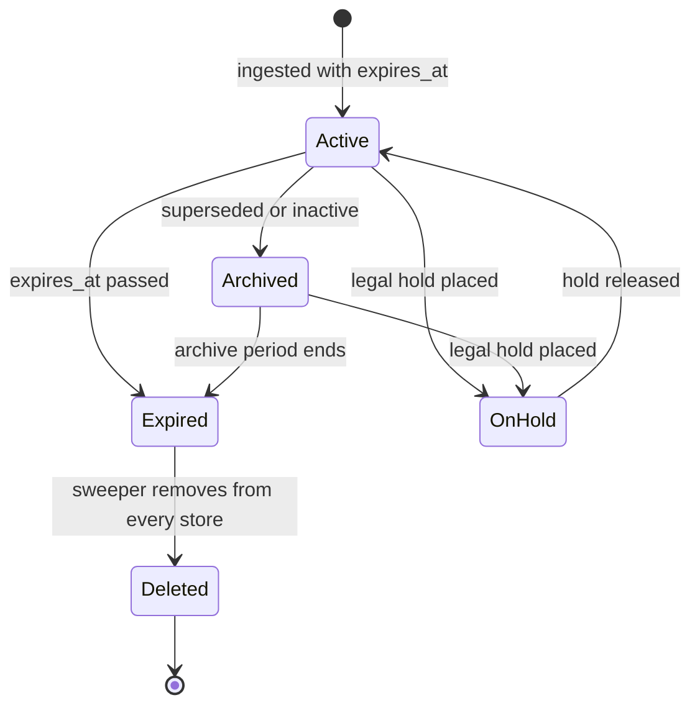

Every piece of data an organisation keeps has a cost and a risk. The cost is storage and the effort of managing it. The risk is that it will one day be breached, subpoenaed, misused or retrieved by a question it should never have matched. **Data retention** is the discipline of deciding, in advance and in writing, how long each kind of data is kept, and then actually removing it when the time comes. A RAG system makes this harder than usual, because one document becomes many copies: chunks, vectors, summaries, cached answers, conversation history, logs and backups. Deleting the source file and forgetting the rest is the characteristic retention failure.

This lesson covers the engineering of retention: expressing a policy as data, stamping it onto chunks at ingestion, enforcing it with a sweeper that covers every store, honouring legal holds, dealing with backups, and proving that deletion happened. The legal obligations behind it, and deletion in response to an individual's request, are the subject of [GDPR concepts](/learn/enterprise-rag-governance/gdpr-concepts) and [Secure deletion](/learn/enterprise-rag-governance/secure-deletion) in the governance module; here the focus is the mechanism.

## Learning objectives

- Distinguish a retention schedule, a legal hold, archival and deletion, and explain who owns each decision.
- Enumerate the places a RAG system holds copies of a document and say how each is expired.
- Implement a retention sweeper that stamps expiry at ingestion, deletes by filter across several stores, respects legal holds and is idempotent.
- Calculate steady-state storage under a retention period, and the worst-case time until data is gone from live storage and from backups.
- Design verification and audit for deletion, including what to do after restoring a backup.

## Prerequisites

- [PII detection](/learn/access-control-and-privacy/pii-detection): finding the personal data that retention rules most often target.
- [Data encryption](/learn/access-control-and-privacy/data-encryption): crypto-shredding as a way to expire backups.
- [CRUD operations](/learn/vector-database-fundamentals/crud-operations): deleting points, by id and by filter.
- [Metadata](/learn/vector-database-fundamentals/metadata): the payload fields a retention rule reads.

## Why this matters

Without a retention policy, data accumulates by default. Three consequences follow.

**Privacy and legal exposure grows with age.** Data protection law in many jurisdictions includes a *storage limitation* principle: personal data should be kept in an identifiable form no longer than necessary for its purpose (the GDPR states it in Article 5). An archive of five-year-old chat transcripts that nobody uses is a liability with no benefit. The reverse also happens: some records *must* be kept for a minimum period by tax, employment or sector rules, so deleting too early is a failure too. Retention is the explicit reconciliation of "keep at least this long" and "delete no later than this".

**Old content degrades answers.** An index that never forgets keeps superseded policies. Meridian's 2023 handbook said laptops were refreshed every four years; the 2025 handbook says three. A retriever that indexes both will sometimes answer with the dead policy. Retention and lifecycle management are therefore also quality controls.

**The attack surface scales with data.** A breach, an access-control bug or a prompt-injection exfiltration exposes whatever is there. Data that was deleted on schedule cannot be leaked. This is the strongest argument for minimisation: the best protection for data you do not need is not to hold it.

RAG's particular risk is that the *copies* outlive the original. A document removed from the wiki may persist in the vector index, in a semantic cache and in a nightly backup, and the assistant will cheerfully quote it.

## The intuition

Think of a records room in a company. Each box has a label with a destruction date, set according to a schedule maintained by the records manager and the legal team: payroll files for so many years, visitor logs for a few months. A clerk walks the room each week, pulls the boxes whose date has passed, and shreds them. A box under investigation carries a red "legal hold" tag, and the clerk must leave it alone, however old.

Now notice what a careless records room forgets. The photocopies in the filing cabinets down the hall. The summary notes in someone's desk. The offsite archive that gets a copy of everything every night. A destruction date means nothing if the copies are never found. A good records manager knows that destruction is a *process over every location*, keeps an inventory of those locations, and records each destruction, so that she can later show an auditor exactly what was destroyed, when and why.

A RAG retention system is that process: a schedule, a label on every item, a sweeper that visits every location, a hold tag, and a destruction log.

## How it works

### Four ideas that are often confused

- **Retention schedule**: the rule that says how long each category of data is kept ("chat logs 30 days; support tickets 12 months"). It is owned by legal, compliance or records management, with input from the business, not decided by the engineer.
- **Legal hold**: a suspension of deletion because data may be needed for litigation or an investigation. It *overrides* the schedule and must be applied and lifted by authorised people.
- **Archival**: moving data out of active use (not retrievable by the assistant) but still kept. A superseded handbook may be archived for the record and excluded from search.
- **Deletion**: removal such that the data can no longer be read or recovered through the system. Deletion in one place is not deletion everywhere.



The diagram makes the policy decisions explicit. Items only leave through `Expired`, and `OnHold` is a state from which nothing can be deleted.

### Where a RAG system keeps copies

| Store | What it holds | How it expires |
| --- | --- | --- |
| **Source system / object store** | Original files | The system of record's own policy; deletion must propagate down |
| **Chunk store and vectors** | Text, embeddings, metadata | Sweeper deleting by `expires_at` or `doc_id` |
| **Derived artefacts** | Summaries, extracted entities, graph nodes, generated questions | Delete by lineage: anything derived from a deleted source |
| **Caches** | Semantic and answer caches | Short TTL; flush entries derived from deleted documents |
| **Conversation history and memory** | User questions and answers, possibly quoting documents | Per-user retention period; delete on account closure |
| **Query logs, traces, feedback, evaluation sets** | Queries, retrieved text, ratings | Short, separate retention; scrubbed of PII |
| **Backups and snapshots** | Everything, at a moment | Their own schedule; crypto-shredding; deletion ledger on restore |
| **Model provider** | Prompts and outputs | Provider's terms and any zero-retention agreement; outside your direct control |

An inventory like this one, maintained for your system, is the first deliverable. A sweeper can only be as complete as the list of locations it knows about.

### Stamping the policy at ingestion

The cleanest design computes the expiry **once, at ingestion**, from the document's category and creation or last-modified date, and stores `expires_at` in each chunk's metadata. The sweeper then needs no knowledge of the policy table; it just compares timestamps. Two details matter:

- **What starts the clock.** Retention might run from creation, last modification, last access, or the end of a business event (a contract's termination, an employee's departure). Choose per category and write it down. "Event-based" retention needs the event to be known, so the metadata must be updated when it occurs.
- **Policy changes.** If the schedule changes from 12 to 6 months, existing chunks carry the old `expires_at`. Provide a re-stamping job, and decide whether a shorter period applies retroactively (usually yes, since the new limit is the one you must meet).

Content with no expiry (a current handbook) uses `expires_at = null`; it is governed instead by *supersession*: when a new version is ingested, the old version's chunks are archived (excluded from search) or given an expiry. Retrieval filters should also exclude archived items, so that archival has teeth.

### The sweeper

The sweeper is a scheduled job. Its design properties are what make it trustworthy.

1. **Select by filter, not by memory.** "Expired and not on hold" is a database condition: `expires_at <= now AND NOT legal_hold`. A condition survives restarts and has no list to lose.
2. **Idempotent.** Running it twice does the same as running it once. A crash halfway leaves a state the next run completes.
3. **Covers every store.** For each expired document, it removes the chunks, derived artefacts, cache entries and conversation references, using a lineage link such as `doc_id`.
4. **Reports.** It records what it deleted (document identifiers and counts, not content), when, under which policy version, and any items skipped because of a hold.
5. **Has a dry-run mode** that lists the victims without deleting, which is how you test a new rule safely.
6. **Verifies.** After deleting, it queries to confirm the items are gone, and emits a metric for anything that remains.
7. **Is rate-limited and batched**, so that a large first run does not degrade search.

### Legal holds

A legal hold is a flag that wins over the schedule. Implement it as metadata (`legal_hold: true`, possibly with a `hold_id` to say which matter) that the sweeper's filter excludes. Process matters:

- Placing and releasing holds is restricted to authorised people, logged, and applied *before* the data would expire. A hold placed after deletion is useless.
- Holds are scoped to a matter and may cover whole categories or custodians; the system needs a way to select the affected chunks by metadata.
- When a hold is lifted, the data returns to its schedule, and may be immediately overdue: the sweeper should then delete it on its next run, as the example shows.
- Retrieval access is separate from retention: data on hold is retained but need not be searchable by the assistant.

### Deletion in vector databases

Deleting a point from a vector database may not instantly free the storage or remove every trace. Many systems mark deletions logically and reclaim the space later, when segments are merged or compacted. For retention purposes, what matters is: (1) the deleted item can no longer be *retrieved* by any query, which you verify; and (2) it eventually becomes physically unrecoverable, which you confirm in the database's documentation, including how snapshots and write-ahead logs are handled. If your policy requires a bounded time to physical removal, test it and monitor compaction.

### Backups

Backups are the hard case, because they are immutable copies on their own schedule. There are three approaches, often combined:

1. **Let backups age out.** Keep backups for a short, fixed period (for example 35 days) and document that deleted data persists in backups until they expire. This is the common and defensible position, if the period is disclosed and the backups are access-controlled and encrypted.
2. **Crypto-shredding.** Encrypt data with a key per tenant or per subject and destroy the key ([Data encryption](/learn/access-control-and-privacy/data-encryption)); every backup copy becomes unreadable at once.
3. **A deletion ledger replayed on restore.** Keep a log of identifiers deleted and when. After *any* restore, replay the ledger so that data deleted since the backup was taken is not resurrected into service.

The third is the one most often missing. A disaster-recovery restore that quietly brings back data that was deleted last month undermines every deletion promise made since.

## The mathematics

Two small calculations govern capacity and compliance promises.

**Steady-state storage.** If data arrives at a constant rate $\lambda$ (chunks per day) and each chunk is kept for $T$ days, the live collection stabilises at

$$
N_{\text{steady}} = \lambda \times T
$$

This is Little's law applied to storage: the number in the system equals arrival rate times time in the system. Longer retention directly multiplies the index size.

**Worst-case time to disappearance.** A chunk's expiry date is $T$ days after creation, but the sweeper runs only every $s$ days, so a chunk that expires just after a run waits up to $s$ more days. Backups retained for $b$ days extend that tail:

$$
t_{\text{live}} \le T + s, \qquad t_{\text{backups}} \le T + s + b
$$

**Worked example.** Chat chunks arrive at $\lambda = 5{,}000$ per day. With $T = 30$ days, $N = 150{,}000$ chunks; with $T = 90$, $N = 450{,}000$. Each 384-dimension float32 vector is $384 \times 4 = 1{,}536$ bytes, so raw vector storage is about $0.23$ GB at 30 days, $0.69$ GB at 90 days and $2.80$ GB at 365 days (index structures and payloads add more). With a daily sweep ($s = 1$) and 35-day backups ($b = 35$), a chunk with a 30-day retention is gone from live storage within 31 days and from every backup within 66 days.

```python
rate, dims, bytes_per = 5_000, 384, 4          # chunks per day, vector size, float32
for days in (30, 90, 365):
    n = rate * days
    gb = n * dims * bytes_per / 1e9
    print(f"retention {days:3d} d: steady-state chunks = {n:>9,}  raw vectors = {gb:5.2f} GB")

retention, sweep_interval, backup_retention = 30, 1, 35
print("worst-case days until the data is gone from live storage :", retention + sweep_interval)
print("worst-case days until the data is gone from all backups  :", retention + sweep_interval + backup_retention)
```

```output
retention  30 d: steady-state chunks =   150,000  raw vectors =  0.23 GB
retention  90 d: steady-state chunks =   450,000  raw vectors =  0.69 GB
retention 365 d: steady-state chunks = 1,825,000  raw vectors =  2.80 GB
worst-case days until the data is gone from live storage : 31
worst-case days until the data is gone from all backups  : 66
```

The bounds are *worst cases*. State them as such in policy documents, and remember that a longer sweep interval or a longer backup window moves them linearly. If a contract promises "deleted within 30 days", a 30-day retention with a daily sweep does not meet it; the retention period itself must be shorter than the promise by at least $s$ (and, for backups, $s + b$).

## In code

The example sweeps three stores: a Qdrant collection (in memory), a query log and a semantic cache. It stamps `expires_at` at ingestion from a policy table, protects one document under a legal hold, uses a fixed "now" so results are reproducible, and shows idempotence, the passage of time, and a hold being released. Vectors are random 8-dimensional placeholders, because retention does not depend on embeddings.

```bash
pip install qdrant-client numpy
```

```python
import numpy as np
from qdrant_client import QdrantClient, models

DAY = 86_400
POLICY_DAYS = {"chat-log": 30, "support-ticket": 365, "handbook": None}   # None = kept until superseded

rng = np.random.default_rng(7)
client = QdrantClient(":memory:")
client.create_collection("askmeridian", vectors_config=models.VectorParams(size=8, distance=models.Distance.COSINE))

CHUNKS = [  # (doc_id, category, age in days at t=0)
    ("chat-001", "chat-log", 45), ("chat-002", "chat-log", 10), ("chat-003", "chat-log", 31),
    ("tick-100", "support-ticket", 400), ("tick-101", "support-ticket", 100), ("tick-102", "support-ticket", 500),
    ("handbook-2025", "handbook", 300),
]
LEGAL_HOLD = {"tick-102"}          # under a legal hold: must not be deleted even though it has expired
NOW = 1_800_000_000                # a fixed "today" so the example is reproducible

points = []
for i, (doc, cat, age) in enumerate(CHUNKS):
    created = NOW - age * DAY
    days = POLICY_DAYS[cat]
    points.append(models.PointStruct(
        id=i, vector=rng.normal(size=8).tolist(),
        payload={"doc_id": doc, "category": cat, "created_at": created,
                 "expires_at": created + days * DAY if days else None,
                 "legal_hold": doc in LEGAL_HOLD}))
client.upsert("askmeridian", points=points)

# Two derived stores that also hold the content: a query log and a semantic cache.
QUERY_LOG = [{"ts": NOW - 40 * DAY, "q": "old question"}, {"ts": NOW - 5 * DAY, "q": "recent question"}]
CACHE = {"k1": {"ts": NOW - 50 * DAY, "a": "stale answer"}, "k2": {"ts": NOW - 1 * DAY, "a": "fresh answer"}}
LOG_RETENTION_DAYS, CACHE_TTL_DAYS = 30, 7


def expired_filter(now: int) -> models.Filter:
    return models.Filter(
        must=[models.FieldCondition(key="expires_at", range=models.Range(lte=now))],   # null never matches a range
        must_not=[models.FieldCondition(key="legal_hold", match=models.MatchValue(value=True))],
    )


def sweep(now: int) -> dict:
    flt = expired_filter(now)
    victims, _ = client.scroll("askmeridian", scroll_filter=flt, limit=10_000, with_payload=["doc_id"])
    victim_docs = sorted(p.payload["doc_id"] for p in victims)
    if victims:
        client.delete("askmeridian", points_selector=models.FilterSelector(filter=flt))
    n_log = len(QUERY_LOG)
    QUERY_LOG[:] = [r for r in QUERY_LOG if now - r["ts"] < LOG_RETENTION_DAYS * DAY]
    n_cache = len(CACHE)
    for k in [k for k, v in CACHE.items() if now - v["ts"] >= CACHE_TTL_DAYS * DAY]:
        del CACHE[k]
    return {"index_deleted": victim_docs, "log_deleted": n_log - len(QUERY_LOG), "cache_deleted": n_cache - len(CACHE)}


def remaining():
    pts, _ = client.scroll("askmeridian", limit=100, with_payload=["doc_id"])
    return sorted(p.payload["doc_id"] for p in pts)


if __name__ == "__main__":
    print("before :", remaining())
    print("sweep 1:", sweep(NOW))
    print("after  :", remaining())
    print("sweep 2 (idempotent):", sweep(NOW))
    print("30 days later:", sweep(NOW + 30 * DAY), "->", remaining())
    LEGAL_HOLD.clear()
    client.set_payload("askmeridian", payload={"legal_hold": False},
                       points=models.Filter(must=[models.FieldCondition(key="doc_id", match=models.MatchValue(value="tick-102"))]))
    print("hold released:", sweep(NOW + 30 * DAY), "->", remaining())
    print("verify count :", client.count("askmeridian", exact=True).count)
```

```output
before : ['chat-001', 'chat-002', 'chat-003', 'handbook-2025', 'tick-100', 'tick-101', 'tick-102']
sweep 1: {'index_deleted': ['chat-001', 'chat-003', 'tick-100'], 'log_deleted': 1, 'cache_deleted': 1}
after  : ['chat-002', 'handbook-2025', 'tick-101', 'tick-102']
sweep 2 (idempotent): {'index_deleted': [], 'log_deleted': 0, 'cache_deleted': 0}
30 days later: {'index_deleted': ['chat-002'], 'log_deleted': 1, 'cache_deleted': 1} -> ['handbook-2025', 'tick-101', 'tick-102']
hold released: {'index_deleted': ['tick-102'], 'log_deleted': 0, 'cache_deleted': 0} -> ['handbook-2025', 'tick-101']
verify count : 2
```

### Reading the output

At the first sweep, three chunks are past their expiry: `chat-001` (45 days old against a 30-day limit), `chat-003` (31 days) and `tick-100` (400 days against 365). `chat-002` at 10 days is kept. `tick-102` is 500 days old and expired, but it is on a legal hold, so it is **kept**: the `must_not` condition is doing its job. The handbook has `expires_at = null`, which never satisfies a range comparison, so it is not touched; it is governed by supersession, not by age. The log and cache stores are swept in the same run, each with its own period (30-day log retention, 7-day cache TTL).

The second sweep deletes nothing, which is the idempotence property. After 30 more days, `chat-002` expires, along with the remaining aged log and cache entries, while `tick-101` (130 days old, against 365) stays. When the hold is released and the flag cleared, the next sweep removes `tick-102` immediately, because it was overdue the whole time. The final `count` with `exact=True` confirms two chunks remain, which is the check that the deletion actually took effect.

### Important lines

- `expired_filter` is the policy: `expires_at <= now AND NOT legal_hold`. Everything else is mechanism.
- `scroll` before `delete` collects the identifiers for the audit report, using the same filter, so what is reported is what is removed. (Between the two calls new items could in theory expire; a production job takes a single `now` and a snapshot, as here.)
- `FilterSelector` deletes by condition in one call, rather than by listing ids.
- `now` is a parameter, never `time.time()` inside the logic, so tests control the clock.
- The stores are swept in one function so that a new store cannot be added to the system without its sweep being considered.

### Common errors

- **Null expiry treated as expired or as zero.** A `None` in a range comparison never matches here, which is the safe behaviour for "keep"; in other databases null handling differs, so test it.
- **Timezones and units.** Mixing seconds and milliseconds, or local time and UTC, shifts expiry by hours or by decades. Store UTC epoch seconds and name the unit.
- **A sweeper that runs only in one region or one tenant.** Verify it covers every collection and tenant.
- **Deleting in the index but not the cache.** The assistant continues to answer from a cached copy. Sweep every store in the inventory.

### Extending it

Add a dry-run flag; write the report (ids, counts, policy version, skipped holds) to an append-only audit log; add a deletion ledger and a `replay(ledger)` function to run after restores; delete derived artefacts by `doc_id` lineage; and run the sweep on a schedule with an alert if the number of overdue chunks is ever non-zero after a run.

## A real-world example

Meridian's Platform team adds a "meeting assistant" feature to AskMeridian: staff can ask questions about recordings' transcripts. Three months after launch, a privacy review finds that transcripts are indexed, transcribed text is cached for repeated questions, summaries are generated and stored, and every question and answer is written to the trace store. Nothing expires anywhere. The reviewer's question is simple: if a team asks you to delete a meeting from last quarter, how many places must you clean?

The count is six: the transcript store, the chunks and vectors, the summaries, the cache, the conversation history and the traces, plus the nightly backup. The team builds the retention capability in three steps. First, with HR and Legal, they agree a schedule: meeting transcripts are kept 90 days unless the meeting is marked as a record, conversation history 30 days, traces 14 days with content scrubbed of PII, caches 7 days. Second, they stamp `expires_at` and `source_id` on every artefact at creation, so that lineage and expiry travel with the data. Third, they write one sweeper that takes the schedule and the inventory of six stores, runs daily, produces a report and fails loudly if any store cannot be reached.

Two things go wrong in the first month, both instructive. A legal request arrives to preserve one team's meetings, and the engineers discover there is no way to hold a subset: they add the `legal_hold` flag and an authorised-user workflow. And a disaster-recovery drill restores a three-week-old snapshot into staging, resurrecting transcripts that had been deleted; the team adds a deletion ledger replayed after every restore, and a drill step that checks a sample of known-deleted identifiers is absent. The backups themselves expire after 35 days, a period the team publishes in its privacy notice.

## Common mistakes

- **No schedule, indefinite retention.** Data piles up until a breach or request exposes it. Agree a schedule with legal and records management and implement it.
- **Deleting the source but not the copies.** Chunks, caches, summaries and logs persist and the assistant quotes the "deleted" document. Inventory and sweep every store.
- **Ignoring backups.** Deleted data returns on restore. Use expiry, crypto-shredding and a replayed deletion ledger.
- **No legal hold mechanism.** Either holds are impossible or deletion destroys evidence. Build holds in, restricted and audited.
- **Sweeper that is not idempotent or crashes mid-way.** Partial runs leave inconsistent state. Select by condition and make every run safe to repeat.
- **Unverified deletion.** A delete call that returned success is not proof. Query for the items afterwards and count.
- **Treating retention as a storage optimisation only.** Retention is a compliance and security control with owners outside engineering. Involve them.
- **Superseded content kept searchable.** The dead policy competes with the live one. Archive or exclude superseded versions from retrieval.

## Best practices

- Maintain an inventory of every store that holds copies of source content, and review it whenever a new feature adds one.
- Express the schedule as data with an owner, a version and a starting event per category, and stamp `expires_at` and a lineage id at ingestion.
- Run an idempotent, batched, filter-based sweeper on a schedule, with dry-run, report and verification, and alert on failure or backlog.
- Implement legal holds as metadata that wins over the schedule, with controlled placement and release.
- Handle supersession explicitly: archive old versions and exclude them from retrieval.
- Give caches and logs short, separate lifetimes, and keep PII out of them.
- Decide how backups expire, document it, and replay a deletion ledger after every restore, testing this in drills.
- State your deletion guarantees as worst-case bounds that include sweep interval and backup retention, and do not promise less than you can deliver.

## Performance considerations

Retention is a background cost with a foreground benefit. The sweep itself is a filtered delete; with a payload index on `expires_at` the database finds expired points without scanning every payload, and batching keeps the load modest. A first run against years of accumulated data is the exception: it may delete millions of points, causing heavy write activity, segment rewrites and temporary latency for searches. Run it in a quiet window, batch it, and watch latency.

Shorter retention reduces cost directly: by the steady-state formula, cutting chat retention from 90 to 30 days cuts the live collection to one third, and with it memory, index build time and backup size. Frequent small deletions fragment an index until compaction, so monitor segment counts and plan for optimisation, as covered in [Index updates](/learn/advanced-vector-database-engineering/index-updates). A sweeper that runs daily instead of hourly deletes in bigger batches but fewer times; choose the interval from the promise you make (the worst-case bound above) rather than from convenience.

Scanning logs and traces for retention is a different workload: use time-partitioned storage so that expiry drops a whole partition rather than deleting rows.

## Security considerations

- The sweeper holds the power to delete everything. Restrict who can change schedules and run it, require review of schedule changes, and log every execution.
- Protect holds: an attacker or careless admin who can lift a hold can destroy evidence; one who can place holds everywhere can prevent deletion. Authorise both.
- A deletion ledger contains identifiers of deleted data. Treat it as sensitive and keep content out of it.
- Verify deletion from the retrieval path (ask for the deleted item as a permitted user) rather than only from the database, because caches and replicas can still serve it.
- Backups hold everything for their lifetime: encrypt them, restrict restore rights, and keep their retention short and documented.
- Remember the model provider: check its retention terms and use zero-retention options where your policy requires, since you cannot sweep their storage.

## Summary

- Retention is a written schedule, owned jointly with legal and records management, stating how long each category is kept and what starts the clock; a legal hold overrides it.
- A RAG system keeps many copies: source, chunks, vectors, derived artefacts, caches, history, logs and backups. Expiry works only if every store is inventoried and swept.
- Stamp `expires_at` and a lineage id at ingestion, then enforce with an idempotent, filter-based, reported and verified sweeper.
- Steady-state size is arrival rate times retention; deletion promises are worst-case bounds that include the sweep interval and backup retention.
- Backups need expiry, crypto-shredding or a deletion ledger replayed on restore, and deletion is proven by querying, not by a successful call.

## Exercises

1. **Conceptual.** A teammate says "we delete the document from the wiki, so it is gone". List five other places in AskMeridian where it may remain.

<details><summary>Show solution</summary>

The chunk and vector store; summaries or other derived artefacts generated from it; the semantic or answer cache; conversation history and memory that quoted it; query logs and traces holding the retrieved text; the evaluation or feedback datasets; and backups and snapshots. Any of these will continue to serve or retain the content until it is swept or expires.

</details>

2. **Calculation.** Support tickets arrive at 800 chunks per day and are kept for 365 days. How many chunks are live in steady state, and how many raw gigabytes of 768-dimension float32 vectors is that? If the daily sweep and 35-day backups apply, what is the worst-case time until a ticket chunk is unrecoverable?

<details><summary>Show solution</summary>

$800 \times 365 = 292{,}000$ chunks. Each vector is $768 \times 4 = 3{,}072$ bytes, so $292{,}000 \times 3{,}072 \approx 0.90$ GB. Worst case to leave live storage: $365 + 1 = 366$ days; from all backups: $365 + 1 + 35 = 401$ days.

</details>

3. **Design.** A customer's contract says their data must be deleted within 60 days of termination, including backups. Your backups last 35 days and the sweep is daily. Propose the retention trigger and check whether the promise is met.

<details><summary>Show solution</summary>

Use an *event-based* trigger: termination starts the clock, and the tenant's data is deleted immediately on termination (retention $T = 0$) by an on-demand sweep or tenant-delete job. Then the worst case is $T + s + b = 0 + 1 + 35 = 36$ days, within 60. If instead the data were kept for 30 days after termination, the bound would be $30 + 1 + 35 = 66$ days, which breaks the promise; you would shorten the post-termination period or use per-tenant keys and crypto-shred the key at termination to make backups unreadable at once.

</details>

4. **Code.** Add a `dry_run` parameter to `sweep` that returns the victims and the report without deleting anything, and write the assertion that proves it deletes nothing.

<details><summary>Show solution</summary>

```python
def sweep(now, dry_run=False):
    flt = expired_filter(now)
    victims, _ = client.scroll("askmeridian", scroll_filter=flt, limit=10_000, with_payload=["doc_id"])
    victim_docs = sorted(p.payload["doc_id"] for p in victims)
    if victims and not dry_run:
        client.delete("askmeridian", points_selector=models.FilterSelector(filter=flt))
    # ... skip the log and cache deletions when dry_run ...
    return {"index_deleted": victim_docs, "dry_run": dry_run}

before = remaining()
report = sweep(NOW, dry_run=True)
assert remaining() == before and report["index_deleted"], "dry run must list victims but delete nothing"
```

The log and cache stores should honour the flag as well; the assertion should check each store's size before and after.

</details>

## Check your understanding

```quiz
[
  {"q": "What is the safest way to implement 'expired and not on hold' in a sweeper?", "options": ["Keep an in-memory list of ids to delete", "Select by a database condition on expires_at and legal_hold, so each run is idempotent", "Delete everything older than 30 days", "Ask each user which documents to delete"], "answer": 1, "why": "A condition-based selection survives restarts, has no list to lose and can safely be re-run."},
  {"q": "A document has expires_at = null. What does a range filter expires_at <= now do?", "options": ["Matches it, treating null as zero", "Does not match it, so the document is not swept by age", "Raises an error", "Deletes it as invalid"], "answer": 1, "why": "In the example a null value never satisfies a range comparison, which is the safe behaviour for content kept until superseded. Always test null handling in your database."},
  {"q": "Chunks arrive at 2,000 per day with a 60-day retention. Approximately how many are live in steady state?", "options": ["2,000", "60,000", "120,000", "720,000"], "answer": 2, "why": "Steady state is arrival rate times retention: 2,000 x 60 = 120,000 chunks."},
  {"q": "After restoring a backup, why replay a deletion ledger?", "options": ["To speed up the restore", "To remove data that was deleted after the backup was taken and has been resurrected", "To rebuild the vector index", "To rotate encryption keys"], "answer": 1, "why": "A restore returns the system to the backup's moment, including data deleted later. Replaying the ledger re-applies those deletions."},
  {"q": "Retention is 30 days, the sweep runs daily and backups last 35 days. What is the worst-case time until the data is gone from every backup?", "options": ["30 days", "31 days", "35 days", "66 days"], "answer": 3, "why": "Retention plus sweep interval plus backup retention: 30 + 1 + 35 = 66 days."}
]
```

## Further reading

- Regulation (EU) 2016/679 (GDPR), Article 5(1)(e) on storage limitation and Article 17 on erasure, via the official EUR-Lex site.
- UK Information Commissioner's Office guidance on storage limitation and retention (ico.org.uk).
- ISO 15489-1, "Information and documentation: Records management", for the vocabulary of retention schedules and disposition.
- NIST Special Publication 800-88, "Guidelines for Media Sanitization", for the physical side of deletion (nist.gov).
- Qdrant documentation on deleting points, filtering and snapshots (qdrant.tech/documentation).
- The documentation of your backup and storage services on lifecycle rules and retention.
