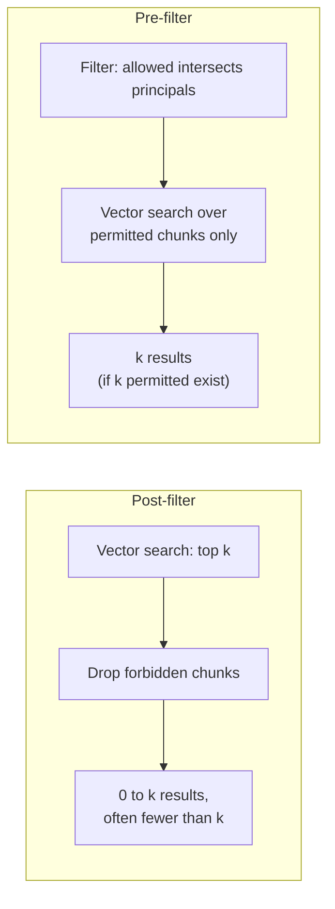

Roles decide which *collections* a person may search. Most enterprise content, however, is protected one document at a time: a spreadsheet shared with three named people, a folder visible to one department, a page that only its authors can open. The source systems that hold this content (a file share, a wiki, a document store) already know who may read what. A RAG system that copies the text into a vector index and forgets the permissions has, in effect, deleted the security of every document it ingested. **Document-level permissions** are the discipline of carrying each document's access list into the index, and applying it on every search, so that retrieval honours the same rules the source system does.

This lesson shows how to represent permissions on chunks, apply them *inside* the vector search rather than after it, keep them in sync when sources change, and test that nothing leaks. The running example uses Qdrant in its in-memory mode, so you can run every query.

## Learning objectives

- Represent a document's access-control list as chunk metadata, and expand a user into the principals that must be matched against it.
- Explain why filtering after retrieval fails, and calculate how many candidates a post-filter must fetch to return $k$ results.
- Implement permission-aware search with a pre-filter, update ACLs on grant and revoke, and verify the effect on search results.
- Design ACL synchronisation from source systems, including its staleness window and a safe failure mode.
- Identify derived artefacts (summaries, caches, parent chunks) that can leak permissioned content, and write tests that catch it.

## Prerequisites

- [Role-based access control](/learn/access-control-and-privacy/role-based-access-control): coarse, collection-level control that this lesson refines.
- [Authorisation](/learn/access-control-and-privacy/authorisation): enforcement points, deny by default and the post-retrieval backstop.
- [Filtering](/learn/vector-database-fundamentals/filtering) and [Metadata filtering](/learn/advanced-vector-database-engineering/metadata-filtering): how a vector database applies conditions during search, and why very selective filters are hard.
- [Metadata](/learn/vector-database-fundamentals/metadata): attaching structured fields to chunks.

## Why this matters

The central fact is that **embeddings do not respect permissions.** A vector index ranks chunks by similarity to the query, and similarity knows nothing about who is allowed to read what. Ask for "pay bands and the pay review budget" and the nearest chunks are the HR ones, whoever you are. Everything protective must therefore be added deliberately.

Without document-level permissions, teams choose between two failures. Either they index only content that everyone may read, and the assistant is useless for most of the company's knowledge; or they index everything and rely on the model's discretion, and it leaks. The third path, preserving source permissions in the index, is the one that lets an enterprise assistant be both useful and safe, and it is where most of the engineering effort in enterprise RAG is spent.

The problem also has a time dimension. Documents are re-shared daily, people leave, folders move. A system that copies permissions once at ingestion is correct on day one and increasingly wrong afterwards. A stale ACL is the dangerous direction when it grants access that has since been removed.

## The intuition

Think of each chunk as a book in a library shelved in one giant room, ordered by subject so that browsing is fast. Every book has a small card tucked inside the cover listing who may read it. A visitor arrives with a pass listing their name and the groups they belong to.

The naive librarian walks to the subject shelf, pulls the five most relevant books, and then checks each card. If three have the wrong names on them, the visitor gets two books, even though plenty of permitted books about the topic sit slightly further along the shelf. That is **post-filtering**: starved results. The better librarian looks at the cards while searching, skipping every book the visitor may not read and continuing along the shelf until she has five permitted ones. That is **pre-filtering**: the permission check is part of the search.

In the second design, a revoked permission only requires changing the card in the book. In neither design should the librarian ever keep a private notebook of summaries of forbidden books, because the notebook has no cards.

## How it works

### The permission model on a chunk

At ingestion, each source document yields its **ACL**: the set of principals (people and groups) allowed to read it. Every chunk produced from the document receives a copy, stored as metadata alongside the text and vector:

```json
{"doc_id": "pay-review", "text": "The annual pay review budget ...",
 "allowed": ["group:hr", "user:maya"], "acl_version": 1}
```

Principals are written as typed strings (`user:maya`, `group:hr`) so that a user and a group with the same name cannot collide. A special principal such as `group:all-staff` represents "everyone in the organisation", which keeps public documents on the same mechanism as private ones instead of creating a second code path.

### Expand on the query side, not the index side

A document's ACL names groups (`group:hr`). A user belongs to groups, and groups can contain groups. The question is where to resolve that. Resolving on the *index* side (expanding `group:hr` into all its members' usernames when the chunk is written) makes every membership change a re-indexing job over every chunk the group can read. Resolving on the *query* side is far cheaper: the identity resolver from the [authentication lesson](/learn/access-control-and-privacy/authentication) returns the user's full principal set, including nested groups, and the filter asks "does the chunk's ACL intersect this set?".

```text
principals(maya) = { user:maya, group:all-staff, group:hr, ... nested groups ... }
chunk visible    =  chunk.allowed ∩ principals(maya) ≠ ∅
```

The same query-side principle makes group changes immediate: when Maya leaves `group:hr`, her next query has a smaller principal set and nothing in the index changes. Only a change to a *document's own* ACL requires updating that document's chunks.

### Pre-filter, post-filter and why it matters



With a **post-filter**, the permission condition is applied after the nearest neighbours are chosen. If the user may read only a small fraction of the index, most of the top $k$ are removed and the answer is starved, sometimes empty. The assistant then replies "I don't know" about a question the corpus can answer. The usual patch, fetching more candidates, is expensive and still probabilistic, and it also *moves* forbidden chunks through more of the pipeline (rerankers, logs) before they are discarded.

A **pre-filter** makes the condition part of the search, so only permitted chunks are candidates. How a vector database does this efficiently (payload indexes, filter-aware graph traversal, switching to exact search when the permitted set is small) is the subject of [Metadata filtering](/learn/advanced-vector-database-engineering/metadata-filtering) and [Payload indexes](/learn/advanced-vector-database-engineering/payload-indexes). For this lesson, treat it as a capability you rely on, and verify with the recall tests described under Performance.

### Keeping ACLs fresh

The index holds a *copy* of permissions, so it can disagree with the source. Three mechanisms, usually combined:

1. **Event-driven updates.** Many sources offer change notifications or change feeds (webhooks, delta queries). On a permission change, a worker fetches the document's new ACL and updates the chunks' payload. Fast, but notification delivery is not guaranteed.
2. **Periodic reconciliation.** A scheduled job compares ACLs in the source with ACLs in the index (by an `acl_version` or a hash) and repairs differences. It catches missed events and bounds the worst-case staleness.
3. **Live authorisation check at answer time.** For the most sensitive documents, re-verify access against the source system immediately before the text enters the prompt. This eliminates staleness for those documents at the price of a network call and a dependency on the source's availability.

The **propagation delay** between "access was revoked in the source" and "the index reflects it" is a number you should set and monitor, like a service-level objective. Choose which direction is safe when things go wrong. A sensible rule: **revocations are processed ahead of grants**, so that a backlog delays new access (an annoyance) rather than prolonging old access (a leak). If the sync worker cannot reach a source, either quarantine that source's chunks (exclude them from search) or extend the live check; do not keep serving them on a stale ACL indefinitely.

### Negative permissions and inheritance

Source systems have richer permission models than an allow-list. They have **inheritance** (a page inherits from its folder), **deny entries** (everyone in the department except one person) and **link sharing** ("anyone with the link"). The index can only store what you flatten, so the ingestion step must compute the **effective** allow-list: apply inheritance, subtract denies, and map link-sharing to the principal that matches your intent (usually the organisation's all-staff group, not "everyone on the internet"). Where the source's rules cannot be flattened faithfully, prefer the more restrictive interpretation and record that you did.

Two further decisions matter. Document *versions* may have different permissions from the current version. And a chunk inherits its ACL from its *document*, but a *summary* chunk that synthesises several documents (as in [hierarchical RAG](/learn/hierarchical-rag)) has an audience that is the **intersection** of its sources' audiences, never the union.

### Where else permissions leak

Even with a perfect filter on the chunk store, copies of content live elsewhere:

- **Derived text**: summaries, extracted titles, generated questions, parent chunks in parent-child retrieval, and knowledge-graph nodes. Each needs an ACL computed from its sources.
- **Caches**: a semantic cache keyed by query embedding can return user A's answer to user B who asked a similar question. Key it by principal set or policy version.
- **Conversation history and memory**: text retrieved earlier remains in context after access is revoked.
- **Logs and traces**: retrieved chunks written to logs are readable by whoever reads logs.
- **Rerankers and evaluators**: they must only ever see chunks the filter returned.
- **Embedding-space neighbours**: showing "related documents" by nearest neighbour across the whole index leaks titles.

## The mathematics

The mathematics explains why post-filtering fails and sizes the fix.

**Intuition.** If you fetch $n$ candidates and each is permitted with probability $p$, the number you can keep is random with mean $np$. To be confident of $k$ keepers you must fetch well over $k/p$.

Model each of $n$ fetched candidates as independently permitted with probability $p$. The number of permitted candidates $X$ is binomial, and the chance a post-filter returns at least $k$ results is:

$$
P(X \ge k) = 1 - \sum_{i=0}^{k-1} \binom{n}{i} p^{i} (1-p)^{n-i}
$$

Here $n$ is the number of candidates fetched before filtering, $p$ the fraction of the corpus the user may read, $k$ the results wanted, and $\binom{n}{i}$ the number of ways to choose which $i$ of the $n$ are permitted. The expected number of keepers is $np$.

**Worked example.** A user may read $p = 0.05$ of the corpus and we want $k = 5$. Fetching only $n = 5$ gives $np = 0.25$ expected keepers, and $P(X \ge 5) = 0.05^5 \approx 3 \times 10^{-7}$, essentially zero. Fetching $n = k/p = 100$ gives $np = 5$ expected keepers but $P(X \ge 5)$ is only about 0.56: nearly half the time the answer is short. To be about 97 percent sure we need $n = 200$, twice $k/p$.

```python
from math import comb

def p_at_least(k, n, p):
    """P(at least k of n candidates are permitted), each independently permitted with probability p."""
    return 1 - sum(comb(n, i) * p**i * (1 - p) ** (n - i) for i in range(k))

p, k = 0.05, 5
for n in (5, 20, 100, 200, 400):
    print(f"fetch {n:3d}: expected permitted = {n * p:5.1f}, P(at least {k}) = {p_at_least(k, n, p):.3f}")
```

```output
fetch   5: expected permitted =   0.2, P(at least 5) = 0.000
fetch  20: expected permitted =   1.0, P(at least 5) = 0.003
fetch 100: expected permitted =   5.0, P(at least 5) = 0.564
fetch 200: expected permitted =  10.0, P(at least 5) = 0.974
fetch 400: expected permitted =  20.0, P(at least 5) = 1.000
```

The independence assumption is a simplification. Real permissions correlate with topic: a question about HR matters retrieves mostly HR chunks, so a user outside HR may find that nearly *all* nearest neighbours are forbidden (an effective $p$ near zero for that query), which is worse than the average suggests. A pre-filter has no such failure because it never fetches forbidden candidates.

## In code

The example indexes ten Meridian chunks in an in-memory Qdrant collection with `all-MiniLM-L6-v2` embeddings (384 dimensions), stamps each with an `allowed` list, and then runs the same question four ways. It then grants and revokes a document's access and shows the effect, and ends with a backstop check.

```bash
pip install qdrant-client sentence-transformers
```

```python
import os
os.environ["TOKENIZERS_PARALLELISM"] = "false"
from qdrant_client import QdrantClient, models
from sentence_transformers import SentenceTransformer

model = SentenceTransformer("sentence-transformers/all-MiniLM-L6-v2")

# (doc_id, text, principals allowed to read it: group ids and user ids)
CHUNKS = [
    ("handbook",  "Annual leave is 25 days; up to 5 unused days carry over and must be used by 31 March.", ["group:all-staff"]),
    ("handbook",  "Remote work is allowed up to 3 days a week; the home-office equipment budget is 400 pounds.", ["group:all-staff"]),
    ("expenses",  "Expenses must be submitted within 30 days and anything over 75 pounds needs a receipt.", ["group:all-staff"]),
    ("it-vpn",    "A VPN is required on public Wi-Fi. Passwords must be rotated every 90 days.", ["group:all-staff"]),
    ("salary",    "Salary bands for senior engineers run from band E4 to band E6 and are reviewed each April.", ["group:hr"]),
    ("pay-review","The annual pay review budget is a 4 percent increase pool, allocated by department heads.", ["group:hr", "user:maya"]),
    ("case-114",  "Disciplinary case 114: formal warning issued after repeated policy breaches.", ["group:hr"]),
    ("atlas",     "Atlas error E-4030 means the deployment token has expired; rotate it in the Atlas console.", ["group:engineering"]),
    ("atlas",     "Atlas capacity planning: add two nodes when queue depth stays above 500 for an hour.", ["group:engineering"]),
    ("pricing",   "Unreleased Meridian Relay pricing: the new tier will cost 40 percent more than the current plan.", ["group:finance"]),
]

client = QdrantClient(":memory:")
client.create_collection("askmeridian",
    vectors_config=models.VectorParams(size=384, distance=models.Distance.COSINE))
client.create_payload_index("askmeridian", "allowed", models.PayloadSchemaType.KEYWORD)

vecs = model.encode([c[1] for c in CHUNKS], normalize_embeddings=True)
client.upsert("askmeridian", points=[
    models.PointStruct(id=i, vector=v.tolist(),
                       payload={"doc_id": d, "text": t, "allowed": acl, "acl_version": 1})
    for i, ((d, t, acl), v) in enumerate(zip(CHUNKS, vecs))])


def search(query, principals=None, k=3, post_filter=False):
    qv = model.encode(query, normalize_embeddings=True).tolist()
    flt = None
    if principals is not None and not post_filter:
        flt = models.Filter(must=[models.FieldCondition(
            key="allowed", match=models.MatchAny(any=sorted(principals)))])
    hits = client.query_points("askmeridian", query=qv, query_filter=flt, limit=k).points
    if post_filter and principals is not None:        # the WRONG way: filter after taking top k
        hits = [h for h in hits if set(h.payload["allowed"]) & set(principals)]
    return [(h.payload["doc_id"], round(h.score, 3)) for h in hits]


q = "What are the pay bands and the pay review budget?"
raj = {"user:raj", "group:all-staff", "group:engineering"}
maya = {"user:maya", "group:all-staff", "group:hr"}
print("no filter       :", search(q))
print("post-filter raj :", search(q, raj, post_filter=True))
print("pre-filter  raj :", search(q, raj))
print("pre-filter  maya:", search(q, maya))

# Direct grant, then revoke: update the ACL on every chunk of one document.
def set_acl(doc_id, principals, version):
    client.set_payload("askmeridian", payload={"allowed": principals, "acl_version": version},
        points=models.Filter(must=[models.FieldCondition(key="doc_id", match=models.MatchValue(value=doc_id))]))

print("\nbefore grant, raj :", search("pay review budget", raj, k=2))
set_acl("pay-review", ["group:hr", "user:maya", "user:raj"], 2)
print("after grant, raj  :", search("pay review budget", raj, k=2))
set_acl("pay-review", ["group:hr", "user:maya"], 3)
print("after revoke, raj :", search("pay review budget", raj, k=2))

# Backstop: verify every returned chunk against the principals before it reaches the prompt.
def authorised(hit_payload, principals):
    return bool(set(hit_payload["allowed"]) & set(principals))
qv = model.encode(q, normalize_embeddings=True).tolist()
flt = models.Filter(must=[models.FieldCondition(key="allowed", match=models.MatchAny(any=sorted(raj)))])
pts = client.query_points("askmeridian", query=qv, query_filter=flt, limit=5).points
print("backstop passes   :", all(authorised(p.payload, raj) for p in pts), "| chunks:", len(pts))
```

```output
no filter       : [('salary', 0.55), ('pay-review', 0.5), ('expenses', 0.247)]
post-filter raj : [('expenses', 0.247)]
pre-filter  raj : [('expenses', 0.247), ('handbook', 0.208), ('atlas', 0.148)]
pre-filter  maya: [('salary', 0.55), ('pay-review', 0.5), ('expenses', 0.247)]

before grant, raj : [('expenses', 0.398), ('handbook', 0.245)]
after grant, raj  : [('pay-review', 0.642), ('expenses', 0.398)]
after revoke, raj : [('expenses', 0.398), ('handbook', 0.245)]
backstop passes   : True | chunks: 5
```

Your similarity scores should match to three decimals on the same library versions; other versions may differ slightly in the last digit. The script also prints a library warning (explained below) and Hugging Face loading messages, which are omitted here.

### Reading the output

The first line is the leak: with no filter, Raj, an engineer, would receive the two HR chunks about pay bands and the pay review at the top of his results. The second line is post-filtering applied to the same query: of three candidates, two are forbidden, so only one survives. A top-3 request became a single weak result about expenses. The third line is the correct behaviour: the pre-filter lets the search continue past forbidden chunks and returns three permitted ones. Maya, whose principal set includes `group:hr`, sees the full HR chunks (fourth line).

The grant/revoke sequence shows ACL updates taking effect on the next query: Raj has no access to the pay review chunk, receives it with the highest score (0.642) after his user id is added to its `allowed` list, and loses it again after the revoke. No re-embedding was needed because permissions are payload, separate from the vector. The final line confirms the backstop: all five returned chunks pass an independent check.

### Important lines

- `MatchAny(any=sorted(principals))` expresses "the chunk's `allowed` list contains at least one of these principals". On an array-valued keyword field, Qdrant matches if any element matches.
- The filter is built from the *principal set the server resolved*, never from anything the client sent.
- `set_payload` with a filter selects every chunk of one `doc_id`, which is how a document-level ACL change reaches all of its chunks in one call.
- `acl_version` lets a reconciliation job tell which chunks have caught up with the source.

### Common errors

- **A warning that payload indexes have no effect.** In local (`:memory:`) mode Qdrant ignores payload indexes, as the warning says; filtering still works, just without an index. Against a server the same call builds the index that makes the filter fast.
- **Storing the ACL as one comma-separated string.** A keyword match then needs the entire string to equal the value; store a list so each principal is a separate element.
- **An empty principal set.** `MatchAny(any=[])` matches nothing (a safe failure) but it also hides a bug upstream: log it.
- **Forgetting to update the ACL on every chunk.** Updating one chunk of a document leaves siblings with the old list. Always select by `doc_id`.

### Extending it

Replace the in-memory client with a server, using the `QdrantClient(url=...)` constructor. Not run here, because it needs a running server: create the payload index and set `m=0` plus `payload_m` as the [Multi-tenancy](/learn/advanced-vector-database-engineering/multi-tenancy) lesson discusses if most queries carry a tenant condition. Add a reconciliation job that scrolls the index and compares each `acl_version` with the source, and a scenario test per user and per document, as described below.

## A real-world example

The Platform team at Meridian adds Meridian's finance wiki to AskMeridian and takes a shortcut: ACLs are copied into the index once, during the first full ingestion. Two months later an internal audit asks them to prove that access removed in the wiki is removed in the assistant. They cannot, and a spot check finds the problem within an hour: a contractor was removed from a finance page's reader list three weeks earlier, and the assistant still answers questions from it for her.

The design they move to has three layers. Change events from the wiki trigger a worker that fetches the page's effective ACL and updates the payload; revocations are processed on a separate, higher-priority queue. A nightly reconciliation job compares a hash of each document's ACL with the index and repairs drift, and it publishes a metric: the number of chunks whose ACL differs from the source, which should be zero and pages the on-call engineer when it is not. For a short list of pages tagged *restricted* (unreleased pricing and acquisition work) the answer path also performs a live permission check against the wiki before the text enters the prompt.

They also build the test that would have caught the original bug sooner: a matrix of synthetic users against canary documents. Each canary contains a unique nonsense phrase, and for every (user, canary) pair the test asserts whether a search for that phrase finds it, which is a check of the filter and the sync together.

## Common mistakes

- **Post-filtering.** Results are starved or empty for users with narrow access, and forbidden chunks still travel through the pipeline. Filter inside the search.
- **Copying ACLs once.** The index is correct at ingestion and drifts afterwards. Add event-driven updates and reconciliation, and measure propagation delay.
- **Expanding groups at index time.** Every membership change becomes a re-index. Resolve groups on the query side.
- **Flattening deny and inheritance carelessly.** Dropping a deny entry or an inherited restriction widens access silently. Compute the effective list, and when unsure, take the narrower reading.
- **Ignoring derived content.** Summaries, parent chunks, caches and conversation memory each need their own permission story, usually the intersection of their sources.
- **Trusting the client to say who it is.** A principal list taken from a request body is attacker-controlled. Build it from the verified identity.
- **No tests.** A permission bug looks like a normal answer. Use canary documents and a user-by-document matrix.

## Best practices

- Stamp every chunk with an effective ACL at ingestion, and refuse to index a chunk whose permissions cannot be determined (or quarantine it with an owner-only ACL).
- Store typed principal strings in an array field and index that field.
- Expand users into their full principal set on the query side; keep documents' ACLs as the source of truth in the source system.
- Apply the ACL as a pre-filter in the vector search and re-check every returned chunk as a backstop, alerting on any rejection.
- Sync by events, reconcile on a schedule, process revocations first, and publish the propagation delay and drift as metrics.
- Use a live source check for the most sensitive documents.
- Compute the audience of any derived artefact (summary, cache entry, memory) as the intersection of its sources' audiences.
- Test with canary documents and a matrix of users, including a user with the narrowest realistic access.

## Performance considerations

Permission filtering adds work in three places. In the **index**, a filter on an array field needs a payload index for speed; without one, a server may need to inspect payloads for many points. In the **payload**, long ACL lists inflate memory: if a typical document is readable by 20 principals averaging 12 bytes each, that is about 240 bytes per chunk, so 10 million chunks add roughly 2.4 GB before overheads (an estimate to replace with measurement). A common compaction is to give each *distinct ACL* an integer id, store only that id on the chunk, and compute at query time the list of ACL ids a user matches. In many organisations a few thousand distinct ACLs cover millions of documents, so the filter becomes `acl_id IN (...)` over short integers. The cost is that the user-to-ACL-id resolution must be fast and cached.

In the **search**, a filter that leaves a small fraction of the corpus can reduce recall of approximate graph search, as the [Metadata filtering](/learn/advanced-vector-database-engineering/metadata-filtering) lesson explains; databases mitigate it with filter-aware traversal or exact search over small permitted sets. Test recall for your narrowest realistic user by comparing filtered approximate search against an exact scan with the same filter.

Write cost matters when ACLs churn: changing a folder's permissions can touch thousands of chunks. Batch payload updates, and prioritise revocations. Live source checks add a network round trip per sensitive chunk; limit them to restricted content and run them in parallel.

## Security considerations

- Treat the ACL field as security data: only the ingestion and sync services may write it, and it must never be settable through a user-facing API.
- Fail closed everywhere: an unlabelled chunk, an unresolved group or an unreachable source means exclusion, not default access.
- Make denial indistinguishable from absence in messages, counts and citations, as the [Authorisation](/learn/access-control-and-privacy/authorisation) lesson explains.
- Include permissions in cache keys and log which principal set and ACL version each answer used, so an incident can be reconstructed.
- Remember backups and snapshots of the index: they contain chunks with the ACLs of their moment, so a restore re-grants access that has since been revoked. Re-run reconciliation immediately after any restore.

## Summary

- Embeddings ignore permissions, so every chunk must carry its document's effective ACL and every search must apply it.
- Filter inside the search (pre-filter). Post-filtering starves results and moves forbidden chunks through the pipeline; the fetch needed to compensate grows roughly as $k/p$ and still fails often.
- Resolve groups on the query side so that membership changes need no re-indexing; update chunk payloads only when a document's own ACL changes.
- Keep ACLs fresh with events, reconciliation and live checks for sensitive content, process revocations first, and measure propagation delay.
- Derived artefacts and caches leak unless their audience is computed as the intersection of their sources; verify the whole system with canary documents and a user-by-document test matrix.

## Exercises

1. **Conceptual.** Why is expanding groups into individual users at ingestion time a poor design?

<details><summary>Show solution</summary>

Group membership changes constantly. If the index stores expanded user lists, each change in membership requires rewriting the ACL on every chunk the group can read, and until that job finishes the index is wrong. Storing group principals on chunks and expanding the *user* into their groups at query time makes membership changes take effect immediately and keeps index writes limited to changes in a document's own ACL.

</details>

2. **Calculation.** A user can read 2 percent of the corpus. A post-filter fetches 50 candidates and wants 5 results. What is the expected number of results, and is the request likely to be satisfied (assume independence)?

<details><summary>Show solution</summary>

Expected permitted candidates: $50 \times 0.02 = 1$. The probability of at least 5 is very small: with $n = 50$, $p = 0.02$, $P(X \ge 5) \approx 0.003$. A pre-filter would return all five from the permitted 2 percent.

</details>

3. **Design.** A "Related documents" panel shows the three nearest neighbours of whichever page the user is viewing. Explain the leak and the fix.

<details><summary>Show solution</summary>

If neighbours are computed over the whole index, the panel can show titles of documents the user may not read, disclosing their existence and subject. The fix is to run the neighbour search through the same permission-filtered path as ordinary retrieval, using the user's principal set. Cache results per principal set or not at all.

</details>

4. **Code.** Write the canary test: for each user in `{raj, maya}` and each canary document in a list, assert whether a search for its unique phrase finds the document, comparing with the expected visibility table.

<details><summary>Show solution</summary>

```python
CANARIES = {"canary-hr": ("zebrafish-quartz-7731", {"maya"}),
            "canary-eng": ("walnut-orbit-4410", {"raj"})}
USERS = {"raj": raj, "maya": maya}

for doc_id, (phrase, readers) in CANARIES.items():
    for name, principals in USERS.items():
        found = any(d == doc_id for d, _ in search(phrase, principals, k=10))
        assert found == (name in readers), f"{name} / {doc_id}: found={found}"
```

Each canary document is ingested with the ACL its readers imply and a unique phrase in its text. The assertion catches both a leak (found but not a reader) and a lockout (a reader who cannot find it). Run it after every ingestion or sync change, and in CI against a staging index.

</details>

## Check your understanding

```quiz
[
  {"q": "Why does post-filtering often return fewer than k results for a user with narrow access?", "options": ["Cosine similarity is undefined for permissions", "The top k are chosen before permissions are applied, and forbidden ones are then dropped", "Filters make vectors shorter", "Qdrant limits results to one per document"], "answer": 1, "why": "Post-filtering removes forbidden chunks from a list of k nearest neighbours that was chosen without regard to permissions, so users who may read little see starved or empty results."},
  {"q": "Where should nested group membership be resolved?", "options": ["At ingestion, into usernames stored on each chunk", "On the query side, producing the user's full principal set", "In the language model's prompt", "In the browser"], "answer": 1, "why": "Resolving on the query side makes membership changes immediate and leaves the index untouched. Index-side expansion forces re-indexing on every change."},
  {"q": "A summary chunk is generated from two documents readable by group:hr and group:finance respectively. Who should be able to see the summary?", "options": ["Anyone in either group", "Only principals who may read both source documents", "Everyone, because summaries are short", "Only administrators"], "answer": 1, "why": "A summary can reveal content from every source, so its audience is the intersection of the sources' audiences, never the union."},
  {"q": "After an ACL change in the source, which processing order is the safest when the sync worker has a backlog?", "options": ["Grants first, then revocations", "Revocations first, then grants", "Oldest change first regardless of type", "Process none until the backlog clears"], "answer": 1, "why": "A delayed grant is an inconvenience, but a delayed revocation prolongs access that should have ended."},
  {"q": "A semantic cache returns a stored answer when a new query is similar enough to an old one. What permission risk does it create?", "options": ["None, since the answer is already generated", "User B may receive an answer built from documents only user A could read", "The cache becomes slower", "The cache stores vectors in plain text"], "answer": 1, "why": "Similarity of queries says nothing about the askers' permissions. Cache keys must include the principal set or a policy version."}
]
```

## Further reading

- Qdrant documentation on filtering and payload indexing (qdrant.tech/documentation).
- Microsoft Graph and Google Drive API documentation on change notifications and permission listings, for the event sources used in ACL synchronisation.
- Pang et al., 2019, "Zanzibar: Google's Consistent, Global Authorization System", for the relationship-based alternative and its consistency discussion.
- OWASP Top 10 for LLM Applications, the entry on sensitive information disclosure (owasp.org).
- NIST SP 800-162, "Guide to Attribute Based Access Control (ABAC) Definition and Considerations".
