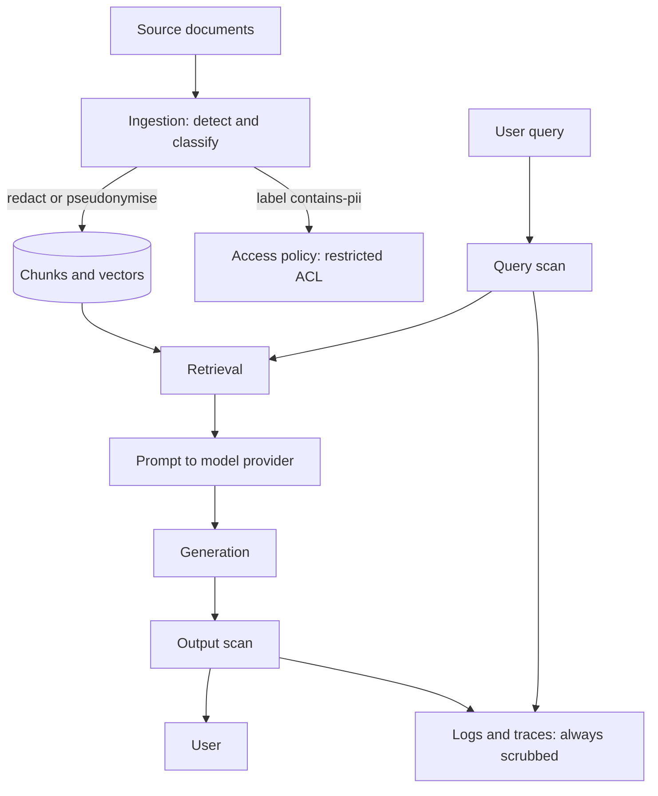

Documents contain people. Handbooks name the HR contact, support tickets quote a customer's email and phone number, expense reports carry card digits, and case notes describe individuals in detail. A RAG system ingests all of it, embeds it, retrieves it, sends it to a language model and logs it along the way. **PII detection** is the practice of finding **personally identifiable information** in that flow so that you can decide, deliberately, what to do with it: remove it, mask it, replace it with a stable token, restrict who can see it, or let it through knowingly.

The lesson builds from first principles. It defines what counts as personal data and where it enters a RAG pipeline, compares the detection techniques (patterns with checksums, dictionaries, named-entity recognition, language-model classifiers) and what each is good at, and then builds and *measures* a rule-based detector with redaction and pseudonymisation. Measurement is the heart of it: a PII detector is a classifier, it makes both kinds of mistake, and the arithmetic of those mistakes decides whether it is safe to rely on.

## Learning objectives

- Define personal data, special-category data and quasi-identifiers, and list the points in a RAG pipeline where PII enters, moves and leaks.
- Compare pattern-based, dictionary-based, NER-based and LLM-based detection on precision, recall, cost and failure modes.
- Implement a detector that validates candidates with checksums (Luhn, IBAN) and evaluate it per entity type with precision, recall and F-beta.
- Choose between blocking, redaction, pseudonymisation and routing to restricted storage for a given use, and explain what each costs retrieval quality.
- Estimate how many sensitive items remain undetected at a given recall, and design layered controls around that residual risk.

## Prerequisites

- [Sensitive data exposure](/learn/rag-security-fundamentals/sensitive-data-exposure): how personal data leaks out of RAG systems.
- [Document-level permissions](/learn/access-control-and-privacy/document-level-permissions): the access control that PII classification feeds and does not replace.
- [Data encryption](/learn/access-control-and-privacy/data-encryption): protecting the data that remains.
- [Precision@K](/learn/retrieval-evaluation/precision-k) and [Recall@K](/learn/retrieval-evaluation/recall-k): the metrics, adapted here to judge a detector.

## Why this matters

Personal data is both the most valuable and the most regulated content in an organisation. Laws such as the GDPR in Europe and the UK, and many national and state laws elsewhere, restrict how it may be collected, used, stored and disclosed. This lesson is engineering guidance, not legal advice; the legal definitions differ by jurisdiction, and the [GDPR concepts](/learn/enterprise-rag-governance/gdpr-concepts) lesson returns to them. The engineering point is simpler: if you do not know where personal data is in your index, you cannot restrict it, minimise it, delete it on request or keep it away from a model provider.

RAG makes the problem worse in three ways. First, **aggregation**: a model answers questions across documents, so it can assemble scattered details (a name in one chunk, an address in another) into a profile nobody wrote. Second, **amplification**: text chunked and embedded exists in several places (the source, the chunks, the vectors, caches, logs), and each copy needs handling. Third, **new egress**: retrieved context is sent to an external model, and generated answers go to people who may not be entitled to the details.

A detector will not make the system safe alone, because no detector is perfect. What it provides is *visibility*: the ability to label chunks as containing personal data, route them to the right collection, strip what the use case does not need, and keep a measured estimate of what slips through.

## The intuition

Imagine a proofreader whose job is to black out sensitive details before a document is photocopied for a wider audience. She has two skills. For anything with a fixed shape, such as a bank card number or an email address, she can recognise it at a glance and even check it: card numbers have a built-in check digit, so a random sixteen-digit order number will not pass her test. For anything without a fixed shape, such as a person's name, she must read the sentence and understand it: "Priya Nair reported a lost laptop" names a person, while "Rose was delivered on Monday" may not.

The first skill is fast, cheap and rarely wrong. The second is slower, needs real language understanding, and sometimes errs in both directions: blacking out a word that is not a name, or missing one that is. A careful office uses both, samples finished copies to see what she missed, and does not post the redacted copy publicly on the strength of her work alone. It also controls who may see the *original*.

## How it works

### What counts as PII

- **Direct identifiers** point to a person on their own: name, email address, phone number, national insurance or social security number, passport number, home address, account numbers.
- **Quasi-identifiers** identify only in combination: job title plus department plus office plus start date can single out one person in a 400-person company, though no single field would.
- **Special-category or sensitive data** carries higher risk and stricter rules: health, ethnicity, religion, union membership, biometric and genetic data, and in many jurisdictions, financial and children's data.
- **Payment card data** is governed by industry rules (PCI DSS) that restrict storing and transmitting card numbers.
- **Secrets**, such as API keys and passwords in pasted logs, are not personal data but are detected by the same machinery and are just as harmful to leak.

The GDPR's definition of personal data is broad: information relating to an identified *or identifiable* person. That is why quasi-identifiers matter and why a regular-expression detector, which finds only direct identifiers with fixed shapes, is necessary and never sufficient.

### Where PII enters and leaves a RAG system



Four points deserve a detector, each answering a different question.

1. **Ingestion**: *what is in the corpus?* Detect, classify, and decide per entity whether to strip, tokenise, or keep and restrict. This is where most value is, because decisions here apply to every later copy.
2. **Query**: *what is the user sending us?* Users paste emails and account numbers into questions. Scan before logging or forwarding to an external model.
3. **Output**: *what is the model about to show?* The final scan catches leakage the earlier layers missed, including a model repeating or inferring details. It is the last of several layers and not a primary control; see [Output validation](/learn/rag-security-fundamentals/output-validation).
4. **Logs and traces**: *what are we writing down?* Observability data is long-lived and widely readable. Scrub it by default.

### Detection techniques

| Technique | How it works | Strengths | Weaknesses |
| --- | --- | --- | --- |
| **Patterns (regular expressions)** | Match fixed shapes such as emails, phone numbers, IDs | Fast, deterministic, explainable, no model | Misses variants; matches non-PII that looks the same |
| **Patterns plus validation** | Add checksums and rules (Luhn for cards, mod-97 for IBAN, format rules for national IDs) | Large drop in false positives for structured data | Only for identifiers with a checksum or strict rules |
| **Dictionaries (gazetteers)** | Look up names, places, internal codenames | Good for closed sets such as your employee list or product names | Misses names not in the list; ambiguous common words |
| **Named-entity recognition (NER)** | A trained model tags person, organisation, location from context | Finds names and places that no pattern can; handles unseen names | Needs a model; errors in both directions; weaker on short, lowercase or non-English text |
| **LLM-based classification** | Prompt a language model to list or judge sensitive content | Flexible; handles context and unusual categories | Slower, costlier, nondeterministic, and sends the text to a model, which may be what you are trying to avoid |

Open-source building blocks exist. Microsoft Presidio combines pattern recognisers, context words and an NLP engine behind one analyser and anonymiser interface; spaCy and Hugging Face provide NER models; the major clouds offer data-loss-prevention services. They are named so you recognise them; this lesson's runnable example uses patterns and checksums because they need no model and expose the mechanism.

The practical design is **layered**: validated patterns for structured identifiers (cheap, high precision), NER for names and places, dictionaries for organisation-specific terms, and, where the budget allows, an LLM pass for hard documents or for sampling and auditing the cheaper layers.

### Choosing the action

| Action | Result | Use when |
| --- | --- | --- |
| **Block** | Refuse to ingest the document or send the prompt | Data must never enter or leave the system |
| **Redact** | Replace with a typed placeholder: `[EMAIL]` | The identity is irrelevant to the use |
| **Pseudonymise** | Replace with a stable token: `<EMAIL_09e77a0b>` | Consistency is needed without the raw value |
| **Generalise** | Reduce precision, such as exact age to a band | Statistics matter more than exact values |
| **Route** | Keep the text, label it, give it a restrictive ACL | The use needs the data and only some people may see it |
| **Allow and log** | Pass through with an audit record | Public, expected data such as a staff directory |

Redaction has a retrieval cost that is easy to overlook: "Who do I contact about leave?" is answered by the *name and email*, which a redacted index no longer holds. Typed placeholders (`[EMAIL]`, not a blank) keep the structure the embedding model needs. For HR-type content the right answer is often **routing**: keep the text, restrict it, and let the permission system decide who sees it.

**Pseudonymisation** replaces a value with a token while a separate secret allows relinking. The example derives tokens with a keyed hash (HMAC), so equal values get equal tokens with no lookup table and nobody without the key can recompute a token from a guessed value. A keyed hash cannot be reversed; if you need reversal, keep the mapping in a protected vault. And under the GDPR pseudonymised data remains personal data, because relinking is possible.

### Why detection is never complete

Formats vary (`maya dot khan at meridian dot example`, numbers split across lines); context decides ("Mark" is a name or a verb); patterns built for English miss other languages; OCR noise defeats checksums; quasi-identifiers such as "the only Atlas engineer in Leeds hired this month" match no pattern; and an entity you wrote no recogniser for is invisible. Design with a *measured recall below one*, and put access control, encryption, retention and output checks behind it. Detection reduces exposure; it does not certify a corpus as clean.

## The mathematics

A detector's findings are compared with a gold standard of labelled data. Three counts matter: **true positives** (tp, correct detections), **false positives** (fp, flagged items that are not PII) and **false negatives** (fn, PII the detector missed).

**Intuition.** Precision asks "of what I flagged, how much was right?", which governs how much harmless text you destroy or alarm on. Recall asks "of what was there, how much did I find?", which governs how much PII slips through. For privacy, a miss is usually worse than a false alarm, so recall carries more weight.

$$
\text{precision} = \frac{tp}{tp + fp}, \qquad \text{recall} = \frac{tp}{tp + fn}, \qquad F_\beta = \frac{(1 + \beta^2)\, P R}{\beta^2 P + R}
$$

$P$ is precision and $R$ recall. $F_\beta$ combines them; $\beta = 1$ weights them equally, and $\beta = 2$ weights recall twice as heavily as precision, which suits privacy screening.

**Worked example.** Suppose a detector evaluated on 12 labelled spans makes tp $= 10$, fp $= 0$, fn $= 2$ (the counts the example below produces). Then $P = 10/10 = 1.00$, $R = 10/12 = 0.833$, $F_1 = 2 \times 1.00 \times 0.833 / 1.833 = 0.909$ and $F_2 = 5 \times 1.00 \times 0.833 / (4 \times 1.00 + 0.833) = 0.862$.

A second calculation turns recall into the number that actually matters, items left undetected: $N_{\text{missed}} = N \times \pi \times (1 - R)$, where $N$ is the number of chunks and $\pi$ the fraction of chunks containing PII.

```python
tp, fp, fn = 10, 0, 2
precision, recall = tp / (tp + fp), tp / (tp + fn)

def f_beta(p, r, beta):
    return (1 + beta**2) * p * r / (beta**2 * p + r)

print(f"precision={precision:.3f} recall={recall:.3f}")
print(f"F1={f_beta(precision, recall, 1):.3f}  F2={f_beta(precision, recall, 2):.3f}")

chunks, prevalence = 2_000_000, 0.015
for r in (0.80, 0.95, 0.99):
    print(f"recall {r:.2f}: chunks with PII = {chunks * prevalence:,.0f}, undetected = {chunks * prevalence * (1 - r):,.0f}")
```

```output
precision=1.000 recall=0.833
F1=0.909  F2=0.862
recall 0.80: chunks with PII = 30,000, undetected = 6,000
recall 0.95: chunks with PII = 30,000, undetected = 1,500
recall 0.99: chunks with PII = 30,000, undetected = 300
```

The assumed corpus has 2 million chunks and 1.5 percent contain PII, so 30,000 chunks. Even at 95 percent recall, 1,500 chunks remain with undetected PII. Raising recall from 0.95 to 0.99 removes 1,200 of them, which is why serious deployments spend effort on the hard entity types and on layered controls behind detection. The prevalence value is an assumption; estimate yours by auditing a random sample.

## In code

The example is a rule-based detector for six entity types: email, UK phone number, UK National Insurance number, payment card (validated by the Luhn checksum), IBAN (validated by the mod-97 check) and person names preceded by a title. It then redacts and pseudonymises, and finally evaluates itself against 12 synthetic labelled sentences. All identifiers are fake (the phone numbers are in ranges reserved for fiction, the card number is a well-known test number, and the IBAN is a published example). Standard library only; run it with `python pii.py`.

```python
import hashlib
import hmac
import re
from dataclasses import dataclass


@dataclass(frozen=True)
class Finding:
    kind: str
    start: int
    end: int
    text: str


def luhn_ok(digits: str) -> bool:
    total = 0
    for i, ch in enumerate(reversed(digits)):
        d = int(ch)
        if i % 2 == 1:
            d = d * 2 - 9 if d * 2 > 9 else d * 2
        total += d
    return total % 10 == 0


def iban_ok(raw: str) -> bool:
    s = raw.replace(" ", "").upper()
    s = s[4:] + s[:4]
    return int("".join(str(int(c, 36)) for c in s)) % 97 == 1


PATTERNS = [
    ("EMAIL", re.compile(r"\b[\w.+-]+@[\w-]+(?:\.[\w-]+)+\b"), None),
    ("PHONE", re.compile(r"(?<!\w)(?:\+44\s?\(?0?\)?\s?|0)\d{2,4}[\s-]?\d{3,4}[\s-]?\d{3,4}\b"), None),
    ("NI_NUMBER", re.compile(r"\b[A-CEGHJ-PR-TW-Z][A-CEGHJ-NPR-TW-Z]\s?\d{2}\s?\d{2}\s?\d{2}\s?[A-D]\b"), None),
    ("CARD", re.compile(r"\b\d(?:[ -]?\d){12,18}\b"), lambda t: luhn_ok(re.sub(r"\D", "", t))),
    ("IBAN", re.compile(r"\b[A-Z]{2}\d{2}(?:\s?[A-Z0-9]{4}){2,7}(?:\s?[A-Z0-9]{1,3})?\b"), iban_ok),
    ("PERSON", re.compile(r"\b(?:Mr|Mrs|Ms|Dr)\.? [A-Z][a-z]+(?: [A-Z][a-z]+)?"), None),
]


def detect(text: str) -> list[Finding]:
    found = []
    for kind, rx, validate in PATTERNS:
        for m in rx.finditer(text):
            if validate is None or validate(m.group()):
                found.append(Finding(kind, m.start(), m.end(), m.group()))
    found.sort(key=lambda f: (f.start, -(f.end - f.start)))
    kept = []
    for f in found:                                   # drop findings overlapped by an earlier, longer one
        if not kept or f.start >= kept[-1].end:
            kept.append(f)
    return kept


def redact(text: str) -> str:
    out, last = [], 0
    for f in detect(text):
        out += [text[last:f.start], f"[{f.kind}]"]
        last = f.end
    return "".join(out + [text[last:]])


def pseudonymise(text: str, key: bytes) -> str:
    """Replace each value with a stable keyed token: equal values map to equal tokens."""
    out, last = [], 0
    for f in detect(text):
        tag = hmac.new(key, f.text.encode(), hashlib.sha256).hexdigest()[:8]
        out += [text[last:f.start], f"<{f.kind}_{tag}>"]
        last = f.end
    return "".join(out + [text[last:]])
```

The evaluation harness, appended to the same file, compares predictions with gold spans:

```python
GOLD = [  # (text, [(kind, value), ...])  all synthetic
    ("Contact Maya Khan at maya.khan@meridian.example for leave queries.", [("PERSON", "Maya Khan"), ("EMAIL", "maya.khan@meridian.example")]),
    ("Ring the support desk on 020 7946 0958 between 08:00 and 18:00.", [("PHONE", "020 7946 0958")]),
    ("My NI number is AB 12 34 56 C, please update payroll.", [("NI_NUMBER", "AB 12 34 56 C")]),
    ("Reimburse card 4111 1111 1111 1111 for the conference.", [("CARD", "4111 1111 1111 1111")]),
    ("Order reference 5012 3456 7890 1234 shipped on Monday.", []),
    ("Pay to GB82 WEST 1234 5698 7654 32 by Friday.", [("IBAN", "GB82 WEST 1234 5698 7654 32")]),
    ("Dr Alvarez approved the sick-leave request.", [("PERSON", "Dr Alvarez")]),
    ("Priya Nair reported a lost laptop yesterday.", [("PERSON", "Priya Nair")]),
    ("Atlas error E-4021 means the VPN client is out of date.", []),
    ("Call 07700 900123 or email raj@meridian.example.", [("PHONE", "07700 900123"), ("EMAIL", "raj@meridian.example")]),
    ("Annual leave is 25 days; the equipment budget is 400 pounds.", []),
    ("Ms Okafor's NI number AB123456C was entered twice.", [("PERSON", "Ms Okafor"), ("NI_NUMBER", "AB123456C")]),
]


def evaluate(gold):
    per = {}
    for text, truth in gold:
        pred = {(f.kind, f.text) for f in detect(text)}
        truth = set(truth)
        for kind, _ in pred | truth:
            per.setdefault(kind, [0, 0, 0])
        for k in pred & truth: per[k[0]][0] += 1
        for k in pred - truth: per[k[0]][1] += 1; print("  false positive:", k, "in", text[:40])
        for k in truth - pred: per[k[0]][2] += 1; print("  missed        :", k, "in", text[:40])
    return per


if __name__ == "__main__":
    per = evaluate(GOLD)
    print(f"{'type':10}{'tp':>4}{'fp':>4}{'fn':>4}{'precision':>11}{'recall':>8}")
    tot = [0, 0, 0]
    for kind, (tp, fp, fn) in sorted(per.items()):
        p = tp / (tp + fp) if tp + fp else 1.0
        r = tp / (tp + fn) if tp + fn else 1.0
        print(f"{kind:10}{tp:>4}{fp:>4}{fn:>4}{p:>11.2f}{r:>8.2f}")
        tot = [a + b for a, b in zip(tot, (tp, fp, fn))]
    tp, fp, fn = tot
    p, r = tp / (tp + fp), tp / (tp + fn)
    print(f"{'ALL':10}{tp:>4}{fp:>4}{fn:>4}{p:>11.2f}{r:>8.2f}")
    print()
    sample = "Priya Nair (priya.nair@meridian.example, 020 7946 0958) asked about card 4111 1111 1111 1111."
    print(redact(sample))
    k = b"demo-key-not-a-secret"
    print(pseudonymise(sample, k))
    print(pseudonymise("Write to priya.nair@meridian.example again.", k))
```

```output
  missed        : ('PERSON', 'Maya Khan') in Contact Maya Khan at maya.khan@meridian.
  missed        : ('PERSON', 'Priya Nair') in Priya Nair reported a lost laptop yester
type        tp  fp  fn  precision  recall
CARD         1   0   0       1.00    1.00
EMAIL        2   0   0       1.00    1.00
IBAN         1   0   0       1.00    1.00
NI_NUMBER    2   0   0       1.00    1.00
PERSON       2   0   2       1.00    0.50
PHONE        2   0   0       1.00    1.00
ALL          10   0   2       1.00    0.83

Priya Nair ([EMAIL], [PHONE]) asked about card [CARD].
Priya Nair (<EMAIL_09e77a0b>, <PHONE_bb3beb29>) asked about card <CARD_d55bca82>.
Write to <EMAIL_09e77a0b> again.
```

### Reading the output

The structured identifiers are found perfectly on this small set. The 16-digit order reference was *not* flagged as a card because it fails the Luhn check, and the Atlas error code and the "25 days" sentence were correctly ignored. Without the checksum, the card pattern alone would also have matched the order number: validation is what removes that false positive.

The weakness is names. The title-based pattern finds "Dr Alvarez" and "Ms Okafor" but misses "Maya Khan" and "Priya Nair", who appear with no title: recall for `PERSON` is 0.50. The redacted sample shows the consequence in the most direct form: the email, phone and card are replaced, but **Priya Nair is still there**. A reader would see exactly who the redacted details belong to. This is why names need a real NER model or a dictionary, and why a clean score on structured types says little about overall safety. Overall, precision is 1.00 and recall 0.83 on 12 examples, which is far too small a sample to rely on; it is a demonstration of method, not a benchmark.

The pseudonymised output shows the property that makes tokens useful: the same email produces the same token (`<EMAIL_09e77a0b>`) in both strings, so the two texts can still be linked (for deduplication, or "how often does this person appear?") without storing the address. Your tokens will differ if you change the key.

### Important lines

- `iban_ok` rearranges the code, converts letters to numbers (`int(c, 36)` maps `A` to 10 and so on), and tests the remainder modulo 97, the standard IBAN check.
- The overlap loop keeps the earliest and longest finding at each position, so a phone-like substring inside an IBAN is not reported twice.
- `hmac.new(key, ..., sha256)` makes the token depend on a secret key. A plain unkeyed hash of a phone number could be reversed by hashing all possible phone numbers, because the space is small.
- `evaluate` uses *exact-match* scoring over `(kind, value)` pairs; real evaluations also report overlap-based scores.

### Adding a name detector (not executed)

The usual way to catch names is an NER model. The following sketch uses Microsoft Presidio's documented analyser and anonymiser interface. It was **not run** here, because Presidio and a spaCy language model are not installed in the sandbox and must be downloaded (`pip install presidio-analyzer presidio-anonymizer` and `python -m spacy download en_core_web_lg`). Your exact entities and scores will differ; it needs no API key.

```python
from presidio_analyzer import AnalyzerEngine
from presidio_anonymizer import AnonymizerEngine

analyzer = AnalyzerEngine()          # loads the default spaCy NLP engine
anonymizer = AnonymizerEngine()

text = "Priya Nair reported a lost laptop yesterday."
results = analyzer.analyze(text=text, language="en")      # entities with types and confidence scores
for r in results:
    print(r.entity_type, text[r.start:r.end], round(r.score, 2))
print(anonymizer.anonymize(text=text, analyzer_results=results).text)
```

Expect `PERSON` for "Priya Nair" and a redacted sentence with a placeholder. Treat the confidence `score` as model-specific, not a probability, and choose a threshold on your own labelled documents.

### Common errors

- **Regex catastrophic backtracking.** Nested optional groups on long untrusted text can take exponential time. Test patterns on long adversarial strings.
- **Offsets after redaction.** Replacing from the start shifts later offsets; build the output in one pass, as `redact` does.
- **Scoring only exact matches.** A partially detected name counts as both a false positive and a miss; also report overlap-based scores.

## A real-world example

The Platform team at Meridian wants AskMeridian to answer questions from the support-desk ticket archive: three years of tickets, several hundred thousand, written by staff and customers. Tickets are full of personal details: names, work and personal phone numbers, email addresses, the occasional card number a customer pasted to prove a charge, and descriptions of health-related absences.

Their first idea is to regex-redact everything at ingestion. A one-week trial on a few thousand tickets shows two problems. The patterns work well on emails and card numbers, but a manual audit of a random sample finds names untouched in many tickets, and a quick test question ("what did Priya say about her laptop?") still retrieves and answers from a redacted ticket, because her name survived. In the other direction, redaction removed the asker's *role* ("the HR contact") along with a name in several tickets, damaging answers to questions about whom to contact.

The revised design is layered. Validated patterns and an NER model run at ingestion; each chunk gets a `pii_types` list. Card numbers and national-identifier numbers are blocked outright: the chunk is not indexed, with an alert to the ticket owner. Health-related content is routed to a restricted collection visible only to HR through the [document-level permissions](/learn/access-control-and-privacy/document-level-permissions) mechanism. Names and emails in ordinary tickets are replaced with consistent pseudonym tokens, so that "ticket from <PERSON_3fa1>" remains answerable as a pattern without exposing identity. Queries and logs are scrubbed at the edge, with tokens in logs and no raw text. And the team institutes the audit as a standing control: every month, 500 random chunks are labelled by hand, recall is recomputed per entity type, and a drop below an agreed floor blocks the next ingestion run.

The outcome is not zero risk: names the NER model misses still pass, and the team says so in its privacy documentation. Each layer's failure is caught or limited by another, and the miss rate is a measured number, not a hope.

## Common mistakes

- **Treating detection as a certificate.** A detector with recall below one leaves PII in the corpus; relying on it alone creates false confidence. Put access control, encryption and retention behind it.
- **Regex-only detection of names.** Names have no fixed shape, so a pattern-only system leaves them intact. Add NER or dictionaries and measure.
- **Skipping checksum validation.** Any long digit string then looks like a card number, flooding the system with false positives and training people to ignore alerts.
- **Evaluating on invented examples only.** A detector tuned to its own tests fails on messy real text (OCR errors, odd formats). Evaluate on a sample of your actual documents.
- **Redacting without regard to the use case.** Removing the very details a question needs makes the assistant useless. Choose the action per entity and use case.
- **Pseudonymising and calling it anonymous.** Tokens that can be relinked are still personal data. Document it accurately.

## Best practices

- Layer detectors: validated patterns for structured identifiers, NER for names and places, dictionaries for internal names, an LLM pass only where justified and permitted.
- Decide the action per entity type and per use case: block, redact, pseudonymise, route or allow, and record the decision.
- Measure precision and recall per entity type on a labelled sample of real documents, track them over time, and re-audit regularly.
- Weight recall for sensitive types (use $F_2$ or a recall floor) and tune thresholds on your own data.
- Scrub queries, logs, traces and caches by default; give raw text a short, controlled life.

## Performance considerations

Pattern matching is fast: a handful of regular expressions over a chunk costs microseconds to a millisecond, negligible against embedding. NER is the expensive layer. At an assumed 20 ms per chunk on CPU, ingesting 2 million chunks takes 40,000 seconds, about 11 hours on one core; measure on your hardware, parallelise across workers, run NER once at ingestion and cache by chunk hash. At query time a short query scan is cheap, but an NER model on every request adds tens of milliseconds, so check it against the latency target. Scanning a streamed answer needs incremental scanning because a pattern can span two tokens ([Streaming responses](/learn/generation-strategies/streaming-responses)).

LLM-based detection multiplies cost and latency by orders of magnitude relative to patterns, so use it for sampling and audit rather than for every chunk. The cost of *misses* can dwarf the cost of compute: a modest amount of CPU spent on better recall is usually cheap by comparison.

## Security considerations

- The detector itself sees raw PII. Run it inside your trust boundary, and do not send raw text to an external service for scanning unless the provider is approved for that data.
- Log findings as types and counts, never the values; an audit log full of detected card numbers is a new leak.
- Attackers evade patterns on purpose (spacing, homoglyphs, spelled-out digits). Do not rely on pattern detection against a hostile user; rely on access control and output policy.
- Prompt injection may ask the model to reveal or reconstruct personal data. Output scanning is a backstop, and the primary defence is that the data was never retrieved.
- Pseudonym keys and token vaults are high-value secrets: store them in a KMS, restrict access and rotate with a plan for relinking.
- If a person asks for deletion, PII labels and tokens are how you find their data; see [Data retention](/learn/access-control-and-privacy/data-retention) and [Secure deletion](/learn/enterprise-rag-governance/secure-deletion).

## Summary

- PII includes direct identifiers, quasi-identifiers and special-category data, and in RAG it enters at ingestion and queries and leaks through prompts, outputs, logs and caches.
- Patterns with checksums are fast and precise for structured identifiers; names and context need NER or dictionaries; LLM classifiers are flexible but costly and send text to a model.
- Choose the action (block, redact, pseudonymise, generalise, route) per entity and use case; redaction costs retrieval quality, and routing to a restricted collection is often better.
- A detector is a classifier: measure precision, recall and $F_\beta$ per entity type on real documents, and turn recall into a count of undetected items.
- Because recall is never one, layer detection with access control, encryption, retention and output checks, and state the residual risk plainly.

## Exercises

1. **Conceptual.** Why does a Luhn check improve a card-number detector, and what does it not prove?

<details><summary>Show solution</summary>

Card numbers carry a check digit, so a random digit string passes Luhn only about one time in ten. Applying it discards most order numbers, phone numbers and IDs that merely look like cards, which sharply reduces false positives. It does not prove the number is a real, active card: it only says the digits are internally consistent, and a made-up Luhn-valid number (or a test number) will pass.

</details>

2. **Calculation.** A corpus has 500,000 chunks, 2 percent of which contain PII. The detector has recall 0.92 and precision 0.88. How many PII-containing chunks are missed, and how many chunks does it flag in total?

<details><summary>Show solution</summary>

PII chunks: $500{,}000 \times 0.02 = 10{,}000$. Missed: $10{,}000 \times (1 - 0.92) = 800$. True positives: $9{,}200$. Precision 0.88 means true positives are 88 percent of flags, so total flags $= 9{,}200 / 0.88 \approx 10{,}455$, of which about 1,255 are wrong.

</details>

3. **Design.** Choose an action (block, redact, pseudonymise, route, allow) for each: (a) a card number in a support ticket; (b) the HR contact's name and email in the handbook; (c) a customer's email in a ticket, needed to count repeat complaints; (d) a sick-leave note naming an employee.

<details><summary>Show solution</summary>

(a) Block (do not index): the data should not enter the system. (b) Allow and log: it is a published staff contact the assistant exists to provide; record the justification. (c) Pseudonymise with a keyed token, so repeats are countable without exposing the address. (d) Route to a restricted HR-only collection with document-level permissions, and keep the name; redaction would defeat legitimate HR use.

</details>

4. **Code.** Add a `UK_POSTCODE` recogniser to `PATTERNS` and say how you would evaluate it. What precision problem should you expect?

<details><summary>Show solution</summary>

Add `("UK_POSTCODE", re.compile(r"\b[A-Z]{1,2}\d[A-Z\d]?\s?\d[A-Z]{2}\b"), None)`. Then add labelled sentences containing postcodes and sentences with look-alikes, and compute per-type precision and recall with `evaluate`. Expect false positives from alphanumeric codes of similar shape (product or error codes such as "E4 5RT"-like strings, vehicle identifiers) and note that a postcode alone is a quasi-identifier: a full postcode can identify a household, so decide the action by context rather than by detection alone.

</details>

## Check your understanding

```quiz
[
  {"q": "Why is recall usually weighted more heavily than precision for PII screening?", "options": ["High recall makes detection faster", "A missed item is exposed personal data, while a false positive only costs some harmless text or an extra review", "Precision cannot be measured", "Regulators define recall"], "answer": 1, "why": "A false negative leaves PII in the system. A false positive usually costs only over-redaction, so privacy screening favours recall, for example with F2."},
  {"q": "A 16-digit order number appears in a document. Which technique avoids flagging it as a payment card?", "options": ["Matching 16 digits with a regular expression", "Validating candidate digit strings with the Luhn checksum", "Lower-casing the text", "Removing all spaces"], "answer": 1, "why": "Card numbers satisfy the Luhn check, while most arbitrary digit strings do not. Validation removes most false positives from the pattern."},
  {"q": "Pseudonymised data under the GDPR is generally:", "options": ["Anonymous and out of scope", "Still personal data, because the tokens can be relinked to individuals", "Illegal to store", "Automatically encrypted"], "answer": 1, "why": "Pseudonymisation reduces risk but the data can be relinked with additional information, so it remains personal data."},
  {"q": "In the example, why is Priya Nair still visible after redaction?", "options": ["The redact function has a bug", "The PERSON pattern requires a title such as Dr or Ms, and her name has none", "Names cannot be redacted", "The email pattern hides it"], "answer": 1, "why": "A title-based pattern misses untitled names. Detecting names reliably needs NER or a dictionary, and the evaluation shows 0.50 recall for PERSON."},
  {"q": "Why use an HMAC rather than a plain hash to make pseudonym tokens for phone numbers?", "options": ["HMAC is shorter", "Phone numbers have few possible values, so an unkeyed hash can be reversed by hashing every candidate; a secret key prevents that", "HMAC encrypts the text", "A plain hash cannot be computed in Python"], "answer": 1, "why": "Low-entropy values are vulnerable to brute-force reversal of an unkeyed hash. A secret key makes the token uncomputable without it."}
]
```

## Further reading

- Regulation (EU) 2016/679 (GDPR), Article 4 (definitions, including personal data and pseudonymisation), Article 9 (special categories) and Recital 26 (on identifiability), via the official EUR-Lex site.
- UK Information Commissioner's Office guidance on personal data and on anonymisation and pseudonymisation (ico.org.uk).
- NIST Special Publication 800-122, "Guide to Protecting the Confidentiality of Personally Identifiable Information (PII)" (nist.gov).
- Microsoft Presidio documentation (microsoft.github.io/presidio), for recognisers, context enhancement and anonymisation operators.
- The PCI Security Standards Council's PCI DSS documents, for rules on card data (pcisecuritystandards.org).
- Manning, Raghavan and Schütze, 2008, "Introduction to Information Retrieval", the chapter on evaluation in information retrieval, for precision, recall and F-measure.
