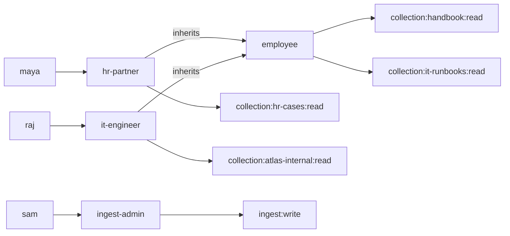

**Role-based access control (RBAC)** is the model most organisations already use without calling it that: people are given roles ("HR partner", "support engineer"), roles are given permissions ("read the HR cases collection"), and nobody is granted permissions one by one. It matches how companies describe jobs, keeps administration to a manageable size, and gives auditors a short list to review. For a RAG system it is also the most natural way to decide which **collections** of documents a person may search at all.

RBAC is also easy to over-trust. Roles are coarse: they say what *kind* of person you are, not which individual document you may open. This lesson covers the model precisely (users, roles, permissions, hierarchies, constraints), shows where it fits in a RAG architecture and where it stops, and builds a small RBAC engine with inheritance, cycle detection and separation of duties. Per-document control, which RBAC cannot express, is the subject of [Document-level permissions](/learn/access-control-and-privacy/document-level-permissions).

## Learning objectives

- Define user, role, permission and session in the RBAC model, and explain how a role hierarchy and separation-of-duties constraints work.
- Translate a set of job functions into a role design for a RAG system, and derive each user's searchable collections from their roles.
- Calculate the administrative saving of RBAC over direct grants and the role count produced by "role explosion".
- Recognise when RBAC is the wrong tool (per-document sharing, contextual rules) and what to combine it with.
- Implement an RBAC engine that rejects cyclic hierarchies and conflicting role assignments.

## Prerequisites

- [Authorisation](/learn/access-control-and-privacy/authorisation): the decision model, deny by default, and the other access-control families.
- [Authentication](/learn/access-control-and-privacy/authentication): where a user's roles and groups come from.
- [Metadata](/learn/vector-database-fundamentals/metadata): how a chunk carries the collection or label that a role will be matched against.

## Why this matters

Imagine AskMeridian indexing four sources: the employee handbook, IT runbooks, internal engineering notes for the Atlas platform, and HR case guidance. Everyone should read the first two. Only engineers should read the Atlas notes. Only HR partners should read the case guidance. Without a model, each of these rules ends up as a special case in code: `if user.department == "hr"`, repeated in several services, with slightly different spellings of "hr". When a new team forms, someone searches the code base for every place a department name appears.

RBAC replaces scattered `if` statements with one table: which roles exist, what each may do, and who holds which. The payoff is operational. A new HR partner is onboarded by assigning one role, and offboarded by removing it. An auditor asking "who can read HR cases?" gets a query result instead of a code review. A change in what HR partners may read is one edit that applies to all of them at once.

The risk is the opposite error: believing that roles are sufficient. Roles describe categories of people, but documents are shared with specific individuals, drafts are visible only to authors, and a manager may see one report's performance review but not another's. If the only tool is RBAC, either these cases are forced into hundreds of narrow roles, or they are quietly dropped and over-shared. Knowing the model's boundary is as important as knowing its mechanics.

## The intuition

A hospital does not decide, nurse by nurse, which of two thousand drawers each may open. It defines **roles**: ward nurse, pharmacist, porter, records clerk. Each role has a list of what it may do. When Priya joins as a ward nurse she receives that role and, instantly, all its access. When she moves to pharmacy, one role is swapped for another. The hospital manages roughly a dozen roles rather than thousands of individual permissions.

Two refinements appear naturally. First, some roles contain others: a senior nurse can do everything a ward nurse can, plus more, so the hospital defines "senior nurse" as "ward nurse plus ...". That is a **hierarchy**. Second, some pairs of roles should never meet in one person: the clerk who raises purchase orders should not also approve them. That is a **separation-of-duties** constraint. Together, roles, hierarchies and constraints are most of the RBAC model.

## How it works

### The core model

The standard model (formalised by Sandhu, Coyne, Feinstein and Youman in 1996, and standardised by NIST as ANSI INCITS 359) has a small vocabulary.

- **User**: a person or service principal.
- **Role**: a named job function.
- **Permission**: an approval to perform an action on a resource, such as `collection:hr-cases:read` or `ingest:write`.
- **User assignment (UA)**: the relation that says which users hold which roles.
- **Permission assignment (PA)**: the relation that says which permissions each role carries.
- **Session**: the subset of a user's roles that are active in one interaction. Many enterprise systems activate every assigned role at sign-in; the session concept matters when a user may choose to work in a lower-privilege role.

A user's effective permissions are the union of the permissions of all their active roles, with the roles' parents included. An access check asks one question: does the union contain the permission this action needs?



### Role hierarchies

A **hierarchy** lets one role inherit another's permissions, so common access is defined once. Every staff member holds `employee`, which grants the handbook and the IT runbooks. `hr-partner` and `it-engineer` are defined as `employee` *plus* their specialist collection. When the company later adds an "expenses policy" collection that everyone may read, it is added to `employee` and every descendant gets it.

Hierarchies need care. They must form a **directed acyclic graph**: a cycle (`a` inherits `b` inherits `a`) makes permission computation loop or, worse, silently collapses two roles into one. A well-built engine detects cycles when roles are created or assigned. Deep or tangled hierarchies are also hard to reason about; a good rule of thumb is that if you cannot explain a role's permissions on one slide, the hierarchy has become the problem.

### Constraints: separation of duties

**Static separation of duty (SSD)** forbids a user from *holding* two conflicting roles at once. **Dynamic separation of duty (DSD)** allows holding both but forbids *activating* both in one session. In a RAG system the conflicts that matter most are about the pipeline's own administration:

- Whoever can **ingest** documents (and therefore influence what the model sees) should not also **approve policy changes**, or one person can insert content and loosen the rules that govern it.
- Whoever administers **audit logs** should not be able to write the events they audit.
- A break-glass emergency role should be separate from daily roles, time-limited and logged.

### From roles to retrieval

For RAG, the most useful thing RBAC can output is a **set of collections** (or labels) the user may search. The retrieval layer then restricts the query to those. Concretely: compute `collections(user)`, and add a condition `collection IN (...)` to the vector search filter.

This gives coarse, cheap, easily explained control. It is a good fit when access really is decided by category: all the HR case guidance has one audience. It is a poor fit for access decided by the individual item. A chunk from a document that is "shared with Maya, Raj and the design team" cannot be reached by roles unless you invent a role for that exact audience. That is the territory of per-document ACLs, and the sensible architecture combines the two: RBAC decides which *collections* are searchable, document-level permissions decide which *chunks inside them* are visible, and both are applied as one filter.

### Where RBAC strains: role explosion

When a rule depends on several independent attributes, encoding each combination as a role multiplies them. Suppose access depends on department (8 values), region (4) and seniority (3). One role per combination needs $8 \times 4 \times 3 = 96$ roles; keeping the three attributes as attributes and writing rules over them needs only 15 values to maintain. This is **role explosion**, and its symptoms are role names like `hr-emea-senior-readonly-v2`, roles that are assigned to exactly one person, and a review process nobody completes.

The remedy is not more roles, it is a better model for the dimension that is exploding: use attributes (ABAC, as in [Authorisation](/learn/access-control-and-privacy/authorisation)) for the contextual dimensions and keep RBAC for the stable job-function layer. Many systems end up with "roles as one attribute among others".

### Roles versus groups

Directories have **groups**, and the words are often used interchangeably, but they are different ideas. A group is a *collection of people* ("everyone in Finance") and is usually managed by a directory. A role is a *collection of permissions* named for a job function. In practice you connect them: a directory group `grp-hr-partners` is *mapped* to the role `hr-partner`. Keep the mapping explicit and in your own configuration, so that renaming a group in the directory does not silently change who has the role, and so that a role can be granted by more than one group.

### Lifecycle: joiner, mover, leaver

RBAC's weakness in practice is rarely the model; it is the process around it.

- **Joiner**: new staff get their baseline role(s) automatically from the HR system (via the directory and SCIM, as in the [authentication lesson](/learn/access-control-and-privacy/authentication)).
- **Mover**: when someone changes team, old roles must be *removed*, not just new ones added. Privilege accumulation ("permission creep") is the most common RBAC finding in audits.
- **Leaver**: deprovisioning must be prompt and verified.
- **Periodic access review**: owners of each sensitive role confirm its members at a regular interval, such as quarterly. A review that only ever approves is a sign the roles are too broad to evaluate.

## The mathematics

RBAC's value is arithmetic: it replaces a user-by-permission relation with two smaller relations.

**Intuition.** Granting permissions directly means one entry for every (user, permission) pair a user holds. With roles, you store which roles each user holds, and which permissions each role holds, and the product emerges by composition.

Let $U$ be the number of users, $P$ the number of permissions, $R$ the number of roles, $\bar r$ the mean number of roles per user and $\bar p$ the mean number of permissions per role. In the worst case of direct assignment, every user holds every permission:

$$
E_{\text{direct}} = U \times P
$$

With RBAC the relations to maintain are:

$$
E_{\text{rbac}} = U \bar r + R \bar p
$$

**Worked example.** Take $U = 400$ staff, $P = 40$ permissions, $R = 25$ roles, $\bar r = 1.5$, $\bar p = 8$. Then $E_{\text{direct}} = 400 \times 40 = 16{,}000$, and $E_{\text{rbac}} = 400 \times 1.5 + 25 \times 8 = 600 + 200 = 800$, a ratio of $20$. The more telling saving is for changes: giving a new permission to 120 support staff is 120 edits directly, but one edit (to the `support` role) with RBAC.

```python
users, perms, roles = 400, 40, 25
roles_per_user, perms_per_role = 1.5, 8
direct = users * perms                              # worst case: every user holds every permission directly
rbac = users * roles_per_user + roles * perms_per_role
print(direct, rbac, round(direct / rbac, 1))
# Adding one new permission that every one of 120 support staff needs:
print("direct edits:", 120, "| RBAC edits:", 1)
```

```output
16000 800.0 20.0
direct edits: 120 | RBAC edits: 1
```

The direct figure is a worst case and real organisations hold far fewer direct grants than $U \times P$, so read the ratio as an upper bound on the saving. The reverse calculation is where role explosion appears: if $A_1, \dots, A_n$ are independent attributes with $v_1, \dots, v_n$ values, encoding all combinations as roles needs $\prod_i v_i$ roles whereas attributes need $\sum_i v_i$ values. For (8, 4, 3) that is 96 against 15.

## In code

The example is a compact RBAC engine with the three behaviours that matter in practice: hierarchical inheritance, **cycle detection** (a bad hierarchy fails when assigned, not later at query time) and **static separation of duty** (a conflicting assignment is refused). It also exposes `collections(user)`, the bridge from roles to a retrieval filter. It uses only the standard library; run it with `python rbac.py`.

```python
from dataclasses import dataclass, field


class RbacError(Exception):
    pass


@dataclass
class Role:
    name: str
    permissions: frozenset
    parents: tuple = ()          # roles whose permissions this role inherits


@dataclass
class Rbac:
    roles: dict = field(default_factory=dict)
    assignments: dict = field(default_factory=dict)       # user -> set of role names
    conflicts: list = field(default_factory=list)         # pairs of roles one person may not hold together

    def add_role(self, name, permissions=(), parents=()):
        self.roles[name] = Role(name, frozenset(permissions), tuple(parents))

    def role_permissions(self, name, _seen=()):
        """Permissions of a role including everything inherited from its parents."""
        if name in _seen:
            raise RbacError("cycle in role hierarchy: " + " -> ".join(_seen + (name,)))
        if name not in self.roles:
            raise RbacError(f"unknown role {name!r}")
        role = self.roles[name]
        perms = set(role.permissions)
        for parent in role.parents:
            perms |= self.role_permissions(parent, _seen + (name,))
        return perms

    def assign(self, user, role):
        held = self.assignments.setdefault(user, set())
        for a, b in self.conflicts:
            if (role == a and b in held) or (role == b and a in held):
                raise RbacError(f"separation of duties: {user} cannot hold both {a} and {b}")
        self.role_permissions(role)                       # fails early on unknown roles or cycles
        held.add(role)

    def permissions(self, user):
        out = set()
        for role in self.assignments.get(user, ()):
            out |= self.role_permissions(role)
        return out

    def collections(self, user, action="read"):
        """The collections a user may search: the bridge from roles to a retrieval filter."""
        prefix, suffix = "collection:", f":{action}"
        return sorted(p[len(prefix):-len(suffix)] for p in self.permissions(user)
                      if p.startswith(prefix) and p.endswith(suffix))


def build() -> Rbac:
    r = Rbac(conflicts=[("ingest-admin", "policy-approver")])
    r.add_role("employee", {"collection:handbook:read", "collection:it-runbooks:read"})
    r.add_role("hr-partner", {"collection:hr-cases:read"}, parents=["employee"])
    r.add_role("it-engineer", {"collection:atlas-internal:read"}, parents=["employee"])
    r.add_role("ingest-admin", {"ingest:write"})
    r.add_role("policy-approver", {"policy:approve"})
    return r


if __name__ == "__main__":
    r = build()
    r.assign("maya", "hr-partner")
    r.assign("raj", "it-engineer")
    r.assign("sam", "ingest-admin")
    for u in ("maya", "raj", "sam"):
        print(f"{u:5}", r.collections(u), sorted(p for p in r.permissions(u) if not p.startswith("collection:")))
    try:
        r.assign("sam", "policy-approver")
    except RbacError as e:
        print("blocked:", e)
    r.add_role("a", parents=["b"]); r.add_role("b", parents=["a"])
    try:
        r.assign("tess", "a")
    except RbacError as e:
        print("blocked:", e)
    # Role explosion: encoding independent attributes as roles multiplies them.
    dept, region, level = 8, 4, 3
    print("roles if each combination is a role:", dept * region * level)
    print("roles if attributes stay attributes:", dept + region + level)
```

```output
maya  ['handbook', 'hr-cases', 'it-runbooks'] []
raj   ['atlas-internal', 'handbook', 'it-runbooks'] []
sam   [] ['ingest:write']
blocked: separation of duties: sam cannot hold both ingest-admin and policy-approver
blocked: cycle in role hierarchy: a -> b -> a
roles if each combination is a role: 96
roles if attributes stay attributes: 15
```

### Reading the output

Maya and Raj inherit the two `employee` collections and add one specialist collection each, which is the hierarchy at work. Sam, the ingest administrator, can search **no** collections (the first list is empty) yet holds the `ingest:write` permission: a role for operating the pipeline need not carry any right to read the content it processes, which is least privilege for administrators. The two `blocked` lines show constraints failing loudly at assignment time, with a message that names the problem, rather than at query time with a puzzling empty result.

### Important lines

- `role_permissions` passes the path of roles visited so far in `_seen`; meeting a name already on the path is a cycle, and the error message prints the loop.
- `assign` calls `role_permissions(role)` *before* adding the role. A role with a cycle or an unknown parent is rejected at the moment an administrator tries to use it.
- `conflicts` is configuration, not code, so the separation rules can be reviewed on their own.
- `collections` is deliberately a pure function of `permissions(user)`: the retrieval layer receives a plain list and need not know about roles at all.

### Common errors

- **Forgetting to remove old roles on a move.** The engine does not know a person changed team; the lifecycle process must call a `revoke`, which this example omits for brevity.
- **Assigning a role before defining its parents.** Order of creation matters here; production systems validate the whole hierarchy in one step.
- **Using role names as permissions in checks.** Code such as `if "hr-partner" in roles` re-creates the scattered `if` statements RBAC was meant to remove. Check *permissions*, and let roles change underneath.

### Extending it

Add `revoke`, DSD (a per-session active-role set), time-limited assignments with an expiry timestamp for break-glass roles, an audit event for every assignment and revocation, and a function that answers the reviewer's question "who holds permission X?" by inverting the relation.

## A real-world example

The Platform team at Meridian launches AskMeridian with three roles: `employee`, `hr-partner` and `it-engineer`, mapped from directory groups. It works for a quarter. Then requests accumulate. Finance wants a `finance-analyst` role for the forecasting wiki. A group of six people across HR and Finance run the annual pay review and need both HR cases and finance data for six weeks. The sales team in the UK may read UK pricing notes but not the EU ones. A director asks to see exactly one confidential document from a department she does not belong to.

Each request tests the model differently. Finance analyst is a clean new role; it is added in a day. The pay-review group is a **temporary combination**: the team creates `pay-review-2026` as a role with an expiry date instead of adding HR and Finance roles to six people permanently, and the review process removes it automatically. Regional pricing is an early sign of explosion (roles for UK, EU and later more regions across several products), so the team adds a `region` attribute to the pricing chunks and a rule over it instead of a role per region. The director's single document is the clearest case of all: it is an exception on one document for one person, which belongs in a document ACL, not in a role.

The lesson the team writes into their access-control standard is a decision list: stable job functions become roles; temporary needs become expiring assignments; contextual dimensions become attributes; per-document sharing becomes an ACL. RBAC remains the backbone, with each of the others handling what it does best.

## Common mistakes

- **Treating roles as sufficient.** Per-document sharing and contextual rules are forced into narrow roles or ignored, and content is over-shared. Combine roles with document ACLs and attributes.
- **Role explosion.** Encoding every attribute combination as a role makes the role list unreviewable. Move contextual dimensions into attributes.
- **Permission creep.** Movers keep old roles and accumulate access. Remove old roles on every move and run periodic reviews.
- **Checking role names in code.** Scattered `if "hr-partner" in roles` checks defeat the purpose and break when roles are renamed. Check permissions.
- **Overpowered administrator roles.** An "admin" that can read all content, edit policy and ingest documents combines duties that should be separate. Split them and add constraints.
- **Hierarchies with cycles or tangles.** Inherited permissions become impossible to predict. Validate the graph and keep it shallow.
- **Shared accounts and standing break-glass.** A role everyone can use "in emergencies" is a permanent backdoor. Time-limit and audit emergency access.

## Best practices

- Derive roles from stable job functions, not from individuals or projects; name them for the function.
- Keep the hierarchy shallow and acyclic, validate it automatically, and keep the baseline role small.
- Map directory groups to roles explicitly in version-controlled configuration.
- Define separation-of-duty rules for the pipeline's own administration (ingest versus policy approval, audit versus operations).
- Give service and administrative roles no read access unless they need it, and make temporary roles expire by default.
- Run joiner-mover-leaver automation and a periodic review in which owners confirm each sensitive role's membership.
- Output collections or labels from roles, then combine them with document-level conditions in a single retrieval filter.
- Test the role table: for each role, assert the exact set of collections it can search.

## Performance considerations

Role resolution is cheap and, importantly, cacheable. A user's effective permissions change only when assignments or role definitions change, so they can be computed once per request (or cached for the identity-freshness window from the [authentication lesson](/learn/access-control-and-privacy/authentication)) and reused. The cost is a set union over a handful of roles, microseconds. The hierarchy walk is proportional to the number of roles involved; flatten it (precompute each role's closed permission set) when roles number in the hundreds.

The performance concern lies downstream, in what the output does to the vector query. A filter `collection IN (a, b, c)` is cheap when collections are indexed and large. A user who holds many roles and so many collections produces a longer `IN` list, and a filter that excludes most of the corpus affects approximate search, as described in [Metadata filtering](/learn/advanced-vector-database-engineering/metadata-filtering). Separate collections per audience are tempting as a performance measure, since each query then touches only one, but they multiply storage and make cross-collection questions awkward. Measure with your most restricted realistic user before choosing.

Role explosion has its own performance cost, measured in human time: the cost of review scales with the number of roles and members, and an unreviewable role list is an access-control failure even if the software is fast.

## Security considerations

- Roles define blast radius. A compromised account holds exactly its roles, so keep the baseline narrow and make powerful roles separate, assigned and time-limited.
- Protect the role table itself: assigning a role is the most privileged operation in the system. Restrict it, require approval, and log every change.
- Never derive roles from user-editable data (a profile field, a header, a request parameter). Roles come from the directory or the policy store.
- Service accounts are users too. Give them roles with explicit, narrow permissions and review them like human roles.
- Audit both directions: who *holds* each role now, and the history of grants and revocations.

## Summary

- RBAC grants permissions to roles and roles to people, cutting administration from users-times-permissions to users-plus-roles; an access check is a set-membership test on the user's effective permissions.
- Hierarchies share common permissions and must be acyclic; separation-of-duty rules stop one person holding conflicting roles.
- For RAG, roles are best used to decide which collections a user may search, expressed as one condition in the retrieval filter.
- RBAC is coarse: role explosion, temporary access and per-document sharing call for attributes, expiring assignments and document ACLs.
- Most real failures are lifecycle failures: permission creep on moves, slow deprovisioning and reviews that approve everything.

## Exercises

1. **Conceptual.** Distinguish a group from a role, and explain why a mapping between them should be explicit.

<details><summary>Show solution</summary>

A group is a set of people managed by the directory; a role is a set of permissions named for a function. An explicit, version-controlled mapping (group `grp-hr-partners` to role `hr-partner`) means that renaming or restructuring directory groups cannot silently change who holds a role, and lets several groups feed one role or one group feed several. Without it, a directory clean-up becomes an unreviewed permission change.

</details>

2. **Calculation.** Access to pricing notes depends on product (6 products), region (5 regions) and plan tier (2 tiers). How many roles does the "one role per combination" design need, and how many values does an attribute design maintain?

<details><summary>Show solution</summary>

Roles: $6 \times 5 \times 2 = 60$. Attribute values: $6 + 5 + 2 = 13$. Adding a seventh product adds 10 roles in the first design (one per region-tier pair) and one value in the second.

</details>

3. **Design.** Maya, an HR partner, covers for a colleague for two weeks and needs the colleague's `hr-payroll` access. Describe how to grant it safely.

<details><summary>Show solution</summary>

Assign `hr-payroll` to Maya with an expiry timestamp two weeks out and a recorded approver, rather than adding it permanently. The assignment is logged, the role is reviewed at expiry, and a scheduled job removes it if no one renews it. Check that `hr-payroll` does not conflict with any of Maya's other roles under separation-of-duty rules.

</details>

4. **Code.** Add a `revoke(user, role)` method to `Rbac` and a function `who_holds(permission)` that returns the users holding a permission. Say what the second is for.

<details><summary>Show solution</summary>

```python
def revoke(self, user, role):
    self.assignments.get(user, set()).discard(role)

def who_holds(self, permission):
    return sorted(u for u in self.assignments if permission in self.permissions(u))
```

`who_holds` answers the access reviewer's and auditor's question ("who can read HR cases?") by inverting the relation. It scans every user, which is fine for hundreds of users; for much larger directories keep a reverse index updated on assign and revoke.

</details>

## Check your understanding

```quiz
[
  {"q": "In the RBAC model, a user's effective permissions are:", "options": ["The permissions of their most senior role only", "The union of the permissions of their active roles, including inherited ones", "The intersection of their roles' permissions", "Whatever the last assigned role grants"], "answer": 1, "why": "Permissions accumulate across roles, and a role includes everything it inherits from its parents."},
  {"q": "Access to a document depends on department (8 values), region (4) and seniority (3). Encoding every combination as a role needs how many roles?", "options": ["15", "32", "96", "24"], "answer": 2, "why": "The combinations multiply: 8 x 4 x 3 = 96. Keeping them as attributes needs only 8 + 4 + 3 = 15 values."},
  {"q": "Which is the best use of RBAC in a RAG retrieval layer?", "options": ["Deciding the visibility of each individual chunk", "Deciding which collections a user may search, combined with document-level conditions", "Replacing authentication", "Filtering the model's final answer"], "answer": 1, "why": "Roles are coarse and fit category-level decisions such as which collections are searchable. Per-document visibility needs ACLs or attributes."},
  {"q": "Why does the engine call `role_permissions(role)` inside `assign` before adding the role?", "options": ["To make the assignment faster", "To reject unknown roles and cyclic hierarchies at assignment time instead of at query time", "To copy permissions onto the user", "To log the permissions"], "answer": 1, "why": "Validating on assignment makes a bad hierarchy fail loudly where the administrator can see it, rather than appearing later as an exception or an empty result."},
  {"q": "A person moves from Finance to HR and is given the `hr-partner` role, but keeps `finance-analyst`. What is this called, and what prevents it?", "options": ["Role explosion; more roles", "Permission creep; removing old roles on every move and periodic reviews", "Cycle detection; a deeper hierarchy", "Session hijacking; shorter tokens"], "answer": 1, "why": "Accumulating access across job changes is permission creep. Joiner-mover-leaver automation that removes old roles, plus periodic access reviews, controls it."}
]
```

## Further reading

- Sandhu, Coyne, Feinstein and Youman, 1996, "Role-Based Access Control Models", IEEE Computer.
- Ferraiolo, Sandhu, Gavrila, Kuhn and Chandramouli, 2001, "Proposed NIST Standard for Role-Based Access Control", ACM Transactions on Information and System Security; the standard is ANSI INCITS 359.
- NIST Special Publication 800-162, "Guide to Attribute Based Access Control (ABAC) Definition and Considerations", for the comparison with RBAC and hybrid designs.
- OWASP Authorization Cheat Sheet (cheatsheetseries.owasp.org).
- Your identity provider's documentation on groups, app roles and SCIM provisioning (for example Microsoft Entra ID, Okta or Keycloak).
