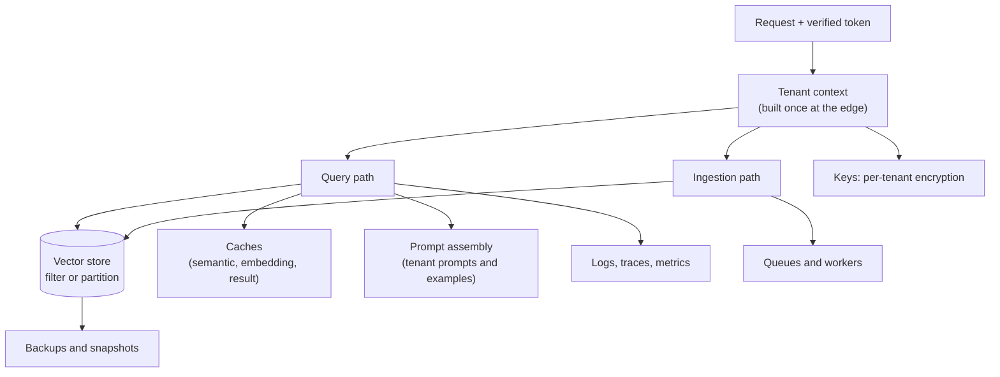

When one RAG deployment serves several customers, or several business units that must not see each other's documents, the most important property of the whole system is that **no tenant's content ever reaches another tenant**. A **tenant** is any group whose data must stay separate: a customer company in a SaaS product, a subsidiary, a department with legal barriers around its files. **Tenant isolation** is the set of mechanisms that make that separation hold, not just in the database but everywhere the data travels.

Two earlier lessons already cover the storage and the service architecture of multi-tenancy: [Multi-tenancy](/learn/advanced-vector-database-engineering/multi-tenancy) explains how vector databases partition tenants (collection, shard or payload filter) and why an approximate index finds tenant filters hard, and [Multi-tenant RAG](/learn/production-architecture/multi-tenant-rag) walks through the request path, tenant registry, fairness and metering. This lesson takes the **security** view. It asks what an attacker, or an ordinary bug, can do to cross the boundary, lists every place a tenant's data lives besides the vector store, and builds a test harness that catches a leak before a customer does.

## Learning objectives

- Describe a threat model for a multi-tenant RAG system, naming the confidentiality, integrity and availability risks.
- List the layers where isolation must hold (identity, data, compute, cache, prompt, logs, keys, backups) and the typical leak at each.
- Choose between silo, bridge and pool tenancy using a risk-and-cost argument rather than habit.
- Implement a request-scoped tenant context, a tenant-scoped store and cache, and verify that execution contexts without a tenant fail closed.
- Write canary-based leak tests that exercise the whole pipeline, and use them as a release gate.

## Prerequisites

- [Multi-tenancy](/learn/advanced-vector-database-engineering/multi-tenancy): silo, bridge and pool models and how the vector database enforces them.
- [Multi-tenant RAG](/learn/production-architecture/multi-tenant-rag): the request path and tenant context at service level.
- [Authentication](/learn/access-control-and-privacy/authentication): how the tenant identity is established from a verified credential.
- [Document-level permissions](/learn/access-control-and-privacy/document-level-permissions): the per-document layer that sits inside a tenant boundary.

## Why this matters

A cross-tenant leak is the worst class of bug in a shared system. A wrong answer is embarrassing. A fluent answer built from another customer's contracts is a breach, with contractual, regulatory and reputational consequences, and it can affect every customer simultaneously because they share the code path. In a pooled deployment, **one missing filter exposes all tenants at once.**

RAG systems are prone to this class of failure because their data moves far from the database. A tenant's text appears in embeddings, in retrieved chunks, in prompts, in cached answers, in traces, in evaluation sets, in background job payloads, in backups. Teams that secure only the vector store (a tenant filter on every query) leave all the other places open. The leak that finally reaches a customer is often not a database leak at all: it is a semantic cache that returned a similar question's answer, a shared few-shot prompt built from another customer's examples, a log line a support engineer pasted into a ticket.

The final reason is that failure is silent. Nothing crashes when a filter is missing; the system just answers, with plausible text. Isolation therefore has to be tested actively, because it will not announce itself.

## The intuition

Consider a multi-storey office building shared by several companies. The lobby, lifts and electricity are shared. Each company has its own floor with a lock. The landlord decides how much to share and how much to separate: an open-plan co-working floor is cheap and flexible, a locked suite with its own entrance is expensive and strong.

Isolation fails in ways that have nothing to do with the main door. The cleaners have a master key and tape a list of codes in the cupboard. The post room mixes up two companies' parcels. A waste skip in the car park holds shredded-but-readable paper from several floors. A thoughtful landlord inspects every one of those side channels, not just the locks.

In a RAG system the lock is the tenant filter on the vector store. The master key is the support tooling and service accounts. The post room is the cache and the message queue. The skip is the logs, traces and backups. Tenant isolation is the work of finding all of them.

## How it works

### The threat model

Write down who you defend against, because isolation controls for a curious customer differ from those for a compromised service.

| Threat | Example | Property at risk |
| --- | --- | --- |
| **Application bug** | A code path forgets the tenant filter; a cache is shared | Confidentiality |
| **Malicious tenant user** | Crafts requests with another tenant's id, or prompts the model to reveal "other customers' documents" | Confidentiality, integrity |
| **Compromised credential or service** | A leaked service token queries without a tenant | Confidentiality |
| **Malicious insider or support access** | An engineer reads a customer's data without a ticket | Confidentiality |
| **Noisy neighbour** | One tenant's bulk upload slows everyone else | Availability |
| **Cross-tenant write** | A tenant uploads a document that lands in the shared or another tenant's index | Integrity (a form of [data poisoning](/learn/rag-security-fundamentals/data-poisoning)) |
| **Side channel** | Timing, error messages or counts reveal that another tenant has a document | Confidentiality (existence) |

The most common cause by far is the first: ordinary bugs. The design therefore aims at making the mistake structurally hard, not at hoping developers remember.

### Where tenant data lives



For each box, ask the same question: *if this component forgot the tenant, what could it return, and to whom?*

- **Vector store.** Enforced by partitioning or a mandatory filter ([Multi-tenancy](/learn/advanced-vector-database-engineering/multi-tenancy)). Add a second wall in the database where it is available, such as scoped credentials restricting a token to one tenant's collection or partition.
- **Caches.** Semantic caches match on *similarity*, so a request from tenant B that resembles tenant A's earlier question returns A's answer. Result and session caches have the same risk. Every cache key includes the tenant.
- **Embedding caches** keyed by a hash of the text hold only vectors, which are the same for any tenant's identical text, so sharing them across tenants does not reveal content. It can, however, reveal *existence*: if "has anyone embedded this exact sentence?" is observable through latency, one tenant can probe another's corpus. Scope it per tenant when documents are sensitive.
- **Prompt assembly.** System prompts, instructions and few-shot examples may be customised per tenant. A shared template filled with another tenant's examples leaks them. Prompts optimised automatically from "our best conversations" must be optimised per tenant.
- **Logs, traces and metrics.** They contain queries and retrieved text. Tag every record with the tenant, restrict who can read which tenant's records, and keep content out of metrics labels (high-cardinality labels also break metrics systems).
- **Queues and workers.** Background jobs run with no HTTP request to carry the tenant. The job message must carry it, and the worker must bind a context from it, so tasks fail if the field is missing.
- **Backups and snapshots.** A restore of a shared snapshot brings back all tenants together. Offboarding a tenant must account for them ([Secure deletion](/learn/enterprise-rag-governance/secure-deletion) and [Data retention](/learn/access-control-and-privacy/data-retention)).
- **Keys.** Per-tenant encryption keys let you destroy one tenant's data cryptographically without touching the others ([Data encryption](/learn/access-control-and-privacy/data-encryption)).
- **The language model.** Prompts are sent to a model per request; a tenant's text is not mixed with another's inside one call unless you put it there. Check the provider's data-handling terms for training and retention, and never fine-tune a shared model on pooled tenant data without explicit contractual permission.

### The tenant context pattern

The rules from the earlier lessons apply: the tenant comes from a verified token, never from the body; one choke point adds it to every query; callers' filters are combined with AND; results are verified on the way out. The pattern that makes these rules robust is a **request-scoped tenant context**:

1. The edge (API gateway or first middleware) verifies the token and binds the tenant to the execution context, once.
2. Any code that touches tenant data calls `require_tenant()`, which **raises** if none is bound. There is no default and no optional parameter.
3. Data-access classes read the tenant from the context; the tenant is not a parameter that callers can get wrong, forget or fill in from the request body.
4. When work crosses a boundary (a queue, a thread pool, another service), the tenant travels explicitly, in the job message or a signed header, and the receiver rebinds it.

In Python the standard tool is `contextvars.ContextVar`. Its semantics are exactly what a fail-closed design wants: asyncio tasks copy the current context when created, so a context bound before `await` flows into spawned tasks; but plain `threading.Thread` objects and `ThreadPoolExecutor` workers **start with an empty context**, so tenant-scoped code that is accidentally run in a worker raises instead of silently running unscoped (or worse, with another request's tenant). Treat that as a feature.

### Choosing a tenancy tier by risk

The three tenancy models trade cost against the strength of isolation and the size of the blast radius.

| Tier | Isolation strength | Blast radius of one bug | Cost |
| --- | --- | --- | --- |
| **Pool** (shared collection, filter) | Logical | All tenants | Lowest |
| **Bridge** (partition or shard per tenant) | Structural in the database, shared everything else | All tenants through shared services | Moderate |
| **Silo** (collection, or whole stack, per tenant) | Physical | One tenant | Highest |

Choose by the cost of a leak, not by the number of tenants alone. A regulated customer whose contract requires dedicated infrastructure is a silo by obligation. Many providers end up with a **tiered** model: a pooled tier for small tenants and a dedicated tier for large or regulated ones, behind the same API and tenant context. Whatever the tier, the application-level controls in this lesson stay the same, because the pooled tier has to be correct for the dedicated tier's customers to stay safe from you.

### Shared global content

Some content belongs to nobody in particular: the vendor's own product documentation that every tenant may search. The clean way to model it is a reserved `global` tenant whose documents every tenant can read, so a query is `tenant = X OR tenant = global`. Two cautions follow. The write path to `global` is far more privileged than a tenant's own path and needs separate controls, since poisoning it poisons everyone. And a `global` document must never be derived from tenant data (for example, an FAQ auto-generated from customers' questions).

### Operational access

People are a leak channel too. Support and engineering staff sometimes need to see a tenant's data to fix a problem. Make this a controlled, audited event rather than a standing capability: access through a **break-glass** role that is time-limited, requires a ticket and, for sensitive customers, the customer's consent; record every access in a log the customer can request. Tools that query "across all tenants" for analytics should return aggregates, not text.

## In code

The example makes the key ideas concrete in under 120 lines, with no model download. It has four parts: a `ContextVar` tenant binding that fails closed; a `TenantStore` whose search takes the tenant only from that context, filters before ranking and checks on the way out; a `SemanticCache` with a `scoped` switch so we can run the leaky and the safe version; and a canary test that exercises the whole answer path. Documents are embedded with TF-IDF (scikit-learn) so that results are deterministic.

```bash
pip install numpy scikit-learn
```

```python
import contextvars
from concurrent.futures import ThreadPoolExecutor

import numpy as np
from sklearn.feature_extraction.text import TfidfVectorizer

_tenant = contextvars.ContextVar("tenant")


class IsolationError(Exception):
    pass


def require_tenant() -> str:
    try:
        return _tenant.get()
    except LookupError:
        raise IsolationError("no tenant bound to this execution context") from None


DOCS = [  # (tenant, text) - each tenant has one document containing a unique canary phrase
    ("kestrel", "Kestrel renewal pricing for the analytics plan is fixed. canary-kestrel-8841"),
    ("kestrel", "Kestrel onboarding checklist covers single sign-on and export settings."),
    ("orchard", "Orchard renewal pricing for the analytics plan includes a volume discount. canary-orchard-2207"),
    ("orchard", "Orchard onboarding checklist covers webhook retries and event limits."),
]
vectoriser = TfidfVectorizer().fit([t for _, t in DOCS] + ["renewal pricing analytics plan"])
MATRIX = vectoriser.transform([t for _, t in DOCS]).toarray()
OWNERS = np.array([t for t, _ in DOCS])


def embed(text):
    return vectoriser.transform([text]).toarray()[0]


class TenantStore:
    """The only way application code reaches documents. The tenant is never a parameter."""

    def search(self, query, k=2):
        tenant = require_tenant()
        scores = MATRIX @ embed(query)
        scores = np.where(OWNERS == tenant, scores, -np.inf)       # filter BEFORE ranking
        top = [i for i in np.argsort(-scores)[:k] if np.isfinite(scores[i])]
        hits = [DOCS[i][1] for i in top]
        assert all(OWNERS[i] == tenant for i in top), "tenant filter failed"   # check on the way out
        return hits


class SemanticCache:
    def __init__(self, scoped: bool, threshold=0.5):
        self.scoped, self.threshold, self.items = scoped, threshold, []

    def _key(self):
        return require_tenant() if self.scoped else "*"

    def put(self, query, answer):
        self.items.append((self._key(), embed(query), answer))

    def get(self, query):
        key, q = self._key(), embed(query)
        for k, v, answer in self.items:
            if k == key and float(v @ q) >= self.threshold:
                return answer
        return None


def answer(tenant, query, cache, store):
    token = _tenant.set(tenant)           # bound once, at the edge of the request
    try:
        cached = cache.get(query)
        if cached is not None:
            return cached
        result = " | ".join(store.search(query, k=1))
        cache.put(query, result)
        return result
    finally:
        _tenant.reset(token)


def leak_test(scoped):
    store, leaks = TenantStore(), []
    for owner, other in [("kestrel", "orchard"), ("orchard", "kestrel")]:
        cache = SemanticCache(scoped=scoped)                                       # fresh cache per pair
        answer(owner, "renewal pricing analytics plan", cache, store)              # owner warms the cache
        reply = answer(other, "what is the renewal pricing for the analytics plan", cache, store)
        if f"canary-{owner}" in reply:
            leaks.append(f"{other} saw {owner}'s canary")
    return leaks


if __name__ == "__main__":
    q1, q2 = embed("renewal pricing analytics plan"), embed("what is the renewal pricing for the analytics plan")
    print("query similarity:", round(float(q1 @ q2), 3))
    print("global cache :", leak_test(scoped=False) or "no leaks")
    print("scoped cache :", leak_test(scoped=True) or "no leaks")

    store = TenantStore()
    try:
        store.search("renewal pricing")
    except IsolationError as e:
        print("no context   : refused ->", e)

    token = _tenant.set("kestrel")
    with ThreadPoolExecutor(1) as pool:
        try:
            pool.submit(store.search, "renewal pricing").result()
        except IsolationError as e:
            print("worker thread: refused ->", e)
    print("same thread  :", store.search("renewal pricing", k=1))
    _tenant.reset(token)
```

```output
query similarity: 0.545
global cache : ["orchard saw kestrel's canary", "kestrel saw orchard's canary"]
scoped cache : no leaks
no context   : refused -> no tenant bound to this execution context
worker thread: refused -> no tenant bound to this execution context
same thread  : ['Kestrel renewal pricing for the analytics plan is fixed. canary-kestrel-8841']
```

### Reading the output

The query similarity of 0.545 shows two differently worded questions close enough for a cache with a loose threshold (0.5) to treat them as the same. With a **global** cache, each tenant's reply included the other's canary phrase: the cache returned the first tenant's stored answer to the second tenant's similar question, and the test reports both directions. With the **scoped** cache the same test reports no leaks, because entries are only matched within the asking tenant. The threshold was set deliberately loose to make the failure visible; a production threshold is stricter, but any threshold below 1.0 has this problem and a cache without tenant scoping has it at some rate.

The last three lines show the fail-closed behaviour. Calling the store with no tenant bound raises `IsolationError`. A worker thread started from a pool with the tenant bound in the submitting thread **also raises**, because the pool's thread has an empty context. Only code running where the tenant was explicitly bound gets results, and only that tenant's.

### Important lines

- `require_tenant()` has no default. The absence of a tenant is an error, never "all tenants" or "the last tenant".
- In `TenantStore.search`, the tenant filter runs **before** ranking (`np.where(... -np.inf)`), so another tenant's documents are never candidates. The `assert` afterwards is the on-the-way-out check; in production use an explicit exception, because `assert` is removed under `python -O`.
- `_tenant.reset(token)` in a `finally` block restores the previous binding even if the request fails, so a context cannot leak into the next request on a reused worker.
- `SemanticCache._key` returns the tenant when `scoped`, which is the one-line difference between the leaky and the safe version.
- `leak_test` builds a fresh cache per pair so each direction is tested independently, using a canary string that cannot appear by chance.

### Common errors

- **A tenant bound in the wrong place.** Binding the tenant inside the data layer (from a parameter) rather than at the edge re-introduces the parameter you wanted to remove.
- **Running tenant-scoped code in a thread pool and passing the tenant as an argument to "fix" the error.** That works, and is exactly the habit that leads to a call with the wrong argument. Prefer `contextvars.copy_context().run(...)` or rebind from the job record inside the worker.
- **A test that checks only the happy path.** A leak test must run *as the other tenant* and look for the owner's canary.

### Extending it

Replace the TF-IDF store with a vector database collection and add the tenant filter inside the same choke-point class; add a database-level second wall (scoped credentials) so a bug in application code cannot bypass it; propagate the context across a queue by putting `tenant_id` in the job message and rebinding in the worker; and run `leak_test` in CI against a staging index with realistic tenants.

## A real-world example

Harbourlight Software sells a RAG-powered help assistant to business customers, and two of them, Orchard and Kestrel, share a pooled index. The platform team has done the textbook things: the tenant comes from the token, one search class adds the filter, and a unit test proves it.

Then a customer asks the assistant a question about renewal terms and receives an answer that quotes a discount percentage Orchard has never heard of. The post-incident review finds the cause in a place nobody had looked at. A performance sprint had added a semantic answer cache keyed on query embedding to reduce model cost. The cache had been written against a single-tenant prototype and nobody threaded the tenant through its key. For six weeks it had occasionally returned a stored answer to a similar question from another tenant. No log line recorded it, because the answer path looked normal.

The remediation is instructive. The cache key now includes the tenant, enforced the same way as the store: the cache reads the tenant from the context and fails if there is none. The team adds an inventory of every component that stores or transforms tenant text (cache, prompt templates, trace pipeline, job queue, evaluation sets, backups), and a rule that adding to the inventory requires a tenant-isolation note in the pull request. And a nightly **canary** job inserts a synthetic document into each of two dedicated test tenants and asks the full assistant, as each, for the other's canary phrase; the job pages on-call if either ever appears. The incident was never a database failure: the isolation test they had was aimed at the wrong layer.

## Common mistakes

- **Securing only the vector store.** Caches, prompts, logs, queues and backups also hold tenant text. Inventory every component and test each.
- **A tenant-less cache.** Similarity matching makes cross-tenant hits probable, not just possible. Key every cache by tenant.
- **Taking the tenant from a request field or an unchecked header.** A caller can name any tenant. Derive it from verified identity.
- **A tenant parameter on data-access functions.** One forgotten or wrong argument is a breach. Read it from the bound context and fail if absent.
- **Pooling without a second wall.** A single filter is a single point of failure. Add database-level scoping and an on-the-way-out check.
- **Global tools and analytics returning text across tenants.** Support dashboards and "search all customers" features bypass every control. Aggregate only, or break-glass with audit.
- **Testing only that a tenant sees its own data.** The failure is seeing someone else's. Test as the other tenant.
- **Ignoring noisy neighbours.** One tenant's bulk ingestion degrading everyone is an availability failure and sometimes a probe. Rate-limit per tenant.

## Best practices

- Document a threat model and a data-flow inventory listing every place tenant text is stored, cached, logged or transformed.
- Bind the tenant once at the edge from verified identity, using a context object that fails closed when absent.
- Give every data-access, cache, prompt and logging component a tenant-scoped interface with no tenant parameter, and verify results on the way out.
- Use a second enforcement wall in the database (scoped credentials, row-level security or partitioning) in addition to the application filter.
- Carry the tenant explicitly through queues and workers, and rebind in the worker.
- Choose tenancy tiers by the cost of a leak and contractual requirements, and keep application-level controls identical across tiers.
- Make operational access to tenant data a time-limited, audited break-glass event.
- Run canary-based leak tests in CI and continuously in production-like environments, across the whole answer path.
- Rate-limit and meter per tenant to protect availability, as the [Multi-tenant RAG](/learn/production-architecture/multi-tenant-rag) lesson describes.

## Performance considerations

Isolation costs are mostly in choosing the tier. In a **pool**, the marginal cost of a new tenant is close to zero, but every query carries a filter and shares resources. In a **silo**, each tenant has fixed overhead. As an illustration with assumed numbers: if a dedicated collection needs a baseline of 200 MB of memory even when empty, 500 silo tenants reserve about 100 GB before storing a single chunk, while a pooled design stores the same documents with no per-tenant baseline. The break-even depends on tenant size and the database; measure your own overhead rather than trusting the illustration.

A scoped cache has a lower hit rate than a global one, since identical questions from different tenants no longer share an entry. For tenant-specific content that cost is unavoidable. For content that is truly shared (the vendor's public documentation), cache it under the `global` tenant so all tenants benefit without any private data entering the shared entry.

The on-the-way-out check costs a loop over $k$ results, negligible against retrieval. Canary tests are cheap: a handful of queries per run. The expensive item is the **per-tenant partitioning** in the vector database when tenant counts are very large, covered in [Multi-tenancy](/learn/advanced-vector-database-engineering/multi-tenancy).

## Security considerations

- Isolation is a property of the whole system; review it whenever a new component handles tenant text (a new cache, a new tracing exporter, a new evaluation tool).
- Keep tenant identifiers unguessable where they appear in URLs or storage paths, but never rely on that: authorisation must still be enforced.
- Restrict log and trace access by tenant, scrub tenant content from shared metrics, and avoid copying production tenant text into development environments.
- Rotate and scope service credentials per environment; a staging credential must not reach production tenants' data.
- Plan offboarding end to end: index, caches, queues, traces, backups, per-tenant keys. Verify that nothing remains.
- Prepare for the failure: a kill switch that disables a feature or tenant, an incident procedure for suspected cross-tenant exposure, and notification obligations that your contracts and regulations impose.

## Summary

- Tenant isolation means no tenant's content ever reaches another, across every component that stores or transforms it, and the most likely cause of failure is an ordinary bug in a component nobody thought of.
- Bind the tenant once from verified identity into a context that fails closed, read it inside data-access components, and carry it explicitly across queues and threads.
- Check on the way out and add a database-level second wall; do not rely on a single filter.
- Caches, prompts, logs, queues and backups need the same tenant discipline as the vector store; semantic caches in particular leak by similarity.
- Choose pool, bridge or silo by the cost of a leak, and prove isolation with canary tests that run as the other tenant across the whole answer path.

## Exercises

1. **Conceptual.** Why is a semantic cache more dangerous for isolation than an exact-match cache keyed on the query string?

<details><summary>Show solution</summary>

An exact-match cache returns an entry only when two requests have the same string, which still leaks if tenants are not in the key, but only for identical questions. A semantic cache matches on similarity, so *different* questions from different tenants can hit the same entry (here, a similarity of 0.545 was enough), making cross-tenant hits far more frequent and harder to spot. Either way the tenant must be part of the key.

</details>

2. **Prediction.** In the example, what happens if `answer` is changed to call `pool.submit(store.search, query)` from inside a worker pool after binding the tenant in the request thread, and why is that behaviour desirable?

<details><summary>Show solution</summary>

`store.search` raises `IsolationError` because the pool's worker thread starts with an empty context. It is desirable because it makes the mistake loud: the code cannot run unscoped, and a developer must pass the tenant deliberately (for example by running the call under `contextvars.copy_context().run`, or by rebinding from the job record). Silent success in the wrong context would be the breach.

</details>

3. **Design.** Design the canary strategy for a pooled production system with 300 tenants.

<details><summary>Show solution</summary>

Create two or more dedicated canary tenants that no customer can access, each holding a document with a unique nonsense phrase. A scheduled job, running through the real API with real tokens, asks each canary tenant for the other's phrase (and for several paraphrases), and fails and alerts if any phrase appears in an answer, a citation, a cache hit or a logged trace visible to the wrong tenant. Run it after every deploy and periodically. Keep canary tenants configured identically to the smallest customer tier, including caches and prompts. Optionally place a canary document *inside* a real tenant's partition to test the shared paths too, if policy allows.

</details>

4. **Code.** Modify `TenantStore` to support the `global` tenant (visible to everyone) without letting a tenant write to it. Sketch the search change and the write rule.

<details><summary>Show solution</summary>

In `search`, replace the mask with `np.isin(OWNERS, [tenant, "global"])`, so both are candidates before ranking, and make the on-the-way-out check accept the same two values. Add a separate `add_document(tenant, text)` method that reads the tenant from the context and refuses `tenant == "global"`; documents reach `global` only through a distinct, privileged ingestion job that authenticates as a platform service and is reviewed. Never derive `global` documents from tenant content.

</details>

## Check your understanding

```quiz
[
  {"q": "In a pooled deployment, what is the main consequence of one missing tenant filter?", "options": ["Only that tenant is affected", "Every tenant sharing the code path may be exposed", "The index must be rebuilt", "Queries become slower"], "answer": 1, "why": "In a pool all tenants share the same collection and code, so a missing filter can expose any tenant's content to any other."},
  {"q": "A ThreadPoolExecutor worker calls code that uses require_tenant(), after the tenant was bound with a ContextVar in the submitting thread. What happens?", "options": ["It sees the submitting thread's tenant", "It raises, because the worker's context is empty", "It receives the last tenant any thread used", "It receives a random tenant"], "answer": 1, "why": "Pool worker threads start with an empty context rather than a copy of the submitter's, so tenant-scoped code fails closed unless the tenant is rebound or the context is copied explicitly."},
  {"q": "Which cache design avoids cross-tenant answers?", "options": ["Raising the similarity threshold to 0.99", "Including the tenant in every cache key, taken from the verified context", "Clearing the cache hourly", "Caching only short answers"], "answer": 1, "why": "Only scoping by tenant guarantees a tenant cannot receive another's entry. A high threshold or periodic clearing only lowers the probability."},
  {"q": "Why is a canary test run as 'the other tenant' more informative than a test that each tenant can find its own documents?", "options": ["It is faster", "Leaks appear as seeing someone else's data, which a self-retrieval test never checks", "It tests the embedding model", "It avoids needing a database"], "answer": 1, "why": "The failure is cross-tenant visibility. Only a test that asks as one tenant for another's unique phrase can detect it across every layer."},
  {"q": "Why should support engineers' access to a tenant's data be a break-glass event?", "options": ["Support work is rare", "Standing cross-tenant access is a leak channel, so it should be time-limited, ticketed and audited", "It speeds up debugging", "It avoids needing authentication"], "answer": 1, "why": "People with standing access can read any customer's data. Time-limited, justified and logged access reduces both misuse and exposure."}
]
```

## Further reading

- Amazon Web Services, "SaaS Lens" of the Well-Architected Framework and the AWS whitepaper "SaaS Tenant Isolation Strategies" (aws.amazon.com), for the silo, pool and bridge vocabulary.
- OWASP Top 10 for LLM Applications, entries on sensitive information disclosure and vector and embedding weaknesses (owasp.org).
- Python documentation for the `contextvars` module (docs.python.org), for the copy-on-task and thread behaviour used here.
- Qdrant documentation on multitenancy and on JWT-based access control (qdrant.tech/documentation).
- PostgreSQL documentation on row security policies (postgresql.org/docs), for a database-level second wall.
