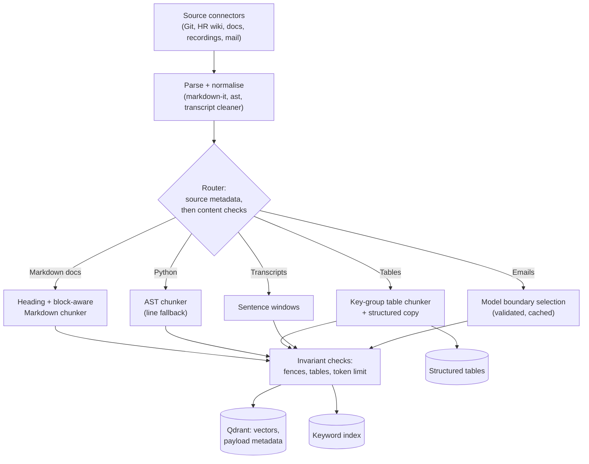

This assessment covers the whole of Advanced Chunking Strategies: recursive character splitting, semantic chunking, document-aware, structure-aware and heading-based chunking, and the specialised strategies for Markdown, code, tables, sliding windows and model-driven (agentic) chunking. Aim for at least 80 per cent on the quiz (16 of 20) before moving on, then work through the open questions, coding exercises, design challenge and troubleshooting scenarios. Try each one before opening its model answer.

```quiz
[
  {"q": "A recursive character splitter has separators [\"\\n\\n\", \"\\n\", \" \", \"\"]. A piece of text is still too long after splitting on blank lines. What happens next?", "options": ["The whole document is re-split on spaces", "Only the oversized pieces are split again with the next separator, and small pieces are merged back up to the chunk size", "The piece is truncated at the chunk size", "The splitter raises an error"], "answer": 1, "why": "Recursion applies finer separators only to pieces that are still too long; a greedy merge then re-packs small pieces."},
  {"q": "In percentile-based semantic chunking, what does raising the percentile from 90 to 95 do?", "options": ["Produces fewer, longer chunks, because fewer adjacent-sentence distances exceed the threshold", "Produces more, shorter chunks", "Changes the embedding model", "Has no effect on chunk length"], "answer": 0, "why": "A higher percentile raises the threshold, so fewer gaps become boundaries; mean chunk length is about 1/(1 - p/100) sentences."},
  {"q": "Which statement best distinguishes document-aware chunking from structure-aware chunking?", "options": ["They are the same technique", "Document-aware chunking only works on PDFs", "Document-aware chunking chooses a strategy by document type (FAQ, release notes, transcript), while structure-aware chunking places boundaries between parsed elements within a document", "Structure-aware chunking ignores headings"], "answer": 2, "why": "One routes by the kind of document and its natural unit; the other packs typed elements such as paragraphs, tables and code."},
  {"q": "Why does a heading-based chunker prepend a heading path such as 'Expenses > Eligibility' rather than just 'Eligibility'?", "options": ["Because embedding models require two levels", "To make chunks longer", "Because 'Eligibility' is a reserved word", "Because the same heading recurs under different parents, and the path disambiguates them"], "answer": 3, "why": "Repeated titles are common; the full path tells retrieval and the model which section a chunk belongs to."},
  {"q": "Why does a block-aware Markdown chunker pack only top-level blocks?", "options": ["So that a list and anything nested in it, such as a code block inside a list item, stays in one chunk", "Because nested blocks have no text", "Because markdown-it-py does not report nested blocks", "To make chunks shorter"], "answer": 0, "why": "Treating nested blocks as separate units would let a boundary cut an instruction away from its code."},
  {"q": "`RecursiveCharacterTextSplitter.from_language(Language.MARKDOWN)` meets a fenced shell script containing the line `# clear the cache`. What is the risk?", "options": ["The script is deleted", "The heading-like separator matches the comment and the splitter may cut inside the fence", "The splitter converts it to a heading", "None; it tracks fences"], "answer": 1, "why": "Its separators are regular expressions over raw text and cannot know the line is inside a code block."},
  {"q": "What does this print?\n```python\nimport ast\nsrc = \"@cache\\n@log\\ndef f(x):\\n    return x\\n\"\nnode = ast.parse(src).body[0]\nprint(node.lineno, min(d.lineno for d in node.decorator_list), node.end_lineno)\n```", "options": ["1 1 4", "3 3 4", "3 1 4", "1 3 4"], "answer": 2, "why": "`lineno` is the `def` line (3); decorators start on line 1; the function ends on line 4. A chunk must start at line 1."},
  {"q": "A Python class exceeds the chunk budget. What does the AST chunker from the Code chunking lesson emit?", "options": ["The class truncated to the budget", "One chunk per method, each prefixed with the class line and docstring", "Only the class signature", "Fixed 40-line windows"], "answer": 1, "why": "Unfolding one level of the tree gives units that fit; the class header gives each method its context."},
  {"q": "Why add identifier parts such as `missing` and `receipt` (from `missing_receipt`) to a code chunk's keyword index?", "options": ["BM25 would otherwise treat `missing_receipt` as one term that a natural-language query cannot match", "To reduce index size", "Embedding models reject underscores", "To replace the original identifier"], "answer": 0, "why": "Splitting connects how people ask with how code is named, while the original is kept for exact searches."},
  {"q": "Budget B = 512, caption c = 40, header h = 60, average row v = 45 tokens. How many rows fit in a table chunk?", "options": ["10", "8", "11", "9"], "answer": 3, "why": "(512 - 40 - 60) / 45 = 412 / 45 = 9.16, rounded down to 9."},
  {"q": "A 30-row table is kept as one chunk. In the embedding model's tokeniser it is 600 tokens; the model's limit is 256. What is the main consequence?", "options": ["The chunk is rejected and logged", "The bottom rows are truncated before embedding, so queries about them cannot match through this chunk's vector", "The model averages three vectors", "Nothing; limits apply only to queries"], "answer": 1, "why": "Sentence Transformers truncates to max_seq_length, usually with only a warning."},
  {"q": "A wide table is split into column groups. What must every column group repeat?", "options": ["The key column that identifies each row, plus caption and header", "The first data row", "All numeric columns", "Nothing"], "answer": 0, "why": "Without the row key, the values in a column group cannot be attributed to a row."},
  {"q": "With window W = 64 and stride S = 16, what is the longest span guaranteed to lie wholly inside some window?", "options": ["48", "16", "64", "49"], "answer": 3, "why": "W - S + 1 = 64 - 16 + 1 = 49."},
  {"q": "What does this print?\n```python\nW, S, N = 10, 4, 30\nstarts = []\nfor s in range(0, N, S):\n    starts.append(s)\n    if s + W >= N: break\nprint(len(starts), starts[-1])\n```", "options": ["7 24", "6 20", "5 16", "8 28"], "answer": 1, "why": "Windows start at 0, 4, 8, 12, 16, 20; the window at 20 reaches 30, so the loop stops: 6 windows, last start 20. This matches ceil((30 - 10)/4) + 1 = 6."},
  {"q": "In a Hugging Face tokenizer call with `return_overflowing_tokens=True`, `stride=32` means:", "options": ["Each window starts 32 tokens after the previous one", "Consecutive windows overlap by 32 tokens", "Windows are 32 tokens long", "Every 32nd token is dropped"], "answer": 1, "why": "In this API stride is the overlap, the opposite of its common meaning as step size."},
  {"q": "Why merge overlapping retrieved windows from the same document before building the prompt?", "options": ["Vector databases require it", "It improves the embeddings", "It removes duplicated text, freeing context for other evidence", "It makes windows longer than W"], "answer": 2, "why": "Each part of the text lives in about W/S windows, so top-k results are often near-duplicates."},
  {"q": "In model-based boundary selection, why ask the model for sentence index ranges rather than chunk text?", "options": ["The index then holds the original text, so paraphrase, omission and 'corrections' cannot enter it", "Indices are cheaper to embed", "Models cannot output long text", "It removes the need for validation"], "answer": 0, "why": "The model contributes judgement; the source is cut by validated indices."},
  {"q": "A model returns valid JSON for the Segmentation schema. Which problem can it still contain?", "options": ["A non-integer index", "A missing segments field", "A title that is not a string", "Overlapping ranges or a skipped sentence"], "answer": 3, "why": "Schemas check types; coverage, order and overlap must be checked in code."},
  {"q": "Meridian's handbook is well-structured Markdown with headings. Which chunking approach is most appropriate?", "options": ["Agentic chunking for every section", "Heading- and block-aware Markdown chunking, with a recursive or sentence fallback for oversized sections", "A sliding window over the whole file", "Fixed 500-character chunks"], "answer": 1, "why": "The authors have already marked the boundaries; using them is cheaper, deterministic and at least as good."},
  {"q": "Which corpus is the best candidate for a sliding window?", "options": ["Meeting transcripts with no headings or reliable paragraph breaks", "A Python repository", "An error-code table", "Markdown runbooks"], "answer": 0, "why": "Windows give a coverage guarantee where no structure exists; structured sources have better boundaries to follow."}
]
```

## Conceptual questions

**1.** Explain why "never cross a section boundary" and "pack blocks up to the budget" pull in opposite directions, and how a chunker should resolve the tension for a document with many very short sections.

<details><summary>Show model answer</summary>

Packing up to the budget minimises the number of chunks and gives each chunk as much context as possible. Respecting section boundaries keeps each chunk about one topic and lets it carry one heading path. A document with many tiny sections (a glossary, an FAQ, a settings reference) makes the two conflict: strict section boundaries produce dozens of 20-token chunks, each with a breadcrumb longer than its content; packing across sections produces chunks that mix several topics under a misleading heading. The usual resolution is to merge **adjacent siblings under the same parent** up to the budget, and give the merged chunk the parent's path plus the list of child headings it contains. Never merge across a parent boundary. For FAQ-like content, document-aware chunking may decide that the natural unit is one question and answer, and accept short chunks because each one answers a question on its own.

</details>

**2.** Compare semantic chunking (embedding distances between adjacent sentences) with model-based boundary selection. When would you prefer each?

<details><summary>Show model answer</summary>

Both look for topic shifts in structure-poor text. Semantic chunking needs one embedding per sentence (or buffered group), is cheap, deterministic for a fixed model and runs locally, but adjacent-sentence similarity is noisy: short transitional sentences ("Next, laptops.") and pronoun-heavy sentences have unreliable embeddings, and the percentile threshold fixes the proportion of boundaries rather than finding the true ones. Model-based boundary selection reads the text with full context and handles transitions and references well, but costs a model call per batch, is slower, less reproducible, and sends the document to a model (a privacy question for hosted models). Prefer semantic chunking for large, frequently changing, structure-poor corpora where cost matters; prefer model-based selection for smaller, slowly changing, high-value collections where an evaluation shows a gain. In both cases enforce a maximum size, keep the original text, and compare against a recursive baseline.

</details>

**3.** A colleague proposes indexing every table as single-row records "because rows are the unit of lookup". Give two situations where that is a poor choice and what you would do instead.

<details><summary>Show model answer</summary>

First, **questions over several rows**: "which plans include SAML single sign-on?" needs every matching row, and top-k retrieval of single rows cannot guarantee that. Keep small tables whole (the generator then sees every row), and route aggregation over large tables to a structured copy. Second, **tables with long captions and headers but short rows**: each row record repeats the context, so the index can be several times the size of the table and each record is dominated by repeated header text, which blurs the embeddings toward each other. Use key-based row groups (for example by component or plan tier), with the caption and header once per group, and put row keys in metadata and the keyword index for exact lookups. Single-row records remain a good choice for large lookup tables with distinctive rows.

</details>

**4.** What is the coverage guarantee of a sliding window, and why does it not make sliding windows the best default for every corpus?

<details><summary>Show model answer</summary>

With window $W$ and stride $S$, every span of up to $W - S + 1$ positions lies wholly inside at least one window, whatever the boundaries. It does not make windows the default because: the cost is about $W/S$ times the storage and embedding of fixed chunks; windows ignore structure, so on Markdown, code or tables they cut fences, functions and tables exactly as character splitters do; token windows are ragged at the edges; and overlapping windows produce duplicate hits that must be merged at query time. Structure-aware chunking gives better boundaries for free wherever authors have marked them. Windows are the right tool for unstructured streams such as transcripts, OCR output and logs, or as a fallback inside oversized structural units.

</details>

**5.** Several strategies in this module "repeat context on every piece": the fence in Markdown, the class header in code, the table header and caption, the heading breadcrumb. What general principle is at work, and what does it cost?

<details><summary>Show model answer</summary>

A chunk is retrieved and read alone, so it must carry whatever context its meaning depends on: what kind of block it is (a code fence), what it belongs to (a class, a section), and what its values mean (a table header). When a structural unit is split, each piece loses that context unless it is repeated. The cost is tokens: the repeated context consumes $p$ of every chunk's budget $B$ (an overhead of $p/B$), increases total embedding and storage, and, if long and similar across chunks, makes sibling chunks look alike to the retriever. Keep repeated context short, store the full version in metadata, and measure whether it improves retrieval on your questions.

</details>

## Coding exercises

**1. Chunk invariant checker.** Write `chunk_problems(chunk, budget, ntok)` that returns the invariants a chunk breaks: an unbalanced code fence (backtick or tilde), a table whose first row is not followed by a delimiter row, or a length over budget. Test it on four chunks: a good prose chunk, a good table chunk, a table fragment without a header, and a chunk that ends inside a fence.

<details><summary>Show solution</summary>

A table's first row is a pipe row not preceded by another pipe row; the line after it must be a delimiter row of dashes (optionally with colons). Word count stands in for a tokeniser here; pass your embedding model's tokeniser in production.

```python
import re

FENCE = "`" * 3

def chunk_problems(chunk, budget, ntok):
    """Return the invariants this chunk breaks."""
    lines = chunk.splitlines()
    problems = []
    if sum(l.lstrip().startswith((FENCE, "~~~")) for l in lines) % 2:
        problems.append("unbalanced code fence")
    for i, line in enumerate(lines):
        is_row = line.strip().startswith("|")
        prev_is_row = i > 0 and lines[i - 1].strip().startswith("|")
        if is_row and not prev_is_row:                 # first row of a table
            nxt = lines[i + 1] if i + 1 < len(lines) else ""
            if not re.fullmatch(r"\s*\|?(\s*:?-{3,}:?\s*\|)+\s*:?-*:?\s*\|?\s*", nxt):
                problems.append(f"table at line {i + 1} has no header delimiter")
    if ntok(chunk) > budget:
        problems.append("over budget")
    return problems

ntok = lambda s: len(s.split())          # word count as a stand-in tokeniser
chunks = [
    "Leave > Carry-over\n\nUp to 5 days carry over and must be used by 31 March.",
    "VPN > Errors\n\n| Code | Meaning |\n| --- | --- |\n| E-4021 | Certificate expired |",
    "| E-4030 | Captive portal |\n| E-4100 | Too many sessions |",
    "VPN > Reset\n\n~~~bash\nsudo launchctl unload /Library/LaunchDaemons/com.meridian.vpn.plist",
]
for i, c in enumerate(chunks):
    print(i, chunk_problems(c, budget=20, ntok=ntok))
```

```output
0 []
1 []
2 ['table at line 1 has no header delimiter']
3 ['unbalanced code fence']
```

Run it over every chunk at ingestion and fail the build (or route the document to a fallback chunker) when any list is non-empty. It catches regressions in any chunker, whatever strategy produced the chunks.

</details>

**2. Percentile breakpoints with a size cap.** Given the cosine distances between adjacent sentences of a 12-sentence document, compute boundaries at the 80th percentile, then build chunks as `(start, end)` sentence ranges with a maximum of 4 sentences per chunk. What do you notice about the last chunk, and how would you fix it?

<details><summary>Show solution</summary>

A boundary after sentence $i$ is placed where the distance between sentences $i$ and $i + 1$ exceeds the threshold. The size cap splits any segment longer than 4 sentences.

```python
import numpy as np

def breakpoints(distances, percentile):
    """Indices i where a chunk boundary falls between sentence i and i + 1."""
    threshold = np.percentile(distances, percentile)
    return [i for i, d in enumerate(distances) if d > threshold], threshold

def chunks_from_breaks(n_sentences, breaks, max_len):
    chunks, start = [], 0
    for b in breaks + [n_sentences - 1]:
        end = b + 1
        while end - start > max_len:                  # enforce the size cap
            chunks.append((start, start + max_len)); start += max_len
        chunks.append((start, end)); start = end
    return [c for c in chunks if c[0] < c[1]]

distances = np.array([0.12, 0.18, 0.71, 0.15, 0.09, 0.22, 0.64, 0.11, 0.19, 0.14, 0.13])
breaks, t = breakpoints(distances, 80)
print(f"threshold={t:.3f} breaks={breaks}")
print(chunks_from_breaks(len(distances) + 1, breaks, max_len=4))
```

```output
threshold=0.220 breaks=[2, 6]
[(0, 3), (3, 7), (7, 11), (11, 12)]
```

The two large distances (0.71 and 0.64) become boundaries; 0.22 equals the threshold and is not strictly greater, so it does not. The final topic runs from sentence 7 to 11 (5 sentences), so the cap splits it into 4 and 1, leaving a one-sentence fragment. Better: when a segment exceeds the cap, split it into the fewest pieces of near-equal size (here 3 and 2), or split at the largest internal distance, and merge any fragment below a minimum size into its neighbour within the same topic.

</details>

## Architecture design challenge

Meridian wants one ingestion service for AskMeridian that handles every source it indexes: the Markdown employee handbook (owned by HR), the IT runbooks in Git (Markdown with shell scripts and error tables), the Atlas error-code catalogue, the finance service's Python repository, product documentation for Meridian Sync, Relay and Reports (HTML converted to Markdown, with wide plan-comparison tables), all-hands meeting transcripts, and a two-year archive of policy announcement emails. Design the chunking layer: how documents are routed, which strategy each source gets, what every chunk carries, how quality is enforced, and how cost is controlled. The index runs on Meridian's existing Qdrant cluster.

<details><summary>Show reference design</summary>



**Routing.** Route first by source metadata (repository, file extension, connector), and only then by content checks. Each route has a declared fallback (recursive or sentence splitter) so that no document is dropped, and every fallback is logged with its reason.

**Strategies.**

- Handbook, runbooks and product docs: heading-based sections, block-aware packing inside sections, atomic fences and tables split along their seams with the fence or header repeated. Front matter goes to metadata.
- Tables found inside any document (error catalogue, plan comparisons): extracted as separate units, chunked by key groups (component, plan tier); wide plan tables split into column groups with the Plan column repeated. A structured copy goes to a table store for aggregation questions.
- Python: AST chunker with class headers and decorator-aware spans; identifier splitting for the keyword index; secret scanning before indexing.
- Transcripts: sentence windows (for example 12 sentences, stride 4), with merging of overlapping hits at query time.
- Emails: one email is often one chunk; long multi-topic announcements go through model-based boundary selection with indices, validation, a retry and a deterministic fallback, cached by content hash and prompt version.

**Every chunk carries** a short breadcrumb in its text (document title, heading path or symbol name), and in the payload: document ID and version, source path and line or offset range, chunk strategy and its version, owner team, and access labels copied from the document. Row keys, error codes and qualified symbol names go to the payload and the keyword index for exact matching.

**Quality gates.** An invariant checker (balanced fences, table delimiters, token count measured with the embedding model's tokeniser below its limit) runs on every chunk; failures block the batch. A per-source evaluation set measures retrieval after any chunker change.

**Cost control.** Hash every chunk and re-embed only changed ones; the model-based path runs only for emails that are long and multi-topic, through a batch API where available. Sliding windows are confined to transcripts, so the $W/S$ storage multiplier applies to a small share of the corpus.

**Trade-offs.** Several strategies mean more code and more to test, but each source gets boundaries that fit it; a single splitter for everything is simpler and measurably worse on code and tables. The model path adds cost, nondeterminism and a privacy review, so it is limited to the one source where structure is genuinely missing and evaluation supports it. Structured table copies add a second store to keep in sync, which is the price of answering "list all" questions correctly.

</details>

## Troubleshooting scenarios

**1. Half a script.** After a refactor of the ingestion service, AskMeridian's answers to "how do I reset the VPN on a Mac?" sometimes stop after the first two commands, and in the chat interface some citations render as a large heading reading "clear the cached profile". Retrieval scores look normal. Diagnose and fix.

<details><summary>Show diagnosis and fix</summary>

The heading-rendered citation is the giveaway: a chunk begins with `# clear the cached profile`, a shell comment from inside a fenced code block. A chunk boundary fell inside the fence. The refactor most likely replaced the block-aware Markdown chunker with (or added after it) a separator-based splitter whose heading separator matches lines beginning with `#`, or it changed the size limit so that oversized fences are now cut by a generic fallback. Confirm by running the invariant checker over the runbook chunks: chunks with an odd number of fence lines identify the damage. Fix by restoring block-aware packing (top-level blocks only; fences split only between lines with the opener and closer repeated) and by making the invariant checker a blocking test in the ingestion pipeline, so the next regression fails the build instead of reaching users. Re-index the affected runbooks.

</details>

**2. Bottom of the catalogue is invisible.** Questions about Atlas errors for Meridian Sign-in and Sync are answered well, but questions about Relay and laptop errors (lower in the catalogue) are usually answered with "I don't know", even when the user describes the error precisely. The catalogue is indexed as one Markdown table chunk of about 40 rows. Diagnose and fix.

<details><summary>Show diagnosis and fix</summary>

The pattern (top rows work, bottom rows do not) points to truncation. Count the chunk's tokens with the embedding model's own tokeniser: a 40-row table is far beyond a 256- or 512-token input limit, so everything after the first part of the table was never embedded. The chunk can only match queries about the rows the model saw; even when retrieved, a whole-table vector is a blurry match for one row. Fix: re-chunk the table into key groups by component, each with the caption, section path and header, and check every chunk against the model's limit at ingestion; put error codes into payload metadata and the keyword index so that "E-5003" matches exactly; keep a structured copy for "list all Relay errors". Add a regression question about the last row of the table to the evaluation set.

</details>

**3. Five results, one passage.** Meeting transcripts were moved from fixed chunks to sliding windows ($W = 300$ tokens, $S = 75$). Recall on single-fact questions improved, but answers to questions that need two separate parts of a meeting got worse, and prompts are longer. Diagnose and fix.

<details><summary>Show diagnosis and fix</summary>

With $W/S = 4$, each part of a transcript appears in about four windows, so a query's top five results are often four overlapping windows of the same passage plus one other. The prompt carries the same sentences several times (longer prompts), and the second relevant passage is crowded out of the top five (worse multi-part answers). Fix at query time: retrieve more candidates (for example 15 to 20), group them by transcript, merge overlapping or touching windows into spans, rank spans by their best window score, then keep the top five spans; optionally apply MMR for diversity. Consider a larger stride: the guarantee $W - S + 1$ only needs to cover the length of a typical answer, and $S = 150$ halves the storage multiplier while still protecting spans of up to 151 tokens. Re-run the evaluation for both single-fact and multi-part questions.

</details>
