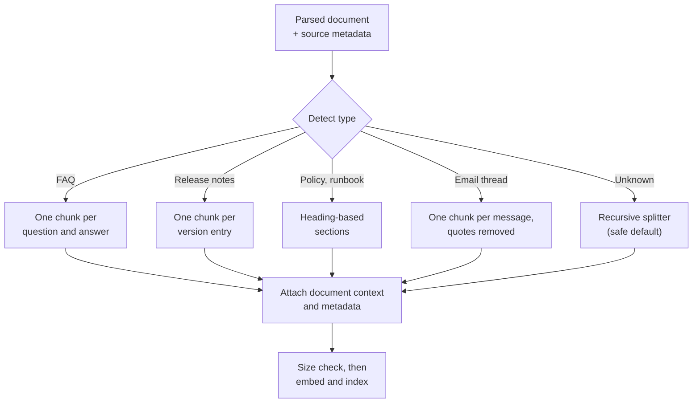

A real knowledge base is not one kind of text. AskMeridian indexes an employee handbook written in long prose sections, an IT FAQ made of short question-and-answer pairs, release notes organised by version, runbooks made of numbered procedures, and email threads full of quoted replies. A single splitter with a single configuration treats all of them as an undifferentiated stream of characters, and it gets most of them slightly wrong.

**Document-aware chunking** means two things. First, the chunker knows *what kind of document* it is processing and chooses the chunking unit that suits that kind: a question with its answer, a version entry, a procedure, an email message. Second, every chunk knows *which document it came from*: its title, type, version and permissions travel with it, both as metadata and, where it helps retrieval, as a short header in the text that is embedded. This lesson builds a small document-aware chunking pipeline and shows, on a query you can run, what it fixes.

## Learning objectives

- Define document-aware chunking and distinguish it from structure-aware and heading-based chunking.
- Identify the natural retrieval unit for common document types (FAQ, release notes, policy, runbook, email, transcript, slides, spreadsheet).
- Implement a router that detects a document's type, dispatches it to a type-specific chunker and falls back safely.
- Attach document-level context to each chunk, keeping the text that is shown separate from the text that is embedded.
- Explain the cost and security implications of propagating document metadata into chunks.

## Prerequisites

- [Recursive character splitting](/learn/advanced-chunking-strategies/recursive-character-splitting): the general-purpose fallback used here for prose.
- [Document classification](/learn/document-engineering/document-classification) and [Document metadata](/learn/document-engineering/document-metadata): how a document's type and attributes are determined before chunking.
- [Why chunking matters](/learn/chunking-fundamentals/why-chunking-matters): what a chunk is for.

## Why this matters

Every chunking decision is a bet on what a good answer looks like. For an FAQ, the answer to a user's question is almost always exactly one question-and-answer pair: no more, no less. For release notes it is one version's entry. For a policy it is a section. A size-driven splitter ignores those units, and the damage shows up in three ways.

**Units are merged.** Two short FAQ entries fit into one 300-character chunk, so the chunk about passwords also contains the answer about the VPN. Its embedding is a blend of both topics, and when it is retrieved, the generator receives an irrelevant answer alongside the relevant one.

**Units are split.** A long procedure is cut halfway, so step 6 and its warning end up in different chunks.

**Units lose their identity.** The chunk "## 3.1.0 — Added delivery receipts for direct messages" does not say which product it describes. If Meridian Sync and Meridian Relay both have a version 3.1.0, a question about "Relay 3.1.0" has nothing in the chunk text to match on. The product name lives in the document title, and the splitter threw the title away.

The third problem is the least visible and often the most damaging. A chunk is retrieved *out of context*: the retriever sees it alone, and so does the generator. Any fact needed to interpret the chunk that lives elsewhere in the document (the product, the policy's effective date, whether this is the current or a superseded handbook) is lost unless you put it back.

## The intuition

Think of a librarian asked to cut a pile of documents into index cards, one idea per card. A careless librarian cuts every document into cards of equal height. A good librarian looks at each document first. A dictionary is cut into entries, a recipe book into recipes, a newspaper into articles, a letter is usually kept whole. And on every card, the good librarian writes a small label in the corner: "Cookbook, p. 34, Desserts". Someone pulling a card out of the box months later knows immediately what it is and where it came from.

Document-aware chunking is the good librarian. The look at each document is *routing*. The cut into entries or recipes is choosing the *natural unit*. The label in the corner is *document context*.

## How it works

### Where it sits

Document-aware chunking is a layer *above* the splitters you already know. It decides which splitter to use, with what settings, and what to attach to the results. It is related to, but different from, the next two lessons in this module:

- **Document-aware** (this lesson): the strategy depends on the document's *type* and genre, and chunks carry document-level context.
- **[Structure-aware](/learn/advanced-chunking-strategies/structure-aware-chunking)**: within one document, boundaries follow the parsed elements (paragraphs, lists, tables, code blocks), and some elements are never split.
- **[Heading-based](/learn/advanced-chunking-strategies/heading-based-chunking)**: within one document, boundaries follow the heading hierarchy, and each chunk carries its heading path.

In a production pipeline all three usually work together: the router sends a handbook to a heading-based chunker, which uses structure-aware rules inside each section and a recursive splitter as the last resort.



### Step 1: detect the document type

The router needs a type for each document. In order of reliability:

1. **Facts from the source system.** The connector knows that a page came from the IT FAQ space in the wiki, that a file is the `CHANGELOG.md` of a repository, or that an item is an email. This is the best signal, because it was not guessed. Capture it at ingestion ([document metadata](/learn/document-engineering/document-metadata)).
2. **Format.** The MIME type or file extension separates slides, spreadsheets, emails and code from prose, though not an FAQ from a policy.
3. **Templates and naming conventions.** Many organisations write documents from templates: every runbook starts with "Purpose" and "Steps", every release note with a version heading.
4. **Content sniffing.** Regular expressions or a small classifier on the text: several lines starting with `Q:`, version headings matching `## \d+\.\d+`, `From:` and `Sent:` headers. Useful as a fallback, but fragile; a policy document that quotes two FAQ entries should not be chunked as an FAQ.
5. **An LLM classifier**, for corpora with many types and no metadata. Accurate but slower and more expensive; cache the result per document version.

Whatever the method, there must be a **default route** for documents that match nothing, and that default must be safe: a well-configured recursive splitter. A wrong specialised strategy usually does more harm than the generic one, so the router should be conservative.

### Step 2: choose the natural unit for each type

The natural unit is the smallest piece that answers a typical question *on its own*. Some common choices:

| Document type | Natural unit | Notes |
| --- | --- | --- |
| FAQ | One question with its answer | Keep the question in the chunk: it is the best match for user queries. |
| Release notes, changelog | One version entry | Record the version and date as metadata. |
| Policy, handbook | One section | Use [heading-based chunking](/learn/advanced-chunking-strategies/heading-based-chunking); split long sections. |
| Runbook | One procedure | Never separate a step from its warning. |
| Email thread | One message, quoted text removed | Quoted replies duplicate earlier messages and pollute rankings. |
| Chat export | One thread or conversation window | Group by thread before any splitting. |
| Meeting transcript | Topic segment of speaker turns | Structure is weak: a case for [semantic chunking](/learn/advanced-chunking-strategies/semantic-chunking). |
| Slide deck | One slide, with speaker notes | Slide titles are strong headings. |
| Spreadsheet, CSV | Groups of rows, with the header repeated | See [table chunking](/learn/advanced-chunking-strategies/table-chunking). |
| Source code | Function or class | See [code chunking](/learn/advanced-chunking-strategies/code-chunking). |
| Contract | Clause, with its number | Clause numbers are cross-referenced; keep them. |

Two rules apply across types. **Short documents stay whole**: if a document is shorter than your target chunk size, splitting it can only lose context. And **every natural unit still needs a size check**: an FAQ answer can be 2,000 words long, in which case it is split further (with the question repeated in each part).

### Step 3: carry document context into every chunk

A chunk has two texts, and keeping them separate is the most useful habit in this lesson:

- The **display text** is the original passage. It is what the generator quotes and what the user sees in a citation.
- The **index text** is what is embedded (and, for lexical search, tokenised). It is the display text plus a short **context header**: the document title, the unit's label (for example "version 3.1.0" or "FAQ entry"), and sometimes the heading path or effective date.

The header puts back exactly the facts the chunk lost when it was cut out of its document. "Meridian Relay release notes (version 3.1.0)" lets the query "Relay 3.1.0" match, lexically and semantically. Keep it short: a header of 10 to 20 tokens on a 300-token chunk barely shifts the embedding towards the title, whereas a 100-token header of boilerplate makes every chunk from the same document look alike.

Alongside the text, every chunk carries **metadata** copied from its document: `doc_id`, `title`, `type`, `version` or effective date, `source_url`, and, critically, access-control information. Metadata is not embedded; it is stored in the vector database's payload and used for [filtering](/learn/vector-database-fundamentals/filtering), for citations, and for deleting or replacing all chunks of a document when it changes.

A more elaborate version of the context header asks an LLM to write a sentence or two situating each chunk within its document before embedding it. That technique, contextual retrieval, is covered in [Contextual retrieval](/learn/advanced-retrieval/contextual-retrieval). The deterministic header in this lesson costs nothing per chunk and should be in place first.

### Step 4: check and record

After chunking, the pipeline checks every chunk against the embedding model's token limit, splits any that exceed it with the fallback splitter, and records which strategy produced each chunk (`kind` in the code below). That last field is invaluable later: when retrieval quality drops for one type of document, you can see which strategy produced the chunks involved.

## In code

**The problem.** Four Meridian documents of three different types (an IT FAQ, two products' release notes and a handbook section) are chunked twice: by one recursive splitter for everything, and by a document-aware router with a context header. Two queries test the difference with BM25 lexical retrieval, which makes the effect of each word in the chunk easy to reason about.

**Dependencies.** `langchain-text-splitters` for the prose fallback and `rank-bm25` for retrieval. No API key and no model download.

```bash
pip install langchain-text-splitters rank-bm25
```

```python
import re
from dataclasses import dataclass, field
from langchain_text_splitters import RecursiveCharacterTextSplitter
from rank_bm25 import BM25Okapi

DOCS = [
    {"id": "it-faq", "title": "IT help: frequently asked questions", "source": "confluence",
     "text": """Q: How often must I change my password?
A: Every 90 days. The portal reminds you a week before it expires.

Q: Do I need the VPN at home?
A: Not on your home network. The VPN is required on public Wi-Fi, such as in cafés or hotels.

Q: What should I do if I lose my laptop?
A: Report it to the support desk at once, by phone if you cannot sign in."""},
    {"id": "sync-release-notes", "title": "Meridian Sync release notes", "source": "github",
     "text": """## 3.2.0 (2025-06-02)
- Added resumable uploads for files over 2 GB.
- Fixed a crash when a shared folder was renamed during sync.

## 3.1.0 (2025-03-11)
- Added selective sync for team folders.
- Removed support for the legacy desktop agent."""},
    {"id": "relay-release-notes", "title": "Meridian Relay release notes", "source": "github",
     "text": """## 3.2.0 (2025-05-20)
- Added message retention policies per workspace.

## 3.1.0 (2025-02-04)
- Added delivery receipts for direct messages.
- Fixed duplicate notifications after reconnecting."""},
    {"id": "handbook-expenses", "title": "Employee handbook: Expenses", "source": "sharepoint",
     "text": """Expenses must be submitted within 30 days of being incurred, using the finance portal. Anything over £75 needs a receipt; a photograph of the receipt is acceptable. Claims submitted late are returned by the finance department with a note explaining why. Travel booked through the approved agency does not need to be claimed, because it is invoiced to Meridian directly."""},
]


@dataclass
class Chunk:
    doc_id: str
    text: str                                     # what the reader sees and the LLM quotes
    meta: dict = field(default_factory=dict)

    def embed_text(self, doc_title):
        """What the retriever indexes: the chunk plus a short context header."""
        unit = f" ({self.meta['unit']})" if "unit" in self.meta else ""
        return f"{doc_title}{unit}\n{self.text}"


# ---- one strategy per kind of document -------------------------------------
def chunk_faq(doc):
    pairs = re.split(r"\n\s*\n(?=Q:)", doc["text"].strip())          # one Q&A per unit
    return [Chunk(doc["id"], p.strip(), {"unit": "FAQ entry"}) for p in pairs]


def chunk_release_notes(doc):
    entries = re.split(r"\n(?=## )", doc["text"].strip())              # one version per unit
    out = []
    for e in entries:
        version = re.match(r"## (\S+)", e).group(1)
        out.append(Chunk(doc["id"], e.strip(), {"unit": f"version {version}", "version": version}))
    return out


prose_splitter = RecursiveCharacterTextSplitter(
    separators=["\n\n", "\n", ". ", " ", ""], keep_separator="end",
    chunk_size=300, chunk_overlap=0,
)

def chunk_prose(doc):
    return [Chunk(doc["id"], t) for t in prose_splitter.split_text(doc["text"])]


def detect_kind(doc):
    """Prefer facts from the source system; sniff the text only as a fallback."""
    if doc["source"] == "github" and "release notes" in doc["title"].lower():
        return "release_notes"
    if len(re.findall(r"^Q:", doc["text"], flags=re.M)) >= 2:
        return "faq"
    return "prose"


STRATEGIES = {"faq": chunk_faq, "release_notes": chunk_release_notes, "prose": chunk_prose}


def document_aware_chunks(docs):
    chunks = []
    for doc in docs:
        kind = detect_kind(doc)
        for c in STRATEGIES[kind](doc):
            c.meta.update(kind=kind, title=doc["title"])
            chunks.append(c)
    return chunks


def naive_chunks(docs):
    """The baseline: one recursive splitter for everything, no context header."""
    return [Chunk(d["id"], t, {"title": ""}) for d in docs for t in prose_splitter.split_text(d["text"])]


def tok(s):
    return re.findall(r"\w+", s.lower())

QUERIES = ["what changed in relay 3.1.0", "do I need the VPN when working from home"]
for name, chunker in [("naive", naive_chunks), ("document-aware", document_aware_chunks)]:
    chunks = chunker(DOCS)
    print(f"=== {name}: {len(chunks)} chunks")
    if name == "document-aware":
        for c in chunks[3:5]:
            print("  embedded as:", repr(c.embed_text(c.meta["title"]))[:88] + "...")
    bm25 = BM25Okapi([tok(c.embed_text(c.meta["title"])) for c in chunks])
    for q in QUERIES:
        scores = bm25.get_scores(tok(q))
        best = chunks[int(scores.argmax())]
        print(f"  {q!r}\n    -> [{best.doc_id}] {best.text[:70]!r}")
```

```output
=== naive: 6 chunks
  'what changed in relay 3.1.0'
    -> [relay-release-notes] '## 3.2.0 (2025-05-20)\n- Added message retention policies per workspace'
  'do I need the VPN when working from home'
    -> [it-faq] 'Q: How often must I change my password?\nA: Every 90 days. The portal r'
=== document-aware: 9 chunks
  embedded as: 'Meridian Sync release notes (version 3.2.0)\n## 3.2.0 (2025-06-02)\n- Added resumable u...
  embedded as: 'Meridian Sync release notes (version 3.1.0)\n## 3.1.0 (2025-03-11)\n- Added selective s...
  'what changed in relay 3.1.0'
    -> [relay-release-notes] '## 3.1.0 (2025-02-04)\n- Added delivery receipts for direct messages.\n-'
  'do I need the VPN when working from home'
    -> [it-faq] 'Q: Do I need the VPN at home?\nA: Not on your home network. The VPN is '
```

**The important lines.**

- `Chunk.text` and `Chunk.embed_text(...)` are the two texts described in step 3. Only `embed_text` is indexed; `text` is what would be stored for display and citation.
- `re.split(r"\n\s*\n(?=Q:)", ...)` splits an FAQ only at a blank line *followed by* `Q:`. A blank line inside a long answer does not start a new unit.
- `chunk_release_notes` records the version both in the header and as structured metadata (`"version"`), so a later stage could filter on it exactly instead of relying on text matching.
- `detect_kind` checks the source system first and sniffs the text second, in the order recommended above. Anything unrecognised falls through to `"prose"`, the safe default.
- `c.meta.update(kind=kind, title=doc["title"])` stamps every chunk with the strategy that produced it and its document's title.

**What the output means.**

- **The Relay query.** The naive splitter packed both Relay versions into one chunk (the two entries total under 300 characters), so the top result *contains* the 3.1.0 entry but starts with 3.2.0. The generator would receive both versions and has to work out which lines belong to 3.1.0; a citation would point at a chunk about two releases. With document-aware chunking, the 3.1.0 entry is its own chunk, and its header "Meridian Relay release notes (version 3.1.0)" carries both "relay" and the version, so BM25 ranks it first.
- **The VPN query.** The naive splitter packed the password and VPN entries together, and that merged chunk ranked first. It does contain the answer, but half of it is about passwords. The document-aware version returns the single VPN entry.
- **Chunk count went up**, from 6 to 9, because natural units here are smaller than the size limit. That is common: document-aware chunking optimises for coherent units, not for filling chunks to capacity. The arithmetic of that trade-off is in the performance section below.
- The handbook section produced the same chunks in both runs: it is prose, so the router sent it to the same recursive splitter.

**Errors people commonly hit.**

- A type-specific splitter that crashes on a document that is *nearly* the expected type (a release-notes file whose first entry has no `## ` heading makes `re.match(...)` return `None` here). Wrap each strategy so that an exception falls back to the default strategy and is logged, rather than failing the whole ingestion run.
- Putting the context header into the display text. Citations then show "Meridian Relay release notes (version 3.1.0)" pasted into the quotation, and the generator may quote the header as if it were content.
- Forgetting to re-chunk when routing rules change. Old chunks produced by the previous rules stay in the index; record the strategy and its version in metadata so you can find and rebuild them.

**Extending it.** Add an email strategy that splits a thread at `From:` headers and removes lines starting with `>` (quoted text), then add an email thread to `DOCS` and check that a query matching a quoted sentence returns the original message, not the reply that quotes it.

## A real-world example

The Platform team added the support desk's shared mailbox to AskMeridian so that staff could ask "has anyone had this problem before?". The first version used the same recursive splitter as the handbook. Within a week, the support desk lead reported that answers cited the wrong emails.

The team inspected the retrieved chunks for a dozen bad answers and found that most came from long reply chains. Each reply quoted the entire thread below it, so a single sentence from the original report ("Atlas shows E-4021 after the update") appeared in five or six emails. Every one of those chunks matched the query equally well, the top results were filled with near-duplicates, and the most recent reply (often just "Thanks, that fixed it" above a quoted history) was frequently cited as the source.

The fix was document-aware routing for the mailbox source. Email items were detected from the connector's metadata, not from their text. Each message was parsed into its own unit, quoted blocks and signatures were removed before chunking (the [cleaning](/learn/document-preprocessing/cleaning) step), and each chunk carried a header with the subject line and the sender's team, plus metadata linking it to its thread. Very short messages were attached to the message they replied to rather than indexed alone. The near-duplicate problem disappeared, citations pointed at the message that contained the information, and the subject-line header made the chunks findable by the terms staff actually used in their questions.

## Common mistakes

- **One configuration for every source.** Size-driven chunking merges FAQ entries, splits procedures and mixes versions; the damage is spread thinly enough that average metrics hide it.
- **Sniffing types from content when the source system already knows.** Text heuristics misroute edge cases; metadata from the connector does not.
- **No safe default route.** Unknown or malformed documents crash a specialised splitter or are silently skipped and never indexed.
- **Splitting short documents.** A 150-word announcement cut into three chunks loses context that the whole would have kept.
- **Dropping document identity.** Chunks without a title or product name cannot be matched to queries that name them, and cannot be filtered or cited.
- **Not propagating access-control metadata.** A chunk that loses its document's permissions can be shown to people who could not open the document.
- **Long, repetitive context headers.** Boilerplate headers make every chunk from a document embed alike and waste tokens.

## Best practices

- Capture document type and attributes at ingestion from the source system, and treat content sniffing as a fallback.
- Define a natural unit for each document type you index, write it down, and review it with people who know the documents.
- Keep display text and index text separate; prepend a short, factual context header only to the index text.
- Copy document metadata, including access-control fields and version, onto every chunk, and record which strategy (and which version of it) produced each chunk.
- Route anything unrecognised to a conservative recursive splitter, and log routing decisions so that misroutes can be found.
- Evaluate per document type: a labelled query set grouped by type shows which strategy needs work, where an overall average would not.

## Performance considerations

Routing itself is negligible: a dictionary lookup or a few regular expressions per document. The costs come from the chunks.

**Chunk count.** Natural units are often smaller than the size limit, so document-aware chunking usually produces more chunks. In the example, 9 instead of 6, a 50 percent increase. Embedding cost and index size scale with the number of tokens embedded and the number of vectors stored. If a corpus grows from 1 million to 1.5 million vectors of 384 float32 dimensions, raw vector storage grows from $10^6 \times 384 \times 4 = 1.54$ GB to about 2.3 GB, before index overhead.

**Header tokens.** A context header is embedded with every chunk. With an average chunk of 250 tokens and a 15-token header, embedding input grows by $15/250 = 6$ percent. With a 60-token header it grows by 24 percent, and the header starts to dominate short chunks. This is another reason to keep headers short.

**Per-type parsing.** Some strategies are expensive: parsing email MIME structure, rendering slides, or classifying types with an LLM. An LLM classification call per document is affordable for thousands of documents and noticeable for millions; cache classifications by document content hash so that unchanged documents are never reclassified.

## Security considerations

Document-aware chunking touches untrusted input and access control, so three points matter.

- **Permissions must follow the chunk.** Copy access-control metadata from the document to every chunk at chunking time, and filter on it at query time. A pipeline that adds a new type-specific strategy and forgets to copy the `allowed_groups` field creates a data leak that no test of retrieval quality will catch. Make permission fields mandatory in the chunk schema so that a chunk without them fails validation.
- **Do not let content choose its own route when it matters.** If routing relies on sniffing, a document author can make a document look like an FAQ or release notes and receive a different treatment, for example a different retention or redaction rule. Route on trusted metadata wherever the route has security consequences.
- **Headers are text the model will read.** A document title is controlled by whoever wrote the document. Putting it into every chunk's index text is fine, but if you also show headers to the generator, treat them with the same caution as any retrieved content.

## Summary

- Document-aware chunking chooses the chunking strategy from the document's type and keeps each chunk tied to its document.
- Each document type has a natural unit (a Q&A pair, a version entry, a section, a message) that answers a typical question on its own; short documents stay whole.
- A router detects the type, preferring source-system metadata, dispatches to a type-specific chunker, and falls back to a safe default.
- Separate display text from index text; a short context header restores the identity a chunk loses when it is cut from its document.
- Copy metadata, especially permissions and version, onto every chunk, and evaluate retrieval per document type.

## Exercises

**1.** For each document, name the natural unit and one piece of document context that should go into each chunk's header: (a) a 40-slide quarterly business review deck; (b) Meridian's 2023 employee handbook, which has been superseded; (c) a CSV export of the support desk's ticket categories.

<details><summary>Show solution</summary>

(a) One slide with its speaker notes; header: deck title and slide title (the quarter and date are useful metadata). (b) One section, via heading-based chunking; header: "Employee handbook (2023, superseded)", because its facts (a 4-year laptop cycle, a £250 equipment budget) contradict the current handbook and the generator must be able to tell them apart. Better still, mark it superseded in metadata and exclude it by default with a filter. (c) Groups of rows with the column header repeated in every chunk; header: the export's name and date.

</details>

**2.** The router in the code example detects an FAQ when at least two lines start with `Q:`. Give an example of a document that would be misrouted by this rule, and propose a more robust rule.

<details><summary>Show solution</summary>

A policy document containing a short "Common questions" appendix with two `Q:` lines would be routed to the FAQ strategy, and its prose sections would be split at blank lines followed by `Q:`, which never occur in the main text, so the whole policy would become one huge first "entry". A more robust rule uses source metadata first (the wiki space or template), and if sniffing is unavoidable, requires that most of the document consist of Q/A pairs, for example that `Q:` lines account for at least a third of non-empty lines and that every `Q:` is followed by an `A:`.

</details>

**3.** Add an email strategy to the code example. It should split a thread into messages at lines beginning with `From:`, drop lines beginning with `>`, and put the subject line into the context header. Test it on a two-message thread in which the reply quotes the original.

<details><summary>Show solution</summary>

```python
def chunk_email(doc):
    messages = re.split(r"\n(?=From: )", doc["text"].strip())
    out = []
    for m in messages:
        body = "\n".join(l for l in m.splitlines() if not l.startswith(">")).strip()
        subject = re.search(r"^Subject: (.*)$", m, flags=re.M)
        unit = f"email: {subject.group(1)}" if subject else "email"
        out.append(Chunk(doc["id"], body, {"unit": unit}))
    return out
```

Register it with `STRATEGIES["email"] = chunk_email` and add a branch in `detect_kind` that returns `"email"` when `doc["source"] == "mailbox"`. On a thread where the reply quotes the original with `>` lines, the reply's chunk now contains only the new text, so a query matching the original report returns the original message alone.

</details>

**4.** Design decision. AskMeridian must add Meridian Reports' API reference (one page per endpoint, each with a description, a parameter table and example requests) and its user guide (long prose with headings). Sketch the routing and units for both, and say what you would evaluate before launch.

<details><summary>Show solution</summary>

Route both by source metadata (they live in different documentation folders), not by sniffing.

- **API reference:** one chunk per endpoint if it fits, with header "Meridian Reports API: `GET /exports/{id}`". If an endpoint page is too long, split it into the description with the parameter table (tables kept whole, see [table chunking](/learn/advanced-chunking-strategies/table-chunking)) and the examples, repeating the endpoint name in each header. Store the endpoint path and HTTP method as metadata.
- **User guide:** heading-based chunking with a recursive fallback inside long sections; header with the guide title and heading path. Record the product plan where relevant (SAML single sign-on is an Enterprise-plan feature), so answers about it can say so.

Before launch, build a labelled set of questions of both kinds (endpoint lookups and how-to questions), measure Recall@K per document type, and read the top chunks for failures. Check that chunk token counts stay below the embedding model's limit.

</details>

## Check your understanding

```quiz
[
  {
    "q": "What distinguishes document-aware chunking from heading-based chunking?",
    "options": [
      "Document-aware chunking ignores headings entirely",
      "Document-aware chunking selects the strategy and unit from the document's type and keeps document context on each chunk; heading-based chunking splits within a document along its heading hierarchy",
      "Heading-based chunking only works on PDFs",
      "They are two names for the same technique"
    ],
    "answer": 1,
    "why": "Document-aware chunking is a routing and context layer above specific splitters; heading-based chunking is one of the strategies it may route to."
  },
  {
    "q": "Two products both have a version 3.1.0, and release-note chunks contain only the version entry. Which change most directly lets the query \"Relay 3.1.0\" find the right chunk?",
    "options": [
      "Increasing the chunk size so both products' notes share a chunk",
      "Adding more overlap between chunks",
      "Adding a context header with the product name and version to the index text of each chunk",
      "Removing version numbers from the chunks"
    ],
    "answer": 2,
    "why": "The product name was in the document title, not in the chunk. A short header restores it so both lexical and semantic matching can use it."
  },
  {
    "q": "Why should the context header be added to the index text but not the display text?",
    "options": [
      "Headers are invisible to embedding models",
      "Vector databases cannot store more than one text field",
      "Display text must always be under 100 characters",
      "So that citations and generated quotations show the original passage rather than a synthetic label"
    ],
    "answer": 3,
    "why": "The header exists to help retrieval. Mixing it into the passage shown to users and the generator distorts quotations."
  },
  {
    "q": "Which signal should a router trust most to decide a document's type?",
    "options": [
      "Facts recorded by the source system's connector, such as the wiki space or file role",
      "The first word of the document",
      "A regular expression counting lines that start with Q:",
      "The document's length"
    ],
    "answer": 0,
    "why": "Source-system facts were not guessed; content sniffing is a fallback that misroutes edge cases."
  },
  {
    "q": "A new type-specific chunker is added and a security review finds that some chunks can be retrieved by staff who cannot open the source document. What is the most likely cause?",
    "options": [
      "The chunks are too small",
      "The new strategy does not copy the document's access-control metadata onto its chunks",
      "BM25 ignores permissions",
      "The context header contains the document title"
    ],
    "answer": 1,
    "why": "Permissions must be propagated to every chunk; a strategy that forgets to copy them makes query-time filtering ineffective."
  }
]
```

## Further reading

- LangChain documentation, "Text splitters", in particular the sections on splitting by document structure and the format-specific splitters in `langchain-text-splitters`.
- LlamaIndex documentation, "Node parsers" (file-based and text-splitting parsers, and how nodes inherit document metadata): [docs.llamaindex.ai](https://docs.llamaindex.ai/).
- Unstructured documentation, "Chunking" (element-based chunking strategies that use document type and element metadata): [docs.unstructured.io](https://docs.unstructured.io/).
- Anthropic (2024). "Introducing Contextual Retrieval", engineering blog post describing LLM-generated chunk context: [anthropic.com/news/contextual-retrieval](https://www.anthropic.com/news/contextual-retrieval).
- Manning, C. D., Raghavan, P. and Schütze, H. (2008). *Introduction to Information Retrieval*, Cambridge University Press, chapter 10 ("XML retrieval"), on choosing retrieval units in structured documents.
