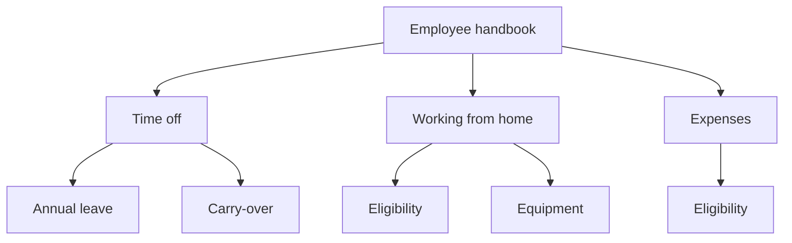

Authors already did the hardest part of chunking for you. When someone writes an employee handbook, they group related sentences under "Carry-over", group that with "Annual leave" under "Time off", and put "Time off" inside the handbook. Those headings are topic boundaries chosen by the person who understood the content best, and they are labels: each one says, in two or three words, what the text below it is about.

**Heading-based chunking** turns the heading hierarchy into chunk boundaries and chunk context. Each chunk is a section (or a group of subsections), and each chunk carries its **heading path**, such as "Employee handbook > Time off > Carry-over", so that it still makes sense when it is retrieved on its own. This lesson covers how to recover headings from different formats, how to build the section tree, how to choose which level of the tree becomes a chunk when sections vary wildly in size, and how to use the heading path in the index.

## Learning objectives

- Build a section tree from a sequence of headings and body text, and explain how the heading level determines nesting.
- Detect headings in DOCX, HTML, Markdown, PDF and plain text, and judge how reliable each source is.
- Implement size-adaptive heading-based chunking: keep a whole subtree when it fits, descend a level when it does not, and split oversized leaf sections with the title repeated.
- Use heading paths in the index text and in metadata, and explain why they disambiguate repeated headings such as "Eligibility".
- Diagnose the common failures: false headings, skipped levels, empty parent sections and fragment chunks.

## Prerequisites

- [Structure-aware chunking](/learn/advanced-chunking-strategies/structure-aware-chunking): chunking from parsed elements rather than plain text; this lesson focuses on one element type, the heading.
- [Recursive character splitting](/learn/advanced-chunking-strategies/recursive-character-splitting): the fallback for sections that are too long.
- [Markdown parsing](/learn/data-processing/markdown-parsing): the heading stack algorithm, traced step by step, which this lesson reuses.
- [Document-aware chunking](/learn/advanced-chunking-strategies/document-aware-chunking): context headers and display versus index text.

## Why this matters

Consider the sentence "Up to 5 unused days carry over and must be used by 31 March." Alone, it is ambiguous: days of what? Under the heading path "Employee handbook > Time off > Carry-over", it is unambiguous. A chunker that ignores headings creates three problems that heading-based chunking solves.

**Boundaries in the wrong places.** Size-driven splitters cut wherever the limit falls, so a chunk can contain the end of "Annual leave" and the start of "Working from home". Its embedding blends two topics and matches neither well.

**Lost context.** Even when a boundary falls in the right place, the chunk loses the headings above it. Many sections in real documents are written assuming the reader knows where they are: "Eligibility" sections that never repeat *for what*, "Exceptions" that never repeat *to which rule*.

**Ambiguous duplicates.** Large documents reuse subsection names. Meridian's handbook has an "Eligibility" section under "Working from home" and another under "Expenses". Without the path, a retriever sees two chunks that both start "Eligibility", and a generator that receives the wrong one gives a confident, wrong answer.

The heading hierarchy is free, author-provided structure. When documents have it, heading-based chunking is usually the strongest simple baseline, and it is the default for handbooks, policies, runbooks and product documentation.

## The intuition

Think of a book's table of contents. If someone asks you a question, you do not flip to a random page range of fixed length; you look up the chapter and section, and you read that section. If the section is short, you might read the whole chapter it belongs to. If the section is very long, you read the relevant part of it, but you still know which section you are in, because the section title is printed at the top of every page.

Heading-based chunking follows the same three habits. Prefer whole sections. Use a bigger unit (the whole chapter) when it is small enough to read at once. When a section is too long, split it, but print its title at the top of every part.

## How it works

### Sections form a tree

A **section** is a heading together with everything that follows it up to the next heading of the *same or a higher* level (a smaller number: level 1 is higher than level 2). Sections nest: a level-3 section sits inside the nearest level-2 section above it. The whole document is therefore a tree whose root is the document, whose internal nodes are sections with subsections, and whose leaves are sections with only body text.

Each section has its own **body** (text that appears after its heading but before its first subsection) and its **children** (subsections). A section can have both. A parent section with no body of its own, such as "Time off" immediately followed by "Annual leave", is common.

The tree is built in one pass with a **heading stack**: when a heading of level $n$ arrives, pop every open section of level $n$ or deeper, attach the new section to whatever is now on top of the stack, and push it. [Markdown parsing](/learn/data-processing/markdown-parsing) traces this algorithm step by step; the same code works for any format once headings and their levels have been identified.



### Finding the headings

Everything depends on recovering headings and their levels correctly. Sources differ greatly in how reliably they provide them:

- **DOCX.** Paragraph styles named "Heading 1", "Heading 2" and so on are explicit and reliable, *if authors used them*. Many do not; they make a paragraph bold and larger instead. A robust reader also treats short, bold, standalone paragraphs as candidate headings, with care.
- **HTML.** `h1` to `h6` elements are explicit, but sites misuse them for styling, and some use `div`s with classes instead. Check a sample per site.
- **Markdown.** `#` to `######` are explicit and reliable. The details (setext headings, `#` inside code fences) are covered in [Markdown chunking](/learn/advanced-chunking-strategies/markdown-chunking).
- **PDF.** A PDF has no headings, only text drawn in fonts at positions. Two sources help. Many PDFs carry an **outline** (bookmarks), which PyMuPDF exposes through `Document.get_toc()` as a list of level, title and page entries; when present, it is the best signal. Otherwise, headings are inferred from font size, weight and spacing: find the body-text font size (the most common one), and treat larger or bold short lines as headings, assigning levels by size. This is heuristic and should be checked on samples. [Layout-aware parsing](/learn/advanced-document-parsing/layout-aware-parsing) covers tools that do it with trained models.
- **Plain text.** Numbered headings ("3.2 Carry-over") are a strong signal, and the number gives the level directly (count the dots). ALL-CAPS lines and lines followed by a row of `=` or `-` characters are weaker signals.

### Choosing which level becomes a chunk

Once you have a tree, you must decide which nodes become chunks. There are two common approaches.

**Fixed-level splitting.** Split at one chosen level, for example every level-2 heading, and treat everything under it as one chunk. This is what LangChain's `MarkdownHeaderTextSplitter` and `HTMLHeaderTextSplitter` do: you pass `headers_to_split_on`, a list of the heading markers or tags to split at, and each resulting piece records the headings above it as metadata. It is simple and predictable, but section sizes in real documents vary by orders of magnitude, so one level gives some chunks of 20 tokens and some of 5,000. In practice its output is passed through a size-based splitter afterwards.

**Size-adaptive splitting.** Walk the tree from the top and take the **largest subtree that fits** within the size limit:

1. Start at the root.
2. If the current section's full text (its heading, body and all descendants) fits within the limit, emit it as one chunk and stop descending.
3. Otherwise, emit the section's own body (if any) as a chunk headed by its title, splitting it if it is too long.
4. Apply steps 2 to 4 to each child in order.
5. For any body that is still too long, split it with a recursive splitter and repeat the section title at the start of every part.
6. Attach the heading path to every chunk.

The result adapts to the document: a short chapter becomes one chunk containing all its subsections, while a long chapter is broken down to whichever level makes its pieces fit. This is the approach implemented in the code below.

A **bottom-up** variant starts from leaves and merges consecutive small siblings while the total fits, which avoids tiny chunks when a parent is too big but several of its children are small. Both have their place; the top-down version is easier to reason about and is a good default.

### Tiny and empty sections

Two degenerate cases need explicit rules.

- **Empty parents.** "Time off" has no body: its heading is immediately followed by "Annual leave". It produces no chunk of its own; its title survives in its children's paths.
- **Fragments.** A section whose body is one short line (a document's two-sentence introduction, a "Contact" section with an email address) becomes a tiny chunk. Merge it with the next sibling if both fit, or attach it to its parent's chunk, rather than indexing it alone. A chunk of 12 tokens embeds almost nothing but still competes for a top-k slot.

### The heading path in the index

Every chunk should carry its path in two forms:

- **As metadata**, a list such as `["Employee handbook", "Expenses", "Eligibility"]`. It is used for citations ("Employee handbook, section Expenses > Eligibility"), for filtering ("only the Expenses chapter"), and for fetching neighbouring sections or the whole parent section at query time, an idea developed in [parent-child chunking](/learn/chunking-optimisation/parent-child-chunking).
- **In the index text**, as a short breadcrumb prepended before embedding, for the reasons given in [document-aware chunking](/learn/advanced-chunking-strategies/document-aware-chunking): it restores the context that the chunk lost. Prepending only the *ancestors* (the chunk already starts with its own title) avoids repeating the title twice.

Keep breadcrumbs short. Deep documentation sites can produce six-level paths; the top level (the document title) and the two nearest ancestors usually carry most of the useful information.

## In code

**The problem.** Meridian's handbook arrives as a Word document. Read its heading styles, build the section tree, and produce heading-based chunks at two size limits, with the heading path attached and a recursive fallback for an oversized section.

**Dependencies.** `python-docx` to create and read the `.docx` file, `tiktoken` to count tokens and `langchain-text-splitters` for the fallback. No API key and no model download. The script writes the document itself, so it needs no input file; the very small limits are chosen so that a short document exercises every rule.

```bash
pip install python-docx tiktoken langchain-text-splitters
```

```python
import io
import re
from dataclasses import dataclass, field
import docx                                         # python-docx
import tiktoken
from langchain_text_splitters import RecursiveCharacterTextSplitter

# ---- Build a small handbook as a real .docx file (stands in for an upload) ----
def make_handbook():
    d = docx.Document()
    d.add_heading("Employee handbook", level=1)
    d.add_paragraph("This handbook applies to all Meridian employees.")
    d.add_heading("Time off", level=2)
    d.add_heading("Annual leave", level=3)
    d.add_paragraph("Every employee receives 25 days of annual leave per year.")
    d.add_heading("Carry-over", level=3)
    d.add_paragraph("Up to 5 unused days carry over and must be used by 31 March.")
    d.add_heading("Working from home", level=2)
    d.add_heading("Eligibility", level=3)
    d.add_paragraph("Staff may work remotely up to 3 days a week, agreed with their manager.")
    d.add_heading("Equipment", level=3)
    d.add_paragraph("The home-office equipment budget is £400. Contractors are not eligible "
                    "for it. Purchases must be made through the approved supplier, and items "
                    "remain Meridian property. Return them when you leave or when the laptop "
                    "refresh cycle of 3 years replaces your setup.")
    d.add_heading("Expenses", level=2)
    d.add_heading("Eligibility", level=3)
    d.add_paragraph("Expenses must be submitted within 30 days. Anything over £75 needs a receipt.")
    buf = io.BytesIO()
    d.save(buf)
    return buf.getvalue()


# ---- 1. Read headings and body from paragraph styles --------------------------
def read_blocks(data):
    blocks = []
    for p in docx.Document(io.BytesIO(data)).paragraphs:
        m = re.fullmatch(r"Heading (\d)", p.style.name)
        if m:
            blocks.append(("heading", int(m.group(1)), p.text))
        elif p.text.strip():
            blocks.append(("text", None, p.text))
    return blocks


# ---- 2. Build the section tree with a heading stack ---------------------------
@dataclass
class Section:
    title: str
    level: int
    path: list
    body: list = field(default_factory=list)
    children: list = field(default_factory=list)

def build_tree(blocks):
    root = Section("", 0, [])
    stack = [root]
    for kind, level, text in blocks:
        if kind == "heading":
            while stack[-1].level >= level:          # close siblings and deeper sections
                stack.pop()
            node = Section(text, level, stack[-1].path + [text])
            stack[-1].children.append(node)
            stack.append(node)
        else:
            stack[-1].body.append(text)
    return root


# ---- 3. Emit chunks: whole subtree if it fits, otherwise go one level down ----
enc = tiktoken.get_encoding("cl100k_base")
ntok = lambda s: len(enc.encode(s))

def render(sec):
    """A section's full text including its subsections."""
    parts = [sec.title] + sec.body if sec.title else list(sec.body)
    return "\n".join(parts + [render(c) for c in sec.children])

def emit(sec, body, max_tokens, out):
    """Add one chunk headed by the section title; split the body if it is too long."""
    path, text = " > ".join(sec.path), "\n".join([sec.title] + body)
    if ntok(text) <= max_tokens:
        out.append((path, text))
        return
    splitter = RecursiveCharacterTextSplitter(            # fallback inside one section
        separators=["\n", ". ", " ", ""], keep_separator="end", chunk_overlap=0,
        chunk_size=max_tokens - ntok(sec.title) - 1, length_function=ntok)
    for n, part in enumerate(splitter.split_text("\n".join(body)), 1):
        out.append((f"{path} (part {n})", f"{sec.title}\n{part}"))   # title repeated

def chunk(sec, max_tokens, out):
    if sec.title and ntok(render(sec)) <= max_tokens:
        out.append((" > ".join(sec.path), render(sec)))   # the whole subtree fits
        return out
    if sec.body:                                          # own text, before subsections
        emit(sec, sec.body, max_tokens, out)
    for child in sec.children:
        chunk(child, max_tokens, out)
    return out


def index_text(path, text):
    """What gets embedded: the breadcrumb of parent headings, then the chunk."""
    parents = path.rsplit(" > ", 1)[0] if " > " in path else ""
    return f"[{parents}]\n{text}" if parents else text


tree = build_tree(read_blocks(make_handbook()))
for limit in (120, 24):
    chunks = chunk(tree, limit, [])
    print(f"--- max {limit} tokens: {len(chunks)} chunks")
    for path, text in chunks:
        print(f"{ntok(text):>4}  {path}")

path, text = chunks[-1]
print("\nembedded text of the last chunk:")
print(index_text(path, text))
```

```output
--- max 120 tokens: 4 chunks
  12  Employee handbook
  39  Employee handbook > Time off
  79  Employee handbook > Working from home
  25  Employee handbook > Expenses
--- max 24 tokens: 8 chunks
  12  Employee handbook
  15  Employee handbook > Time off > Annual leave
  21  Employee handbook > Time off > Carry-over
  21  Employee handbook > Working from home > Eligibility
  18  Employee handbook > Working from home > Equipment (part 1)
  19  Employee handbook > Working from home > Equipment (part 2)
  21  Employee handbook > Working from home > Equipment (part 3)
  22  Employee handbook > Expenses > Eligibility

embedded text of the last chunk:
[Employee handbook > Expenses]
Eligibility
Expenses must be submitted within 30 days. Anything over £75 needs a receipt.
```

**The important lines.**

- `re.fullmatch(r"Heading (\d)", p.style.name)` reads the level from Word's built-in heading styles. `python-docx`'s `add_heading(text, level=n)` applies the style "Heading n", which is what a person using Word's style gallery produces. Paragraphs with other styles are body text.
- In `build_tree`, `while stack[-1].level >= level: stack.pop()` is the heading-stack rule. The root has level 0, so it is never popped.
- `chunk` implements the top-down, largest-subtree-that-fits rule. `render(sec)` is the section's full text including all descendants; if it fits, the whole subtree is one chunk.
- `emit` handles a section's own body. If it is too long, the recursive splitter gets a budget reduced by the title's token count, and the title is prepended to every part, so no part is a headless fragment.
- `index_text` prepends only the ancestors as a breadcrumb, because the chunk text already begins with the section's own title.

**What the output means.**

- **At 120 tokens**, every level-2 section fits whole, so the chunker stops at level 2: "Time off" becomes one chunk containing both "Annual leave" and "Carry-over", and "Working from home" one chunk of 79 tokens. The whole handbook (over 120 tokens) did not fit, so the root was opened and its own introduction became a separate chunk.
- **At 24 tokens**, the chunker descends to level 3 wherever a level-2 section is too big. "Equipment" is still too long as a leaf, so its body is split into three parts, each starting with "Equipment" and each labelled with its part number in the path.
- **The two "Eligibility" chunks** have the same title and similar wording, but different paths. The embedded text of the last chunk begins "[Employee handbook > Expenses]", so a query about expenses eligibility can match it, and a citation can name the right section.
- **The 12-token introduction** ("This handbook applies to all Meridian employees.") is a fragment, indexed alone at both limits. A merge rule for small sections would attach it to the first child; exercise 2 asks you to add one.
- Notice that the size-adaptive rule produced *different* granularity for different parts of the same document. That is the point: the chunk boundary follows the structure as far down as necessary, and no further.

**Errors people commonly hit.**

- Documents whose authors never used heading styles. `read_blocks` then finds no headings, the root's body is the whole document, and the chunker falls back to splitting everything recursively. Log the number of headings found per document so that this is visible.
- Custom or localised style names. A German Word installation, or a corporate template, may use names other than "Heading 1"; inspect `p.style.name` on samples, and consider reading the style's outline level instead.
- Text in tables. `Document.paragraphs` returns only body paragraphs, not the paragraphs inside tables; tables are reached through `Document.tables`. A reader that ignores them silently drops content (the structure-aware lesson discusses tables as elements).
- Skipped levels (a level-1 heading followed directly by level 3). The stack handles them correctly, but a fixed-level splitter configured for level 2 will not split there at all.

**Extending it.** For Markdown and HTML sources, compare this chunker with LangChain's `MarkdownHeaderTextSplitter` and `HTMLHeaderTextSplitter`, which take `headers_to_split_on` (for example `[("#", "Header 1"), ("##", "Header 2")]`) and return pieces whose metadata holds the headings above them; pass their output through a recursive splitter for size control. For PDFs, read the outline with PyMuPDF's `Document.get_toc()` and use its titles and page numbers to locate section starts.

## A real-world example

The HR team asked why AskMeridian kept answering questions about expense eligibility with the rules for working from home. The Platform team's logs showed the query "who is eligible to claim expenses?" retrieving a chunk that began "Eligibility. Staff may work remotely up to 3 days a week". The handbook had been chunked recursively at 500 tokens, and both "Eligibility" sections had ended up at the starts of chunks with their parent headings in other chunks. The embeddings of the two "Eligibility" chunks were close to each other, and the remote-work one happened to rank higher.

The team switched the handbook to heading-based chunking using the DOCX heading styles, with the ancestors' breadcrumb prepended to the index text. Two problems appeared immediately when they read the new chunks. First, the 2023 handbook, still in the index for historical questions, had been written without heading styles: its section titles were bold body text, so it produced no headings and came through as one giant root body. The team added a fallback that treated short, bold, standalone paragraphs as headings, and verified the resulting tree for that document by hand. They also tagged every chunk from the 2023 handbook with its edition in metadata and in the breadcrumb ("Employee handbook (2023, superseded)"), because its laptop cycle, equipment budget and support hours contradict the current edition. Second, the root introduction and several one-line "Contact" sections became fragment chunks; a merge rule attached each to its next sibling.

The eligibility question now retrieves "[Employee handbook > Expenses] Eligibility...", and answers cite the section by its full path, which the HR team found more useful than the chunk text itself when checking answers.

## Common mistakes

- **Fixed-level splitting without a size check.** Sections vary from a sentence to many pages; one level produces fragments and giants at the same time.
- **Splitting an oversized section without repeating its title.** The later parts become headless fragments, exactly what heading-based chunking was meant to prevent.
- **Dropping the heading path.** Chunks with duplicate titles become indistinguishable, and citations cannot point to a section.
- **Trusting headings blindly.** Bold text used for emphasis, headings used for styling in HTML, and PDF font heuristics all create false headings; documents without styles create none.
- **Indexing empty and tiny sections alone.** They waste top-k slots and embed almost no content.
- **Very long breadcrumbs.** A six-level path on every chunk adds tokens and makes all chunks from one chapter look alike to the embedding model.

## Best practices

- Prefer explicit structure (heading styles, `h` tags, Markdown headings, PDF outlines) and fall back to inferred headings only with checks on sample documents.
- Use size-adaptive selection: the largest subtree that fits, descending only where necessary.
- Repeat the section title at the start of every part of a split section, and record the part number.
- Store the full heading path as metadata and prepend a short ancestor breadcrumb to the index text.
- Merge fragment sections with a sibling or their parent; never index a section that is just a heading.
- Log, per document, the number of headings found and the depth of the tree; a document with zero headings or one with hundreds of single-line sections needs attention.

## Performance considerations

Building the tree is a single linear pass over the document's blocks. The chunker as written calls `render` and counts tokens for a subtree at every level it visits, so a deep document can be tokenised several times: once at the root, again for each child, and so on. The cost is proportional to the document length multiplied by the depth of the tree that is actually visited, typically three or four levels, so it is a small constant factor. For very large documents, compute each node's token count once, bottom-up, and sum the counts of children instead of re-rendering text.

The breadcrumb adds embedding cost in proportion to its length. With an average chunk of 300 tokens and a 12-token breadcrumb, embedding input grows by $12/300 = 4$ percent; a 40-token breadcrumb would add about 13 percent. Size-adaptive chunking also produces chunks of uneven length; if your embedding provider charges per token, cost depends on total tokens, not on the number of chunks, so the unevenness itself does not raise the bill, but fragments and repeated titles do.

## Summary

- Headings are author-chosen topic boundaries and labels; heading-based chunking turns the heading hierarchy into a section tree, chunk boundaries and chunk context.
- Heading reliability depends on the source: DOCX styles, HTML tags and Markdown are explicit; PDFs need outlines or font heuristics; plain text needs numbering patterns.
- Size-adaptive chunking takes the largest subtree that fits, descends where it does not, and splits oversized leaves with the title repeated in every part.
- The heading path disambiguates repeated titles such as "Eligibility"; store it as metadata and prepend a short breadcrumb to the index text.
- Merge fragments and handle documents without headings explicitly, rather than letting them become one giant section.

## Exercises

**1.** A document has these headings and token counts (each count includes the heading and the section's own body, not its subsections): `# Guide` (10), `## Install` (40), `### Linux` (90), `### macOS` (70), `## Upgrade` (60). With a 150-token limit and the top-down rule from the lesson, which chunks are produced?

<details><summary>Show solution</summary>

The whole document is $10 + 40 + 90 + 70 + 60 = 270$ tokens, which does not fit, so the root `Guide` emits its own body (10 tokens) and descends. `Install` with its subtree is $40 + 90 + 70 = 200$, which does not fit, so `Install` emits its own body (40 tokens) and descends: `Linux` (90) and `macOS` (70) each fit and become chunks. `Upgrade` (60) fits. Result: Guide (10), Install (40), Install > Linux (90), Install > macOS (70), Upgrade (60). The first two are small and are candidates for merging with their first child.

</details>

**2.** Add a merge rule to the code so that a section's own body under 20 tokens is not emitted alone but prepended to its first child's chunk. Which chunks change at the 24-token limit?

<details><summary>Show solution</summary>

One approach: in `chunk`, when `sec.body` is shorter than 20 tokens and `sec.children` is not empty, pass the body down to the first child (for example as an extra `prefix` argument) instead of calling `emit`; the child then includes the prefix at the start of its text when emitting. At the 24-token limit, the root introduction (12 tokens) moves into the first leaf below it, "Time off > Annual leave", which grows from 15 to exactly 24 tokens (measured with the same tokeniser): it just fits. One more word in either text and it would not, so a careful implementation checks the size after merging and either skips the merge or lets the child split. Merge rules always need that check. The other chunks are unchanged, and the chunk count falls from 8 to 7.

</details>

**3.** A PDF has no outline. Its body text is 10-point regular, and the parser reports lines in 16-point bold, 13-point bold, 10-point bold and 10-point regular. Propose a heading detector and name two ways it could go wrong.

<details><summary>Show solution</summary>

Take the most common font size (10 points) as body text. Treat short lines (for example under about 12 words, not ending in a full stop) in larger fonts as headings, assigning level 1 to 16-point and level 2 to 13-point. Treat 10-point bold short standalone lines as possible level-3 headings, but only if they are followed by regular body text.

Failure modes: bold text used for emphasis at the start of a paragraph ("**Note:** the VPN...") is mistaken for a heading; table headers or figure captions in bold are mistaken for headings; running headers and footers in a larger font repeat on every page and create hundreds of false sections (remove them first, see [header and footer removal](/learn/document-preprocessing/header-and-footer-removal)); and a document using a different body size on some pages throws off the size ranking.

</details>

**4.** Design decision. The Atlas documentation site has five heading levels and thousands of pages. Pages vary from 50 to 8,000 tokens. You must choose between fixed-level splitting at `h2` followed by a recursive splitter, and the size-adaptive tree approach. Which do you choose, and how do you build the breadcrumb?

<details><summary>Show solution</summary>

Size-adaptive. With pages from 50 to 8,000 tokens, fixed `h2` splitting produces whole-page chunks for short pages (fine) but very long `h2` sections on large pages, which the recursive splitter then cuts at arbitrary paragraph boundaries, ignoring the `h3` to `h5` structure that exists inside them. The size-adaptive approach descends into exactly those large sections and uses their sub-headings as boundaries.

For the breadcrumb, use the page title plus the two nearest ancestor headings (for example "Atlas docs: Error codes > VPN errors"), not all five levels, to keep it short and distinctive. Store the full path as metadata for citations and filtering. Validate on a labelled query set that includes pages of both extremes of length.

</details>

## Check your understanding

```quiz
[
  {
    "q": "In a section tree, which section does a level-3 heading belong to?",
    "options": [
      "The nearest preceding level-2 section, or a higher-level section if no level-2 section is open",
      "The first level-1 section in the document",
      "The next level-2 section that follows it",
      "None: level-3 headings are always treated as body text"
    ],
    "answer": 0,
    "why": "Sections nest under the nearest open section of a higher level, which the heading stack tracks."
  },
  {
    "q": "With size-adaptive heading-based chunking, a chapter and all its subsections total 300 tokens and the limit is 500. What happens?",
    "options": [
      "Each subsection becomes its own chunk",
      "The chapter is split by a recursive splitter into 500-token pieces",
      "The whole chapter, with its subsections, becomes one chunk",
      "Only the chapter heading is indexed"
    ],
    "answer": 2,
    "why": "The rule takes the largest subtree that fits and stops descending there."
  },
  {
    "q": "Two chunks both begin \"Eligibility\", one from the remote-work chapter and one from the expenses chapter. What best helps retrieval tell them apart?",
    "options": [
      "Larger chunk overlap",
      "Removing the word \"Eligibility\" from both",
      "A higher embedding dimension",
      "Prepending each chunk's ancestor heading path to its index text and storing the path as metadata"
    ],
    "answer": 3,
    "why": "The breadcrumb restores the context that distinguishes the sections, for both matching and citation."
  },
  {
    "q": "A long leaf section is split into three parts by the fallback splitter. What should each part start with?",
    "options": [
      "Nothing extra: repeating text wastes tokens",
      "The section's title (and its path in metadata), so no part is a headless fragment",
      "The full text of the previous part",
      "The document's first paragraph"
    ],
    "answer": 1,
    "why": "Repeating the title keeps each part interpretable on its own, which is the purpose of heading-based chunking."
  },
  {
    "q": "Which source gives the most reliable headings for a PDF, when it is available?",
    "options": [
      "The PDF outline (bookmarks), for example from PyMuPDF's get_toc()",
      "The most common font size on the page",
      "Every line in bold",
      "Lines in capital letters"
    ],
    "answer": 0,
    "why": "The outline is explicit structure written by the authoring tool; font-based inference is heuristic."
  }
]
```

## Further reading

- LangChain documentation, "How to split Markdown by headers" and "How to split by HTML header" (`MarkdownHeaderTextSplitter`, `HTMLHeaderTextSplitter` in `langchain-text-splitters`).
- `python-docx` documentation, "Working with Styles": [python-docx.readthedocs.io](https://python-docx.readthedocs.io/).
- PyMuPDF documentation, `Document.get_toc()` and text extraction with font information: [pymupdf.readthedocs.io](https://pymupdf.readthedocs.io/).
- Unstructured documentation, "Chunking" (`chunk_by_title`): [docs.unstructured.io](https://docs.unstructured.io/).
- Manning, C. D., Raghavan, P. and Schütze, H. (2008). *Introduction to Information Retrieval*, Cambridge University Press, chapter 10 ("XML retrieval"), on choosing the right level of a document tree as the unit of retrieval.
