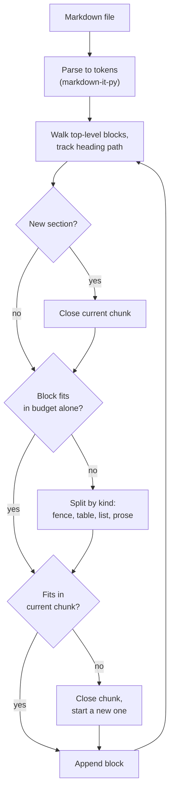

Markdown is the format in which a large share of engineering knowledge is written: README files, runbooks kept in Git, documentation sites, wiki exports, and the output of most PDF-to-text converters. It is also the format that generic splitters damage most visibly. A splitter that counts characters will cut a shell script in half, leave a heading stranded at the end of one chunk while its content starts the next, and separate a table's header row from the rows it labels.

This lesson teaches you which Markdown constructs must never be cut, how to pack the rest into token-budgeted chunks, what to do when one code block or table exceeds the budget, and how the common library splitters behave on a real runbook. Parsing Markdown into tokens was covered in [Markdown parsing](/learn/data-processing/markdown-parsing), and splitting by heading hierarchy in [Heading-based chunking](/learn/advanced-chunking-strategies/heading-based-chunking); here the focus is what is specific to Markdown: its block types.

## Learning objectives

- Identify the Markdown block types that must be treated as atomic during chunking, and explain the failure each one causes when cut.
- Implement a block-aware Markdown chunker that packs top-level blocks into chunks under a token budget without crossing section boundaries.
- Split an oversized fenced code block or table so that every piece is still valid Markdown and still readable on its own.
- Predict how `RecursiveCharacterTextSplitter.from_language(Language.MARKDOWN)` and `MarkdownHeaderTextSplitter` will treat a given document, including their failure modes.
- Choose what to embed and what to keep only as metadata (breadcrumbs, front matter, link targets) for a Markdown corpus.

## Prerequisites

- [Markdown parsing](/learn/data-processing/markdown-parsing): the CommonMark token stream, `markdown-it-py`, heading stacks and section records.
- [Recursive character splitting](/learn/advanced-chunking-strategies/recursive-character-splitting): the separator hierarchy that generic splitters use.
- [Heading-based chunking](/learn/advanced-chunking-strategies/heading-based-chunking): splitting by section and carrying the heading path.
- [Token-based chunking](/learn/chunking-fundamentals/token-based-chunking): why budgets are measured in tokens.

## Why this matters

When Meridian's engineers ask AskMeridian how to fix something, the answer they need is usually prose plus a command: "close the client, then run these three commands". In Markdown that is a paragraph followed by a fenced code block. If a chunk boundary falls inside the fence, three things go wrong. The retrieved chunk is **incomplete**, so the model answers with half a script or invents the rest. The chunk is **misread downstream**: one that begins mid-fence starts with a line such as `# clear the cached profile`, which any later stage that reads Markdown (a citation renderer, another splitter) treats as a level-1 heading. And the chunk is **hard to find**: the half holding the commands has no prose and no heading, so nothing in it says "VPN" or "macOS".

Tables fail in parallel. Cut a pipe table after its second data row and the next chunk holds rows such as `| E-4100 | Too many sessions | Disconnect another device |` with no header, so the model must guess which column is which.

None of these failures raises an error; answers just get worse. Markdown chunking makes them impossible by construction.

## The intuition

Think of a Markdown document as a stack of bricks of different kinds: paragraphs, lists, code listings, tables. A heading is not a brick; it is the label on the shelf the bricks sit on.

Chunking is packing bricks into boxes of a fixed size. A character splitter saws through the stack every 300 characters, whatever it hits. A Markdown chunker puts whole bricks into a box until the next one will not fit, then starts a new box. It never mixes bricks from two shelves in one box, and it writes the shelf label on every box. Only when a single brick is bigger than a whole box does it cut one, and then along the brick's natural seams: a code listing between lines, with its opening and closing fence repeated on each piece; a table between rows, with the header row repeated. Each piece is still a complete brick of the same kind.

## How it works

### Blocks are the unit, not characters

CommonMark divides a document into **blocks**: headings, paragraphs, block quotes, lists, fenced code blocks, indented code blocks, HTML blocks, thematic breaks (`---`), and, in GitHub Flavored Markdown, tables. As [Markdown parsing](/learn/data-processing/markdown-parsing) showed, a parser such as `markdown-it-py` reports each block as tokens, and the opening token carries a `map` field: the line range the block occupies in the source.

That line range makes block-aware chunking simple: instead of rebuilding Markdown from tokens, you slice the original lines. The chunk contains exactly what the author wrote, which matters for code (indentation is meaningful) and for citations (you can point to lines 12 to 19 of the file).

The blocks that matter for chunking fall into three groups:

| Group | Blocks | Rule |
| --- | --- | --- |
| Atomic | Fenced and indented code, tables, HTML blocks | Never split if it fits; if it must be split, split along its own seams and keep each piece valid |
| Splittable containers | Lists, block quotes | Keep whole if possible; otherwise split between items, never inside one |
| Prose | Paragraphs | Keep whole if possible; otherwise split between sentences |

Headings are not packed at all. They change the **section** the following blocks belong to, and the section's heading path becomes the chunk's breadcrumb.

### Only top-level blocks

Blocks nest. A list item can contain a paragraph and a code block; a block quote can contain a list. A chunker that treats every nested block as a separate brick will cut a list item away from the code block inside it, which is the same failure as before one level down. The rule that avoids this is: **pack top-level blocks only** (in `markdown-it-py`, tokens whose `level` is 0). A list is one brick, including everything nested inside it. A nested code block inside a list item is protected because the list as a whole is the unit.

### The packing algorithm

Given the token budget $B$ for a chunk:

1. Parse the document and walk the token stream, maintaining the heading path with a stack (the algorithm from [Markdown parsing](/learn/data-processing/markdown-parsing)).
2. For each top-level block that is not a heading, slice its source lines using `map` and record its kind (`paragraph`, `fence`, `table`, `bullet_list`, and so on) and the current heading path.
3. If the heading path differs from that of the chunk being built, close the current chunk. Chunks never span two sections.
4. Compute the breadcrumb cost $p$: the tokens of the heading path that will be prefixed to the chunk.
5. If the block alone exceeds $B - p$, split it with the rule for its kind (below) into pieces that each fit.
6. For each piece: if adding it to the current chunk would exceed $B$, close the chunk and start a new one. Append the piece.
7. When the document ends, close the last chunk. Prefix every chunk with its breadcrumb.



Step 3 means a section with one short paragraph becomes one short chunk. That is usually right, because the chunk is precise and carries a breadcrumb saying what it is about. Merging tiny sibling sections is a policy question that [Heading-based chunking](/learn/advanced-chunking-strategies/heading-based-chunking) discusses.

### Splitting an oversized block along its seams

**Fenced code.** A fence is an opening line (three backticks or tildes, optionally followed by a language name), the code, and a closing line. Split between lines, and repeat the opening line (with its language tag) and the closing line on every piece, so each piece is a valid code block that no later parser will misread. For real programming languages, consider a code-aware splitter instead ([Code chunking](/learn/advanced-chunking-strategies/code-chunking)).

**Tables.** A pipe table's first two lines are the header row and the delimiter row. Split between data rows and repeat both lines on every piece. Choosing how many rows go in a piece, and alternatives to pipe tables, is the subject of [Table chunking](/learn/advanced-chunking-strategies/table-chunking).

**Lists.** Split between top-level items. Numbered lists need care: a piece that starts at item 4 should keep its number (`4.`), because "step 4" is something people quote. CommonMark honours the start number of an ordered list, so slicing the original lines preserves it.

**Paragraphs.** Split between sentences. A paragraph larger than a whole chunk is rare in documentation; when you see many, the source is probably a converted PDF that lost its paragraph breaks, and the fix belongs in [Document preprocessing](/learn/document-preprocessing).

### The breadcrumb

The breadcrumb is the heading path joined into one line, such as `VPN runbook > Resetting the client on macOS`. Prefixed to the chunk text, it puts the section's subject into every chunk of the section, including later chunks of a long section that would otherwise carry no heading, and it gives lexical search the words in the headings, which are often the words users type.

The cost is tokens: a breadcrumb of $p$ tokens in a budget of $B$ is a fraction $p/B$ of overhead. A 20-token breadcrumb in a 400-token budget is 5 per cent; a 60-token breadcrumb in a 200-token budget is 30 per cent, and you should shorten the path, for example by dropping the document title. Store the path as metadata too, where it can be filtered on, shown in citations and changed without re-embedding.

### Front matter, links and other things that are not prose

- **YAML front matter** (owner, version, audience) belongs in metadata. Embedded, it puts the same keys atop every file's first chunk, making those chunks look alike.
- **Link targets** waste tokens; keep link text in the chunk and URLs in a list on the chunk record.
- **HTML comments** are invisible when rendered; drop them or index them deliberately (see the security section).
- **Images** keep their alt text, often the only description of the image.

### What the library splitters do

`RecursiveCharacterTextSplitter.from_language(Language.MARKDOWN)` is the [recursive splitter](/learn/advanced-chunking-strategies/recursive-character-splitting) with a Markdown separator list. In the installed version (`langchain-text-splitters` 1.1.3) the list is: a newline followed by one to six `#` and a space, a fence line, three kinds of horizontal rule, blank lines, newlines, spaces, and the empty string. These are regular expressions over raw text. They make heading lines preferred cut points, but **they cannot know whether a line is inside a code block**, so a shell comment inside a fence is used as a heading cut. The pieces get no repeated fence or table header and no heading metadata.

`MarkdownHeaderTextSplitter` splits on heading lines, tracks whether it is inside a fence, and puts the heading path into metadata. It produces **one document per section with no size limit**. The usual pattern is to follow it with a size-limited splitter, which reintroduces fence and table cuts unless it is block-aware. LlamaIndex's `MarkdownNodeParser` behaves similarly: heading splits, header path in metadata, size control left to you.

For prose-heavy Markdown, header splitting followed by recursive splitting is fine. For runbooks and API references dense with code and tables, a block-aware chunker such as the one below is safer, and short enough to own.

## In code

**The problem.** Chunk a Meridian VPN runbook, which contains a paragraph, a fenced shell script with `#` comments, and an error-code table, under a token budget, without ever producing an invalid code block or a table without its header. Then compare the result with the library splitters on the same file.

**Dependencies.** `markdown-it-py` for parsing, `tiktoken` for counting tokens (used here only as a yardstick; your embedding model's tokeniser will count slightly differently), and `langchain-text-splitters` for the comparison.

```bash
pip install markdown-it-py tiktoken langchain-text-splitters
```

The runbook uses tilde fences (`~~~`), which CommonMark treats exactly like backtick fences. The chunker reads both.

```python
# md_chunk.py
import re
import tiktoken
from markdown_it import MarkdownIt

DOC = """# VPN runbook

Meridian staff must use the VPN on public Wi-Fi. The client is called
meridian-vpn and is installed on every company laptop.

## Resetting the client on macOS

If the client hangs on "Connecting", reset it. Close the client first,
then run the commands below in Terminal. You need administrator rights.

~~~bash
# stop the service
sudo launchctl unload /Library/LaunchDaemons/com.meridian.vpn.plist

# clear the cached profile
rm -rf ~/Library/Application\\ Support/meridian-vpn/profile

# start the service again
sudo launchctl load /Library/LaunchDaemons/com.meridian.vpn.plist
~~~

Sign in again with your Meridian account. If it still hangs, contact the
support desk (08:00 to 18:00 UK time).

## Error codes

| Code | Meaning | Action |
| --- | --- | --- |
| E-4021 | Certificate expired | Reinstall the client |
| E-4012 | Server unreachable | Check your network |
| E-4100 | Too many sessions | Disconnect another device |
"""

enc = tiktoken.get_encoding("cl100k_base")
ntok = lambda s: len(enc.encode(s))

def blocks(md_text):
    """Yield (heading_path, block_kind, source_text) for each top-level block."""
    lines = md_text.splitlines(keepends=True)
    tokens = MarkdownIt("commonmark").enable("table").parse(md_text)
    path = []
    for i, tok in enumerate(tokens):
        if tok.nesting == 1 and tok.level == 0 and tok.type == "heading_open":
            level = int(tok.tag[1])
            path = [p for p in path if p[0] < level]
            path.append((level, tokens[i + 1].content))
        elif tok.level == 0 and tok.map and tok.type != "heading_open" and tok.nesting in (0, 1):
            start, end = tok.map
            kind = tok.type.replace("_open", "")
            yield [t for _, t in path], kind, "".join(lines[start:end]).rstrip("\n")

def split_oversized(kind, text, budget):
    """Split one block that is larger than the budget, respecting its syntax."""
    rows = text.split("\n")
    if kind == "table":                       # repeat the header row and delimiter
        head, body = rows[:2], rows[2:]
        pieces, cur = [], []
        for r in body:
            if cur and ntok("\n".join(head + cur + [r])) > budget:
                pieces.append("\n".join(head + cur)); cur = []
            cur.append(r)
        return pieces + ["\n".join(head + cur)]
    if kind == "fence":                       # close and reopen the fence
        opener, inner, closer = rows[0], rows[1:-1], rows[-1]
        pieces, cur = [], []
        for r in inner:
            if cur and ntok("\n".join([opener] + cur + [r, closer])) > budget:
                pieces.append("\n".join([opener] + cur + [closer])); cur = []
            cur.append(r)
        return pieces + ["\n".join([opener] + cur + [closer])]
    sentences = re.split(r"(?<=[.!?])\s+", text)   # prose: fall back to sentences
    pieces, cur = [], ""
    for s in sentences:
        if cur and ntok(cur + " " + s) > budget:
            pieces.append(cur); cur = ""
        cur = (cur + " " + s).strip()
    return pieces + [cur]

def chunk_markdown(md_text, budget=120):
    chunks, cur, cur_path = [], [], None
    def flush():
        if cur:
            crumb = " > ".join(cur_path)
            chunks.append({"path": crumb, "text": crumb + "\n\n" + "\n\n".join(cur)})
    for path, kind, text in blocks(md_text):
        if path != cur_path:                  # never cross a section boundary
            flush(); cur, cur_path = [], path
        prefix = ntok(" > ".join(path)) + 2
        pieces = split_oversized(kind, text, budget - prefix) if ntok(text) + prefix > budget else [text]
        for piece in pieces:
            if cur and ntok("\n\n".join(cur + [piece])) + prefix > budget:
                flush(); cur = []
            cur.append(piece)
    flush()
    return chunks

if __name__ == "__main__":
    for i, c in enumerate(chunk_markdown(DOC, budget=120)):
        print(f"--- chunk {i} ({ntok(c['text'])} tokens)")
        print(c["text"])

    print("\n=== budget=60: oversized blocks split by their own rules ===")
    for i, c in enumerate(chunk_markdown(DOC, budget=60)):
        body = c["text"].split("\n\n", 1)[1].splitlines()
        print(f"chunk {i} ({ntok(c['text'])} tok) first: {body[0][:28]!r} last: {body[-1][:28]!r}")
```

```output
--- chunk 0 (33 tokens)
VPN runbook

Meridian staff must use the VPN on public Wi-Fi. The client is called
meridian-vpn and is installed on every company laptop.
--- chunk 1 (114 tokens)
VPN runbook > Resetting the client on macOS

If the client hangs on "Connecting", reset it. Close the client first,
then run the commands below in Terminal. You need administrator rights.

~~~bash
# stop the service
sudo launchctl unload /Library/LaunchDaemons/com.meridian.vpn.plist

# clear the cached profile
rm -rf ~/Library/Application\ Support/meridian-vpn/profile

# start the service again
sudo launchctl load /Library/LaunchDaemons/com.meridian.vpn.plist
~~~
--- chunk 2 (42 tokens)
VPN runbook > Resetting the client on macOS

Sign in again with your Meridian account. If it still hangs, contact the
support desk (08:00 to 18:00 UK time).
--- chunk 3 (62 tokens)
VPN runbook > Error codes

| Code | Meaning | Action |
| --- | --- | --- |
| E-4021 | Certificate expired | Reinstall the client |
| E-4012 | Server unreachable | Check your network |
| E-4100 | Too many sessions | Disconnect another device |

=== budget=60: oversized blocks split by their own rules ===
chunk 0 (33 tok) first: 'Meridian staff must use the ' last: 'meridian-vpn and is installe'
chunk 1 (40 tok) first: 'If the client hangs on "Conn' last: 'then run the commands below '
chunk 2 (46 tok) first: '~~~bash' last: '~~~'
chunk 3 (56 tok) first: '~~~bash' last: '~~~'
chunk 4 (42 tok) first: 'Sign in again with your Meri' last: 'support desk (08:00 to 18:00'
chunk 5 (48 tok) first: '| Code | Meaning | Action |' last: '| E-4012 | Server unreachabl'
chunk 6 (35 tok) first: '| Code | Meaning | Action |' last: '| E-4100 | Too many sessions'
```

**What the important lines do.**

- `.enable("table")` adds the GFM table rule to strict CommonMark; without it a table parses as a paragraph of pipes.
- `tok.level == 0` packs top-level blocks only, so a list and any code nested in it form one unit.
- `tok.map` gives each block's half-open line range; slicing `lines[start:end]` keeps the author's exact text.
- `if path != cur_path: flush()` is the section rule. It is why the closing paragraph of the macOS section (chunk 2) is not merged into the error-code chunk, although both would fit.
- `split_oversized` handles the seams, and receives $B - p$ so the breadcrumb is already paid for.

**What the output means.** At a budget of 120 tokens, the runbook becomes four chunks. The paragraph that introduces the reset and the whole script sit together in chunk 1 (114 tokens), which is exactly the unit a person would want: the instruction and the commands. Every chunk begins with its breadcrumb. At a budget of 60, the script no longer fits, so it is split into two pieces (chunks 2 and 3), and each piece starts with `~~~bash` and ends with `~~~`. The table is split into two pieces, both starting with the header row. No chunk is invalid Markdown.

Now the comparison. The runbook is converted to backtick fences first, because that is what LangChain's separator list looks for. (`FENCE` is built as three backticks by multiplication only so that this page's own Markdown is not confused.)

```python
# compare.py
from langchain_text_splitters import (Language, MarkdownHeaderTextSplitter,
                                      RecursiveCharacterTextSplitter)
from md_chunk import DOC, chunk_markdown

FENCE = "`" * 3
doc_bt = DOC.replace("~~~", FENCE)          # the same runbook with backtick fences

def broken_fences(chunks):
    return [i for i, c in enumerate(chunks)
            if sum(l.startswith(FENCE) for l in c.splitlines()) % 2]

def starts_with_heading(chunks):
    return [c.splitlines()[0] for c in chunks if c.startswith("#")]

splitter = RecursiveCharacterTextSplitter.from_language(
    Language.MARKDOWN, chunk_size=300, chunk_overlap=0)
md_chunks = splitter.split_text(doc_bt)
print("Markdown separators:", len(md_chunks), "chunks")
print("  chunks with a broken fence:", broken_fences(md_chunks))
print("  chunks that start with '#':", starts_with_heading(md_chunks))

ours = [c["text"] for c in chunk_markdown(doc_bt, budget=120)]
print("Block-aware chunker:", len(ours), "chunks")
print("  chunks with a broken fence:", broken_fences(ours))

by_header = MarkdownHeaderTextSplitter([("#", "h1"), ("##", "h2")])
for d in by_header.split_text(doc_bt):
    print(f"  header splitter: {len(d.page_content):4d} chars  {d.metadata}")
```

```output
Markdown separators: 4 chunks
  chunks with a broken fence: [1, 2]
  chunks that start with '#': ['# VPN runbook', '## Resetting the client on macOS', '# clear the cached profile', '## Error codes']
Block-aware chunker: 4 chunks
  chunks with a broken fence: []
  header splitter:  124 chars  {'h1': 'VPN runbook'}
  header splitter:  537 chars  {'h1': 'VPN runbook', 'h2': 'Resetting the client on macOS'}
  header splitter:  215 chars  {'h1': 'VPN runbook', 'h2': 'Error codes'}
```

The recursive splitter produced four chunks of about the right size, two of which hold half a code block each. The third chunk's first line is `# clear the cached profile`: the heading separator matched a shell comment inside the fence and cut there, so any later stage reading the chunk as Markdown sees a section called "clear the cached profile". The header splitter ignored the comment correctly, but applies no size limit; on a long runbook the macOS section could be thousands of tokens.

**Common errors.**

- Forgetting `.enable("table")`: tables parse as paragraphs and are split mid-row by the sentence fallback.
- Reading `map` on closing tokens, where it is `None`; the code reads it only when `nesting` is 1 or 0.
- Leaving front matter in place: the CommonMark preset parses its `---` lines as a thematic break or setext underline. Strip it first and offset the line numbers.
- A budget smaller than breadcrumb plus table header: the table splitter emits one row per piece, still over budget. Check that $B - p$ comfortably exceeds the header.

**Extending it.** Record `start_line` and `end_line` from `tok.map` for citations, split oversized lists between items (Exercise 2), prefer blank lines as cut points inside fences, and send fences tagged with a programming language to a code-aware splitter.

## A real-world example

Meridian's Platform team keeps the IT runbooks in Git as Markdown. After the move to section-aware parsing described in [Markdown parsing](/learn/data-processing/markdown-parsing), the ingestion job split each section with a recursive character splitter at 1,000 characters. Answers improved, but the support desk kept forwarding one kind of complaint: replies to "how do I…?" questions sometimes stopped halfway through a list of commands, and the chat interface occasionally rendered half an answer as a giant heading.

Priya, an engineer on the Platform team, pulled the retrieved chunks for twenty complaints. Every one involved a section longer than 1,000 characters containing a fenced code block, with the cut inside the fence. The rendering bug had the same cause: chunk text was shown as a citation preview, and a chunk beginning `# Run as administrator` rendered as a heading.

The fix was the block-aware packer in this lesson, with the budget in tokens of the embedding model's tokeniser. She added an invariant test that re-parses every chunk in the index and fails if any has an odd number of fence lines or a table without its delimiter row. A month later that test caught an unrelated regression when a contributor changed the splitter configuration. The index grew by a few per cent, because some sections now needed two chunks of whole blocks; that was the expected price of never cutting a block.

## Common mistakes

- **Trusting separators to protect code.** Separators are regular expressions on raw text, so fences get cut and comments become headings.
- **Treating nested blocks as separate units.** A code block nested in a list item is cut away from its instruction.
- **Header splitting without a size limit.** Long sections become oversized chunks whose embeddings average many topics, and which may be silently truncated by the embedding model.
- **Adding a size limit with a block-unaware splitter.** This reintroduces the fence and table cuts the header splitter avoided.
- **Embedding the breadcrumb without storing it as metadata.** You lose section filters and readable citations.
- **Measuring the budget in characters.** Code and tables tokenise less efficiently than prose, so a character budget safe for prose can overflow on code.

## Best practices

- Configure the parser for the flavour your authors used (usually GFM, so enable tables).
- Pack top-level blocks only, never cross a section boundary, and budget in the embedding model's tokens.
- Treat code, tables and HTML blocks as atomic; when one must be split, repeat the fence or header on every piece.
- Prefix a short breadcrumb and store path, source file and line range as metadata.
- Add an invariant test that re-parses every chunk: even fence count, every table has its delimiter row, nothing over budget.

## Performance considerations

Block-aware chunking is cheap relative to embedding: parsing is linear in document length and the packer visits each block once. What matters is the number of chunks, since each is an embedding call and an index entry. Two effects raise the count compared with a character splitter. **Section boundaries** create short chunks, and **atomic blocks** leave unused space: if a chunk holds 300 tokens of a 400-token budget and the next block is a 200-token table, the chunk closes at 300. If no block exceeds $B/2$, every closed chunk except the last of each section is more than half full, so a corpus of $N$ tokens with $s$ sections yields at most about $2N/B + s$ chunks. Measure the real figure on your corpus.

Token counting is the hot loop: the code above re-encodes the growing chunk for every block. At scale, count each block once and add the counts plus a small constant for the joins, leaving a margin of a few tokens below the model's limit because the sum of parts can differ slightly from the count of the whole.

## Security considerations

Markdown in a knowledge base is untrusted input, even in an internal repository, because anyone with write access can change it.

- **Hidden content.** HTML comments and raw HTML blocks are invisible when rendered but present in the source, and a chunker that keeps `html_block` tokens indexes them. Text a reviewer cannot see is an easy place to hide instructions aimed at the model ([indirect prompt injection](/learn/rag-security-fundamentals/indirect-prompt-injection)); decide explicitly whether to drop it.
- **Rendering retrieved chunks.** If citations render chunk text as Markdown, raw HTML in a chunk is a cross-site scripting risk. Render with HTML disabled or sanitise.
- **Commands in answers.** Users copy and run commands from runbook chunks, so a tampered runbook can deliver a malicious command. Restrict write access to the indexed repository, review changes to code blocks, and show the source file and line range with any command the assistant repeats.
- **Access control.** If front matter carries an audience field, copy it to every chunk's metadata and enforce it at query time.

## Summary

- Markdown chunking packs whole top-level blocks into token-budgeted chunks and never crosses a section boundary.
- Code blocks, tables and HTML blocks are atomic. When one exceeds the budget, split it along its seams and repeat the fence or the table header on every piece.
- Slicing source lines with the parser's `map` keeps the author's exact text and gives you line numbers for citations.
- A short heading breadcrumb in the text, plus the full path in metadata, makes every chunk self-describing at a small token cost.
- `RecursiveCharacterTextSplitter` with Markdown separators cuts fences and mistakes comments for headings; `MarkdownHeaderTextSplitter` respects fences but has no size limit. Know which failure you are accepting.

## Exercises

**1. The orphaned heading.** A generic recursive splitter applied to the runbook (without Markdown separators) produced a first chunk that ends with the line `## Resetting the client on macOS`. Explain why that happens and what the consequence is for retrieval of both the first and the second chunk.

<details><summary>Show solution</summary>

The splitter prefers to cut at blank lines and packs as much as it can before the size limit. The heading line is short and is followed by a blank line, so it fits at the end of the first chunk, and the cut falls on the blank line after it. The first chunk now carries a heading about resetting the client with no content about resetting, so it may be retrieved for reset questions and contribute nothing. The second chunk contains the reset instructions but has lost the words "Resetting", "client" and "macOS" from the heading, so it is harder to find for exactly those queries. A block-aware chunker avoids both because headings are never packed; they only set the path.

</details>

**2. Splitting long lists.** The chunker falls back to sentence splitting for an oversized list, which can separate an item's first line from its continuation. Write `split_list(text, budget)` that splits a top-level list only between items, using `markdown-it-py` token maps. Test it on a four-step numbered list with a 30-token budget.

<details><summary>Show solution</summary>

List items are the `list_item_open` tokens at level 1 inside the top-level list; their `map` gives each item's lines, including continuation lines.

```python
from markdown_it import MarkdownIt
from md_chunk import ntok

def split_list(text, budget):
    """Split a top-level list between its items, never inside one."""
    lines = text.splitlines(keepends=True)
    tokens = MarkdownIt("commonmark").parse(text)
    items = ["".join(lines[t.map[0]:t.map[1]]).rstrip("\n")
             for t in tokens if t.type == "list_item_open" and t.level == 1]
    pieces, cur = [], []
    for item in items:
        if cur and ntok("\n".join(cur + [item])) > budget:
            pieces.append("\n".join(cur)); cur = []
        cur.append(item)
    return pieces + ["\n".join(cur)]

steps = """1. Close the meridian-vpn client.
2. Open Terminal and stop the service.
   Use the launchctl unload command from the runbook.
3. Delete the cached profile folder.
4. Start the service and sign in again."""
for p in split_list(steps, budget=30):
    print(p, "\n---")
```

```output
1. Close the meridian-vpn client. 
---
2. Open Terminal and stop the service.
   Use the launchctl unload command from the runbook.
3. Delete the cached profile folder. 
---
4. Start the service and sign in again. 
---
```

Item 2 keeps its indented continuation line. The last piece starts at `4.`, and because CommonMark honours an ordered list's start number, it still renders as step 4. Wire it into `split_oversized` for the `bullet_list` and `ordered_list` kinds.

</details>

**3. Design decision: code-heavy API reference.** Meridian Relay's API reference has, per endpoint, a short description and a response example as a 120-line JSON fence of about 900 tokens. Your budget is 400 tokens. Users ask "which field in the Relay webhook response holds the retry count?". Propose a chunking design.

<details><summary>Show solution</summary>

Splitting the JSON by lines yields pieces that start mid-object, so a `retry_count` field in piece 3 has lost the parent keys that say what it belongs to. Better: emit one chunk per endpoint holding the breadcrumb, the description and a **schema summary** of field paths (such as `webhook.delivery.retry_count` with types), generated deterministically by walking the JSON; field paths are what users ask about, and they are compact. Store the full example as a linked record returned alongside it (see [Parent-child chunking](/learn/chunking-optimisation/parent-child-chunking)). If the JSON itself must be split, split at top-level keys and prefix each piece with its key path. Test with real field-name questions.

</details>

## Check your understanding

```quiz
[
  {"q": "Why does a block-aware Markdown chunker pack only top-level blocks (level 0 in markdown-it-py)?", "options": ["Nested blocks have no line maps", "So that a list and everything nested inside it, such as a code block in a list item, stay together as one unit", "Because top-level blocks are always smaller", "Because embedding models ignore nested content"], "answer": 1, "why": "Treating nested blocks as separate units would let a cut separate an instruction in a list item from the code nested in it."},
  {"q": "A 900-token fenced code block must be split for a 400-token budget. What makes each piece valid?", "options": ["Cutting at exactly 400 tokens", "Removing the language tag", "Splitting between lines and repeating the opening fence line (with its language) and the closing fence on every piece", "Converting the code to prose first"], "answer": 2, "why": "Each piece then renders as a code block, keeps highlighting, and cannot be misread as Markdown by later stages."},
  {"q": "What does `RecursiveCharacterTextSplitter.from_language(Language.MARKDOWN)` do with a line `# clear the cache` inside a fenced shell script?", "options": ["Treats it as a candidate heading separator and may cut there", "Ignores it because it tracks fences", "Removes it", "Raises an error"], "answer": 0, "why": "Its separators are regular expressions over raw text; they cannot know the line is inside a fence."},
  {"q": "What is the main limitation of `MarkdownHeaderTextSplitter` used on its own?", "options": ["It cuts code fences", "It loses the heading path", "It cannot read level-2 headings", "It produces one document per section with no size limit"], "answer": 3, "why": "Long sections stay as single oversized chunks, so a size-limited second stage is needed."},
  {"q": "Why should YAML front matter go into metadata rather than the embedded text?", "options": ["Embedding models cannot read YAML", "It puts the same keys at the top of every file's first chunk, making those chunks look alike, and it is more useful as filterable fields", "It is always confidential", "It changes the token count"], "answer": 1, "why": "Repeated boilerplate distorts similarity, while metadata supports filtering and display."}
]
```

## Further reading

- [CommonMark specification](https://spec.commonmark.org/): the precise rules for blocks, fences, lists and their nesting.
- [GitHub Flavored Markdown specification](https://github.github.com/gfm/): the table extension and other GFM additions.
- [markdown-it-py documentation](https://markdown-it-py.readthedocs.io/): the token stream, `map`, presets and plugins.
- [LangChain text splitters](https://python.langchain.com/docs/concepts/text_splitters/): conceptual guide covering the header and recursive splitters.
- [LlamaIndex node parsers](https://docs.llamaindex.ai/en/stable/module_guides/loading/node_parsers/modules/): `MarkdownNodeParser` and the other parsers.
