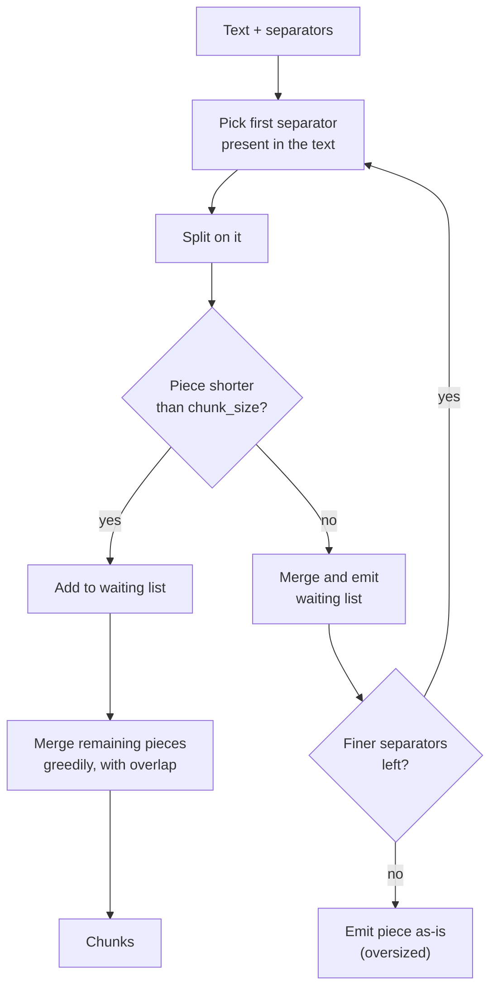

Fixed-size chunking cuts text every *n* characters or tokens, wherever that happens to fall: in the middle of a sentence, a word, even a number. Paragraph and sentence splitters respect boundaries, but produce chunks of wildly uneven size. **Recursive character splitting** is the compromise that most RAG pipelines start with: try to cut at the biggest natural boundary available (a blank line between paragraphs), and only where a piece is still too big, fall back to a smaller boundary (a line break, then a sentence end, then a space, then any character). The result is chunks that respect a size limit *and* break in sensible places as often as the text allows.

This lesson takes the algorithm apart: how the separator is chosen, how oversized pieces are recursed into, how small pieces are re-packed, and how overlap really behaves. You will implement it in about forty lines, check it against LangChain's `RecursiveCharacterTextSplitter`, and learn the settings that decide whether its chunks are good.

## Learning objectives

- Describe the three phases of recursive character splitting (choose a separator, split and recurse, merge with overlap) and trace them on a short text.
- Implement a recursive splitter from scratch and verify it against LangChain's `RecursiveCharacterTextSplitter`.
- Explain why overlap is made of whole pieces and is therefore often smaller than `chunk_overlap`, or zero.
- Choose a separator list, a length function (characters or tokens) and a `keep_separator` setting for a given corpus, and justify the choice.
- Identify the failure modes recursive splitting cannot fix on its own, such as orphaned headings and split tables.

## Prerequisites

- [Chunk size](/learn/chunking-fundamentals/chunk-size) and [Chunk overlap](/learn/chunking-fundamentals/chunk-overlap): what the two numbers control and why they matter.
- [Character-based chunking](/learn/chunking-fundamentals/character-based-chunking) and [Token-based chunking](/learn/chunking-fundamentals/token-based-chunking): the two ways of measuring length.
- [Sentence-based chunking](/learn/chunking-fundamentals/sentence-based-chunking) and [Paragraph-based chunking](/learn/chunking-fundamentals/paragraph-based-chunking): the boundary-respecting splitters this one generalises.

## Why this matters

A chunk is the unit your retriever returns. If a chunk boundary falls in the middle of the sentence "Anything over £75 needs a receipt", one chunk ends with "Anything over £75" and the next begins "needs a receipt". Neither chunk answers "When do I need a receipt?", and the embedding of each half is a blurred average of whatever else shares its chunk. Fixed-size cutting produces such fractures routinely, because the cut positions are blind to the text.

Splitting only on paragraphs keeps every sentence whole but gives no control over size: a one-line paragraph embeds almost no context, and a 2,000-word one dilutes its embedding across many topics and may exceed the embedding model's input limit (most sentence-embedding models silently truncate input beyond a fixed number of tokens).

Recursive splitting gives you both properties, as far as the text allows: a hard ceiling on size, and boundaries chosen from the most meaningful level that can satisfy it. It is the text splitter LangChain's documentation recommends for generic text, and it is the baseline every strategy in this module should be compared against. If your fancier chunker does not beat a well-configured recursive splitter on your own evaluation set, ship the recursive splitter.

## The intuition

Imagine you have to pack a long letter into envelopes that hold at most one page each, and you want to cut the letter as few times and as cleanly as possible.

1. First, you look for whole paragraphs. Short paragraphs go into envelopes together, as many as fit.
2. When you meet a paragraph longer than a page, you cannot keep it whole. So for that paragraph alone you drop down a level and cut it into sentences, then pack the sentences into envelopes.
3. If a single sentence is longer than a page (a legal clause, say), you drop down again and cut it at spaces between words.
4. Only if a single "word" is longer than a page (a long URL, a base64 blob) do you cut it at arbitrary characters.

Two features matter. Finer cuts happen *only inside the piece that needed them*, and afterwards the pieces are *re-packed* greedily, so you do not end up with one sentence per envelope.

## How it works

The algorithm has three moving parts: a list of separators ordered from coarse to fine, a recursive split, and a greedy merge.

### The separator hierarchy

The separators are plain strings (or regular expressions), tried in order. LangChain's default list is:

```text
["\n\n", "\n", " ", ""]
```

That is: paragraph break, line break, space, and the empty string, which means "between any two characters" and guarantees that the recursion always terminates. Many people add `". "` between the line break and the space, so that sentences are preferred over words; we do that in the code below.

For other formats the list changes: LangChain ships language-specific lists through `RecursiveCharacterTextSplitter.from_language(...)`; for Markdown the list begins with a heading pattern and code-fence markers before falling back to blank lines. Those are still just a priority order of *strings*.

### Phase 1: choose a separator for this piece of text

Given a piece of text and a list of separators, the splitter takes the **first separator in the list that actually occurs in the text**. If the text contains a blank line, it splits on blank lines; if not, it tries line breaks; and so on. The remaining, finer separators are kept for later.

The choice is "first separator present", not "first separator that would produce small enough pieces": a text with one blank line is split there even if both halves are still too large. Phase 2 handles that.

### Phase 2: split, then recurse into oversized pieces

The text is split on the chosen separator. Each resulting piece is then measured with the **length function** (by default `len`, so characters):

- If the piece is smaller than `chunk_size`, it is put aside in a list of "good" pieces waiting to be merged.
- If the piece is too big, the waiting good pieces are first merged and emitted (phase 3), then the oversized piece is split **recursively** with the remaining finer separators. If no finer separators remain, the piece is emitted as it is, over-sized.

Flushing the waiting pieces before recursing preserves document order. It also has a side effect you will see in the output below: a short piece that happens to sit just before a long one (typically a heading) is flushed on its own and becomes a tiny chunk.

### Phase 3: merge small pieces greedily, with overlap

Merging walks through the small pieces and appends them to a growing window while the total length stays within `chunk_size`. When the next piece would overflow, the window is emitted as a chunk. Then, to create overlap, the merger **drops pieces from the front of the window** until what remains is at most `chunk_overlap` long *and* leaves room for the incoming piece. Whatever remains becomes the start of the next chunk.

The consequence is important and widely misunderstood: **overlap is made of whole pieces**. If your pieces are sentences of 80 characters and `chunk_overlap` is 30, no sentence fits in 30 characters, so the overlap is empty. Overlap is a *maximum*, not a target. Step through the merge on four words with a 10-character limit and a 4-character overlap:

```trace
{
  "title": "Greedy merge with whole-piece overlap (size 10, overlap 4)",
  "code": [
    "pieces = ['The ', 'VPN ', 'is ', 'required ']",
    "chunks, window, total = [], [], 0",
    "for p in pieces:",
    "    if window and total + len(p) > 10:",
    "        chunks.append(''.join(window).strip())",
    "        while window and (total > 4 or total + len(p) > 10):",
    "            total -= len(window.pop(0))",
    "    window.append(p); total += len(p)",
    "chunks.append(''.join(window).strip())"
  ],
  "steps": [
    {"line": 8, "vars": {"p": "'The '", "window": "['The ']", "total": "4"}, "note": "The window is empty, so the first piece goes straight in."},
    {"line": 8, "vars": {"p": "'VPN '", "window": "['The ', 'VPN ']", "total": "8"}, "note": "4 + 4 = 8 fits within 10."},
    {"line": 5, "vars": {"p": "'is '", "chunks": "['The VPN']", "total": "8"}, "note": "8 + 3 = 11 would overflow, so the window is emitted as a chunk."},
    {"line": 7, "vars": {"window": "['VPN ']", "total": "4"}, "note": "8 is more than the overlap of 4, so 'The ' is dropped. 4 is not more than 4 and 4 + 3 fits, so 'VPN ' stays as overlap."},
    {"line": 8, "vars": {"window": "['VPN ', 'is ']", "total": "7"}, "note": "The new piece joins the overlap."},
    {"line": 5, "vars": {"p": "'required '", "chunks": "['The VPN', 'VPN is']", "total": "7"}, "note": "7 + 9 = 16 overflows: emit 'VPN is'."},
    {"line": 7, "vars": {"window": "[]", "total": "0"}, "note": "'VPN ' is dropped because 7 > 4. Then 'is ' must go too: 3 + 9 = 12 would still overflow. No overlap is possible."},
    {"line": 9, "vars": {"chunks": "['The VPN', 'VPN is', 'required']"}, "note": "The final window is emitted. Two chunks share 'VPN'; the last shares nothing."}
  ]
}
```

### The whole algorithm, step by step

1. Take the text and the separator list.
2. Find the first separator that occurs in the text; remember the separators after it.
3. Split the text on that separator (keeping the separator attached to one side, depending on `keep_separator`).
4. For each piece, in order:
   1. If it is shorter than `chunk_size`, add it to the waiting list.
   2. Otherwise, merge and emit the waiting list (step 5), then apply steps 2 to 4 to this piece with the remaining separators. If none remain, emit the piece unchanged.
5. Merge the waiting list greedily into chunks no longer than `chunk_size`, carrying whole trailing pieces of up to `chunk_overlap` into the next chunk.
6. Strip surrounding whitespace from every chunk and drop empty ones.



### What "keep the separator" means

When text is split on `". "`, where does the full stop go? There are three options, and LangChain exposes all of them through `keep_separator`:

- `False`: the separator is thrown away at the split and the merge re-inserts it between pieces. For `". "` this means a chunk boundary removes the full stop.
- `True` or `"start"` (the default for `RecursiveCharacterTextSplitter`): the separator is glued to the **start** of the following piece. For blank lines this is harmless; for `". "` it produces chunks that begin with `". Up to 5 unused days..."` and end without a full stop.
- `"end"`: the separator is glued to the **end** of the preceding piece, so sentences keep their full stops and paragraphs keep their trailing blank line.

For sentence separators, `"end"` is almost always what you want. You will see the difference in the output below.

### Characters or tokens

The length function decides what `chunk_size` means. Characters are fast and model-independent, but embedding models and LLMs count tokens, and the ratio between the two varies with language and content (English prose is often around four characters per token for common tokenisers; code, numbers and non-Latin scripts differ substantially). If your hard constraint is an embedding model's maximum input length in tokens, measure in tokens with the *same tokeniser family* the model uses, or leave a generous margin. LangChain provides `RecursiveCharacterTextSplitter.from_tiktoken_encoder(...)` for OpenAI-style tokenisers and `SentenceTransformersTokenTextSplitter` for sentence-transformer models; you can also pass any `length_function` you like.

Measuring in tokens changes how pieces are counted, not where cuts may fall.

### What it cannot do

Recursive splitting looks only at strings. It cannot tell that a short line is a heading that belongs with the paragraph below, that a table must not lose its header row, or that two adjacent paragraphs are about different subjects. The rest of this module deals with these gaps: [semantic chunking](/learn/advanced-chunking-strategies/semantic-chunking) uses meaning to place boundaries, [structure-aware chunking](/learn/advanced-chunking-strategies/structure-aware-chunking) and [heading-based chunking](/learn/advanced-chunking-strategies/heading-based-chunking) use the document's own structure, and [table chunking](/learn/advanced-chunking-strategies/table-chunking) and [code chunking](/learn/advanced-chunking-strategies/code-chunking) handle content that is not prose. In practice, most of those strategies still call a recursive splitter as their fallback for any section that is too long.

```playground
chunking
```

## In code

**The problem.** Implement recursive character splitting from scratch on a short section of the Meridian employee handbook, check that it matches LangChain's implementation exactly, and read the chunks for defects.

**Dependencies.** `langchain-text-splitters` for the comparison and `tiktoken` for token counting. No API key and no model download.

```bash
pip install langchain-text-splitters tiktoken
```

The from-scratch version follows the three phases above. The separator list adds `". "` so that sentences are preferred over words.

```python
import re
from langchain_text_splitters import RecursiveCharacterTextSplitter

HANDBOOK = """Annual leave

Every employee receives 25 days of annual leave per year. Up to 5 unused days carry over into the next year and must be used by 31 March.

Remote work

Staff may work remotely up to 3 days a week. The home-office equipment budget is £400; contractors are not eligible for it.

Expenses
Expenses must be submitted within 30 days. Anything over £75 needs a receipt. Late claims are returned to the employee by the finance department with a note explaining why they were rejected."""

SEPARATORS = ["\n\n", "\n", ". ", " ", ""]


def split_on(text, sep):
    """Split text on sep, keeping sep attached to the start of the following piece."""
    if sep == "":
        return list(text)
    parts = re.split(f"({re.escape(sep)})", text)
    pieces = [parts[0]] + [parts[i] + parts[i + 1] for i in range(1, len(parts) - 1, 2)]
    return [p for p in pieces if p]


def merge(pieces, size, overlap):
    """Greedily pack small pieces into chunks of at most `size` characters."""
    chunks, window, total = [], [], 0
    for p in pieces:
        if window and total + len(p) > size:
            chunks.append("".join(window).strip())
            # keep a tail of whole pieces (at most `overlap` characters) as overlap
            while window and (total > overlap or total + len(p) > size):
                total -= len(window[0])
                window.pop(0)
        window.append(p)
        total += len(p)
    if window:
        chunks.append("".join(window).strip())
    return [c for c in chunks if c]


def recursive_split(text, size, overlap, separators=SEPARATORS):
    # 1. pick the first separator that actually occurs in this text
    for i, sep in enumerate(separators):
        if sep == "" or sep in text:
            rest = separators[i + 1:]
            break
    chunks, small = [], []
    for piece in split_on(text, sep):
        if len(piece) < size:
            small.append(piece)               # fits: hold it for merging
        else:
            if small:                         # flush what we were holding
                chunks += merge(small, size, overlap)
                small = []
            if rest:                          # too big: recurse with finer separators
                chunks += recursive_split(piece, size, overlap, rest)
            else:
                chunks.append(piece)
    if small:
        chunks += merge(small, size, overlap)
    return chunks


SIZE, OVERLAP = 120, 30
ours = recursive_split(HANDBOOK, SIZE, OVERLAP)
lc = RecursiveCharacterTextSplitter(
    separators=SEPARATORS, chunk_size=SIZE, chunk_overlap=OVERLAP
).split_text(HANDBOOK)

for n, chunk in enumerate(ours, 1):
    print(f"[{n}] ({len(chunk):>3} chars) {chunk!r}")
print()
print("identical to LangChain:", ours == lc)
print("largest chunk:", max(map(len, ours)), "chars; limit:", SIZE)
```

```output
[1] ( 12 chars) 'Annual leave'
[2] ( 56 chars) 'Every employee receives 25 days of annual leave per year'
[3] ( 81 chars) '. Up to 5 unused days carry over into the next year and must be used by 31 March.'
[4] ( 11 chars) 'Remote work'
[5] ( 43 chars) 'Staff may work remotely up to 3 days a week'
[6] ( 80 chars) '. The home-office equipment budget is £400; contractors are not eligible for it.'
[7] (  8 chars) 'Expenses'
[8] ( 76 chars) 'Expenses must be submitted within 30 days. Anything over £75 needs a receipt'
[9] (115 chars) '. Late claims are returned to the employee by the finance department with a note explaining why they were rejected.'

identical to LangChain: True
largest chunk: 115 chars; limit: 120
```

**The important lines.**

- The loop at the top of `recursive_split` implements phase 1: `sep in text` picks the first separator present, and `rest` holds the finer ones for any recursion.
- `if len(piece) < size` is the decision between "keep for merging" and "recurse". The comparison is strict, mirroring LangChain: a piece of exactly `chunk_size` is recursed into.
- `chunks += merge(small, size, overlap)` before recursing is the flush that preserves document order.
- The `while` loop in `merge` is the overlap rule from the trace: drop whole pieces from the front until the remainder is no more than `overlap` and leaves room for the incoming piece.
- `ours == lc` checks that the two implementations agree on this input. They do, which tells you the mental model above is the real algorithm, not a simplification.

**What the output means.** Every chunk respects the 120-character limit, and no word is cut. But read the chunks as a retriever would, and three defects stand out:

1. **Orphaned headings.** Chunks 1, 4 and 7 are just "Annual leave", "Remote work" and "Expenses". Each heading was waiting to be merged when the following paragraph, too long for the limit, forced a flush before recursion. These chunks carry no information, yet a query such as "remote work" will match chunk 4 strongly and waste a retrieval slot.
2. **Misplaced full stops.** With the default `keep_separator=True`, the `". "` separator is attached to the start of the next piece, so chunks 3, 6 and 9 begin with ". " and chunks 2, 5 and 8 lose their final full stop.
3. **No overlap at all.** `chunk_overlap=30` was requested, but every candidate piece for overlap is a sentence longer than 30 characters, so nothing is carried over.

None of these is a bug; each follows directly from the algorithm. They are configuration problems, and the configuration below fixes two of them.

**A better configuration.** Measure in tokens, keep separators at the end, and use a size large enough that a heading and its paragraph fit together:

```python
import tiktoken

enc = tiktoken.get_encoding("cl100k_base")
splitter = RecursiveCharacterTextSplitter(
    separators=["\n\n", "\n", ". ", " ", ""],
    keep_separator="end",                         # full stop stays with its sentence
    chunk_size=60,                                # now measured in tokens
    chunk_overlap=15,
    length_function=lambda s: len(enc.encode(s)),
)
for n, chunk in enumerate(splitter.split_text(HANDBOOK), 1):
    print(f"[{n}] ({len(enc.encode(chunk)):>2} tokens) {chunk!r}")
```

```output
[1] (38 tokens) 'Annual leave\n\nEvery employee receives 25 days of annual leave per year. Up to 5 unused days carry over into the next year and must be used by 31 March.\n\nRemote work'
[2] (31 tokens) 'Remote work\n\nStaff may work remotely up to 3 days a week. The home-office equipment budget is £400; contractors are not eligible for it.'
[3] (41 tokens) 'Expenses\nExpenses must be submitted within 30 days. Anything over £75 needs a receipt. Late claims are returned to the employee by the finance department with a note explaining why they were rejected.'
```

Now each section is one chunk with its heading, and sentences end with their full stops. But look at the end of chunk 1: the heading "Remote work" has been packed onto the leave chunk, and then carried into chunk 2 as overlap. The overlap mechanism happily repeats a heading because, to the splitter, it is just a short piece. On a larger document this "heading at the bottom of the wrong chunk" pattern is common, and no setting of size or overlap removes it reliably. The fix is to tell the splitter where sections start, which is exactly what [heading-based chunking](/learn/advanced-chunking-strategies/heading-based-chunking) does.

**Errors people commonly hit.**

- `chunk_overlap` larger than `chunk_size` raises a `ValueError` at construction. Overlap must be smaller than size.
- A warning such as "Created a chunk of size 4310, which is longer than the specified 1000" means a piece could not be split further with your separators. With the default list (which ends in `""`) this cannot happen from the recursion; it typically means you removed `""` from your list, or that the length function counts differently from the way the pieces were cut (a token length function with a very long run of characters that tokenises badly).
- Using a regular expression in `separators` without `is_separator_regex=True`. The pattern is then escaped and treated as a literal string, so it never matches.

**Extending it.** Add `add_start_index=True` and use `create_documents` instead of `split_text`: each chunk then records its character offset in the source, which you need for citations and highlighting.

## A real-world example

The Platform team that owns AskMeridian first indexed the IT runbooks with a recursive splitter configured as `chunk_size=1000` characters, `chunk_overlap=200`, default separators and default `keep_separator`. Retrieval quality on policy questions was acceptable, but runbook questions often returned the right document with the wrong chunk.

An engineer read the chunks returned for a dozen failed queries. Two patterns explained most failures. Runbooks used numbered steps separated by single line breaks, so a long procedure arrived as one huge "paragraph" and the merge packed steps greedily: a step's command landed at the end of one chunk and its explanation at the start of the next. And each procedure's error code (such as E-4021 from the Atlas catalogue) sat in a one-line heading which, as in the output above, became its own tiny chunk or was packed onto the *previous* procedure.

The team kept recursive splitting but made three changes, each justified by reading chunks. They added a regular-expression separator for numbered steps (`\n(?=\d+\. )`) ahead of plain line breaks, so procedures split between steps rather than mid-step. They switched to `keep_separator="end"`. And they moved heading handling out of the recursive splitter entirely: a structure-aware pre-pass split each runbook into sections at its headings, and the recursive splitter ran only *inside* sections that were still too long, with the heading text prepended to every resulting chunk. That combination, section boundaries from structure and size control from recursion, is the pattern you will meet repeatedly in the rest of this module.

## Common mistakes

- **Assuming overlap is always present.** Overlap is assembled from whole pieces; when pieces are longer than `chunk_overlap`, there is none.
- **Leaving `keep_separator` at its default with sentence separators.** Chunks begin with ". " and end without punctuation, which looks sloppy in citations and slightly changes embeddings.
- **Measuring characters when the constraint is tokens.** A 2,000-character chunk of dense code or Japanese text can exceed an embedding model's token limit and be silently truncated.
- **Removing the empty-string separator.** Without `""` at the end of the list, an unbroken string longer than `chunk_size` (a URL, a hash, minified JSON) is emitted oversized.
- **Using one global configuration for every document type.** Separators that suit prose are wrong for CSV exports, code or chat logs. Route documents to different configurations (see [document-aware chunking](/learn/advanced-chunking-strategies/document-aware-chunking)).
- **Judging the splitter by chunk-size statistics alone.** Uniform sizes say nothing about whether a chunk answers a question. Read a sample of chunks, and measure retrieval on labelled queries.

## Best practices

- Start every chunking project with a well-configured recursive splitter as the baseline, and require any alternative to beat it on your own retrieval evaluation.
- Order separators from the most meaningful boundary to the least, and add domain separators (numbered steps, clause numbers, log-record starts) as regular expressions with `is_separator_regex=True`.
- Use `keep_separator="end"` for sentence and line separators.
- Measure length with a tokeniser that matches, or approximates conservatively, your embedding model's tokeniser, and keep chunks comfortably below its input limit.
- Record each chunk's start offset (`add_start_index=True`) and its source identifiers, so that chunks can be traced back for citations and debugging.
- Run the recursive splitter *inside* sections produced by a structure-aware pass, rather than over whole documents, whenever the documents have headings.

## Performance considerations

Recursive splitting is cheap: each recursion level scans its piece a couple of times, and the depth is bounded by the separator list. The expensive part is the length function. With `len` it is negligible; with a tokeniser it runs on every piece during splitting and merging. For 100,000 pages of about 3,000 characters (300 million characters), a tokeniser processing, as an assumption, a few million characters per second needs a minute or two per full pass, and the splitter makes several passes. That is still small next to embedding the corpus, and documents are independent, so parallelise across them.

Halving `chunk_size` roughly doubles the number of chunks, and with them embedding calls and index size. Overlap adds more: with an average overlap of $o$ tokens on chunks of $s$ tokens, the total text embedded grows by roughly a factor of $s / (s - o)$. For $s = 500$ and $o = 100$, that is $500/400 = 1.25$, a quarter more embedding work and storage. Recursive overlap is often smaller than requested, so measure the real figure (total chunk length divided by document length).

## Summary

- Recursive character splitting picks the first separator present in a piece of text, splits on it, and recurses with finer separators only into pieces that are still too long.
- Small pieces are re-packed greedily up to `chunk_size`; overlap is formed from whole trailing pieces and may be smaller than requested, or zero.
- `keep_separator` decides where separators end up; `"end"` keeps full stops with their sentences.
- The length function defines what `chunk_size` means; measure in tokens when the binding constraint is a model's token limit.
- The splitter sees only strings, so it orphans headings and splits structured content; combine it with structure-aware passes and use it as the fallback for oversized sections.

## Exercises

**1.** Without running code, predict the chunks produced by `RecursiveCharacterTextSplitter(separators=[" "], chunk_size=12, chunk_overlap=5, keep_separator="end")` on the text `"VPN is required on public Wi-Fi"`. Then check your answer in the sandbox.

<details><summary>Show solution</summary>

The pieces are `"VPN "` (4), `"is "` (3), `"required "` (9), `"on "` (3), `"public "` (7) and `"Wi-Fi"` (5).

- `"VPN " + "is "` = 7; adding `"required "` would make 16 > 12, so emit `"VPN is"`. Drop from the front while the total exceeds 5 or the new piece would not fit: drop `"VPN "` (total 3), then 3 + 9 = 12 is not more than 12, so `"is "` stays as overlap.
- `"is " + "required "` = 12; adding `"on "` gives 15 > 12, so emit `"is required"`. Drop `"is "` (total 9 > 5), then drop `"required "` (9 > 5): window empty.
- `"on " + "public "` = 10; adding `"Wi-Fi"` gives 15 > 12, so emit `"on public"`. Drop `"on "` (total 7 > 5), drop `"public "` (7 > 5). Window empty.
- `"Wi-Fi"` is emitted at the end.

Result: `['VPN is', 'is required', 'on public', 'Wi-Fi']`. Only the first boundary has overlap.

</details>

**2.** A colleague sets `chunk_size=1000, chunk_overlap=200` on a corpus of legal contracts whose clauses are long single sentences (300 to 600 characters) separated by single line breaks. They are surprised that adjacent chunks never share text. Explain why, and propose a change that produces real overlap without changing `chunk_size`.

<details><summary>Show solution</summary>

The splitter recurses to line breaks, and each piece is a whole clause of 300 to 600 characters. Overlap is built from whole trailing pieces whose total is at most 200 characters; no clause is that short, so the overlap is always empty.

Either add finer separators such as `"; "` and `", "` before `" "`, so that some pieces fit inside 200 characters (overlap then consists of clause fragments), or implement clause-level overlap explicitly by prepending the previous whole clause to each chunk. The second is often better for contracts, where half a clause can mislead.

</details>

**3.** Write a separator list (with `is_separator_regex=True`) for AskMeridian's runbooks, which contain numbered steps (`1. `, `2. `...) on separate lines, blank lines between sections, and occasional long shell commands. Run it on a short runbook of your own and show that no step is split across chunks when each step is shorter than `chunk_size`.

<details><summary>Show solution</summary>

A reasonable list, from coarse to fine: `[r"\n\n", r"\n(?=\d+\. )", r"\n", r"(?<=\.) ", r" ", r""]`. The second entry splits only at a line break followed by a step number (a lookahead, so the number stays with its step); the fourth splits after a full stop using a lookbehind. Pass `is_separator_regex=True, keep_separator="end"`. On a four-step runbook with a heading and `chunk_size=110, chunk_overlap=0`, this produced:

```output
'Reset a VPN certificate'
'1. Open the IT portal and sign in.\n2. Go to Certificates and select Revoke.'
'3. Run: sudo meridian-vpn --renew --profile corporate\n4. Reconnect and confirm the status is Connected.'
```

Every chunk starts at a step boundary. The heading is still orphaned: the structural problem from the lesson.

</details>

**4.** Design decision. AskMeridian's embedding model has a 256-token input limit (treat that as an assumption about the chosen model). You must choose between `chunk_size=1000` characters and `chunk_size=200` tokens measured with a tokeniser that differs from the model's own. Which do you pick, what margin do you leave, and how would you verify that no chunk is truncated?

<details><summary>Show solution</summary>

Prefer measuring in tokens, because the constraint is in tokens; 1,000 characters is usually around 250 tokens of English prose but can be far more for code, identifiers or non-English text, so a character limit gives no guarantee. Because the splitter's tokeniser differs from the model's, leave a margin: 200 measured tokens against a 256 limit is about 22 percent headroom, which is reasonable, but it is an estimate.

Verify directly: tokenise every chunk with the embedding model's own tokeniser (counting special tokens) and report the maximum and the number above the limit. Run this check in the ingestion pipeline, not once by hand, because new documents can differ from the sample.

</details>

## Check your understanding

```quiz
[
  {
    "q": "A text contains one blank line and many single line breaks. The separator list is the default `[\"\\n\\n\", \"\\n\", \" \", \"\"]`. Which separator does the splitter use first?",
    "options": [
      "The line break, because it splits the text into more pieces",
      "The blank line, because it is the first separator in the list that occurs in the text",
      "The space, because it guarantees every piece fits",
      "Whichever separator produces pieces closest to chunk_size"
    ],
    "answer": 1,
    "why": "The splitter takes the first separator present, regardless of whether the resulting pieces are small enough; oversized pieces are handled by recursion."
  },
  {
    "q": "With chunk_overlap=50, adjacent chunks share no text at all. What is the most likely reason?",
    "options": [
      "The splitter ignores overlap when keep_separator is True",
      "Overlap only applies when the length function counts tokens",
      "Every candidate trailing piece is longer than 50, and overlap is built from whole pieces",
      "Overlap is only added to the first and last chunks"
    ],
    "answer": 2,
    "why": "The merge keeps whole trailing pieces whose total is at most chunk_overlap. If no piece is that short, the overlap is empty."
  },
  {
    "q": "Splitting on \". \" with the default keep_separator produces chunks that begin with \". Up to 5 unused days\". Which setting fixes this?",
    "options": [
      "keep_separator=\"end\"",
      "strip_whitespace=False",
      "is_separator_regex=True",
      "chunk_overlap=0"
    ],
    "answer": 0,
    "why": "\"end\" attaches each separator to the preceding piece, so the full stop stays with its sentence."
  },
  {
    "q": "Why do short headings often become chunks on their own under recursive splitting?",
    "options": [
      "Headings are always treated as separators and removed",
      "The splitter detects headings and isolates them deliberately",
      "Short pieces are dropped below a minimum length",
      "A short piece waiting to be merged is flushed on its own when the next piece is too long and must be recursed into"
    ],
    "answer": 3,
    "why": "Before recursing into an oversized piece, the splitter merges and emits what it was holding. A heading followed by a long paragraph is therefore emitted alone."
  },
  {
    "q": "Your embedding model truncates input beyond a fixed number of tokens. Which configuration best prevents silent truncation?",
    "options": [
      "A large character chunk_size with generous overlap",
      "A token-based length function with a margin below the limit, plus a post-chunking check with the model's own tokeniser",
      "Removing the empty-string separator so chunks never split words",
      "keep_separator=False, so separators do not count towards length"
    ],
    "answer": 1,
    "why": "Only a token-based measure relates to the model's limit, and a check with the model's own tokeniser catches any mismatch between tokenisers."
  }
]
```

## Further reading

- LangChain documentation, "Text splitters" and the API reference for `RecursiveCharacterTextSplitter` in the `langchain-text-splitters` package. Source code: [github.com/langchain-ai/langchain](https://github.com/langchain-ai/langchain).
- LlamaIndex documentation, "Node parsers" (in particular `SentenceSplitter`, its default text splitter): [docs.llamaindex.ai](https://docs.llamaindex.ai/).
- OpenAI, `tiktoken` (the BPE tokeniser used in this lesson): [github.com/openai/tiktoken](https://github.com/openai/tiktoken).
- Lewis, P. et al. (2020). "Retrieval-Augmented Generation for Knowledge-Intensive NLP Tasks". [arXiv:2005.11401](https://arxiv.org/abs/2005.11401). The original RAG paper, which retrieves fixed-length 100-word passages: a useful reminder of the baseline recursive splitting improves on.
- Kamradt, G. "5 Levels of Text Splitting", a widely shared tutorial notebook that walks from character splitting through recursive, document-specific, semantic and agentic splitting.
