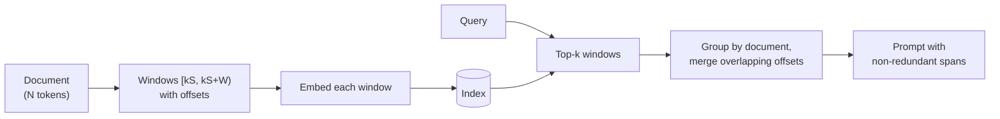

Every chunker that cuts text into separate pieces has the same blind spot: a fact that happens to straddle a boundary is in no single chunk. Sliding window chunking removes that blind spot by brute force. Instead of cutting the text into consecutive pieces, it slides a fixed-size window along the text in steps smaller than the window, so that every stretch of text up to a known length lies wholly inside at least one window.

This lesson treats the sliding window as an algorithm with two parameters, the **window size** and the **stride**, and works out exactly what they buy and what they cost: the coverage guarantee, the number of windows, the storage multiplier, and the duplicate results that overlapping windows produce at query time. You will build a token-level sliding window, watch it rescue a fact that fixed chunks split, and merge overlapping hits into clean spans before they reach the prompt. The general idea of overlap between neighbouring chunks was introduced in [Chunk overlap](/learn/chunking-fundamentals/chunk-overlap), and tuning it experimentally is covered in [Overlap optimisation](/learn/chunking-optimisation/overlap-optimisation); this lesson is about the sliding window as a chunking strategy in its own right.

## Learning objectives

- Define window size $W$ and stride $S$, and relate them to overlap ($W - S$) and to the terminology used by common libraries.
- Prove and apply the coverage guarantee: every span of at most $W - S + 1$ tokens lies inside some window.
- Calculate the number of windows and the storage multiplier for a document of $N$ tokens.
- Merge overlapping retrieved windows into non-redundant spans before building the prompt.
- Choose between token windows, sentence windows and the sentence-window retrieval pattern for a given corpus.

## Prerequisites

- [Chunk overlap](/learn/chunking-fundamentals/chunk-overlap): why neighbouring chunks share text.
- [Token-based chunking](/learn/chunking-fundamentals/token-based-chunking): counting and cutting in tokens.
- [Sentence-based chunking](/learn/chunking-fundamentals/sentence-based-chunking): sentence segmentation, used by sentence windows.
- [Top-K retrieval](/learn/retrieval-fundamentals/top-k-retrieval): how the retriever's top results become the prompt's context.

## Why this matters

Fixed, non-overlapping chunks are cheap and simple, but their boundaries are blind. The Meridian handbook says that "up to 5 unused days carry over into the next leave year, and carried-over days must be used by 31 March". If a boundary falls after "carried-over days must", one chunk has the rule without the date and the next has the date without the rule. A question about the deadline retrieves the first chunk (it mentions carried-over leave), and the generator, which never sees "31 March", either says it does not know or guesses.

Structure-aware chunkers (by heading, paragraph or block) reduce this problem by cutting where authors cut, but they cannot remove it: a paragraph that is too long must still be split somewhere, and many sources have no reliable structure at all. Transcripts of meetings and calls, OCR output, logs, chat exports and long unformatted emails are streams of text with no headings and unreliable paragraph breaks. For these, the sliding window is a dependable default, because it gives a guarantee that does not depend on where the boundaries fall.

The price is redundancy: each piece of text is stored and embedded several times, and the retriever tends to return several overlapping windows for one question. Both costs are predictable, and both can be managed.

## The intuition

Imagine reading a long scroll through a slot in a piece of card. The slot shows 48 words at a time. With fixed chunking you read words 1 to 48, then move the card down by exactly 48 words, then another 48. A sentence that runs from word 45 to word 56 is never fully visible in the slot.

Now move the card down only 16 words at a time: 1 to 48, then 17 to 64, then 33 to 80. Each word now passes through the slot three times, at the bottom, in the middle and at the top. The sentence from 45 to 56 is fully visible in the view that runs from 17 to 64 and in the one from 33 to 80. Any passage short enough will be fully visible in at least one view, however it lines up with the steps. The cost is that you have looked at the scroll three times.

## How it works

### Window, stride and overlap

A sliding window chunker has two parameters:

- **Window size $W$**: the length of each chunk, in tokens (or sentences, or characters).
- **Stride $S$**: how far the window moves between consecutive chunks. Also called step or hop.

Window $k$ (counting from 0) covers positions $[kS,\ kS + W)$, clipped at the end of the document. Consecutive windows share $W - S$ positions, the **overlap**. Fixed chunking is the special case $S = W$; $S > W$ leaves gaps and is almost never what you want.

Be careful with names. LangChain's splitters take `chunk_size` and `chunk_overlap`, so stride is `chunk_size - chunk_overlap`. Hugging Face tokenizers have a `stride` argument (used with `return_overflowing_tokens=True` to process inputs longer than a model's limit), and there `stride` means **the number of overlapping tokens**, not the step. The same word means opposite things in two popular libraries; always check which one you are setting.

### The procedure

1. Tokenise the document with the tokeniser whose limit you care about (normally the embedding model's) and keep the token sequence of length $N$.
2. For $k = 0, 1, 2, \ldots$: take the tokens from $kS$ to $\min(kS + W, N)$ as window $k$. Stop after the first window that reaches $N$.
3. For each window, record its start and end offsets (in tokens, and in characters if you can map them) along with the document identifier. These offsets are what make deduplication and merging possible later.
4. Decode each window to text and embed it.
5. At query time, retrieve the top windows, then merge windows from the same document whose offsets overlap or touch into single spans, and put the spans, not the raw windows, into the prompt.



### Where windows cut: tokens versus sentences

A token window cuts wherever the count says, often mid-sentence, sometimes mid-word or mid-number (a window can end with "08:00 to 18" while the next begins ":00 UK time"). The overlap means the complete text is always in some other window, so nothing is lost for retrieval, but each individual window is ragged, and a ragged window is a slightly worse embedding and a worse thing to show a model.

Two common refinements:

- **Sentence windows.** Segment the text into sentences first, then slide a window of $W$ sentences with a stride of $S$ sentences. Windows are always whole sentences. Window lengths in tokens then vary, so check the longest against the model's limit.
- **Snap to boundaries.** Slide in tokens, but move each window's start forward and end backward to the nearest sentence boundary within a small tolerance. This keeps the guarantee approximately while avoiding ragged edges.

### Sentence-window retrieval

A related pattern decouples **what is embedded** from **what is returned**. Each sentence is embedded on its own, which gives a sharp vector for one fact, and stored with a window of its neighbours (for example one or two sentences each side). Retrieval matches single sentences; the prompt receives the surrounding window. LlamaIndex implements this as `SentenceWindowNodeParser` (with `window_size` meaning the number of sentences on each side), together with a post-processor that swaps the sentence for its window at query time. It is a member of the small-to-big family covered in [Small-to-big retrieval](/learn/chunking-optimisation/small-to-big-retrieval): embed small, return big.

### Duplicates at query time

Because each part of the text lives in about $W/S$ windows, a question about it tends to retrieve several of those windows. With $W/S = 3$ and a top-k of 4, three of the four results can be near-copies of each other. Two consequences:

- **Wasted context.** The prompt carries the same sentences two or three times.
- **Crowding out.** The fourth-best distinct passage, which might hold the rest of the answer, is pushed below the cut-off by duplicates of the first.

Merging overlapping windows from the same document into spans fixes the first. For the second, retrieve more candidates than you need (say 3k), merge, then keep the top k spans; or apply a diversity method such as [MMR](/learn/advanced-retrieval-optimisation/mmr), which penalises candidates similar to ones already chosen.

## The mathematics

### The coverage guarantee

**Intuition.** A span is safe if some window starts at or before it and ends at or after it. Windows start every $S$ positions, so a span can start at most $S - 1$ positions after the nearest window start. That window still has $W - (S - 1)$ positions left, so any span that short fits.

**Formula.** With windows $[kS, kS + W)$, every span of length

$$
L \le W - S + 1
$$

lies wholly inside at least one window. Here $L$ is the length of the span (the fact, sentence or phrase you care about) in the same units as $W$ and $S$.

**Why.** Let the span start at position $a$, and take $k = \lfloor a / S \rfloor$. Then $kS \le a$ and $a - kS \le S - 1$. The window ends at $kS + W$, and the span ends at $a + L \le kS + (S - 1) + (W - S + 1) = kS + W$. So the span fits. (At the end of the document the last window is clipped to $N$, which only helps.) For fixed chunking, $S = W$, the guarantee shrinks to $L \le 1$: no span longer than one token is safe.

**By hand.** With $W = 48$ and $S = 16$: $L \le 48 - 16 + 1 = 33$ tokens. Any sentence of up to 33 tokens is fully inside some window, wherever it falls.

### The cost

For a document of $N > W$ tokens, the number of windows and the tokens indexed are

$$
n = \left\lceil \frac{N - W}{S} \right\rceil + 1
\qquad
T \approx n\,W \approx N \cdot \frac{W}{S}
$$

$n$ counts the windows; $T$ is the total tokens embedded (the last window may be shorter than $W$). The ratio $W/S$ is the **storage multiplier**: away from the ends, each token is embedded $W/S$ times when $S$ divides $W$.

**By hand.** The Meridian handbook passage below is $N = 168$ tokens. With $W = 48$, $S = 16$: $n = \lceil (168 - 48)/16 \rceil + 1 = \lceil 7.5 \rceil + 1 = 9$ windows. Eight full windows give $8 \times 48 = 384$ tokens; the ninth starts at $8 \times 16 = 128$ and is clipped to $168 - 128 = 40$ tokens, so $T = 424$. That is $424/168 \approx 2.5$ times the document, a little under the multiplier $W/S = 3$ because of the edges. Halving the stride to 8 would roughly double the cost again (about 6 times) to stretch the guarantee from 33 to 41 tokens: the guarantee grows linearly as $S$ falls, while the cost grows as $1/S$.

The program below prints the same 9 windows and 424 tokens.

## In code

**The problem.** Index a short Meridian handbook passage with fixed chunks and with sliding windows of the same size, check which chunks contain the carry-over deadline in full, retrieve for a question about it, and merge the overlapping windows into spans.

**Dependencies.** `tiktoken` for tokenising, `sentence-transformers` with the local `all-MiniLM-L6-v2` model for retrieval, and NumPy.

```bash
pip install tiktoken sentence-transformers numpy
```

```python
import numpy as np
import tiktoken
from sentence_transformers import SentenceTransformer

TEXT = (
    "Meridian employees receive 25 days of annual leave each year. Leave is booked "
    "through the HR portal and must be approved by your line manager. Up to 5 unused "
    "days carry over into the next leave year, and carried-over days must be used by "
    "31 March or they are lost. Staff may work remotely up to 3 days a week, by "
    "agreement with their team. The home-office equipment budget is 400 pounds and "
    "covers a chair, a monitor and a keyboard; contractors are not eligible. Expenses "
    "must be submitted within 30 days of the spend, and anything over 75 pounds needs a "
    "receipt. Laptops are refreshed every 3 years, and a lost laptop must be reported to "
    "the support desk at once. The support desk is open from 08:00 to 18:00 UK time on "
    "working days."
)

enc = tiktoken.get_encoding("cl100k_base")
ids = enc.encode(TEXT)

def windows(n_tokens, size, stride):
    """(start, end) offsets of windows of `size` tokens every `stride` tokens."""
    out = []
    for start in range(0, n_tokens, stride):
        out.append((start, min(start + size, n_tokens)))
        if start + size >= n_tokens:          # this window reaches the end
            break
    return out

def merge(spans):
    """Merge overlapping or touching (start, end) spans."""
    out = []
    for s, e in sorted(spans):
        if out and s <= out[-1][1]:
            out[-1] = (out[-1][0], max(out[-1][1], e))
        else:
            out.append((s, e))
    return out

W, S = 48, 16
fixed = windows(len(ids), W, W)
sliding = windows(len(ids), W, S)
print(f"document: {len(ids)} tokens")
print(f"fixed   (W={W}, S={W}): {len(fixed)} chunks, {sum(e - s for s, e in fixed)} tokens indexed")
print(f"sliding (W={W}, S={S}): {len(sliding)} chunks, {sum(e - s for s, e in sliding)} tokens indexed")

fact = "carried-over days must be used by 31 March"
f_start = len(enc.encode(TEXT[:TEXT.index(fact)]))
f_end = f_start + len(enc.encode(fact))
print(f"\nfact occupies tokens {f_start}-{f_end}")
for name, ws in [("fixed", fixed), ("sliding", sliding)]:
    whole = [i for i, (s, e) in enumerate(ws) if s <= f_start and f_end <= e]
    print(f"  {name:7s}: windows containing the whole fact: {whole}")

model = SentenceTransformer("sentence-transformers/all-MiniLM-L6-v2")
query = "By when do I have to use leave carried over from last year?"
q = model.encode([query], normalize_embeddings=True)[0]
print(f"\nquery: {query}")

f_vecs = model.encode([enc.decode(ids[s:e]) for s, e in fixed], normalize_embeddings=True)
best = int(np.argmax(f_vecs @ q))
print(f"  fixed top-1 is chunk {best}; it ends: ...{enc.decode(ids[fixed[best][0]:fixed[best][1]])[-45:]!r}")

texts = [enc.decode(ids[s:e]) for s, e in sliding]
vecs = model.encode(texts, normalize_embeddings=True)
scores = vecs @ q
top = np.argsort(-scores)[:4]
for i in top:
    print(f"  window {i:2d} tokens {sliding[i][0]:3d}-{sliding[i][1]:3d}  score {scores[i]:.3f}")
spans = merge([sliding[i] for i in top])
print(f"top-4 windows: {sum(sliding[i][1] - sliding[i][0] for i in top)} tokens; "
      f"merged spans {spans}: {sum(e - s for s, e in spans)} tokens")
for s, e in spans:
    print("  >>", enc.decode(ids[s:e]))
```

```output
document: 168 tokens
fixed   (W=48, S=48): 4 chunks, 168 tokens indexed
sliding (W=48, S=16): 9 chunks, 424 tokens indexed

fact occupies tokens 45-56
  fixed  : windows containing the whole fact: []
  sliding: windows containing the whole fact: [1, 2]

query: By when do I have to use leave carried over from last year?
  fixed top-1 is chunk 0; it ends: ...'e next leave year, and carried-over days must'
  window  2 tokens  32- 80  score 0.699
  window  1 tokens  16- 64  score 0.680
  window  0 tokens   0- 48  score 0.513
  window  7 tokens 112-160  score 0.294
top-4 windows: 192 tokens; merged spans [(0, 80), (112, 160)]: 128 tokens
  >> Meridian employees receive 25 days of annual leave each year. Leave is booked through the HR portal and must be approved by your line manager. Up to 5 unused days carry over into the next leave year, and carried-over days must be used by 31 March or they are lost. Staff may work remotely up to 3 days a week, by agreement with their team. The home-office
  >>  spend, and anything over 75 pounds needs a receipt. Laptops are refreshed every 3 years, and a lost laptop must be reported to the support desk at once. The support desk is open from 08:00 to 18
```

**What the important lines do.**

- `windows()` produces half-open offset pairs $[kS, \min(kS + W, N))$ and stops after the first window that reaches the end. With `stride == size` it produces ordinary fixed chunks, so both strategies come from one function.
- The fact's token span is found by encoding the text before it (its start) and the fact itself (its length). Tokenising a prefix separately can occasionally differ by one token from tokenising the whole text, because of how spaces attach to words; it is exact here, and in production you would map character offsets through the tokeniser's offset mapping instead.
- `merge()` sorts spans and joins any that overlap or touch. It assumes all spans come from one document; in a real index, group by document identifier first.

**What the output means.**

- The fact is 11 tokens long (positions 45 to 56). The fixed chunk boundary at 48 cuts through it, so **no fixed chunk contains it**. Two sliding windows (16 to 64 and 32 to 80) contain it whole, as the guarantee promises for anything up to 33 tokens.
- With fixed chunks, the best match for the question is chunk 0, which ends "carried-over days must". The date is in chunk 1. A generator given chunk 0 cannot answer.
- With sliding windows, the top two results both contain the full rule and the date. The top four results are 192 tokens of text but only 128 distinct tokens: windows 0, 1 and 2 overlap heavily and merge into one span (0 to 80). The fourth result (window 7) is unrelated and stays as its own span; a score threshold or a smaller k would drop it.
- Notice the ragged edges: the merged span ends mid-sentence ("The home-office"), and the second span starts mid-sentence ("spend, and…") and ends inside a time ("08:00 to 18"). Token windows do not respect sentences.

**Common errors.**

- Forgetting to cover the tail: a loop over `range(0, N - W, S)` misses the last part of the document. The `break` condition here guarantees the last window reaches $N$.
- Merging windows across documents because offsets coincide. Always group by document first.
- Mixing up stride and overlap when moving between libraries.

**Extending it.** Snap window edges to sentence boundaries; retrieve 3k windows, merge, and keep the top k spans by their best window score; add character offsets so that merged spans can be cut from the original text rather than decoded from tokens.

### Two library equivalents

LlamaIndex's sentence-window parser embeds each sentence and keeps its neighbours in metadata, here one sentence each side:

```python
from llama_index.core import Document
from llama_index.core.node_parser import SentenceWindowNodeParser

parser = SentenceWindowNodeParser.from_defaults(window_size=1)
doc = Document(text="Leave is 25 days. Up to 5 days carry over. They expire on 31 March. "
                    "VPN is required on public Wi-Fi.")
for node in parser.get_nodes_from_documents([doc]):
    print(f"{node.text!r:30} -> window: {node.metadata['window']!r}")
```

```output
'Leave is 25 days. '           -> window: 'Leave is 25 days.  Up to 5 days carry over. '
'Up to 5 days carry over. '    -> window: 'Leave is 25 days.  Up to 5 days carry over.  They expire on 31 March. '
'They expire on 31 March. '    -> window: 'Up to 5 days carry over.  They expire on 31 March.  VPN is required on public Wi-Fi.'
'VPN is required on public Wi-Fi.' -> window: 'They expire on 31 March.  VPN is required on public Wi-Fi.'
```

The sentence "They expire on 31 March." would be retrieved on its own sharp embedding, and the prompt would receive its window, which says what "they" are.

Hugging Face tokenizers apply the same idea to a model's input limit, which is useful when a model must read a passage longer than it accepts. Note that `stride=2` produces an overlap of two tokens:

```python
from transformers import AutoTokenizer

tok = AutoTokenizer.from_pretrained("sentence-transformers/all-MiniLM-L6-v2")
enc = tok("one two three four five six seven eight nine ten eleven twelve",
          max_length=8, truncation=True, stride=2, return_overflowing_tokens=True)
for ids in enc["input_ids"]:
    print(tok.convert_ids_to_tokens(ids))
```

```output
['[CLS]', 'one', 'two', 'three', 'four', 'five', 'six', '[SEP]']
['[CLS]', 'five', 'six', 'seven', 'eight', 'nine', 'ten', '[SEP]']
['[CLS]', 'nine', 'ten', 'eleven', 'twelve', '[SEP]']
```

Each window holds six content tokens plus the two special tokens; consecutive windows share two tokens (`five six`, `nine ten`).

## A real-world example

Meridian's Platform team extended AskMeridian to cover recordings of the monthly all-hands meetings, transcribed to text. The transcripts have no headings and almost no paragraph breaks: an hour of speech is one long stream of sentences. The first attempt used fixed 300-token chunks, and staff soon reported that the assistant missed answers they knew had been given. One example: the head of finance had said, across two sentences that a chunk boundary separated, that the expenses deadline would stay at 30 days "but receipts will be required for anything over 75 pounds from next quarter". The chunk with "receipts" lacked "from next quarter".

Sam, an engineer on the team, switched transcripts to sentence windows of 12 sentences with a stride of 4, so that every run of up to 9 consecutive sentences sat whole inside some window. The index for transcripts tripled in size, which was acceptable because transcripts were a small part of the corpus. The first evaluation run then showed a new problem: for many questions, three of the five retrieved chunks were overlapping windows of the same passage, and answers that needed two separate parts of a meeting got only one. Sam changed retrieval to fetch 15 windows, merge overlapping windows from the same transcript into spans, and keep the best five spans. The handbook and runbooks kept their structure-aware chunking; the sliding window was used only where there was no structure to follow.

## Common mistakes

- **Using a sliding window where structure exists.** Headings, paragraphs and code blocks are better boundaries than a token count; windows over Markdown cut code blocks and tables exactly as character splitters do.
- **Sending overlapping windows straight to the prompt.** The same sentences appear two or three times, wasting context and crowding out other evidence.
- **Choosing a tiny stride "to be safe".** Cost grows as $W/S$ while the guarantee grows only linearly; a stride of 1 multiplies storage by $W$.
- **Confusing stride with overlap** when moving between LangChain, Hugging Face and your own code, giving the opposite of the intended setting.
- **Dropping offsets.** Without start and end positions you cannot merge, deduplicate or cite precisely.
- **Forgetting the tail.** Off-by-one loops leave the last part of a document unindexed.

## Best practices

- Reserve sliding windows for unstructured streams (transcripts, OCR output, logs, chat exports), or as a fallback inside oversized structural units.
- Choose $S$ from the guarantee you need: to keep spans of up to $L$ tokens whole, set $S \le W - L + 1$.
- Prefer sentence windows or boundary snapping when windows will be shown to a model or a user.
- Store document identifier and offsets with every window; merge overlapping hits per document before building the prompt.
- Over-retrieve, merge, then truncate to k spans; consider MMR for diversity.
- Measure the storage multiplier and retrieval quality together, using a test set with answers that cross natural boundaries.

## Performance considerations

The storage and embedding cost is the multiplier $W/S$. For a corpus of 50 million tokens (an assumed figure for illustration), fixed chunks embed 50 million tokens; windows with $W/S = 2$ embed about 100 million; $W/S = 4$, about 200 million. Embedding cost, index size and index build time all scale with that, and so does memory for an in-memory vector index, which holds one vector per window: at 384 dimensions in 32-bit floats a vector is $384 \times 4 = 1{,}536$ bytes, so a million extra windows cost about 1.5 GB before any index overhead.

Query-time cost changes too. Over-retrieving 3k candidates for merging means a larger top-k from the vector index (cheap) and more text to process before the prompt (cheap); the prompt itself gets smaller, because merged spans remove duplicated text. In the example, merging cut 192 tokens of retrieved text to 128.

Sentence-window retrieval shifts cost differently: one vector per sentence (many more, but shorter, vectors) and larger prompts, since each hit expands to its window.

## Security considerations

Sliding windows raise no new class of risk, but one existing risk deserves care. Merging spans assumes the windows come from the same document version and the same access scope. If a document is re-ingested and old windows are not deleted, a merge can splice text from two versions into one span that never existed. Delete or version all windows of a document together, include the version in the grouping key used for merging, and carry the document's access labels on every window so that a window cannot be retrieved by someone who could not read its document.

## Summary

- A sliding window has size $W$ and stride $S$; overlap is $W - S$, and fixed chunking is the case $S = W$.
- Every span of up to $W - S + 1$ positions lies wholly inside some window, whatever the boundaries; fixed chunks guarantee nothing.
- The cost is about $W/S$ times the storage and embedding of fixed chunks, with $n = \lceil (N - W)/S \rceil + 1$ windows per document.
- Overlapping windows produce duplicate hits; merge them by document and offset, and over-retrieve before merging.
- Use windows for unstructured streams; use sentence windows or boundary snapping to avoid ragged edges; know which library's `stride` means overlap.

## Exercises

**1. Choosing a stride.** Meeting transcripts are chunked into windows of $W = 256$ tokens. Your evaluation shows that answers rarely span more than 120 tokens. What is the largest stride that guarantees such spans are whole, and what is the storage multiplier?

<details><summary>Show solution</summary>

From $L \le W - S + 1$: $S \le W - L + 1 = 256 - 120 + 1 = 137$. With $S = 137$ the multiplier is $W/S = 256/137 \approx 1.87$. A round value such as $S = 128$ gives a guarantee of $256 - 128 + 1 = 129$ tokens and a multiplier of exactly 2, which is simpler to reason about and leaves a little margin.

</details>

**2. Merge across documents.** Extend `merge()` to take a list of `(doc_id, start, end, score)` hits and return merged spans per document, each carrying the best score of the windows merged into it, sorted by that score.

<details><summary>Show solution</summary>

```python
from itertools import groupby

def merge_hits(hits):
    spans = []
    for doc, group in groupby(sorted(hits), key=lambda h: h[0]):
        for _, s, e, score in group:
            if spans and spans[-1][0] == doc and s <= spans[-1][2]:
                d, s0, e0, best = spans[-1]
                spans[-1] = (d, s0, max(e0, e), max(best, score))
            else:
                spans.append((doc, s, e, score))
    return sorted(spans, key=lambda x: -x[3])

hits = [("handbook", 16, 64, 0.68), ("handbook", 32, 80, 0.70),
        ("transcript-03", 400, 448, 0.55), ("handbook", 112, 160, 0.29)]
print(merge_hits(hits))
```

```output
[('handbook', 16, 80, 0.7), ('transcript-03', 400, 448, 0.55), ('handbook', 112, 160, 0.29)]
```

Sorting the tuples orders by document, then start offset, which is what the merge needs.

</details>

**3. Design decision.** A support team wants to index exported chat conversations between staff and the support desk. Each conversation is 5 to 200 messages; messages range from one word to several paragraphs. Would you use token windows, message windows, or something else? Justify the window and stride units.

<details><summary>Show solution</summary>

Use windows measured in **messages**, not tokens, so a message is never cut, with a token cap: slide a window of, say, 8 messages with a stride of 4, but close a window early if it would exceed the embedding model's limit, and split any single message longer than the limit with a token window inside that message. Prefix each window with the conversation's title or first question and the participants' roles (not names, if privacy requires), so that a window from the middle of a long conversation still says what the conversation is about. Short conversations (under the window size) become a single chunk. Store conversation ID and message offsets for merging and citation, and evaluate with questions whose answers span a question message and the reply that follows it, since that pairing is exactly what the overlap must protect.

</details>

## Check your understanding

```quiz
[
  {"q": "With window size W = 100 and stride S = 25, what is the longest span guaranteed to lie wholly inside at least one window?", "options": ["25 tokens", "76 tokens", "75 tokens", "100 tokens"], "answer": 1, "why": "W - S + 1 = 100 - 25 + 1 = 76."},
  {"q": "A document of 1,000 tokens is chunked with W = 200 and S = 100. How many windows are produced?", "options": ["9", "5", "10", "8"], "answer": 0, "why": "ceil((1000 - 200) / 100) + 1 = 8 + 1 = 9."},
  {"q": "In a Hugging Face tokenizer call with `return_overflowing_tokens=True`, what does `stride=32` mean?", "options": ["Each window starts 32 tokens after the previous one", "Windows are 32 tokens long", "Consecutive windows overlap by 32 tokens", "Only every 32nd token is kept"], "answer": 2, "why": "In this API, stride is the number of overlapping tokens between consecutive pieces, unlike the usual meaning of step size."},
  {"q": "Why merge overlapping retrieved windows before building the prompt?", "options": ["To remove duplicated text and free context for other evidence", "Because the model cannot read overlapping text", "To improve embedding quality", "Because vector databases require it"], "answer": 0, "why": "Overlapping windows repeat the same sentences; merging them shrinks the context and lets other distinct passages fit."},
  {"q": "Halving the stride from S to S/2 with W fixed roughly does what?", "options": ["Halves storage and halves the guarantee", "Doubles storage and doubles the guaranteed span", "Has no effect on storage", "Doubles storage while increasing the guaranteed span by only S/2 tokens"], "answer": 3, "why": "Storage scales as W/S, while the guarantee W - S + 1 grows by only S/2 when S is halved."}
]
```

## Further reading

- [Hugging Face Transformers: tokenizer documentation](https://huggingface.co/docs/transformers/main_classes/tokenizer): `stride` and `return_overflowing_tokens`.
- [LlamaIndex node parsers](https://docs.llamaindex.ai/en/stable/module_guides/loading/node_parsers/modules/): `SentenceWindowNodeParser`.
- [LangChain text splitters](https://python.langchain.com/docs/concepts/text_splitters/): `chunk_size` and `chunk_overlap`.
- Manning, C. D., Raghavan, P. and Schütze, H. (2008). *Introduction to Information Retrieval*, Cambridge University Press. Chapter 2 discusses document units and indexing granularity, the trade-off sliding windows navigate.
