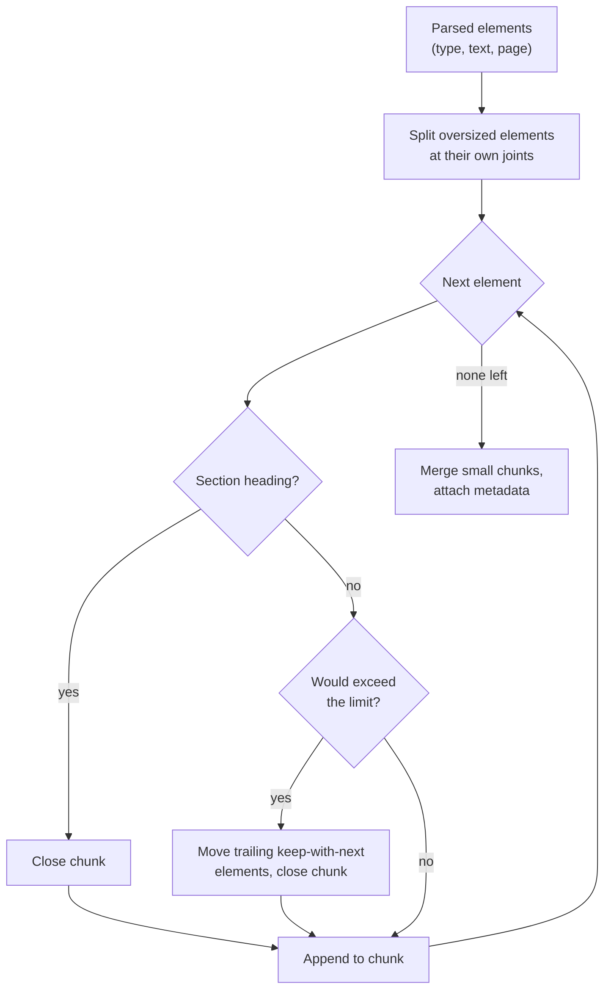

A runbook is not a string. It is a heading, a sentence of context, a list of prerequisites introduced by "make sure you have:", numbered steps, a block of shell commands, a warning, and a table of error codes. Each of those pieces has a shape, and some shapes break when cut: a table row without its header row is a list of unlabelled values, a shell script cut in half runs the first command and not the second, and "make sure you have:" at the end of one chunk promises a list that is in another chunk.

**Structure-aware chunking** builds chunks out of a document's *elements* instead of its characters. The document is first parsed into typed elements (headings, paragraphs, lists, tables, code blocks, notes); chunk boundaries may then fall only *between* elements, never inside the ones that must stay whole, and small rules keep related elements together. This lesson shows how to model elements, the packing algorithm and its rules, how to handle elements that are too big, and what goes wrong when structure is thrown away before chunking.

## Learning objectives

- Explain why boundaries placed between parsed elements are safer than boundaries placed in extracted plain text.
- Classify element types as atomic or divisible, and choose a fallback for each when an element exceeds the size limit.
- Implement a structure-aware packer with section breaks and keep-with-next rules, and compare its output with a recursive splitter on the same document.
- Describe how element metadata (type, page, section) should be carried onto chunks and used later.

## Prerequisites

- [Recursive character splitting](/learn/advanced-chunking-strategies/recursive-character-splitting): the baseline, and the fallback for oversized prose.
- [Document-aware chunking](/learn/advanced-chunking-strategies/document-aware-chunking): choosing a strategy per document type; this lesson works inside one document.
- [HTML parsing](/learn/advanced-document-parsing/html-parsing) and [Layout-aware parsing](/learn/advanced-document-parsing/layout-aware-parsing): where elements come from.
- [Unstructured](/learn/advanced-document-parsing/unstructured): an element-based parsing library, including its `chunk_by_title` chunker.

## Why this matters

Most ingestion pipelines throw structure away early. A parser produces rich output (an HTML tree, DOCX paragraphs with styles, PDF blocks with coordinates) and then the pipeline calls something like `get_text()` and hands a flat string to a splitter. From that point on, the splitter has to *guess* structure from newlines and full stops, and it guesses badly on exactly the content that matters most in technical documentation:

- **Tables** become one cell per line. A size-based cut can separate the header row ("Code, Meaning, Action") from the data rows, leaving a chunk that says "E-4021 / Client out of date / Update from the IT portal" with nothing to say which value is which. [Table chunking](/learn/advanced-chunking-strategies/table-chunking) goes further on tables; the first requirement is simply not to cut them blindly.
- **Code blocks** are cut between lines. A chunk containing the first command of a two-command procedure is worse than useless: someone may run it.
- **Lists and their lead-ins** separate. "Before you start, make sure you have:" ends one chunk and the list begins the next. Neither chunk answers "what do I need before renewing a certificate?".
- **Warnings** drift away from the step they qualify.
- **Headings** sink to the bottom of the previous chunk, as you saw in the recursive splitting lesson.

None of these failures shows up in chunk-size statistics. They show up as answers that are subtly wrong, in exactly the documents (runbooks, product documentation, reference tables) where users act on what they read.

## The intuition

Think of moving house with a removal van that holds a fixed volume. A careless packer pours everything into boxes by volume: half a bookshelf in one box, the other half in the next, the screws for the bed in a box with the kitchen plates. A careful packer works in *items*. Some items go into a box whole and are never taken apart (a lamp, a mirror). Some items can be dismantled if they are too big, but only at their joints (a bed comes apart into frame and slats, not sawn in half). Some items always travel together (the screws go in a bag taped to the bed frame). And each room gets its own set of boxes, labelled with the room's name.

Structure-aware chunking is the careful packer. Elements are the items, atomic elements are the mirrors, divisible elements come apart at their joints (list items, table rows, paragraphs' sentences), keep-with-next rules are the bag of screws, and sections are the rooms.

## How it works

### Step 1: get elements, not text

Every later step depends on having a list of typed elements in reading order. Where they come from depends on the format:

| Source | How elements are obtained | Reliability |
| --- | --- | --- |
| HTML | Walk the DOM: `h1` to `h6`, `p`, `ul`/`ol`, `table`, `pre`, `blockquote` | High, if the HTML is semantic rather than nested `div`s |
| DOCX | Paragraph styles (Heading 1, List Paragraph), tables, runs | High, if authors used styles |
| Markdown | A CommonMark parser's block tokens ([Markdown parsing](/learn/data-processing/markdown-parsing)) | High |
| PDF | Layout analysis: text blocks, fonts, positions, detected tables | Medium to low; depends on the parser |
| Scanned documents | OCR plus layout models | Lowest |

Element-producing libraries such as Unstructured (`partition` returns `Title`, `NarrativeText`, `ListItem`, `Table` and other element types) and Docling do this work for many formats at once. Whatever the source, each element should carry at least its **type**, its **text**, and its **provenance** (page number, position, or source line), because the chunk will inherit them.

### Step 2: decide which elements are atomic

Each element type is either **atomic** (never split while it fits) or **divisible at known joints**:

| Element | Default treatment | If larger than the limit |
| --- | --- | --- |
| Heading | Atomic; always starts or joins the following content | Not applicable in practice |
| Paragraph | Atomic if it fits | Split at sentences with a recursive splitter |
| List | Atomic if it fits | Split between items; repeat the lead-in sentence in each part |
| Table | Atomic if it fits | Split between rows; repeat the header row in each part |
| Code block | Atomic if it fits | Split between top-level statements or blank lines; see [code chunking](/learn/advanced-chunking-strategies/code-chunking) |
| Note, warning | Atomic; keep with the element it qualifies | Rarely needed |
| Image, figure | Caption or generated description, atomic | Not applicable |

The pattern in the right-hand column is important: when an element must be divided, it is divided at *its own* joints, and the context that makes each part intelligible (a table's header row, a list's lead-in) is **repeated** in each part.

### Step 3: pack elements into chunks

The packer walks the elements in order and accumulates them into a current chunk. Three kinds of rule decide when to close it:

- **Section break.** A heading at or above a chosen level always starts a new chunk, so content from two sections is never mixed. (Using the heading hierarchy to its full extent, with heading paths and nested sections, is the subject of [heading-based chunking](/learn/advanced-chunking-strategies/heading-based-chunking). Here a heading is simply a hard boundary.)
- **Size.** If adding the next element would push the chunk over the limit, the current chunk is closed first.
- **Keep-with-next.** Some elements must not be the *last* thing in a chunk because they introduce what follows: headings, and paragraphs that end with a colon ("make sure you have:"). When a chunk is closed for size, any such elements at its end are moved to the start of the next chunk. Word processors have long had the same rule for printed pages, under the same name.

Two further rules are common in production:

- **Merge small chunks.** A section consisting only of a heading and one short line is merged with the next section if both fit, as Unstructured's `combine_text_under_n_chars` does, so that fragments are not indexed alone.
- **Isolate some types.** Unstructured's `chunk_by_title` never combines a table with prose; each table becomes its own chunk. That is a choice, not a law: isolating tables keeps table chunks clean but separates a table from the sentence that explains it. Whichever you choose, apply it consistently.

### The algorithm, step by step

1. Parse the document into a list of typed elements in reading order.
2. Replace any element larger than the size limit by its parts, split at that element type's joints, with the shared context (header row, lead-in, heading) repeated in each part.
3. Start an empty current chunk.
4. For each element:
   1. If it is a section-starting heading and the current chunk is not empty, close the current chunk.
   2. Otherwise, if adding it would exceed the limit, move any trailing keep-with-next elements out of the current chunk, close the chunk, and start the next one with the moved elements.
   3. Append the element to the current chunk.
5. Close the final chunk.
6. Merge chunks below a minimum size with a neighbour in the same section, where the result fits.
7. Attach metadata to each chunk: the element types it contains, page range, section heading, and document identifiers.



### What the chunk remembers

Because chunks are built from elements, they can record facts a string splitter cannot: that chunk 4 contains a table, that it spans pages 3 to 4, that it belongs to the section "Error codes". These fields pay off later. Element types let you render tables as tables in citations, or route table chunks to a different index. Page numbers make citations checkable. Section names feed the context header described in [document-aware chunking](/learn/advanced-chunking-strategies/document-aware-chunking).

## In code

**The problem.** A short IT runbook arrives as HTML from the wiki. Chunk it twice with a 50-token limit: once by extracting plain text and running a recursive splitter (the common pipeline), and once with a structure-aware packer over parsed elements. Compare what each chunk contains.

**Dependencies.** BeautifulSoup for parsing, `tiktoken` for counting tokens, and `langchain-text-splitters` for the baseline. No API key and no model download. A 50-token limit is unrealistically small; it is used so that a short document exercises every rule.

```bash
pip install beautifulsoup4 tiktoken langchain-text-splitters
```

```python
from bs4 import BeautifulSoup
import tiktoken
from langchain_text_splitters import RecursiveCharacterTextSplitter

HTML = """
<h2>Renewing a VPN certificate</h2>
<p>Certificates expire every 90 days, together with your password.</p>
<p>Before you start, make sure you have:</p>
<ul><li>your laptop on a trusted network</li><li>access to the IT portal</li></ul>
<ol>
  <li>Open the IT portal and choose Certificates.</li>
  <li>Select Revoke next to the expired certificate.</li>
  <li>Run the renewal command below and restart the VPN client.</li>
</ol>
<pre><code>sudo meridian-vpn --renew --profile corporate
sudo systemctl restart meridian-vpn</code></pre>
<blockquote>Never renew a certificate on public Wi-Fi without the VPN.</blockquote>
<h2>Error codes</h2>
<table>
  <tr><th>Code</th><th>Meaning</th><th>Action</th></tr>
  <tr><td>E-4012</td><td>Certificate expired</td><td>Renew it (see above)</td></tr>
  <tr><td>E-4021</td><td>Client out of date</td><td>Update from the IT portal</td></tr>
</table>
"""

enc = tiktoken.get_encoding("cl100k_base")
ntok = lambda s: len(enc.encode(s))


# ---- 1. Parse into typed elements --------------------------------------------
def to_elements(html):
    out = []
    for el in BeautifulSoup(html, "html.parser").find_all(recursive=False):
        if el.name in ("h1", "h2", "h3"):
            out.append(("heading", el.get_text(strip=True)))
        elif el.name == "p":
            out.append(("paragraph", el.get_text(" ", strip=True)))
        elif el.name in ("ul", "ol"):
            items = [li.get_text(" ", strip=True) for li in el.find_all("li")]
            mark = (lambda i: f"{i}.") if el.name == "ol" else (lambda i: "-")
            out.append(("list", "\n".join(f"{mark(i)} {t}" for i, t in enumerate(items, 1))))
        elif el.name == "pre":
            out.append(("code", el.get_text()))
        elif el.name == "table":
            rows = [[c.get_text(strip=True) for c in tr.find_all(["th", "td"])] for tr in el.find_all("tr")]
            out.append(("table", "\n".join(" | ".join(r) for r in rows)))
        elif el.name == "blockquote":
            out.append(("note", "Note: " + el.get_text(" ", strip=True)))
    return out


# ---- 2. Pack elements into chunks, never cutting inside one ------------------
def keeps_with_next(kind, text):
    return kind == "heading" or (kind == "paragraph" and text.endswith(":"))

def pack(elements, max_tokens):
    chunks, current = [], []
    size = lambda els: ntok("\n".join(t for _, t in els))
    for i, (kind, text) in enumerate(elements):
        starts_section = kind == "heading"
        too_big = current and size(current + [(kind, text)]) > max_tokens
        # do not leave a heading or lead-in sentence stranded at the end of a chunk
        if (starts_section or too_big) and current:
            carry = []
            while current and keeps_with_next(*current[-1]) and not starts_section:
                carry.insert(0, current.pop())
            if current:
                chunks.append(current)
            current = carry
        current.append((kind, text))
    if current:
        chunks.append(current)
    return chunks


elements = to_elements(HTML)
print("elements:", [k for k, _ in elements])

print("\n--- structure-aware (max 50 tokens) ---")
for n, c in enumerate(pack(elements, max_tokens=50), 1):
    text = "\n".join(t for _, t in c)
    print(f"[{n}] {ntok(text):>2} tokens {[k for k, _ in c]}")

print("\n--- recursive splitter on extracted plain text (max 50 tokens) ---")
plain = BeautifulSoup(HTML, "html.parser").get_text("\n", strip=True)
rec = RecursiveCharacterTextSplitter(chunk_size=50, chunk_overlap=0,
                                     length_function=ntok).split_text(plain)
for n, c in enumerate(rec, 1):
    print(f"[{n}] {ntok(c):>2} tokens {c!r}")
```

```output
elements: ['heading', 'paragraph', 'paragraph', 'list', 'list', 'code', 'note', 'heading', 'table']

--- structure-aware (max 50 tokens) ---
[1] 41 tokens ['heading', 'paragraph', 'paragraph', 'list']
[2] 35 tokens ['list']
[3] 34 tokens ['code', 'note']
[4] 38 tokens ['heading', 'table']

--- recursive splitter on extracted plain text (max 50 tokens) ---
[1] 39 tokens 'Renewing a VPN certificate\nCertificates expire every 90 days, together with your password.\nBefore you start, make sure you have:\nyour laptop on a trusted network\naccess to the IT portal'
[2] 40 tokens 'Open the IT portal and choose Certificates.\nSelect Revoke next to the expired certificate.\nRun the renewal command below and restart the VPN client.\nsudo meridian-vpn --renew --profile corporate'
[3] 45 tokens 'sudo systemctl restart meridian-vpn\nNever renew a certificate on public Wi-Fi without the VPN.\nError codes\nCode\nMeaning\nAction\nE-4012\nCertificate expired\nRenew it (see above)'
[4] 15 tokens 'E-4021\nClient out of date\nUpdate from the IT portal'
```

**The important lines.**

- `find_all(recursive=False)` walks only the top-level elements, so a list or table is handled as one element rather than as its individual cells. Real wiki HTML is usually wrapped in `div`s and needs a deeper walk; the principle is the same.
- Each table becomes one element whose rows are joined by newlines and whose cells are joined by `" | "`, so the header row stays visibly attached to the data rows.
- `keeps_with_next` defines the two keep-with-next rules: headings, and paragraphs ending in a colon.
- In `pack`, `starts_section` implements the section break and `too_big` the size rule. The `while` loop moves trailing keep-with-next elements into `carry`, which becomes the start of the next chunk.
- The packer never splits an element; step 2 of the algorithm (splitting oversized elements at their joints) is left out to keep the example short, and exercise 3 adds it.

**What the output means.**

- **Recursive chunk 2 ends with half a code block** (`sudo meridian-vpn --renew ...`) and chunk 3 starts with the other half. Someone reading chunk 2 alone would renew the certificate and never restart the client.
- **The table is destroyed.** `get_text("\n")` put every cell on its own line, so the header cells "Code", "Meaning", "Action" sit in chunk 3 with the E-4012 row, and the E-4021 row is alone in chunk 4 with no header and no heading. A query for "E-4021" retrieves chunk 4, which does not say that these are error codes or which value is the action.
- **Sections are mixed.** Recursive chunk 3 contains the end of the renewal procedure, the warning, the "Error codes" heading and half the table.
- **The structure-aware chunks are coherent.** The lead-in "make sure you have:" stayed with its list (chunk 1); the numbered steps are one chunk; the code block is whole and kept with its warning; and the "Error codes" heading starts a new chunk containing the entire table.
- **It is not perfect.** Step 3 says "Run the renewal command below", but at this tiny limit the command is in the next chunk. A rule that keeps a code block with the list item that introduces it would fix this; real limits of a few hundred tokens usually make the problem disappear.

**Errors people commonly hit.**

- Extracting text before chunking. Once `get_text()` has run, the information needed for every rule above is gone; chunk from elements, and render text per element.
- Treating layout `div`s as paragraphs. Pages built from nested `div`s with classes produce one giant element or hundreds of tiny ones. Inspect the parsed element list before tuning the packer.
- Forgetting oversized atomic elements. A 3,000-token table is "never split" only until it exceeds the embedding model's limit; without a fallback it is silently truncated.
- Counting tokens of each element separately and summing. The joined text includes separators; count the text you will actually embed, as `size` does here.

**Extending it.** Add page numbers to elements (for a PDF parser, from each block's page) and record the page range on each chunk; then render a citation such as "Runbook: VPN certificates, p. 2". Frameworks offer related tools that were not run here: LangChain's `HTMLSemanticPreservingSplitter` keeps specified HTML elements (such as tables and lists) intact while splitting, Unstructured's `chunk_by_title` and `chunk_elements` pack its elements, and Docling provides hierarchical and hybrid chunkers over its document model. Check each library's current documentation for exact parameters.

## A real-world example

The Platform team migrated AskMeridian's ingestion of the Atlas product documentation from a PDF export to the documentation site's HTML. The first version kept the old pipeline shape: parse the HTML, call `get_text()`, split recursively at 400 tokens. Answer quality on error-code questions fell compared with the PDF version, which surprised everyone, since HTML is the cleaner source.

Reading the retrieved chunks explained it. The Atlas error-code catalogue is a set of long HTML tables, one row per code, with columns for code, meaning, cause and fix. The PDF parser had happened to emit each table row as one line; `get_text("\n")` emitted each *cell* as one line. The recursive splitter then cut tables between arbitrary cells, and roughly every other chunk began partway through a row. Questions such as "what does E-4021 mean?" retrieved a chunk containing "E-4021" followed by the meaning of the next code.

The fix was structure-aware chunking. Tables were extracted as elements; each table larger than the limit was split between rows with the header row repeated in every part; and each table chunk was prefixed with the heading of the section containing it. Code blocks and lists were made atomic, and lead-in sentences were kept with their lists. The team added a regression test to the ingestion pipeline: for a sample of pages, assert that no chunk boundary falls inside a table row or a code block. The test runs on every parser upgrade, because a parser change is exactly what caused the regression.

## Common mistakes

- **Flattening to text before chunking.** Structure discarded early cannot be recovered by clever splitting later.
- **Never splitting atomic elements, even when they are too big.** Oversized tables and code blocks are truncated by the embedding model; divide them at their joints with shared context repeated.
- **Splitting a table without repeating its header.** Data rows without column names are close to meaningless to both retriever and generator.
- **Separating lead-ins from lists and warnings from steps.** Both read as complete text and fail silently.
- **Trusting the parser blindly.** A PDF parser that misses a table, or HTML built from `div`s, yields wrong elements; check the element list on samples from every source.
- **Dropping element metadata.** Without type and page on each chunk you cannot render, filter or cite precisely.

## Best practices

- Keep the parser's element list as an intermediate artefact, store it, and chunk from it; never chunk from extracted plain text when structure is available.
- Write down, per element type, whether it is atomic and how it is divided when oversized, and repeat shared context in every part.
- Use headings as hard section boundaries and keep-with-next rules for headings and lead-in sentences.
- Merge fragments below a minimum size with their neighbour in the same section.
- Record element types, page ranges and section names on each chunk.
- Add ingestion tests that assert boundaries never fall inside table rows or code blocks, and run them on parser upgrades.

## Performance considerations

Structure-aware chunking moves cost from the chunker to the parser. Walking a DOM or a list of DOCX paragraphs is cheap, comparable to text extraction. Layout analysis of PDFs is not: model-based layout and table detection can take on the order of a second or more per page on a CPU (an assumption that varies widely by tool and hardware), which for 100,000 pages is more than a day of single-core time. That cost is incurred for parsing, though, not for chunking; if you already run a layout-aware parser, structure-aware chunking adds almost nothing.

The packer itself is a single pass over the elements. Counting tokens is the main cost, and the example recounts the whole current chunk for every element, which is quadratic in the number of elements per chunk. For large documents, keep a running token total and count each element once (plus the separator), which makes the pass linear.

Chunk sizes become less uniform, because the packer closes chunks at section and element boundaries rather than filling them. Expect a lower average fill than a recursive splitter and therefore somewhat more chunks for the same limit; the extra embedding and storage cost is proportional to that increase.

## Security considerations

Parsed structure includes content that plain-text extraction may silently drop and that you may not want to index: hidden elements, HTML comments, `display: none` text, alt text, and tracked changes or comments in DOCX files. Hidden text is also a known channel for prompt injection, because it is invisible to human reviewers but visible to the model. Decide explicitly which element types are indexed, strip hidden and non-rendered content, and log element types per chunk so that unexpected content can be audited.

## Summary

- Structure-aware chunking packs typed elements (headings, paragraphs, lists, tables, code, notes) into chunks, placing boundaries only between elements.
- Atomic elements stay whole while they fit; oversized ones are divided at their own joints with shared context (header rows, lead-ins) repeated.
- Section breaks and keep-with-next rules stop sections mixing and stop headings and lead-ins being stranded.
- Flattening documents to text before chunking destroys tables, code blocks and lists in ways that size statistics never reveal.
- Chunks built from elements can carry type, page and section metadata for rendering, filtering and citation.

## Exercises

**1.** A document's element list is: heading (5 tokens), paragraph (30), paragraph ending in a colon (10), list (25), table (40). With a 60-token limit, headings as section breaks and the keep-with-next rules from the lesson, which chunks does the packer produce? Ignore separator tokens.

<details><summary>Show solution</summary>

- heading (5) + paragraph (30) = 35; adding the colon paragraph gives 45; adding the list would give 70 > 60. The trailing colon paragraph is a keep-with-next element, so it is moved: chunk 1 = heading + paragraph (35).
- The new chunk starts with the colon paragraph (10) + list (25) = 35. Adding the table gives 75 > 60; the list is not keep-with-next, so chunk 2 = colon paragraph + list.
- Chunk 3 = table (40).

</details>

**2.** Your team isolates every table as its own chunk, as Unstructured's `chunk_by_title` does. Users complain that answers about the expenses limits table never mention the sentence above it: "Limits below apply per person, per day, and exclude VAT." Propose two fixes and their trade-offs.

<details><summary>Show solution</summary>

(1) Treat a paragraph immediately before a table as keep-with-next, so the explanatory sentence joins the table chunk. Simple, but a long preceding paragraph may push the table over the limit. (2) Keep tables isolated but add a context header to each table chunk containing the section heading and the preceding sentence (or a caption, if the table has one). This keeps table chunks clean and small, at the cost of duplicating that sentence in the index. Both need the "per person, per day, excluding VAT" qualification to reach the generator, which is what matters.

</details>

**3.** Extend `pack` so that a `table` element larger than `max_tokens` is first split into parts of whole rows, each part starting with the header row. Test it on a table with ten data rows and a 40-token limit.

<details><summary>Show solution</summary>

```python
def split_table(text, max_tokens):
    header, *rows = text.split("\n")
    parts, current = [], [header]
    for row in rows:
        if len(current) > 1 and ntok("\n".join(current + [row])) > max_tokens:
            parts.append("\n".join(current))
            current = [header]
        current.append(row)
    parts.append("\n".join(current))
    return parts

def expand(elements, max_tokens):
    out = []
    for kind, text in elements:
        if kind == "table" and ntok(text) > max_tokens:
            out += [("table", part) for part in split_table(text, max_tokens)]
        else:
            out.append((kind, text))
    return out

rows = "\n".join(f"E-40{i:02d} | Example meaning {i} | Example action {i}" for i in range(10))
table = "Code | Meaning | Action\n" + rows
for part in split_table(table, 40):
    print(ntok(part), part.split("\n")[0], "...", part.split("\n")[-1][:6])
```

```output
35 Code | Meaning | Action ... E-4001
35 Code | Meaning | Action ... E-4003
35 Code | Meaning | Action ... E-4005
35 Code | Meaning | Action ... E-4007
35 Code | Meaning | Action ... E-4009
```

Call `pack(expand(elements, max_tokens), max_tokens)`. Every part begins with "Code | Meaning | Action", and no row is split. If a single row with its header exceeds the limit, it is emitted alone; at that point the row itself needs a different representation, as discussed in table chunking.

</details>

**4.** Design decision. AskMeridian is adding scanned PDF policy letters processed by OCR, for which the layout parser's element types are often wrong (headings detected as paragraphs, tables as text). Should you use structure-aware chunking for them? Describe what you would measure before deciding.

<details><summary>Show solution</summary>

Structure-aware chunking is only as good as its elements. If headings and tables are misdetected, the packer's rules fire in the wrong places, and a recursive splitter may do as well or better. Measure element quality first: on a sample of letters, label the true headings, tables and lists and compute the parser's precision and recall for each element type. If heading detection is reliable but table detection is not, use headings as section breaks and treat everything else as prose. Then compare both chunkers on labelled queries over the letters. Since letters are short and usually single-subject, one chunk per letter (split only if too long) is also a strong candidate.

</details>

## Check your understanding

```quiz
[
  {
    "q": "What is the defining rule of structure-aware chunking?",
    "options": [
      "Chunks always contain exactly one element",
      "Chunk boundaries may fall only between parsed elements, and some elements are never split while they fit",
      "Every chunk has the same number of tokens",
      "Boundaries are placed where embedding similarity drops"
    ],
    "answer": 1,
    "why": "Chunks are built from typed elements; atomic elements stay whole and boundaries fall between elements."
  },
  {
    "q": "A table of 30 rows exceeds the chunk limit. What is the recommended way to divide it?",
    "options": [
      "Split it into groups of whole rows and repeat the header row at the start of each group",
      "Split it at the token limit, wherever that falls",
      "Drop rows until it fits",
      "Index only the header row"
    ],
    "answer": 0,
    "why": "Tables are divided at their joints (rows), and the header row is repeated so each part remains interpretable."
  },
  {
    "q": "Why is the paragraph \"Before you start, make sure you have:\" treated as keep-with-next?",
    "options": [
      "It is shorter than the minimum chunk size",
      "Paragraphs ending in punctuation are always headings",
      "Colons are not allowed at the end of a chunk by tokenisers",
      "It introduces the list that follows, and is meaningless at the end of a chunk without it"
    ],
    "answer": 3,
    "why": "A lead-in sentence promises content that follows; separating them leaves neither chunk able to answer the question."
  },
  {
    "q": "A pipeline parses HTML, calls get_text(\"\\n\") and then runs a recursive splitter. Which failure is most likely on a page with a large table?",
    "options": [
      "The table is dropped entirely",
      "The splitter raises an error on table markup",
      "Cells end up one per line and chunks are cut between cells, separating values from their column headers",
      "The table is duplicated in every chunk"
    ],
    "answer": 2,
    "why": "Text extraction flattens the table, and the splitter has no way of knowing where rows begin or which cells are headers."
  },
  {
    "q": "Which statement about isolating tables as their own chunks is correct?",
    "options": [
      "It is required by every vector database",
      "It keeps table chunks clean but can separate a table from the sentence that explains it, so that context may need to be carried in another way",
      "It always improves retrieval",
      "It makes tables impossible to retrieve lexically"
    ],
    "answer": 1,
    "why": "Isolation is a trade-off; explanatory text can be restored with keep-with-next rules or a context header."
  }
]
```

## Further reading

- Unstructured documentation, "Chunking" (`chunk_elements` and `chunk_by_title`, and their parameters): [docs.unstructured.io](https://docs.unstructured.io/).
- Docling documentation, "Chunking" (hierarchical and hybrid chunkers over the Docling document model): [docling-project.github.io/docling](https://docling-project.github.io/docling/).
- LangChain documentation, "How to split HTML" (`HTMLHeaderTextSplitter`, `HTMLSectionSplitter` and `HTMLSemanticPreservingSplitter` in `langchain-text-splitters`).
- Beautiful Soup documentation: [crummy.com/software/BeautifulSoup/bs4/doc](https://www.crummy.com/software/BeautifulSoup/bs4/doc/).
- Manning, C. D., Raghavan, P. and Schütze, H. (2008). *Introduction to Information Retrieval*, Cambridge University Press, chapter 10 ("XML retrieval"), on retrieving structured elements rather than whole documents.
