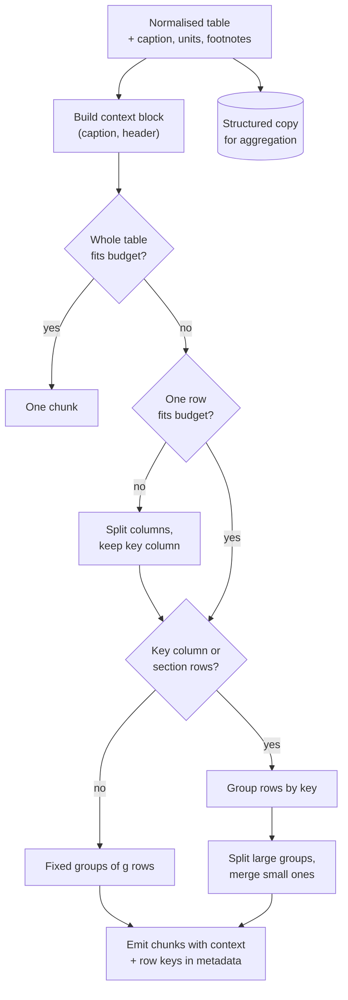

A table packs many facts into a small space, and every one of those facts depends on two things outside its own cell: the column header that says what the value is, and the row key that says what it is about. Chunking a table therefore has its own rules. Cut it like prose and rows lose their headers; keep it whole and a large table becomes one oversized chunk whose embedding describes everything and nothing, and which the embedding model may silently truncate.

Earlier lessons covered the steps on either side of this one. [Tables and structured content](/learn/advanced-document-parsing/tables-and-structured-content) showed how to extract a table's grid from PDFs, HTML and Word files, and [Tables](/learn/multimodal-ingestion/tables) compared ways of representing a table as text (whole Markdown tables, row records, summaries) and explained when to keep a structured copy for aggregation questions. This lesson is about the decision in between: **where to put the chunk boundaries in a table**. How many rows go in a chunk, which rows belong together, what to do with very wide tables, and what context every chunk must carry. You will measure the effect of these choices on a Meridian error-code catalogue.

## Learning objectives

- Compute the number of rows that fit in a chunk from the token budget, the context size, the header size and the average row size.
- Compare whole-table, single-row, fixed row-group and key-based row-group chunking, and explain the retrieval and cost trade-off of each.
- Detect when a table chunk exceeds the embedding model's input limit and explain what truncation does to retrieval.
- Split a wide table into column groups that each keep the row key.
- Design the context (caption, section path, header, units, footnotes) that every table chunk carries.

## Prerequisites

- [Tables](/learn/multimodal-ingestion/tables): row records, Markdown tables, summaries, and keeping a structured copy.
- [Markdown chunking](/learn/advanced-chunking-strategies/markdown-chunking): splitting a pipe table between rows with the header repeated.
- [Chunk size](/learn/chunking-fundamentals/chunk-size): budgets and the embedding model's input limit.
- [Embeddings](/learn/understanding-large-language-models/embeddings): one vector per chunk, and why a vector of many topics is a blurry match for any one of them.

## Why this matters

Tables hold the facts users ask about most directly: error codes and fixes, plan features, price lists, approval limits. A question such as "what does Atlas error E-4030 mean?" has a single-row answer, and a system that cannot find that row looks broken. Three failures are common, each from a chunking decision:

1. **Headerless fragments.** A size-based splitter cuts a table after row 17, and the next chunk starts at row 18 with no header. The model must guess what each column means, and a column of numbers (a limit? a price?) cannot be guessed.
2. **Blurred whole-table embeddings.** A 200-row table kept as one chunk has one vector for 200 facts. A question about one row competes with every other chunk on the strength of 1/200th of a chunk's content.
3. **Silent truncation.** Embedding models have a maximum input length, and text beyond it is cut off, usually without an error. The last rows of a long chunk are invisible to retrieval, however exact the query.

None of these shows up in a casual test, because people test with the first few rows.

## The intuition

Think of a large printed catalogue of error codes. Nobody photocopies the whole catalogue to answer one question, and nobody cuts out a single line without its column headings. You photocopy **the page with the answer, with the heading row at the top and the catalogue's title in the corner**.

Good table chunks are those photocopies: title, header, and a manageable set of rows. Which rows share a page matters too. A catalogue with one page per section (all VPN errors, then all Sync errors) is easier to use than one that turns the page every eight lines regardless of section. That is the difference between fixed-size and key-based row groups.

## How it works

### Three questions for every table

For each table the chunker must answer:

1. **Does the whole table fit in one chunk, with its context, under the embedding model's limit?** If it does and it is small (a handful of rows), one chunk is usually best: the generator sees everything, which also makes questions over several rows answerable.
2. **If not, which rows go together?** Fixed-size groups, or groups that follow a key column or the table's own sections.
3. **Is the table too wide, so that even a few rows exceed the budget?** If so, columns must be split too.

### The context every chunk carries

A table chunk must make sense without the rest of the document. It carries:

- **A caption line**: the table's title or caption, plus the document and section path (`Atlas error-code catalogue (IT runbooks > Atlas platform > Error codes)`). Without it, a row group of error codes from Atlas and one from Meridian Relay's own catalogue are indistinguishable.
- **The header row** (and, for Markdown output, the delimiter row), repeated on every chunk.
- **Units and footnotes that apply to the rows**: "all amounts in pounds, excluding VAT", "* Enterprise plan only". Footnotes that change the meaning of a value must travel with the row, not stay at the bottom of the table where only the last chunk sees them.
- **A group label** when rows are grouped by key: ` - VPN`, appended to the caption.
- **Metadata** (not embedded): table identifier, row keys and source location, so the whole table or neighbouring rows can be fetched later.

### Fixed row groups versus key-based groups

**Fixed row groups** put $g$ consecutive rows in each chunk, with $g$ chosen from the budget (see the mathematics below). They are simple and predictable, but the boundaries are arbitrary: a group may hold the last two Sign-in errors and the first two Sync errors.

**Key-based groups** split where a key column changes value (Component, Region, Plan, Department), or at the table's own section rows (a full-width row such as "VPN errors" that labels the rows below it). Each chunk is then about one thing, its embedding is coherent, and the group label adds a strong retrieval signal. If one key value has more rows than fit, fall back to fixed groups within that key, repeating the label. If keys produce many tiny groups, merge adjacent small groups up to the budget.

Key-based grouping needs rows sorted or sectioned by the key; if they are not, sort a copy first and keep the original order in metadata if it matters.

**Single-row chunks** (often written as the row records of [Tables](/learn/multimodal-ingestion/tables)) give the sharpest embedding for one row but pay the caption and header overhead on every row, and a question spanning two rows needs two retrievals.

### Wide tables: splitting columns

A comparison table with 30 feature columns can exceed the budget with one row. Split it **vertically** into column groups, each repeating the **key column** that identifies the row (Plan, Code, Employee): one chunk might hold `Plan | Max users | Data retention` and another `Plan | SAML single sign-on | Audit log`. Group columns that belong together (a two-level header often says how) and put the group name in the caption.

### Exact lookups do not need embeddings

A question that quotes a key ("E-4030", a part number, an employee ID) is best answered by an exact match, not by similarity: put the row keys into the keyword index and into chunk metadata, so that keyword search or a metadata filter finds the chunk containing E-4030 directly. Embeddings then do the job they are good at, which is matching questions that describe the row ("VPN fails in a hotel with a login page"). Most production systems use both; see [Dense versus sparse retrieval](/learn/hybrid-search/dense-versus-sparse-retrieval).

### The chunking procedure

1. Take the extracted, normalised table (header resolved, merged cells handled, multi-page parts stitched), with its caption, section path, units and footnotes.
2. Build the context block: caption with section path, header, applicable footnotes. Measure its tokens with the embedding model's tokeniser.
3. If context plus all rows fits the budget, emit the whole table as one chunk. Stop.
4. If context plus one row exceeds the budget, split the columns into groups that each keep the key column, and run the rest of the procedure once per column group.
5. If the table has a key column or section rows, group rows by key; otherwise use fixed groups of $g$ rows, with $g$ computed from the budget.
6. Split any group that is still over budget into fixed groups; merge adjacent small groups up to the budget.
7. Emit each group with the context block (plus group label), and record the table identifier and row keys as metadata.
8. Store the full table as structured data for aggregation questions and for expansion at answer time.



### At answer time

Small chunks are best for finding rows, not always for answering. When a question needs neighbouring rows, use the table identifier to fetch adjacent groups or the whole table: the small-to-big pattern of [Parent-child chunking](/learn/chunking-optimisation/parent-child-chunking).

## The mathematics

### How many rows fit in a chunk

**Intuition.** Every chunk spends part of its budget on context (caption and header), which is the same for every chunk, and the rest on rows. Divide the remainder by the size of a row.

$$
g = \left\lfloor \frac{B - c - h}{v} \right\rfloor
\qquad
n = \left\lceil \frac{r}{g} \right\rceil
\qquad
T_{\text{index}} \approx n\,(c + h) + r\,v
$$

- $B$ is the chunk budget in tokens.
- $c$ is the caption (with section path) in tokens; $h$ is the header and delimiter rows.
- $v$ is the average tokens per row; $r$ is the number of rows.
- $g$ is the number of rows per chunk, $n$ the number of chunks, and $T_{\text{index}}$ the total tokens embedded for the table.

The tokens returned for one retrieved chunk are about $c + h + g\,v$: that is what each hit costs in the prompt.

**By hand.** For the 24-row Atlas catalogue used below, measured with a common tokeniser: $c = 15$, $h = 18$, $v \approx 21.25$. With a budget of $B = 200$:

- $g = \lfloor (200 - 15 - 18) / 20.9 \rfloor = \lfloor 167 / 21.25 \rfloor = \lfloor 7.86 \rfloor = 7$ rows per chunk.
- $n = \lceil 24 / 7 \rceil = 4$ chunks.
- $T_{\text{index}} \approx 4 \times 33 + 24 \times 21.25 = 132 + 510 = 642$ tokens.
- Each retrieved chunk costs about $33 + 7 \times 21.25 \approx 182$ tokens.

The whole table as one chunk would be $33 + 510 = 543$ tokens, so chunking costs about $642 / 543 \approx 1.18$ times the tokens to embed: modest, because the context is small compared with the rows. With a long caption or a header full of long column names, the overhead grows, and single-row chunks multiply it by $r$.

Note the floor: $167/21.25$ is just under 8, so 7 rows fit, not 8. Averages hide variation; real rows differ in length, so in code you pack rows one at a time against the budget, as the [Markdown chunking](/learn/advanced-chunking-strategies/markdown-chunking) table splitter does, and use the formula only for planning.

```python
import math

B, c, h, v, r = 200, 15, 18, 21.25, 24          # budget, caption, header, row, rows
g = math.floor((B - c - h) / v)
chunks = math.ceil(r / g)
index_tokens = chunks * (c + h) + r * v
print(f"rows per chunk g = {g}")
print(f"chunks = {chunks}, index tokens ~ {index_tokens:.0f}")
print(f"tokens per retrieved chunk ~ {c + h + g * v:.0f}")
print(f"overhead vs one whole table: {index_tokens / (c + h + r * v):.2f}x")
```

```output
rows per chunk g = 7
chunks = 4, index tokens ~ 642
tokens per retrieved chunk ~ 182
overhead vs one whole table: 1.18x
```

## In code

**The problem.** The Atlas error-code catalogue has 24 rows across six components. Ten questions describe a problem in the user's words, each answered by one row. The index also contains eight short handbook sentences as distractors, so that the table chunks compete with other content as they would in a real index. Compare whole-table, single-row, fixed-group and key-group chunking on whether the chunk holding the answer row is ranked first (hit@1) or in the top three (hit@3), how many tokens the top chunk costs, and whether any chunk exceeds the embedding model's input limit.

**Dependencies.** `sentence-transformers` with the local `all-MiniLM-L6-v2` model, `tiktoken` for counting prompt tokens, and NumPy.

```bash
pip install sentence-transformers tiktoken numpy
```

```python
# table_chunks.py
from itertools import groupby
import numpy as np
import tiktoken
from sentence_transformers import SentenceTransformer

CAPTION = "Atlas error-code catalogue (IT runbooks > Atlas platform > Error codes)"
HEADER = ["Code", "Component", "Meaning", "Action"]
ROWS = [
    ["E-1001", "Sign-in", "Password incorrect", "Retype it or use the reset link"],
    ["E-1002", "Sign-in", "Password expired after 90 days", "Choose a new password"],
    ["E-1003", "Sign-in", "Account locked after failed attempts", "Wait 15 minutes or call the support desk"],
    ["E-1010", "Sign-in", "Single sign-on assertion rejected", "Ask IT to check the SAML settings"],
    ["E-2001", "Meridian Sync", "Folder quota exceeded", "Delete files or request more space"],
    ["E-2002", "Meridian Sync", "File name contains invalid characters", "Rename the file"],
    ["E-2003", "Meridian Sync", "Conflicting edits on two devices", "Pick the version to keep"],
    ["E-2004", "Meridian Sync", "Device not authorised", "Register the laptop in the portal"],
    ["E-3001", "Meridian Reports", "Export too large for PDF", "Export as CSV instead"],
    ["E-3002", "Meridian Reports", "Scheduled report owner has left", "Reassign the schedule"],
    ["E-3003", "Meridian Reports", "Data source timed out", "Retry outside peak hours"],
    ["E-3004", "Meridian Reports", "Feature needs the Enterprise plan", "Contact your account manager"],
    ["E-4012", "VPN", "VPN certificate expired", "Request a new certificate from the IT portal"],
    ["E-4021", "VPN", "VPN client is out of date", "Update it from the IT portal"],
    ["E-4030", "VPN", "Connection blocked on public Wi-Fi captive portal", "Accept the portal terms, then reconnect"],
    ["E-4100", "VPN", "Too many simultaneous sessions", "Disconnect another device"],
    ["E-5001", "Meridian Relay", "Webhook endpoint returned an error", "Check the receiving service logs"],
    ["E-5002", "Meridian Relay", "Message larger than the size limit", "Split the payload"],
    ["E-5003", "Meridian Relay", "Retry limit reached for a delivery", "Replay it from the dead-letter queue"],
    ["E-5004", "Meridian Relay", "Signing secret mismatch", "Rotate the secret on both sides"],
    ["E-6001", "Laptop", "Disk encryption not enabled", "Run the encryption tool from IT"],
    ["E-6002", "Laptop", "Operating system out of support", "Book a laptop refresh"],
    ["E-6003", "Laptop", "Device reported lost", "Contact the support desk at once"],
    ["E-6004", "Laptop", "Battery health below threshold", "Request a battery replacement"],
]
QUESTIONS = {   # question -> code of the row that answers it
    "My password is too old and Atlas will not let me in": "E-1002",
    "I typed my password wrong too many times and now I am locked out": "E-1003",
    "Sync says my folder is full": "E-2001",
    "I edited the same file on my desktop and my laptop": "E-2003",
    "The PDF export of my report fails because it is too big": "E-3001",
    "The colleague who owned a scheduled report left the company": "E-3002",
    "My VPN client is out of date and will not connect": "E-4021",
    "VPN does not connect in a hotel with a login page": "E-4030",
    "Relay keeps retrying a webhook and then gives up": "E-5003",
    "Atlas says my operating system is no longer supported": "E-6002",
}
DISTRACTORS = [
    "Annual leave is 25 days a year; up to 5 unused days carry over to 31 March.",
    "Staff may work remotely up to 3 days a week.",
    "The home-office equipment budget is 400 pounds; contractors are not eligible.",
    "Expenses must be submitted within 30 days; anything over 75 pounds needs a receipt.",
    "Passwords must be rotated every 90 days.",
    "The VPN is required whenever you use public Wi-Fi.",
    "Laptops are refreshed every 3 years.",
    "The support desk is open 08:00 to 18:00 UK time.",
]

enc = tiktoken.get_encoding("cl100k_base")
ntok = lambda s: len(enc.encode(s))
pipe = lambda cells: "| " + " | ".join(cells) + " |"

def make_chunk(rows, label=""):
    """Caption, header and delimiter repeated on every chunk, then the rows."""
    head = [CAPTION + label, pipe(HEADER), pipe(["---"] * len(HEADER))]
    return "\n".join(head + [pipe(r) for r in rows]), {r[0] for r in rows}

def fixed_groups(rows, g):
    return [make_chunk(rows[i:i + g]) for i in range(0, len(rows), g)]

def key_groups(rows, col=1):                 # one chunk per Component value
    return [make_chunk(list(grp), f" - {key}")
            for key, grp in groupby(rows, key=lambda r: r[col])]

model = SentenceTransformer("sentence-transformers/all-MiniLM-L6-v2")
questions = list(QUESTIONS)
gold = [QUESTIONS[q] for q in questions]
q_vecs = model.encode(questions, normalize_embeddings=True)

def evaluate(name, table_chunks):
    chunks = table_chunks + [(d, set()) for d in DISTRACTORS]
    vecs = model.encode([text for text, _ in chunks], normalize_embeddings=True)
    order = np.argsort(-(q_vecs @ vecs.T), axis=1)
    n = len(questions)
    hit1 = np.mean([gold[i] in chunks[order[i, 0]][1] for i in range(n)])
    hit3 = np.mean([any(gold[i] in chunks[j][1] for j in order[i, :3]) for i in range(n)])
    tok_top1 = np.mean([ntok(chunks[order[i, 0]][0]) for i in range(n)])
    longest = max(len(model.tokenizer(t)["input_ids"]) for t, _ in table_chunks)
    print(f"{name:>13} {len(table_chunks):>6} {hit1:>6.1f} {hit3:>6.1f} {tok_top1:>9.0f} {longest:>8}")

print(f"model input limit: {model.max_seq_length} tokens")
print(f"{'grouping':>13} {'chunks':>6} {'hit@1':>6} {'hit@3':>6} {'tok/top-1':>9} {'longest':>8}")
for g in [1, 4, 8, 24]:
    evaluate(f"{g} rows", fixed_groups(ROWS, g))
evaluate("by component", key_groups(ROWS))
```

```output
model input limit: 256 tokens
     grouping chunks  hit@1  hit@3 tok/top-1  longest
       1 rows     24    0.7    0.9        46       73
       4 rows      6    0.8    1.0        96      140
       8 rows      3    0.7    1.0       146      222
      24 rows      1    0.5    0.9       277      564
 by component      6    0.8    1.0       100      143
```

The `transformers` library also prints a warning to standard error: `Token indices sequence length is longer than the specified maximum sequence length for this model (564 > 256)`. That warning is the most important line of the run.

**What the important lines do.**

- `make_chunk` writes every chunk the same way: caption (plus optional group label), header row, delimiter row, then the rows. It also returns the set of codes in the chunk, which is how the evaluation knows whether the answer row was retrieved.
- `fixed_groups` slices consecutive rows; `key_groups` uses `itertools.groupby` on the Component column, which works because the catalogue is sorted by component. Unsorted rows would produce repeated groups for the same key.
- `evaluate` embeds the table chunks together with the distractors, ranks all chunks for each question by cosine similarity (the vectors are normalised, so the dot product is the cosine), and checks whether the gold code is in the top chunk or the top three.
- `tok/top-1` is the average size of the top-ranked chunk in `cl100k_base` tokens: the prompt cost of using it. `longest` is the longest table chunk measured with the embedding model's own tokeniser, which is what the 256-token limit applies to.

**What the output means.** Read it with the sample size in mind: ten questions, so each question is 0.1 of hit@1, and a difference of 0.1 is one question. Treat this as a demonstration of mechanisms, not a benchmark.

- **The whole table is the worst at rank 1 (0.5) and the most expensive (277 tokens per hit).** Part of the reason is blur: one vector stands for 24 facts. The other part is visible in the `longest` column: the chunk is 564 tokens in the model's tokeniser and the model reads only 256, so roughly the second half of the table was never embedded. The Relay and Laptop rows could only be found through whatever the first half happens to share with the question.
- **Single rows are sharp but not the best here (0.7 hit@1, 0.9 hit@3).** Each row chunk is small and focused, but short chunks are also easily outscored by short distractors with overlapping words, and every row pays the caption and header overhead.
- **Groups of four do better (0.8 hit@1, 1.0 hit@3) at moderate cost; groups of eight are less reliable (0.7 hit@1, 1.0 hit@3).** Groups of four happen to coincide with the six components, because each component has four rows, whereas groups of eight straddle component boundaries and blur two subjects into one vector.
- **Grouping by component ties for best (0.8 hit@1, 1.0 hit@3) at about 100 tokens per hit.** Each chunk is about one subject, and the label (` - VPN`) in the caption gives the embedding a strong cue. With ten questions it cannot be separated from groups of four on this run; the point is that both stay near 100 tokens per hit while the whole table costs nearly three times that.

The two questions that key groups miss at rank 1 ("I typed my password wrong too many times…" and "VPN does not connect in a hotel with a login page") are outscored by the handbook sentences about rotating passwords every 90 days and about needing the VPN on public Wi-Fi, a reminder that table chunks compete with everything else in the index.

**Common errors.**

- Measuring budgets with one tokeniser and embedding with another. The table here is 277 tokens to `cl100k_base` but 564 to the MiniLM tokeniser, because the latter splits codes such as `E-4030` and many words into more pieces. Always check the limit with the embedding model's own tokeniser.
- Ignoring the truncation warning. Sentence Transformers truncates to `max_seq_length` and carries on; the warning comes from the tokenizer and is easy to lose in logs.
- Using `groupby` on unsorted rows, which splits one key into several groups.

**Extending it.** Add key groups that fall back to fixed groups inside a large key; add a BM25 index over the row keys and check that questions quoting a code ("what is E-4030?") are answered by keyword search; and grow the table to a few hundred rows with more questions to get numbers you can trust.

## A real-world example

The Atlas error-code catalogue started as a page in the IT runbooks with a few dozen rows. AskMeridian's ingestion kept tables whole if they were under 2,000 characters and split them like prose otherwise. Over a year the catalogue grew past a hundred rows, and the support desk noticed a pattern: AskMeridian answered questions about sign-in and Sync errors well, but for laptop and Relay errors it either said it did not know or quoted the wrong row.

Jonas, on the Platform team, checked the chunks for the catalogue. The prose splitter had cut the table every 2,000 characters; only the first chunk had the header row, and the embedding model's input limit truncated each chunk about halfway. The rows that failed were the ones that sat in the second half of a chunk or in a headerless chunk, which explained why the errors at the top of the table worked and those lower down did not.

The fix had three parts: key groups by component, each with caption, section path and header, budgeted with the embedding model's tokeniser; error codes in metadata and the keyword index for exact matches; and a structured copy of the catalogue for "list all VPN errors". He also added an ingestion check that fails the build if any chunk exceeds the model's input limit.

## Common mistakes

- **Splitting tables with a prose splitter.** Only the first chunk keeps the header; the rest are columns of unlabelled values.
- **Keeping large tables whole.** One vector stands for many unrelated rows, and the chunk may exceed the embedding model's input limit, so later rows are never embedded.
- **Measuring the budget with the wrong tokeniser.** Tables full of codes, numbers and punctuation tokenise very differently across tokenisers; a budget that is safe in one can be double the limit in another.
- **Dropping the caption and section path.** Two row groups from different tables with the same columns become indistinguishable.
- **Leaving footnotes and units at the bottom.** A row that says "40" without "thousand pounds, excluding VAT" is misread.
- **Expecting top-k to answer "list all…" questions.** Retrieval returns some matching rows, not all of them; route aggregation to a structured copy.
- **Splitting wide tables without the key column in each part.** Column groups without the row key cannot be joined back or understood.

## Best practices

- Repeat caption, section path, header and relevant footnotes in every table chunk.
- Prefer key-based row groups; fall back to fixed groups computed from the budget.
- Check every chunk against the embedding model's own tokeniser and fail ingestion when one exceeds the limit.
- Put row keys in metadata and in the keyword index for exact lookups.
- Keep a structured copy of every significant table, and link chunks to it with a table identifier for expansion and aggregation.
- Evaluate with questions phrased the way users ask, including questions about rows near the bottom of large tables.

## Performance considerations

The number of table chunks is $n = \lceil r / g \rceil$ per column group, and each chunk adds $c + h$ tokens of repeated context. For tables with short rows and a long caption and header, that overhead dominates. As an illustration, with $c + h = 60$ tokens and rows of 10 tokens, single-row chunks embed 70 tokens per row, seven times the row content, while groups of ten embed $60 + 100 = 160$ tokens per ten rows, 1.6 times. Embedding cost scales with tokens, so the group size directly sets the embedding bill for table-heavy corpora.

At query time, the cost that matters is prompt tokens: each retrieved table chunk costs $c + h + g\,v$. If your prompt takes the top five chunks and table chunks are 300 tokens each, tables can fill most of the context. Smaller groups at retrieval, with expansion only when needed, keep prompts small.

Tables of thousands of rows often should not be fully embedded: if most questions are key lookups or aggregations, a structured store answers them more cheaply and reliably. Embed a summary and some row groups so retrieval can find the table, and let the structured path do the rest.

## Security considerations

- **Row-level sensitivity.** Tables often mix public and restricted rows (salary bands, customer contracts). Chunk so that rows with different access levels land in different chunks, and carry the access label in each chunk's metadata.
- **Personal data in tables.** Staff lists, rotas and expense reports are tables of personal data. Decide before indexing whether they should be in the assistant at all, and apply [PII detection](/learn/access-control-and-privacy/pii-detection) to cell values, which are easy to miss when scanning prose.
- **Aggregation leaks.** A structured copy that answers "average salary in team X" can reveal individuals in small groups; apply permissions and minimum group sizes there too.

## Summary

- Table chunks must carry their caption, section path, header and relevant footnotes, because a cell means nothing without its column and row context.
- Rows per chunk follow from the budget: $g = \lfloor (B - c - h)/v \rfloor$; pack against real row sizes in code.
- Whole large tables blur the embedding and may be truncated by the model's input limit, making later rows unfindable.
- Key-based row groups give coherent chunks with a strong label; fixed groups are the fallback, and single rows trade sharpness for overhead.
- Wide tables split into column groups that each keep the key column; exact key lookups go through keyword search or metadata, and aggregation through a structured copy.

## Exercises

**1. Rows per chunk.** A plan-comparison table has a caption of 25 tokens, a header of 40 tokens and rows averaging 35 tokens, with 18 rows. The budget is 256 tokens. Compute $g$, the number of chunks, and the total tokens embedded. Is it worth chunking at all?

<details><summary>Show solution</summary>

$g = \lfloor (256 - 25 - 40)/35 \rfloor = \lfloor 191/35 \rfloor = \lfloor 5.46 \rfloor = 5$. Chunks: $\lceil 18/5 \rceil = 4$. Tokens: $4 \times 65 + 18 \times 35 = 260 + 630 = 890$. The whole table would be $65 + 630 = 695$ tokens, which exceeds the 256-token budget (and a model with a 256-token limit would truncate it), so yes, it must be chunked. Because plan tables are often asked "which plans have X?", also keep the whole table available for the generator via the table identifier, and consider key groups by plan tier if the rows are sectioned.

</details>

**2. Truncation check.** Write a function `over_limit(chunks, model)` that returns the indices of chunks whose token count in the embedding model's own tokeniser exceeds `model.max_seq_length`, and use it on the five groupings from the lesson.

<details><summary>Show solution</summary>

Append to `table_chunks.py`, which defines the names used:

```python
def over_limit(chunks, model):
    limit = model.max_seq_length
    return [i for i, (text, _) in enumerate(chunks)
            if len(model.tokenizer(text)["input_ids"]) > limit]

for name, chunks in [("1 rows", fixed_groups(ROWS, 1)), ("4 rows", fixed_groups(ROWS, 4)),
                     ("8 rows", fixed_groups(ROWS, 8)), ("24 rows", fixed_groups(ROWS, 24)),
                     ("by component", key_groups(ROWS))]:
    print(f"{name:>13}: {over_limit(chunks, model)}")
```

```output
       1 rows: []
       4 rows: []
       8 rows: []
      24 rows: [0]
 by component: []
```

The token count includes the special tokens the tokenizer adds (for this model, a start and an end token), which also count against the limit. Run this as an ingestion check and fail the build, or split the chunk, when the list is not empty.

</details>

**3. Design: a wide HR table.** Meridian HR keeps a table with one row per office (12 offices) and 40 columns: address, opening hours, first-aid contacts, fire wardens, parking rules, desk-booking rules, and so on, with a two-level header grouping the columns into "Location", "Safety", "Facilities" and "Booking". Design the chunking.

<details><summary>Show solution</summary>

One row is already 40 values with long column names, so even a single row is probably over budget; columns must be split. Use the two-level header to define four column groups, each repeating the key column (Office). Within each column group, all 12 offices may fit in one or two chunks; if not, group rows by region. Caption each chunk with the table title, the column-group name and the section path, for example "Office directory: Safety (HR handbook > Offices)". Questions such as "who is the fire warden in Leeds?" then hit a Safety chunk containing Leeds; questions that span groups ("opening hours and parking in Leeds") retrieve two chunks with the same key, which the generator can combine. First-aid contacts and fire wardens are personal data; check whether they belong in the assistant and keep them in their own column group so access can be controlled separately. Store the full table for questions such as "which offices have parking?".

</details>

## Check your understanding

```quiz
[
  {"q": "A 24-row table chunk is 564 tokens in the embedding model's tokeniser, and the model's maximum input is 256 tokens. What happens to the bottom rows?", "options": ["They are embedded with lower weight", "The model raises an error and the chunk is skipped", "They are truncated and never contribute to the embedding, so no query can match them through that vector", "The model automatically splits the chunk into three vectors"], "answer": 2, "why": "Sentence Transformers truncates to max_seq_length; the remaining text is ignored, typically with only a warning."},
  {"q": "With budget B = 300, caption c = 20, header h = 40 and rows of v = 30 tokens, how many rows fit in a chunk?", "options": ["8", "10", "9", "7"], "answer": 0, "why": "(300 - 20 - 40) / 30 = 240 / 30 = 8 rows."},
  {"q": "Why can key-based row groups retrieve better than fixed groups of the same average size?", "options": ["They use fewer tokens", "Each chunk is about one subject and carries a group label, so its embedding is coherent", "They need no header", "They are always smaller"], "answer": 1, "why": "Coherent content and a label such as 'VPN' make the chunk's vector a clear match for questions on that subject."},
  {"q": "A wide table must be split into column groups. What must each column group contain?", "options": ["Only numeric columns", "The table summary instead of the header", "Every column, to be safe", "The key column that identifies each row, plus the caption and the group's header"], "answer": 3, "why": "Without the row key, values in a column group cannot be attributed to a row or joined back."},
  {"q": "A user asks 'list every Atlas error for the VPN'. What is the most reliable way to answer?", "options": ["Increase top-k to 50", "Query a structured copy of the table filtered by Component, or retrieve the VPN key group if it is complete", "Use single-row chunks", "Lower the similarity threshold"], "answer": 1, "why": "Top-k retrieval cannot guarantee all matching rows; a structured filter or a complete key group can."}
]
```

## Further reading

- [Sentence Transformers documentation](https://www.sbert.net/): `max_seq_length` and input truncation.
- Herzig, J., Nowak, P. K., Müller, T., Piccinno, F. and Eisenschlos, J. M. (2020). *TaPas: Weakly Supervised Table Parsing via Pre-training*. [arXiv:2004.02349](https://arxiv.org/abs/2004.02349). A model that reads tables directly, background for why serialisation choices matter.
- [GitHub Flavored Markdown specification: tables](https://github.github.com/gfm/#tables-extension-): the pipe-table syntax used for table chunks.
- [pandas documentation](https://pandas.pydata.org/docs/): `groupby` and `to_markdown` for building key groups from a DataFrame.
