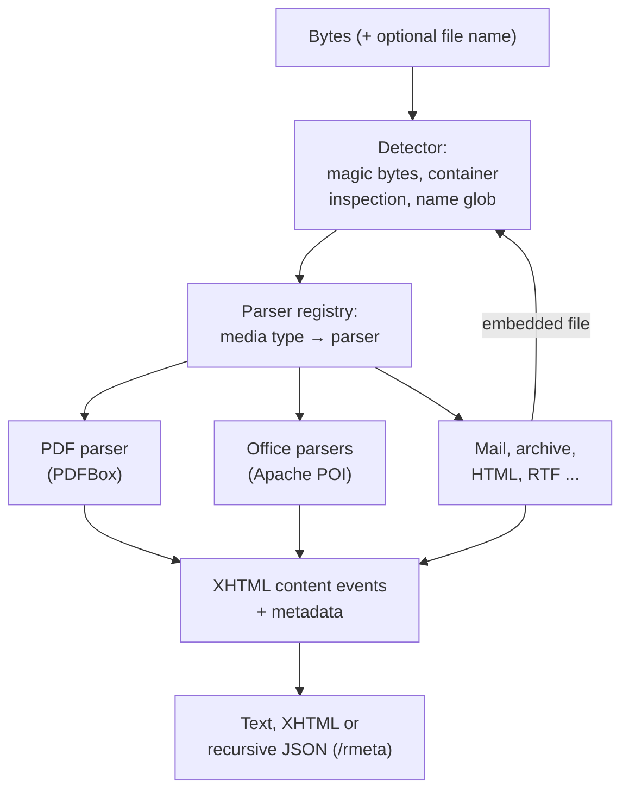

Sooner or later an ingestion pipeline meets a file nobody planned for: a `.msg` email with a spreadsheet attached, a ZIP of runbooks, a legacy `.doc`, an RTF exported from an old intranet, or a PDF that is actually a Word file with the wrong extension. **Apache Tika** is the long-standing open-source answer to "extract text and metadata from anything". It is a Java toolkit from the Apache Software Foundation that detects a file's type from its content, dispatches it to the right parser, recurses into embedded documents, and returns text plus normalised metadata through one interface. For Python RAG pipelines it usually runs as a separate service, **Tika Server**, called over HTTP.

This lesson explains how Tika detects types and organises its parsers, how its recursive metadata output represents containers and attachments, how to run and call it from Python, and how to operate it safely at scale. Tika needs a Java runtime, which the course sandbox does not have, so the code that calls a real Tika Server is shown but was not executed against one. The detection mechanism and the response-processing code are run for real: the latter against a stand-in server that returns a hand-constructed response, clearly marked as such.

## Learning objectives

- Explain how Tika detects a document's media type from magic bytes, container contents and file names, and why content-based detection matters for ingestion.
- Describe Tika's architecture (detector, parser registry, XHTML content handler, metadata) and the role of wrapped libraries such as PDFBox and Apache POI.
- Call Tika Server's `/tika`, `/meta` and `/rmeta` endpoints from Python and turn the recursive metadata response into indexable documents with provenance.
- Operate Tika safely: isolate it, bound time and memory, and handle parse exceptions and embedded-document failures.
- Decide when Tika is the right parser and when a format-specific library is better.

## Prerequisites

- [Unstructured](/learn/advanced-document-parsing/unstructured): the idea of one representation for many formats, which Tika approaches differently.
- [Working with APIs](/learn/python-for-rag-engineering/working-with-apis): calling HTTP services from Python.
- [Ingestion architecture](/learn/understanding-document-ingestion/ingestion-architecture): where a parsing service sits among ingestion components.

## Why this matters

Format coverage is a long tail. The first three formats (PDF, DOCX, HTML) cover most documents, and each has a good Python library. The next thirty each cover a sliver: XLS, PPT, RTF, ODT, EPUB, MSG, EML, MBOX, Pages, Visio, archives. Writing and maintaining an extractor for each is not realistic, and skipping them means some fraction of the knowledge base is silently missing. Nobody notices until someone asks a question whose only answer is in an attachment.

There is a second, quieter problem: **trusting file extensions**. Files are renamed, mislabelled by upload forms, or exported with generic names. A pipeline that routes by extension sends a Word file named `.pdf` to a PDF parser, which fails or returns nothing, and the document vanishes from the index without an error anyone reads.

And there is the **container problem**. An email is a document *and* a container of attachments; a ZIP is a container of documents that may themselves be containers. A pipeline that extracts only the outer layer misses most of the content, and one that flattens everything into one string loses which text came from which file, so answers cannot be cited.

Tika addresses all three: broad format coverage, content-based detection and recursive extraction with per-document metadata.

## The intuition

Imagine a post room that receives every kind of parcel. The clerk does not trust the label. They open each parcel, look at what is inside (a letter, a book, a box of more parcels), and send it to the specialist who reads that kind of thing. When a parcel contains other parcels, they open those too, writing on each item where it was found: "letter, found inside box 3, inside the crate from Leeds". At the end you have every readable item, each with its own note of origin.

Tika is that post room. The detector is the clerk, the parsers are the specialists, and the recursive metadata output is the pile of items with their origin notes.

## How it works

### Architecture

Tika is a framework more than a parser. Most of its format support comes from wrapping established Java libraries: Apache PDFBox for PDF, Apache POI for Microsoft Office formats (both legacy binary and OOXML), and others for archives, email, images and so on. Tika's own job is to put a uniform interface around them:

1. **Detection.** A detector decides the media type (MIME type) of the input.
2. **Parser selection.** A registry maps media types to parsers; the auto-detecting parser chains detection and selection, so callers do not choose a parser themselves.
3. **Parsing.** The chosen parser reads the stream and reports content as a sequence of **XHTML** events (paragraphs, headings, tables, list items where the format provides them) to a content handler, and fills a **metadata** object.
4. **Recursion.** When a parser meets an embedded document (an attachment, a file inside an archive, an image inside a Word file), it hands that stream back to the framework, which detects and parses it in turn.
5. **Output.** A content handler turns the XHTML events into what you asked for: plain text, XHTML, or nothing (metadata only).



Using XHTML as the internal content model is a deliberate choice: it can express headings, paragraphs, tables and lists, so structure survives when the source format had it. Ask for XHTML output when you want to keep that structure; plain text discards it.

### Detection

Tika's detection combines several signals, defined in its media-type registry:

- **Magic bytes.** Many formats start with a fixed signature: PDF with `%PDF-`, PNG with `\x89PNG`, ZIP with `PK\x03\x04`, legacy Office files with the OLE2 signature `D0 CF 11 E0`. These are matched at known offsets.
- **Container inspection.** A DOCX, an XLSX and an EPUB are all ZIP files. To tell them apart, the detector looks inside: a DOCX has a `word/` folder, an XLSX `xl/`. Legacy Office files are OLE2 containers, distinguished by the streams they hold.
- **File name.** Extension globs (`*.pdf`) are used as a hint, mainly to break ties when content alone is ambiguous, such as plain text versus CSV.
- **Type hierarchy.** Media types have parents (a DOCX is a specialisation of a ZIP-based OOXML type, which is a kind of ZIP), so the detector can return the most specific type it can justify.

The practical rule for ingestion: **send the bytes, and the file name if you have it, and let detection decide.** Never route on the extension alone.

### Recursive metadata

Plain extraction (`/tika` on the server) returns one block of text with attachments' text concatenated in. That loses provenance. The **recursive metadata** output (`/rmeta` on the server, `-J` in the command-line app) returns a JSON **list of metadata objects**, one per document: the container first, then each embedded document. Each object includes:

- `Content-Type`: the detected media type, sometimes with parameters such as charset.
- `X-TIKA:content`: the extracted content (plain text, XHTML or none, depending on the handler requested, for example `/rmeta/text`).
- `X-TIKA:embedded_resource_path`: where an embedded document sits inside the container, such as `/invoice.pdf` or `/archive.zip/report.docx`. Absent on the container itself.
- Format metadata, mapped where possible to standard vocabularies: `dc:title`, `dc:creator`, `dcterms:created`, `xmpTPg:NPages` (page count) and many format-specific keys.
- `X-TIKA:EXCEPTION:...` keys when parsing a document, or one of its attachments, failed. A failure in one attachment does not have to lose the rest.

This list is exactly what a RAG pipeline wants: one indexable document per entry, each with its own type, text, metadata and a path back to its parent for citation.

### Ways to run it

| Mode | How | When |
| --- | --- | --- |
| **Tika Server** | A REST service (default port 9998), run from the `tika-server-standard` JAR or the official `apache/tika` Docker image | The usual choice from Python: language-neutral, isolatable, scalable |
| **Tika App** | A command-line JAR (`java -jar tika-app.jar --text file.pdf`) | One-off inspection and debugging |
| **Library** | Embedded in a JVM application | Java or Scala pipelines |
| **tika-python** | A Python package wrapping Tika Server; can download and start a server for you | Prototypes; in production point it at a managed server |

Recent Tika releases require a modern Java runtime (Java 11 or later for the current major version); check the release notes for the version you deploy. Tika is released under the Apache 2.0 licence.

Key server endpoints, all taking the document as the body of an HTTP `PUT`:

- `/tika`: extracted content; the `Accept` header selects `text/plain` or `text/html`.
- `/meta`: metadata only, as JSON with `Accept: application/json`.
- `/rmeta`, with variants `/rmeta/text`, `/rmeta/html`, `/rmeta/ignore`: recursive metadata with content in the chosen form.
- `/detect/stream`: the detected media type only.
- `/unpack`: the embedded files themselves, as an archive.

Per-request options are passed as headers; for example the server documentation describes headers for configuring PDF OCR behaviour when Tesseract is available. OCR inside Tika is optional and needs Tesseract installed in the server's environment; [OCR](/learn/advanced-document-parsing/ocr) covers OCR itself.

### Strengths and limits for RAG

Tika's strengths are coverage, detection, recursion and operational maturity: it has been used for years in search engines (Apache Solr integrates it) and in large-scale document processing. Its limits matter for retrieval quality:

- **PDF layout.** Tika's PDF parser is PDFBox. Its text output is generally reasonable for single-column documents, but it does not perform the layout analysis of model-based parsers; columns, tables and reading order on complex pages need the techniques in [Layout-aware parsing](/learn/advanced-document-parsing/layout-aware-parsing).
- **Structure in plain text.** The plain-text handler drops headings and tables to lines of text. Use the XHTML output if you need structure, then parse it as described in [HTML parsing](/learn/advanced-document-parsing/html-parsing).
- **Operational weight.** A JVM service is another thing to deploy, monitor and patch, and Java parsers can use a lot of memory on large files.

A common production design, and the one this lesson recommends, uses Tika as the **catch-all and the detector**, and sends the high-volume, high-value formats to specialised parsers: PyMuPDF or a layout-aware parser for PDFs, a dedicated HTML pipeline for web pages.

## In code

### Detecting types from content (runs locally)

**The problem.** Show, in a few lines of Python, the detection idea Tika implements: decide a file's type from its bytes, including looking inside ZIP containers. This is a teaching model; Tika's registry knows over a thousand types and handles many subtleties this ignores.

**Dependencies.** Only the standard library for detection. The sample files are made with `python-docx` and Pillow.

```bash
pip install python-docx pillow
```

```python
# make_samples.py: one small file of each kind, for the detection example
import shutil
import zipfile
from pathlib import Path

import docx
from PIL import Image

Path("samples").mkdir(exist_ok=True)
d = docx.Document()
d.add_heading("Expenses", 1)
d.add_paragraph("Expenses must be submitted within 30 days.")
d.save("samples/expenses.docx")
Image.new("RGB", (8, 8), "white").save("samples/logo.png")
with zipfile.ZipFile("samples/runbooks.zip", "w") as z:
    z.writestr("vpn.txt", "VPN is required on public Wi-Fi.")
Path("samples/vpn.html").write_text("<!DOCTYPE html><html><body><h1>VPN</h1></body></html>")
Path("samples/notes.txt").write_text("Support desk hours are 08:00 to 18:00 UK time.")
shutil.copy("handbook.pdf", "samples/handbook.pdf")                  # from the PyMuPDF lesson
shutil.copy("samples/expenses.docx", "samples/expenses-final.pdf")   # wrong extension on purpose
print("ok")
```

```output
ok
```

```python
# detect.py: content-based type detection in the style of Tika's MIME magic
import zipfile
from pathlib import Path

MAGIC = [                                   # (offset, signature bytes, media type)
    (0, b"%PDF-", "application/pdf"),
    (0, b"\x89PNG\r\n\x1a\n", "image/png"),
    (0, b"\xff\xd8\xff", "image/jpeg"),
    (0, b"PK\x03\x04", "application/zip"),
    (0, b"\xd0\xcf\x11\xe0\xa1\xb1\x1a\xe1", "application/x-tika-msoffice"),  # legacy OLE2 Office
]
OOXML = {"word/": "application/vnd.openxmlformats-officedocument.wordprocessingml.document",
         "xl/": "application/vnd.openxmlformats-officedocument.spreadsheetml.sheet",
         "ppt/": "application/vnd.openxmlformats-officedocument.presentationml.presentation"}


def detect(path: Path) -> str:
    head = path.read_bytes()[:1024]
    for offset, sig, media_type in MAGIC:
        if head[offset:offset + len(sig)] == sig:
            if media_type == "application/zip":          # container: look inside
                names = zipfile.ZipFile(path).namelist()
                for prefix, ooxml_type in OOXML.items():
                    if any(n.startswith(prefix) for n in names):
                        return ooxml_type
            return media_type
    text = head.lstrip().lower()
    if text.startswith((b"<!doctype html", b"<html")):
        return "text/html"
    try:
        head.decode("utf-8")
        return "text/plain"
    except UnicodeDecodeError:
        return "application/octet-stream"


for path in sorted(Path("samples").iterdir()):
    print(f"{path.name:<20} {detect(path)}")
```

```output
expenses-final.pdf   application/vnd.openxmlformats-officedocument.wordprocessingml.document
expenses.docx        application/vnd.openxmlformats-officedocument.wordprocessingml.document
handbook.pdf         application/pdf
logo.png             image/png
notes.txt            text/plain
runbooks.zip         application/zip
vpn.html             text/html
```

**What the output means.** `expenses-final.pdf` is correctly identified as a Word document despite its extension, because its first bytes are a ZIP signature and the archive contains a `word/` folder. An extension-based router would have sent it to a PDF parser and lost it. `runbooks.zip` is a plain ZIP because nothing inside marks it as an Office format; Tika would go further and parse each file inside it as an embedded document. Text-like formats are the hardest: HTML is recognised by its opening tag, and anything else that decodes as UTF-8 falls back to plain text. (The `application/x-tika-msoffice` name for OLE2 files is the generic type Tika itself uses before it narrows the file down to Word, Excel or PowerPoint.)

### Calling Tika Server from Python

**Running a server.** With Docker installed:

```bash
docker run --rm -p 9998:9998 apache/tika:latest
```

In production, pin a specific image tag rather than `latest`, so that parser behaviour does not change underneath you.

**The quick way: tika-python.** This was not executed for this lesson (no Java runtime in the sandbox). If `TIKA_SERVER_ENDPOINT` is not set, tika-python downloads the server JAR and starts it locally, which needs Java; set the variable to use your own server.

```bash
pip install tika
export TIKA_SERVER_ENDPOINT=http://localhost:9998
```

```python
from tika import parser

parsed = parser.from_file("handbook.pdf")          # returns a dict
print(parsed["metadata"].get("Content-Type"))
print(parsed["content"][:200])

xhtml = parser.from_file("handbook.pdf", xmlContent=True)   # structure-preserving XHTML
```

`parsed["content"]` is the plain text, with attachments' text concatenated in, and `parsed["metadata"]` is a dictionary of metadata. For provenance-preserving extraction, call `/rmeta` directly.

**The production way: `/rmeta` with httpx.** This client sends a file, receives the recursive metadata list, and turns each entry into a document record, marking entries that failed or yielded too little text.

```bash
pip install httpx
```

```python
# tika_client.py: send a file to Tika Server's /rmeta endpoint and turn the reply into documents
import os

import httpx

TIKA_URL = os.environ.get("TIKA_URL", "http://localhost:9998")
MIN_CHARS = 20   # below this, a document probably needs OCR or is empty


def parse(path, client):
    with open(path, "rb") as fh:
        resp = client.put(f"{TIKA_URL}/rmeta/text", content=fh.read(),
                          headers={"Accept": "application/json"}, timeout=120)
    resp.raise_for_status()
    return resp.json()          # one metadata dict per document: the container first, then embedded files


def to_documents(path, rmeta):
    docs = []
    for meta in rmeta:
        text = (meta.get("X-TIKA:content") or "").strip()
        inner = meta.get("X-TIKA:embedded_resource_path")   # absent for the container itself
        errors = [k for k in meta if k.startswith("X-TIKA:EXCEPTION")]
        docs.append({
            "source": path + (f"#{inner}" if inner else ""),
            "type": meta.get("Content-Type", "").split(";")[0],
            "title": meta.get("dc:title"),
            "pages": meta.get("xmpTPg:NPages"),
            "chars": len(text),
            "status": "error" if errors else ("needs_ocr" if len(text) < MIN_CHARS else "ok"),
            "text": text,
        })
    return docs
```

To exercise this code without a Java runtime, the next script uses `httpx.MockTransport`, httpx's built-in way to answer requests in-process. The response is **constructed by hand** in the documented shape of `/rmeta/text` output for an email with three attachments. It is not real Tika output: a real response contains many more metadata keys, and exact values depend on the file and the Tika version.

```python
# tika_demo.py: run tika_client against a stand-in for Tika Server.
# The response below is CONSTRUCTED by hand in the shape /rmeta/text returns; it is not real Tika output.

import httpx

from tika_client import parse, to_documents

FAKE_RMETA = [
    {"Content-Type": "message/rfc822", "dc:title": "Escalation: E-4021 after VPN update",
     "X-TIKA:content": "Customer reports error E-4021 after the VPN client update. Logs attached."},
    {"Content-Type": "application/pdf", "X-TIKA:embedded_resource_path": "/client-log.pdf",
     "xmpTPg:NPages": "2",
     "X-TIKA:content": "Atlas client log. 09:14 E-4021 VPN client is out of date."},
    {"Content-Type": "image/png", "X-TIKA:embedded_resource_path": "/screenshot.png",
     "X-TIKA:content": ""},
    {"Content-Type": "application/zip", "X-TIKA:embedded_resource_path": "/configs.zip",
     "X-TIKA:EXCEPTION:embedded_exception": "org.apache.tika.exception.EncryptedDocumentException",
     "X-TIKA:content": ""},
]


def fake_tika(request: httpx.Request) -> httpx.Response:
    assert request.method == "PUT" and request.url.path == "/rmeta/text"
    return httpx.Response(200, json=FAKE_RMETA)


client = httpx.Client(transport=httpx.MockTransport(fake_tika))
open("escalation.eml", "w").write("any bytes will do; the stand-in server ignores them")
for d in to_documents("escalation.eml", parse("escalation.eml", client)):
    print(f"{d['status']:<9} {d['type']:<16} chars={d['chars']:<3} {d['source']}")
```

```output
ok        message/rfc822   chars=73  escalation.eml
ok        application/pdf  chars=57  escalation.eml#/client-log.pdf
needs_ocr image/png        chars=0   escalation.eml#/screenshot.png
error     application/zip  chars=0   escalation.eml#/configs.zip
```

**The important lines.**

- `client.put(f"{TIKA_URL}/rmeta/text", content=...)` sends the raw bytes. `/rmeta/text` asks for plain-text content in each entry; use `/rmeta/html` to keep structure.
- `timeout=120` bounds a single request. A pathological file must not hang an ingestion worker forever.
- `X-TIKA:embedded_resource_path` builds a citation path such as `escalation.eml#/client-log.pdf`, so an answer can say exactly which attachment it came from.
- `errors` collects any `X-TIKA:EXCEPTION` keys. One failed attachment (here an encrypted archive) is recorded, not fatal.
- `needs_ocr` flags entries with almost no text. The screenshot has none because Tika returned no OCR text for it (OCR was not configured), so the pipeline should route it to an OCR step or record it as unindexed.

**What the output means.** One input file became four candidate documents, each with its own type, text length and status. Two are indexable now; one needs OCR; one failed. A plain `/tika` call would have returned the first two texts concatenated, with no sign that a screenshot and an archive were skipped.

**Errors people commonly hit.**

- `httpx.ConnectError`: the server is not running or not on that port.
- HTTP 415 or 422 responses: the server could not detect or parse the type; log them with the file's hash for investigation.
- HTTP 5xx or timeouts on very large or malformed files: the server's parser crashed or ran out of time; retry once, then quarantine the file.
- tika-python hanging at start-up: it is trying to download the JAR or start Java. Point it at an existing server with `TIKA_SERVER_ENDPOINT`.
- Garbled characters in plain text from old documents: check the detected charset in `Content-Type` and the [encoding](/learn/data-processing/encoding-and-unicode) handling.

**Extending it.** Send a `Content-Disposition` or file-name header so that detection can use the name as a hint; keep the parent's access-control metadata on every embedded document; and, for PDFs, route the container to your PDF pipeline while using Tika only for the attachments it finds.

## A real-world example

Meridian's support desk forwards escalations from customers of Meridian Relay into a shared mailbox. The Platform team wanted AskMeridian to answer questions such as "has anyone seen E-4021 after the latest VPN update?", which meant indexing the mailbox, including its attachments: client log PDFs, spreadsheets of affected accounts, screenshots and the occasional ZIP of configuration files.

Kenji, who built the ingester, deployed Tika Server in a container next to the ingestion workers and called `/rmeta/text` for each message. On the first full run, the logs showed far fewer documents than expected. The cause was an early design decision: the workers had been told to skip files over a size limit *before* sending them to Tika, and many escalation emails exceeded it only because of large screenshots. The limit was moved to after parsing and applied per embedded document, so a large image no longer took the whole email with it.

The second finding came from the status counts. About one entry in ten was `needs_ocr`, almost all of them screenshots of error dialogs, which were exactly the documents containing error codes. Kenji added an OCR step for image attachments, routed through the team's OCR service, and stored the OCR text as a child document of the email with `extraction=ocr` in its metadata, so that retrieval could weight OCR text differently if it proved noisy. Every embedded document inherited the mailbox's access-control group, because attachments are just as confidential as the emails that carry them.

## Common mistakes

- **Routing by extension.** Mislabelled files go to the wrong parser and disappear; send bytes and let detection decide.
- **Using `/tika` for containers.** Concatenated text loses which attachment said what, so answers cannot be cited and failures are invisible; use `/rmeta`.
- **Ignoring exception keys.** A partially failed parse looks like a successful one unless you check for `X-TIKA:EXCEPTION` entries.
- **No timeouts or limits.** One huge or malformed file can stall a worker or exhaust the server's memory.
- **Running tika-python's auto-started server in production.** It downloads and starts a JVM inside your worker, which is slow, hard to monitor and hard to secure.
- **Expecting layout analysis.** Tika's PDF text is not reading-order-aware on complex layouts; route such PDFs elsewhere.
- **Floating versions.** Using `latest` images means parser output can change without any code change on your side.

## Best practices

- Run Tika Server as its own service (a container), with a pinned version, health checks and resource limits.
- Use `/rmeta` and create one record per embedded document, with a citation path and the parent's metadata, including access control.
- Record status per document (`ok`, `needs_ocr`, `error`) and report counts per source on every run.
- Use Tika for detection and the long tail of formats; use specialised parsers for formats where retrieval quality depends on layout.
- Bound everything: request timeouts, maximum file size, maximum number and depth of embedded documents.
- Keep a set of golden files per format and compare extracted text across Tika upgrades.

## Performance considerations

- **Network and serialisation.** Calling a server costs a round trip and a copy of the file. For a 2 MB document over a local network this is small next to parsing; across regions it is not. Co-locate Tika with the ingestion workers.
- **JVM characteristics.** A Java server has a start-up cost and warms up as code is compiled at run time, so keep servers long-lived rather than starting one per batch.
- **Memory.** Parsers may hold large parts of a document in memory; a huge spreadsheet or a PDF with large images can need hundreds of megabytes. Size the JVM heap and the container's memory limit together, and cap concurrent requests per server so that their combined worst case fits.
- **Throughput arithmetic.** If a server handles $c$ concurrent requests and an average document takes $t$ seconds, throughput is about $c / t$ documents per second. With $c = 8$ and $t = 0.5$ s, that is 16 documents per second, or about 1.4 million per day. Scale horizontally with more server replicas behind a load balancer once you know your real $t$, which you must measure on your own corpus.
- **Recursion multiplies work.** A mailbox where each email has three attachments is four parses per message. Estimate volumes by documents *after* unpacking.
- **OCR dominates.** If Tesseract OCR is enabled for images and scanned PDFs, it can cost orders of magnitude more than text extraction per page; enable it deliberately, not globally.

## Security considerations

Tika's job is to parse untrusted, arbitrary files with dozens of third-party parsers, which makes it a significant attack surface.

- **Parser vulnerabilities.** Vulnerabilities have been reported in Tika and in the libraries it wraps over the years, including denial of service from crafted files. Keep the server patched and subscribe to the project's security announcements.
- **Isolation.** Run Tika in a container with no access to secrets, no outbound network access it does not need, a read-only file system where possible, and CPU and memory limits. Never expose its port to the internet: it will parse whatever anyone sends it.
- **Decompression bombs and deep nesting.** Archives can expand enormously or nest many levels deep. Limit embedded-document counts and depth, and enforce timeouts; Tika Server can run parsing in a child process that is restarted after crashes, timeouts or out-of-memory errors (see the server documentation).
- **Hidden content.** Extraction returns text that a viewer would not show: hidden spreadsheet sheets, speaker notes, document comments, tracked changes, white text. That content enters the model's context and can carry [indirect prompt injection](/learn/rag-security-fundamentals/indirect-prompt-injection). Decide per source which of these to index.
- **Metadata and privacy.** Metadata includes authors, email addresses, software versions and sometimes file-system paths. Strip or restrict fields that should not reach the index, and inherit access control from containers to their embedded documents.

## Summary

- Apache Tika is a Java toolkit that detects file types from content and extracts text and metadata through one interface, wrapping libraries such as PDFBox and Apache POI.
- Detection uses magic bytes, container inspection and file names; route on detected type, never on extension alone.
- The `/rmeta` endpoint returns one metadata object per document, container first, with `X-TIKA:content`, `X-TIKA:embedded_resource_path` and exception keys, which maps directly onto indexable records with provenance.
- From Python, run Tika Server as a separate, pinned, isolated service and call it over HTTP; tika-python is convenient for prototypes.
- Tika is the right catch-all for the long tail of formats and for containers; layout-sensitive formats deserve specialised parsers.

## Exercises

**1.** A file named `policy.pdf` begins with the bytes `50 4B 03 04` and contains an entry `xl/workbook.xml`. What will content-based detection report, and what happens in a pipeline that routes by extension instead?

<details><summary>Show solution</summary>

`50 4B 03 04` is `PK\x03\x04`, the ZIP signature. The `xl/` folder marks an OOXML spreadsheet, so detection reports `application/vnd.openxmlformats-officedocument.spreadsheetml.sheet` (an XLSX file).

An extension router sends it to a PDF parser, which finds no `%PDF-` header and either raises an error or returns nothing. Unless that error is surfaced, the spreadsheet is silently missing from the index.

</details>

**2.** An `/rmeta` response for one email contains five entries: the email, two PDFs, one DOCX inside a ZIP, and the ZIP itself. Write the `X-TIKA:embedded_resource_path` you would expect for the DOCX if the ZIP is called `configs.zip` and the DOCX `vpn.docx`, and explain how you would use it in a citation.

<details><summary>Show solution</summary>

The path reflects nesting: `/configs.zip/vpn.docx`. The ZIP's own entry has `/configs.zip`; the email has no embedded path.

For a citation, combine the container's identity with the path: "Escalation email of 3 March, attachment configs.zip, file vpn.docx". Store the full path in chunk metadata so the user interface can render it and, if permitted, link to the extracted file.

</details>

**3.** Extend `to_documents` so that every embedded document inherits an `acl` field from the container, and so that entries with `needs_ocr` status and an image type are written to a separate OCR queue list instead of the main list. Run it against the stand-in server.

<details><summary>Show solution</summary>

```python
def to_documents(path, rmeta, acl):
    docs, ocr_queue = [], []
    for meta in rmeta:
        text = (meta.get("X-TIKA:content") or "").strip()
        inner = meta.get("X-TIKA:embedded_resource_path")
        errors = [k for k in meta if k.startswith("X-TIKA:EXCEPTION")]
        media_type = meta.get("Content-Type", "").split(";")[0]
        status = "error" if errors else ("needs_ocr" if len(text) < MIN_CHARS else "ok")
        doc = {"source": path + (f"#{inner}" if inner else ""), "type": media_type,
               "acl": acl, "status": status, "text": text}
        if status == "needs_ocr" and media_type.startswith("image/"):
            ocr_queue.append(doc)
        else:
            docs.append(doc)
    return docs, ocr_queue
```

Called as `docs, ocr_queue = to_documents("escalation.eml", parse("escalation.eml", client), acl="support-desk")`, the screenshot moves to `ocr_queue`, the email, the PDF and the failed ZIP stay in `docs`, and every record carries `acl="support-desk"`. The design point is that the access group is decided once, at the container, and can never be lost on an attachment.

</details>

**4.** Design question. You are asked to replace three format-specific parsers (PyMuPDF for PDFs, BeautifulSoup for HTML, python-docx for Word) with "just Tika" to simplify the codebase. Argue for or against, with conditions.

<details><summary>Show solution</summary>

A balanced answer: use Tika for detection, containers and the long tail, but keep specialised parsers where they measurably improve retrieval.

- **For Tika everywhere:** one service, uniform metadata, broad coverage and recursive attachments, fewer libraries to patch.
- **Against:** PDF text from Tika is not layout-aware, so multi-column and table-heavy PDFs would regress compared with a block-ordering or layout-aware extractor. HTML pages from a wiki need boilerplate removal and heading-based sectioning, which a dedicated HTML pipeline does better than generic text extraction.
- **Decide with evidence:** run a sample of each source through both paths, chunk and index both, and compare retrieval on a fixed question set. Keep the specialised parser where the difference is material; otherwise accept Tika's simplicity.
- **Architecture:** detect with Tika (or at least by content), dispatch PDFs and HTML to their parsers, and send everything else, and every embedded document, through `/rmeta`.

</details>

## Check your understanding

```quiz
[
  {"q": "Why does Tika inspect the contents of a ZIP-signature file before reporting its type?", "options": ["To decompress it faster", "Because DOCX, XLSX, PPTX and EPUB are all ZIP containers and are told apart by what is inside", "Because ZIP files cannot be detected by magic bytes", "To check for viruses"], "answer": 1, "why": "Many document formats are ZIP packages; the folder structure inside (word/, xl/, ppt/) identifies the specific format."},
  {"q": "Which Tika Server endpoint should a RAG pipeline use for an email with attachments, so that each attachment can be cited separately?", "options": ["/detect/stream", "/tika", "/rmeta", "/meta"], "answer": 2, "why": "/rmeta returns one metadata object per document, including embedded resource paths and per-document content."},
  {"q": "An `/rmeta` entry has a key starting with `X-TIKA:EXCEPTION`. What does it mean?", "options": ["Parsing of that document or attachment failed, though other entries may be fine", "The whole request failed", "The document is encrypted with AES", "The server needs restarting"], "answer": 0, "why": "Exceptions are recorded per document so that one failed attachment does not lose the rest of the container."},
  {"q": "What does Tika use to parse PDFs?", "options": ["MuPDF", "pdfminer.six", "Tesseract", "Apache PDFBox"], "answer": 3, "why": "Tika wraps established Java libraries; for PDF that is Apache PDFBox."},
  {"q": "Which deployment is most appropriate for a production Python ingestion service?", "options": ["Let tika-python download and start a server inside every worker", "A separately deployed, version-pinned Tika Server container with resource limits, called over HTTP", "Call the Tika App JAR with subprocess for every file", "Expose Tika Server publicly so other teams can use it"], "answer": 1, "why": "A managed, isolated, pinned service is easier to scale, monitor and secure than JVMs started inside workers or per file."}
]
```

## Further reading

- [Apache Tika](https://tika.apache.org/): project home, supported formats and release notes.
- [Apache Tika on GitHub](https://github.com/apache/tika): source code and the Tika Server documentation in the project's wiki and docs.
- Mattmann and Zitting (2011), *Tika in Action*, Manning: the book by Tika's creators, explaining detection, parsers and metadata (it predates recent releases, so check APIs against current documentation).
- [Apache PDFBox](https://pdfbox.apache.org/): the PDF library behind Tika's PDF parser.
- [tika-python on PyPI](https://pypi.org/project/tika/): the Python client for Tika Server.
