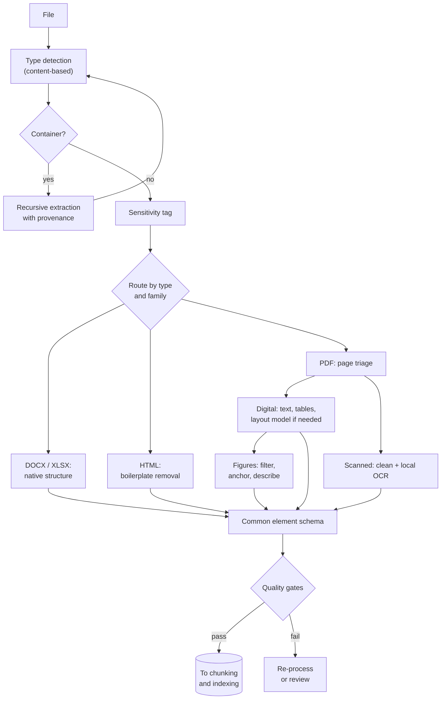

This assessment covers all ten lessons of *Advanced Document Parsing*: PyMuPDF, pypdf, Unstructured, Apache Tika, HTML parsing, tables and structured content, OCR, scanned documents, layout-aware parsing and multimodal document extraction. The multiple-choice section has 18 questions; the pass mark is 14 correct (about 75%). The open questions, coding exercises, design challenge and troubleshooting scenarios are not scored automatically: attempt each one before opening its solution, and treat any you could not answer as a pointer back to the relevant lesson. Where prices or per-page timings appear they are assumptions for arithmetic practice, not measurements or quotes.

```quiz
[
  {"q": "Why do PDF text extractors have to reconstruct reading order rather than simply read it?", "options": ["PDFs store text compressed in reverse order", "A PDF stores glyphs at positions, in whatever order the generator emitted them, with no notion of columns or paragraphs", "PDF text is always stored as images", "Reading order is stored only in the document metadata"], "answer": 1, "why": "Content-stream order is arbitrary; columns, paragraphs and reading order must be inferred from positions."},
  {"q": "A two-column page is extracted with PyMuPDF's `get_text(sort=True)`. What problem is most likely?", "options": ["Lines or blocks from the two columns are interleaved", "The right column is dropped", "All headings are removed", "The text is reversed"], "answer": 0, "why": "Sorting by position reads across the whole page, so content at the same height in both columns ends up adjacent."},
  {"q": "A team must avoid AGPL obligations and wants a pure-Python PDF dependency. Which library fits best?", "options": ["PyMuPDF", "Apache Tika", "pypdf", "Tesseract"], "answer": 2, "why": "pypdf is pure Python and permissively licensed; PyMuPDF is AGPL or commercial, Tika needs Java, and Tesseract is an OCR engine."},
  {"q": "What does Unstructured's `hi_res` strategy add over `fast` for PDFs?", "options": ["Encryption support", "Faster processing", "Language translation", "A layout-detection model run on page images, plus optional table structure"], "answer": 3, "why": "hi_res renders pages and detects typed regions with a model, at much higher compute cost than reading the text layer."},
  {"q": "Why is Apache Tika's recursive metadata output (`/rmeta`) preferable to plain `/tika` output for an email with attachments?", "options": ["It returns one object per embedded document, preserving which text came from which attachment", "It is faster", "It removes all metadata", "It performs OCR on every attachment automatically"], "answer": 0, "why": "Plain output concatenates everything; recursive output keeps provenance per document, which retrieval and citation need."},
  {"q": "An HTML block has 200 characters of text, of which 150 are inside links. What is its link density, and what does it suggest?", "options": ["0.25; main content", "1.33; an error", "0.75; probably navigation or boilerplate", "0.5; a table"], "answer": 2, "why": "150 / 200 = 0.75. Boilerplate such as menus is short and link-heavy, so high link density suggests it is not the main content."},
  {"q": "You have the same policy as a DOCX file and as a PDF exported from it. Where should table extraction happen?", "options": ["The PDF, since it is the published form", "The DOCX, because its table structure is explicit", "Both, indexed twice for safety", "Neither; tables should be skipped"], "answer": 1, "why": "Structured formats record rows, cells and merges; extracting from a PDF rendering means inferring structure from geometry."},
  {"q": "PyMuPDF's default `find_tables()` finds nothing on a page showing a borderless table. What is the best next step?", "options": ["Give up and index plain text", "Increase the page resolution", "Run OCR on the page", "Try the text strategy and validate the result, or use an explicit grid for a known template"], "answer": 3, "why": "The default strategy uses ruling lines; borderless tables need alignment heuristics (which must be checked) or explicit column positions."},
  {"q": "Which serialisation best suits indexing a 300-row error-code table queried one code at a time?", "options": ["One self-contained record per row, repeating caption and column names", "One Markdown chunk for the whole table", "Plain page text split every 500 characters", "Only the header row"], "answer": 0, "why": "Row records can be retrieved alone and still be understood; a single large table chunk embeds as a blur of all rows."},
  {"q": "What does this print?\n```python\np = \"55-5--0\"\nprint(\"\".join(c for i, c in enumerate(p) if (i == 0 or c != p[i-1]) and c != \"-\"))\n```", "options": ["5550", "50", "550", "5-50"], "answer": 2, "why": "The first two 5s merge, the blank separates them from the next 5, the blanks are dropped and the 0 is kept: 550."},
  {"q": "An OCR engine reaches a CER of 0.02 on Meridian's policy scans. Why might it still be unacceptable?", "options": ["CER above zero is always unacceptable", "The errors may be concentrated in numbers and identifiers, which users ask about", "CER does not measure characters", "CER only applies to handwriting"], "answer": 1, "why": "Look-alike confusions hit digits and codes; a separate digit-token error rate is needed alongside CER."},
  {"q": "How many pixels tall is the body of 9-point text rendered at 200 DPI?", "options": ["About 13", "About 18", "About 36", "About 25"], "answer": 3, "why": "9 / 72 x 200 = 25 pixels."},
  {"q": "A PDF page returns 40 characters of text and has an image covering the entire page. What is it most likely to be?", "options": ["A scan, possibly with a small typed or stamped addition, which needs OCR", "A digital page with full text", "An encrypted page", "A blank page"], "answer": 0, "why": "Little text plus full image coverage indicates a scan; the small text layer may be a stamp, note or poor scanner OCR."},
  {"q": "Which OCRmyPDF mode replaces a poor scanner-generated OCR layer while keeping genuine digital text?", "options": ["--skip-text", "--force-ocr", "--redo-ocr", "--deskew"], "answer": 2, "why": "redo-ocr replaces existing OCR text; skip-text leaves pages with text untouched, and force-ocr rasterises everything."},
  {"q": "Two detected Text boxes overlap with an IoU of 0.7. With non-maximum suppression at a threshold of 0.5, what happens?", "options": ["Both are kept", "Both are removed", "They are merged into a larger box", "The lower-scoring box is removed"], "answer": 3, "why": "NMS keeps the highest-scoring box and suppresses same-label boxes whose IoU with it exceeds the threshold."},
  {"q": "When fusing a layout model's regions with a digital PDF's text layer, how should a word be assigned to a region?", "options": ["By the IoU between the word box and the region box", "By the share of the word's area that lies inside the region", "By the word's font size", "By alphabetical order"], "answer": 1, "why": "A word is tiny relative to a region, so IoU is always small; coverage of the word's own area is the right test."},
  {"q": "A chart in a PDF is not found by `page.get_images()`. What should the extractor do?", "options": ["Find it among vector drawings (for example with `cluster_drawings()`) and render that region", "Conclude the page has no figures", "Run Tesseract on the whole document", "Extract the fonts"], "answer": 0, "why": "Charts are often vector graphics, not image objects; they must be found as drawings and rasterised for a vision model."},
  {"q": "A vision-language model's transcription of a digital page states £500 where the text layer says £400. What should the pipeline do?", "options": ["Prefer the transcription because it reads better", "Average the values", "Trust the text layer for the fact and flag the transcription", "Delete the page from the index"], "answer": 2, "why": "The text layer is exact; VLMs can misread or invent numbers, so exact text wins and disagreements are flagged."}
]
```

## Conceptual questions

**1.** Explain why a parsing failure is usually silent in a RAG system, giving three different examples from this module, and describe one monitoring signal that would expose each.

<details><summary>Show model answer</summary>

Parsers return text whether or not it is right, and the rest of the pipeline cannot tell good text from bad. Three examples: (a) a scanned PDF yields an empty string, so the document produces no chunks and vanishes from the index; signal: per-page characters extracted, and per-document chunk counts compared with page counts. (b) A two-column page is read across the columns, producing fluent but spliced paragraphs; signal: disagreement between position order and model or XY-cut order, or a sample of chunks checked by a reviewer, or a language-model coherence check on a sample. (c) A borderless table's last column is truncated by a heuristic; signal: validation checks such as words present in the table's region but missing from the extracted cells, or cells ending in a function word. A general signal is a per-route report (digital, OCR, re-OCR, layout model, review) for every ingestion run, so that a shift in the mix is visible.

</details>

**2.** Compare PyMuPDF, pypdf, Unstructured and Apache Tika as the main parser for a new corpus. What questions would you ask about the corpus and the deployment before choosing?

<details><summary>Show model answer</summary>

Questions about the corpus: which formats (PDF only, or Office, email, archives)? Digital or scanned? Simple or complex layouts, many tables or figures? How many templates? Questions about deployment: licence constraints (PyMuPDF is AGPL or commercial; pypdf, Tika and Unstructured's open-source library are permissive), runtime (Tika needs Java and runs best as a separate service), compute budget (Unstructured `hi_res` and layout models need far more compute), and whether a uniform element model across formats is wanted. Typical outcomes: PyMuPDF for fast, detailed PDF work including tables and rendering; pypdf when pure Python and a permissive licence matter more than features; Tika for very broad format coverage, type detection and recursive extraction of containers; Unstructured when one typed element model across many formats is valuable, with `hi_res` reserved for hard documents. Many production systems combine them, routing by format and document family.

</details>

**3.** Describe the three sub-problems of table extraction from a PDF and explain why ruled tables are easier than borderless ones.

<details><summary>Show model answer</summary>

Detection finds the table's region on the page; structure recognition finds rows, columns, headers and spanning cells; cell content extraction assigns words to cells. Ruled tables have vector lines whose exact coordinates give the grid directly: intersections of horizontal and vertical lines are the cell corners. Borderless tables imply columns only through text alignment, so the extractor must guess boundaries from words that line up, which fails on ragged edges, long cells that bridge gaps, sparse columns, and right-aligned numbers. The guesses can look plausible while being wrong, so borderless extraction needs validation, explicit grids for known templates, or learned structure-recognition models.

</details>

**4.** A colleague proposes sending every page of the corpus to a vision-language model for transcription, "because it handles everything". Give the strongest arguments for and against, and propose a better default.

<details><summary>Show model answer</summary>

For: one method for all layouts, tables, scans and handwriting; good reading order and Markdown structure; far less custom parsing code. Against: cost and latency scale with every page (image tokens grow with area, and transcription output tokens dominate); no per-word confidences or reliable boxes; transcriptions can misread or invent numbers, so exact digital text is replaced by approximate text on pages that had perfect text layers; large pages are downscaled, losing small print; non-determinism complicates re-indexing. Better default: route. Use the text layer for digital pages, layout analysis and table extraction where needed, OCR for scans, figure descriptions for meaningful figures, and VLM whole-page transcription only for pages flagged by earlier stages (low OCR confidence, layout failures, slides, handwriting). Verify transcriptions against the text layer or OCR on numbers and identifiers.

</details>

**5.** Explain what CTC decoding does and why the blank symbol is necessary, using an example.

<details><summary>Show model answer</summary>

A line recogniser outputs a probability distribution over characters for each narrow slice of the line image, and there are many more slices than characters. CTC maps a sequence of per-slice symbols to a string by merging consecutive repeats and then removing blanks. Without a blank, a genuinely doubled character could never be produced: the path "1100" would collapse to "10". With a blank, "1-0-0" or "10-0" collapses to "100", because the blank separates the two zeros so they are not merged. Training sums the probability of all paths that collapse to the correct transcription; greedy decoding takes the most likely symbol per slice and collapses, while beam search considers several paths.

</details>

## Coding exercises

**1. Tables once, prose once.** Write `extract(page, caption)` that uses PyMuPDF's `find_tables()` to emit one self-contained record per table row (caption and column names repeated) and returns the page's prose blocks *excluding* any block that overlaps a table, so no table text is indexed twice. Test it on a page with a paragraph, a ruled two-column table and a closing sentence.

<details><summary>Show solution</summary>

```python
import pymupdf

# Build a page with a paragraph, a ruled table and a closing sentence.
doc = pymupdf.open()
page = doc.new_page()
page.insert_text((72, 90), "Support desk", fontsize=14)
page.insert_text((72, 115), "Contact the support desk through any channel below.", fontsize=10)
rows = [["Channel", "Hours (UK time)"], ["Phone", "08:00 to 18:00"], ["Chat", "08:00 to 18:00"]]
xs, top, h = [72, 222, 402], 130, 20
for r, row in enumerate(rows):
    for c, cell in enumerate(row):
        page.insert_text((xs[c] + 4, top + r * h + 14), cell, fontsize=10)
for r in range(len(rows) + 1):
    page.draw_line((xs[0], top + r * h), (xs[-1], top + r * h))
for x in xs:
    page.draw_line((x, top), (x, top + len(rows) * h))
page.insert_text((72, 215), "Lost laptops are reported to the support desk at once.", fontsize=10)

def extract(page, caption):
    tables = page.find_tables().tables
    records = []
    for t in tables:
        header, *body = t.extract()
        for row in body:
            pairs = "; ".join(f"{h}: {v}" for h, v in zip(header, row))
            records.append(f"{caption}. {pairs}.")
    prose = []
    for x0, y0, x1, y1, text, *_ in page.get_text("blocks"):
        block = pymupdf.Rect(x0, y0, x1, y1)
        if not any(block.intersects(t.bbox) for t in tables):   # skip text inside tables
            prose.append(" ".join(text.split()))
    return prose, records

prose, records = extract(page, "Support desk")
print("PROSE:", *prose, sep="\n  ")
print("TABLE RECORDS:", *records, sep="\n  ")
```

```output
Consider using the pymupdf_layout package for a greatly improved page layout analysis.
PROSE:
  Support desk
  Contact the support desk through any channel below.
  Lost laptops are reported to the support desk at once.
TABLE RECORDS:
  Support desk. Channel: Phone; Hours (UK time): 08:00 to 18:00.
  Support desk. Channel: Chat; Hours (UK time): 08:00 to 18:00.
```

The first line is PyMuPDF's advisory message about an optional add-on, printed when table detection runs; it is not part of the result. `t.bbox` is a tuple, and `Rect.intersects` accepts it. In production, use the section heading rather than a fixed caption, and strip `None` cells from spanning rows.

</details>

**2. Choosing an OCR engine.** Given reference transcriptions and the outputs of two engines, compute overall CER, WER and the accuracy on tokens that contain a digit. Which engine would you choose for AskMeridian's policy documents, and why?

<details><summary>Show solution</summary>

```python
import re

def edit_distance(a, b):
    prev = list(range(len(b) + 1))
    for i, x in enumerate(a, 1):
        cur = [i]
        for j, y in enumerate(b, 1):
            cur.append(min(prev[j] + 1, cur[j - 1] + 1, prev[j - 1] + (x != y)))
        prev = cur
    return prev[-1]

def scores(refs, hyps):
    chars = sum(edit_distance(r, h) for r, h in zip(refs, hyps)) / sum(len(r) for r in refs)
    words = sum(edit_distance(r.split(), h.split()) for r, h in zip(refs, hyps)) / sum(len(r.split()) for r in refs)
    digit_ref = [t for r in refs for t in r.split() if re.search(r"\d", t)]
    digit_ok = sum(t in h.split() for r, h in zip(refs, hyps) for t in r.split() if re.search(r"\d", t))
    return chars, words, digit_ok / len(digit_ref)

refs = ["Anything over £75 needs a receipt.",
        "Passwords must be rotated every 90 days.",
        "Support desk hours are 08:00 to 18:00 UK time."]
engines = {
    "engine A": ["Anything over £7S needs a receipt.",
                 "Passwords must be rotated every 90 days.",
                 "Support desk hours are 08:00 to 18:O0 UK time."],
    "engine B": ["Anyth1ng ovcr £75 nceds a receipt.",
                 "Passwords rnust be rotatcd every 90 days.",
                 "Support desk hours are 08:00 to 18:00 UK tirne."],
}
for name, hyps in engines.items():
    cer, wer, digits = scores(refs, hyps)
    print(f"{name}: CER={cer:.3f}  WER={wer:.3f}  digit-token accuracy={digits:.2f}")
```

```output
engine A: CER=0.017  WER=0.091  digit-token accuracy=0.50
engine B: CER=0.067  WER=0.273  digit-token accuracy=1.00
```

Engine A looks better on both CER and WER, but it got half the numeric tokens wrong ("£7S", "18:O0"). Engine B's errors are all in ordinary words, which retrieval and readers tolerate well, and every number is right. For policy documents, where users ask about amounts, deadlines and times, engine B is the safer choice, or engine A with a digit-specific check. Three sentences are far too few to decide in practice: run the same comparison on a hand-transcribed sample of real pages. (The digit check here counts a token as correct only if the identical token appears in the corresponding output line, a simple approximation of alignment.)

</details>

**3. Finding the main content of an HTML page.** Compute the link density of each top-level block of a small page with BeautifulSoup, and choose the main content as the longest block whose link density is below 0.5.

<details><summary>Show solution</summary>

```python
from bs4 import BeautifulSoup

html = """
<body>
  <div class="nav"><a href="/">Home</a> <a href="/it">IT</a> <a href="/hr">HR</a> <a href="/help">Help</a></div>
  <div class="content">
    <h2>VPN on public Wi-Fi</h2>
    <p>The VPN is required on public Wi-Fi, including hotels and trains.
       See the <a href="/vpn-setup">setup guide</a> if you have not installed it.</p>
    <p>Passwords must be rotated every 90 days.</p>
  </div>
  <div class="footer"><a href="/privacy">Privacy</a> | <a href="/terms">Terms</a> | Meridian</div>
</body>"""

def link_density(tag):
    text = len(tag.get_text(" ", strip=True))
    linked = sum(len(a.get_text(" ", strip=True)) for a in tag.find_all("a"))
    return linked / text if text else 1.0

soup = BeautifulSoup(html, "html.parser")
blocks = soup.body.find_all("div", recursive=False)
for div in blocks:
    print(f"{div['class'][0]:8} chars={len(div.get_text(' ', strip=True)):3}  link_density={link_density(div):.2f}")
main = max((d for d in blocks if link_density(d) < 0.5),
           key=lambda d: len(d.get_text(" ", strip=True)))
print("main content:", main["class"][0])
```

```output
nav      chars= 15  link_density=0.80
content  chars=183  link_density=0.06
footer   chars= 26  link_density=0.46
main content: content
```

The footer's density (0.46) falls just under the threshold, which shows why density alone is not enough: combining it with length (or with semantic landmarks such as `<main>`, `<nav>` and `<footer>` when present) makes the decision robust.

</details>

## Architecture design challenge

Meridian is acquiring a smaller company and must add its document archive to AskMeridian within a quarter. The archive contains about 120,000 files: Word and Excel files, HTML exports of an old intranet, emails (`.msg` and `.eml`) with attachments, ZIP archives of runbooks, born-digital PDFs from many templates (including product manuals with diagrams and screenshots), and roughly 15,000 scanned pages of signed contracts and HR forms, some with handwriting. HR files must not leave Meridian's own infrastructure. Design the parsing layer: how files are identified and routed, which tools handle which content, how tables, scans, layouts and figures are dealt with, what quality checks exist, what the output looks like, and how cost is controlled.

<details><summary>Show reference design</summary>

**Identification and routing.** Every file goes first through content-based type detection (Tika's detector, or equivalent magic-number detection), not extension. Containers (ZIP, email) are expanded recursively with provenance: Tika's recursive metadata gives one record per embedded document with its path inside the container, and each embedded document re-enters routing as a document in its own right. A sensitivity classifier (from source folder, owner and document type) tags HR material before any external service sees it.

**Per-format parsers.**

- DOCX and XLSX: native object models (python-docx, a spreadsheet reader), keeping tables as tables and headings as headings.
- HTML: decode, remove boilerplate (landmarks first, link density as fallback), keep headings, tables and lists, and attach heading paths.
- Digital PDFs: page-level triage, then PyMuPDF text and `find_tables()` for simple templates; a layout model or conversion toolkit for document families that rules handle badly (multi-column manuals, slides), routed by family.
- Scanned pages: orientation fixing, deskewing, OCR at about 300 DPI with a local engine (required for HR files), keeping word boxes and confidences; OCRmyPDF `--redo-ocr` where scanner OCR layers are poor.
- Figures: raster images and vector clusters, filtered for decoration, anchored to captions, described by a VLM with structured output; HR images only through a locally hosted model or not at all.
- Handwriting and very poor scans: a VLM (local for HR), with output flagged as low confidence and routed to review where it matters.

**Output.** Every route produces the same element schema: element type (title, heading, text, list item, table row, table, figure description, page furniture), text, source file and container path, page, bounding box, heading path, parser route and version, and quality signals (OCR confidence, flags). Tables produce row records plus the whole table; page headers and footers become metadata.

**Quality checks.** Per-page characters and route counts per run; table validation (column consistency, words in region missing from cells); OCR page scores (mean confidence, real-word ratio, low-confidence digit tokens); VLM transcriptions and figure descriptions checked for numbers and labels against the text layer or OCR. Failing pages go to re-processing, then review. A hand-labelled evaluation set per document family is scored on every parser change.

**Cost control.** Cheap paths first; expensive paths only on pages that need them; caching by content hash plus parser version; batch processing for OCR and VLM calls with rate limits. Rough sizing with assumed figures: if 15,000 scanned pages take 2 seconds each to OCR on a CPU, that is 30,000 CPU-seconds, about 8 CPU-hours, or about half an hour on 16 cores; if 5% of 300,000 digital pages need a layout model at 0.5 seconds each, that is 7,500 seconds; VLM figure descriptions scale with the number of meaningful figures, not pages.



**Trade-offs.** A single toolkit for everything would be simpler to operate but either too weak on hard pages or too expensive on easy ones; routing adds operational complexity in exchange for cost and accuracy. Keeping HR processing local limits accuracy on handwriting, accepted in exchange for confidentiality and mitigated by review. Building a common element schema costs effort up front but means chunking, metadata and evaluation are written once.

</details>

## Troubleshooting scenarios

**1.** After ingesting a batch of supplier contracts, AskMeridian answers questions about them with "I don't know", although the ingestion job reported every file as processed successfully. Chunk counts for the batch are a small fraction of what similar batches produced.

<details><summary>Show diagnosis and fix</summary>

Diagnosis: the contracts are mostly scanned PDFs with no text layer. Text extraction returned empty strings for those pages, so they produced no chunks, and nothing raised an error. Confirm by computing characters extracted and image coverage per page for a sample: scanned pages show near-zero text and full-page image coverage. Fix: add page-level triage to the pipeline, route scanned pages through orientation fixing, deskewing and OCR (or OCRmyPDF with `--skip-text` for mixed documents), store OCR quality signals, and change the ingestion report to count pages per route so that a batch of scans can never again look like success. Re-ingest the batch.

</details>

**2.** Users report that AskMeridian states the wrong approver for some expense types. The answers cite the correct page of the expenses policy PDF.

<details><summary>Show diagnosis and fix</summary>

Diagnosis: the approval matrix is a table that was indexed as plain text and split by a fixed-size chunker. Chunks begin and end mid-row, so values appear next to the wrong expense type, and the model pairs them by proximity. Inspect the retrieved chunk for one bad answer to confirm. Fix: detect tables before chunking (`find_tables()` or the structured source document if one exists), remove table regions from the prose, and index one record per row with the caption and column names repeated, keeping a table identifier so the full table can be added to the prompt at generation time. Add table validation checks so truncated or malformed extractions are flagged, not indexed.

</details>

**3.** After a parser upgrade, answers drawn from the two-column product manuals become garbled: chunks contain sentences that jump between unrelated topics mid-paragraph. The single-column handbook is unaffected.

<details><summary>Show diagnosis and fix</summary>

Diagnosis: a reading-order regression on multi-column layouts. The new parser version (or a changed setting, such as switching to position-sorted extraction or layout mode) interleaves the columns, so paragraphs from both columns are spliced. Compare the old and new extraction of one manual page, and check which blocks or regions cross the column gutter (call-out boxes are a common trigger, because they remove the clean vertical cut XY-cut relies on). Fix: restore column-aware ordering (XY-cut over blocks or detected regions, with gutter-crossing regions such as call-outs removed and re-inserted), or route the manuals' document family to a layout model; pin the parser version, record it in chunk metadata, and add these manual pages to the evaluation set so a future upgrade cannot regress silently.

</details>
