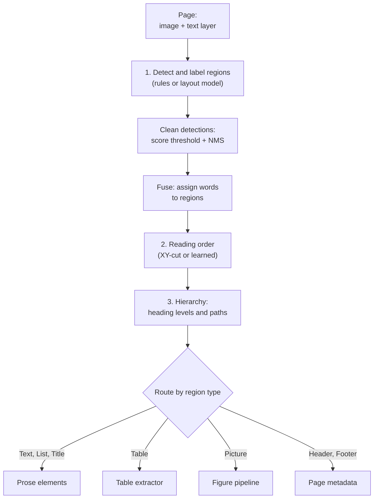

Every parser in this module so far has treated a page as text with coordinates and then applied rules: blocks wider than most of the page are full-width, larger fonts are headings, the strip at the bottom is the footer. Those rules work on the documents they were written for and break on the next template. **Layout-aware parsing** treats the page as what a person sees: a set of regions (a title, section headings, paragraphs, a table, a figure with its caption, a sidebar, a footnote, running headers and footers), each with a type, a position and a place in the reading order. Once a page is described that way, choosing what to index, in what order and under which heading becomes straightforward.

This lesson explains the three jobs of layout analysis (finding and labelling regions, ordering them, and building the document's hierarchy), the two families of methods that do them (geometric algorithms and learned layout models), the mathematics of evaluating and cleaning detector output, and how to fuse a layout model's regions with a PDF's text layer. It builds on the band-and-column heuristic from the [PyMuPDF](/learn/advanced-document-parsing/pymupdf) lesson and explains the model behind the `hi_res` strategy you met in [Unstructured](/learn/advanced-document-parsing/unstructured).

## Learning objectives

- Define the three jobs of layout analysis (region detection and labelling, reading order, hierarchy) and give a failure that each one prevents in a RAG system.
- Implement recursive XY-cut reading order and explain where it fails.
- Compute intersection over union and apply non-maximum suppression to the output of a layout detector.
- Fuse detected layout regions with a PDF's text layer to produce typed, ordered elements and page metadata.
- Choose between rules, a layout model, a document conversion toolkit and a vision-language model for a given corpus, by accuracy, cost and control.

## Prerequisites

- [PyMuPDF](/learn/advanced-document-parsing/pymupdf): blocks, spans, font sizes, and the band-and-column reading-order heuristic.
- [Unstructured](/learn/advanced-document-parsing/unstructured): typed document elements and partitioning strategies.
- [Tables and structured content](/learn/advanced-document-parsing/tables-and-structured-content): why tables need their own extraction path.
- [OCR](/learn/advanced-document-parsing/ocr): for pages whose text must come from the image.

## Why this matters

A chunk is only as good as the text it was cut from. Layout errors produce text that is wrong in ways no later stage can repair:

- **Wrong reading order** splices sentences from two columns ("Passwords must be rotated every 90 days. The VPN is required on public Wi-Fi…" as if they were one paragraph), puts a sidebar in the middle of the main text, or reads a table across its rows into the next paragraph.
- **Unlabelled page furniture** (running headers, footers, page numbers, watermarks) is repeated on every page and pollutes every chunk. "INTERNAL - Meridian IT" in 400 chunks makes them all slightly similar to each other and to any query mentioning Meridian.
- **Lost hierarchy** means a chunk saying "This must be done within 30 days" no longer knows it belongs to "Expenses > Submitting a claim", so it cannot be retrieved by a question about expenses and cannot be cited meaningfully.
- **Unrecognised non-text regions**: a table parsed as prose, a figure's labels scattered through the text, a caption separated from its figure.

Rules can handle a single, well-understood template. A corpus with hundreds of templates (supplier documents, product manuals, scanned forms, slide decks exported to PDF) needs a method that generalises.

## The intuition

Hand a page of a magazine to someone who does not read its language. They can still tell you, almost instantly, which block is the headline, which are the columns, where the photo and its caption are, and which tiny line at the bottom is the page number. They are using visual cues alone: size, weight, position, alignment and whitespace. Ask them to number the blocks in reading order and they will mostly get it right too, because page design follows conventions.

Layout analysis is teaching a machine that same skill. A rule-based parser is a person told explicit rules ("the biggest text is the title"). A layout model is a person who has looked at hundreds of thousands of labelled pages and learned the conventions, including the ones nobody wrote down.

## How it works

### The three jobs

1. **Region detection and labelling.** Find rectangles on the page and give each a type. A widely used label set comes from the DocLayNet dataset (Pfitzmann and colleagues, 2022), which has eleven classes: Caption, Footnote, Formula, List-item, Page-footer, Page-header, Picture, Section-header, Table, Text and Title. The earlier PubLayNet dataset (Zhong, Tang and Jimeno Yepes, 2019), built from scientific articles, uses five: Text, Title, List, Table and Figure.
2. **Reading order.** Put the regions in the sequence a person would read them. This is a separate problem from detection: a perfect set of boxes can still be read in the wrong order.
3. **Hierarchy.** Decide which heading each region belongs under, and how headings nest (title, then sections, then subsections). The result is a tree, and each chunk can carry its path through it, such as `Security basics > Passwords`.



### Geometric methods

Before learned models, layout analysis was geometry, and geometric methods are still the right tool when they suffice, because they are fast, deterministic and explainable.

**Whitespace analysis.** Columns, paragraphs and regions are separated by whitespace, so finding large empty rectangles (gutters between columns, gaps between paragraphs) segments the page.

**Recursive XY-cut** (Nagy and Seth, 1984) is the classic algorithm, and it generalises the band-and-column heuristic from the PyMuPDF lesson:

1. Project all blocks onto the x axis and look for a vertical gap (a gutter) that no block crosses. If there is one, cut the page into a left part and a right part.
2. Otherwise, project onto the y axis and look for a horizontal gap. If there is one, cut into a top and a bottom part.
3. Recurse into each part, reading the left (or top) part before the right (or bottom).
4. Stop when a part has no clean cut; read its blocks top to bottom.

The result is a tree of cuts whose leaf order is the reading order. Because it recurses, it handles three columns, a full-width title above two columns, or a two-column band followed by a full-width table, without a rule for each. The order in which you try cuts matters: if paragraph gaps happen to line up across both columns, cutting horizontally first reads across the columns, so the version in this lesson's code tries column gutters first.

XY-cut fails where layouts are not separable by straight cuts: text wrapping around a figure, an L-shaped region, a sidebar box that overlaps a column, or a pull quote straddling the gutter. It also knows nothing about region types: a caption is just another block.

**Font statistics** give region types cheaply in digital PDFs: the most common font size is body text; clearly larger sizes are headings, ranked by size; the smallest text near the bottom is footnotes or footers. The PyMuPDF lesson used this, and it remains a useful baseline and a useful *feature* even when a model is used.

**Tagged PDFs.** Some PDFs, particularly those produced for accessibility (the PDF/UA standard), contain a **structure tree**: explicit tags for headings, paragraphs, lists, tables and figures, in logical reading order. When it is present and correct, it is better than any inference, just as HTML structure is better than geometry. Library support for reading it varies, and many PDFs are untagged or tagged badly, so treat it as a bonus to check for rather than something to rely on.

### Learned layout models

The dominant modern approach treats region detection as **object detection** on an image of the page, the same computer-vision task as finding cars and pedestrians in a photograph:

1. Render the page to an image (for a scan, the image already exists).
2. A detection network (architectures from general computer vision, such as Faster R-CNN, the YOLO family or DETR-style transformers, trained on labelled pages) outputs many candidate boxes, each with a class label and a confidence score.
3. Low-confidence boxes are discarded and duplicates are removed by **non-maximum suppression**, explained in the mathematics section.
4. The surviving regions are combined with the text, either from the PDF's text layer or from OCR.

A second family adds the text itself. **LayoutLM** (Xu and colleagues, 2020) is a BERT-style transformer whose input is each word *plus* its bounding box: the box coordinates, normalised to a 0 to 1000 grid, are embedded and added to the word's embedding, so the model learns from both what a word says and where it sits. Later versions add image features too (LayoutLMv3, Huang and colleagues, 2022). These models are typically fine-tuned for tasks such as labelling words as heading or body, or extracting fields from forms.

Learned models generalise across templates and work on scans, where no fonts or text layer exist. Their costs: they need rendering and inference (a GPU helps a lot), their mistakes are less predictable than a rule's, and their quality depends on how similar your documents are to their training data. A model trained mostly on scientific papers may be poor on slide decks or invoices. Check the licence of any pre-trained model before production use: some well-known layout models are released for non-commercial use only.

**Reading order with models.** XY-cut over detected regions is still a common choice. Some toolkits add learned or rule-based reading-order components that use region types (captions follow their figures, footnotes go last, page furniture is excluded).

### Toolkits and services

You will rarely train a layout model yourself. Options, from most to least control:

- **Your own rules** over PyMuPDF or pdfplumber output: best for a few known templates.
- **Open-source conversion toolkits** that bundle layout detection, table structure, OCR and reading order and output Markdown, JSON or element lists: for example Docling (from IBM Research, described in the Docling technical report, 2024), Unstructured's `hi_res` strategy, Marker, and the `pymupdf4llm` package for digital PDFs.
- **Cloud document services** (Amazon Textract, Azure AI Document Intelligence, Google Document AI) with layout, table and form outputs.
- **Vision-language models** asked to transcribe a page into Markdown, covered in [Multimodal document extraction](/learn/advanced-document-parsing/multimodal-document-extraction).

These projects change quickly; evaluate the current versions on your own documents rather than relying on published comparisons, which are usually made on different document types.

### Fusing regions with text

For a digital PDF you have two independent descriptions of the page: the text layer (exact words with exact boxes) and the layout regions (types and boxes, from a model that saw pixels). Fusion assigns each word to the region that contains most of it, then joins each region's words. This keeps the text exact (no OCR errors) while taking the structure from the model. Words that fall in no region are a useful diagnostic: they may be a missed region, or noise. For scans, the words come from OCR instead, with the same fusion step.

### Building the hierarchy

Once regions are typed and ordered, the hierarchy is built in one pass: keep a stack of open headings; when a heading arrives, pop headings of the same or deeper level and push the new one; attach every other region to the heading path on top of the stack. The hard part is the **heading level**. Title versus Section-header is given by the label set, but subsection depth is not; it comes from font size and weight (in digital PDFs), from numbering ("4.2.1"), from the PDF outline (`doc.get_toc()` in PyMuPDF) or from the tagged structure. Each chunk then carries its heading path as metadata, which [Heading-based chunking](/learn/advanced-chunking-strategies/heading-based-chunking) and [Structure-aware chunking](/learn/advanced-chunking-strategies/structure-aware-chunking) use.

> [!KEY]
> Layout analysis turns a page into typed regions in reading order under a heading path. Detection decides *what* each region is, reading order decides *in what sequence* it is read, and the hierarchy decides *where it belongs*. A failure in any one of them produces fluent but wrong chunks.

## The mathematics

### Intersection over union

**Intuition.** To compare two boxes (a predicted region and the true one, or two predictions of the same region) you need one number for how much they agree. Overlap alone rewards a huge box that covers everything; dividing the overlap by the combined area penalises that.

**Formula.** For boxes $A$ and $B$:

$$
\text{IoU}(A, B) = \frac{|A \cap B|}{|A \cup B|} = \frac{|A \cap B|}{|A| + |B| - |A \cap B|}
$$

- $|A|$ and $|B|$ are the areas of the boxes.
- $|A \cap B|$ is the area of their overlap (zero if they do not overlap).
- IoU is 1 for identical boxes and 0 for disjoint ones.

Detection benchmarks count a prediction as correct if its label matches and its IoU with a true box exceeds a threshold (0.5 is traditional), and summarise performance as **mean average precision** (mAP) over classes, often averaged over several IoU thresholds, as DocLayNet does.

**Worked example.** A layout model returns two Text boxes for the same paragraph: $A = (53, 152, 268, 201)$ and $B = (53, 150, 270, 230)$, as $(x_0, y_0, x_1, y_1)$ in points. The overlap is $x$ from 53 to 268 (width 215) and $y$ from 152 to 201 (height 49), so $|A \cap B| = 215 \times 49 = 10{,}535$. $|A| = 215 \times 49 = 10{,}535$ (A lies entirely inside B) and $|B| = 217 \times 80 = 17{,}360$. So

$$
\text{IoU} = \frac{10{,}535}{10{,}535 + 17{,}360 - 10{,}535} = \frac{10{,}535}{17{,}360} \approx 0.607.
$$

### Non-maximum suppression

**Intuition.** Detectors propose several overlapping boxes for the same object. Keep the most confident one and delete the others that overlap it heavily.

**Procedure.** Discard boxes below a score threshold $s_{\min}$. Sort the rest by score, highest first. Walk through them, keeping a box only if its IoU with every already-kept box *of the same label* is below $\tau$:

$$
\text{keep}(b) \iff \text{score}(b) \ge s_{\min} \ \text{and} \ \max_{k \in \text{kept},\ \text{label}(k) = \text{label}(b)} \text{IoU}(b, k) < \tau
$$

With $\tau = 0.5$, box $B$ above (score 0.71) overlaps the kept box $A$ (score 0.96) with IoU 0.607, so $B$ is suppressed. Both the IoU and NMS are computed in the second code example below, which prints the result.

## In code

The first two examples run locally:

```bash
pip install pymupdf
```

They use `runbook.pdf`, a one-page, two-column Meridian IT runbook page with a title, two section headings, four paragraphs, a running header and a footer. The script that builds it writes the blocks deliberately out of reading order, as many PDF generators do:

```python
import pymupdf

doc = pymupdf.open()
page = doc.new_page()                        # A4: 595 x 842 points

# Written deliberately out of reading order, as many PDF generators do.
page.insert_text((56, 815), "Meridian IT runbook  |  Page 7", fontsize=8)
page.insert_text((308, 145), "VPN and Wi-Fi", fontsize=13, fontname="hebo")
page.insert_textbox(pymupdf.Rect(308, 155, 539, 260),
    "The VPN is required on public Wi-Fi, including hotels, trains and cafes. "
    "Connect before opening any internal tool.", fontsize=10)
page.insert_text((56, 145), "Passwords", fontsize=13, fontname="hebo")
page.insert_textbox(pymupdf.Rect(56, 155, 287, 260),
    "Passwords must be rotated every 90 days. The reminder email arrives "
    "seven days before the deadline.", fontsize=10)
page.insert_textbox(pymupdf.Rect(56, 265, 287, 380),
    "Lost laptops are reported to the support desk at once, by phone if "
    "the laptop held the only copy of your authenticator.", fontsize=10)
page.insert_textbox(pymupdf.Rect(308, 265, 539, 380),
    "Support desk hours are 08:00 to 18:00 UK time on working days.", fontsize=10)
page.insert_text((56, 95), "Security basics for all Meridian staff", fontsize=20, fontname="hebo")
page.insert_text((56, 30), "INTERNAL - Meridian IT", fontsize=8)
doc.save("runbook.pdf")
```

### 1. Naive orders versus recursive XY-cut

First, the two orders you get for free:

```python
import pymupdf

page = pymupdf.open("runbook.pdf")[0]
print("--- get_text(): content-stream order ---")
print(page.get_text())
print("--- blocks sorted top-to-bottom, left-to-right ---")
for x0, y0, x1, y1, text, *_ in page.get_text("blocks", sort=True):
    print(f"[{x0:3.0f},{y0:3.0f}] {text.strip()[:48]!r}")
```

```output
--- get_text(): content-stream order ---
Meridian IT runbook  |  Page 7
VPN and Wi-Fi
The VPN is required on public Wi-Fi, including
hotels, trains and cafes. Connect before opening
any internal tool.
Passwords
Passwords must be rotated every 90 days. The
reminder email arrives seven days before the
deadline.
Lost laptops are reported to the support desk at
once, by phone if the laptop held the only copy of
your authenticator.
Support desk hours are 08:00 to 18:00 UK time on
working days.
Security basics for all Meridian staff
INTERNAL - Meridian IT

--- blocks sorted top-to-bottom, left-to-right ---
[ 56, 21] 'INTERNAL - Meridian IT'
[ 56, 74] 'Security basics for all Meridian staff'
[ 56,131] 'Passwords'
[308,131] 'VPN and Wi-Fi'
[ 56,155] 'Passwords must be rotated every 90 days. The\nrem'
[308,155] 'The VPN is required on public Wi-Fi, including\nh'
[308,265] 'Support desk hours are 08:00 to 18:00 UK time on'
[ 56,265] 'Lost laptops are reported to the support desk at'
[ 56,806] 'Meridian IT runbook  |  Page 7'
```

Content-stream order starts with the footer and ends with the title. Position order is better but interleaves the columns: both headings, then both first paragraphs. It also puts "Support desk hours" before "Lost laptops" although both start at the same height; the sort appears to use the block's bottom edge first, and the support-desk block is shorter. Small details like that are why position sorting is not a reading-order algorithm.

Now the recursive XY-cut, with page furniture removed and headings detected by font size. Save it as `xycut.py`; the next example imports from it.

```python
import statistics
import pymupdf

def page_blocks(page):
    """Text blocks with their box, text, and largest font size."""
    blocks = []
    for b in page.get_text("dict")["blocks"]:
        if b["type"] != 0:                       # 0 = text, 1 = image
            continue
        spans = [s for line in b["lines"] for s in line["spans"] if s["text"].strip()]
        if not spans:
            continue
        text = " ".join(" ".join(s["text"] for s in line["spans"]).strip()
                        for line in b["lines"])
        blocks.append({"bbox": pymupdf.Rect(b["bbox"]), "text": text,
                       "size": max(s["size"] for s in spans)})
    return blocks

def drop_margins(blocks, page, band=0.06):
    """Remove running headers and footers: blocks wholly inside the top or bottom band."""
    top, bottom = page.rect.height * band, page.rect.height * (1 - band)
    return [b for b in blocks if b["bbox"].y0 > top and b["bbox"].y1 < bottom]

def find_gap(blocks, axis, min_gap):
    """Split position along x (axis=0) or y (axis=1) where no block overlaps, else None."""
    lo, hi = (0, 2) if axis == 0 else (1, 3)
    spans = sorted((b["bbox"][lo], b["bbox"][hi]) for b in blocks)
    reach = spans[0][1]
    for start, end in spans[1:]:
        if start - reach >= min_gap:
            return (reach + start) / 2           # first clean gap, in reading direction
        reach = max(reach, end)
    return None

def reading_order(blocks, min_gap=12):
    """Recursive XY-cut that prefers column gutters over horizontal cuts."""
    if len(blocks) <= 1:
        return blocks
    for axis in (0, 1):                          # 0: vertical gutter, 1: horizontal gap
        cut = find_gap(blocks, axis, min_gap if axis == 0 else 1)
        if cut is not None:
            lo = 0 if axis == 0 else 1
            first = [b for b in blocks if b["bbox"][lo] < cut]
            second = [b for b in blocks if b["bbox"][lo] >= cut]
            return reading_order(first, min_gap) + reading_order(second, min_gap)
    return sorted(blocks, key=lambda b: (b["bbox"].y0, b["bbox"].x0))

def to_markdown(blocks):
    body = statistics.median(b["size"] for b in blocks)
    sizes = sorted({b["size"] for b in blocks if b["size"] > body + 1}, reverse=True)
    out = []
    for b in blocks:
        if b["size"] > body + 1:                 # noticeably larger than body text
            out.append("#" * (sizes.index(b["size"]) + 1) + " " + b["text"])
        else:
            out.append(b["text"])
    return "\n\n".join(out)

if __name__ == "__main__":
    page = pymupdf.open("runbook.pdf")[0]
    blocks = drop_margins(page_blocks(page), page)
    print(to_markdown(reading_order(blocks)))
```

```output
# Security basics for all Meridian staff

## Passwords

Passwords must be rotated every 90 days. The reminder email arrives seven days before the deadline.

Lost laptops are reported to the support desk at once, by phone if the laptop held the only copy of your authenticator.

## VPN and Wi-Fi

The VPN is required on public Wi-Fi, including hotels, trains and cafes. Connect before opening any internal tool.

Support desk hours are 08:00 to 18:00 UK time on working days.
```

**How it got there.** On the whole page there is no vertical gutter, because the title crosses the middle, so the first cut is horizontal: the title above, everything else below. In the lower part, the gap between x = 283 (the right edge of the widest left-column block) and x = 308 is a gutter at least 12 points wide that no block crosses, so it cuts into left and right columns, each then read top to bottom. The header and footer were removed beforehand by position, and font sizes gave two heading levels: 20 points became `#`, 13 points `##`.

**Important lines.** `find_gap` sweeps the sorted intervals and tracks how far right (or down) the blocks seen so far reach; a new interval that starts beyond that reach plus `min_gap` reveals a clean cut. The `for axis in (0, 1)` loop is the policy decision: gutters first. `min_gap=12` for vertical cuts stops word spacing being mistaken for a gutter; horizontal cuts accept any clean gap.

**Where it breaks.** A block that straddles the gutter (a wide figure inside the column area, a pull quote) removes the vertical cut, and the algorithm falls back to horizontal cuts and interleaves the columns; the mitigation is to remove such regions first (figures and tables have their own paths anyway) and cut the rest. Text wrapped around an image, and multi-column layouts whose columns change partway down the page, defeat simple XY-cut entirely.

### 2. Fusing layout-model regions with the text layer

**The problem.** A layout model has labelled the page's regions. Its raw output needs cleaning (a duplicate box, a low-confidence false alarm), and its regions need filling with the exact words of the text layer. The detections below are **simulated**: they are what a DocLayNet-style model might return for this page, written by hand so that the example runs without downloading a model. The cleaning and fusion code is the same for real model output.

```python
import pymupdf
from xycut import reading_order     # the recursive XY-cut from the previous example

# What a layout-detection model might return for runbook.pdf (simulated here):
# label, confidence, box in PDF points (x0, y0, x1, y1).
detections = [
    ("Page-header",    0.91, (54, 18, 150, 34)),
    ("Title",          0.97, (52, 70, 402, 104)),
    ("Section-header", 0.95, (54, 128, 128, 151)),
    ("Section-header", 0.94, (305, 128, 400, 151)),
    ("Text",           0.96, (53, 152, 268, 201)),
    ("Text",           0.71, (53, 150, 270, 230)),   # duplicate, looser box
    ("Text",           0.95, (305, 152, 526, 201)),
    ("Text",           0.93, (53, 262, 276, 311)),
    ("Text",           0.92, (305, 262, 534, 297)),
    ("Picture",        0.22, (400, 400, 520, 500)),  # low-confidence false alarm
    ("Page-footer",    0.90, (54, 803, 166, 820)),
]

def iou(a, b):
    ix = max(0, min(a[2], b[2]) - max(a[0], b[0]))
    iy = max(0, min(a[3], b[3]) - max(a[1], b[1]))
    inter = ix * iy
    area = lambda r: (r[2] - r[0]) * (r[3] - r[1])
    return inter / (area(a) + area(b) - inter)

def nms(dets, score_min=0.5, iou_max=0.5):
    """Drop weak boxes, then drop boxes that overlap a stronger box of the same label."""
    kept = []
    for d in sorted((d for d in dets if d[1] >= score_min), key=lambda d: -d[1]):
        if all(k[0] != d[0] or iou(k[2], d[2]) < iou_max for k in kept):
            kept.append(d)
    return kept

regions = nms(detections)
print(f"{len(detections)} detections -> {len(regions)} regions after NMS")

# Assign every word of the text layer to the region that covers most of it.
page = pymupdf.open("runbook.pdf")[0]
words = {i: [] for i in range(len(regions))}
for x0, y0, x1, y1, word, *_ in page.get_text("words", sort=True):
    area = (x1 - x0) * (y1 - y0)
    def cover(r):                                   # share of the word inside region r
        ix = max(0, min(x1, r[2]) - max(x0, r[0]))
        iy = max(0, min(y1, r[3]) - max(y0, r[1]))
        return ix * iy / area
    best = max(range(len(regions)), key=lambda i: cover(regions[i][2]))
    if cover(regions[best][2]) > 0.5:
        words[best].append(word)

elements = [{"label": label, "bbox": pymupdf.Rect(box), "text": " ".join(words[i])}
            for i, (label, score, box) in enumerate(regions)]
furniture = [e for e in elements if e["label"] in ("Page-header", "Page-footer")]
content = [e for e in elements if e not in furniture]

prefix = {"Title": "# ", "Section-header": "## "}
for e in reading_order(content):
    print(prefix.get(e["label"], "") + e["text"])
print("metadata:", {e["label"]: e["text"] for e in furniture})
```

```output
11 detections -> 9 regions after NMS
# Security basics for all Meridian staff
## Passwords
Passwords must be rotated every 90 days. The reminder email arrives seven days before the deadline.
Lost laptops are reported to the support desk at once, by phone if the laptop held the only copy of your authenticator.
## VPN and Wi-Fi
The VPN is required on public Wi-Fi, including hotels, trains and cafes. Connect before opening any internal tool.
Support desk hours are 08:00 to 18:00 UK time on working days.
metadata: {'Page-header': 'INTERNAL - Meridian IT', 'Page-footer': 'Meridian IT runbook | Page 7'}
```

**What the output means.** NMS removed two of the eleven detections: the 0.22-confidence "Picture" (below the score threshold) and the looser duplicate Text box (IoU 0.607 with a stronger box of the same label, as computed by hand above). Word assignment filled each region with the exact words from the text layer, so there are no OCR errors. Headings now come from the model's labels rather than font sizes, which also works on scans and on documents whose headings are bold body-size text. The header and footer were not thrown away but kept as page metadata: the footer's "Page 7" is what a citation should show.

**Important lines.** `cover()` measures the share of a *word's* area inside a region, not IoU: a word is tiny compared with a paragraph box, so IoU would always be small, and the question is simply whether the word lies inside. The `> 0.5` test leaves words in no region unassigned; in production, log them, because a cluster of unassigned words means the model missed a region. `reading_order` is reused unchanged: XY-cut does not care whether its boxes came from text blocks or from a model.

**Extending it.** Route `Table` regions to a table extractor (pass the region's box as `clip` to `find_tables()`), `Picture` regions to the figure pipeline, and attach `Caption` regions to the nearest picture or table. Build the heading path for each element with a stack, as described above, and store it as chunk metadata.

### 3. A conversion toolkit (not executed here)

Toolkits package all of the above. As one example, Docling converts a document to a structured representation and exports Markdown. This was **not executed** in the course sandbox, because Docling is not installed there and downloads its layout and table models on first use:

```bash
pip install docling
```

```python
from docling.document_converter import DocumentConverter

converter = DocumentConverter()
result = converter.convert("runbook.pdf")
markdown = result.document.export_to_markdown()
print(markdown)
```

For a page like `runbook.pdf`, expect Markdown similar to the XY-cut output above; your exact output depends on the version and its models. Whatever toolkit you adopt, keep the hand-built pieces of this lesson in mind: you will need to inspect regions, reading order and dropped text when its output is wrong, and to decide what to do with page furniture and figures.

## A real-world example

Meridian's Platform team extended AskMeridian to the product documentation for Meridian Sync, Meridian Relay and Meridian Reports. The documentation came as PDFs from three generations of tooling: older two-column manuals, newer single-column guides with grey call-out boxes, and slide decks exported to PDF.

The team's existing rule-based parser, tuned on the employee handbook, did well on the single-column guides and badly elsewhere. In the two-column manuals, call-out boxes straddling the gutter made the column cut disappear, and paragraphs from the two columns were interleaved. In the slide decks, the biggest font on each slide was the slide title, so every slide became a top-level heading and the deck's real section structure was lost.

They did not replace the rules wholesale. They added a layout model as a second route and routed by **document family**, detected from metadata (producer application, page size and orientation): handbook-style documents stayed on the fast rules; manuals and decks went through the model. For the manuals, call-out boxes were detected as their own regions, removed before the XY-cut and re-inserted after the paragraph they sat next to, marked as call-outs. For the decks, the heading hierarchy came from the PDF outline when present, and from slide numbering otherwise. Each route stored its name and version in chunk metadata, and a small evaluation set of 30 hand-annotated pages per family (regions, order and headings) was scored on every change, so that "improving" the manual route could not quietly break the decks.

## Common mistakes

- **Treating position order as reading order.** Sorting by coordinates interleaves columns and misplaces blocks of different heights.
- **Deleting page furniture without reading it.** Page numbers and section running heads are noise in chunks but valuable as citation metadata.
- **Running a layout model on every page.** Most corpora have many simple pages that rules handle exactly, at a fraction of the cost.
- **Using a model trained on a different document genre without testing.** A model trained on scientific papers may label slide titles or invoice fields poorly.
- **Using IoU to assign words to regions.** A word is tiny compared with its region, so IoU stays small even when the word is fully inside; use the share of the word's area covered.
- **Flattening the hierarchy.** Chunks without their heading path lose context that both retrieval and citation need.
- **Assuming tagged PDF structure is correct.** Tags are often generated automatically and can be wrong or partial; validate before relying on them.

## Best practices

- Route documents by family: rules for known, simple templates; a layout model or toolkit for complex or unknown ones; a vision-language model for the hardest pages.
- Keep text exact where possible: take structure from the layout model and words from the text layer, using OCR only when there is no usable text layer.
- Output typed elements (title, heading, text, list item, table, figure, caption, page furniture) with boxes, page numbers and heading paths, not just a string.
- Process tables and figures through their own paths and remove their regions before computing reading order of the prose.
- Build a small annotated evaluation set per document family and score region labels, reading order and headings on every parser change.
- Record the parser, model and version in each chunk's metadata.

## Performance considerations

- **Rules are nearly free.** Block extraction and XY-cut on one page take milliseconds; the recursion touches each block a few times.
- **Layout models cost rendering plus inference.** Rendering an A4 page at 150 DPI produces about $1{,}240 \times 1{,}754 \approx 2.2$ million pixels per page, and most models resize this to their own input size. As a planning assumption, suppose 0.5 seconds per page on a CPU and 0.05 on a GPU: 100,000 pages then take about 14 CPU-hours or under 1.5 GPU-hours. Measure your own figures before committing.
- **Routing multiplies savings.** If only 20% of pages need the model, the model cost falls by 80%.
- **Batching.** Detection models process batches of page images far more efficiently on a GPU than one page at a time; group pages from many documents into batches.
- **Caching.** Store layout output per page keyed by content hash and model version; re-parsing for a chunking change should not re-run the model.

## Security considerations

Layout analysis decides what text is kept and in what order, which makes it part of your defence against hidden content. Text in regions a reader never sees (white text, text under an image, text outside the visible page area) still sits in the text layer and is fused into regions by position. Compare the text layer against what is visible, for example by checking word colour against background or by OCRing the rendered page and flagging large differences, for documents from untrusted sources. Models and toolkits that download weights at runtime should be pinned to known versions and fetched from trusted sources.

## Summary

- Layout analysis has three jobs: detect and label regions, put them in reading order, and build the heading hierarchy; each failure produces fluent but wrong chunks.
- Geometric methods (whitespace, recursive XY-cut, font statistics) are fast and explainable but brittle on unusual layouts; tagged PDFs, when correct, give structure directly.
- Learned layout models detect regions on page images as object detection; clean their output with a score threshold and non-maximum suppression based on IoU.
- Fuse model regions with the exact text layer for digital PDFs, keep page furniture as metadata, and route tables and figures to their own extractors.
- Route by document family and evaluate on annotated pages, because no single method is best for every corpus.

## Exercises

1. **IoU by hand.** Compute the IoU of boxes $(0, 0, 100, 50)$ and $(50, 0, 150, 50)$. Would NMS with $\tau = 0.5$ keep both if they had the same label?

<details><summary>Show solution</summary>

The overlap is $x$ from 50 to 100 and $y$ from 0 to 50: $50 \times 50 = 2{,}500$. Each box has area $100 \times 50 = 5{,}000$. IoU $= 2{,}500 / (5{,}000 + 5{,}000 - 2{,}500) = 2{,}500 / 7{,}500 \approx 0.333$. That is below 0.5, so NMS keeps both. That may be right (two adjacent paragraphs) or wrong (two halves of one paragraph); NMS cannot merge partial detections, which is one reason toolkits add post-processing that merges same-label boxes on the same text lines.

</details>

2. **Three columns.** Create a page with a full-width title and three columns of two paragraphs each, and run `reading_order` from `xycut.py` on it. Does it produce the right order? Then add a block that spans columns two and three in the middle of the page and explain what happens.

<details><summary>Show solution</summary>

```python
import pymupdf
from xycut import page_blocks, reading_order

doc = pymupdf.open()
page = doc.new_page()
page.insert_text((56, 80), "Three-column page", fontsize=18)
for c in range(3):
    for r in range(2):
        x = 56 + c * 165
        page.insert_textbox(pymupdf.Rect(x, 110 + r * 120, x + 150, 220 + r * 120),
                            f"Column {c + 1}, paragraph {r + 1}.", fontsize=10)
print([b["text"] for b in reading_order(page_blocks(page))])

page.insert_textbox(pymupdf.Rect(221, 200, 536, 225), "Wide call-out across columns 2 and 3.",
                    fontsize=10)
print([b["text"] for b in reading_order(page_blocks(page))])
```

```output
['Three-column page', 'Column 1, paragraph 1.', 'Column 1, paragraph 2.', 'Column 2, paragraph 1.', 'Column 2, paragraph 2.', 'Column 3, paragraph 1.', 'Column 3, paragraph 2.']
['Three-column page', 'Column 1, paragraph 1.', 'Column 1, paragraph 2.', 'Column 2, paragraph 1.', 'Column 3, paragraph 1.', 'Wide call-out across columns 2 and 3.', 'Column 2, paragraph 2.', 'Column 3, paragraph 2.']
```

The recursion handles three columns with no extra rule. With the call-out spanning columns two and three, the gutter between them disappears in the right-hand part, so XY-cut falls back to a horizontal cut and reads the first paragraphs of columns two and three side by side. The fix is to detect such regions first (a layout model labels them, or a rule finds blocks crossing a gutter), remove them, order the rest, then re-insert them next to their nearest paragraph.

</details>

3. **Heading paths.** Write a function that takes ordered elements with labels `Title`, `Section-header` (with a `level` field) and `Text`, and returns each `Text` element's heading path as a list, such as `["Security basics", "Passwords"]`.

<details><summary>Show solution</summary>

```python
def heading_paths(elements):
    stack, out = [], []
    for e in elements:
        if e["label"] == "Title":
            stack = [(0, e["text"])]
        elif e["label"] == "Section-header":
            while stack and stack[-1][0] >= e["level"]:
                stack.pop()                 # close headings at the same or deeper level
            stack.append((e["level"], e["text"]))
        else:
            out.append((e["text"], [t for _, t in stack]))
    return out

elements = [
    {"label": "Title", "text": "Security basics"},
    {"label": "Section-header", "level": 1, "text": "Passwords"},
    {"label": "Text", "text": "Rotate every 90 days."},
    {"label": "Section-header", "level": 2, "text": "Reminders"},
    {"label": "Text", "text": "Email arrives seven days before."},
    {"label": "Section-header", "level": 1, "text": "VPN"},
    {"label": "Text", "text": "Required on public Wi-Fi."},
]
for text, path in heading_paths(elements):
    print(path, "->", text)
```

```output
['Security basics', 'Passwords'] -> Rotate every 90 days.
['Security basics', 'Passwords', 'Reminders'] -> Email arrives seven days before.
['Security basics', 'VPN'] -> Required on public Wi-Fi.
```

</details>

4. **Choose a route.** For each corpus, choose rules, a layout model or toolkit, or a vision-language model, and justify: (a) 20,000 pages of the employee handbook, all from one Word template; (b) 5,000 supplier PDFs from hundreds of companies; (c) 300 scanned engineering drawings with handwritten notes.

<details><summary>Show solution</summary>

(a) Rules: one known template, digital text, and the cost of a model on 20,000 pages buys nothing; better still, parse the Word source directly. (b) A layout model or toolkit: many unknown templates, where rules cannot keep up; route the simple pages (single column, no tables) back to the fast path if a cheap test identifies them, and evaluate on a sample from many suppliers. (c) A vision-language model, with human review: drawings are not text layouts, handwriting defeats classic OCR, and 300 pages is small enough that per-page cost is acceptable; layout models trained on documents will not understand drawings.

</details>

## Check your understanding

```quiz
[
  {"q": "Which of these is a reading-order failure rather than a detection failure?", "options": ["A table is labelled as Text", "A paragraph from the right column is placed between two paragraphs of the left column", "A footer is missed entirely", "A figure has no box"], "answer": 1, "why": "All the regions may be correctly found and labelled, yet read in the wrong sequence; reading order is a separate job."},
  {"q": "Two boxes have areas 400 and 600 and overlap by 200. What is their IoU?", "options": ["0.25", "0.33", "0.5", "0.2"], "answer": 0, "why": "200 / (400 + 600 - 200) = 200 / 800 = 0.25."},
  {"q": "Why does the XY-cut in this lesson try vertical gutters before horizontal gaps?", "options": ["Vertical cuts are cheaper to compute", "Horizontal gaps never exist in two-column layouts", "If paragraph gaps line up across columns, cutting horizontally first would read across the columns", "PDF coordinates start at the bottom of the page"], "answer": 2, "why": "Aligned paragraph gaps create full-width horizontal gaps; cutting there first interleaves the columns."},
  {"q": "When fusing a layout model's regions with a digital PDF's text layer, where should the words come from?", "options": ["The text layer, because it is exact; the model supplies only region types and boxes", "OCR of the rendered page, always", "The model's predicted labels", "The PDF outline"], "answer": 0, "why": "The text layer has no recognition errors; taking structure from the model and words from the text layer combines the strengths of both."},
  {"q": "What does LayoutLM add to a BERT-style text model?", "options": ["A table detector", "An OCR engine", "A larger vocabulary", "Embeddings of each word's bounding-box position on the page"], "answer": 3, "why": "Each token's 2D position is embedded and added to its text embedding, so the model learns from both content and placement."}
]
```

## Further reading

- Pfitzmann, B., Auer, C., Dolfi, M., Nassar, A. S. and Staar, P. (2022). [DocLayNet: A large human-annotated dataset for document-layout analysis](https://arxiv.org/abs/2206.01062). KDD 2022.
- Zhong, X., Tang, J. and Jimeno Yepes, A. (2019). [PubLayNet: largest dataset ever for document layout analysis](https://arxiv.org/abs/1908.07836). ICDAR 2019.
- Xu, Y., Li, M., Cui, L., Huang, S., Wei, F. and Zhou, M. (2020). [LayoutLM: Pre-training of text and layout for document image understanding](https://arxiv.org/abs/1912.13318). KDD 2020.
- Nagy, G. and Seth, S. (1984). Hierarchical representation of optically scanned documents. Proceedings of the 7th International Conference on Pattern Recognition. The original XY-cut paper.
- Auer, C. and colleagues (2024). [Docling technical report](https://arxiv.org/abs/2408.09869).
- [PyMuPDF documentation](https://pymupdf.readthedocs.io/): text extraction flags, `get_text("dict")` and `get_toc()`.
