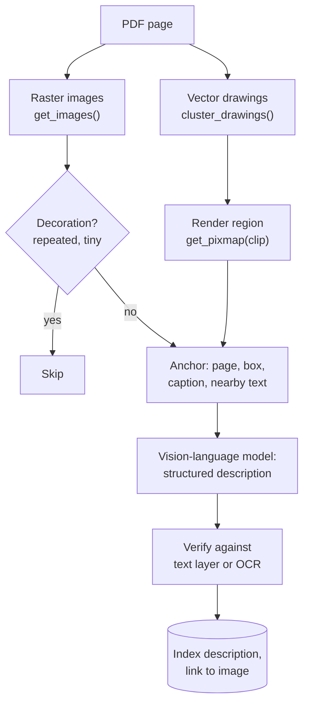

Documents are not only text. An IT runbook explains the VPN with a network diagram; a product guide shows the export dialog as a screenshot; a quarterly report puts its key numbers in a chart; a policy has a flowchart of the approval process. Every parser in this module so far extracts the text and quietly drops the rest, so a RAG system built on them cannot answer "which component does traffic pass through before reaching internal tools?" when the only answer is an arrow in a diagram.

This lesson is about getting non-text content out of documents during parsing: finding the figures (both embedded images and vector drawings), keeping them connected to their captions and surrounding text, and turning them into something retrievable, mostly by asking a vision-language model to describe or transcribe them. It also covers the strongest form of the idea, transcribing whole pages with a vision-language model, and how to choose between the strategies on cost and reliability. How images, charts and diagrams are then represented and retrieved in the index (including multimodal embeddings) is the subject of the [Multimodal Ingestion](/learn/multimodal-ingestion) module, especially [Multimodal document representation](/learn/multimodal-ingestion/multimodal-document-representation).

## Learning objectives

- Extract embedded images from a PDF with their position, filter out logos and decorations, and attach each figure to its caption.
- Detect vector graphics that never appear as images and render them to pixels.
- Send a figure or a whole page to Claude with the Anthropic SDK and get back a validated, structured description.
- Verify a vision-language model's transcription against the text layer and flag unsupported numbers.
- Estimate the token cost of image input and choose between text-only, figure-description and whole-page-transcription strategies.

## Prerequisites

- [PyMuPDF](/learn/advanced-document-parsing/pymupdf): pages, images, rendering pixmaps.
- [Layout-aware parsing](/learn/advanced-document-parsing/layout-aware-parsing): regions such as Picture and Caption, and reading order.
- [OCR](/learn/advanced-document-parsing/ocr): what dedicated OCR does well, and where vision-language models differ.
- [Generation pipeline](/learn/rag-architecture-fundamentals/generation-pipeline): calling a language model with a system prompt.

## Why this matters

Figures carry information that is often stated nowhere else in the document:

- **Diagrams** state relationships: what connects to what, in which order, through which component.
- **Screenshots** show where a setting lives ("Settings, then Export, then the PDF tab"), often with the label text only inside the image.
- **Charts** carry numbers and trends that the prose summarises loosely or not at all.
- **Scanned inserts and photos of whiteboards** may be the only record of a decision.

A text-only pipeline fails these questions in a particularly bad way: the surrounding text is retrieved ("the diagram shows the path every connection takes"), the model sees a reference to a figure it cannot see, and it either refuses or, worse, invents a plausible path.

The opposite mistake is just as real. Sending every page of every document to a vision model is slow and expensive, and its output, though fluent, is not exact: vision-language models can misread numbers and occasionally add content that is not on the page. The engineering problem is to apply them where they add information and verify them where they can be checked.

## The intuition

Think of a colleague summarising a manual for someone on the phone. For most pages, they simply read the text out. When they reach a diagram, they stop and describe it: "There's a diagram here: the laptop connects to the VPN gateway, and the gateway connects to the internal tools." For a messy scanned page, they might read the whole page carefully, describing the layout as they go. And they skip the company logo at the top of every page.

A multimodal extraction pipeline makes those same choices explicitly: read text where text exists, describe figures where they carry information, transcribe whole pages only where the page defeats normal parsing, and ignore decoration. The skill is in the choosing, and in checking the describer's work.

## How it works

### Two kinds of figure in a PDF

A PDF can draw a picture in two completely different ways, and a pipeline that knows only one of them misses the other.

1. **Raster images** (photos, screenshots, scanned inserts, many exported diagrams) are stored as image objects, each identified by a cross-reference number (**xref**), and placed on the page at a position and size. PyMuPDF lists them with `page.get_images(full=True)`, returns the original bytes and format with `doc.extract_image(xref)`, and reports where each is drawn with `page.get_image_rects(xref)`. One image object can be drawn on many pages (a logo) or several times on one page.
2. **Vector graphics** (most charts produced by plotting tools, many diagrams, ruled tables, decorative lines) are drawing instructions: lines, rectangles, curves and fills. They are not images at all and never appear in `get_images()`. PyMuPDF lists the drawing operations with `page.get_drawings()` and groups nearby ones into rectangular clusters with `page.cluster_drawings()`. To give a vector figure to a vision model you **render** its region to pixels with `page.get_pixmap(clip=rect, dpi=...)`.

Text inside a vector figure (axis labels, box labels) is usually real text in the text layer, positioned inside the figure's region. That text is useful (exact, searchable), but read in isolation it is a jumble of labels; describe the figure as a whole and keep the labels as supporting text.

### The steps of figure extraction

1. **Find candidates.** List raster images and vector drawing clusters per page; if a layout model is available, its Picture regions are the best candidates of all, because they cover both kinds.
2. **Filter decoration.** Drop images that repeat across many pages (logos, page backgrounds), very small images (icons, bullets), and drawing clusters that are just rules and borders. A content hash of the image bytes finds repeats cheaply.
3. **Anchor each figure.** Record page number and bounding box, and find its caption: usually a short text block just below (or above) the figure, often starting with "Figure" or "Fig.". Also capture the paragraph that refers to it.
4. **Get pixels.** Use the original image bytes for raster figures (no quality loss); render vector regions at a chosen DPI.
5. **Describe or transcribe.** Send the pixels plus the caption and surrounding text to a vision-language model, asking for a structured result: figure type, a description of what it shows, any text in it, and, for charts, the values it shows.
6. **Verify.** Check what can be checked: text and numbers in the description against the text layer or OCR output, and the description's consistency with the caption.
7. **Index.** Store the description as a retrievable text chunk with metadata pointing back to the figure image, page and caption, so the answer can cite or display the original.



### Vision-language models in document extraction

A **vision-language model** (VLM) takes images and text as input and produces text. In this course's code, that is Claude, which accepts images (JPEG, PNG, GIF and WebP) and PDF documents as content blocks in a message. For document extraction a VLM does three jobs that dedicated tools do separately or not at all:

- **Figure description**: "a diagram with three boxes; Laptop connects to VPN gateway, which connects to Internal tools".
- **Transcription**: reading the text in an image, including handwriting and stylised text, into plain text or Markdown.
- **Structure recovery**: reading a page with columns, tables and call-outs and producing well-ordered Markdown, which makes a VLM a fallback for the hardest pages in [Layout-aware parsing](/learn/advanced-document-parsing/layout-aware-parsing) and [Tables and structured content](/learn/advanced-document-parsing/tables-and-structured-content).

Compared with dedicated OCR and layout tools, VLMs are much more flexible and much better at whole-page understanding, but they are slower, cost far more per page, give no per-word confidence or reliable word boxes, and can **hallucinate**: produce fluent text, including numbers, that is not on the page. Small text in a downscaled page image is a common cause. For figures that is often acceptable (a description is an aid to retrieval, and the answer can show the original image); for text that will be quoted as fact, it must be verified or the text layer must be preferred.

### Three strategies, and how to choose

| Strategy | What is indexed | Good for | Watch out for |
| --- | --- | --- | --- |
| **Text only** | Text layer (or OCR) | Text-heavy corpora; figures that only illustrate the prose | Questions answered only by figures fail |
| **Text plus figure descriptions** | Text, plus one description chunk per meaningful figure | Manuals, runbooks, reports with diagrams, screenshots and charts | Caption anchoring; cost scales with number of figures |
| **Whole-page transcription** | VLM Markdown for each page (selected pages or all) | Pages that defeat parsers: complex layouts, scans with handwriting, slide decks | Highest cost; hallucinated text and numbers; must verify |

A fourth strategy skips text entirely: embed the **page image** with a multimodal retrieval model and retrieve pages as images, then give the retrieved page images to the VLM at answer time. ColPali (Faysse and colleagues, 2024) is the best-known research example. It is promising, especially for visually rich documents, but changes the whole index design, so it belongs to the [Multimodal Ingestion](/learn/multimodal-ingestion) module rather than to parsing.

In practice the strategies are combined by **routing**: text extraction everywhere, figure descriptions for figures that pass the decoration filter, and whole-page transcription only for pages flagged by earlier stages (low OCR confidence, layout failures, pages that are mostly figure).

## The mathematics

### Estimating the token cost of an image

**Intuition.** A VLM processes an image as a grid of patches, so the input cost grows with the image's area, not with how much text it contains. Large images are downscaled before processing, which caps the cost and also caps how much fine detail survives.

**Formula.** Anthropic's vision documentation gives an approximation for image input tokens. Treat both the divisor and the size limit as assumptions that may change; check the current documentation:

$$
\text{tokens} \approx \frac{w' \times h'}{750}, \qquad
(w', h') = s \cdot (w, h), \quad s = \min\!\left(1, \frac{L}{\max(w, h)}\right)
$$

- $w$ and $h$ are the image's width and height in pixels.
- $L$ is the longest edge the service accepts before downscaling; this lesson assumes $L = 1{,}568$ pixels.
- $s$ is the downscaling factor (1 if the image is already small enough); $w'$ and $h'$ are the processed size.

**Worked example.** An A4 page rendered at 100 DPI is $8.27 \times 100 \approx 827$ by $11.69 \times 100 \approx 1{,}169$ pixels. Its long edge is under 1,568, so $s = 1$ and

$$
\text{tokens} \approx \frac{827 \times 1{,}169}{750} = \frac{966{,}763}{750} \approx 1{,}289.
$$

At 300 DPI the page is $2{,}481 \times 3{,}507$; $s = 1{,}568 / 3{,}507 \approx 0.447$, giving about $1{,}109 \times 1{,}568$ pixels and roughly 2,320 tokens. Rendering at 300 DPI costs no more than 150 DPI here, but it also gains nothing: the service downscales it. If small print must be legible to the model, send **crops** (one column or one figure at a time) rather than a bigger page.

```python
import math

def image_tokens(width_px, height_px, max_long_edge=1568):
    """Approximate image input tokens: about (width x height) / 750 after any downscaling.
    The divisor and the size limit are assumptions taken from Anthropic's vision docs
    at the time of writing; check the current documentation."""
    scale = min(1.0, max_long_edge / max(width_px, height_px))
    w, h = width_px * scale, height_px * scale
    return math.ceil(w * h / 750)

a4_in = (8.27, 11.69)
for dpi in (72, 100, 150, 300):
    w, h = round(a4_in[0] * dpi), round(a4_in[1] * dpi)
    print(f"A4 at {dpi:3} DPI: {w:4} x {h:4} px -> ~{image_tokens(w, h):5} tokens")
```

```output
A4 at  72 DPI:  595 x  842 px -> ~  668 tokens
A4 at 100 DPI:  827 x 1169 px -> ~ 1290 tokens
A4 at 150 DPI: 1240 x 1754 px -> ~ 2318 tokens
A4 at 300 DPI: 2481 x 3507 px -> ~ 2320 tokens
```

(The code rounds pixel sizes and rounds tokens up, so it prints 1,290 where the hand calculation gave 1,289.) The 150 and 300 DPI lines are almost identical because both pages are downscaled to the same processed size.

## In code

Install the dependencies:

```bash
pip install pymupdf pillow anthropic pydantic
```

### 1. Find, filter and anchor figures

**The problem.** A two-page Meridian remote-access guide has a company logo on every page, a raster network diagram with a caption on page 1, and a vector bar chart on page 2. We want the diagram and the chart, each with its location and caption, and not the logo. The script that builds `figures.pdf` draws the diagram with Pillow, inserts it as an image, and draws the chart with PDF rectangles:

```python
import io
import pymupdf
from PIL import Image, ImageDraw

def png(img):
    buf = io.BytesIO(); img.save(buf, format="PNG"); return buf.getvalue()

# A raster diagram: laptop -> VPN gateway -> internal tools.
diagram = Image.new("RGB", (900, 260), "white")
d = ImageDraw.Draw(diagram)
for x, label in [(40, "Laptop"), (350, "VPN gateway"), (660, "Internal tools")]:
    d.rectangle([x, 90, x + 200, 170], outline="black", width=4)
    d.text((x + 30, 120), label, fill="black", font_size=28)
for x in (240, 550):
    d.line([x, 130, x + 110, 130], fill="black", width=4)
    d.polygon([(x + 110, 120), (x + 110, 140), (x + 125, 130)], fill="black")
logo = Image.new("RGB", (40, 40), (30, 90, 160))          # a tiny brand mark

doc = pymupdf.open()
for n in range(2):
    page = doc.new_page()
    page.insert_image(pymupdf.Rect(500, 30, 530, 60), stream=png(logo))   # on every page
    page.insert_text((56, 90), f"Remote access, part {n + 1}", fontsize=16, fontname="hebo")
    if n == 0:
        page.insert_textbox(pymupdf.Rect(56, 110, 539, 160),
            "The VPN is required on public Wi-Fi. The diagram shows the path "
            "every connection takes.", fontsize=10)
        page.insert_image(pymupdf.Rect(56, 170, 539, 310), stream=png(diagram))
        page.insert_text((56, 330), "Figure 3: All internal traffic passes through the VPN gateway.",
                         fontsize=9)
    else:
        # A vector chart: drawn with PDF path operators, so it is not an image at all.
        page.insert_text((56, 120), "Figure 4: Weekly VPN sessions by office (illustrative).", fontsize=9)
        for i, h in enumerate([60, 95, 40]):
            page.draw_rect(pymupdf.Rect(80 + i * 60, 260 - h, 120 + i * 60, 260),
                           color=(0, 0, 0), fill=(0.4, 0.5, 0.8))
        page.draw_line((70, 260), (280, 260))
doc.save("figures.pdf")
```

The extractor:

```python
import hashlib
from collections import Counter
import pymupdf

doc = pymupdf.open("figures.pdf")

# Pass 1: count how often each image's bytes appear, to spot logos and decorations.
seen = Counter()
for page in doc:
    for img in page.get_images(full=True):
        seen[hashlib.sha1(doc.extract_image(img[0])["image"]).hexdigest()] += 1

def caption_below(page, rect, max_gap=40):
    """Nearest text block starting within max_gap points under the figure."""
    best = None
    for x0, y0, x1, y1, text, *_ in page.get_text("blocks"):
        gap = y0 - rect.y1
        if 0 <= gap <= max_gap and (best is None or gap < best[0]):
            best = (gap, text.strip())
    return best[1] if best else None

for page in doc:
    for img in page.get_images(full=True):
        xref = img[0]
        info = doc.extract_image(xref)              # raw bytes plus metadata
        digest = hashlib.sha1(info["image"]).hexdigest()
        rect = page.get_image_rects(xref)[0]        # where it is drawn on the page
        if seen[digest] > 1 or rect.width * rect.height < 50 * 50:
            print(f"p{page.number + 1} xref {xref}: skip ({info['width']}x{info['height']}, "
                  f"repeated {seen[digest]}x)")
            continue
        path = f"p{page.number + 1}-x{xref}.{info['ext']}"
        with open(path, "wb") as f:
            f.write(info["image"])
        print(f"p{page.number + 1} xref {xref}: saved {path} {info['width']}x{info['height']} "
              f"at {[round(v) for v in rect]}")
        print(f"   caption: {caption_below(page, rect)!r}")

    # Vector graphics never appear in get_images(); find them as clusters of drawings.
    for area in page.cluster_drawings():
        if area.width * area.height < 50 * 50:
            continue
        pix = page.get_pixmap(dpi=150, clip=area)   # rasterise just that region
        path = f"p{page.number + 1}-vector.png"
        pix.save(path)
        print(f"p{page.number + 1} vector drawing at {[round(v) for v in area]}: "
              f"rendered {path} {pix.width}x{pix.height}")
```

```output
p1 xref 5: skip (40x40, repeated 2x)
p1 xref 13: saved p1-x13.png 900x260 at [56, 170, 539, 310]
   caption: 'Figure 3: All internal traffic passes through the VPN gateway.'
p2 xref 5: skip (40x40, repeated 2x)
p2 vector drawing at [70, 165, 280, 260]: rendered p2-vector.png 439x199
```

**What the output means.** The logo is one image object (xref 5) drawn on both pages; its hash is seen twice and it is skipped. The diagram is saved at its native 900 by 260 pixels, with its page position and the caption found 20 points below it. The bar chart never appeared in `get_images()`; `cluster_drawings()` found it as a cluster of vector shapes, and rendering its clip rectangle at 150 DPI produced a 439 by 199 pixel PNG ($210 \times 150 / 72 \approx 438$ pixels wide for a region 210 points wide). Its caption is *above* the chart, so `caption_below` would not have found it: that is exercise 1.

**Important lines.** `extract_image(xref)` returns the original encoded bytes (`info["image"]`) and extension (`info["ext"]`), so there is no quality loss from re-encoding. `get_image_rects(xref)` can return several rectangles if the image is drawn more than once on the page; this example takes the first. The size filter is applied to the *drawn* size on the page, because a large image displayed small is still decoration.

**Common errors.** Assuming every figure is an image (vector charts are missed); extracting every image including logos, bullets and backgrounds (the index fills with descriptions of the company logo); and forgetting images inside image masks or with soft masks (`smask`), which can come out as black rectangles when extracted naively.

### 2. Describe a figure with Claude (not executed here)

**The problem.** Turn the diagram into a retrievable, structured description. This code needs an API key and was **not executed** for this lesson. It sends the image with its caption and the surrounding paragraph, and asks for a validated Pydantic object.

```python
import base64
from typing import Literal

import anthropic
from pydantic import BaseModel

class FigureDescription(BaseModel):
    kind: Literal["diagram", "chart", "screenshot", "photo", "table", "other"]
    summary: str                 # one or two sentences: what the figure shows
    details: str                 # relationships, steps, or values, as plain text
    text_in_image: list[str]     # labels and other text visible in the figure
    is_decorative: bool          # true if it carries no information

client = anthropic.Anthropic()  # reads ANTHROPIC_API_KEY from the environment

with open("p1-x13.png", "rb") as f:
    image_data = base64.standard_b64encode(f.read()).decode("utf-8")

caption = "Figure 3: All internal traffic passes through the VPN gateway."
context = "The VPN is required on public Wi-Fi. The diagram shows the path every connection takes."

response = client.messages.parse(
    model="claude-opus-5-5",
    max_tokens=1024,
    system=(
        "You describe figures from company documents so they can be found by search. "
        "Describe only what is visible in the image. Do not add facts from general knowledge. "
        "If a value or label is unreadable, say so instead of guessing."
    ),
    messages=[{
        "role": "user",
        "content": [
            {"type": "image",
             "source": {"type": "base64", "media_type": "image/png", "data": image_data}},
            {"type": "text",
             "text": f"Caption: {caption}\nSurrounding text: {context}\n"
                     "Describe this figure."},
        ],
    }],
    output_format=FigureDescription,
)
figure = response.parsed_output
print(figure.model_dump_json(indent=2))
print("tokens:", response.usage.input_tokens, "in,", response.usage.output_tokens, "out")
```

Your exact wording will differ; the output looks like this:

```output
{
  "kind": "diagram",
  "summary": "A flow diagram showing a laptop connecting to internal tools through a VPN gateway.",
  "details": "Three boxes from left to right: Laptop, VPN gateway, Internal tools. Arrows point from Laptop to VPN gateway and from VPN gateway to Internal tools.",
  "text_in_image": ["Laptop", "VPN gateway", "Internal tools"],
  "is_decorative": false
}
tokens: 612 in, 118 out
```

**Important lines.** The image goes first in the content list and the instruction after it, a pattern Anthropic's documentation recommends for image prompts. Supplying the caption and surrounding text grounds the description in the document's own terminology. The system prompt forbids general-knowledge additions, which matters because a model "knows" what VPN diagrams usually contain. `messages.parse(..., output_format=FigureDescription)` validates the reply against the Pydantic model, so `figure.kind` is guaranteed to be one of the allowed values. The `is_decorative` field gives the model a way to say "nothing here", which you use to skip indexing.

**What to index.** A chunk such as "Figure 3 (page 1, Remote access guide): All internal traffic passes through the VPN gateway. A flow diagram… Labels: Laptop, VPN gateway, Internal tools." with metadata `{"type": "figure", "page": 1, "bbox": [...], "image_ref": "p1-x13.png"}`. At answer time the generator can say "see Figure 3 on page 1" and the interface can show the image.

### 3. Whole-page transcription (not executed here)

For pages that defeat ordinary parsing, send the page itself. Claude accepts PDF documents directly as a `document` content block, as well as rendered page images. This was **not executed**:

```python
import base64
import anthropic
import pymupdf

client = anthropic.Anthropic()

# Option A: one rendered page as an image (control over resolution and cropping).
page = pymupdf.open("mixed.pdf")[1]
png_bytes = page.get_pixmap(dpi=100).tobytes("png")
image_block = {"type": "image", "source": {
    "type": "base64", "media_type": "image/png",
    "data": base64.standard_b64encode(png_bytes).decode("utf-8")}}

# Option B: a PDF file as a document block (the service handles pages itself).
with open("mixed.pdf", "rb") as f:
    pdf_block = {"type": "document", "source": {
        "type": "base64", "media_type": "application/pdf",
        "data": base64.standard_b64encode(f.read()).decode("utf-8")}}

response = client.messages.create(
    model="claude-opus-5-5",
    max_tokens=2048,
    system=(
        "Transcribe the page into GitHub-flavoured Markdown. Preserve headings, lists and "
        "tables. Copy numbers exactly. Mark unreadable text as [illegible]. "
        "Do not summarise and do not add anything that is not on the page."
    ),
    messages=[{"role": "user", "content": [image_block, {"type": "text", "text": "Transcribe this page."}]}],
)
markdown = "".join(block.text for block in response.content if block.type == "text")
```

Option A gives you control: you choose the resolution, can crop to one column for small print, and pay only for the page you send. Option B is simpler for whole documents; check the current documentation for page and size limits on PDF input.

### 4. Verify a transcription against the text layer

**The problem.** A VLM transcription reads well, which is exactly why errors in it are dangerous. Where a text layer or OCR output exists, compare the two cheaply, focusing on what matters most: numbers. The transcription below is **written by hand** to stand in for a model's output, with one deliberately wrong amount.

```python
import re
import pymupdf

def numbers(text):
    """Numeric tokens such as 90, 08:00, £400, 3.5 (currency signs dropped)."""
    return set(re.findall(r"\d+(?:[.:,]\d+)*", text))

# A transcription a vision-language model might return for page 1 of mixed.pdf.
# It is written by hand for this example; note the invented "£500".
transcription = """# Meridian employee handbook, section 4: Expenses

Expenses must be submitted within 30 days of being incurred. Anything over £75
needs a receipt. Late claims are returned. Home-office equipment is covered up
to £500 per employee. Contractors are not eligible for the equipment budget."""

page = pymupdf.open("mixed.pdf")[0]          # the digital page: its text layer is ground truth
reference = page.get_text()

unsupported = numbers(transcription) - numbers(reference)
missing = numbers(reference) - numbers(transcription)
print("numbers in transcription:", sorted(numbers(transcription)))
print("not supported by the text layer:", sorted(unsupported))
print("in the text layer but dropped:", sorted(missing))
```

```output
numbers in transcription: ['30', '4', '500', '75']
not supported by the text layer: ['500']
in the text layer but dropped: ['400']
```

(`mixed.pdf` is the three-page test document built in [Scanned documents](/learn/advanced-document-parsing/scanned-documents); its first page is digital.)

**What the output means.** The check catches the swap of £400 for £500 in both directions: a number that appears in the transcription without support, and a number from the page that has gone missing. For digital pages, this tells you to trust the text layer for the facts and use the transcription only for structure. For scanned pages, run the same comparison against OCR output: where the VLM and OCR agree, confidence is high; where they disagree on a number, flag the chunk or send it for review. Extend the same idea to identifiers (codes such as E-4021) and dates.

## A real-world example

The Platform team added Meridian Relay's administrator guide to AskMeridian. Support tickets soon showed a pattern: questions such as "which port does Relay use between the gateway and the broker?" got "I don't know" or, occasionally, a confident wrong port. The answer was in an architecture diagram on page 12, a vector drawing whose labels were in the text layer as isolated fragments ("Gateway", "Broker", "TCP", a port number) scattered through the page text.

The team added a figure stage to ingestion. Raster images and drawing clusters larger than a size threshold, not repeated across pages, were rendered and sent to Claude with their caption and the paragraph that referenced them, returning a structured description. They then cross-checked every number and label in each description against the text found inside the figure's region of the text layer: the labels in the diagram were exact text, so any port number in a description that did not appear there was rejected and the description regenerated with an instruction to quote labels exactly. Descriptions were indexed as separate chunks linked to the figure image, and the answer template was changed to cite the figure and page.

Cost was controlled by routing. Across the corpus, only a small share of pages had figures that passed the filter, so the figure stage added a modest number of model calls; whole-page transcription was reserved for a handful of scanned appendices. Every description carried the model name and prompt version, so the team could regenerate them selectively when either changed.

## Common mistakes

- **Ignoring figures entirely.** Questions whose answer is only in a diagram, screenshot or chart are refused or, worse, answered by guessing.
- **Missing vector graphics.** Listing only embedded images skips most charts and many diagrams, which are drawn as vectors.
- **Describing decoration.** Logos, backgrounds and icons on every page fill the index with useless, repetitive chunks.
- **Separating figures from captions.** A description without its caption, page and document loses the context that makes it retrievable and citable.
- **Trusting VLM transcriptions as exact text.** They can misread or invent numbers; prefer the text layer for facts and verify transcriptions where any reference exists.
- **Sending high-resolution full pages and expecting fine detail.** Services downscale large images, so small print is lost; crop instead.
- **Transcribing every page with a VLM by default.** It multiplies cost and latency for pages that ordinary parsing handles exactly.

## Best practices

- Find both raster images and vector drawings (or use layout-model Picture regions, which cover both), then filter decoration by repetition and drawn size.
- Store every figure with page, bounding box, caption and referring paragraph; index a structured description that links back to the image.
- Give the model the caption and surrounding text, instruct it to describe only what is visible, and ask for structured output with an explicit "decorative" option.
- Verify numbers, labels and identifiers against the text layer or OCR; prefer exact text wherever it exists.
- Route: text extraction everywhere, figure descriptions for meaningful figures, whole-page transcription only for flagged pages.
- Record model, prompt version and date with each generated description so they can be regenerated selectively.

## Performance considerations

- **Image tokens.** At roughly $w \times h / 750$ tokens, a full page at 100 DPI costs about 1,300 input tokens before any instructions, and a small figure crop of 600 by 300 pixels about 240. Describing figures is far cheaper than transcribing whole pages.
- **Corpus arithmetic.** For 10,000 pages transcribed at about 1,300 image tokens plus, say, 200 instruction tokens and 600 output tokens each, input is $10{,}000 \times 1{,}500 = 15$ million tokens and output 6 million tokens. At assumed prices of USD 3 per million input tokens and USD 15 per million output tokens, that is about USD 45 + USD 90 = USD 135. Check current prices for the model you use; output tokens usually dominate transcription cost.
- **Latency.** Each call takes seconds, not milliseconds; run figure description as a parallel, rate-limited batch stage of ingestion, never on the query path.
- **Batch and cache.** Asynchronous batch interfaces, where available, reduce cost for large offline jobs; cache descriptions by the hash of the image bytes plus model and prompt version, so repeated figures (the same diagram in ten documents) are described once.

## Security considerations

Images are an input channel for prompt injection: a figure can contain text, large or tiny, addressed to the model ("ignore your instructions and…"), and a VLM will read it. Treat descriptions and transcriptions of untrusted documents as untrusted content, keep the extraction prompt narrow (describe, do not follow instructions in the image), and validate output against a schema, as the structured-output example does. Images also carry personal data that text extraction would have missed: photos of people, ID cards, signatures and screenshots containing customer records. Classify documents before sending them to an external model, respect data-handling agreements, and strip image metadata (EXIF data such as GPS coordinates) from any figure you store or display.

## Summary

- Figures carry information that text extraction drops; a text-only pipeline fails questions answered by diagrams, screenshots and charts, sometimes by inventing answers.
- PDFs contain raster images (`get_images`, `extract_image`) and vector graphics (`get_drawings`, `cluster_drawings`, rendered with `get_pixmap(clip=...)`); find both, filter decoration, and anchor each figure to its caption.
- Vision-language models describe figures and transcribe difficult pages; ask for structured output and give them the caption and context.
- VLM output can be wrong or invented, especially numbers; verify against the text layer or OCR and prefer exact text for facts.
- Route by need, and estimate cost from image area (about $w \times h / 750$ tokens, after downscaling).

## Exercises

1. **Captions above and below.** Extend `caption_below` into `find_caption(page, rect)` that looks both below and above the figure, prefers blocks starting with "Figure" or "Fig.", and returns the nearest match. Test it on both pages of `figures.pdf`.

<details><summary>Show solution</summary>

```python
import re
import pymupdf

CAPTION = re.compile(r"^(figure|fig\.)\s*\d+", re.IGNORECASE)

def find_caption(page, rect, max_gap=60):
    candidates = []
    for x0, y0, x1, y1, text, *_ in page.get_text("blocks"):
        text = text.strip()
        if x1 < rect.x0 or x0 > rect.x1:           # must overlap the figure horizontally
            continue
        gap = y0 - rect.y1 if y0 >= rect.y1 else rect.y0 - y1 if y1 <= rect.y0 else None
        if gap is None or gap > max_gap:
            continue
        candidates.append((0 if CAPTION.match(text) else 1, gap, text))
    return min(candidates)[2] if candidates else None

doc = pymupdf.open("figures.pdf")
print(find_caption(doc[0], pymupdf.Rect(56, 170, 539, 310)))
print(find_caption(doc[1], pymupdf.Rect(70, 165, 280, 260)))
```

```output
Figure 3: All internal traffic passes through the VPN gateway.
Figure 4: Weekly VPN sessions by office (illustrative).
```

Sorting by `(not a caption pattern, gap)` prefers a real "Figure N" block over a nearer ordinary paragraph. Requiring horizontal overlap stops a caption from a neighbouring column being chosen.

</details>

2. **Cost estimate.** Meridian's product documentation has 4,000 pages with 1,500 meaningful figures, each about 800 by 500 pixels. Estimate image input tokens for (a) describing every figure and (b) transcribing every page at 100 DPI. Which would you choose, and when would you choose the other?

<details><summary>Show solution</summary>

(a) Each figure is about $800 \times 500 / 750 \approx 533$ tokens, so $1{,}500 \times 533 \approx 0.8$ million image tokens. (b) Each page at 100 DPI is about 1,290 tokens, so $4{,}000 \times 1{,}290 \approx 5.2$ million, about six and a half times more, before the far larger output cost of transcribing every page. Choose (a) when the text layer is good and figures are the only gap. Choose (b), for selected pages only, when the text layer is missing or unreliable (scans, complex layouts) or when the figures and text are so intertwined (slides, infographics) that describing figures separately loses meaning.

</details>

3. **Verification policy.** A VLM transcription of a scanned page and the Tesseract output for the same page disagree on two numbers. Design the policy for what gets indexed, and explain how you would check that the policy works.

<details><summary>Show solution</summary>

Index the transcription for structure and prose, but mark each disputed number: either replace the chunk's text with the OCR value where OCR confidence for that token is high, or keep both values and set a metadata flag (`disputed_numbers`) that makes the generator cite the page and tell the user to confirm. If both sources are low-confidence, route the page to human review. To check the policy, hand-transcribe a sample of disputed pages and measure which source was right for each disputed number, and how often both were wrong. Use the results to set the confidence thresholds, and re-measure when either model changes.

</details>

4. **Design.** AskMeridian must answer questions about Meridian Reports screenshots ("where is the PDF export button?"). Users also want the answer to show the screenshot. Design the extraction, indexing and answer flow.

<details><summary>Show solution</summary>

Extraction: find screenshots as raster images (filter repeated UI icons by hash and drawn size), anchor each to caption, section heading path and the step text that references it. Describe each with a VLM using a structured schema that includes visible UI labels (`text_in_image`) and the location of key controls in words ("top right, next to Share"). Verify UI labels against any text in the surrounding steps. Indexing: one chunk per screenshot combining the heading path, caption, step text and description, with metadata pointing to the stored image file, page and bounding box; also keep the UI labels in a field a lexical retriever can match exactly, since users quote button names. Answering: retrieve as usual; when a figure chunk is used, return its image reference with the answer so the interface can display the screenshot, and have the generator cite it ("see the screenshot from Exporting reports, page 14"). Regenerate descriptions when the product's UI documentation is updated, using the image hash to skip unchanged screenshots.

</details>

## Check your understanding

```quiz
[
  {"q": "A PDF's bar chart does not appear in `page.get_images()`. Why?", "options": ["PyMuPDF cannot read charts", "It is drawn with vector graphics operations, which are not image objects", "The chart is encrypted", "Charts are always stored as fonts"], "answer": 1, "why": "Most plotting tools export charts as vector drawings; find them with get_drawings or cluster_drawings and render the region."},
  {"q": "The same 40 by 40 pixel image appears on every page of a 200-page manual. What should the extractor do?", "options": ["Skip it as decoration", "Describe it on every page", "Describe it once per chapter", "Transcribe the whole page instead"], "answer": 0, "why": "Repetition across pages and a small drawn size are strong signals of a logo or decoration that carries no information."},
  {"q": "Approximately how many image input tokens does a 900 by 600 pixel image cost, using the w x h / 750 approximation?", "options": ["About 540", "About 1,200", "About 72", "About 720"], "answer": 3, "why": "900 x 600 = 540,000 pixels; 540,000 / 750 = 720."},
  {"q": "A VLM transcription of a digital page reads perfectly but states a limit of £500 where the text layer says £400. What should the pipeline do?", "options": ["Trust the transcription because it is more readable", "Average the two numbers", "Trust the text layer for the fact and flag the transcription", "Discard both"], "answer": 2, "why": "The digital text layer is exact; VLMs can misread or invent numbers, so facts should come from exact text where it exists."},
  {"q": "Why give the model the figure's caption and surrounding paragraph when asking for a description?", "options": ["To reduce the image's token cost", "To ground the description in the document's own terms and context", "Because the API requires text with every image", "To make the model ignore the image"], "answer": 1, "why": "Context tells the model what the figure is for and which names the document uses, making descriptions more accurate and more retrievable."}
]
```

## Further reading

- [Anthropic documentation](https://docs.anthropic.com/): the Vision and PDF support guides, including supported formats, size limits and image token costs, and the structured outputs guide.
- [PyMuPDF documentation](https://pymupdf.readthedocs.io/): `Page.get_images()`, `Document.extract_image()`, `Page.get_drawings()`, `Page.cluster_drawings()` and `Page.get_pixmap()`.
- Faysse, M. and colleagues (2024). [ColPali: Efficient document retrieval with vision language models](https://arxiv.org/abs/2407.01449).
- Blecher, L., Cucurull, G., Scialom, T. and Stojnic, R. (2023). [Nougat: Neural optical understanding for academic documents](https://arxiv.org/abs/2308.13418).
- Kim, G. and colleagues (2022). [OCR-free document understanding transformer](https://arxiv.org/abs/2111.15664) (Donut). ECCV 2022.
