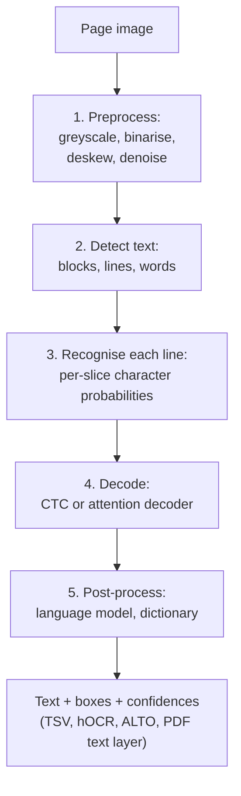

Optical character recognition (OCR) turns a picture of text into text. For a RAG system it is the only way into a large share of real-world documents: scanned contracts, photographed whiteboards, faxed forms, screenshots pasted into wiki pages, and PDFs whose "text" is really an image. It is also the stage of ingestion most likely to introduce errors that nobody notices, because its output looks like text and flows through the rest of the pipeline without complaint.

This lesson explains how a modern OCR engine works inside, from image to characters, so that you can reason about its failures; how to measure OCR quality with character and word error rates; and how OCR errors propagate into retrieval. The practicalities of whole scanned documents (detecting them, cleaning page images, adding text layers) are the subject of the next lesson, [Scanned documents](/learn/advanced-document-parsing/scanned-documents), and running OCR at scale as a production service is covered in [OCR pipelines](/learn/multimodal-ingestion/ocr-pipelines).

## Learning objectives

- Describe the stages of an OCR engine (preprocessing, text detection, line recognition, decoding, post-processing) and what each one can get wrong.
- Decode a sequence of per-frame character probabilities with greedy CTC decoding, by hand and in NumPy.
- Compute character error rate and word error rate from an edit distance, and explain why they can disagree.
- Run an experiment showing how OCR-style character errors degrade lexical and dense retrieval.
- Use word-level confidence scores from an OCR engine to decide what to index, flag or re-process.

## Prerequisites

- [PDF extraction](/learn/data-processing/pdf-extraction): text layers in PDFs, and why some PDFs have none.
- [PyMuPDF](/learn/advanced-document-parsing/pymupdf): opening documents and rendering pages.
- [Query-document matching](/learn/rag-architecture-fundamentals/query-document-matching): lexical versus semantic scoring.
- [Tables and structured content](/learn/advanced-document-parsing/tables-and-structured-content): why structure matters as much as characters.

## Why this matters

When text extraction fails on a digital PDF, you usually get nothing, which is easy to detect. When OCR fails, you get *almost* the right text. "£75" becomes "£7S", "rotated every 90 days" becomes "rotated every 30 days", "E-4021" becomes "E-402l". The errors cluster precisely where RAG systems are most sensitive:

- **Numbers and identifiers.** Digits and letters that look alike (0 and O, 1 and l and I, 5 and S, 8 and B) are the classic confusions, and policy limits, error codes, part numbers and dates are made of exactly those characters. A language model will repeat a wrong number from its context with full confidence.
- **Rare terms.** OCR engines lean on language models and dictionaries to resolve ambiguous shapes, so common words come out well and unusual ones (product names, surnames, internal jargon) are "corrected" into common words.
- **Retrieval signals.** A lexical retriever needs exact term matches, and one wrong character breaks a term. A dense retriever is more tolerant, but not immune.

Without measurement you will not know how often this happens, so the engineering problem has two halves: getting good OCR, and knowing how good it is.

## The intuition

Think about how you read a smudged handwritten note. You do not identify each letter in isolation. You see the shape of a whole word, you use the letters you are sure of to guess the ones you are not, and you use the sentence around it to settle what remains: "the meeting is at 1O:30" must mean "10:30", because a time needs digits.

An OCR engine does the same three things, in the same order. It finds where the lines of text are. It looks along each line and produces, for every small slice, a guess of which character is there, with a probability. Then it turns those slice-by-slice guesses into a string, using knowledge of the language to break ties. Each step can go wrong, and the third step is the one that can go wrong *convincingly*: an engine that "knows" English will turn an unusual name into a common word.

## How it works

### The stages of an OCR engine

Modern engines differ in their models, but most follow this pipeline.



1. **Preprocessing.** Convert to greyscale, separate ink from paper (**binarisation**), straighten a crooked page (**deskewing**) and remove specks. Traditional engines such as Tesseract benefit a great deal from this; deep-learning engines trained on messy photos depend on it less. The details belong to [Scanned documents](/learn/advanced-document-parsing/scanned-documents).
2. **Text detection and layout analysis.** Find the regions that contain text and split them into lines (and often words). Classical engines do this with connected-component analysis: find blobs of ink, group blobs into lines by their vertical position, and group lines into blocks by spacing. Deep-learning detectors, such as CRAFT (Baek and colleagues, 2019) and DBNet (Liao and colleagues, 2020), predict text regions directly from the image and cope with curved or rotated text. This step decides **reading order** and column structure, and many OCR "errors" are really detection errors: two columns read as one, or a table read across.
3. **Line recognition.** Each line image is resized to a fixed height and fed to a neural network that reads it left to right. A common design, popularised by the CRNN paper (Shi, Bai and Yao, 2015), uses a convolutional network to turn the line into a sequence of feature vectors, one per narrow vertical slice, and a recurrent network (an LSTM) to give each slice context from its neighbours. The output is a matrix: for each slice, a probability for every character in the alphabet, plus a special **blank** symbol. Tesseract has used an LSTM line recogniser since version 4. Newer engines use transformer recognisers (TrOCR, Li and colleagues, 2021, is a well-known example).
4. **Decoding.** Turn the probability matrix into a string. A line is typically wider than the number of characters it holds, so many slices see the same character, and some see the gap between characters. **Connectionist Temporal Classification (CTC)**, introduced by Graves and colleagues (2006), solves this with a simple rule, explained in the mathematics section: take a path through the slices, merge repeated symbols, then delete blanks. Attention-based decoders instead generate characters one at a time like a small language model.
5. **Post-processing.** Combine the recogniser's probabilities with a language model or dictionary: prefer "receipt" over "reccipt" when the shapes are ambiguous. This fixes many errors and causes a few: it can replace a correct rare word with an incorrect common one.

The output is not just text. Every serious engine reports **bounding boxes** (where each word is on the page) and **confidence scores** (how sure it is), in formats such as Tesseract's TSV, **hOCR** (HTML with boxes in attributes) and **ALTO** (an XML standard used by libraries and archives), or as an invisible text layer in a PDF. Keep the boxes: they let you reconstruct layout, highlight citations on the page image, and remove headers and footers by position.

### Engines you will meet

The landscape changes quickly, so treat this as a map rather than a ranking, and check each project's documentation for current capabilities and licences.

- **Tesseract.** Open source, maintained for many years, runs on a CPU, supports more than a hundred languages through downloadable trained-data files. Its page-segmentation modes (`--psm`) tell it what to expect: `3` is fully automatic page segmentation (the default), `6` assumes a single uniform block of text, `7` a single line, `11` sparse text in no particular order. Choosing the wrong mode is a common cause of poor results on receipts, forms and screenshots. It does best on clean, high-contrast, well-scanned printed text.
- **Deep-learning toolkits** such as PaddleOCR, EasyOCR and docTR. These pair a learned text detector with a learned recogniser, cope better with photos, rotated text and complex backgrounds, and run faster on a GPU.
- **Cloud document services**: Amazon Textract, Google Cloud Document AI and Vision, Azure AI Document Intelligence. They return text with layout, and usually tables and form key-value pairs as well. You pay per page and send documents to a third party, which matters for confidential material.
- **Vision-language models.** General multimodal models, including Claude, can read text from images and are covered in [Multimodal document extraction](/learn/advanced-document-parsing/multimodal-document-extraction). They are strong on messy layouts and handwriting, but they do not give per-character confidences or reliable word boxes, they cost far more per page, and they can produce fluent text that is not on the page. "OCR-free" document models such as Donut (Kim and colleagues, 2022) and Nougat (Blecher and colleagues, 2023) are research systems in the same family.

### Confidence scores, and what they are worth

An engine's confidence for a word is derived from the recogniser's probabilities along the decoded path. Tesseract reports a word confidence from 0 to 100 (and `-1` for rows that are not words, such as block and line records). Two facts about these numbers matter in practice:

- **They are useful for ranking, not as probabilities.** A word with confidence 40 is much more likely to be wrong than one with 95, but "95" does not mean "wrong 5% of the time". Calibrate thresholds on your own documents.
- **They are local.** A confidently recognised word can still be in the wrong place, from a detection or reading-order error. Confidence measures the recognition step only.

Typical uses: flag pages whose mean word confidence is low for human review or re-processing with a stronger engine; mark low-confidence numeric tokens so that answers quoting them can warn the user; and drop very low-confidence "words" that are usually specks of noise read as punctuation.

### Languages and scripts

OCR needs to know the language. A model trained for English cannot read Arabic, and an English model given a French page will miss accents and "correct" French words into English ones. Tesseract takes a language list (`-l eng+fra`); multilingual documents need every language listed, and more languages make recognition slower and sometimes less accurate. Right-to-left scripts, vertical text and scripts without spaces between words (Chinese, Japanese, Thai) each need engines and models built for them. Language detection on the *output* (a later module covers [Language detection](/learn/document-preprocessing/language-detection)) is a useful check that the right model was used: an English model reading Greek produces gibberish whose detected language is nothing sensible.

## The mathematics

### CTC decoding

**Intuition.** The recogniser makes a guess for every narrow slice of the line, and there are many more slices than characters. Neighbouring slices covering the same character will all say that character, so repeats must be merged. But some words genuinely contain doubled letters ("00" in "100"), which merging would destroy. CTC adds a **blank** symbol, written here as `-`, that the network outputs between characters; repeats are merged only when no blank separates them.

**Formula.** For an alphabet extended with the blank, a **path** $\pi = (\pi_1, \dots, \pi_T)$ assigns one symbol to each of the $T$ slices. The recogniser gives each slice a probability distribution $y_t$, so the probability of a path is the product of its per-slice probabilities. The collapse function $\mathcal{B}$ merges consecutive repeats and then removes blanks. The probability of a string $\ell$ is the sum over every path that collapses to it:

$$
p(\pi \mid x) = \prod_{t=1}^{T} y_t(\pi_t), \qquad
p(\ell \mid x) = \sum_{\pi \,:\, \mathcal{B}(\pi) = \ell} p(\pi \mid x)
$$

- $x$ is the line image; $T$ is the number of slices.
- $y_t(k)$ is the probability the network gives symbol $k$ at slice $t$; each $y_t$ sums to 1.
- $\mathcal{B}$ is the collapse: for example $\mathcal{B}(\texttt{99-00-}) = \texttt{900}$.

Training maximises $p(\ell \mid x)$ for the correct transcription, which an efficient dynamic-programming algorithm makes tractable. At inference, the simplest decoder is **greedy**: take the most probable symbol at each slice and collapse. Beam search, optionally combined with a language model, considers several candidate paths and usually does a little better.

**Worked example.** Suppose a four-slice line has these probabilities over the symbols `-`, `1`, `0`:

| slice | `-` | `1` | `0` |
| --- | --- | --- | --- |
| 1 | 0.1 | 0.8 | 0.1 |
| 2 | 0.6 | 0.3 | 0.1 |
| 3 | 0.2 | 0.1 | 0.7 |
| 4 | 0.3 | 0.1 | 0.6 |

Greedy decoding picks `1`, `-`, `0`, `0`, a path with probability $0.8 \times 0.6 \times 0.7 \times 0.6 = 0.2016$. Collapsing merges the two final zeros (no blank between them), giving "10". The string "100" would need a blank between the zeros, such as path `1`, `0`, `-`, `0` with probability $0.8 \times 0.1 \times 0.2 \times 0.6 = 0.0096$, far less likely. So greedy decoding reads "10".

Watch the collapse rule run on a longer path:

```trace
{"title": "Collapsing a CTC path", "code": ["path = \"99-0-00\"", "out, prev = [], None", "for ch in path:", "    if ch != prev and ch != \"-\":", "        out.append(ch)", "    prev = ch", "print(\"\".join(out))"], "steps": [
{"line": 1, "vars": {"path": "\"99-0-00\""}, "note": "Seven slices. The intended text is 900."},
{"line": 2, "vars": {"out": "[]", "prev": "None"}, "note": "Nothing emitted yet."},
{"line": 5, "vars": {"ch": "\"9\"", "out": "[\"9\"]"}, "note": "First 9: differs from prev and is not blank, so emit it."},
{"line": 6, "vars": {"ch": "\"9\"", "prev": "\"9\"", "out": "[\"9\"]"}, "note": "Second 9 equals prev: a repeat from a neighbouring slice, so skip it."},
{"line": 6, "vars": {"ch": "\"-\"", "prev": "\"-\"", "out": "[\"9\"]"}, "note": "Blank: never emitted, but it resets prev."},
{"line": 5, "vars": {"ch": "\"0\"", "out": "[\"9\", \"0\"]"}, "note": "First 0 emitted."},
{"line": 6, "vars": {"ch": "\"-\"", "prev": "\"-\"", "out": "[\"9\", \"0\"]"}, "note": "Another blank separates the zeros."},
{"line": 5, "vars": {"ch": "\"0\"", "out": "[\"9\", \"0\", \"0\"]"}, "note": "Because prev is the blank, this 0 is a new character, not a repeat."},
{"line": 6, "vars": {"ch": "\"0\"", "prev": "\"0\"", "out": "[\"9\", \"0\", \"0\"]"}, "note": "Final 0 repeats the previous slice: skipped."},
{"line": 7, "vars": {"out": "[\"9\", \"0\", \"0\"]"}, "out": ["900"], "note": "Collapsed result: 900."}
]}
```

### Character and word error rate

**Intuition.** To score OCR against a correct transcription, count the smallest number of single-character edits that turn the OCR output into the truth, and divide by the length of the truth. Doing the same with words instead of characters gives the word error rate.

**Formula.**

$$
\text{CER} = \frac{S + D + I}{N}, \qquad \text{WER} = \frac{S_w + D_w + I_w}{N_w}
$$

- $S$, $D$, $I$ are the numbers of substituted, deleted and inserted characters in a minimum-cost alignment (their sum is the **Levenshtein edit distance**).
- $N$ is the number of characters in the reference (true) text.
- $S_w$, $D_w$, $I_w$, $N_w$ are the same quantities counted in words.

Both can exceed 1 if the output contains many insertions.

**Worked example.** Reference: "Anything over £75 needs a receipt." That is 34 characters and 6 words. The OCR output "Anything over £7S needs a receipt." has one substitution (5 read as S):

$$
\text{CER} = \frac{1}{34} \approx 0.029, \qquad \text{WER} = \frac{1}{6} \approx 0.167
$$

A 3% character error rate sounds excellent; but the one wrong word is the amount, the only part of the sentence anyone will ask about. This is why you should report both, and also check accuracy specifically on digits and identifiers.

**In Python:**

```python
def edit_distance(ref, hyp):
    """Levenshtein distance: minimum substitutions + deletions + insertions."""
    prev = list(range(len(hyp) + 1))
    for i, r in enumerate(ref, start=1):
        cur = [i]
        for j, h in enumerate(hyp, start=1):
            cur.append(min(prev[j] + 1,              # delete r
                           cur[j - 1] + 1,           # insert h
                           prev[j - 1] + (r != h)))  # substitute (free if equal)
        prev = cur
    return prev[-1]

def cer(ref, hyp):
    return edit_distance(ref, hyp) / len(ref)

def wer(ref, hyp):
    return edit_distance(ref.split(), hyp.split()) / len(ref.split())

ref = "Anything over £75 needs a receipt."
for hyp in ["Anything over £75 needs a receipt.",
            "Anything over £7S needs a receipt.",
            "Anyth1ng ovcr £75 nceds a reccipt.",
            "Anything over 75 needs a receipt"]:
    print(f"{hyp!r:40} CER={cer(ref, hyp):.3f}  WER={wer(ref, hyp):.3f}")
```

```output
'Anything over £75 needs a receipt.'     CER=0.000  WER=0.000
'Anything over £7S needs a receipt.'     CER=0.029  WER=0.167
'Anyth1ng ovcr £75 nceds a reccipt.'     CER=0.118  WER=0.667
'Anything over 75 needs a receipt'       CER=0.059  WER=0.333
```

The same `edit_distance` function works on lists of words because it only compares elements for equality. The third line shows the opposite disagreement: four scattered character errors give a modest CER but ruin four of six words. The fourth line has lost the currency sign and the full stop, two deletions; whether that matters depends on whether your normalisation strips punctuation before comparing, so always state the normalisation you used alongside a reported error rate.

## In code

Install the dependencies for the runnable examples:

```bash
pip install numpy rank-bm25 sentence-transformers
```

### 1. Greedy CTC decoding on a simulated recogniser output

**The problem.** See exactly how a probability matrix becomes a string, and where a confidence number comes from. We simulate the matrix a recogniser might produce for a line reading "90 days".

```python
import numpy as np

alphabet = ["-", "9", "0", " ", "d", "a", "y", "s"]   # index 0 is the CTC blank
# One row per horizontal slice (time step) of a line image reading "90 days".
# Each row is the recogniser's probability for every symbol at that slice.
frames = ["9", "9", "-", "0", "0", "-", " ", "d", "a", "a", "y", "-", "s", "s"]
rng = np.random.default_rng(0)
probs = np.full((len(frames), len(alphabet)), 0.02)
for t, ch in enumerate(frames):
    probs[t, alphabet.index(ch)] = 0.8
probs += rng.uniform(0, 0.03, probs.shape)        # a little noise
probs /= probs.sum(axis=1, keepdims=True)         # each row sums to 1

def ctc_greedy_decode(probs, alphabet, blank=0):
    best = probs.argmax(axis=1)                   # most likely symbol per slice
    out, prev = [], None
    for idx in best:
        if idx != prev and idx != blank:          # collapse repeats, drop blanks
            out.append(alphabet[idx])
        prev = idx
    path = "".join(alphabet[i] for i in best)
    confidence = probs.max(axis=1).prod() ** (1 / len(best))   # geometric mean
    return path, "".join(out), confidence

path, text, conf = ctc_greedy_decode(probs, alphabet)
print("best path:", repr(path))
print("decoded:  ", repr(text))
print(f"mean per-slice confidence: {conf:.3f}")

# Why the blank matters: "00" needs a blank between the two zeros.
for p in ["1--00-", "100", "10-0"]:
    collapsed = "".join(c for i, c in enumerate(p) if (i == 0 or c != p[i - 1]) and c != "-")
    print(f"{p!r:10} -> {collapsed!r}")
```

```output
best path: '99-00- daay-ss'
decoded:   '90 days'
mean per-slice confidence: 0.763
'1--00-'   -> '10'
'100'      -> '10'
'10-0'     -> '100'
```

**What the output means.** Fourteen slices became seven characters. The repeated `99`, `aa` and `ss` collapsed to single letters, and the blanks vanished. The last three lines show the blank's job: without a blank between the zeros, "100" can never be produced. The confidence here is the geometric mean of the winning probabilities along the path, one simple way to summarise a line; real engines compute their own variants, which is one reason confidences from different engines cannot be compared.

**Extending it.** Lower one slice's top probability so that two symbols nearly tie and watch the decoded string change; then implement a beam search that keeps the three best partial strings at each step.

### 2. How OCR noise hurts retrieval

**The problem.** AskMeridian is about to index a batch of scanned handbook pages. How much do character errors matter for retrieval, and does it depend on the retriever? We inject OCR-like confusions (e to c, l to 1, 5 to S, m to rn and so on) into eight Meridian documents at increasing rates, then ask eight questions with BM25 and with a dense embedding model, and count how often the right document comes first. Each rate is averaged over five random seeds.

```python
import random
import re
import numpy as np
from rank_bm25 import BM25Okapi
from sentence_transformers import SentenceTransformer

docs = [
    "Annual leave is 25 days a year; up to 5 unused days carry over and must be used by 31 March.",
    "Staff may work remotely up to 3 days a week and claim a home-office equipment budget of £400.",
    "Expenses must be submitted within 30 days, and anything over £75 needs a receipt.",
    "Passwords must be rotated every 90 days, and the VPN is required on public Wi-Fi.",
    "Laptops are refreshed every 3 years; report a lost laptop to the support desk at once.",
    "The support desk is open from 08:00 to 18:00 UK time.",
    "Contractors are not eligible for the home-office equipment budget.",
    "The Atlas error-code catalogue explains error E-4021 and how to fix it.",
]
queries = [  # (question, index of the document that answers it)
    ("How many days of annual leave do I get?", 0),
    ("How many days a week can I work from home?", 1),
    ("When do I need a receipt for an expense?", 2),
    ("How often must I change my password?", 3),
    ("How often are laptops replaced?", 4),
    ("What time does the support desk open?", 5),
    ("Can contractors claim the equipment budget?", 6),
    ("What does error E-4021 mean?", 7),
]

CONFUSIONS = {"e": "c", "l": "1", "o": "0", "S": "5", "s": "5", "i": "l",
              "m": "rn", "a": "o", "t": "f", "0": "O", "1": "l", "5": "S"}

def ocr_noise(text, rate, rng):
    """Swap characters for look-alikes, as a weak OCR engine would."""
    return "".join(CONFUSIONS[c] if c in CONFUSIONS and rng.random() < rate else c
                   for c in text)

tok = lambda s: re.findall(r"\w+", s.lower())
model = SentenceTransformer("sentence-transformers/all-MiniLM-L6-v2")
q_vecs = model.encode([q for q, _ in queries], normalize_embeddings=True)

print("noise  bm25_top1  dense_top1")
for rate in [0.0, 0.1, 0.2, 0.4]:
    bm25_hits, dense_hits = [], []
    for seed in range(5):
        rng = random.Random(seed)
        noisy = [ocr_noise(d, rate, rng) for d in docs]
        bm25 = BM25Okapi([tok(d) for d in noisy])
        d_vecs = model.encode(noisy, normalize_embeddings=True)
        for qi, (q, gold) in enumerate(queries):
            bm25_hits.append(int(np.argmax(bm25.get_scores(tok(q)))) == gold)
            dense_hits.append(int(np.argmax(d_vecs @ q_vecs[qi])) == gold)
    print(f"{rate:5.1f}  {np.mean(bm25_hits):9.2f}  {np.mean(dense_hits):10.2f}")

rng = random.Random(1)
print("\nexample at rate 0.2:", ocr_noise(docs[2], 0.2, rng))
```

```output
noise  bm25_top1  dense_top1
  0.0       0.75        1.00
  0.1       0.60        0.93
  0.2       0.50        0.85
  0.4       0.40        0.60

example at rate 0.2: Expcnses must be 5ubrnittcd within 30 day5, ond anything over £7S needs a receipt.
```

**What the output means.** The "noise" column is the probability that each *confusable* character is swapped, not a CER; the overall CER is lower because many characters have no entry in the table. Even on clean text BM25 misses two of the eight questions, through ordinary vocabulary mismatch ("work from home" against "work remotely"), which [Query-document matching](/learn/rag-architecture-fundamentals/query-document-matching) explained. Both retrievers then lose accuracy steadily as noise rises. BM25 suffers because "5ubrnittcd" is a different term from "submitted"; the dense model degrades more gently because its subword tokeniser still sees fragments of the original words, but it degrades too. This is a tiny, synthetic corpus, so read the *shape* of the result, not the numbers: OCR quality is a retrieval-quality problem, and the example line shows the price, "£75" has become "£7S".

**Common errors.** Comparing a CER measured with punctuation stripped against one measured without; evaluating OCR only on clean pages; and measuring retrieval with queries written by someone looking at the OCR output (they will unconsciously use words that survived).

### 3. Running Tesseract and keeping confidences (not executed here)

The sandbox used for this course does not have the Tesseract binary installed, so the code in this section was **not executed**. It uses `pytesseract`, a thin wrapper that calls the `tesseract` command-line program. Install Tesseract itself through your operating system's package manager (for example `brew install tesseract` on macOS or `apt-get install tesseract-ocr` on Debian and Ubuntu), then:

```bash
pip install pytesseract pillow pymupdf
```

```python
import pytesseract
from PIL import Image

img = Image.open("scan_page.png")
data = pytesseract.image_to_data(
    img,
    lang="eng",
    config="--oem 1 --psm 3",          # LSTM engine, automatic page segmentation
    output_type=pytesseract.Output.DICT,
)

lines = {}
low_confidence = []
for i, word in enumerate(data["text"]):
    conf = float(data["conf"][i])
    if conf < 0 or not word.strip():   # -1 marks block/paragraph/line rows, not words
        continue
    key = (data["block_num"][i], data["par_num"][i], data["line_num"][i])
    lines.setdefault(key, []).append(word)
    if conf < 60:
        low_confidence.append((word, conf))

text = "\n".join(" ".join(words) for _, words in sorted(lines.items()))
print(text)
print("low-confidence words:", low_confidence)
```

`image_to_data` returns one row per page, block, paragraph, line and word, with parallel lists for `text`, `conf`, `left`, `top`, `width`, `height` and the block, paragraph, line and word numbers. Grouping by `(block_num, par_num, line_num)` rebuilds lines in Tesseract's reading order. The threshold of 60 is an arbitrary starting point; calibrate it by checking which words below each threshold are actually wrong in a sample of your documents.

PyMuPDF can call Tesseract for you and give back an ordinary text page, which lets the rest of a PyMuPDF-based pipeline treat OCR text and digital text identically. This also requires Tesseract and its language data (located through the `TESSDATA_PREFIX` environment variable, or the `tessdata` argument):

```python
import pymupdf

doc = pymupdf.open("scanned.pdf")
for page in doc:
    tp = page.get_textpage_ocr(language="eng", dpi=300, full=True)
    print(page.get_text(textpage=tp))
```

With `full=False` (the default), PyMuPDF only OCRs the parts of the page not already covered by readable digital text, which suits mixed pages. Your exact output depends on your Tesseract version and image quality; for the clean synthetic scan built in the next lesson, you should expect near-perfect text, and on real office scans you should expect occasional errors of the kinds shown above.

## A real-world example

Meridian's Finance department digitised ten years of signed expense-policy memos for AskMeridian. The Platform team ran Tesseract over them with default settings and indexed the output. Spot checks looked fine: paragraphs read naturally.

Three weeks later a staff member was told by AskMeridian that receipts were needed for expenses "over £7S". The answer was quoted faithfully from the context. The team pulled a random sample of 40 pages, transcribed them by hand, and measured CER and WER, plus a separate error rate on tokens containing digits. Prose came out well, but digit-bearing tokens had noticeably more errors than words: the memos used a typeface whose 5 and S were close, and a background watermark broke up the digits on some pages.

They made three changes. The ingestion job now records Tesseract's word confidences, and any page whose digit tokens have a low median confidence is re-OCRed at a higher rendering resolution and, if still poor, queued for review. Chunks keep a flag listing low-confidence numeric tokens, and the generation prompt instructs the model to point the user to the source page when an answer depends on a flagged number. Finally, the 40 hand-transcribed pages became a permanent regression set: any change of OCR engine, model or setting must not increase CER or digit-token error rate on it.

## Common mistakes

- **Trusting OCR output because it reads fluently.** Post-processing makes errors look like real words, so they pass casual review and reach users as confident wrong answers.
- **Not measuring at all.** Without a small hand-transcribed sample you cannot tell whether a new engine, setting or scanner is better or worse.
- **Reporting CER alone.** A low CER can hide a high error rate on exactly the numbers and identifiers people ask about.
- **Using the wrong language model or page-segmentation mode.** An English model on a French page, or `--psm 3` on a single-line label, produces poor text with no error.
- **Throwing away boxes and confidences.** Without them you cannot fix reading order, remove page furniture, highlight sources, or decide what to re-process.
- **OCRing digital PDFs.** Rasterising a page that already has a correct text layer and OCRing it replaces exact text with approximate text.

## Best practices

- OCR only what needs it: use the digital text layer whenever it is present and valid.
- Keep a hand-transcribed evaluation set from your real documents and track CER, WER and digit-token accuracy for every pipeline change.
- Store word boxes and confidences alongside the text; aggregate them into page-level quality scores.
- Route low-quality pages to re-processing (higher resolution, a different engine, a vision-language model, or a person) instead of indexing them as if they were clean.
- Set the language list explicitly, per document where you can detect it.
- Combine lexical and dense retrieval for OCRed corpora; dense matching tolerates character noise better, lexical matching finds clean identifiers.

## Performance considerations

OCR is usually the slowest stage of ingestion by a wide margin, so estimate before you start. The numbers below are assumptions for illustration; measure your own.

- If CPU OCR takes about 2 seconds per page (an assumed figure; real costs vary with resolution, engine and page density), 50,000 pages need $50{,}000 \times 2 = 100{,}000$ CPU-seconds, about 28 CPU-hours. Spread over 16 cores that is under 2 hours of wall-clock time. Pages are independent, so OCR parallelises almost perfectly across processes.
- Resolution drives cost. Rendering at 300 DPI instead of 150 DPI produces four times as many pixels, and detection and recognition time grows roughly with the image area.
- Cloud OCR is priced per page. At an assumed price of USD 1.50 per 1,000 pages, 50,000 pages cost about USD 75; check current prices, which differ by feature (plain text versus tables and forms).
- Vision-language models cost much more per page than dedicated OCR and are slower; reserve them for pages that cheaper engines handle badly.
- Cache OCR results keyed by a hash of the page image and the engine version, so that re-indexing does not re-OCR unchanged pages.

## Security considerations

Scanned documents are often the most sensitive in an organisation: signed contracts, identity documents, medical forms. Sending them to a cloud OCR service sends their contents to a third party, so check data-processing terms, regions and retention before doing so, and keep confidential material on local engines if required. OCR also makes previously unsearchable personal data searchable: a scanned staff list becomes retrievable text the moment it is indexed, so apply the same access controls and sensitivity classification as for digital documents. Finally, an image can carry text designed to be read by a machine (faint, tiny or in the margins) that a human reviewer would miss; OCR output from untrusted images is untrusted input, exactly like any other extracted text.

## Summary

- OCR runs in stages (preprocess, detect, recognise, decode, post-process), and each stage has its own failure modes; detection errors break reading order, recognition errors break characters.
- CTC decoding merges repeated per-slice predictions and removes blanks; the blank is what allows doubled letters.
- CER and WER, both built on edit distance, measure quality; report them with your normalisation, and track digits and identifiers separately.
- OCR errors cluster in numbers and rare terms and degrade both lexical and dense retrieval, lexical more sharply.
- Keep word boxes and confidences, measure on a hand-transcribed sample, and route poor pages to re-processing instead of indexing them blindly.

## Exercises

1. **By hand.** Compute the CER and WER of the OCR output "Passwords must be rotatcd every 30 days" against the reference "Passwords must be rotated every 90 days". Which error matters more for AskMeridian, and does either metric tell you so?

<details><summary>Show solution</summary>

The reference has 39 characters and 7 words. There are two substitutions (e read as c, 9 read as 3), so CER = 2/39 ≈ 0.051 and WER = 2/7 ≈ 0.286. The "rotatcd" error is harmless: any reader or dense retriever recovers it. The "30" error changes the policy, and a model will repeat it. Neither metric distinguishes them; that is why a separate error rate on digit-bearing tokens (here 1 of 1 wrong) is worth tracking.

</details>

2. **Greedy versus best string.** Using the four-slice table in the mathematics section, compute the total probability of the string "10" by summing every path that collapses to it. Is greedy decoding guaranteed to return the most probable string? Explain.

<details><summary>Show solution</summary>

Paths over four slices that collapse to "10" must contain a 1 followed later by a 0, with only repeats or blanks around them. Enumerating them in code is the reliable way:

```python
import itertools
y = [{"-": .1, "1": .8, "0": .1}, {"-": .6, "1": .3, "0": .1},
     {"-": .2, "1": .1, "0": .7}, {"-": .3, "1": .1, "0": .6}]

def collapse(p):
    return "".join(c for i, c in enumerate(p) if (i == 0 or c != p[i - 1]) and c != "-")

totals = {}
for path in itertools.product("-10", repeat=4):
    prob = 1.0
    for t, s in enumerate(path):
        prob *= y[t][s]
    totals[collapse(path)] = totals.get(collapse(path), 0) + prob
for s, p in sorted(totals.items(), key=lambda kv: -kv[1])[:4]:
    print(repr(s), round(p, 4))
```

```output
'10' 0.6375
'101' 0.0629
'0' 0.0624
'1' 0.0594
```

"10" has total probability about 0.638, more than three times the single greedy path's 0.2016, because many paths collapse to it (for example `1-00`, `11-0`, `1000`, `-100`). Here greedy decoding happens to return the most probable string, but it is not guaranteed to: greedy finds the most probable *path*, and a string supported by many moderately likely paths can beat one supported by a single likely path. Beam search approximates the sum better.

</details>

3. **A confidence gate.** Given Tesseract `image_to_data` output as a dictionary, write a function that returns the page text plus a page-quality record: mean word confidence, the share of words below 60, and the list of low-confidence tokens that contain a digit. Test it on a hand-made dictionary, since you may not have Tesseract installed.

<details><summary>Show solution</summary>

```python
def ocr_quality(data, threshold=60):
    words = [(w, float(c)) for w, c in zip(data["text"], data["conf"])
             if float(c) >= 0 and w.strip()]
    if not words:
        return "", {"mean_conf": 0.0, "low_share": 1.0, "low_digits": []}
    confs = [c for _, c in words]
    low = [(w, c) for w, c in words if c < threshold]
    return " ".join(w for w, _ in words), {
        "mean_conf": round(sum(confs) / len(confs), 1),
        "low_share": round(len(low) / len(words), 2),
        "low_digits": [w for w, _ in low if any(ch.isdigit() for ch in w)],
    }

fake = {"text": ["", "Anything", "over", "£7S", "needs", "a", "receipt."],
        "conf": [-1, 96, 95, 41, 93, 97, 90]}
print(ocr_quality(fake))
```

```output
('Anything over £7S needs a receipt.', {'mean_conf': 85.3, 'low_share': 0.17, 'low_digits': ['£7S']})
```

A page whose `low_digits` list is non-empty is a candidate for re-OCR or review.

</details>

4. **Design decision.** Meridian wants to index 200,000 pages of archived scans. A cloud OCR service is more accurate on their hardest pages but the legal team is reluctant to send HR files outside the company. Propose a design that balances accuracy, cost and confidentiality.

<details><summary>Show solution</summary>

Classify documents by sensitivity first (from folder, owner and document type metadata). Run a local engine (for example Tesseract or a GPU toolkit) on everything, recording confidences. Compute page quality scores. For low-quality pages from non-sensitive collections, re-process with the cloud service. For low-quality pages from sensitive collections (HR files), re-process locally with a stronger setting or a locally hosted model, and if still poor, queue them for human review or index them with a "low OCR quality" flag that the answer generator surfaces. Measure each path's CER on a hand-transcribed sample so the escalation threshold is justified, and cache results by page hash so the expensive steps happen once.

</details>

## Check your understanding

```quiz
[
  {"q": "In CTC decoding, why does the alphabet include a blank symbol?", "options": ["To mark the end of the line", "So that genuinely repeated characters, such as the two zeros in 100, can be separated and not merged", "To represent spaces between words", "To store the confidence score"], "answer": 1, "why": "Collapsing merges consecutive repeats; a blank between two identical characters keeps them as two."},
  {"q": "An OCR output has a CER of 0.03 on a policy page. What is the most important follow-up check for a RAG system?", "options": ["Nothing; 3% is excellent", "Re-run OCR at a lower resolution", "Measure error rates specifically on numbers and identifiers", "Convert the page to greyscale"], "answer": 2, "why": "Errors concentrate in look-alike characters, so a low overall CER can hide wrong amounts, dates or codes, which are what users ask about."},
  {"q": "What does this print?\n```python\np = \"aa-a--b\"\nprint(\"\".join(c for i, c in enumerate(p) if (i == 0 or c != p[i-1]) and c != \"-\"))\n```", "options": ["aab", "ab", "aaab", "a-ab"], "answer": 0, "why": "The first two a's merge into one, the blank separates it from the third a, and the blanks are dropped: aab."},
  {"q": "Tesseract is producing poor text on single-line product labels with default settings. What is the most likely fix?", "options": ["Use a different embedding model", "Lower the page resolution", "Disable the language model", "Set a page segmentation mode that expects a single line, such as --psm 7"], "answer": 3, "why": "The default mode expects a full page with blocks and paragraphs; telling Tesseract it is looking at one line changes how it segments the image."},
  {"q": "In the noise experiment, why did BM25 lose accuracy faster than the dense retriever as OCR noise increased?", "options": ["One wrong character turns a word into a different term that no longer matches, while subword embeddings still see fragments of the word", "BM25 cannot handle numbers", "Dense retrievers ignore spelling entirely", "BM25 needs a GPU"], "answer": 0, "why": "Lexical matching needs exact terms; the embedding model's subword tokens and learned representations tolerate small corruptions better, though not completely."}
]
```

## Further reading

- [Tesseract OCR documentation](https://tesseract-ocr.github.io/): installation, page segmentation modes, and the "Improving the quality of the output" guide.
- Graves, A., Fernández, S., Gomez, F. and Schmidhuber, J. (2006). Connectionist temporal classification: labelling unsegmented sequence data with recurrent neural networks. ICML 2006.
- Shi, B., Bai, X. and Yao, C. (2015). [An end-to-end trainable neural network for image-based sequence recognition and its application to scene text recognition](https://arxiv.org/abs/1507.05717). The CRNN architecture.
- Smith, R. (2007). An overview of the Tesseract OCR engine. ICDAR 2007.
- Li, M. and colleagues (2021). [TrOCR: Transformer-based optical character recognition with pre-trained models](https://arxiv.org/abs/2109.10282).
- [PyMuPDF documentation](https://pymupdf.readthedocs.io/): the OCR section, including `Page.get_textpage_ocr()`.
