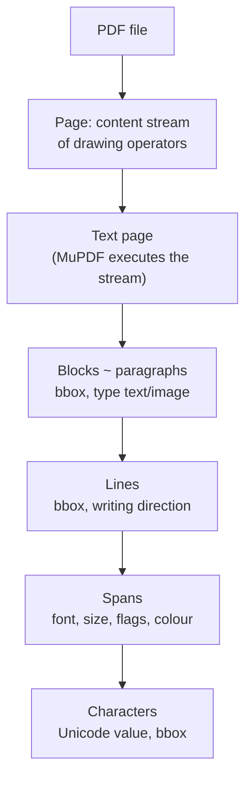
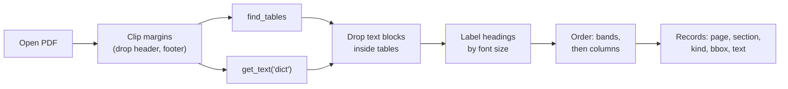

A PDF looks like a document, but inside the file there are no paragraphs, no headings and no tables: only instructions that paint glyphs at coordinates on a page. Getting clean, correctly ordered text out of one is therefore an act of reconstruction, and the quality of that reconstruction caps the quality of everything downstream in a RAG system. **PyMuPDF** is the Python library most production pipelines reach for first when they need that reconstruction to be fast and controllable. This lesson takes you inside it: how it models a page, the different views of text it offers, and how to use positions, fonts and tables to turn a page into ordered, labelled records ready for chunking.

[PDF extraction](/learn/data-processing/pdf-extraction) introduced the PDF format and its basic pitfalls. Here we go deeper into one tool and build a small but real extraction pipeline with it. The next lesson, [pypdf](/learn/advanced-document-parsing/pypdf), covers the pure-Python alternative and when to prefer it.

## Learning objectives

- Explain how a PDF page stores text and why extraction must reconstruct reading order rather than read it.
- Use PyMuPDF's `get_text` modes (`"text"`, `"blocks"`, `"words"`, `"dict"`) and say which one a given task needs.
- Remove running headers and footers with a clip rectangle and detect headings from font size.
- Extract a ruled table with `find_tables` and render it as Markdown.
- Build an extractor that emits records carrying page number, section, kind and bounding box, and justify each design choice.

## Prerequisites

- [PDF extraction](/learn/data-processing/pdf-extraction): what a PDF is and the basic ways extraction goes wrong.
- [Document metadata](/learn/document-engineering/document-metadata): why every chunk should carry its source, page and section.
- [Indexing pipeline](/learn/rag-architecture-fundamentals/indexing-pipeline): where parsing sits among the offline stages.

## Why this matters

Retrieval can only find what the parser produced. If a two-column page is read straight across, every line of the left column is glued to the matching line of the right column, and a sentence about annual leave ends in the middle of a sentence about remote work. The resulting chunk embeds to a vector that is near neither topic, and the question "how many days of leave do I get?" no longer finds it. Nothing errors. The index simply gets worse in a way that only shows up as wrong answers weeks later.

Three other parsing failures are just as quiet:

- **Running headers and footers.** "Meridian Employee Handbook 2025" and "Page 7 of 120" appear on every page. Left in, they are repeated in hundreds of chunks, add noise to every embedding and can make a lexical retriever think every page is about the handbook's title.
- **Lost structure.** Headings become ordinary lines, so the chunker cannot split at section boundaries and chunks cannot be labelled with the section they came from.
- **Flattened tables.** A table read cell by cell becomes a list of disconnected words: "Policy Rule Password rotation Every 90 days Laptop refresh". The association between "Laptop refresh" and "3 years" survives only by accident of order.

A good parser does not just produce text. It produces text in the right order, with the noise removed and the structure labelled. PyMuPDF gives you the raw ingredients for all three; this lesson shows how to use them.

## The intuition

Imagine receiving a page of a newspaper as a list of instructions from a typesetter: "at position (310, 136) write *Staff may work*", "at (50, 30) write *Meridian Employee Handbook*", "at (50, 136) write *Annual leave is 25 days*". The instructions can come in any order the typesetting software liked. To read the page you would lay out every fragment where it belongs, notice that the small text at the very top and bottom repeats on every page, see that the bold, larger fragments are headings, and then read down the left column before the right one.

That is exactly the job. PyMuPDF does the first part for you: it executes the instructions, groups glyphs that sit next to each other into words, lines and blocks, and tells you where each one is and what font it uses. The second part, deciding what is noise, what is a heading and what order to read things in, uses that information but is ultimately your decision, because it depends on what your documents look like.

## How it works

### What PyMuPDF is

PyMuPDF is the Python binding for **MuPDF**, a PDF and e-book rendering library written in C and maintained by Artifex. The Python package is installed as `pymupdf` and imported as `pymupdf`; older code uses `import fitz`, a legacy name that still works but is deprecated. Because the parsing and rendering happen in compiled C code, PyMuPDF is fast, and it reads more than PDF: XPS, EPUB, MOBI, FB2, CBZ, SVG and common image formats open through the same API.

> [!WARNING]
> PyMuPDF and MuPDF are dual-licensed: under the **GNU AGPL v3** or under a commercial licence from Artifex. The AGPL has obligations that reach further than permissive licences such as MIT or BSD, including for software offered over a network. Check the licence with whoever owns compliance in your organisation before you build a commercial product on it. This is one of the most common reasons teams choose [pypdf](/learn/advanced-document-parsing/pypdf) (BSD licence) instead.

### How a PDF page stores text

A PDF page has a **content stream**: a sequence of drawing operators. Text operators select a font and size, set a position and paint a string of glyphs. A few consequences follow, and every one of them shapes the code in this lesson:

1. **Positions, not paragraphs.** The file records where each run of glyphs goes. Lines, paragraphs and columns are not stored; they are inferred from geometry.
2. **Any order.** The content stream can paint fragments in any order. Many generators emit text in reading order, but nothing requires it; headers are often painted last, columns sometimes right to left, and edited documents in whatever order edits happened.
3. **Coordinates.** PDF units are **points** (1/72 inch). An A4 page is 595 by 842 points. PDF's own coordinate system starts at the bottom-left corner, but PyMuPDF converts everything so that the origin is the **top-left** corner and y grows downwards, like a screen.
4. **Glyphs need mapping back to characters.** A font may map glyph codes to Unicode through a table in the file. When that table is missing or wrong, extraction produces nonsense even though the page renders perfectly. A page that is just a scanned image has no text operators at all. Both cases need [OCR](/learn/advanced-document-parsing/ocr).

### The page hierarchy

When you ask for a page's text, MuPDF builds a **text page**: it executes the content stream, records every character with its position and font, and groups them bottom-up:

- **Characters** carry a glyph, a Unicode value and a bounding box.
- **Spans** are runs of characters on one line in the same font, size and colour.
- **Lines** are spans that share a baseline.
- **Blocks** are lines that sit close together, roughly paragraphs.

Each level has a **bounding box** (`bbox`): the rectangle `(x0, y0, x1, y1)` around it, top-left corner first.



### The views of text

`page.get_text(option)` returns that hierarchy at different levels of detail. Choosing the right one is the first design decision.

| Option | Returns | Use it for |
| --- | --- | --- |
| `"text"` (default) | One string, lines separated by newlines | Quick inspection; simple single-column documents |
| `"blocks"` | List of `(x0, y0, x1, y1, text, block_no, block_type)` | Reordering paragraphs; dropping regions |
| `"words"` | List of `(x0, y0, x1, y1, word, block_no, line_no, word_no)` | Fine-grained geometry; custom line or table logic |
| `"dict"` | Nested dict: blocks, lines, spans with font, size, flags | Headings, bold, font-based structure |
| `"rawdict"` | Like `"dict"` plus individual characters | Character-level work; rarely needed |
| `"html"`, `"xhtml"`, `"xml"`, `"json"` | Serialised forms of the same data | Handing to other tools |

Three keyword arguments matter constantly:

- `clip=pymupdf.Rect(...)` restricts extraction to a rectangle. It is the simplest tool for dropping headers, footers and margins.
- `sort=True` reorders output by position (top to bottom, then left to right) instead of content-stream order.
- `flags=` switches individual text-page features on or off, such as keeping ligatures (`TEXT_PRESERVE_LIGATURES`) or including image blocks (`TEXT_PRESERVE_IMAGES`).

### Reading order, the central problem

Content-stream order and position order are both wrong for multi-column pages, in different ways. Content-stream order is whatever the generator emitted. Position order, as `sort=True` produces it, reads straight across the page, which on a two-column layout puts the first line of the left column beside the first line of the right. Neither knows what a column is.

A practical heuristic, and the one this lesson implements, works with blocks:

1. Treat any block wider than a large share of the page (say 60%) as **full width**: titles, wide tables, single-column paragraphs.
2. Full-width blocks divide the page into horizontal **bands**.
3. Within each band, read every block in the left half from top to bottom, then every block in the right half.

This handles the common magazine and handbook layouts. It does not handle three columns, columns of unequal width, sidebars, or text that wraps around figures. For those you need a parser that models layout explicitly, which is the subject of [Layout-aware parsing](/learn/advanced-document-parsing/layout-aware-parsing).

### Headers, footers and headings

**Running headers and footers** occupy the same narrow strips at the top and bottom of each page. If your documents have consistent margins, a clip rectangle that excludes those strips removes them at no cost. Where margins vary, a more robust method is to find lines that repeat at the same position across many pages; [Header and footer removal](/learn/document-preprocessing/header-and-footer-removal) develops that method. Both approaches have a cost to keep in mind: a page number is noise for embedding, but it is valuable **metadata** for citations, so read it before you throw it away.

**Headings** have no tag in an untagged PDF. They are detected by appearance: larger size or bold weight than the body text. The `"dict"` view gives each span a `size` and a `flags` bit field (bold is `pymupdf.TEXT_FONT_BOLD`, italic `pymupdf.TEXT_FONT_ITALIC`). A robust way to find the body size is to count characters per font size and take the most common one; anything clearly larger is a heading candidate. Some PDFs also carry an **outline** (bookmarks), which `doc.get_toc()` returns as `[level, title, page]` rows. When present, it is a more reliable source of section titles than font guessing.

### Tables

Since version 1.23, PyMuPDF has `page.find_tables()`, which detects tables from the vector lines that draw their borders (the default strategy) or from text alignment (`strategy="text"`, for borderless tables). Each table found has a `bbox`, `extract()` (a list of rows of cell strings), `to_markdown()` and `to_pandas()`. Ruled tables with clean grids work well; borderless tables, merged cells and tables that continue over a page break are much harder. The general problem, and how to choose a representation for retrieval, belongs to [Tables and structured content](/learn/advanced-document-parsing/tables-and-structured-content).

When you extract a table separately, you must also stop its cells appearing a second time as ordinary text. The pipeline below does this by dropping any text block whose bounding box intersects a table's.

### What else PyMuPDF exposes

- **Metadata:** `doc.metadata` (title, author, creation date and so on) and `doc.get_toc()`.
- **Page labels:** `page.get_label()` returns the printed label ("iv", "A-3") where the PDF defines one, which is what a citation should show.
- **Links:** `page.get_links()` lists hyperlinks with their target.
- **Images:** `page.get_images(full=True)` lists embedded images; `doc.extract_image(xref)` returns the bytes and format of one. Figures are the territory of [Multimodal document extraction](/learn/advanced-document-parsing/multimodal-document-extraction).
- **Rendering:** `page.get_pixmap(dpi=...)` rasterises a page, which you need before sending a page to an OCR engine or a vision model.
- **OCR hook:** `page.get_textpage_ocr(...)` runs Tesseract over a page to produce a text page, if Tesseract is installed. [OCR](/learn/advanced-document-parsing/ocr) covers OCR itself.
- **Encryption:** `doc.needs_pass` and `doc.authenticate(password)`.

There is also a separate companion package, **pymupdf4llm**, whose `to_markdown()` converts a document to Markdown with headings, lists and tables, aimed at exactly the RAG use case. It is a reasonable first thing to try on a new corpus. This lesson builds the mechanism by hand so you understand what such a converter does and can fix it when it guesses wrong.

## In code

### Setup

Everything in this section ran in the course sandbox with PyMuPDF 1.28.2.

```bash
pip install pymupdf
```

The examples use a two-page sample handbook that you can generate yourself. It is built to contain every problem described above: a running header and footer, a two-column page whose right column is written to the file *before* the left one, a title written last, bold headings, a ruled table and a word hyphenated across a line break.

```python
# make_handbook.py: builds a two-page sample PDF for the examples
import pymupdf

doc = pymupdf.open()

def furniture(page, n, total):
    page.insert_text((50, 40), "Meridian Employee Handbook 2025", fontsize=9)
    page.insert_text((480, 815), f"Page {n} of {total}", fontsize=9)

def section(page, x, y, heading, body):
    page.insert_text((x, y), heading, fontsize=12, fontname="hebo")
    page.insert_textbox(pymupdf.Rect(x, y + 6, x + 235, y + 120), body, fontsize=11)

# Page 1: two columns. The right column is written to the file first.
p1 = doc.new_page(width=595, height=842)
furniture(p1, 1, 2)
section(p1, 310, 130, "3. Remote work",
        "Staff may work remotely up to 3 days a week. The home-office equipment "
        "budget is £400. Contractors are not eligible for the equipment budget.")
section(p1, 50, 130, "1. Annual leave",
        "Annual leave is 25 days per year. Up to 5 unused days carry over and "
        "must be used by 31 March.")
section(p1, 50, 230, "2. Expenses",
        "Expenses must be submitted within 30 days. Anything over £75 needs a receipt.")
p1.insert_text((50, 95), "Part A: Time, money and place", fontsize=16, fontname="hebo")

# Page 2: a ruled table, then a paragraph with a word hyphenated across lines.
p2 = doc.new_page(width=595, height=842)
furniture(p2, 2, 2)
p2.insert_text((50, 95), "Part B: IT policies", fontsize=16, fontname="hebo")
rows = [("Policy", "Rule"), ("Password rotation", "Every 90 days"),
        ("Laptop refresh", "Every 3 years"),
        ("Support desk hours", "08:00 to 18:00 UK time")]
y = 115
for i, (a, b) in enumerate(rows):
    font = "hebo" if i == 0 else "helv"
    for x0, x1, text in ((50, 220, a), (220, 450, b)):
        p2.draw_rect(pymupdf.Rect(x0, y, x1, y + 22), color=(0, 0, 0), width=0.7)
        p2.insert_text((x0 + 5, y + 15), text, fontsize=10, fontname=font)
    y += 22
p2.insert_textbox(pymupdf.Rect(50, 225, 545, 300),
    "VPN is required on public Wi-Fi. Lost laptops must be reported to the sup-\n"
    "port desk at once.", fontsize=11)

doc.set_metadata({"title": "Meridian Employee Handbook", "author": "HR team"})
doc.set_toc([[1, "Part A: Time, money and place", 1], [1, "Part B: IT policies", 2]])
doc.save("handbook.pdf")
print("wrote handbook.pdf with", doc.page_count, "pages")
```

```output
wrote handbook.pdf with 2 pages
```

`"hebo"` and `"helv"` are PyMuPDF's short names for the built-in Helvetica Bold and Helvetica fonts, so no font files are needed.

### Step 1: the naive extraction

**The problem.** See what the default call returns before deciding anything.

```python
import pymupdf

doc = pymupdf.open("handbook.pdf")
print("pages:", doc.page_count)
print("title:", doc.metadata["title"], "| author:", doc.metadata["author"])
print("toc:", doc.get_toc())

page = doc[0]
print("page size (points):", page.rect.width, "x", page.rect.height)
print("--- get_text() ---")
print(page.get_text())
```

```output
pages: 2
title: Meridian Employee Handbook | author: HR team
toc: [[1, 'Part A: Time, money and place', 1], [1, 'Part B: IT policies', 2]]
page size (points): 595.0 x 842.0
--- get_text() ---
Meridian Employee Handbook 2025
Page 1 of 2
3. Remote work
Staff may work remotely up to 3 days a week.
The home-office equipment budget is £400.
Contractors are not eligible for the equipment
budget.
1. Annual leave
Annual leave is 25 days per year. Up to 5
unused days carry over and must be used by 31
March.
2. Expenses
Expenses must be submitted within 30 days.
Anything over £75 needs a receipt.
Part A: Time, money and place
```

**What the output means.** The text is complete and every character is right, yet the result is wrong in three ways. The footer "Page 1 of 2" sits second. Section 3 comes before section 1, because that is the order the file painted them. The page title comes last. Fed to a chunker, the title "Part A" would be attached to whatever followed it, and a fixed-size chunk could easily mix the remote-work rules with the leave rules. This is content-stream order, exactly as the theory predicted.

### Step 2: sorting by position is not enough

```python
import pymupdf

page = pymupdf.open("handbook.pdf")[0]
print(page.get_text(sort=True, clip=pymupdf.Rect(0, 60, page.rect.width, 300)).strip())
```

```output
Part A: Time, money and place

1. Annual leave                                  3. Remote work
Annual leave is 25 days per year. Up to 5             Staff may work remotely up to 3 days a week.
unused days carry over and must be used by 31    The home-office equipment budget is £400.
March.                                            Contractors are not eligible for the equipment
                                                  budget.

2. Expenses
Expenses must be submitted within 30 days.
Anything over £75 needs a receipt.
```

The clip rectangle removed the header and footer, and sorting put the title first. But the columns are now laid side by side, line by line. A human reads this easily; a chunker sees the line "Annual leave is 25 days per year. Up to 5 Staff may work remotely up to 3 days a week." It is the column-merging failure from *Why this matters*, produced on purpose.

### Step 3: looking at the geometry

To do better we need positions and fonts. This script prints the `"blocks"`, `"dict"` and `"words"` views of the same page.

```python
import pymupdf

page = pymupdf.open("handbook.pdf")[0]

print("--- blocks: (x0, y0, x1, y1, first line) in file order ---")
for x0, y0, x1, y1, text, block_no, block_type in page.get_text("blocks"):
    print(f"({x0:5.1f}, {y0:5.1f}, {x1:5.1f}, {y1:5.1f})  {text.splitlines()[0]}")

print("--- spans with font information ---")
for block in page.get_text("dict")["blocks"]:
    for line in block["lines"]:
        span = line["spans"][0]
        bold = bool(span["flags"] & pymupdf.TEXT_FONT_BOLD)
        print(f"{span['font']:<16} {span['size']:4.1f}pt bold={bold!s:<5} {span['text'][:40]}")

print("--- words: the first five ---")
for w in page.get_text("words")[:5]:
    print(tuple(round(v, 1) for v in w[:4]), w[4])
```

```output
--- blocks: (x0, y0, x1, y1, first line) in file order ---
( 50.0,  30.3, 193.1,  42.7)  Meridian Employee Handbook 2025
(480.0, 805.3, 526.0, 817.7)  Page 1 of 2
(310.0, 117.2, 398.7, 133.7)  3. Remote work
(310.0, 136.0, 531.9, 199.9)  Staff may work remotely up to 3 days a week.
( 50.0, 117.2, 137.4, 133.7)  1. Annual leave
( 50.0, 136.0, 284.8, 183.6)  Annual leave is 25 days per year. Up to 5
( 50.0, 217.2, 119.4, 233.7)  2. Expenses
( 50.0, 236.0, 267.0, 267.4)  Expenses must be submitted within 30 days.
( 50.0,  77.9, 283.0,  99.9)  Part A: Time, money and place
--- spans with font information ---
Helvetica         9.0pt bold=False Meridian Employee Handbook 2025
Helvetica         9.0pt bold=False Page 1 of 2
Helvetica-Bold   12.0pt bold=True  3. Remote work
Helvetica        11.0pt bold=False Staff may work remotely up to 3 days a w
Helvetica        11.0pt bold=False The home-office equipment budget is £400
Helvetica        11.0pt bold=False Contractors are not eligible for the equ
Helvetica        11.0pt bold=False budget.
Helvetica-Bold   12.0pt bold=True  1. Annual leave
Helvetica        11.0pt bold=False Annual leave is 25 days per year. Up to 
Helvetica        11.0pt bold=False unused days carry over and must be used 
Helvetica        11.0pt bold=False March.
Helvetica-Bold   12.0pt bold=True  2. Expenses
Helvetica        11.0pt bold=False Expenses must be submitted within 30 day
Helvetica        11.0pt bold=False Anything over £75 needs a receipt.
Helvetica-Bold   16.0pt bold=True  Part A: Time, money and place
--- words: the first five ---
(50.0, 30.3, 84.5, 42.7) Meridian
(87.0, 30.3, 127.0, 42.7) Employee
(129.5, 30.3, 170.5, 42.7) Handbook
(173.0, 30.3, 193.1, 42.7) 2025
(480.0, 805.3, 526.0, 817.7) Page
```

Everything a reader uses is now visible as data:

- The header and footer have tiny `y` values (about 30) or huge ones (about 805): they live in the margins. A clip from 60 to 782 points removes both.
- The two columns have left edges at 50 and 310; the page's midpoint is 297.5. That is the column test.
- Headings are 12 or 16 point bold; body text is 11 point regular. That is the heading test.
- The blocks are already paragraph-sized. MuPDF did the grouping; we only have to order and label them.

### Step 4: a record extractor

**The problem.** Turn a PDF into an ordered list of **records**: small dictionaries holding one heading, paragraph or table, each tagged with page number, enclosing section, kind and bounding box. A chunker can then split at headings, keep tables whole, and attach provenance to every chunk.

```python
# pdf_to_records.py: turn a PDF into ordered, labelled records ready for chunking
import re
from collections import Counter

import pymupdf

MARGIN = 60        # points trimmed from the top and bottom: running headers and footers live there
FULL_WIDTH = 0.6   # an item wider than this share of the page spans both columns


def block_text(block):
    lines = ["".join(span["text"] for span in line["spans"]) for line in block["lines"]]
    text = re.sub(r"(\w)-\n(\w)", r"\1\2", "\n".join(lines))  # rejoin words split at a line end
    return re.sub(r"\s*\n\s*", " ", text).strip()


def body_font_size(blocks):
    """The font size that carries the most characters is the body text size."""
    chars = Counter()
    for b in blocks:
        for line in b["lines"]:
            for span in line["spans"]:
                chars[round(span["size"], 1)] += len(span["text"])
    return chars.most_common(1)[0][0]


def reading_order(items, page_width):
    """Full-width items stay in vertical order; between two of them,
    read the whole left column before the right column."""
    mid = page_width / 2
    ordered, band = [], []

    def flush():
        band.sort(key=lambda it: (it["bbox"][0] >= mid, it["bbox"][1]))
        ordered.extend(band)
        band.clear()

    for it in sorted(items, key=lambda it: it["bbox"][1]):
        x0, _, x1, _ = it["bbox"]
        if x1 - x0 > FULL_WIDTH * page_width:
            flush()
            ordered.append(it)
        else:
            band.append(it)
    flush()
    return ordered


def extract(path):
    doc = pymupdf.open(path)
    records, section = [], None
    for page in doc:
        body = pymupdf.Rect(0, MARGIN, page.rect.width, page.rect.height - MARGIN)
        tables = page.find_tables(clip=body).tables
        boxes = [pymupdf.Rect(t.bbox) for t in tables]
        blocks = [b for b in page.get_text("dict", clip=body)["blocks"]
                  if b["type"] == 0                                   # 0 = text, 1 = image
                  and not any(pymupdf.Rect(b["bbox"]).intersects(r) for r in boxes)]
        size = body_font_size(blocks)

        items = [{"bbox": b["bbox"], "text": block_text(b),
                  "kind": "heading" if max(s["size"] for l in b["lines"] for s in l["spans"]) > size
                  else "text"} for b in blocks]
        items += [{"bbox": t.bbox, "text": t.to_markdown().strip(), "kind": "table"} for t in tables]

        for it in reading_order(items, page.rect.width):
            if it["kind"] == "heading":
                section = it["text"]
            records.append({"page": page.number + 1, "section": section, "kind": it["kind"],
                            "bbox": tuple(round(v) for v in it["bbox"]), "text": it["text"]})
    return records


if __name__ == "__main__":
    for r in extract("handbook.pdf"):
        print(f"p{r['page']} {r['kind']:<7} [{r['section']}] {r['bbox']}")
        print("   ", r["text"].replace("\n", "\n    "))
```

```output
Consider using the pymupdf_layout package for a greatly improved page layout analysis.
p1 heading [Part A: Time, money and place] (50, 78, 283, 100)
    Part A: Time, money and place
p1 heading [1. Annual leave] (50, 117, 137, 134)
    1. Annual leave
p1 text    [1. Annual leave] (50, 136, 285, 184)
    Annual leave is 25 days per year. Up to 5 unused days carry over and must be used by 31 March.
p1 heading [2. Expenses] (50, 217, 119, 234)
    2. Expenses
p1 text    [2. Expenses] (50, 236, 267, 267)
    Expenses must be submitted within 30 days. Anything over £75 needs a receipt.
p1 heading [3. Remote work] (310, 117, 399, 134)
    3. Remote work
p1 text    [3. Remote work] (310, 136, 532, 200)
    Staff may work remotely up to 3 days a week. The home-office equipment budget is £400. Contractors are not eligible for the equipment budget.
p2 heading [Part B: IT policies] (50, 78, 185, 100)
    Part B: IT policies
p2 table   [Part B: IT policies] (50, 115, 450, 203)
    |Policy|Rule|
    |---|---|
    |Password rotation|Every 90 days|
    |Laptop refresh|Every 3 years|
    |Support desk hours|08:00 to 18:00 UK time|
p2 text    [Part B: IT policies] (50, 225, 409, 256)
    VPN is required on public Wi-Fi. Lost laptops must be reported to the support desk at once.
```

**The important lines.**

- `body = pymupdf.Rect(0, MARGIN, ...)` and `clip=body` drop the header and footer before any other step sees them. Both `find_tables` and `get_text` accept the clip.
- `page.find_tables(clip=body).tables` finds the ruled table from its drawn borders. The text-block filter that follows uses `Rect.intersects` to drop the table's cells from the ordinary text, so they are not indexed twice.
- `body_font_size` counts characters, not spans, per size. A page with one long paragraph and five short headings has more heading spans than you might expect, but far fewer heading characters.
- `block_text` joins a block's lines into one string, first rejoining words that were hyphenated at a line end ("sup-" + "port" became "support").
- `reading_order` implements the band-and-column heuristic. The table is 400 points wide, more than 60% of 595, so it is treated as full width and kept in its vertical position.
- `section` carries the most recent heading forward, across pages, so the page 2 records know they belong to "Part B".

**What the output means.** Sections now come out 1, 2, 3, the title comes first, the header and footer are gone, the table is a single Markdown record and the hyphenated "support" is whole again. Each record carries what a citation needs (page and section) and what a debugging session needs (the bounding box, so you can draw it over the page image and see what the parser saw).

The first line is not part of our program. Recent PyMuPDF versions print a one-time suggestion to install an optional layout-analysis add-on when certain functions run. It is harmless; setting the environment variable `PYMUPDF_SUGGEST_LAYOUT_ANALYZER=0` silences it. Capture your extractor's output through a logger rather than `print` so that stray library messages never end up in your data.

**Errors people commonly hit.**

- `AttributeError` on `page.getText`: that is the old camelCase API, removed years ago. The current names are snake_case (`get_text`, `get_toc`, `find_tables`).
- `ModuleNotFoundError: No module named 'frontend'` after `pip install fitz`: there is an unrelated package on PyPI called `fitz`. Install `pymupdf`, never `fitz`.
- Empty strings from a page that clearly shows text: the page is a scanned image, or its fonts lack a Unicode mapping. Check `page.get_images()` and render the page to confirm, then route it to OCR.
- Wrong heading detection on documents whose headings are the same size as the body but bold. Add the bold flag to the test.
- The hyphen rule rejoining genuine compound words split at a line end ("home-" + "office" becomes "homeoffice"). This is a real trade-off; a dictionary check on the joined word reduces it.

**Extending it.**

- Prefer `doc.get_toc()` titles over font-size guesses when the outline exists, and fall back to fonts when it does not.
- Detect repeated header and footer lines across pages instead of using a fixed margin.
- Record `page.get_label()` alongside `page.number + 1`, so citations show the printed page number.
- Feed the records to a heading-aware chunker, covered in [Heading-based chunking](/learn/advanced-chunking-strategies/heading-based-chunking).



## A real-world example

Meridian's HR team publishes the employee handbook as a designed PDF: a cover, a two-column body, and policy summary tables at the end of each chapter. The Platform team's first AskMeridian ingester used plain `page.get_text()` and fixed-size chunks.

Two classes of complaint came in. Staff asking about the carry-over deadline sometimes got answers mixing leave and remote-work rules. And questions about the support desk's hours were answered from the superseded 2023 handbook, which had been ingested too, even when the current one was in the index.

Dev, the engineer who picked this up, started by rendering the failing pages and drawing every block's bounding box over the image, in the order the parser returned them. The first problem was obvious immediately: on chapters where the designer had placed a pull-quote in the right column, the generator had painted the right column first, so chunks crossed from one column into the other. The second problem was subtler. The summary tables were flattened into runs of words, so the chunk with "Support desk hours" and "08:00 to 18:00" no longer kept them adjacent, and the embedding of the old handbook's cleaner prose ("support is available from 09:00 to 17:00") matched the question better.

The fix was the design in this lesson: clip the margins, extract tables first and emit them as Markdown records, order blocks by bands and columns, and carry the section heading into every record's metadata. Dev also added a check that fails ingestion if a page yields text whose block order differs sharply from its position order, and logs the page for review, because a parser that is right on today's handbook will meet a new layout next year.

## Common mistakes

- **Trusting `get_text()` order.** Content-stream order is whatever the generator emitted. On anything but simple single-column documents, chunks will cross sections and columns.
- **Assuming `sort=True` handles columns.** It sorts top to bottom then left to right, which interleaves the lines of side-by-side columns.
- **Clipping away headers without keeping page numbers.** The page number is noise in the text but essential metadata for citations; read it, store it, then drop it.
- **Indexing tables twice.** Extracting a table as Markdown and also leaving its cells in the page text produces duplicate, conflicting chunks.
- **Treating empty text as an empty page.** An empty result usually means a scanned page or a broken font mapping, both of which need OCR, not silence.
- **Ignoring the licence.** Shipping AGPL code in a commercial product without understanding the obligations is a legal problem, not a technical one.
- **Sharing one document across threads.** PyMuPDF does not support using a document from several threads at once; parallelise with processes.

## Best practices

- Inspect before you write rules: print blocks with bounding boxes, and render a page with the boxes drawn on it, for a sample of every document family you ingest.
- Keep geometry in the output. A bounding box per record costs a few bytes and makes every parsing bug diagnosable.
- Use the PDF's own structure (outline, page labels, metadata) when it exists, and fall back to visual heuristics when it does not.
- Make heuristics configurable per document family (margins, column threshold, heading rule) rather than hard-coding one layout.
- Add parse-quality checks to ingestion: characters per page, share of non-printable characters, pages with no text, and duplicate-line counts. Route failures to OCR or a review queue.
- Pin the PyMuPDF version and re-run a small set of golden documents when you upgrade; text-extraction output can change between releases.

## Performance considerations

PyMuPDF's speed comes from doing the heavy work in C, so the Python-side cost is mostly in what you do with the results. Some arithmetic shows where time goes in a large job.

- **Text extraction is cheap relative to everything after it.** If extraction takes on the order of a few milliseconds per text page, a 10,000-page corpus extracts in tens of seconds on one core. Embedding the resulting chunks with a local model or a hosted API usually costs far more. Measure both on your own documents before optimising either.
- **The `"dict"` view costs more than `"text"`.** It allocates a Python dictionary per span, so pages with thousands of spans create thousands of objects. Use `"blocks"` when you need geometry but not fonts.
- **`find_tables` is the expensive step.** It analyses the page's vector drawings. Pages with many drawn lines (forms, charts) take noticeably longer. If only some document families have tables, run it only for those.
- **Rendering is far more expensive than extraction.** `get_pixmap` at 300 dpi produces an A4 image of about $2480 \times 3508 \approx 8.7$ million pixels, roughly 26 MB uncompressed for RGB. Only render pages that need OCR or a vision model.
- **Parallelism.** Because a document must not be shared across threads, use a process pool, giving each worker its own file or page range. With $c$ cores and independent files, throughput scales roughly with $c$ until disk or memory becomes the limit.
- **Memory.** Open documents one at a time and close them (`doc.close()` or a `with` block) in long-running workers; a worker that leaks open documents will slowly exhaust memory.

## Security considerations

PDFs ingested into a RAG system are untrusted input, even when they come from inside the company.

- **Parser vulnerabilities.** MuPDF is C code parsing a complex format, and memory-safety bugs in PDF parsers are found regularly across the industry. Keep PyMuPDF updated, and run ingestion workers in a sandbox with no access to secrets, limited memory and CPU time, and a timeout per document.
- **Resource exhaustion.** A crafted file can declare enormous pages, deeply nested objects or huge images. Enforce limits on file size, page count and processing time per document.
- **Invisible text.** Text can be drawn in white, at tiny sizes, outside the visible page area or under an image. A human reviewer never sees it, but the extractor returns it, and it becomes part of the model's context. This is a route for [indirect prompt injection](/learn/rag-security-fundamentals/indirect-prompt-injection). Spans in the `"dict"` view carry `color` and `size`, and blocks carry a `bbox`, so you can flag text that is invisible or off-page.
- **Encrypted files.** Do not store document passwords in code. If a pipeline must open protected PDFs, fetch passwords from a secrets manager and log which files were opened.
- **Embedded files and JavaScript.** PDFs can carry attachments and scripts. Text extraction does not execute JavaScript, but if you extract attachments (`doc.embfile_names()` lists them), treat each one as a new untrusted document.

## Summary

- A PDF page stores positioned glyphs, not paragraphs; reading order, headings and tables are reconstructed from geometry and fonts.
- PyMuPDF builds a hierarchy of blocks, lines, spans and characters, each with a bounding box, and exposes it through `get_text` modes from `"text"` to `"dict"`.
- Content-stream order and naive position sorting both break multi-column pages; a band-and-column heuristic over blocks fixes common layouts, and layout-aware parsers handle the rest.
- Clip rectangles remove headers and footers, font size and weight identify headings, and `find_tables` extracts ruled tables that must then be excluded from the ordinary text.
- Good extraction output is a list of records with page, section, kind and bounding box, so chunks can be split sensibly and cited precisely.
- PyMuPDF is fast and broad but AGPL-licensed, not thread-safe for shared documents, and parses untrusted input: plan for licensing, process-based parallelism and sandboxing.

## Exercises

**1.** A page has blocks with these bounding boxes (x0, y0, x1, y1) on a 595-point-wide page: A (50, 80, 545, 100), B (310, 120, 540, 300), C (50, 120, 285, 200), D (50, 210, 285, 300), E (50, 320, 545, 400). Using the band-and-column rule with a 60% full-width threshold, write down the reading order.

<details><summary>Show solution</summary>

The full-width threshold is $0.6 \times 595 = 357$ points. A and E are 495 points wide, so they are full width. B, C and D are about 230 points wide, so they belong to the band between A and E.

Sorted by `y0`, A comes first and is emitted on its own. B, C and D form a band. Within the band, the left column (x0 below the midpoint of 297.5) comes first, top to bottom: C then D. Then the right column: B. Finally E.

Order: **A, C, D, B, E**.

</details>

**2.** Your extractor produces chunks where every chunk ends with "Confidential: internal use only". The phrase is at the bottom of every page, but its vertical position varies between 770 and 800 points depending on the page template. Propose two different fixes and say what each one risks.

<details><summary>Show solution</summary>

**Fix 1: a larger bottom margin in the clip** (for example clip everything below 760 points). Simple and fast, but it risks removing real body text on pages where content runs close to the bottom, such as the last lines of a long paragraph or a table.

**Fix 2: repeated-line detection.** Collect the text of lines near the top and bottom of every page, normalise digits (so "Page 7" and "Page 8" match), and drop any line that appears on, say, more than half of the pages. This adapts to varying positions, but it risks removing genuinely repeated content (a recurring table header that should be kept) and needs enough pages to be reliable; a two-page document gives it little evidence. It is the subject of [Header and footer removal](/learn/document-preprocessing/header-and-footer-removal).

A good production answer often combines them: a modest clip for the obvious cases, then repeated-line detection, with the removed lines logged so you can audit them.

</details>

**3.** Extend `pdf_to_records.py` so that a block counts as a heading if its largest span is larger than the body size **or** all its spans are bold and the block is a single line. Explain why the single-line condition matters.

<details><summary>Show solution</summary>

```python
def is_heading(block, body_size):
    spans = [s for line in block["lines"] for s in line["spans"] if s["text"].strip()]
    if not spans:
        return False
    larger = max(s["size"] for s in spans) > body_size
    all_bold = all(s["flags"] & pymupdf.TEXT_FONT_BOLD for s in spans)
    return larger or (all_bold and len(block["lines"]) == 1)
```

Replace the inline condition with `"heading" if is_heading(b, size) else "text"`.

The single-line condition matters because bold is also used for emphasis inside the body: a whole bold paragraph (a warning box, say) is not a heading, and treating it as one would start a new section and mislabel everything after it. Real headings are almost always one short line. You could also cap the length (fewer than about 12 words) for extra safety.

</details>

**4.** Design question. AskMeridian must ingest 50,000 PDFs nightly: most are text PDFs from the documentation system, but about 5% are scanned forms. Describe how you would structure the ingestion workers around PyMuPDF, including how scanned pages are detected and routed, how work is parallelised, and what you would log.

<details><summary>Show solution</summary>

A reasonable design:

- **Detection.** For each page, extract text with `get_text("blocks")`. If a page yields fewer than a threshold of characters (say 20) but `page.get_images()` shows an image covering most of the page area, mark it as scanned. Also flag pages whose text is mostly non-printable or replacement characters (a broken font mapping).
- **Routing.** Text pages go through the record extractor. Scanned pages are rendered with `get_pixmap` at a fixed resolution and sent to a separate OCR queue, because OCR is far slower and should not block text pages. See [Scanned documents](/learn/advanced-document-parsing/scanned-documents).
- **Parallelism.** A process pool, one document per task, sized to the number of cores. Each worker opens, extracts and closes its own document; no document objects cross process boundaries. A per-document timeout and memory limit protect the pool from pathological files.
- **Idempotence.** Key each document by a content hash so that unchanged files are skipped on the next night, which is the incremental pattern from [Incremental ingestion](/learn/understanding-document-ingestion/incremental-ingestion).
- **Logging.** Per document: page count, characters per page, number of tables, number of pages routed to OCR, time taken, PyMuPDF version, and any exception. These make regressions visible after a library upgrade or a template change.

</details>

## Check your understanding

```quiz
[
  {"q": "Why does `page.get_text()` sometimes return the sections of a page in the wrong order?", "options": ["PyMuPDF sorts text alphabetically by default", "It returns text in content-stream order, which is whatever order the PDF generator painted it", "PDF files store paragraphs in reverse order", "The default mode only reads the first column"], "answer": 1, "why": "Without sorting, PyMuPDF follows the order of drawing operators in the content stream, and nothing obliges a generator to paint text in reading order."},
  {"q": "Which `get_text` option gives you font name, size and bold flags for each run of text?", "options": ["\"text\"", "\"words\"", "\"blocks\"", "\"dict\""], "answer": 3, "why": "The \"dict\" view nests blocks, lines and spans, and each span carries font, size, flags and colour."},
  {"q": "A two-column page is extracted with `sort=True`. What is the most likely problem?", "options": ["Lines from the left and right columns are interleaved", "The right column is dropped", "Headings are removed", "The text comes out in reverse order"], "answer": 0, "why": "Sorting by position reads top to bottom and left to right across the whole page, so lines at the same height in the two columns end up next to each other."},
  {"q": "In the record extractor, why are text blocks that intersect a table's bounding box discarded?", "options": ["They are always headers", "find_tables fails if they are present", "The table's cells would otherwise be indexed twice, once as Markdown and once as loose text", "Intersecting blocks contain images"], "answer": 2, "why": "The table is already emitted as a Markdown record; leaving its cells in the ordinary text would create duplicate, flattened copies."},
  {"q": "A team wants to ship a closed-source commercial product using PyMuPDF. What should they check first?", "options": ["Whether their PDFs use Helvetica", "Whether they need a commercial licence from Artifex, because PyMuPDF is otherwise AGPL-licensed", "Whether their Python version supports `import fitz`", "Whether PyMuPDF can read EPUB"], "answer": 1, "why": "PyMuPDF is dual-licensed under the AGPL v3 or a commercial licence, and the AGPL's obligations matter for proprietary and network-served software."}
]
```

## Further reading

- [PyMuPDF documentation](https://pymupdf.readthedocs.io/): the official reference, including the "Text extraction" recipes and the `Page.get_text` and `Page.find_tables` pages.
- [MuPDF](https://mupdf.com/): the underlying C library from Artifex, with licensing information.
- ISO 32000-2:2020, *Document management — Portable document format — Part 2: PDF 2.0*: the PDF specification, for the content-stream and text-operator details behind this lesson.
- [pymupdf4llm on PyPI](https://pypi.org/project/pymupdf4llm/): the companion package that converts documents to Markdown for LLM pipelines.
