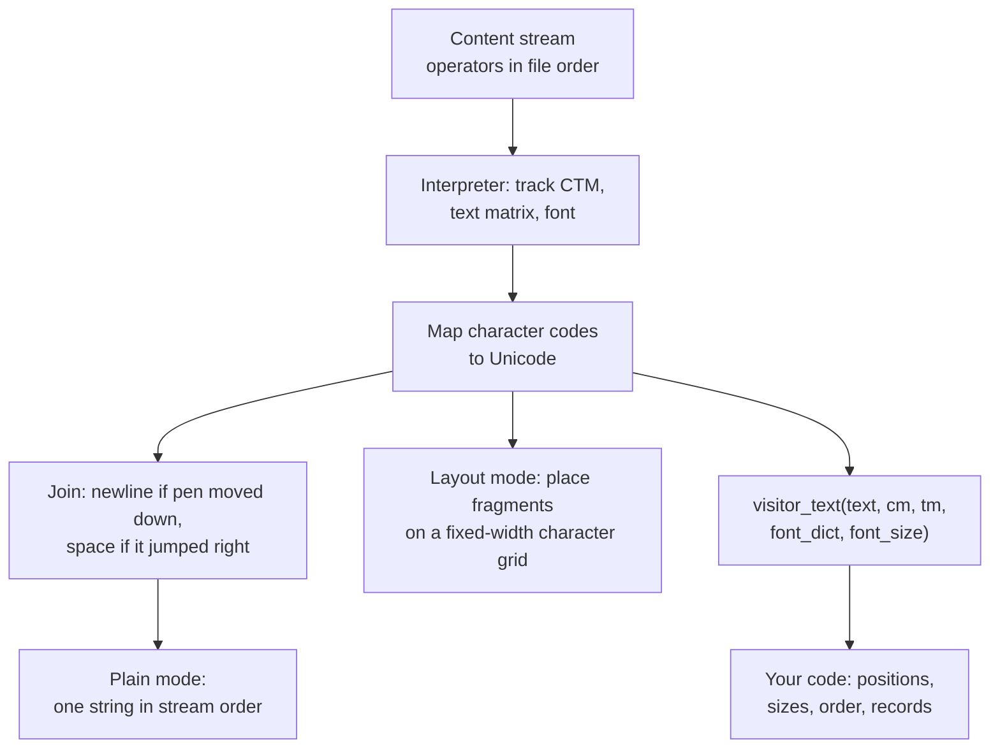

**pypdf** is the PDF library you can install anywhere Python runs. It is written entirely in Python, has no compiled dependencies, and carries a permissive BSD licence, which is why it turns up in LangChain and LlamaIndex loaders, in serverless functions and in countless internal scripts. Those same properties set its limits: it is slower than libraries built on C engines, and its text extraction gives you less structure out of the box. This lesson shows how pypdf reads a page, what its two extraction modes produce, how to recover positions and font sizes through a **visitor function**, and when pypdf is the right choice for a RAG pipeline and when it is not.

The previous lesson, [PyMuPDF](/learn/advanced-document-parsing/pymupdf), explained how a PDF stores positioned glyphs rather than paragraphs and built a record extractor on PyMuPDF's block hierarchy. This lesson uses the same sample handbook so you can compare the two libraries output for output.

## Learning objectives

- Read metadata, outlines, page labels and text from a PDF with `PdfReader`, and explain the difference between `"plain"` and `"layout"` extraction modes.
- Explain how pypdf interprets text operators in a content stream, and compute a fragment's page position and effective font size from its matrices.
- Use `visitor_text` to drop headers and footers, detect headings and rebuild paragraphs in reading order.
- Handle damaged files with `strict=False`, and use `PdfWriter` to split documents.
- Choose between pypdf and PyMuPDF for a given corpus and deployment, with reasons.

## Prerequisites

- [PyMuPDF](/learn/advanced-document-parsing/pymupdf): how a page stores text, reading order, and the record format used here.
- [PDF extraction](/learn/data-processing/pdf-extraction): the basic PDF extraction pitfalls.
- [Document loaders](/learn/document-engineering/document-loaders): where a parser sits inside a loader.

## Why this matters

Many RAG projects begin with `PdfReader(path).pages[i].extract_text()`, because it is the line every tutorial shows and the dependency installs without trouble. It works well on simple, single-column, digitally generated documents. On anything harder it fails quietly, in the same ways as any naive extractor: running headers repeated in every chunk, columns in the wrong order, tables flattened into lists of words, and headings indistinguishable from body text.

The engineering question is not whether pypdf is "good" or "bad". It is whether you know what it returns for *your* documents, and what you must add on top. Teams that never ask end up blaming the embedding model or the chunk size for failures that were baked in at parse time. Teams that do ask often find pypdf is enough, with a visitor function and fifty lines of post-processing, and avoid a heavier dependency or a licence review.

## The intuition

Picture two people transcribing the same typesetter's instructions. The first (PyMuPDF) lays every fragment on a desk, groups neighbouring fragments into paragraphs, and then hands you the grouped page with coordinates attached. The second (pypdf) reads the instructions aloud, one by one, writing down each fragment and starting a new line whenever the pen moves down. If you want more than the transcript, you can ask the second person to call out, for each fragment, *where* the pen was and *how big* the lettering was. That callout is the visitor function. With it you can do the grouping yourself.

## How it works

### The library

pypdf reads and writes PDFs. Reading covers text, metadata, outlines (bookmarks), page labels, annotations, form fields, attachments and images; writing covers merging, splitting, rotating, cropping, encrypting and editing metadata. Its history causes confusion: the project was originally PyPDF2, and in late 2022 development moved back to the `pypdf` package name. PyPDF2 is no longer maintained, so new code should import `pypdf`, and older tutorials using `PdfFileReader` or `extractText()` describe an API that no longer exists.

Optional extras add capabilities: `pip install "pypdf[crypto]"` installs the `cryptography` package needed for AES-encrypted files, and extracting images needs Pillow (`pypdf[image]`).

### Inside `extract_text`

pypdf's extractor is an interpreter for the text part of a PDF content stream. Here is the beginning of page 1 of the sample handbook, printed with `page.get_contents().get_data()`:

```text
q
BT
1 0 0 1 50 802 Tm
/helv 9 Tf [<4d6572696469616e20456d706c6f7965652048616e64626f6f6b2032303235>]TJ
ET
Q
```

Read it line by line. `q` and `Q` save and restore the graphics state. `BT` and `ET` begin and end a text object. `1 0 0 1 50 802 Tm` sets the **text matrix**, here placing the pen at x = 50, y = 802 (PDF's y axis runs upwards from the bottom, so this is near the top of an 842-point page). `/helv 9 Tf` selects a font resource and a size of 9. `TJ` shows a string, here given in hexadecimal: `4d 65 72...` are the character codes for "Mer...". The extractor:

1. Walks the operators in order, tracking the graphics state: the **current transformation matrix** (CTM, set by `cm`), the text matrix (set by `Tm`, moved by `Td`, `TD`, `T*`), the current font and size.
2. For each string shown, maps its character codes to Unicode using the font's encoding or its `ToUnicode` table.
3. Decides how to join strings: if the pen moved down by more than a threshold, it starts a new line; if it moved right by more than a fraction of a space width, it inserts a space. The `space_width` argument tunes that second test.
4. Optionally, calls your visitor with each string and the matrices in force when it was shown.

The output therefore follows **content-stream order**, exactly like PyMuPDF's unsorted output. pypdf does not group text into blocks, has no notion of columns, and does not detect tables.



### Plain and layout modes

`extract_text()` has two modes:

- `extraction_mode="plain"` (the default) returns text in stream order with the joining rules above.
- `extraction_mode="layout"` places each fragment on a fixed-width grid of characters according to its position, so the output looks like the page: columns side by side, table cells aligned by spaces. It accepts extra keywords such as `layout_mode_space_vertically` (whether to keep blank lines for vertical gaps).

Layout mode is good for tables: an aligned table is far easier for a person or a language model to read than cells on separate lines. It is bad for columns, for the same reason `sort=True` was in PyMuPDF: two columns on one line of text become one interleaved line.

### The visitor function

`extract_text(visitor_text=fn)` calls `fn(text, cm, tm, font_dict, font_size)` for every fragment shown. `cm` and `tm` are the CTM and the text matrix as six numbers, `font_dict` is the font's PDF dictionary (its `/BaseFont` entry gives names such as `/Helvetica-Bold`), and `font_size` is the size given to the `Tf` operator. With position and size you can rebuild everything PyMuPDF's `"dict"` view offered, at the cost of writing the grouping yourself. There are also `visitor_operand_before` and `visitor_operand_after` hooks, which see every operator, not just text.

One subtlety makes or breaks this technique, and it is the subject of the next section: **the `font_size` argument is not the size on the page**. Many generators select a font at size 1 and scale it through the text matrix.

### Everything else you need from `PdfReader`

- `reader.metadata` (`.title`, `.author`, `.creation_date`...), which can be `None`.
- `reader.outline`, a nested list of bookmarks; `reader.get_destination_page_number(item)` gives a bookmark's zero-based page.
- `reader.page_labels`, the printed page labels ("i", "ii", "1"...), which is what citations should display.
- `reader.is_encrypted` and `reader.decrypt(password)`, or `PdfReader(path, password=...)`.
- `page.images` (each with `.name` and `.data`), `reader.attachments` and `reader.get_fields()` for forms.
- `PdfReader(path, strict=False)`, the default, tolerates many malformed files by searching for objects when the cross-reference table is wrong; `strict=True` raises instead.

## The mathematics

### From text space to page space

**Intuition.** A PDF never says "this word is at (70, 380)". It says "move the pen here, in a coordinate system that has itself been scaled and shifted". To know where text really is, and how big it really is, you compose those transformations.

PDF writes an affine transformation as six numbers $[a\ b\ c\ d\ e\ f]$, standing for the $3 \times 3$ matrix

$$
M = \begin{pmatrix} a & b & 0 \\ c & d & 0 \\ e & f & 1 \end{pmatrix},
\qquad
(x', y', 1) = (x, y, 1)\,M = (ax + cy + e,\; bx + dy + f,\; 1).
$$

$a, b, c, d$ scale, rotate and skew; $e, f$ translate. Points are row vectors multiplied on the left, so transformations compose left to right. The text matrix $T_m$ maps text space into user space, and the CTM maps user space onto the page, so the glyph origin's page position comes from

$$
M_{\text{page}} = T_m \cdot \text{CTM}, \qquad (x_p, y_p) = (e_{\text{page}},\, f_{\text{page}}),
$$

because the text-space origin $(0, 0)$ lands on the translation part. The effective font size is the nominal size times the matrix's scale factor; for a matrix without skew this is

$$
s_{\text{eff}} = s_{\text{Tf}} \sqrt{\lvert a d - b c \rvert},
$$

where $s_{\text{Tf}}$ is the size passed to the `Tf` operator and $ad - bc$ is the determinant of the $2 \times 2$ part of $M_{\text{page}}$ (the factor by which areas are scaled; its square root is the length scale). Finally, converting to a top-left origin, as PyMuPDF does, needs $y_{\text{top}} = H - y_p$ for a page of height $H$.

**By hand.** A generator writes `1 Tf` (nominal size 1) with $T_m = [12\ 0\ 0\ 12\ 100\ 700]$, inside a page whose CTM is $[0.5\ 0\ 0\ 0.5\ 20\ 30]$ (the page content was shrunk to half size and shifted).

- Scale part: $a = 12 \times 0.5 = 6$, $d = 12 \times 0.5 = 6$, $b = c = 0$.
- Translation: $e = 100 \times 0.5 + 700 \times 0 + 20 = 70$; $f = 100 \times 0 + 700 \times 0.5 + 30 = 380$.
- Position: $(70, 380)$; on an 842-point page, $y_{\text{top}} = 842 - 380 = 462$.
- Effective size: $1 \times \sqrt{6 \times 6 - 0} = 6$ points.

A heading detector that compared `font_size` values would see 1 for every fragment on this page and find nothing. One that used the effective size sees 6, the size a reader sees.

**In NumPy:**

```python
import numpy as np

def as3x3(m):
    a, b, c, d, e, f = m
    return np.array([[a, b, 0], [c, d, 0], [e, f, 1]], dtype=float)

tm = [12, 0, 0, 12, 100, 700]    # text matrix: scale 12, move to (100, 700)
cm = [0.5, 0, 0, 0.5, 20, 30]    # current transformation matrix: halve, then shift
font_size = 1                    # the size given to the Tf operator

M = as3x3(tm) @ as3x3(cm)        # text space -> page space
origin = np.array([0, 0, 1]) @ M
a, b, c, d = M[0, 0], M[0, 1], M[1, 0], M[1, 1]
print("combined matrix [a b c d e f]:", [float(v) for v in (a, b, c, d, M[2, 0], M[2, 1])])
print("glyph origin on the page:", origin[:2])
print("effective font size:", font_size * np.sqrt(abs(a * d - b * c)))
print("top-left y on an 842-point page:", 842 - origin[1])
```

```output
combined matrix [a b c d e f]: [6.0, 0.0, 0.0, 6.0, 70.0, 380.0]
glyph origin on the page: [ 70. 380.]
effective font size: 6.0
top-left y on an 842-point page: 462.0
```

> [!NOTE]
> The full PDF rule also includes horizontal scaling and text rise in a third matrix, and positions *within* a string advance by each glyph's width. For locating whole fragments and comparing their sizes, the composition above is enough.

## In code

Everything here ran in the course sandbox with pypdf 7.1.0, using the `handbook.pdf` generated by `make_handbook.py` in the [PyMuPDF lesson](/learn/advanced-document-parsing/pymupdf) (PyMuPDF is needed only to create the sample; pypdf alone reads it).

```bash
pip install pypdf
```

### Step 1: what pypdf gives you directly

```python
from pypdf import PdfReader

reader = PdfReader("handbook.pdf")
meta = reader.metadata
print("pages:", len(reader.pages), "| title:", meta.title, "| author:", meta.author)
print("page labels:", reader.page_labels)
for item in reader.outline:
    print("outline:", item.title, "-> page", reader.get_destination_page_number(item) + 1)

page = reader.pages[1]
print("--- plain mode, page 2 ---")
print(page.extract_text())
print("--- layout mode, page 2 (first 8 non-blank lines) ---")
lines = [l for l in page.extract_text(extraction_mode="layout").splitlines() if l.strip()]
print("\n".join(lines[:8]))
```

```output
pages: 2 | title: Meridian Employee Handbook | author: HR team
page labels: ['1', '2']
outline: Part A: Time, money and place -> page 1
outline: Part B: IT policies -> page 2
--- plain mode, page 2 ---
Meridian Employee Handbook 2025
Page 2 of 2
Part B: IT policies
Policy Rule
Password rotation Every 90 days
Laptop refresh Every 3 years
Support desk hours 08:00 to 18:00 UK time
VPN is required on public Wi-Fi. Lost laptops must be reported to the sup-
port desk at once.
--- layout mode, page 2 (first 8 non-blank lines) ---
Meridian Employee Handbook 2025
Part B: IT policies
 Policy                                     Rule
 Password rotation                          Every 90 days
 Laptop refresh                             Every 3 years
 Support desk hours                         08:00 to 18:00 UK time
VPN is required on public Wi-Fi. Lost laptops must be reported to the sup-
port desk at once.
```

**What the output means.** Metadata, outline and labels come through cleanly. Plain mode puts the header and footer first (stream order), joins each table row's cells with a single space, so "Password rotation Every 90 days" reads ambiguously, and leaves "sup-" and "port" split. Layout mode keeps the table's columns aligned, which is a real gain for a language model reading the chunk, and drops the footer only because it is far below the fifth printed line. Page 1 in plain mode returns the sections in the order 3, 1, 2, then the title, exactly as PyMuPDF's unsorted `get_text()` did, because both follow the same content stream. In layout mode page 1 shows the two columns side by side, interleaved line by line.

### Step 2: an extractor built on the visitor

**The problem.** Produce the same kind of records as the PyMuPDF extractor (page, kind, section, text) using pypdf only.

```python
# pypdf_records.py: positioned text fragments -> ordered, labelled paragraphs, with pypdf only
import math
import re
from collections import Counter

from pypdf import PdfReader

MARGIN = 60   # points; fragments this close to the top or bottom edge are headers or footers


def mult(m, n):
    """Multiply two PDF matrices written as six numbers [a, b, c, d, e, f]."""
    return [m[0] * n[0] + m[1] * n[2],          m[0] * n[1] + m[1] * n[3],
            m[2] * n[0] + m[3] * n[2],          m[2] * n[1] + m[3] * n[3],
            m[4] * n[0] + m[5] * n[2] + n[4],   m[4] * n[1] + m[5] * n[3] + n[5]]


def fragments(page):
    """Each text fragment with its position (top-left origin) and effective font size."""
    height = float(page.mediabox.height)
    found = []

    def visit(text, cm, tm, font_dict, font_size):
        if not text.strip():
            return
        a, b, c, d, e, f = mult(tm, cm)                    # text space -> page space
        size = font_size * math.sqrt(abs(a * d - b * c))   # nominal size times the scale
        found.append({"x": e, "top": height - f, "size": round(size, 1), "text": text.strip()})

    page.extract_text(visitor_text=visit)
    return [fr for fr in found if MARGIN < fr["top"] < height - MARGIN]


def records(path):
    reader = PdfReader(path)
    pages = [(float(p.mediabox.width), fragments(p)) for p in reader.pages]

    # Body size for the whole document: the size that carries the most characters.
    chars = Counter()
    for _, frags in pages:
        for fr in frags:
            chars[fr["size"]] += len(fr["text"])
    body = chars.most_common(1)[0][0]

    out, section = [], None
    for number, (width, frags) in enumerate(pages, start=1):
        # Left column top to bottom, then the right column.
        frags.sort(key=lambda fr: (fr["x"] >= width / 2, fr["top"]))
        prev = None
        for fr in frags:
            if fr["size"] > body:
                section = fr["text"]
                out.append({"page": number, "kind": "heading", "section": section, "text": fr["text"]})
                prev = None
                continue
            same_para = (prev is not None and prev["x"] == fr["x"]
                         and 0 < fr["top"] - prev["top"] < 1.6 * fr["size"])
            if same_para:   # continue the paragraph, rejoining a word hyphenated at the line end
                text = out[-1]["text"]
                out[-1]["text"] = text[:-1] + fr["text"] if re.search(r"\w-$", text) else text + " " + fr["text"]
            else:
                out.append({"page": number, "kind": "text", "section": section, "text": fr["text"]})
            prev = fr
    print("body size:", body)
    return out


if __name__ == "__main__":
    for r in records("handbook.pdf"):
        print(f"p{r['page']} {r['kind']:<7} [{r['section']}] {r['text']}")
```

```output
body size: 11.0
p1 heading [Part A: Time, money and place] Part A: Time, money and place
p1 heading [1. Annual leave] 1. Annual leave
p1 text    [1. Annual leave] Annual leave is 25 days per year. Up to 5 unused days carry over and must be used by 31 March.
p1 heading [2. Expenses] 2. Expenses
p1 text    [2. Expenses] Expenses must be submitted within 30 days. Anything over £75 needs a receipt.
p1 heading [3. Remote work] 3. Remote work
p1 text    [3. Remote work] Staff may work remotely up to 3 days a week. The home-office equipment budget is £400. Contractors are not eligible for the equipment budget.
p2 heading [Part B: IT policies] Part B: IT policies
p2 text    [Part B: IT policies] Policy
p2 text    [Part B: IT policies] Rule
p2 text    [Part B: IT policies] Password rotation
p2 text    [Part B: IT policies] Every 90 days
p2 text    [Part B: IT policies] Laptop refresh
p2 text    [Part B: IT policies] Every 3 years
p2 text    [Part B: IT policies] Support desk hours
p2 text    [Part B: IT policies] 08:00 to 18:00 UK time
p2 text    [Part B: IT policies] VPN is required on public Wi-Fi. Lost laptops must be reported to the support desk at once.
```

**The important lines.**

- `mult(tm, cm)` is the matrix composition from *The mathematics*. In this file the CTM is the identity, so position equals the text matrix's translation; in files that scale the page, skipping this step puts every fragment in the wrong place.
- `font_size * math.sqrt(abs(a * d - b * c))` is the effective size. Without it, files that use `1 Tf` and a scaled text matrix report every fragment as size 1.
- `height - f` converts PDF's bottom-left origin to a top-left one, so the margin filter and the sort read naturally.
- The body size is computed **over the whole document**. An earlier draft computed it per page and failed on page 2: the table's 10-point cells carried the most characters on that page, so the 11-point paragraph was misclassified as a heading. Per-page statistics are noisy on short or unusual pages.
- `same_para` joins a line to the previous one when it starts at the same x and sits less than 1.6 line-heights below, which is what PyMuPDF's block grouping did for us automatically.

**What the output means.** Page 1 now matches the PyMuPDF extractor record for record: correct section order, no header or footer, paragraphs rebuilt, "support" rejoined. Page 2 shows pypdf's real limitation. The table has become eight unrelated one-line records, because pypdf has no table detector and nothing in the fragments says "these are cells". You could cluster fragments by x and y into a grid, but you would be writing a table detector. For table-heavy documents, that is the point at which PyMuPDF's `find_tables`, a layout-aware parser, or layout mode followed by careful post-processing becomes the better choice; [Tables and structured content](/learn/advanced-document-parsing/tables-and-structured-content) compares the options.

**Errors people commonly hit.**

- `ImportError: cannot import name 'PdfFileReader'`: an old PyPDF2 tutorial. Use `PdfReader`, `len(reader.pages)` and `page.extract_text()`.
- `DependencyError` mentioning `cryptography` when opening an encrypted file: install `pypdf[crypto]`.
- `reader.metadata` is `None` for files with no information dictionary; guard before reading `.title`.
- A visitor that ignores `cm`, so positions are wrong on scaled or rotated pages.
- Rotated pages: check `page.rotation`; layout mode only handles the orientations passed in `orientations`, and positions must be rotated before sorting.

**Extending it.** Use `reader.outline` titles as headings when present; read `/BaseFont` from `font_dict` to treat bold fragments as heading candidates; and add the printed label from `reader.page_labels[number - 1]` to every record.

### Step 3: damaged files

Real corpora contain files written by buggy generators, truncated by uploads or edited by tools that broke the cross-reference table (the index of byte offsets at the end of the file). pypdf's default non-strict mode tries to recover.

```python
import io
import logging
import re

import pypdf

logging.basicConfig(level=logging.WARNING, format="%(levelname)s %(name)s: %(message)s")

data = open("handbook.pdf", "rb").read()
# Simulate a badly written file: point "startxref" at the wrong byte offset.
damaged = re.sub(rb"startxref\s+\d+", b"startxref\n999", data)

for strict in (True, False):
    try:
        reader = pypdf.PdfReader(io.BytesIO(damaged), strict=strict)
        first = reader.pages[0].extract_text().splitlines()[0]
        print(f"strict={strict}: read {len(reader.pages)} pages; first line: {first!r}")
    except pypdf.errors.PdfReadError as exc:
        print(f"strict={strict}: PdfReadError: {exc}")
```

```output
strict=True: PdfReadError: Broken xref table
WARNING pypdf._reader: incorrect startxref pointer(1)
WARNING pypdf._reader: parsing for Object Streams
strict=False: read 2 pages; first line: 'Meridian Employee Handbook 2025'
```

Strict mode refuses the file; non-strict mode logs warnings and recovers by scanning for objects. In ingestion, use the default, but **capture pypdf's log warnings per document**: a file that needed repair is a candidate for review, and its text deserves a quality check before it is indexed.

### Step 4: the writer side

The writer is useful in pipelines too: splitting large files so that workers can process pages in parallel, or producing per-section PDFs for display next to an answer.

```python
from pypdf import PdfReader, PdfWriter

reader = PdfReader("handbook.pdf")
for i, page in enumerate(reader.pages, start=1):
    writer = PdfWriter()
    writer.add_page(page)
    writer.add_metadata({"/Title": f"Meridian Employee Handbook, page {i}", "/Author": "HR team"})
    with open(f"handbook-p{i}.pdf", "wb") as fh:
        writer.write(fh)

check = PdfReader("handbook-p2.pdf")
print(check.metadata.title, "|", len(check.pages), "page")
print(check.pages[0].extract_text().splitlines()[2])
```

```output
Meridian Employee Handbook, page 2 | 1 page
Part B: IT policies
```

## A real-world example

Meridian's Platform team runs a small AWS Lambda-style function that ingests PDFs uploaded to the product documentation bucket for "Meridian Reports". The function's deployment package has a size limit and the team wanted no native libraries, so Sofia, who owns ingestion, chose pypdf.

For a year this worked: the documentation was exported from a docs-as-code system as plain, single-column PDFs, and `extract_text()` plus a header filter was enough. Then the documentation team adopted a new template with a two-column release-notes section and a comparison table of plan features (which plans include SAML single sign-on, which export formats are supported). Questions such as "does the Professional plan support SAML?" started getting answers that contradicted the table.

Sofia printed the visitor output for one page and saw the cause at once: the table cells arrived as separate fragments, and plain extraction joined "SAML single sign-on", "No", "Yes" into one line with the feature names of the next row. The fix was a routing decision, not a rewrite. Pages whose fragments formed a grid (several x positions repeating across many y positions) were sent to a container-based worker using a table-capable parser; everything else stayed on the pypdf function. The team kept pypdf where it was strong and stopped asking it to do what it was not built for.

## Common mistakes

- **Copying PyPDF2 code.** `PdfFileReader`, `getPage` and `extractText` are from a retired API. Use `pypdf` and its current names.
- **Using `font_size` from the visitor as the visible size.** It ignores the text matrix and CTM; compute the effective size.
- **Using layout mode on multi-column pages.** It aligns columns side by side, which interleaves their lines when the output is read as text.
- **Expecting table structure.** pypdf has no table detection; plain mode flattens rows into ambiguous lines.
- **Silencing warnings.** Repair warnings are the signal that a file's text may be incomplete; send them to your ingestion logs.
- **Assuming metadata exists.** `reader.metadata` and its fields can be `None`; outlines can be empty or point to the wrong pages.

## Best practices

- Start with plain extraction on a sample of each document family, then decide whether a visitor, layout mode or a different library is needed.
- When you need structure, build it from the visitor with effective sizes and page-space positions, and keep the coordinates in your records for debugging.
- Compute statistics such as body font size over the whole document, not per page.
- Install the `crypto` extra if any of your sources may be encrypted, and fetch passwords from a secrets store.
- Use non-strict mode, capture warnings, and run a text-quality check on any file that needed repair.
- Keep a small set of golden PDFs with expected extraction output and re-run them when you upgrade pypdf.

## Performance considerations

pypdf runs in pure Python, so its per-page cost is the cost of interpreting each content-stream operator in Python. That cost grows with the number of operators: a page of plain prose may have a few hundred, a page of a dense table or a vector chart many thousands.

- **Reason per operator.** If interpreting one operator costs on the order of microseconds in Python and a dense page has 20,000 operators, that page takes tens of milliseconds; a 1,000-page report of such pages takes tens of seconds on one core. A C-based library does the same work several times faster. On the simple sample handbook, the difference measured while writing this lesson was small; on dense documents it widens. Measure on your own corpus before deciding.
- **Visitors add overhead.** A Python callback runs for every fragment, so keep it minimal: append a tuple, do the work afterwards.
- **Layout mode is more expensive** than plain mode, because it must position every fragment on a grid.
- **Parallelise with processes.** Python threads do not speed up pure-Python CPU work; a process pool with one file per task scales roughly with core count.
- **Memory.** `PdfReader` loads objects lazily, but very large files with huge images still use a lot of memory when pages are accessed; process them in their own worker with a memory limit.
- **Where pypdf wins.** Zero native dependencies means small images, quick cold starts and easy deployment in restricted environments. When parsing time is a small fraction of total ingestion cost (embedding usually dominates), those operational advantages can outweigh raw speed.

## Security considerations

- **Untrusted input.** Being pure Python removes whole classes of memory-corruption bugs, but malformed PDFs can still trigger excessive CPU or memory use; pypdf has fixed several such issues over the years. Keep it updated and enforce per-document time and memory limits.
- **Hidden text.** Text in white, at size 0 or off the page is still extracted. The visitor gives you positions and sizes; flag fragments outside the mediabox or with tiny effective sizes, because they are a route for [indirect prompt injection](/learn/rag-security-fundamentals/indirect-prompt-injection).
- **Encrypted documents.** Treat passwords as secrets; never hard-code them, and record which documents were decrypted.
- **Attachments and forms.** `reader.attachments` and form fields can carry content that is not visible on the page. If you ingest them, treat each as a separate untrusted document with its own provenance.

## Summary

- pypdf is a pure-Python, BSD-licensed PDF reader and writer; its strengths are portability and licensing, its limits are speed and structure.
- `extract_text()` interprets the content stream in file order; plain mode joins fragments into lines, layout mode places them on a character grid that preserves alignment but interleaves columns.
- The visitor function exposes each fragment with its matrices; composing $T_m \cdot \text{CTM}$ gives true positions, and the determinant gives effective font size.
- With a visitor you can remove headers and footers, detect headings and rebuild paragraphs in column order, but tables need a dedicated detector.
- Non-strict mode recovers many damaged files; log its warnings and check the text of repaired files.

## Exercises

**1.** A fragment is shown with `font_size = 1`, $T_m = [10\ 0\ 0\ 10\ 72\ 500]$ and CTM $= [1\ 0\ 0\ 1\ 0\ 0]$ on a 792-point-high page. Give its position with a top-left origin and its effective size.

<details><summary>Show solution</summary>

With an identity CTM, $M_{\text{page}} = T_m$. The position is the translation $(72, 500)$; with a top-left origin, $y_{\text{top}} = 792 - 500 = 292$, so $(72, 292)$. The effective size is $1 \times \sqrt{10 \times 10 - 0} = 10$ points.

</details>

**2.** Your team's LangChain prototype uses a pypdf-based loader. Answers about a two-column policy document mix unrelated rules. Explain what is happening and give two options for fixing it, with the trade-off of each.

<details><summary>Show solution</summary>

The loader calls `extract_text()`, which returns text in content-stream order, or in layout mode lines that interleave the columns. Either way, chunks cross from one column into the other, so a chunk mixes two topics.

Option 1: write a visitor-based extractor, as in this lesson, that sorts fragments by column then by position. It keeps the pure-Python dependency but needs code and tuning per layout (column midpoint, margins), and still will not handle complex layouts.

Option 2: switch that document family to a parser with layout analysis (PyMuPDF with block ordering, or a [layout-aware parser](/learn/advanced-document-parsing/layout-aware-parsing)). Better results with less custom code, at the cost of a heavier dependency, possibly a licence review (PyMuPDF is AGPL or commercial), and more compute for model-based parsers.

</details>

**3.** Extend `pypdf_records.py` so that a fragment also counts as a heading when its font's `/BaseFont` name contains `Bold`, it is no larger than the body size, and it is shorter than 60 characters. Run it on the handbook and explain the result on page 2.

<details><summary>Show solution</summary>

Record the font name in the visitor:

```python
font = font_dict.get("/BaseFont", "") if font_dict else ""
found.append({"x": e, "top": height - f, "size": round(size, 1),
              "bold": "Bold" in str(font), "text": text.strip()})
```

and change the heading test to:

```python
if fr["size"] > body or (fr["bold"] and len(fr["text"]) < 60):
```

On page 2 the table's header cells "Policy" and "Rule" are bold, so both become headings, and the section label of everything after them changes to "Rule". That is wrong: they are column headers, not section headings. It shows why a bold-only rule needs context, for example ignoring bold fragments that sit in a grid with other fragments at the same y, or requiring a bold heading to be the only fragment on its line.

</details>

**4.** Design question. You must choose a PDF library for an ingestion service that processes 2 million mostly text-based PDFs once, then about 5,000 new ones a day, in a company whose legal team forbids AGPL dependencies without a commercial licence. Make and justify a recommendation.

<details><summary>Show solution</summary>

A defensible answer: use pypdf as the default parser, with a routing layer.

- **Licence:** pypdf's BSD licence satisfies the constraint without procurement; PyMuPDF would need a commercial licence, which is a possible later step if quality demands it.
- **Throughput:** the one-off backfill of 2 million documents is a batch job; with a process pool across many cores (or many machines), pure-Python speed is acceptable, because embedding the resulting chunks will likely cost more time and money than parsing. 5,000 a day is small for any library.
- **Quality:** run a sample of each document family through plain extraction and the visitor extractor; measure failure classes (column order, tables, scanned pages). Route table-heavy pages and scans to specialised paths ([Tables](/learn/advanced-document-parsing/tables-and-structured-content), [Scanned documents](/learn/advanced-document-parsing/scanned-documents)).
- **Revisit:** if the sample shows that a large share of documents need layout analysis, reopen the licensing question with evidence, or evaluate permissively licensed layout-aware tools.

</details>

## Check your understanding

```quiz
[
  {"q": "Which statement about pypdf's default `extract_text()` is correct?", "options": ["It returns text sorted into reading order by column", "It returns text in content-stream order, joining fragments into lines", "It detects tables and returns them as Markdown", "It runs OCR on scanned pages"], "answer": 1, "why": "Plain mode interprets the content stream in file order; it has no column, table or OCR logic."},
  {"q": "A visitor reports `font_size` 1 for every fragment, though headings are clearly larger on screen. Why?", "options": ["The PDF is scanned", "pypdf cannot read font sizes", "The generator scales text through the text matrix, so the effective size is the nominal size times the matrix scale", "Headings are images"], "answer": 2, "why": "Many generators use `1 Tf` and scale via `Tm`; the visible size is `font_size * sqrt(|ad - bc|)` of the combined matrix."},
  {"q": "What is layout mode (`extraction_mode=\"layout\"`) most useful for?", "options": ["Keeping the columns of a table aligned", "Fixing reading order on two-column pages", "Removing headers and footers", "Decrypting files"], "answer": 0, "why": "Layout mode places text on a character grid, which preserves table alignment but interleaves side-by-side columns."},
  {"q": "With `strict=False`, pypdf opens a file whose cross-reference table is broken and logs warnings. What should an ingestion pipeline do?", "options": ["Ignore the warnings since the file opened", "Reject every such file", "Convert the warnings to exceptions and stop the batch", "Log the warnings against the document and check its extracted text quality before indexing"], "answer": 3, "why": "Recovery usually works, but a repaired file may have missing or garbled text, so it deserves a recorded warning and a quality check."},
  {"q": "Why might a team choose pypdf over PyMuPDF despite lower speed?", "options": ["pypdf has better table detection", "pypdf is pure Python and BSD-licensed, so it deploys anywhere and avoids AGPL obligations", "pypdf includes OCR", "pypdf understands multi-column layouts"], "answer": 1, "why": "Portability and permissive licensing are pypdf's main advantages; structure-related features are weaker."}
]
```

## Further reading

- [pypdf documentation](https://pypdf.readthedocs.io/): the user guide, including "Extract Text from a PDF" and the visitor-function examples.
- [pypdf on GitHub](https://github.com/py-pdf/pypdf): source, changelog and issue tracker, useful for version-specific behaviour.
- ISO 32000-2:2020, *Document management — Portable document format — Part 2: PDF 2.0*: sections on coordinate systems, text objects and text-positioning operators.
- [PyMuPDF documentation](https://pymupdf.readthedocs.io/): for comparison with the block-based approach in the previous lesson.
