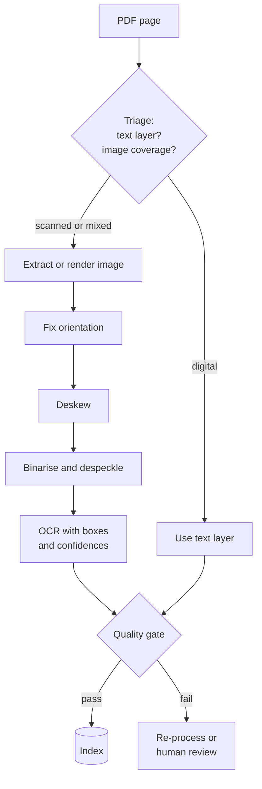

A scanned document is a photograph of paper stored in a document format. It may be a PDF, it may open in a PDF viewer like any other, and it may even contain some searchable text, but its content is pixels. The [OCR](/learn/advanced-document-parsing/ocr) lesson explained how an engine reads text from an image. This lesson is about everything around that engine when the input is a real scanned document: recognising which pages are scans in the first place, choosing a rendering resolution, cleaning the page image so the engine has a fair chance, dealing with rotated pages, handwriting, stamps and existing low-quality text layers, and checking the result before it reaches the index.

Running all of this as a scalable service (queues, retries, cost control) is the subject of [OCR pipelines](/learn/multimodal-ingestion/ocr-pipelines). Here the unit of work is one document, and the aim is to understand each decision well enough to make it deliberately.

## Learning objectives

- Classify each page of a PDF as digital, scanned or mixed from its text layer and image coverage, and route it accordingly.
- Choose a rendering resolution by calculating the pixel size of text at a given DPI.
- Implement Otsu binarisation, speck removal and projection-profile deskewing, and explain what each one fixes.
- Describe how a searchable PDF is produced with OCRmyPDF, and when to skip, redo or force OCR.
- Design quality gates that stop a badly scanned page from entering the index silently.

## Prerequisites

- [OCR](/learn/advanced-document-parsing/ocr): the stages of an OCR engine, confidences, CER and WER.
- [PyMuPDF](/learn/advanced-document-parsing/pymupdf): pages, text extraction and rendering pixmaps.
- [PDF extraction](/learn/data-processing/pdf-extraction): text layers and why some PDFs have none.

## Why this matters

Most organisations have a long tail of documents that were printed, signed and scanned: contracts, signed policies, supplier forms, old manuals, letters. In a RAG system these documents fail in one of three ways, and the first is the worst:

1. **They are indexed as empty.** A text extractor run on a scanned PDF returns an empty string, the chunker produces no chunks, and the document silently disappears from the index. Nothing errors. Questions about it are answered from other documents, or refused.
2. **They are indexed with a bad text layer.** Many scanners and copiers run their own OCR and embed the result invisibly. Some of these layers are good; some are poor, with misread characters, broken words or lines in the wrong order. A text extractor happily returns that text, and nothing marks it as unreliable.
3. **They are indexed with fresh but poor OCR.** A crooked, speckled, low-resolution page OCRed without any preparation produces noticeably worse text than the same page cleaned first.

Each of these is detectable and mostly fixable, but only if the pipeline looks at each page and asks what it actually is.

## The intuition

Think of a photocopy of a photocopy that someone hands you to transcribe. Before you start, you do several things without thinking: turn it the right way up, hold it straight, move to better light, and ignore the coffee ring. Only then do you read. And if part of it is a typed sticker someone added later, you read that directly instead of squinting at the copy.

A scanned-document pipeline makes each of those steps explicit. Detect what kind of page you have; render it at a resolution where the letters are big enough to read; straighten it; separate ink from paper; ignore specks; then hand it to the OCR engine; and finally, check that what came back looks like language.

## How it works

### Step by step

1. **Triage each page.** Decide whether the page has a usable digital text layer, is an image of text, or is a mix. Use the text layer for digital pages; OCR the rest.
2. **Get the page image.** If the page is one big embedded image, extract it at its native resolution. Otherwise render the page to pixels at a chosen DPI.
3. **Fix orientation.** Detect pages scanned sideways or upside down (rotation by 90, 180 or 270 degrees) and rotate them.
4. **Deskew.** Correct the small rotation of a page placed crookedly on the scanner glass, usually a few degrees.
5. **Clean.** Convert to greyscale, separate ink from background (binarise), remove specks and, where needed, remove scanner borders and punch holes.
6. **OCR.** Run the engine with the right language list, keeping words, boxes and confidences.
7. **Assemble.** Attach the text to the page, either as plain text for indexing or as an invisible text layer in a new "searchable" PDF.
8. **Gate.** Compute page quality signals; index good pages, re-process or flag poor ones.



### Triage: what kind of page is this?

Two cheap signals separate most pages:

- **Text-layer size.** How many characters does `get_text()` return? A scanned page with no OCR layer returns none.
- **Image coverage.** What fraction of the page area is covered by images? A scan is usually one image covering the whole page.

Combining them gives four cases: lots of text and little image (digital), little text and a page-sized image (scanned), lots of text *and* a page-sized image (either a scan with an existing OCR layer, or a digital page with a full-page background), and little of either (blank, vector graphics only, or text drawn with fonts that cannot be decoded). The third case needs one more check: is the existing text layer any good? A simple test is to compare the share of tokens that look like real words (in a vocabulary, or matching a language detector) against what your digital pages produce.

Page-level triage matters because real PDFs are often mixed: a digital report with a scanned signature page appended, or a scanned contract with a typed cover sheet. Deciding per document instead of per page either OCRs digital pages (degrading exact text into approximate text) or skips scanned ones.

### Resolution: how many pixels does a letter need?

OCR engines need each character to be a certain number of pixels tall. The page's physical size and the rendering resolution fix that size. One typographic point is $1/72$ of an inch, so text of size $s$ points rendered at $r$ dots per inch (DPI) has a body height of

$$
h = \frac{s}{72} \times r \ \text{pixels}.
$$

For 10-point text: at 72 DPI, $h = 10$ pixels; at 150 DPI, about 21 pixels; at 300 DPI, about 42 pixels. Lower-case letters without ascenders (the **x-height**) are roughly half the body height, so at 150 DPI an "x" is only around 10 pixels tall. That is why common guidance, including Tesseract's own documentation, is to give it images of at least 300 DPI, and why 8-point footnotes are where errors pile up first. Rendering above about 400 DPI rarely helps printed text and costs time and memory.

Two caveats. If the page is an embedded scan, its information content is capped by the resolution at which it was *scanned*: rendering a 150 DPI scan at 300 DPI interpolates pixels but adds no detail (though some engines still do better on the upsampled image, so test both). And fax images, phone photos and old microfilm conversions often have low or uneven resolution, which should lower your expectations of OCR quality and raise the priority of a quality gate.

### Orientation and skew

Pages arrive rotated by multiples of 90 degrees (fed sideways, landscape pages in a portrait document) far more often than you would expect. Engines usually include an **orientation and script detection** step: Tesseract exposes it as page-segmentation mode 0 (`--psm 0`), which reports the detected rotation without OCRing, and OCRmyPDF uses it for its `--rotate-pages` option.

**Skew** is the small residual angle from a sheet placed crookedly. Even two or three degrees matters to an engine that segments lines by horizontal position, because a skewed line drifts into its neighbour's band. The classic **projection-profile** method estimates the angle: rotate the binarised image through a range of small angles, and for each, sum the ink in every pixel row. When text lines are perfectly horizontal, the row sums alternate sharply between "lots of ink" (on a line) and "almost none" (between lines), so the profile has high variance. Pick the angle with the highest variance.

### Binarisation and noise

**Binarisation** turns a greyscale image into ink and paper. A single global threshold works when lighting is even; **Otsu's method** (1979) picks that threshold automatically from the image's histogram, as the mathematics section shows. Uneven backgrounds (shadows from a book spine, a yellowed page, a coloured form) need **adaptive** thresholding, where each region of the image gets its own threshold computed from its neighbourhood; Sauvola's method is the standard example for documents.

**Despeckling** removes isolated dark pixels from dust and scanner noise, which otherwise become stray full stops, commas and apostrophes in the OCR output. The simplest version deletes ink pixels with too few ink neighbours; better versions remove connected components smaller than a few pixels.

Be careful with aggressive cleaning: decimal points, the dot on an "i" and thin strokes of small type can be removed along with the dust. As with every preprocessing step, measure its effect on CER with your own pages rather than assuming it helps. Modern deep-learning engines trained on noisy images often do better on the greyscale original than on a binarised copy.

### Searchable PDFs and existing text layers

A **searchable PDF** (sometimes called "PDF sandwich") is the original page image with an invisible OCR text layer placed over it, word by word, at the right positions. Viewers show the image; text extraction, search and copy-and-paste use the hidden layer. For a RAG pipeline this is attractive: the output is still a PDF, so the rest of your PDF extraction code works unchanged, and citations can point at the exact page image.

**OCRmyPDF** is the established open-source tool for producing them. It wraps Tesseract and adds most of the steps above (rotation, deskewing, optional cleaning, PDF/A output). Its three modes for pages that already contain text are the key decision:

- `--skip-text`: leave any page that already has text alone; OCR only pages without it. Safe for mixed documents with good digital text.
- `--redo-ocr`: replace an existing *OCR* layer (from a scanner) while keeping genuinely digital text. Use it when the scanner's OCR is poor.
- `--force-ocr`: rasterise every page and OCR everything. Use it only when the existing text is unusable, because it turns digital text into images plus approximate text.

### What else lives on a scan

- **Handwriting.** Classic engines such as Tesseract are trained on print and do poorly on handwriting. Cloud document services and vision-language models handle it much better, but still imperfectly; treat handwritten content as low-confidence by default.
- **Stamps, signatures and annotations.** "APPROVED", "COPY", dates in rubber stamps, initials in margins. They can matter (a "SUPERSEDED" stamp changes what the document means) and they confuse layout analysis. Decide whether to capture, flag or ignore them per collection.
- **Forms and checkboxes.** A ticked box is not text, so OCR misses it. Key-value and checkbox extraction is a separate capability of cloud document services and of vision-language models.
- **Two pages per image.** A book scanned open produces one image containing two pages side by side; split it before OCR or reading order will cross the spine.
- **Photos of documents.** Perspective distortion, curved pages and uneven light; these need dewarping and adaptive thresholding, and some phone-scanning apps already do it.

## The mathematics

### Otsu's threshold

**Intuition.** A document image's grey levels usually form two clumps: dark ink and light paper. A good threshold splits the pixels so that each side is as internally uniform as possible, which is equivalent to making the two sides' average brightness as far apart as possible, weighted by how many pixels each side has.

**Formula.** For a threshold $t$, pixels with grey level at most $t$ form the dark class and the rest form the light class. Otsu's method picks the $t$ that maximises the **between-class variance**

$$
\sigma_B^2(t) = \omega_0(t)\,\omega_1(t)\,\bigl(\mu_0(t) - \mu_1(t)\bigr)^2
$$

- $\omega_0(t)$ and $\omega_1(t)$ are the fractions of pixels in the dark and light classes (they sum to 1).
- $\mu_0(t)$ and $\mu_1(t)$ are the mean grey levels of the two classes (0 is black, 255 is white).

Because the total variance of the image is fixed, maximising $\sigma_B^2$ is the same as minimising the variance *within* the two classes.

**Worked example.** Ten pixels: four of ink at grey level 20, two of faint ink or shadow at 200, four of paper at 220. Try two thresholds.

With $t = 20$: the dark class is the four 20s, so $\omega_0 = 0.4$, $\mu_0 = 20$; the light class is the other six, $\omega_1 = 0.6$, $\mu_1 = (2 \times 200 + 4 \times 220)/6 = 213.3$. Then

$$
\sigma_B^2 = 0.4 \times 0.6 \times (20 - 213.3)^2 = 0.24 \times 37{,}378 \approx 8{,}971.
$$

With $t = 200$: dark class is the 20s and the 200s, $\omega_0 = 0.6$, $\mu_0 = (80 + 400)/6 = 80$; light class is the 220s, $\omega_1 = 0.4$, $\mu_1 = 220$:

$$
\sigma_B^2 = 0.6 \times 0.4 \times (80 - 220)^2 = 0.24 \times 19{,}600 = 4{,}704.
$$

The first threshold separates the classes better, so the faint 200-level pixels are treated as paper. Whether that is right depends on whether they were faint ink or shadow, which is exactly the case where adaptive thresholding earns its cost.

```python
import numpy as np

pixels = np.array([20, 20, 20, 20, 200, 200, 220, 220, 220, 220])

def between_class_variance(pixels, t):
    dark, light = pixels[pixels <= t], pixels[pixels > t]
    w0, w1 = len(dark) / len(pixels), len(light) / len(pixels)
    return w0 * w1 * (dark.mean() - light.mean()) ** 2

for t in (20, 200):
    print(f"t={t}: between-class variance = {between_class_variance(pixels, t):.1f}")
```

```output
t=20: between-class variance = 8970.7
t=200: between-class variance = 4704.0
```

### The projection-profile criterion

**Intuition.** Straight text makes the ink-per-row profile spiky; skewed text smears it.

**Formula.** For a binarised image rotated by angle $\theta$, let $P_\theta(y)$ be the number of ink pixels in row $y$, for $H$ rows. The skew correction is

$$
\hat\theta = \arg\max_{\theta} \ \frac{1}{H} \sum_{y=1}^{H} \bigl(P_\theta(y) - \bar P_\theta\bigr)^2
$$

where $\bar P_\theta$ is the mean row count, so the quantity maximised is the variance of the profile.

**Worked example.** Four rows. Level text gives the profile $(10, 10, 0, 0)$: mean 5, variance $(25 + 25 + 25 + 25)/4 = 25$. The same ink skewed across rows gives $(5, 10, 5, 0)$: mean 5, variance $(0 + 25 + 0 + 25)/4 = 12.5$. The level orientation wins. The full implementation is the `skew_angle` function in the code below.

## In code

All of this section's examples except the last run locally:

```bash
pip install pymupdf pillow numpy
```

### 1. Build a realistic test document

**The problem.** To develop and test a scan pipeline you need pages whose truth you know. This script renders a digital handbook page to an image, rotates it 2 degrees, greys the paper, adds sensor noise and dust, and assembles a three-page PDF: the digital original, the scan, and the scan with a small typed note added on top.

```python
import io
import numpy as np
import pymupdf
from PIL import Image

text = ("Meridian employee handbook, section 4: Expenses\n\n"
        "Expenses must be submitted within 30 days of being incurred.\n"
        "Anything over £75 needs a receipt. Late claims are returned.\n"
        "Home-office equipment is covered up to £400 per employee.\n"
        "Contractors are not eligible for the equipment budget.")

# 1. A born-digital page, then a photograph-like copy of it.
digital = pymupdf.open()
p = digital.new_page()
p.insert_textbox(pymupdf.Rect(72, 72, 523, 300), text, fontsize=11)
pix = p.get_pixmap(dpi=150, colorspace=pymupdf.csGRAY)
img = Image.frombytes("L", (pix.width, pix.height), pix.samples)

rng = np.random.default_rng(42)
img = img.rotate(-2.0, expand=False, fillcolor=255)          # crooked on the glass
arr = np.asarray(img).astype(float)
arr = arr * 0.85 + 25 + rng.normal(0, 18, arr.shape)          # grey paper + sensor noise
arr[rng.random(arr.shape) < 0.003] = 40                       # dust specks
img = Image.fromarray(np.clip(arr, 0, 255).astype(np.uint8))
img.save("scan_page.png")

buf = io.BytesIO(); img.save(buf, format="PNG")

# 2. A three-page PDF: digital, scanned, and a scan with a typed cover note.
out = pymupdf.open()
out.insert_pdf(digital)
scan = out.new_page()
scan.insert_image(scan.rect, stream=buf.getvalue())
hybrid = out.new_page()
hybrid.insert_image(hybrid.rect, stream=buf.getvalue())
hybrid.insert_text((72, 40), "Scanned copy received 3 March", fontsize=9)
out.save("mixed.pdf")
print("pages:", out.page_count, "| image size:", img.size)
```

```output
pages: 3 | image size: (1240, 1755)
```

**Important lines.** `get_pixmap(dpi=150, colorspace=pymupdf.csGRAY)` renders an A4 page (8.27 by 11.69 inches) at 150 DPI, giving the 1240 by 1755 pixel image: $8.27 \times 150 \approx 1240$. `Image.rotate(-2.0)` rotates clockwise by 2 degrees (Pillow's positive angles are anticlockwise). `insert_image(page.rect, ...)` places the image over the whole page, exactly as a scanner's PDF output does. Building test data like this, with known text and known damage, is how you check each cleaning step does what you think.

### 2. Triage every page

```python
import pymupdf

def classify_page(page, min_chars=50, image_cover=0.5):
    """Return 'digital', 'scanned' or 'hybrid' for one PDF page."""
    text = page.get_text().strip()
    page_area = page.rect.width * page.rect.height
    covered = 0.0
    for info in page.get_image_info():              # every image placement on the page
        bbox = pymupdf.Rect(info["bbox"]) & page.rect   # clip to the page
        covered += bbox.width * bbox.height
    cover = min(covered / page_area, 1.0)
    if len(text) >= min_chars and cover < image_cover:
        kind = "digital"
    elif len(text) < min_chars and cover >= image_cover:
        kind = "scanned"
    elif cover >= image_cover:
        kind = "hybrid"          # a big image plus some real text: OCR the image part
    else:
        kind = "empty-or-odd"    # little text, little image: blank, vector art, or broken fonts
    return kind, len(text), cover

doc = pymupdf.open("mixed.pdf")
for page in doc:
    kind, n_chars, cover = classify_page(page)
    print(f"page {page.number + 1}: {kind:8}  chars={n_chars:4}  image_cover={cover:.2f}")
```

```output
page 1: digital   chars= 282  image_cover=0.00
page 2: scanned   chars=   0  image_cover=1.00
page 3: scanned   chars=  29  image_cover=1.00
```

**What the output means.** Page 1 has a full text layer and no images. Page 2 is the classic scan: no text at all, one image covering the page. Page 3 has 29 characters of genuine text (the typed note) on top of a full-page image; it falls under the 50-character threshold, so it is labelled "scanned". That is the right *action*: the page must be OCRed. But it shows why the pipeline must OCR the image part *and* keep the digital text, which is what PyMuPDF's `get_textpage_ocr(full=False)` and OCRmyPDF's `--redo-ocr` mode are designed for. Thresholds like `min_chars=50` and `image_cover=0.5` are starting points; tune them on a labelled sample of your own pages.

**Common errors.** Summing image areas without clipping to the page (images often extend past the edge, giving coverage above 1); counting whitespace as text; and forgetting that a page can show the *same* image twice, or tile a scan as several strips, which this sum handles but a "number of images" test does not.

### 3. Binarise, despeckle and deskew

```python
import numpy as np
from PIL import Image

def otsu_threshold(gray):
    """Grey level that maximises the between-class variance (Otsu, 1979)."""
    hist = np.bincount(gray.ravel(), minlength=256).astype(float)
    p = hist / hist.sum()
    omega = np.cumsum(p)                    # weight of the dark class for each threshold
    mu = np.cumsum(p * np.arange(256))      # cumulative mean
    mu_total = mu[-1]
    with np.errstate(divide="ignore", invalid="ignore"):
        between = (mu_total * omega - mu) ** 2 / (omega * (1 - omega))
    return int(np.nanargmax(between))

def skew_angle(binary, max_angle=5.0, step=0.25):
    """Angle whose rotation makes text rows line up best (projection profile)."""
    img = Image.fromarray((binary * 255).astype(np.uint8))   # ink = 255
    best, best_score = 0.0, -1.0
    for angle in np.arange(-max_angle, max_angle + step, step):
        rotated = np.asarray(img.rotate(angle, resample=Image.BILINEAR)) > 127
        profile = rotated.sum(axis=1)                       # ink per pixel row
        score = float(np.var(profile))                      # peaky profile = level rows
        if score > best_score:
            best, best_score = float(angle), score
    return best

gray = np.asarray(Image.open("scan_page.png").convert("L"))
t = otsu_threshold(gray)
ink = gray <= t                                  # True where there is ink (dark class)
print(f"Otsu threshold: {t}   ink pixels: {ink.mean():.3%}")

# Denoise: drop isolated ink pixels with fewer than 2 ink neighbours (3x3 window).
padded = np.pad(ink, 1)
neighbours = sum(np.roll(np.roll(padded, dy, 0), dx, 1)
                 for dy in (-1, 0, 1) for dx in (-1, 0, 1))[1:-1, 1:-1] - ink
clean = ink & (neighbours >= 2)
print(f"after removing specks: {clean.mean():.3%}")

angle = skew_angle(clean)
print(f"estimated skew correction: {angle:+.2f} degrees")
fixed = Image.fromarray(np.where(clean, 0, 255).astype(np.uint8)).rotate(
    angle, resample=Image.BILINEAR, fillcolor=255)
fixed.save("scan_clean.png")
```

```output
Otsu threshold: 145   ink pixels: 0.966%
after removing specks: 0.664%
estimated skew correction: +2.00 degrees
```

**What the output means.** Otsu placed the threshold at grey level 145, between the dark ink and the grey, noisy paper (whose average brightness is around 240). About 0.97% of pixels were classed as ink, but roughly 30% of those were isolated dust specks: removing pixels with fewer than two ink neighbours cut the ink share to 0.66% while leaving the letters intact. The projection-profile search recovered exactly the 2-degree rotation the test page was given, in the right direction. The saved `scan_clean.png` is a straight, black-on-white page ready for OCR.

**Important lines.** The vectorised `otsu_threshold` computes $\sigma_B^2$ for all 256 thresholds at once from cumulative sums; the formula inside it is an algebraic rearrangement of $\omega_0\omega_1(\mu_0-\mu_1)^2$. `np.errstate` silences the division-by-zero warnings at the extremes where one class is empty. In `skew_angle`, ink is stored as white (255) so that Pillow's `fillcolor` default of black for the corners revealed by rotation does not add fake ink; when rotating the final page we pass `fillcolor=255` for the same reason.

**Extending it.** The brute-force search costs one rotation per candidate angle (41 here); speed it up by searching coarsely on a downscaled image and refining near the best angle. Replace the global threshold with an adaptive one for pages with shadows. Replace the neighbour count with connected-component filtering to remove larger blobs.

### 4. Producing a searchable PDF with OCRmyPDF (not executed here)

OCRmyPDF needs Tesseract and Ghostscript, which are not installed in this course's sandbox, so this code was **not executed**. Install them with your system package manager, then:

```bash
pip install ocrmypdf
# Mixed document: OCR only pages without text, fix rotation and skew.
ocrmypdf -l eng --rotate-pages --deskew --skip-text mixed.pdf mixed_ocr.pdf
# Scanner produced a poor OCR layer: replace it but keep real digital text.
ocrmypdf -l eng --redo-ocr scanned_with_bad_layer.pdf fixed.pdf
```

The same is available from Python:

```python
import ocrmypdf

ocrmypdf.ocr("mixed.pdf", "mixed_ocr.pdf",
             language="eng", rotate_pages=True, deskew=True, skip_text=True)
```

After it runs, PyMuPDF's ordinary `page.get_text()` on `mixed_ocr.pdf` returns OCR text for pages 2 and 3, so your existing extraction code needs no changes. Check the tool's documentation for which options combine: for example, options that modify the page image, such as deskewing, are not compatible with every text-layer mode.

## A real-world example

Meridian's Legal team asked for AskMeridian to cover supplier contracts. The Platform team pointed the existing ingestion job at the contracts folder: 3,000 PDFs. The job reported success, and the index grew by only a few hundred chunks.

A per-page triage report explained it: most contracts were scans with no text layer, so `get_text()` returned nothing and the chunker produced nothing. About a tenth carried a text layer from the office copier's built-in OCR; sampling those showed broken words and lines read across the two columns of the terms-and-conditions pages.

The team rebuilt the job around page-level triage. Pages with no text went through orientation fixing, deskewing and OCR at 300 DPI. Pages with a copier text layer were tested with a "real word" ratio, and those below a threshold went through OCRmyPDF's `--redo-ocr`. Every OCRed page stored its mean word confidence; pages under a threshold went to a review queue, where most turned out to be signature pages and fax cover sheets, which the team decided to index with a flag rather than fix. Finally the ingestion report changed from "documents processed" to per-page counts by route (digital, OCR, re-OCR, review), so a folder of scans could never again look like success while adding nothing.

## Common mistakes

- **Deciding per document instead of per page.** Mixed PDFs are common; whole-document decisions either OCR digital pages (losing exact text) or skip scanned ones (losing content).
- **Treating an empty extraction as an empty document.** Without triage, scans vanish from the index with no error.
- **Trusting an existing text layer because it exists.** Scanner-generated OCR is often poor and should be tested like any other OCR output.
- **Rendering too low.** At 72 or 100 DPI body text is only a few pixels high, and OCR quality collapses; small print fails first.
- **Upsampling and expecting detail.** Rendering a 150 DPI scan at 600 DPI adds pixels, not information, and multiplies cost.
- **Over-cleaning.** Aggressive despeckling and thresholding delete decimal points and thin strokes; measure the effect on CER before adopting a step.
- **Using `--force-ocr` by default.** It rasterises digital text and replaces it with approximate OCR text.

## Best practices

- Triage every page, log the route each page took, and report per-route counts for every ingestion run.
- Render or extract page images at around 300 DPI for normal print; keep the native resolution of embedded scans.
- Fix orientation and skew before OCR; binarise and despeckle only where measurements show it helps your engine.
- Test existing text layers before trusting them; redo OCR where they fail.
- Store page-level quality signals (mean confidence, real-word ratio, characters per page) with each chunk, and route poor pages to re-processing or review.
- Keep the page image (or a link to it) next to the OCR text so answers can cite, and reviewers can check, the original.

## Performance considerations

- **Memory.** An A4 page at 300 DPI is about $8.27 \times 300 \approx 2{,}481$ by $11.69 \times 300 \approx 3{,}508$ pixels, about 8.7 million pixels: 8.7 MB as 8-bit greyscale, about 26 MB as RGB. Processing 16 pages in parallel in colour holds over 400 MB of raw pixels before any engine allocates its own buffers. Convert to greyscale early.
- **Resolution cost.** Pixel count grows with the square of DPI: 300 DPI has four times the pixels of 150 DPI, so cleaning and OCR take roughly four times as long.
- **Deskew search.** The brute-force method rotates the image once per candidate angle. Running it on a copy downscaled by 4 in each direction cuts each rotation's work by about 16 times, with ample precision for the angle.
- **Avoid needless OCR.** Triage is cheap (a text extraction and an image list per page) and skipping digital pages is the biggest saving available.
- **Cache by content.** Key OCR results by a hash of the page image plus engine and settings versions, so re-ingesting an unchanged document costs nothing.

## Security considerations

Scanned collections are often the most sensitive documents an organisation holds (signed contracts, identity documents, HR forms), and OCR makes their contents searchable for the first time. Apply the source system's access controls to every chunk, classify sensitivity before indexing, and be cautious about sending scans to external OCR services. Scanned PDFs from outside the organisation are untrusted files: PDF parsers and image decoders have had memory-safety vulnerabilities, so keep libraries patched, process untrusted files in an isolated worker with resource limits (very large or deliberately malformed images can exhaust memory), and treat the extracted text as untrusted input to the language model.

## Summary

- A scanned page is pixels; text extraction returns nothing or an unreliable scanner OCR layer, and both failures are silent without page-level triage.
- Triage per page using text-layer size and image coverage, and route digital, scanned and mixed pages differently.
- Resolution sets the pixel height of letters ($h = s/72 \times r$); about 300 DPI suits normal print, and upsampling adds no detail.
- Orientation fixing, deskewing (projection profiles), binarisation (Otsu or adaptive) and despeckling prepare a page for OCR; measure each step's effect.
- OCRmyPDF produces searchable PDFs; choose between skipping, redoing and forcing OCR deliberately, then gate the output on quality signals.

## Exercises

1. **Arithmetic.** A supplier sends contracts scanned at 200 DPI with 8-point small print. What is the body height of that text in pixels? Would re-rendering at 400 DPI help? What would?

<details><summary>Show solution</summary>

$h = 8/72 \times 200 \approx 22$ pixels, so the x-height is roughly 11 pixels: small for reliable OCR. Re-rendering the embedded 200 DPI image at 400 DPI interpolates pixels without adding detail, so it cannot recover information that the scan lacks, although some engines do respond better to upsampled input; test it on a sample with a known transcription. The real fix is upstream: ask the supplier for digital originals, or for rescans at 300 DPI or more. Otherwise, route those pages to a stronger engine and flag their small print as low confidence.

</details>

2. **A better triage.** Extend `classify_page` so that a page with a full-page image *and* plenty of text is tested for text-layer quality: compute the share of tokens that are alphabetic words of two or more letters found in a vocabulary built from your digital pages, and label pages below a threshold "bad-ocr-layer".

<details><summary>Show solution</summary>

```python
import re

def real_word_ratio(text, vocabulary):
    tokens = re.findall(r"[A-Za-z]{2,}", text)
    if not tokens:
        return 0.0
    return sum(t.lower() in vocabulary for t in tokens) / len(tokens)

vocabulary = {"expenses", "must", "be", "submitted", "within", "days", "anything",
              "over", "needs", "receipt", "late", "claims", "are", "returned"}
good = "Expenses must be submitted within 30 days. Late claims are returned."
bad = "Exp3nses rnust bc subrnitted withln 30 davs. Latc clalms are retumed."
for name, text in [("good", good), ("bad", bad)]:
    print(name, round(real_word_ratio(text, vocabulary), 2))
```

```output
good 1.0
bad 0.09
```

In `classify_page`, when `cover >= image_cover` and `len(text) >= min_chars`, compute the ratio and return `"bad-ocr-layer"` below a threshold such as 0.7 (calibrate it on your own data), else `"hybrid"`. Build the vocabulary from the digital pages of the same collection so that domain terms count as words.

</details>

3. **Choosing the mode.** For each case, choose `--skip-text`, `--redo-ocr` or `--force-ocr`, or no OCR at all, and justify: (a) a digital policy PDF with one scanned signature page at the end; (b) a scanned manual whose copier OCR layer reads columns across; (c) a PDF whose text extracts as unreadable symbols because of a broken font encoding; (d) a digital PDF with a decorative full-page background image.

<details><summary>Show solution</summary>

(a) `--skip-text`: OCR only the signature page and leave the digital pages' exact text alone. (b) `--redo-ocr`: the existing layer is OCR output and poor; replace it while keeping any genuine digital text. (c) `--force-ocr`: the text layer exists but is unusable, and since it is not an OCR layer `--redo-ocr` cannot replace it; rasterising and OCRing is the practical fix, at the cost of approximate text. (d) No OCR: the text layer is digital and correct; triage should look at the text-layer quality, not only at image coverage, so this page should be classed digital.

</details>

4. **Design a gate.** Specify the quality signals and thresholds for a gate that decides, per OCRed page, between "index", "index with a warning flag", "re-process" and "human review". How would you choose the thresholds?

<details><summary>Show solution</summary>

Signals per page: mean word confidence; share of words under a low-confidence threshold; real-word ratio; characters per page compared with the document's other pages (a near-empty page in the middle of a contract is suspicious); share of low-confidence tokens containing digits; and detected language versus expected language. A simple policy: index if mean confidence and real-word ratio are both high; re-process (higher DPI, adaptive thresholding, a stronger engine) if they are moderate; after one re-process, index with a warning flag if moderately low; send to review if very low or if the page has low-confidence digit tokens in a high-stakes collection. Choose thresholds empirically: hand-transcribe a stratified sample of pages, compute CER for each, and pick the thresholds at which pages above them meet your CER target (for example, the confidence above which 95% of sampled pages have acceptable CER), then re-check them whenever the engine or scanner changes.

</details>

## Check your understanding

```quiz
[
  {"q": "An ingestion job reports that a folder of 500 PDFs was processed successfully, but almost no chunks were added. What is the most likely cause?", "options": ["The embedding model failed", "The PDFs are scans without a text layer, so extraction returned empty text", "The chunk size is too large", "The vector database is full"], "answer": 1, "why": "Text extraction on image-only pages returns nothing without an error; only page-level triage reveals it."},
  {"q": "How many pixels tall is the body of 12-point text rendered at 300 DPI?", "options": ["About 25", "About 36", "About 50", "About 100"], "answer": 2, "why": "12/72 x 300 = 50 pixels."},
  {"q": "What does the projection-profile deskewing method maximise?", "options": ["The variance of ink counts per pixel row", "The total amount of ink", "The number of connected components", "The OCR confidence"], "answer": 0, "why": "Level text lines make row ink counts alternate sharply between lines and gaps, which gives a high-variance profile."},
  {"q": "A digital PDF has a single scanned page appended. Which OCRmyPDF mode fits best?", "options": ["--force-ocr", "--redo-ocr", "No OCR", "--skip-text"], "answer": 3, "why": "Skip pages that already have text and OCR only the scanned page, so the digital text stays exact."},
  {"q": "Why can aggressive despeckling make OCR output worse?", "options": ["It changes the page size", "It can delete small genuine marks such as decimal points and the dots on letters", "It converts the image to colour", "It always rotates the page"], "answer": 1, "why": "Small genuine ink components look like dust; removing them changes numbers and words, so cleaning steps should be measured."}
]
```

## Further reading

- [OCRmyPDF documentation](https://ocrmypdf.readthedocs.io/): installation, cookbook, and the text-layer options.
- [Tesseract OCR documentation](https://tesseract-ocr.github.io/): especially "Improving the quality of the output", on resolution, binarisation, rotation and borders.
- Otsu, N. (1979). A threshold selection method from gray-level histograms. *IEEE Transactions on Systems, Man, and Cybernetics*, 9(1), 62 to 66.
- Sauvola, J. and Pietikäinen, M. (2000). Adaptive document image binarization. *Pattern Recognition*, 33(2), 225 to 236.
- [PyMuPDF documentation](https://pymupdf.readthedocs.io/): `Page.get_image_info()`, `Page.get_pixmap()` and the OCR functions.
