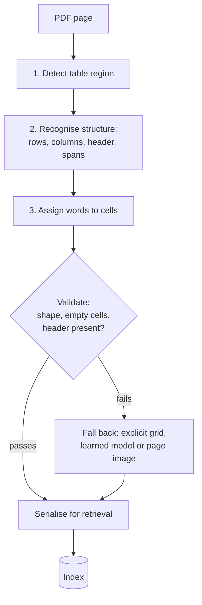

A table is a compact way of stating many facts at once. Each cell means something only because of the row it sits in and the column it sits under: "30 days" is meaningless until you know it is the *deadline* for *travel* expenses. Plain text extraction keeps the cells and throws away the row and column, so a RAG system that indexes it can retrieve the right page and still be unable to say which number belongs to which item. This lesson is about getting tables, and other structured content such as key-value lists and forms, out of documents with their structure intact, checking that you did, and turning the result into text that a retriever and a language model can use.

The focus is extraction: detecting a table, recovering its grid, and serialising it. How to split very large tables into chunks belongs to [Table chunking](/learn/advanced-chunking-strategies/table-chunking), and how to represent tables alongside images and charts in a multimodal index belongs to [Tables](/learn/multimodal-ingestion/tables) in the Multimodal Ingestion module.

## Learning objectives

- Explain why plain text extraction loses the meaning of a table, and show the loss on a real PDF.
- Extract a ruled table from a PDF with PyMuPDF's `find_tables()`, and recover a borderless table when the default heuristics fail.
- Read tables from formats that store structure explicitly (HTML and DOCX) without inferring anything from geometry.
- Serialise a table into retrievable text, choosing between whole-table Markdown and one-chunk-per-row records.
- Measure table extraction quality with a cell-level precision, recall and F1 score.

## Prerequisites

- [PDF extraction](/learn/data-processing/pdf-extraction): how text is stored in a PDF and why extraction is reconstruction rather than reading.
- [PyMuPDF](/learn/advanced-document-parsing/pymupdf): opening documents, pages and `get_text()`.
- [HTML parsing](/learn/advanced-document-parsing/html-parsing): navigating a parsed HTML tree.
- [Embeddings](/learn/understanding-large-language-models/embeddings): text as vectors compared by cosine similarity.

## Why this matters

Some of the most valuable content in a company's documents lives in tables: price lists, approval matrices, service levels, configuration limits, version comparisons, on-call rotas. They are also the content that people ask the most precise questions about. "Who approves client meal expenses?" has a single right answer, and it sits in one cell.

Three things go wrong when tables are handled as ordinary text:

1. **The grid collapses.** A PDF has no "table" object. It has words placed at coordinates and, sometimes, lines drawn between them. Text extraction emits the words in some order, usually row by row, cell by cell, and the row boundaries disappear. A chunk containing "Travel Over £75 30 days Line manager Home-office kit Always 30 days Finance" still contains every fact, but the reader, human or model, has to guess where one record ends and the next begins. Models guess wrong, and they do it fluently.
2. **Chunking cuts records in half.** A splitter that cuts by character count does not know that a row is a unit. Half a row lands in one chunk, the other half (with the answer) in the next, and the header row, the only place the column names appear, ends up in a third chunk that neither of them references.
3. **Retrieval matches the wrong unit.** A whole page of table text embeds as a blur of every row. A question about one row has to compete with the noise of all the others, and the chunk that wins may be the right page but the answer the model extracts from it may come from the wrong row.

None of these produce an error. The pipeline runs; the answers are just sometimes wrong, in ways that are hard to spot because every number in the answer genuinely appears in the source.

## The intuition

Imagine reading a train timetable aloud over the phone to someone who is writing it down. If you say "Leeds, 08:15, 09:40, 11:05, York, 08:42, 10:07, 11:32", your listener can reconstruct the grid only because they know a timetable's shape and you kept a strict rhythm. Skip one time, and every time after it shifts into the wrong column without anyone noticing.

Now imagine you read it differently: "The 08:15 from Leeds reaches York at 08:42." Each sentence is longer, and you repeat the station names over and over, but every sentence survives on its own. Lose one and the others are still correct.

That is the whole lesson in miniature. Extraction is about recovering the grid (who is in which row and column). Serialisation is about choosing how to say the grid out loud: compactly, as a grid, when the reader will see the whole thing; or redundantly, one self-contained statement per row, when each piece may be read alone, as retrieved chunks are.

## How it works

### Two kinds of source: explicit and implied structure

Table extraction is easy or hard depending on one question: **does the file format record the structure, or only the appearance?**

| Format | Where the table lives | What you have to do |
| --- | --- | --- |
| HTML | `<table>`, `<tr>`, `<td>`, with `colspan` and `rowspan` | Read the tree |
| DOCX, XLSX, ODT | An explicit table or sheet object with rows and cells | Read the object model |
| CSV, database exports | Already a grid | Nothing, beyond types and headers |
| Digital PDF | Words at coordinates, plus any ruling lines that were drawn | Infer the grid from geometry |
| Scanned PDF or image | Pixels | Detect, recognise text with [OCR](/learn/advanced-document-parsing/ocr), then infer the grid |

The rule that follows is simple and frequently ignored: **always extract tables from the most structured version of a document you can get.** If the handbook exists as a Word file and as a PDF export of it, parse the Word file. If a web page is available as HTML, do not print it to PDF and parse the PDF. Every step down the table above discards information you then have to guess back.

### Inferring a table from a PDF page

When geometry is all you have, table extraction breaks into three sub-problems. Research literature names them the same way, and most tools mirror the split.

1. **Table detection.** Find the rectangle on the page that contains a table. Heuristic tools look for clusters of ruling lines or for blocks of text aligned in columns. Learned tools, such as the Table Transformer models trained on the PubTables-1M dataset (Smock, Pesala and Abraham, 2022), treat it as object detection on a page image.
2. **Table structure recognition.** Inside that rectangle, find the rows, the columns, the header rows and any merged (spanning) cells. Heuristically, row and column boundaries come from drawn lines, or from gaps in the text: a vertical strip of whitespace that runs the full height of the table is probably a column boundary.
3. **Cell content extraction.** Assign each word to the cell whose box contains it, and join the words of each cell in reading order. In a digital PDF the words come from the text layer; in a scan they come from OCR.



### Ruled and borderless tables

The heuristics work very differently on the two common visual styles.

A **ruled table** has lines drawn between its cells. In a digital PDF those lines are vector drawing commands, and their coordinates are available exactly. A tool can collect the horizontal and vertical line segments, snap nearly-touching ones together, find their intersections, and read the cell grid straight off the intersections. This is reliable; when a ruled table fails to extract, it is usually because the "lines" are actually thin filled rectangles, or are drawn as a background image, or a cell's line is missing.

A **borderless table** has no lines; columns are implied only by aligned text. The tool must guess column boundaries from word positions: edges where several words start (or end) at the same x coordinate, and gaps that run the whole height of the region. This is fragile in predictable ways. A long cell can bridge two columns' worth of whitespace; a right-aligned column of numbers has aligned right edges but ragged left edges; a column with only one or two entries may not produce enough aligned words to count as a column at all. You will see one of these failures happen in the code below.

PyMuPDF's `Page.find_tables()` implements both approaches. The default strategy, `"lines"`, uses vector graphics. `strategy="text"` uses word alignment instead, and the separate `vertical_strategy` and `horizontal_strategy` arguments let you mix them, including `"explicit"`, where you supply the line positions yourself. The design is adapted from the open-source pdfplumber library, which uses the same vocabulary of strategies, snap and join tolerances.

### Header rows, spanning cells and multi-page tables

Recovering the grid is not the end of structure recognition. Three further problems decide whether the output is usable.

- **Headers.** The header row gives every other cell its meaning. Some tables have two header rows (a group label above several columns), and some have a header *column* instead. A header identified wrongly, or truncated, poisons every cell underneath it, which is why the metric in the mathematics section below tracks header-cell pairs, not cells alone.
- **Spanning cells.** A cell that covers two rows ("08:00 to 18:00" for both phone and chat support) is stored once. For retrieval you almost always want it **copied into every row it covers**, so that each row reads correctly on its own. HTML parsers that honour `rowspan` and python-docx's merged cells both do this, as you will see.
- **Tables that cross pages.** Each page is parsed separately, so a long table becomes several tables, and usually only the first carries the header. Join consecutive page tables that have the same number of columns and start near the top of the next page, and carry the header forward. Many policy documents also repeat the header on each page, which you then drop as a duplicate.

### Other structured content

Tables are the most common structure, but not the only one. The same principle (keep the relationships, not only the words) applies to:

- **Key-value lists**, such as "Owner: Platform team" or form fields ("Employee ID: ____"). Extract them as pairs; a value without its key is as useless as a cell without its header.
- **Nested lists**, such as procedures with sub-steps. Keep the numbering and indentation level, because "step 3b" depends on step 3.
- **Definition lists and glossaries.** Each entry is a natural chunk.

Layout-level structure (headings, columns, reading order) is the subject of [Layout-aware parsing](/learn/advanced-document-parsing/layout-aware-parsing).

### Serialising a table for retrieval

Once you have a clean grid, you have to turn it back into text, because that is what embedding models and language models read. There are three common choices, and they serve different purposes.

**Whole-table Markdown or HTML.** The grid kept as a grid:

```text
|Expense type|Receipt needed|Deadline|Approver|
|---|---|---|---|
|Travel|Over £75|30 days|Line manager|
|Client meals|Over £75|30 days|Finance|
```

Language models read Markdown tables well when the whole table is in front of them, and it is compact. It is the right form for the text you place in the prompt, and for small tables that fit comfortably in one chunk. Its weakness is retrieval of one row from a large table: the embedding of the whole table is an average of every row.

**One record per row.** Each row becomes a self-contained statement with the column names repeated:

```text
Meridian expenses: who approves what. Expense type: Client meals; Receipt needed: Over £75;
Deadline: 30 days; Approver: Finance.
```

This costs more tokens (the header is repeated in every row) but each chunk is complete on its own, so it can be retrieved alone and still be understood. Including the table's caption or title in each record matters more than it looks: it is what tells the reader that "Finance" is an approver for *expenses* and not something else.

**Natural-language sentences.** "Client meal expenses over £75 need a receipt and are approved by Finance." These read best, but writing them needs either templates per table (brittle) or a language model (costly, and it can introduce errors). Reserve them for small, high-value tables.

A pattern that combines the strengths is to **index row records for retrieval, but store a pointer to the whole table** so that, when any row is retrieved, the prompt can include the full Markdown table (or the neighbouring rows). That is a form of the small-to-big idea developed in [Parent-child chunking](/learn/chunking-optimisation/parent-child-chunking).

> [!KEY]
> Extraction recovers the grid; serialisation decides how the grid is spoken. For retrieval, make every chunk self-contained: repeat the header and the table's title in each record. For generation, show the model the grid.

## The mathematics

### Cell-level precision, recall and F1

**Intuition.** To know whether a table extractor works, compare its output with a hand-made correct version. Comparing whole tables as strings is too strict (one wrong character fails everything) and comparing bags of cell texts is too lenient (it cannot see a value placed under the wrong header). A practical middle ground is to compare **(row label, column label, value)** triples: a cell counts as correct only if its value is right *and* it sits in the right row and under the right header. This is in the spirit of the adjacency-relation metrics used in table recognition benchmarks; the more thorough Tree-Edit-Distance-based Similarity (TEDS, Zhong, ShafieiBavani and Jimeno Yepes, 2020) compares the full HTML tree of the table instead.

**Formula.** Let $T$ be the set of triples in the true table and $P$ the set in the extracted table.

$$
\text{precision} = \frac{|T \cap P|}{|P|}, \qquad
\text{recall} = \frac{|T \cap P|}{|T|}, \qquad
F_1 = \frac{2 \cdot \text{precision} \cdot \text{recall}}{\text{precision} + \text{recall}}
$$

- $|T \cap P|$ is the number of triples the extractor got exactly right.
- $|P|$ is the number of triples it produced; precision is the share of those that are correct.
- $|T|$ is the number of triples in the truth; recall is the share of the truth that was recovered.
- $F_1$ is the harmonic mean of the two, which is low if either is low.

**Worked example.** The borderless table in the code section below has three data rows and two value columns, so $|T| = 6$. The text-based heuristic truncates the header "Current handbook" to "Current" and the cell "08:00 to 18:00" to "08:00 to". Every triple in the third column now carries the wrong column label, so the three triples in that column are wrong, and the three in the "2023 handbook" column are right. The extractor produced six triples, so $|P| = 6$ and $|T \cap P| = 3$:

$$
\text{precision} = \frac{3}{6} = 0.5, \qquad \text{recall} = \frac{3}{6} = 0.5, \qquad F_1 = \frac{2 \times 0.5 \times 0.5}{0.5 + 0.5} = 0.5
$$

A single truncated header word cost half the table. A character-level comparison would have scored this output above 90% similar, which is why the metric must be structural.

**In Python:**

```python
def triples(table):
    """(row label, column label, value) for every data cell; skip blank rows."""
    header, *body = [r for r in table if any(c.strip() for c in r)]
    return {(row[0], header[c], row[c]) for row in body for c in range(1, len(header))}

def cell_f1(truth, predicted):
    t, p = triples(truth), triples(predicted)
    tp = len(t & p)
    precision, recall = tp / len(p), tp / len(t)
    return precision, recall, 2 * precision * recall / (precision + recall)

truth = [["Policy", "2023 handbook", "Current handbook"],
         ["Laptop refresh", "4 years", "3 years"],
         ["Equipment budget", "£250", "£400"],
         ["Support hours", "09:00 to 17:00", "08:00 to 18:00"]]
text_strategy = [["Policy", "2023 handbook", "Current"], ["", "", ""],
                 ["Laptop refresh", "4 years", "3 years"], ["", "", ""],
                 ["Equipment budget", "£250", "£400"], ["", "", ""],
                 ["Support hours", "09:00 to 17:00", "08:00 to"]]
p, r, f = cell_f1(truth, text_strategy)
print(f"precision={p:.3f} recall={r:.3f} F1={f:.3f}")
```

```output
precision=0.500 recall=0.500 F1=0.500
```

(If an extractor produces no triples at all, `len(p)` is zero and this code divides by zero; a production version should return zero scores in that case.)

## In code

All four examples run locally with no API key. Install the dependencies:

```bash
pip install pymupdf pandas lxml python-docx sentence-transformers
```

### 1. A ruled table: plain text versus `find_tables()`

**The problem.** Meridian's expenses policy contains a ruled table of approvers. We build a one-page PDF containing it, then compare what plain text extraction and table extraction return.

```python
import pymupdf

rows = [
    ["Expense type", "Receipt needed", "Deadline", "Approver"],
    ["Travel", "Over £75", "30 days", "Line manager"],
    ["Home-office kit", "Always", "30 days", "Finance"],
    ["Client meals", "Over £75", "30 days", "Finance"],
]
col_x = [72, 202, 312, 402, 532]   # column boundaries in points
row_h = 22
top = 120

doc = pymupdf.open()
page = doc.new_page()                       # A4 is the default size
page.insert_text((72, 90), "Meridian expenses: who approves what", fontsize=14)

for r, row in enumerate(rows):
    y0 = top + r * row_h
    for c, cell in enumerate(row):
        font = "hebo" if r == 0 else "helv"   # bold header row
        page.insert_text((col_x[c] + 4, y0 + 15), cell, fontsize=10, fontname=font)
# ruling lines: horizontal then vertical
for r in range(len(rows) + 1):
    y = top + r * row_h
    page.draw_line((col_x[0], y), (col_x[-1], y))
for x in col_x:
    page.draw_line((x, top), (x, top + len(rows) * row_h))

page.insert_text((72, top + len(rows) * row_h + 30),
                 "Claims submitted late are returned to the employee.", fontsize=10)
doc.save("expenses.pdf")
```

Now the extraction itself:

```python
import pymupdf

doc = pymupdf.open("expenses.pdf")
page = doc[0]

print("--- plain get_text() ---")
print(page.get_text())

print("--- find_tables() ---")
tables = page.find_tables()          # default strategy uses ruling lines
print("tables found:", len(tables.tables))
table = tables[0]
print("bbox:", [round(v) for v in table.bbox])
print("shape:", table.row_count, "rows x", table.col_count, "cols")
print("header:", table.header.names)
for row in table.extract():
    print(row)
print()
print(table.to_markdown())
```

```output
--- plain get_text() ---
Meridian expenses: who approves what
Expense type
Receipt needed
Deadline
Approver
Travel
Over £75
30 days
Line manager
Home-office kit
Always
30 days
Finance
Client meals
Over £75
30 days
Finance
Claims submitted late are returned to the employee.

--- find_tables() ---
Consider using the pymupdf_layout package for a greatly improved page layout analysis.
tables found: 1
bbox: [72, 120, 532, 208]
shape: 4 rows x 4 cols
header: ['Expense type', 'Receipt needed', 'Deadline', 'Approver']
['Expense type', 'Receipt needed', 'Deadline', 'Approver']
['Travel', 'Over £75', '30 days', 'Line manager']
['Home-office kit', 'Always', '30 days', 'Finance']
['Client meals', 'Over £75', '30 days', 'Finance']

|Expense type|Receipt needed|Deadline|Approver|
|---|---|---|---|
|Travel|Over £75|30 days|Line manager|
|Home-office kit|Always|30 days|Finance|
|Client meals|Over £75|30 days|Finance|
```

**What the output means.** Plain extraction gives one cell per line: the words are all there, and in a sensible order, but nothing marks where a row ends. Sixteen lines in a row, and "Finance" appears twice; only by counting can you tell which expense types it belongs to. A chunker that splits this text in the middle produces fragments such as "30 days Finance Client meals", which are actively misleading.

`find_tables()` recovers the grid exactly: one table, four rows by four columns, with a header row identified from the first row. `table.extract()` returns a list of rows, each a list of cell strings (`None` for cells that do not exist because of spans). `to_markdown()` and `to_pandas()` give the two most useful serialisations. The line "Consider using the pymupdf_layout package…" is an advisory message that recent PyMuPDF versions print to standard output when table detection runs; it is not an error, and it advertises an optional add-on package that was not installed here.

**Important lines.** `page.draw_line` is what makes this a *ruled* table: those vector lines are exactly what the default `"lines"` strategy looks for. `table.bbox` is the table's rectangle on the page, which you need in order to remove the table's words from the surrounding prose (otherwise they get indexed twice, once as a table and once as jumbled text). PyMuPDF's `get_text(clip=...)` and the table bounding box make that straightforward.

### 2. A borderless table: when the heuristic breaks

**The problem.** Meridian's "what changed since 2023" summary is a borderless table: three columns of aligned text, no lines.

```python
import pymupdf

# A borderless table: columns are implied only by aligned text.
rows = [
    ["Policy", "2023 handbook", "Current handbook"],
    ["Laptop refresh", "4 years", "3 years"],
    ["Equipment budget", "£250", "£400"],
    ["Support hours", "09:00 to 17:00", "08:00 to 18:00"],
]
doc = pymupdf.open()
page = doc.new_page()
for r, row in enumerate(rows):
    for c, cell in enumerate(row):
        page.insert_text((72 + c * 150, 120 + r * 18), cell,
                         fontsize=10, fontname="hebo" if r == 0 else "helv")

print("ruling-line strategy:", len(page.find_tables().tables), "tables")

print("\ntext strategy (columns inferred from word alignment):")
for row in page.find_tables(strategy="text")[0].extract():
    print("  ", row)

print("\nexplicit grid (we know where this template's columns are):")
grid = page.find_tables(
    vertical_strategy="explicit", vertical_lines=[70, 220, 370, 520],
    horizontal_strategy="explicit", horizontal_lines=[105, 125, 143, 161, 179],
)
for row in grid[0].extract():
    print("  ", row)
```

```output
Consider using the pymupdf_layout package for a greatly improved page layout analysis.
ruling-line strategy: 0 tables

text strategy (columns inferred from word alignment):
   ['Policy', '2023 handbook', 'Current']
   ['', '', '']
   ['Laptop refresh', '4 years', '3 years']
   ['', '', '']
   ['Equipment budget', '£250', '£400']
   ['', '', '']
   ['Support hours', '09:00 to 17:00', '08:00 to']

explicit grid (we know where this template's columns are):
   ['Policy', '2023 handbook', 'Current handbook']
   ['Laptop refresh', '4 years', '3 years']
   ['Equipment budget', '£250', '£400']
   ['Support hours', '09:00 to 17:00', '08:00 to 18:00']
```

**What the output means.** The default strategy finds nothing, correctly: there are no lines. The text strategy finds the table but gets it wrong in two instructive ways. It invents empty rows between the real ones, and it cuts off the end of the last column: "Current handbook" becomes "Current" and "08:00 to 18:00" becomes "08:00 to". The likely cause is that the text strategy only accepts a column edge where several words line up (three by default, the `min_words_vertical` setting); the left edges of the third column line up, but its right edge is ragged, so words that run past the last accepted edge fall outside the table. Notice that the result *looks* plausible. "08:00 to" could pass a quick glance, and AskMeridian would then answer "When does the support desk close?" with nothing, or with a guess.

When you know a document's template (a monthly report generated by the same system, a form issued by the same department), an **explicit grid** removes the guesswork: you state where the column and row boundaries are, and the extraction is exact. This is a common production pattern for recurring documents: detect the template, then apply a hand-checked grid for it.

**Common errors.** Passing `strategy="text"` together with explicit lines and expecting them to combine (use `vertical_strategy` and `horizontal_strategy` separately); forgetting that PDF coordinates in PyMuPDF are measured in points from the *top-left* corner; and assuming `find_tables()` returns a list (it returns a `TableFinder` object; use `.tables` or index it).

### 3. Native structure: HTML and DOCX

**The problem.** The support desk table exists in two other formats, one with a merged cell. Here no geometry needs inferring.

```python
from io import StringIO
import docx
import pandas as pd

# HTML: the structure is explicit in the markup, including a merged cell.
html = """
<table>
  <caption>Meridian support desk</caption>
  <tr><th>Channel</th><th>Hours (UK time)</th><th>Days</th></tr>
  <tr><td>Phone</td><td rowspan="2">08:00 to 18:00</td><td>Working days</td></tr>
  <tr><td>Chat</td><td>Working days</td></tr>
</table>"""
df = pd.read_html(StringIO(html))[0]
print("HTML via pandas.read_html:")
print(df.to_string(index=False))

# DOCX: python-docx exposes the table grid directly.
d = docx.Document()
t = d.add_table(rows=3, cols=3)
for r, row in enumerate([["Channel", "Hours (UK time)", "Days"],
                         ["Phone", "08:00 to 18:00", "Working days"],
                         ["Chat", "", "Working days"]]):
    for c, text in enumerate(row):
        t.cell(r, c).text = text
t.cell(1, 1).merge(t.cell(2, 1))           # merge the hours cell down two rows
d.save("desk.docx")

table = docx.Document("desk.docx").tables[0]
print("\nDOCX via python-docx:")
for row in table.rows:
    print([cell.text for cell in row.cells])
```

```output
HTML via pandas.read_html:
Channel Hours (UK time)         Days
  Phone  08:00 to 18:00 Working days
   Chat  08:00 to 18:00 Working days

DOCX via python-docx:
['Channel', 'Hours (UK time)', 'Days']
['Phone', '08:00 to 18:00\n', 'Working days']
['Chat', '08:00 to 18:00\n', 'Working days']
```

**What the output means.** Both libraries copy the merged value into each row it spans, which is exactly what retrieval needs: the "Chat" row now states its own hours. `pandas.read_html` uses the `<th>` row as column names. python-docx returns the *same* underlying cell for every grid position a merge covers, so the text repeats; the trailing `\n` appears because merging joined the paragraphs of both original cells (one of them empty). Always `.strip()` cell text from DOCX.

Note that `read_html` needs `lxml` (or BeautifulSoup with html5lib) installed, and that it takes a file-like object or URL; passing a literal HTML string directly is deprecated in recent pandas versions, hence the `StringIO`.

### 4. Serialising rows for retrieval

**The problem.** Decide what to index. We compare a chunk made from the flattened page text with one chunk per table row, using a local embedding model.

```python
import pymupdf
from sentence_transformers import SentenceTransformer

page = pymupdf.open("expenses.pdf")[0]
table = page.find_tables()[0]
header, *body = table.extract()
caption = "Meridian expenses: who approves what"

def row_to_text(caption, header, row):
    """One self-contained sentence-like chunk per row, header repeated."""
    pairs = "; ".join(f"{h}: {v}" for h, v in zip(header, row))
    return f"{caption}. {pairs}."

row_chunks = [row_to_text(caption, header, row) for row in body]
flat_chunk = page.get_text()              # what a naive pipeline would index
for c in row_chunks:
    print(c)

model = SentenceTransformer("sentence-transformers/all-MiniLM-L6-v2")
query = "Who approves expense claims for client meals?"
q, flat, rows = (model.encode(x, normalize_embeddings=True)
                 for x in ([query], [flat_chunk], row_chunks))
print(f"\nquery: {query}")
print(f"flattened page text   cosine = {(q @ flat.T).item():.3f}")
for c, s in zip(row_chunks, (rows @ q.T).ravel()):
    print(f"row '{c.split('Expense type: ')[1].split(';')[0]}'  cosine = {s:.3f}")
```

```output
Consider using the pymupdf_layout package for a greatly improved page layout analysis.
Meridian expenses: who approves what. Expense type: Travel; Receipt needed: Over £75; Deadline: 30 days; Approver: Line manager.
Meridian expenses: who approves what. Expense type: Home-office kit; Receipt needed: Always; Deadline: 30 days; Approver: Finance.
Meridian expenses: who approves what. Expense type: Client meals; Receipt needed: Over £75; Deadline: 30 days; Approver: Finance.

query: Who approves expense claims for client meals?
flattened page text   cosine = 0.496
row 'Travel'  cosine = 0.413
row 'Home-office kit'  cosine = 0.431
row 'Client meals'  cosine = 0.539
```

**What the output means.** The "Client meals" record scores highest of all candidates, above the flattened page. The margin is modest, and on a three-row table the flat chunk would also be retrieved. The real gain is in what reaches the model: the row record states, in one place, that client meals are approved by Finance, whereas the flat text makes the model infer the pairing from line order. On a table with fifty rows the flat chunk's embedding is diluted across fifty records, and the gap widens. Measure this on your own documents rather than trusting the direction: the exact numbers depend on the embedding model.

**Extending it.** Add the document title and section heading to each record (they are what distinguish "approver" in the expenses policy from "approver" in the change-management runbook); store `table_id` and `row_index` in each chunk's metadata so the full table can be pulled into the prompt at generation time; and for very wide tables, include only the key column plus the columns the row actually fills.

## A real-world example

The Platform team that runs AskMeridian received a run of complaints after the Finance department published a new expenses matrix as a PDF: the assistant was telling people that home-office kit was approved by line managers. Every answer cited the right document and the right page.

The engineers pulled the retrieved chunk for one of the bad answers. It was the plain-text extraction of the matrix page, split by a 500-character splitter. The chunk began midway through the "Travel" row ("…30 days Line manager Home-office kit Always 30 days") and ended there; "Finance", the next line, had landed in the following chunk. The model did what any reader would do with that fragment and attached "Line manager" to the nearest expense type.

The fix had three parts. First, the ingestion job now runs `find_tables()` on every PDF page and, when a table is found, removes its words from the prose text (using the table's bounding box) and emits one record per row with the header and the table's caption repeated, plus a `table_id` in the metadata. Second, at prompt-construction time, any retrieved row pulls in the full Markdown table it came from, so the model always sees the grid. Third, they added an extraction check: any detected table whose rows have inconsistent numbers of non-empty cells, or whose header contains a cell that is a prefix of the same column's cell on another page, is flagged for review instead of being indexed silently. Two weeks later, that check caught a borderless "changes since 2023" table whose last column had been truncated by the text heuristic; the team added an explicit grid for that template.

## Common mistakes

- **Indexing table pages as plain text.** Row boundaries vanish and chunkers split records, so the model pairs values with the wrong items while citing the correct page.
- **Indexing the table twice.** Extracting the table *and* leaving its words in the page's prose text puts a jumbled duplicate of every row into the index, which can outrank the clean version.
- **Dropping the header from row chunks.** A row chunk of "Client meals | Over £75 | 30 days | Finance" retrieved alone says nothing about what the columns mean.
- **Trusting borderless-table heuristics without checks.** Truncated cells and invented empty rows look plausible and pass casual inspection, as the example above showed.
- **Parsing the PDF when a structured original exists.** Extracting from an HTML or DOCX source is exact; extracting from its PDF rendering is guesswork.
- **Leaving spanning cells unfilled.** A merged "08:00 to 18:00" that appears only in the first row it covers leaves the other rows answering "unknown".
- **Splitting multi-page tables into unrelated pieces.** The continuation on page two has no header, so its rows become unlabelled numbers.

## Best practices

- Prefer the most structured source format available, and only infer tables from geometry when you have to.
- Run table detection before text extraction, and remove table regions from the prose so each fact is indexed once.
- Serialise each row as a self-contained record that repeats the caption, the section heading and the column names; keep a `table_id` so the full table can be shown to the model.
- Fill spanning cells into every row they cover, and carry headers across page breaks.
- Validate every extracted table: consistent column counts, a non-empty header, no column that is empty in every row, and no cell text cut off mid-token. Route failures to a fallback (explicit grid, learned model, or page-image transcription, discussed in [Multimodal document extraction](/learn/advanced-document-parsing/multimodal-document-extraction)) rather than indexing them.
- Keep a small hand-checked set of your organisation's real tables and score every parser change against it with a structural metric.

## Performance considerations

- **Cost of detection.** `find_tables()` analyses vector drawings and words on the page; it is far more expensive than `get_text()` alone. On a corpus of 50,000 pages, calling it on every page multiplies parse time. A cheap pre-filter (only call it on pages with many drawn line segments, or many short text lines aligned in columns) keeps it to the pages that need it.
- **Token cost of row records.** Repeating a header of, say, 15 tokens and a caption of 10 tokens on every row of a 200-row table adds $200 \times 25 = 5{,}000$ tokens to the index for that table. That is negligible for embedding cost but matters for anything you pass to a language model per chunk (for example contextual summaries). Whole-table Markdown pays the header once.
- **Embedding dilution.** A single chunk containing a large table embeds as an average of all rows; very large tables should always be split into row records or row groups, as [Table chunking](/learn/advanced-chunking-strategies/table-chunking) covers.
- **Learned table models** (detection and structure transformers) generally need a GPU for reasonable throughput. Use them for the pages heuristics fail on, not for every page.

## Security considerations

Tables in untrusted documents can carry text the viewer never sees: white text on a white cell, text in a cell clipped by its column width, or content hidden under another drawn shape. Extraction from the text layer reads all of it, so a table can smuggle instructions into the index. Treat extracted cell text like any other untrusted input (see how prompt injection is handled later in the course), and consider flagging cells whose text colour matches their background. Tables are also a common home for personal data (salary bands, staff lists); classify documents for sensitivity before their rows become individually retrievable records, because row-level chunks make a single person's row easy to retrieve on its own.

## Summary

- A table's meaning lives in the pairing of each cell with its row and column; plain text extraction keeps the words and loses the pairing.
- HTML, DOCX and spreadsheets store structure explicitly; PDFs and scans only imply it, so extraction there is inference that can fail silently.
- Ruled tables extract reliably from vector lines; borderless tables depend on word-alignment heuristics, which need validation, an explicit grid for known templates, or a learned model.
- For retrieval, serialise rows as self-contained records with the caption and headers repeated; for generation, show the model the whole table as Markdown.
- Measure extraction structurally, with (row, column, value) triples or a tree-based metric, not by string similarity.

## Exercises

1. **Spot the damage.** Take the plain `get_text()` output of the expenses table above and split it into chunks of 60 characters. Which chunks would mislead a reader about who approves what, and why?

<details><summary>Show solution</summary>

The text is the 16 cell values joined by newlines. Any chunk that contains an approver value but starts after its own expense type is misleading. For example, a chunk beginning at "Always 30 days Finance Client meals Over £75" pairs nothing correctly: "Finance" appears next to "Client meals" by position, which happens to be true for that row by coincidence, but "Always" has lost "Home-office kit". Chunks that begin mid-row and end mid-row cannot be interpreted without counting columns from the very first header line, which a retrieved chunk does not contain. The general lesson: fixed-size chunking of flattened tables destroys records, so tables must be detected and serialised before chunking.

</details>

2. **Fill spans and carry headers.** Write a function `normalise(rows)` that takes a list of rows from a PDF extractor, where a spanning cell appears as `None` in the rows it covers below its first row, and returns rows with each `None` replaced by the value above it. Then write `merge_pages(tables)` that joins a list of page tables, dropping a repeated header row when a continuation page starts with the same header.

<details><summary>Show solution</summary>

```python
def normalise(rows):
    out = []
    for r, row in enumerate(rows):
        filled = []
        for c, cell in enumerate(row):
            if cell is None and r > 0:
                cell = out[r - 1][c]          # copy the value from the row above
            filled.append((cell or "").strip())
        out.append(filled)
    return out

def merge_pages(tables):
    header = tables[0][0]
    merged = [header]
    for t in tables:
        body = t[1:] if t and t[0] == header else t
        merged.extend(body)
    return merged

page1 = [["Channel", "Hours"], ["Phone", "08:00 to 18:00"], ["Chat", None]]
page2 = [["Channel", "Hours"], ["Email", "Replies within one working day"]]
print(merge_pages([normalise(page1), normalise(page2)]))
```

```output
[['Channel', 'Hours'], ['Phone', '08:00 to 18:00'], ['Chat', '08:00 to 18:00'], ['Email', 'Replies within one working day']]
```

Note that `None` in PyMuPDF's `extract()` can also mean a horizontally merged cell; a full implementation should check the table's cell geometry to decide whether to copy from the left or from above.

</details>

3. **Choose a serialisation.** AskMeridian must index (a) a 6-row table of support channels, (b) a 400-row table of Atlas error codes with columns code, meaning and fix, and (c) a 12 by 12 matrix of which office can book which meeting room. Choose a serialisation for each and justify it.

<details><summary>Show solution</summary>

(a) Six rows fit comfortably in one chunk: index the whole table as Markdown with its caption, perhaps also as row records if users ask about single channels. (b) Error-code tables are queried one code at a time, often by exact identifier: one record per row ("Atlas error catalogue. Code: E-4021; Meaning: …; Fix: …"), with the code also stored as a metadata field so an exact-match filter or a lexical retriever can find it. Pull neighbouring rows only if needed. (c) A matrix is relational in both directions; neither rows nor columns alone are natural records. Convert it into the facts it encodes ("The Leeds office can book Room 3"), one per true cell, or into one record per office listing its bookable rooms, depending on whether questions are usually asked per office or per room. Keep the full matrix available for display.

</details>

4. **Validate before indexing.** Design a set of automatic checks that would have caught the truncated borderless table in this lesson without a human looking at it. Implement at least two of them and run them on the text-strategy output.

<details><summary>Show solution</summary>

Useful checks: (1) remove rows that are entirely empty and flag the table if more than, say, a quarter of its rows were empty; (2) compare the table's words with the words of the page text inside the table's bounding box and flag any word that is on the page but missing from the table (this catches "handbook" and "18:00" being dropped); (3) flag cells that end in a function word such as "to", "and" or "of", which suggests a cut. A sketch of (1) and (3):

```python
rows = [["Policy", "2023 handbook", "Current"], ["", "", ""],
        ["Laptop refresh", "4 years", "3 years"], ["", "", ""],
        ["Equipment budget", "£250", "£400"], ["", "", ""],
        ["Support hours", "09:00 to 17:00", "08:00 to"]]

empty = sum(1 for r in rows if not any(c.strip() for c in r))
print(f"empty rows: {empty}/{len(rows)}", "FLAG" if empty / len(rows) > 0.25 else "ok")
dangling = [c for r in rows for c in r if c.split() and c.split()[-1].lower() in {"to", "and", "of", "for"}]
print("cells ending in a function word:", dangling)
```

```output
empty rows: 3/7 FLAG
cells ending in a function word: ['08:00 to']
```

Check (2) is the strongest because it does not depend on wording: in PyMuPDF, `page.get_text("words", clip=table.bbox)` gives the words in the region, but note that a truncated table's own bounding box may also be too narrow, so compare against a slightly widened region or the full text line.

</details>

## Check your understanding

```quiz
[
  {"q": "Why does plain text extraction of a ruled PDF table often mislead a RAG system even when every cell's text is present?", "options": ["PDF text extraction removes numbers", "Row boundaries are lost, so values can no longer be reliably paired with their row and column", "Embedding models cannot embed tables", "The header row is always extracted last"], "answer": 1, "why": "The words survive but the grid does not; after chunking, the model has to guess which value belongs to which item."},
  {"q": "You have Meridian's expenses policy as both a DOCX file and a PDF exported from it. Which should the ingestion pipeline parse for its tables?", "options": ["The PDF, because it is the published version", "Both, and index both copies", "The DOCX, because it stores the table structure explicitly", "Whichever is smaller"], "answer": 2, "why": "DOCX records rows, cells and merges; a PDF only records where words were drawn, so its structure must be inferred."},
  {"q": "PyMuPDF's default `find_tables()` returns no tables on a page that clearly shows a table. What is the most likely reason?", "options": ["The table is borderless, and the default strategy relies on drawn ruling lines", "The page is too long", "The table has a header row", "PyMuPDF cannot read tables in A4 documents"], "answer": 0, "why": "The default \"lines\" strategy uses vector line drawings; a table made only of aligned text needs the text strategy, an explicit grid or another method."},
  {"q": "Which serialisation is best for indexing a 300-row error-code table that users query one code at a time?", "options": ["The whole table as one Markdown chunk", "Plain page text split every 500 characters", "Only the header row", "One record per row, repeating the caption and column names, with the code in metadata"], "answer": 3, "why": "Each record is self-contained and retrievable alone; a single 300-row chunk would embed as a blur of every row."},
  {"q": "An extractor truncates one column header but gets every cell value right. Under a (row label, column label, value) triple metric, what happens?", "options": ["Nothing; only values are compared", "Every triple in that column is counted wrong", "Only the header cell is counted wrong", "The table scores zero"], "answer": 1, "why": "Each cell is judged together with its column label, so a wrong header makes every cell under it incorrect, reflecting the real damage to meaning."}
]
```

## Further reading

- [PyMuPDF documentation](https://pymupdf.readthedocs.io/): the `Page.find_tables()` reference, including strategies and tolerances.
- Smock, B., Pesala, R. and Abraham, R. (2022). [PubTables-1M: Towards comprehensive table extraction from unstructured documents](https://arxiv.org/abs/2110.00061). CVPR 2022. Introduces the Table Transformer and a large table-structure dataset.
- Zhong, X., ShafieiBavani, E. and Jimeno Yepes, A. (2020). [Image-based table recognition: data, model, and evaluation](https://arxiv.org/abs/1911.10683). ECCV 2020. Introduces PubTabNet and the TEDS metric.
- [pandas documentation](https://pandas.pydata.org/docs/): `pandas.read_html` and its handling of spanning cells.
- [python-docx documentation](https://python-docx.readthedocs.io/): working with tables and merged cells.
