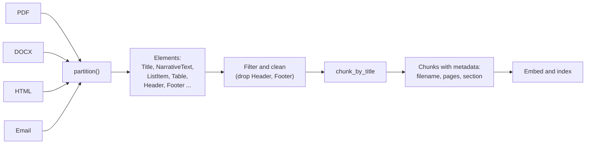

The two previous lessons built extractors for one format at a time. Real corpora mix formats: the Meridian handbook is a PDF, the IT runbooks live as HTML pages exported from a wiki, some policies arrive as Word files, and support escalations come in as email. **Unstructured** is an open-source Python library built around one idea that addresses this directly: whatever the input format, turn it into the same list of typed **elements** (titles, narrative text, list items, tables, headers, footers) with consistent metadata. Downstream code (cleaning, chunking, embedding) is then written once against that element model instead of once per format.

This lesson explains the element model, the **partitioning strategies** that trade speed for accuracy on PDFs, and Unstructured's **chunk by title** chunker. Because Unstructured needs system packages and model downloads that the course sandbox does not have, its own code here is shown but was not executed; alongside it, you will build and run a small local imitation of its partition-then-chunk design, so you can see the mechanism produce real output.

## Learning objectives

- Describe Unstructured's element model (categories, text and metadata) and explain why a format-independent intermediate representation simplifies a multi-format ingestion pipeline.
- Choose between the `fast`, `hi_res`, `ocr_only` and `auto` partitioning strategies for a given PDF and justify the choice by cost and accuracy.
- Use element categories and metadata to filter noise, keep tables intact and attach provenance to chunks.
- Explain how `chunk_by_title` forms chunks, and predict the effect of `max_characters`, `new_after_n_chars` and `combine_text_under_n_chars`.
- Implement a minimal partitioner and title-based chunker, and identify where it and the real library can go wrong.

## Prerequisites

- [PyMuPDF](/learn/advanced-document-parsing/pymupdf): reading order, headings by font size, and record extraction from PDFs.
- [pypdf](/learn/advanced-document-parsing/pypdf): what a plain text extractor does and does not give you.
- [Document loaders](/learn/document-engineering/document-loaders): the loader abstraction in RAG frameworks.
- [Chunk size](/learn/chunking-fundamentals/chunk-size): why chunk length matters for retrieval.

## Why this matters

A multi-format corpus pushes teams towards one of two bad designs. In the first, every format gets its own loader that emits a plain string, and all structure is lost at the boundary: the chunker cannot tell a heading from a paragraph, so it splits wherever a character count says. In the second, every format gets its own loader *and* its own chunker, and the codebase grows a slightly different bug in each.

An intermediate representation fixes both. If every parser emits the same element types with the same metadata keys, one cleaning step can drop every `Header` and `Footer`, one chunker can start a new chunk at every `Title`, and one function can attach `filename`, `page_number` and section to every chunk, whichever format the text came from. This is the same design principle as a compiler's intermediate representation: many front ends, one shared back end.

Without it, the failures are familiar. Running headers repeat in hundreds of chunks. Tables are flattened into word soup. Chunks start mid-section and end mid-sentence, so the retriever returns a fragment that cannot be cited or understood on its own.

## The intuition

Think of a librarian processing donations: hardbacks, magazines, loose printouts, letters. Before shelving, each item gets the same index card: title, type of content, page, where it came from. Once everything has a card, shelving rules are simple and uniform, no matter what the original object looked like.

Unstructured writes those index cards. A PDF, a Word file and an HTML page all come out as a sequence of cards saying "this is a Title", "this is NarrativeText under that title, on page 3", "this is a Table, and here is its HTML". Chunking then works on cards, not on raw text: start a new chunk at every new title, never staple a table to a paragraph, and do not leave a three-word section on its own.

## How it works

### Partitioning: from file to elements

**Partitioning** is Unstructured's name for parsing a document into elements. The entry point `partition(filename=...)` in `unstructured.partition.auto` detects the file type and dispatches to a format-specific function: `partition_pdf`, `partition_docx`, `partition_html`, `partition_email`, `partition_pptx`, `partition_xlsx`, `partition_md` and others. Each returns a list of element objects.

Every element has:

- a **category** (its class): common ones are `Title`, `NarrativeText`, `ListItem`, `Table`, `Header`, `Footer`, `Image`, `FigureCaption`, `PageBreak` and `UncategorizedText`;
- **text**: the element's text content;
- an **element id**, used by other elements to refer to it;
- **metadata**, including `filename`, `filetype`, `page_number`, `languages`, `coordinates` (where the parser knows the position), `parent_id` (the id of the enclosing title, forming a hierarchy), `category_depth` (heading level), and for tables `text_as_html`.

Elements serialise to dictionaries with `element.to_dict()`, and whole lists to JSON with `elements_to_json` from `unstructured.staging.base`, which is how you cache partition results so you do not pay to parse the same file twice.



How an element's category is decided depends on the format. For HTML and DOCX the source carries real structure (`<h2>` tags, Word heading styles, list markup), and partitioning maps it fairly directly. For PDFs and images there is no such markup, so categories are inferred from the page, either by text heuristics or by a vision model, depending on the strategy.

### PDF strategies

`partition_pdf` (and `partition` on a PDF) takes a `strategy` argument. The choice is the main cost and quality lever in an Unstructured pipeline.

| Strategy | How it works | Good for | Cost |
| --- | --- | --- | --- |
| `fast` | Extracts the embedded text layer (via the pdfminer.six library) and classifies text with rules | Digital PDFs with simple layouts | Lowest; no models |
| `hi_res` | Renders pages to images and runs a **layout-detection model** that draws boxes around titles, text, tables, figures; merges with the text layer | Complex layouts, tables (`infer_table_structure=True`), figures | Highest; model inference per page, ideally on a GPU |
| `ocr_only` | Renders pages and runs Tesseract OCR | Scanned documents without a text layer | High; OCR per page |
| `auto` (default) | Chooses among the others based on the document and the options requested | A reasonable default | Varies |

The mechanism behind `hi_res` is **object detection** applied to a page image: a model trained on annotated document pages predicts rectangles and a label for each (title, text, list, table, figure). That is the approach covered in depth in [Layout-aware parsing](/learn/advanced-document-parsing/layout-aware-parsing). Table structure (rows and cells) is recovered by a second model when `infer_table_structure=True`, and the result is put in `metadata.text_as_html`. OCR itself, and the Tesseract engine, belong to [OCR](/learn/advanced-document-parsing/ocr).

Two practical consequences follow. First, the same file can produce noticeably different elements under different strategies, so record the strategy (and library version) in your chunk metadata. Second, `hi_res` turns a parsing job that took milliseconds per page into one that may take on the order of a second or more per page on a CPU, so it should be reserved for documents that need it.

### Chunking by title

Unstructured includes chunkers that operate on elements rather than raw text. The one most used for RAG is `chunk_by_title` in `unstructured.chunking.title`. Its rules:

1. **A `Title` element starts a new section.** Text never crosses from one section into the next chunk unless sections are being combined (rule 4).
2. **Elements are packed into a chunk** until adding the next would exceed `max_characters` (a hard maximum). `new_after_n_chars` sets a soft maximum: once a chunk passes it, the next element starts a new chunk even though there is still room.
3. **An element longer than `max_characters`** on its own (one very long paragraph) is split into several chunks by text length.
4. **Small sections are combined.** A section shorter than `combine_text_under_n_chars` is merged with the following one, so that a heading followed by a one-line paragraph does not become its own tiny chunk.
5. **Tables are isolated.** A `Table` is never combined with text; it becomes its own chunk (a `TableChunk` if it has to be split). This protects tables from being cut in half and mixed with prose.
6. Optional `overlap` repeats the end of one text-split chunk at the start of the next, and `multipage_sections` controls whether a section may span a page boundary.

The output elements are `CompositeElement` objects (text chunks) and `Table` or `TableChunk` objects, each carrying merged metadata (for example the page numbers of the elements inside). The more general strategy of using a document's own headings to choose chunk boundaries is the topic of [Heading-based chunking](/learn/advanced-chunking-strategies/heading-based-chunking); here we care about how Unstructured implements it on top of elements.

### Unstructured as a project

The open-source library is published by Unstructured (the company) under the Apache 2.0 licence. The company also offers hosted and paid processing services and separate packages for running ingestion against many source systems; their names and feature sets have changed over time, so check the current documentation rather than relying on a blog post. Major RAG frameworks provide loaders that wrap Unstructured, so you may already be using it indirectly.

Installation is heavier than for pypdf or PyMuPDF. The base package handles some formats; format support is added through extras such as `unstructured[pdf]`, `unstructured[docx]` or `unstructured[all-docs]`. Several formats need system packages: `libmagic` for file-type detection, Poppler for rendering PDFs, Tesseract for OCR, and LibreOffice for legacy Office formats such as `.doc`. Strategies that use models download them on first use.

## In code

### Using the library (not executed here)

**The problem.** Partition a handbook PDF and a wiki page with one code path, drop page furniture, chunk by title and prepare records for a vector store.

**Dependencies.** The PDF extra and the system packages it needs (shown for Debian or Ubuntu; on macOS use Homebrew's `libmagic`, `poppler` and `tesseract`).

```bash
sudo apt-get install -y libmagic1 poppler-utils tesseract-ocr
pip install "unstructured[pdf]"
```

This code is written against Unstructured's documented API but **was not executed** for this lesson, because the sandbox lacks the library and its system dependencies. Check parameter names against the documentation for the version you install.

```python
from unstructured.chunking.title import chunk_by_title
from unstructured.partition.auto import partition
from unstructured.staging.base import elements_to_json

SOURCES = ["handbook.pdf", "vpn-runbook.html"]

def partition_file(path):
    kwargs = {}
    if path.endswith(".pdf"):
        kwargs = {"strategy": "fast"}          # digital PDFs: no model, no OCR
    elements = partition(filename=path, **kwargs)
    elements_to_json(elements, filename=path + ".elements.json")   # cache the parse
    return [el for el in elements if el.category not in ("Header", "Footer", "PageBreak")]

records = []
for path in SOURCES:
    elements = partition_file(path)
    for el in elements[:5]:
        print(el.category, el.metadata.page_number, el.text[:60])

    chunks = chunk_by_title(
        elements,
        max_characters=1000,             # hard limit per chunk
        new_after_n_chars=800,           # start a new chunk once this is passed
        combine_text_under_n_chars=200,  # merge sections smaller than this
    )
    for i, chunk in enumerate(chunks):
        records.append({
            "id": f"{path}#{i}",
            "text": chunk.text,
            "category": chunk.category,                  # CompositeElement, Table, TableChunk
            "page_number": chunk.metadata.page_number,
            "filename": chunk.metadata.filename,
            "table_html": getattr(chunk.metadata, "text_as_html", None),
        })

print(len(records), "records ready to embed")
```

Your exact elements will differ by version and strategy. For the sample handbook from the [PyMuPDF lesson](/learn/advanced-document-parsing/pymupdf), the first lines printed would look something like this (illustrative, not captured from a run):

```text
Title 1 Part A: Time, money and place
Title 1 1. Annual leave
NarrativeText 1 Annual leave is 25 days per year. Up to 5 unused days carry ...
Title 1 2. Expenses
NarrativeText 1 Expenses must be submitted within 30 days. Anything over £75 ...
```

**The important lines.**

- `partition(filename=path, **kwargs)` detects the type and dispatches; the `strategy` keyword only matters for PDFs and images.
- `elements_to_json(...)` caches the parse. Partitioning is usually the slowest step before embedding, and caching lets you change chunking parameters without re-parsing.
- The category filter removes page furniture once, for every format.
- `chunk_by_title(...)` uses the three size parameters explained above. `chunk.metadata.text_as_html` is only set for table chunks, hence `getattr` with a default.

**Escalating a hard PDF.** For a document with complex tables, ask for the layout model and table structure:

```python
from unstructured.partition.pdf import partition_pdf

elements = partition_pdf(
    filename="benefits-summary.pdf",
    strategy="hi_res",
    infer_table_structure=True,     # fills metadata.text_as_html for Table elements
    languages=["eng"],              # OCR language(s), used where OCR runs
)
tables = [el for el in elements if el.category == "Table"]
for t in tables:
    print(t.metadata.page_number, t.metadata.text_as_html[:120])
```

This also was not executed. It downloads model weights on first use and needs Poppler and Tesseract.

**Errors people commonly hit.**

- File-type detection failures or import errors mentioning `magic`: `libmagic` is missing.
- Errors about `pdftoppm` or Poppler when using `hi_res` or `ocr_only`: Poppler is not on the `PATH`.
- `TesseractNotFoundError` or empty text from scans: Tesseract is not installed, or the `languages` setting does not match the document.
- Very slow ingestion after switching the default to `hi_res` for everything: reserve it for documents that need it.
- `ImportError` for a format: the matching extra (`docx`, `pptx`, `pdf`...) was not installed.

### A local imitation you can run

**The problem.** See the partition-then-chunk mechanism produce real output, without the library. This script builds a minimal element model from PyMuPDF output for the sample handbook, then applies a simplified version of the `chunk_by_title` rules. It is a teaching model, not a replacement: the real library classifies far more element types and handles many formats and edge cases.

```bash
pip install pymupdf
```

```python
# mini_partition.py: a small, local imitation of Unstructured's element model and chunk_by_title
import hashlib
import json
import re
from collections import Counter
from dataclasses import asdict, dataclass, field

import pymupdf

pymupdf.no_recommend_layout()   # silence the optional add-on suggestion


@dataclass
class Element:
    category: str                 # Title, NarrativeText, ListItem, Table, Header, Footer
    text: str
    metadata: dict = field(default_factory=dict)
    element_id: str = ""


def make_id(*parts):
    return hashlib.sha256("|".join(map(str, parts)).encode()).hexdigest()[:12]


def partition_pdf(path, margin=60):
    doc = pymupdf.open(path)
    elements, parent, top = [], None, None
    for page in doc:
        h, w = page.rect.height, page.rect.width
        tables = page.find_tables().tables
        boxes = [pymupdf.Rect(t.bbox) for t in tables]
        blocks = [b for b in page.get_text("dict")["blocks"] if b["type"] == 0
                  and not any(pymupdf.Rect(b["bbox"]).intersects(r) for r in boxes)]
        sizes = Counter(round(s["size"]) for b in blocks for l in b["lines"] for s in l["spans"]
                        for _ in s["text"])
        body = sizes.most_common(1)[0][0]
        items = [(b["bbox"], b) for b in blocks] + [(t.bbox, t) for t in tables]
        # simple reading order: left column, then right column, each top to bottom
        items.sort(key=lambda it: (it[0][0] >= w / 2 and it[0][2] - it[0][0] < 0.6 * w, it[0][1]))
        for bbox, obj in items:
            meta = {"page_number": page.number + 1, "coordinates": [round(v) for v in bbox]}
            if isinstance(obj, pymupdf.table.Table):
                rows = obj.extract()
                html = "<table>" + "".join(
                    "<tr>" + "".join(f"<td>{c}</td>" for c in r) + "</tr>" for r in rows) + "</table>"
                cat, text = "Table", " ".join(" ".join(r) for r in rows)
                meta["text_as_html"] = html
            else:
                text = "\n".join("".join(s["text"] for s in l["spans"]) for l in obj["lines"])
                text = re.sub(r"(\w)-\n(\w)", r"\1\2", text).replace("\n", " ").strip()
                size = max(s["size"] for l in obj["lines"] for s in l["spans"])
                if bbox[3] < margin:
                    cat = "Header"
                elif bbox[1] > h - margin:
                    cat = "Footer"
                elif round(size) > body:
                    cat = "Title"
                    meta["category_depth"] = 0 if size >= 16 else 1
                elif text[:1] in "•-–":
                    cat = "ListItem"
                else:
                    cat = "NarrativeText"
            el = Element(cat, text, meta, make_id(path, page.number, bbox, text))
            if cat == "Title":                       # a sub-heading's parent is the last top heading
                if meta["category_depth"] == 1 and top:
                    meta["parent_id"] = top
                top = el.element_id if meta["category_depth"] == 0 else top
                parent = el.element_id
            elif parent and cat not in ("Header", "Footer"):
                meta["parent_id"] = parent            # body text's parent is the nearest heading
            elements.append(el)
    return elements


def chunk_by_title(elements, max_characters=150, combine_text_under_n_chars=60):
    """Start a new chunk at every Title; never mix a Table with text; split long text."""
    sections, current = [], []
    for el in elements:
        if el.category in ("Header", "Footer"):
            continue
        if el.category == "Title" and current:
            sections.append(current)
            current = []
        if el.category == "Table":
            if current:
                sections.append(current)
            sections.append([el])
            current = []
            continue
        current.append(el)
    if current:
        sections.append(current)

    # merge sections too small to stand alone into the next one (never across a table)
    merged = []
    for sec in sections:
        if merged and merged[-1][-1].category != "Table" and sec[0].category != "Table" \
                and sum(len(e.text) for e in merged[-1]) < combine_text_under_n_chars:
            merged[-1].extend(sec)
        else:
            merged.append(sec)

    chunks = []
    for sec in merged:
        text = "\n\n".join(e.text for e in sec)
        pages = sorted({e.metadata["page_number"] for e in sec})
        kind = "TableChunk" if sec[0].category == "Table" else "CompositeElement"
        while len(text) > max_characters and kind != "TableChunk":
            cut = text.rfind(" ", 0, max_characters)
            chunks.append((kind, pages, text[:cut]))
            text = text[cut + 1:]
        chunks.append((kind, pages, text))
    return chunks


if __name__ == "__main__":
    els = partition_pdf("handbook.pdf")
    for el in els:
        print(f"{el.category:<14} p{el.metadata['page_number']} {el.text[:60]}")
    print("\nOne element as a dictionary:")
    print(json.dumps(asdict(els[3]), indent=2, ensure_ascii=False))
    print("\nChunks:")
    for kind, pages, text in chunk_by_title(els):
        print(f"--- {kind} pages={pages} ({len(text)} chars)")
        print(text)
```

```output
Header         p1 Meridian Employee Handbook 2025
Title          p1 Part A: Time, money and place
Title          p1 1. Annual leave
NarrativeText  p1 Annual leave is 25 days per year. Up to 5 unused days carry 
Title          p1 2. Expenses
NarrativeText  p1 Expenses must be submitted within 30 days. Anything over £75
Title          p1 3. Remote work
NarrativeText  p1 Staff may work remotely up to 3 days a week. The home-office
Footer         p1 Page 1 of 2
Header         p2 Meridian Employee Handbook 2025
Title          p2 Part B: IT policies
Table          p2 Policy Rule Password rotation Every 90 days Laptop refresh E
NarrativeText  p2 VPN is required on public Wi-Fi. Lost laptops must be report
Footer         p2 Page 2 of 2

One element as a dictionary:
{
  "category": "NarrativeText",
  "text": "Annual leave is 25 days per year. Up to 5 unused days carry over and must be used by 31 March.",
  "metadata": {
    "page_number": 1,
    "coordinates": [
      50,
      136,
      285,
      184
    ],
    "parent_id": "292de7907b36"
  },
  "element_id": "5f8be9941b93"
}

Chunks:
--- CompositeElement pages=[1] (142 chars)
Part A: Time, money and place

1. Annual leave

Annual leave is 25 days per year. Up to 5 unused days carry over and must be used by 31 March.
--- CompositeElement pages=[1] (90 chars)
2. Expenses

Expenses must be submitted within 30 days. Anything over £75 needs a receipt.
--- CompositeElement pages=[1] (149 chars)
3. Remote work

Staff may work remotely up to 3 days a week. The home-office equipment budget is £400. Contractors are not eligible for the equipment
--- CompositeElement pages=[1] (7 chars)
budget.
--- CompositeElement pages=[2] (19 chars)
Part B: IT policies
--- TableChunk pages=[2] (114 chars)
Policy Rule Password rotation Every 90 days Laptop refresh Every 3 years Support desk hours 08:00 to 18:00 UK time
--- CompositeElement pages=[2] (91 chars)
VPN is required on public Wi-Fi. Lost laptops must be reported to the support desk at once.
```

**The important lines.**

- `Element` mirrors the shape of Unstructured's elements: a category, the text, a metadata dictionary and an id. Everything after partitioning touches only this shape, which is the whole point of the design.
- The classification rules are the `fast`-strategy idea in miniature: position decides `Header` and `Footer`, relative font size decides `Title`, a leading bullet decides `ListItem`, and the rest is `NarrativeText`.
- `parent_id` links each paragraph to its nearest heading and each sub-heading to its top-level heading. In the dictionary printed, the leave paragraph's parent is the id of "1. Annual leave". A retriever can follow these links to fetch a whole section, an idea developed in [Parent-child chunking](/learn/chunking-optimisation/parent-child-chunking).
- `make_id` hashes the source, page, position and text, so ids are **deterministic**: re-parsing an unchanged file produces the same ids, which makes incremental re-indexing possible.
- `chunk_by_title` applies the rules from *How it works*: furniture dropped, a new section at each title, tables isolated, small sections merged forward, long text split at a space.

**What the output means.**

- The partition is correct: headers and footers are labelled, not lost, so their text is still available for metadata (the footer holds the page count).
- "Part A" (29 characters) was below `combine_text_under_n_chars=60`, so it was merged with section 1. Without combining, it would have become a chunk containing only a heading, which retrieves for nothing useful.
- The remote-work section is 157 characters, over the deliberately small `max_characters=150`, so it was split and left the stub chunk "budget." This is the cost of a hard character limit: a seven-character chunk is useless to retrieve and harmful if retrieved. The real chunker's `new_after_n_chars` soft limit and sensible defaults (hundreds of characters, not 150) make this rare, but it never disappears completely; split text at sentence boundaries where you can.
- "Part B: IT policies" is an orphan: it could not be merged forward because the next section is a table, which is never combined. A heading isolated from its table loses context in both directions; Exercise 3 fixes it by carrying the section title into the table chunk.
- The table's chunk text is the cells joined by spaces, which is hard to read; the structure survives only in `text_as_html`. Whether to embed the flattened text, the HTML, a Markdown rendering or an LLM-written summary is a decision covered in [Tables and structured content](/learn/advanced-document-parsing/tables-and-structured-content).

## A real-world example

Meridian's Platform team had three ingesters for AskMeridian: one for handbook PDFs, one for wiki HTML exports of the IT runbooks, one for policy Word documents. Each produced plain strings, and each had its own fixed-size chunker. When the HR team asked for every answer to cite the section it came from, the change had to be made three times, and was made correctly twice.

Amara, the engineer leading the rework, moved all three onto Unstructured's element model. The first week revealed two problems that had been invisible before. The wiki's HTML had a navigation sidebar that the old HTML ingester had been indexing as text; under partitioning it appeared as dozens of short `ListItem` and `Title` elements at the top of every page, which made it easy to spot and filter. And a set of benefits PDFs designed by an agency used images of text for their headings, so the `fast` strategy produced no `Title` elements for them at all and every chunk on those pages had the wrong section.

The team settled on a routing rule rather than one global setting: `fast` for documents whose partition produced at least one title per few pages and no image-only pages, and `hi_res` for the rest, which turned out to be a small minority. They stored the strategy and library version in every chunk's metadata, cached the element JSON per file content hash, and added a weekly report counting elements by category per source. A source whose share of `UncategorizedText` jumped from one week to the next was the earliest sign of a template change.

## Common mistakes

- **Using `hi_res` everywhere.** It multiplies ingestion time and compute cost on documents the `fast` strategy would have parsed perfectly well.
- **Using `fast` on everything.** Scanned pages produce no text, and complex layouts produce wrong categories, silently.
- **Throwing away categories after partitioning.** Converting elements straight back to one string discards the structure you paid to extract.
- **Dropping headers and footers before reading them.** Page numbers, document titles and dates often live there and belong in metadata.
- **Not caching partition output.** Every chunking experiment then re-pays the full parsing cost.
- **Embedding table chunks as flattened text only.** The relationships between cells are lost; keep `text_as_html` and decide deliberately how tables are represented.
- **Ignoring version drift.** Category assignment and chunk boundaries can change between releases, so re-indexing with a new version can shift retrieval behaviour.

## Best practices

- Write cleaning, chunking and metadata logic once, against elements, and keep format-specific code inside partitioning.
- Route documents to strategies by measured need: page count, presence of a text layer, number of tables and the categories a fast parse produced.
- Store `filename`, `page_number`, section (from `parent_id` or the last title) and parser strategy and version in every chunk's metadata.
- Cache element JSON keyed by a content hash, and re-chunk from the cache.
- Monitor category distributions per source over time; sudden changes indicate template or parser changes.
- Pin the library version, and re-run golden documents before upgrading.

## Performance considerations

The strategies differ by orders of magnitude in cost, so estimate before choosing.

- **`fast`** costs roughly what the underlying text extractor costs, plus Python classification: typically milliseconds to tens of milliseconds per page. A 50,000-page corpus is minutes of single-core work.
- **`hi_res`** renders each page to an image and runs at least one neural network on it. As an assumption for planning, suppose 1 second per page on a CPU. Then 50,000 pages take $50{,}000 \times 1 = 50{,}000$ seconds, about 14 hours on one core; on 16 worker processes, under an hour. A GPU can cut the per-page time substantially. Measure your own figure on a sample before committing to a design.
- **Mixed routing** is usually the right answer. If 5% of pages need `hi_res`, the total is $0.95 \times 50{,}000 \times t_{\text{fast}} + 0.05 \times 50{,}000 \times t_{\text{hi\_res}}$, dominated by the expensive minority: with the assumed 1 second for `hi_res` and, say, 20 milliseconds for `fast`, that is about 950 + 2,500 seconds, roughly 58 minutes on one core instead of 14 hours.
- **Memory.** Layout models and page images need far more memory per worker than text extraction; size worker pools by memory, not just cores.
- **Hosted processing** moves the compute elsewhere but adds network transfer, per-page charges and data-residency questions; compare on cost per page and on where your documents are allowed to go.

## Security considerations

- **Untrusted files, many parsers.** Unstructured delegates to many libraries and external tools (PDF renderers, OCR, office converters). Each is a parser of untrusted input with its own vulnerabilities. Run partitioning in isolated workers with no secrets, resource limits and timeouts, and keep dependencies patched.
- **Office conversion.** Converting legacy formats through LibreOffice runs a large application on untrusted input; isolate it further, for example in a separate container.
- **Hidden content.** HTML comments, hidden elements, white or tiny text in PDFs, and email headers can all become element text and then model context, a route for [indirect prompt injection](/learn/rag-security-fundamentals/indirect-prompt-injection). Inspect what partitioning extracts from each source type, not just what is visible.
- **Hosted APIs.** Sending documents to an external processing service is a data transfer; check contracts, regions and retention, and do not send documents whose handling rules forbid it.
- **Metadata leakage.** Element metadata can include file paths, email addresses and author names. Decide which fields reach the index and which are stripped.

## Summary

- Unstructured turns many file formats into one list of typed elements with consistent metadata, so cleaning, chunking and provenance are written once.
- Element categories (Title, NarrativeText, ListItem, Table, Header, Footer...) and metadata (page, coordinates, parent_id, text_as_html) carry the structure that plain-text loaders lose.
- PDF strategies trade cost for accuracy: `fast` uses the text layer, `hi_res` adds a layout model and table structure, `ocr_only` handles scans, and `auto` chooses; route documents by need.
- `chunk_by_title` starts chunks at titles, isolates tables, merges small sections and splits oversized ones, governed by `max_characters`, `new_after_n_chars` and `combine_text_under_n_chars`.
- The installation and runtime footprint is much larger than a single PDF library; cache parses, record strategy and version, and isolate workers.

## Exercises

**1.** With `max_characters=1000`, `new_after_n_chars=800` and `combine_text_under_n_chars=200`, a document's elements are: Title A (20 chars), NarrativeText (100), Title B (15), NarrativeText (700), NarrativeText (300), Table (900). Describe the chunks `chunk_by_title` would produce, rule by rule.

<details><summary>Show solution</summary>

- Section A is Title A + 100 characters of text, about 120 characters, below the 200 threshold, so it is combined with section B.
- Packing continues: Title A, text (100), Title B, text (700) total about 835 characters. That is past the soft limit of 800, so the next element starts a new chunk.
- The 300-character text becomes the start of a second chunk.
- The table is never combined with text, so it becomes its own chunk; at 900 characters it fits under `max_characters`, so it is a single `Table` chunk rather than being split.

Result: chunk 1 (Title A, text, Title B, text, about 835 characters), chunk 2 (300 characters of section B), chunk 3 (the table). Exact separators add a few characters, so boundaries near a limit can shift slightly in the real implementation.

</details>

**2.** A source of scanned supplier contracts produces almost no elements under the `fast` strategy. A colleague proposes switching the whole pipeline's default to `hi_res`. Give a better design and estimate the saving if scans are 3% of 200,000 pages, assuming 25 milliseconds per page for `fast` and 1.5 seconds per page for `hi_res`.

<details><summary>Show solution</summary>

Route by need: try `fast` first (or inspect for a text layer); send pages or documents with no or very little extracted text to `ocr_only` or `hi_res`.

All `hi_res`: $200{,}000 \times 1.5 = 300{,}000$ seconds, about 83 hours of single-core time.

Routed: $194{,}000 \times 0.025 + 6{,}000 \times 1.5 = 4{,}850 + 9{,}000 = 13{,}850$ seconds, about 3.8 hours, plus the cost of the initial fast attempt on the 6,000 scanned pages, which is small. The routed design is roughly 20 times cheaper under these assumptions, and parses the digital pages with no OCR errors.

</details>

**3.** Modify the local `chunk_by_title` so that a table chunk is prefixed with the title of its section (for example "Part B: IT policies") and an orphaned title immediately before a table is not emitted on its own. Show the changed code.

<details><summary>Show solution</summary>

Track the most recent title while building sections, and when a table arrives, absorb a section that consists only of titles:

```python
def chunk_by_title(elements, max_characters=150, combine_text_under_n_chars=60):
    sections, current, last_title = [], [], None
    for el in elements:
        if el.category in ("Header", "Footer"):
            continue
        if el.category == "Title":
            last_title = el.text
            if current:
                sections.append(current)
                current = []
        if el.category == "Table":
            if current and all(e.category == "Title" for e in current):
                current = []                      # drop the orphan; its text goes into the table
            elif current:
                sections.append(current)
                current = []
            prefix = Element("Title", last_title or "", el.metadata)
            sections.append([prefix, el])
            continue
        current.append(el)
    if current:
        sections.append(current)
    # ... the merging and splitting steps stay as before, but test
    # any(e.category == "Table" for e in sec) instead of sec[0].category == "Table"
```

With this change the handbook produces a table chunk beginning "Part B: IT policies" followed by the cells, and no 19-character orphan. The table chunk is now findable by a query that mentions IT policies, and the heading is not wasted as a separate chunk. The real library has its own handling of this case; check its behaviour on your documents rather than assuming.

</details>

**4.** Design question. Meridian wants to add support escalation emails (with PDF and spreadsheet attachments) to AskMeridian. Using the element model, describe how you would ingest an email so that answers can cite either the email body or a specific attachment page, and what metadata you would store.

<details><summary>Show solution</summary>

- Partition the email itself (`partition_email`), keeping body elements and recording sender, recipients, date and subject as document metadata, subject to privacy rules on what may be indexed.
- Extract each attachment and partition it as its own document with its own strategy (a scanned PDF may need OCR), with metadata pointing back to the parent email (message id, attachment filename, attachment index).
- Chunk each document with `chunk_by_title` separately, so chunks never cross from an email body into an attachment.
- Store on every chunk: source type (email body or attachment), parent message id, attachment filename, page number (for attachments), section title, parser strategy and version, and an access-control field derived from the email's recipients, because emails are usually not visible to everyone.
- Citations then render as "Escalation from 3 March, attachment invoice.pdf, page 2" or "Escalation from 3 March, email body".

</details>

## Check your understanding

```quiz
[
  {"q": "What is the main architectural benefit of Unstructured's element model?", "options": ["It makes PDF text extraction faster than PyMuPDF", "Every format becomes the same typed elements with shared metadata, so cleaning and chunking are written once", "It removes the need for chunking", "It guarantees correct reading order for every layout"], "answer": 1, "why": "A shared intermediate representation lets one downstream pipeline serve all formats."},
  {"q": "Which strategy should you try first for a born-digital, single-column policy PDF?", "options": ["`fast`", "`hi_res`", "`ocr_only`", "None; convert it to images first"], "answer": 0, "why": "The text layer is present and the layout is simple, so the cheap text-based strategy is enough."},
  {"q": "In `chunk_by_title`, what happens to a `Table` element?", "options": ["It is merged into the preceding paragraph", "It is dropped", "It is converted to a Title", "It becomes its own chunk and is never combined with text"], "answer": 3, "why": "Tables are isolated so they are not cut in half or mixed with prose; oversized ones become TableChunk pieces."},
  {"q": "A heading followed by a one-sentence paragraph keeps becoming a tiny chunk. Which parameter addresses this?", "options": ["`max_characters`", "`overlap`", "`combine_text_under_n_chars`", "`strategy`"], "answer": 2, "why": "Sections shorter than this threshold are combined with the following section."},
  {"q": "Why store the partitioning strategy and library version in chunk metadata?", "options": ["Because the same file can yield different elements under different strategies and versions, which you need to know when debugging or re-indexing", "Vector databases require it", "It improves embedding quality", "It is needed for the cache to work"], "answer": 0, "why": "Parsing output is not fixed; recording how a chunk was produced makes regressions traceable."}
]
```

## Further reading

- [Unstructured open-source documentation](https://docs.unstructured.io/): partitioning functions, element types, strategies and chunking.
- [Unstructured on GitHub](https://github.com/Unstructured-IO/unstructured): source code, installation notes and changelog.
- Zhong, Tang and Jimeno Yepes (2019), *PubLayNet: largest dataset ever for document layout analysis*: a widely used dataset for training layout-detection models of the kind `hi_res` relies on.
- [pdfminer.six documentation](https://pdfminersix.readthedocs.io/): the text-layer extractor behind the fast PDF path.
