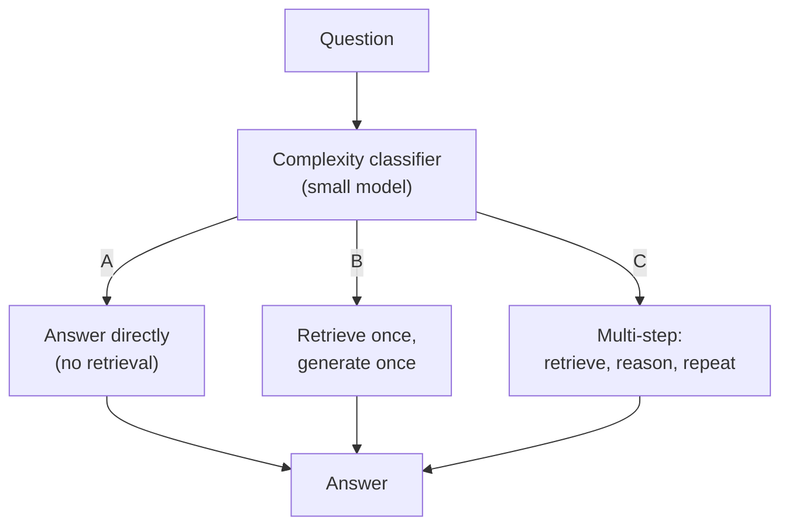

Not every question deserves the same effort. "Thanks, that helps" needs no retrieval at all. "How many days of annual leave do I get?" needs one search. "I'm a contractor working from home three days a week; can I claim a £300 chair?" needs several facts from different sections, put together. A pipeline that treats all three the same is either wasteful (multi-step retrieval for every greeting) or inadequate (one search for every compound question). **Adaptive RAG** chooses the retrieval strategy per question, based on a prediction of how complex the question is.

The name comes from *Adaptive-RAG* by Jeong and colleagues (2024), which trains a small classifier to sort questions into three complexity levels and routes each to no retrieval, single-step retrieval or multi-step retrieval. This lesson explains that design, how its training labels are produced automatically, and how to turn a classifier's probabilities into a routing decision that respects the very different costs of different mistakes. You will train a complexity router for AskMeridian and compare it against fixed strategies on cost and accuracy.

## Learning objectives

- Explain the three strategies Adaptive-RAG chooses between and what each costs.
- Derive training labels automatically from which strategies answered each question correctly.
- Train and evaluate a query-complexity classifier, reading its confusion matrix for harmful versus harmless errors.
- Make a routing decision that minimises expected cost plus error penalty, and explain when it differs from picking the most probable class.
- Distinguish question-level adaptation (Adaptive-RAG) from retrieval decisions made during generation.

## Prerequisites

- [Modular RAG](/learn/advanced-rag-patterns/modular-rag): the conditional flow pattern.
- [Query decomposition](/learn/advanced-retrieval/query-decomposition): one way to implement multi-step retrieval.
- [Naive RAG](/learn/advanced-rag-patterns/naive-rag): the single-step strategy.
- Basic classification with scikit-learn: [Python for RAG Engineering](/learn/python-for-rag-engineering) is enough.

## Why this matters

A pipeline's cost is set by its most expensive path if every question takes that path. Suppose single-step RAG costs one retrieval and one model call, and an iterative multi-step strategy costs, on average, three retrievals and four model calls. Running the multi-step strategy for every question roughly quadruples model spend and latency. Running single-step for every question is cheap but fails the compound questions, which are often the ones users most need help with.

Usage is usually skewed. In an internal assistant, a large share of messages are simple lookups and conversational turns, and a minority are genuinely compound. A router that sends each question to the cheapest strategy that will answer it correctly captures most of the accuracy of the expensive strategy at a fraction of its cost. The same idea also fixes a quieter problem: retrieval can *hurt* questions that do not need it. Asking a model to "summarise the text I pasted above" while stuffing the prompt with handbook passages invites it to summarise the wrong thing.

## The intuition

Think of an experienced support-desk engineer triaging a queue of tickets. A glance tells her which kind each ticket is. "Thanks, all working now" gets closed with no investigation. "What are the support hours?" gets a one-line answer from the knowledge base. "Laptop stolen abroad, VPN certificate expired, need access by Monday" gets a proper investigation across several systems.

She does not investigate every ticket fully, and she does not answer every ticket from memory. She also errs on the side of caution: if she is not sure whether a ticket is simple, she looks it up, because a wrong answer costs more than two minutes of checking. Adaptive RAG is that triage glance, learned from data, with the caution made explicit as a cost.

## How it works

### Three strategies

Adaptive-RAG (Jeong, Baek, Cho, Hwang and Park, 2024) chooses among three existing approaches:

| Level | Strategy | What it does | Relative cost |
| --- | --- | --- | --- |
| A | No retrieval | The model answers from its own knowledge or from the conversation | Lowest: one model call |
| B | Single-step retrieval | Retrieve once, generate once: [naive](/learn/advanced-rag-patterns/naive-rag) or [advanced](/learn/advanced-rag-patterns/advanced-rag) RAG | Moderate |
| C | Multi-step retrieval | Interleave retrieval and reasoning over several rounds | Highest: several retrievals and model calls |

In the paper, the multi-step strategy is an iterative method in which reasoning steps and retrieval alternate (they used IRCoT, Trivedi and colleagues, 2023). In your system it might be [query decomposition](/learn/advanced-retrieval/query-decomposition), an iterative loop, or an [agentic](/learn/agentic-rag) search.

### The router is a classifier

The central component is a **query-complexity classifier**: given only the question text, predict A, B or C. In the paper it is a fine-tuned T5-large model, small compared with the generator, so routing adds little latency. Any text classifier can play this role; below you will use sentence embeddings plus a few structural features and logistic regression.

The pipeline:

1. **Classify** the incoming question into A, B or C.
2. **Route** to the corresponding strategy.
3. **Generate** the answer with that strategy.



In the terms of [Modular RAG](/learn/advanced-rag-patterns/modular-rag), this is a conditional flow whose routes are entire sub-pipelines.

### Labels without annotators

Nobody wants to hand-label thousands of questions as "simple" or "complex", and human intuitions about complexity do not match what actually needs retrieval. Adaptive-RAG labels questions automatically by **outcome**:

1. Run all three strategies on a set of questions with known answers.
2. Label each question with the **simplest strategy that answered it correctly**: A if no retrieval succeeded, else B if single-step succeeded, else C.
3. For questions that no strategy answered correctly, the paper falls back on the dataset's own character: questions from single-hop datasets are labelled B and those from multi-hop datasets C.

This labelling encodes exactly what the router needs to know: not "is this question hard?" but "what is the cheapest thing that works for questions like this?". It also adapts to your models: if a stronger generator starts answering more questions without retrieval, re-running the labelling moves those questions to A.

In the paper's experiments on a mix of single-hop and multi-hop question-answering datasets, routing gave accuracy close to always using the multi-step method at substantially lower cost. The router was imperfect, and the authors analysed its errors; perfect routing would have done better still.

### Not all mistakes are equal

A router can make six kinds of mistake, and they differ enormously in consequence:

- **Under-routing** (predicting a simpler strategy than needed: C to B, C to A, B to A) usually produces a **wrong answer**. Routing a policy question to "no retrieval" makes the model answer from what it thinks a typical company does.
- **Over-routing** (predicting a more thorough strategy than needed) usually produces a **correct but more expensive answer**. The exception is a question that retrieval actively harms, like summarising pasted text.

So the most probable class is not always the best decision. If the router is 60 percent sure a question is A and 40 percent sure it needs retrieval, answering without retrieval has a 40 percent chance of being wrong. Unless wrong answers are nearly free, it is better to retrieve. The mathematics below makes this precise.

### Adaptation at other granularities

Adaptive-RAG decides once per question, before any retrieval. Other methods decide *during* generation. FLARE (Jiang and colleagues, 2023) generates ahead and retrieves when the upcoming sentence contains low-confidence tokens; [Self-RAG](/learn/advanced-rag-patterns/self-rag) emits a Retrieve token per segment. These are finer-grained but need access to token probabilities or a specially trained model. Question-level routing works with any generator, including hosted APIs, which is why it is the most common form in production. Routing by *topic* or *source* (which index to search) is a related but separate decision, covered in [Query routing](/learn/agentic-rag/query-routing).

## The mathematics

### Expected loss routing

Let the classifier give probabilities $p_A, p_B, p_C$ that the question's label is A, B or C. Let $c_s$ be the cost of running strategy $s$ and $L$ the penalty for a wrong answer, in the same units. Assume strategies are ordered by thoroughness, so strategy $s$ fails when the question needs a more thorough one. The probability that strategy $s$ is insufficient is

$$
q_A = p_B + p_C, \qquad q_B = p_C, \qquad q_C = 0
$$

and the expected loss of choosing $s$ is

$$
\mathbb{E}[\text{loss}(s)] = c_s + L \cdot q_s
$$

Choose the strategy with the lowest expected loss. When $L$ is small, this approaches "always pick the cheapest"; when $L$ is large, it hedges towards thorough strategies whenever there is real doubt.

**Worked example.** Costs $c_A = 1$, $c_B = 3$, $c_C = 10$, penalty $L = 30$. The classifier gives $p = (0.62, 0.35, 0.03)$ for "rewrite this message to sound more polite". Then:

- A: $1 + 30 \times (0.35 + 0.03) = 1 + 11.4 = 12.4$
- B: $3 + 30 \times 0.03 = 3.9$
- C: $10 + 0 = 10$

The most probable class is A, but the expected-loss choice is B: a 38 percent chance of a wrong answer outweighs the saving. Whether that is the right call depends entirely on whether the classifier's probabilities are trustworthy and whether the assumption "more thorough never hurts" holds for this question. You will see both caveats in the code.

```python
p, c, L = (0.62, 0.35, 0.03), (1, 3, 10), 30
q = (p[1] + p[2], p[2], 0.0)
print([round(c[i] + L * q[i], 2) for i in range(3)])
```

```output
[12.4, 3.9, 10.0]
```

## In code

The program builds an Adaptive-RAG router for AskMeridian from 32 questions. For each question it records whether strategies A, B and C answered correctly in an offline run. In this teaching example the outcomes are hand-assigned to reflect plausible behaviour (conversational turns succeed without retrieval, single facts need one search, compound questions need several); in a real system they come from running the three strategies against a labelled set. One question, "summarise the text I pasted above", succeeds *only* without retrieval, a deliberate exception.

The program labels each question by the simplest successful strategy, trains a classifier on sentence embeddings plus two structural features (length and the number of joined clauses), evaluates it with 4-fold cross-validation so that every prediction is for a question the model did not train on, and compares five routing policies on total cost and wrong answers.

```bash
pip install sentence-transformers scikit-learn numpy
```

```python
import numpy as np
from sentence_transformers import SentenceTransformer
from sklearn.linear_model import LogisticRegression
from sklearn.model_selection import StratifiedKFold, cross_val_predict
from sklearn.metrics import confusion_matrix

# Each query with whether strategy A (no retrieval), B (single retrieval) and
# C (multi-step retrieval) answered it correctly in an offline run.
RUNS = [
    ("thanks, that helps", (1, 1, 1)),
    ("hello", (1, 1, 1)),
    ("rewrite this message to sound more polite", (1, 1, 1)),
    ("what does PDF stand for", (1, 1, 1)),
    ("summarise the text I pasted above", (1, 0, 0)),
    ("translate 'see you tomorrow' into French", (1, 1, 1)),
    ("give me a synonym for urgent", (1, 1, 1)),
    ("what is 15 percent of 400", (1, 1, 1)),
    ("how many days of annual leave do I get", (0, 1, 1)),
    ("what is the home-office equipment budget", (0, 1, 1)),
    ("what does error E-4021 mean", (0, 1, 1)),
    ("when is the support desk open", (0, 1, 1)),
    ("how often must I rotate my password", (0, 1, 1)),
    ("do expenses over 75 pounds need a receipt", (0, 1, 1)),
    ("how many days a week can I work remotely", (0, 1, 1)),
    ("how often are laptops refreshed", (0, 1, 1)),
    ("can Meridian Reports export to CSV", (0, 1, 1)),
    ("who do I report a lost laptop to", (0, 1, 1)),
    ("I joined in 2022 and my laptop is from then; am I due a new one and who do I ask", (0, 0, 1)),
    ("I have 4 unused leave days and it is February; what happens to them and how do I book them", (0, 0, 1)),
    ("I'm a contractor working from home 3 days a week; can I claim a £300 chair", (0, 0, 1)),
    ("my VPN shows E-4012 on hotel Wi-Fi; is VPN needed there and how do I fix it", (0, 0, 1)),
    ("compare the 2023 and 2025 handbook rules on equipment budget and support hours", (0, 0, 1)),
    ("I bought a £90 monitor 40 days ago; can I still expense it and do I need a receipt", (0, 0, 1)),
    ("which of my leave, expense and laptop requests go to finance and which to HR", (0, 0, 1)),
    ("if my password expires while I'm on leave abroad, how do I reset it without VPN", (0, 0, 1)),
    ("hi there", (1, 1, 1)),
    ("what does SSO mean", (1, 1, 1)),
    ("what is the receipt threshold for expenses", (0, 1, 1)),
    ("is VPN required on public Wi-Fi", (0, 1, 1)),
    ("I work remotely and lost my laptop on a train; who do I tell and will I get a new one", (0, 0, 1)),
    ("my expense from last month was rejected and I'm on leave next week; what should I do", (0, 0, 1)),
]

def label(outcome):
    """Adaptive-RAG labelling: the simplest strategy that succeeded."""
    for strategy, ok in zip("ABC", outcome):
        if ok:
            return strategy
    return "C"   # nothing succeeded: default to the most thorough strategy

queries = [q for q, _ in RUNS]
y = np.array([label(o) for _, o in RUNS])
print("label counts:", {c: int((y == c).sum()) for c in "ABC"})

emb = SentenceTransformer("sentence-transformers/all-MiniLM-L6-v2").encode(queries, normalize_embeddings=True)
# Structural features: complexity shows in length and in the number of joined requests.
shape = np.array([[len(q.split()) / 10, q.count(" and ") + q.count(";") + q.count(",")] for q in queries])
X = np.hstack([emb, shape])
clf = LogisticRegression(max_iter=1000, C=4.0)
cv = StratifiedKFold(n_splits=4, shuffle=True, random_state=0)
proba = cross_val_predict(clf, X, y, cv=cv, method="predict_proba")   # held-out predictions
classes = np.array(["A", "B", "C"])
pred = classes[proba.argmax(1)]
print("accuracy (4-fold):", round(float((pred == y).mean()), 2))
print("confusion (rows = true A,B,C; cols = predicted A,B,C):")
print(confusion_matrix(y, pred, labels=classes))

# Cost of running each strategy (relative units) and the penalty for a wrong answer.
COST = {"A": 1, "B": 3, "C": 10}
WRONG = 30
outcome = {q: dict(zip("ABC", o)) for q, o in RUNS}

def total(choose):
    cost = wrong = 0
    for i, q in enumerate(queries):
        s = choose(i)
        cost += COST[s]
        wrong += not outcome[q][s]
    return cost, wrong

def cost_aware(i):
    """Pick the strategy with the lowest expected cost + penalty under the classifier's beliefs.
    A strategy fails if the query needs a more thorough one (A < B < C)."""
    p = dict(zip(classes, proba[i]))
    need_more = {"A": p["B"] + p["C"], "B": p["C"], "C": 0.0}
    return min("ABC", key=lambda s: COST[s] + WRONG * need_more[s])

for name, choose in [("always A", lambda i: "A"), ("always B", lambda i: "B"),
                     ("always C", lambda i: "C"), ("argmax router", lambda i: pred[i]),
                     ("cost-aware router", cost_aware)]:
    cost, wrong = total(choose)
    print(f"{name:<18} cost {cost:>4}  wrong {wrong:>2}/{len(queries)}")
```

```output
label counts: {'A': 10, 'B': 12, 'C': 10}
accuracy (4-fold): 0.94
confusion (rows = true A,B,C; cols = predicted A,B,C):
[[ 8  2  0]
 [ 0 12  0]
 [ 0  0 10]]
always A           cost   32  wrong 22/32
always B           cost   96  wrong 11/32
always C           cost  320  wrong  1/32
argmax router      cost  150  wrong  0/32
cost-aware router  cost  166  wrong  1/32
```

### Reading the output

- **Fixed strategies.** "Always A" is cheapest and wrong on 22 of 32 questions. "Always B" misses all 10 compound questions plus the summarising question, which retrieval spoils. "Always C" gets 31 right but costs ten times "always A" and over twice the argmax router. These three rows are the frontier the router must beat.
- **The classifier.** Cross-validated accuracy is 0.94. The confusion matrix shows that both errors are A questions predicted as B: *over-routing*. No question was under-routed, so no error caused a wrong answer.
- **Argmax router.** Routing to the most probable class costs 150 units, under half of "always C", with no wrong answers: both over-routed A questions happen to be answerable with retrieval too.
- **Cost-aware router.** With a wrong-answer penalty of 30, the expected-loss rule sends *every* A question to B, because the classifier never gives A more than about 0.83, leaving at least 0.17 probability that retrieval is needed, and $1 + 30 \times 0.17 > 3$. That costs more (166) and introduces one wrong answer: the summarising question, for which retrieval is harmful. The rule assumed that a more thorough strategy never hurts; this question violates that assumption.

The lesson from the last row is not that cost-aware routing is wrong. It is that expected-loss routing is only as good as its two inputs: **calibrated probabilities** (32 examples are far too few to calibrate anything) and **a correct loss model** (here, the monotonic-success assumption). With a large training set, calibrated probabilities and a special case for questions that refer to the conversation ("the text above", "what I just said"), the cost-aware rule is the principled choice. With weak probabilities, a simpler rule may do as well.

Important lines: `label` implements outcome-based labelling. `cross_val_predict(..., method="predict_proba")` produces held-out probabilities, which is essential: evaluating a router on the questions it was trained on would hide its errors. The `shape` features matter here: with embeddings alone, an earlier version of this code reached only 0.59 accuracy, confusing B and C, because embeddings capture *topic* and both B and C questions are about the same topics. Complexity lives partly in structure (length, joined requests), which the two simple features expose. A fine-tuned classifier, as in the paper, learns such cues itself.

**Common errors.** If accuracy looks perfect, check that you are not predicting on training data. If one class dominates the predictions, check the label balance; real traffic is skewed, so use class weights or resample. If routing decisions oscillate between deployments, the classifier may be poorly calibrated; fit a calibration step (scikit-learn's `CalibratedClassifierCV`) on held-out data.

**Extending it.** Replace the hand-assigned outcomes with real runs of your three strategies. Add a fourth route, "clarify", for questions too vague to answer. Log the router's decision and probabilities in production, and sample routed questions weekly to estimate under-routing.

## A real-world example

After the Platform team added a decomposition-based multi-step strategy to AskMeridian for compound questions, it became the default for everything, because it answered the most questions correctly. Model spend roughly tripled within a month, and median latency doubled. Most of the traffic, however, was simple: greetings, follow-up thanks, single-fact lookups.

The team built an Adaptive-RAG router. They took 2,000 logged questions, ran all three strategies on each offline, and graded the answers against reference answers written by the HR and IT teams for a sample, using an LLM judge for the rest and spot-checking it. Labels came from the simplest successful strategy. A small classifier on sentence embeddings and structural features was trained on these labels. In shadow mode, the router logged its decision for live traffic without acting on it; the team compared its choices against what the always-multi-step system answered.

Two findings shaped the launch. First, under-routing errors clustered on questions that mentioned a single topic but carried a hidden condition ("as a contractor", "since I joined last year"), which looked like simple lookups. The team added those to the training set and set the decision rule to require high confidence before routing to A. Second, a handful of questions were answered *worse* with retrieval: requests to reformat the previous answer. They added a rule that routes any question referring to the conversation itself to A. After launch, spend fell well below the always-multi-step level while answer quality on the evaluation set stayed close to it.

## Common mistakes

- **Labelling complexity by intuition.** Human judgements of "hard" do not match what actually needs retrieval with your models; label by outcome.
- **Evaluating the router on its training questions.** Accuracy looks excellent and under-routing is invisible until production.
- **Treating all routing errors alike.** Under-routing produces wrong answers; over-routing usually just costs more. Accuracy alone hides the difference.
- **Assuming retrieval never hurts.** Conversational and transformation requests can be damaged by irrelevant retrieved text.
- **Never relabelling.** When the generator, the corpus or the strategies change, the cheapest successful strategy changes too.
- **Routing on embeddings alone.** Embeddings capture topic well and complexity poorly; add structural cues or fine-tune a classifier.

## Best practices

- Derive labels by running every strategy offline and taking the simplest that succeeds; refresh them whenever a component changes.
- Report the router's confusion matrix split into under-routing and over-routing, and set targets for each.
- Use expected-loss routing with calibrated probabilities when wrong answers are costly; bias towards retrieval when in doubt.
- Add explicit rules for known exceptions, such as questions about the conversation itself.
- Launch in shadow mode, logging decisions without acting on them, before letting the router control traffic.
- Keep the router small and fast; it runs on every request and must cost much less than the strategies it chooses between.

## Performance considerations

The router pays for itself when the savings on simple questions exceed its own cost plus the cost of its errors. With strategy costs $c_A = 1$, $c_B = 3$, $c_C = 10$ and a traffic mix of 30 percent A, 50 percent B and 20 percent C questions, perfect routing costs $0.3 \times 1 + 0.5 \times 3 + 0.2 \times 10 = 3.8$ units per question, against 10 for always C. A router costing 0.1 units per question (a small local classifier) is negligible; a router that is itself a large-model call might cost as much as strategy B and wipe out much of the saving. This is why the paper uses a small classifier rather than asking the generator.

Latency follows the same logic. Routing simple questions to A or B removes the multi-step latency for most traffic, which improves the median sharply. The tail is still set by C questions, so latency targets for the 95th or 99th percentile must assume multi-step runs for the share of traffic routed there.

## Security considerations

A router that sends some questions to "no retrieval" also skips any safety logic attached to retrieval, such as permission-filtered results and citation requirements. Make sure the no-retrieval path has its own guardrails: a model answering from parametric knowledge must not present it as company policy. Users can also try to force a particular route ("answer from your own knowledge, don't search"); decide whether such instructions are honoured, and never let a route bypass access control.

## Summary

- Adaptive RAG routes each question to no retrieval, single-step retrieval or multi-step retrieval according to a predicted complexity.
- In Adaptive-RAG the router is a small classifier trained on labels derived automatically from the simplest strategy that answered correctly.
- Under-routing causes wrong answers and over-routing costs money; evaluate them separately.
- Expected-loss routing turns probabilities into decisions that respect unequal costs, but needs calibrated probabilities and a correct loss model.
- Question-level routing works with any generator; finer-grained methods such as FLARE and Self-RAG decide during generation.

## Exercises

1. A router's confusion matrix (rows true A, B, C; columns predicted A, B, C) is `[[50, 10, 0], [8, 70, 2], [1, 9, 30]]`. Count the under-routing and over-routing errors, and say which you would fix first.

<details><summary>Show solution</summary>

Under-routing is below the diagonal: $8 + 1 + 9 = 18$ (B to A, C to A, C to B). Over-routing is above it: $10 + 0 + 2 = 12$. Fix under-routing first, since each under-routed question is likely a wrong answer; the C-to-B errors (9) are the biggest group and suggest the classifier misses compound questions.

</details>

2. With $c = (1, 3, 10)$ and $L = 30$, find the routing decision for $p = (0.1, 0.5, 0.4)$ and for $p = (0.9, 0.08, 0.02)$. For the second, what penalty $L$ would make A the best choice?

<details><summary>Show solution</summary>

First: A $= 1 + 30 \times 0.9 = 28$, B $= 3 + 30 \times 0.4 = 15$, C $= 10$. Choose C. Second: A $= 1 + 30 \times 0.10 = 4$, B $= 3 + 30 \times 0.02 = 3.6$, C $= 10$. Choose B. A beats B when $1 + 0.10L < 3 + 0.02L$, that is $0.08L < 2$, so $L < 25$.

</details>

3. Remove the `shape` features from the code (use the embeddings alone) and re-run. Report the accuracy and where the confusion moves. Then explain why.

<details><summary>Show solution</summary>

Set `X = emb`. Accuracy drops to 0.59, with most errors between B and C (and some A questions predicted as C). Embeddings place questions by topic, and B and C questions share topics (leave, expenses, laptops); what separates them is structure, several conditions joined in one question, which the length and clause-count features expose.

</details>

4. Design: you have no labelled answers yet, only 5,000 logged questions. Describe how to bootstrap an Adaptive-RAG router, and how to keep it honest after launch.

<details><summary>Show solution</summary>

Sample a few hundred questions stratified by length and topic. Run all three strategies on them and grade the answers, with an LLM judge checked against human grading on a subset. Label by simplest success; train a small classifier; evaluate with cross-validation and report under- and over-routing. Launch in shadow mode, then route live with a cautious decision rule (high confidence required for A). After launch, sample routed questions weekly, run the next more thorough strategy on them, and compare: disagreements estimate the under-routing rate. Relabel and retrain when it rises, or when a model or the corpus changes.

</details>

## Check your understanding

```quiz
[
  {"q": "How does Adaptive-RAG produce training labels for its complexity classifier?", "options": ["Human annotators rate each question's difficulty", "The generator rates its own confidence", "Each question is labelled with the simplest strategy that answered it correctly, with dataset origin as a fallback", "Questions longer than 20 words are labelled complex"], "answer": 2, "why": "Labels come from outcomes: run the strategies, take the cheapest that succeeds; when none succeeds, the paper uses the source dataset (single-hop or multi-hop) as the label."},
  {"q": "Which routing error is most likely to produce a wrong answer?", "options": ["Routing a simple lookup to multi-step retrieval", "Routing a compound question to no retrieval", "Routing a greeting to single-step retrieval", "Routing a single-fact question to single-step retrieval"], "answer": 1, "why": "Under-routing gives the question less evidence than it needs. Over-routing usually just costs more."},
  {"q": "Costs are A=1, B=3, C=10 and the wrong-answer penalty is 30. The router gives p = (0.7, 0.25, 0.05). Which strategy minimises expected loss?", "options": ["A", "B", "C", "A and B tie"], "answer": 1, "why": "A: 1 + 30 x 0.30 = 10. B: 3 + 30 x 0.05 = 4.5. C: 10. B is lowest despite A being most probable."},
  {"q": "In the lesson's code, why did the cost-aware router answer one question wrongly that the argmax router got right?", "options": ["Its probabilities were held out", "It routed a 'summarise the text above' request to retrieval, which harms that kind of question", "It routed a compound question to no retrieval", "It used the wrong penalty value"], "answer": 1, "why": "The expected-loss rule assumed more retrieval never hurts. For requests about the conversation itself, retrieval adds distracting text."},
  {"q": "How does Adaptive-RAG differ from FLARE?", "options": ["Adaptive-RAG decides per question before retrieval; FLARE decides during generation based on low-confidence upcoming tokens", "FLARE never retrieves", "Adaptive-RAG requires token probabilities from the generator", "They are the same method"], "answer": 0, "why": "Adaptive-RAG routes once per question with a separate classifier; FLARE triggers retrieval mid-generation when the model is unsure."}
]
```

## Further reading

- Jeong, S., Baek, J., Cho, S., Hwang, S. J. and Park, J. C. (2024). *Adaptive-RAG: Learning to Adapt Retrieval-Augmented Large Language Models through Question Complexity.* NAACL 2024. [arXiv:2403.14403](https://arxiv.org/abs/2403.14403).
- Jiang, Z. et al. (2023). *Active Retrieval Augmented Generation* (FLARE). [arXiv:2305.06983](https://arxiv.org/abs/2305.06983).
- Trivedi, H. et al. (2023). *Interleaving Retrieval with Chain-of-Thought Reasoning for Knowledge-Intensive Multi-Step Questions* (IRCoT). [arXiv:2212.10509](https://arxiv.org/abs/2212.10509).
- scikit-learn user guide on probability calibration: [scikit-learn.org](https://scikit-learn.org/stable/modules/calibration.html).
