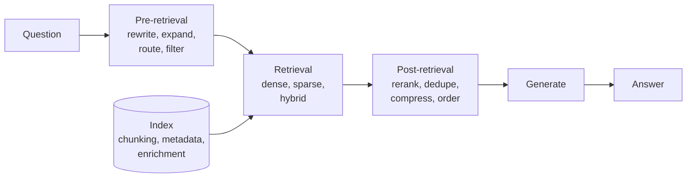

[Naive RAG](/learn/advanced-rag-patterns/naive-rag) runs one fixed pipeline: embed the question as typed, take the top $k$, generate. **Advanced RAG** keeps that linear shape but adds processing on either side of the retrieval step: work *before* retrieval to give the search a better query and a better index, and work *after* retrieval to put better context in front of the model. Nearly every production RAG system you will meet is advanced RAG in this sense.

The individual techniques (query rewriting, hybrid search, reranking, compression) each have their own lessons earlier in the curriculum. This lesson is about the *pattern*: the map of where improvements can be inserted, how to choose which one a failure needs, and how to prove that an addition helps. You will build a four-step improvement ladder over the Meridian handbook and see, with real numbers, that one popular addition did not help on this data at all.

## Learning objectives

- Describe advanced RAG as naive RAG plus pre-retrieval and post-retrieval stages, and place a given technique in the right stage.
- Match each naive-RAG failure point to the families of technique that address it.
- Run an ablation that measures each added stage separately, and decide from the results which stages to keep.
- Explain why the order of stages matters, for example why a reranker cannot recover from a query that retrieval never matched.
- Estimate the latency and cost that each added stage contributes.

## Prerequisites

- [Naive RAG](/learn/advanced-rag-patterns/naive-rag): the baseline and its failure points.
- [Reciprocal Rank Fusion](/learn/hybrid-search/reciprocal-rank-fusion): merging ranked lists.
- [Cross-encoders](/learn/reranking-fundamentals/cross-encoders): the reranking model used below.
- [Recall@K](/learn/retrieval-fundamentals/recall-k): the retrieval metric used below.

## Why this matters

Once a naive pipeline is running, there is no shortage of ideas for improving it. Blog posts, framework release notes and colleagues all suggest things: add HyDE, add a reranker, try hybrid search, compress the context, use parent-child chunks. Each idea works somewhere. The trap is to add them all. A pipeline with six enhancements costs more per query, is slower, and has six places to break, and if nobody measured each addition separately, some of them are probably making things worse.

Advanced RAG is the discipline that avoids this trap. It gives you a *map* (every enhancement belongs to one of a few stages), a *diagnosis* (the failure points from the previous lesson say which stage is losing answers) and a *method* (add one stage, measure, keep it only if it pays). The result is a pipeline in which every component can justify its existence, which is also the pipeline that is easiest to maintain.

## The intuition

Think of a reference librarian at Meridian's company library. The naive version of her job is: hear the question, walk to the shelf whose label best matches the words, take the first three books, read the answer from them.

An experienced librarian does three extra things, and they line up with the three stages of advanced RAG.

**Before** she walks to the shelves, she clarifies the question. "Holiday? You mean annual leave. That's in the HR section." She also keeps the shelves in good order: books split into sensible sections, each labelled with its subject and year. That is *pre-retrieval*: improving the query and the index.

**While** searching, she checks both the subject catalogue and the keyword index, because some questions ("what does E-4021 mean?") are best found by exact code. That is *improved retrieval*.

**After** she has an armful of books, she skims each and puts the most relevant first, removes duplicates and marks the relevant paragraph. That is *post-retrieval*: reranking, filtering and compression.

She does not do all of this for every question. She does what the question needs. That is the point of measuring.

## How it works

### The three insertion points

The survey by Gao and colleagues (2023) defines advanced RAG as naive RAG enhanced with **pre-retrieval** and **post-retrieval** strategies. It is helpful to add a third heading for changes to the retrieval step itself:



Each heading contains a family of techniques, most with a lesson of their own:

| Stage | Technique | Fixes mainly | Lesson |
| --- | --- | --- | --- |
| Pre-retrieval (index) | Structure-aware chunking | Split facts, diluted chunks | [Structure-aware chunking](/learn/advanced-chunking-strategies/structure-aware-chunking) |
| Pre-retrieval (index) | Small-to-big / parent-child | Precise matching but thin context | [Small-to-big retrieval](/learn/chunking-optimisation/small-to-big-retrieval) |
| Pre-retrieval (index) | Contextual chunk headers | Chunks that lose their document's meaning | [Contextual retrieval](/learn/advanced-retrieval/contextual-retrieval) |
| Pre-retrieval (index) | Metadata and filters | Outdated or wrong-scope chunks | [Filtered retrieval](/learn/advanced-retrieval/filtered-retrieval) |
| Pre-retrieval (query) | Rewriting and expansion | Vocabulary mismatch | [Query rewriting](/learn/advanced-retrieval/query-rewriting) |
| Pre-retrieval (query) | Decomposition | Multi-part questions | [Query decomposition](/learn/advanced-retrieval/query-decomposition) |
| Pre-retrieval (query) | HyDE | Question-answer asymmetry | [HyDE](/learn/advanced-retrieval/hyde) |
| Retrieval | Hybrid dense + sparse | Exact codes, names, rare terms | [Hybrid retrieval architecture](/learn/hybrid-search/hybrid-retrieval-architecture) |
| Post-retrieval | Reranking | Right chunk ranked too low | [Two-stage retrieval](/learn/advanced-retrieval-optimisation/two-stage-retrieval) |
| Post-retrieval | Deduplication, MMR | Redundant context | [Duplicate removal](/learn/advanced-retrieval-optimisation/duplicate-removal) |
| Post-retrieval | Compression, selection | Noise around the answer | [Context compression](/learn/context-engineering/context-compression) |
| Post-retrieval | Ordering | Answer buried mid-context | [Lost-in-the-middle problem](/learn/context-engineering/lost-in-the-middle-problem) |

What all of these have in common, and what separates advanced RAG from the patterns later in this module, is that the flow is still **linear and fixed**. Every question goes through every stage, once, in the same order. Nothing branches on what retrieval found, nothing loops back. [Modular RAG](/learn/advanced-rag-patterns/modular-rag) relaxes the fixed flow; [Corrective RAG](/learn/advanced-rag-patterns/corrective-rag) and [Adaptive RAG](/learn/advanced-rag-patterns/adaptive-rag) add decisions.

### From failure point to stage

The previous lesson located failures by stage. The table above says which techniques act on which failure. Put together, they give a decision procedure:

1. **Run the stage diagnostic** from [Naive RAG](/learn/advanced-rag-patterns/naive-rag) over a labelled test set and count failures by stage.
2. **Take the largest bucket.** If it is *missed top-ranked*, look at the failed queries and classify them further: different vocabulary (rewriting, hybrid), exact identifiers (hybrid), split or diluted chunks (chunking), multi-part questions (decomposition).
3. **If it is *not in context***, the chunk was retrieved but ranked too low or crowded out: reranking, deduplication or compression.
4. **If it is *not extracted***, the context is noisy or conflicting: compression, ordering, metadata filters for outdated material, or a better generation prompt.
5. **If it is *missing content***, no retrieval technique will help. Add the content, or add a refusal path; deciding *whether* to answer is the territory of [Corrective RAG](/learn/advanced-rag-patterns/corrective-rag).
6. **Add one technique, re-run, compare.** Keep it only if it moves the target bucket without creating failures elsewhere.

### Why order matters

Stages interact, and their order is not arbitrary. A reranker only reorders the candidates it receives; if the first stage never retrieved the right chunk, reranking cannot conjure it up. So recall problems must be fixed *upstream* of the reranker, and the reranker exists to fix precision among candidates that are already there. Similarly, compression after reranking acts on the best chunks; compression before it would spend effort on chunks about to be discarded.

There is a subtler interaction too: a stage can be tuned for the input of the stage before it. A reranker scoring the *original* question may undo the benefit of a rewrite, because it judges relevance to the words the user typed. In the code below, the reranker scores the rewritten query for exactly this reason.

### Measure each addition

The tool for this is an **ablation**: run the same evaluation set through a series of pipelines, each adding one stage, and record a retrieval metric for each. The metrics used below are recall@1 (the fraction of questions whose gold chunk is ranked first) and **mean reciprocal rank** (MRR: the average of $1/\text{rank}$ of the gold chunk, so first place scores 1, second 0.5, third 0.33). Both are covered in depth in the [Retrieval Evaluation](/learn/retrieval-evaluation) module; here they are simply the yardstick.

> [!KEY]
> Advanced RAG is not a fixed recipe. It is naive RAG plus whichever pre- and post-retrieval stages your measurements justify, in an order where each stage works on the output it is designed for.

## In code

The program evaluates five pipelines over 13 questions written in staff vocabulary ("WFH", "PTO", "helpdesk", "stolen") against a 20-chunk Meridian corpus that includes distractors (desk booking, password length, taxi fares). Each pipeline adds one stage to the previous, plus a control that adds reranking to the naive pipeline without rewriting.

The query rewriter is a stand-in: a small dictionary that appends handbook vocabulary to staff vocabulary. In production a language model does this ([Query rewriting](/learn/advanced-retrieval/query-rewriting) shows how), but a dictionary keeps the example deterministic and shows the same effect. Embeddings come from `all-MiniLM-L6-v2` and the reranker is the `ms-marco-MiniLM-L-6-v2` cross-encoder, both run locally.

```bash
pip install sentence-transformers rank-bm25 numpy
```

```python
import re
import numpy as np
from rank_bm25 import BM25Okapi
from sentence_transformers import SentenceTransformer, CrossEncoder

CHUNKS = [
    "Annual leave is 25 days per year.",                                    # 0
    "Up to 5 unused leave days carry over and must be used by 31 March.",   # 1
    "Staff may work remotely up to 3 days a week.",                         # 2
    "The home-office equipment budget is £400; contractors are not eligible.",  # 3
    "Expenses must be submitted within 30 days of purchase.",               # 4
    "Any expense over £75 needs a receipt.",                                # 5
    "Passwords must be rotated every 90 days.",                             # 6
    "VPN is required on public Wi-Fi.",                                     # 7
    "Error E-4021 means the VPN client is out of date; update it from the IT portal.",  # 8
    "Error E-4012 means the VPN certificate has expired.",                  # 9
    "The laptop refresh cycle is 3 years.",                                 # 10
    "Support desk hours are 08:00 to 18:00 UK time.",                       # 11
    "Lost laptops must be reported to the support desk at once.",           # 12
    "Meridian Reports exports to PDF and CSV.",                             # 13
    "Leave requests are approved by your line manager in the HR portal.",   # 14
    "Office desks are booked through the facilities app.",                  # 15
    "Taxi fares to client sites are a valid business expense.",             # 16
    "Laptops are encrypted and managed by IT.",                             # 17
    "Remote access to internal tools requires single sign-on.",            # 18
    "Passwords must be at least 14 characters long.",                       # 19
]

# (question, id of the chunk that answers it)
EVAL = [
    ("how much holiday do I get", 0),
    ("can I roll over unused PTO", 1),
    ("how many WFH days are allowed", 2),
    ("money for a desk and chair at home", 3),
    ("deadline for claiming a taxi fare", 4),
    ("do I need proof of purchase for a £90 dinner", 5),
    ("how often do I change my password", 6),
    ("is VPN mandatory in a coffee shop", 7),
    ("what is E-4021", 8),
    ("what is E-4012", 9),
    ("when will I get a new laptop", 10),
    ("what time does the helpdesk close", 11),
    ("my laptop was stolen, what now", 12),
]

def tok(text):
    return re.findall(r"[a-z0-9£\-]+", text.lower())

# Stand-in for an LLM query rewriter: expand staff vocabulary into handbook vocabulary.
REWRITES = {"holiday": "annual leave", "pto": "leave", "wfh": "work remotely",
            "roll": "carry", "helpdesk": "support desk", "proof of purchase": "receipt",
            "stolen": "lost", "claiming": "expenses submitted", "new laptop": "laptop refresh"}

def rewrite(q):
    out = q.lower()
    for k, v in REWRITES.items():
        out = re.sub(rf"\b{k}\b", f"{k} {v}", out)
    return out

embedder = SentenceTransformer("sentence-transformers/all-MiniLM-L6-v2")
reranker = CrossEncoder("cross-encoder/ms-marco-MiniLM-L-6-v2")
chunk_vecs = embedder.encode(CHUNKS, normalize_embeddings=True)
bm25 = BM25Okapi([tok(c) for c in CHUNKS])

def dense(q, n=10):
    s = chunk_vecs @ embedder.encode([q], normalize_embeddings=True)[0]
    return list(np.argsort(-s)[:n])

def sparse(q, n=10):
    s = bm25.get_scores(tok(q))
    return [i for i in np.argsort(-s, kind="stable")[:n] if s[i] > 0]  # drop non-matches

def rrf(lists, k=60):
    scores = {}
    for lst in lists:
        for rank, doc in enumerate(lst, start=1):
            scores[doc] = scores.get(doc, 0.0) + 1.0 / (k + rank)
    return sorted(scores, key=lambda d: -scores[d])

def rerank(q, candidates, n=10):
    scores = reranker.predict([(q, CHUNKS[i]) for i in candidates[:n]])
    return [candidates[i] for i in np.argsort(-scores)]

PIPELINES = {
    "naive (dense)":            lambda q: dense(q),
    "+ rewrite":                lambda q: dense(rewrite(q)),
    "+ rewrite + hybrid":       lambda q: rrf([dense(rewrite(q)), sparse(rewrite(q))]),
    "+ rewrite + rerank":       lambda q: rerank(rewrite(q), dense(rewrite(q))),
    "+ rewrite + hybrid + rerank": lambda q: rerank(rewrite(q), rrf([dense(rewrite(q)), sparse(rewrite(q))])),
    "naive + rerank":           lambda q: rerank(q, dense(q)),
}

K = 1
print(f"{'pipeline':<30}{'recall@' + str(K):>9}{'MRR':>7}  misses")
for name, run in PIPELINES.items():
    hits, rr, misses = 0, 0.0, []
    for q, gold in EVAL:
        ranking = [int(i) for i in run(q)]
        pos = ranking.index(gold) + 1 if gold in ranking else None
        hits += pos is not None and pos <= K
        rr += 1 / pos if pos else 0.0
        if not pos or pos > K:
            misses.append(gold)
    print(f"{name:<30}{hits / len(EVAL):>9.2f}{rr / len(EVAL):>7.2f}  {misses}")
```

```output
pipeline                       recall@1    MRR  misses
naive (dense)                      0.85   0.91  [2, 4]
+ rewrite                          0.92   0.96  [4]
+ rewrite + hybrid                 0.85   0.90  [3, 4]
+ rewrite + rerank                 1.00   1.00  []
+ rewrite + hybrid + rerank        1.00   1.00  []
naive + rerank                     0.85   0.90  [2, 4]
```

### Reading the results

The `misses` column lists the gold chunk IDs of questions that did not rank their answer first.

- **Naive** misses chunk 2 ("how many WFH days", where the model does not connect *WFH* to *work remotely*) and chunk 4 ("deadline for claiming a taxi fare", where the taxi-fare distractor, chunk 16, outranks the 30-day rule).
- **Rewriting** fixes the WFH question: once "work remotely" is in the query, dense retrieval finds it. This is a *pre-retrieval* fix for a vocabulary-mismatch failure, which is exactly what the diagnosis predicted.
- **Hybrid search did not help here; it hurt.** BM25 ranked "Lost laptops must be reported to the support desk at once" first for the desk question, because it shares the words "desk" and "at"; RRF gave that list equal weight and pushed the right chunk down. On this tiny corpus, the only exact identifiers (the E-codes) were already handled by dense retrieval. On a larger corpus with part numbers and ticket IDs, the verdict could reverse; the point is that you find out by measuring, not by assumption.
- **Reranking after rewriting** fixes the taxi question: the cross-encoder reads the question and chunk together and sees that "deadline for claiming" is about the submission window, not about whether taxis are allowed. This is a *post-retrieval* precision fix.
- **Reranking without rewriting** fixes nothing. The cross-encoder is given the WFH question and cannot recover the vocabulary mismatch either. This is the ordering principle in action: rewriting and reranking solve different problems, and here the second needs the first.

The conclusion for this corpus: keep rewriting and reranking, drop hybrid. Thirteen questions is far too few to make that decision for real; a production ablation needs a few hundred labelled questions and a check that differences are larger than the noise between runs. But the shape of the decision is the same.

Two details in the code reflect real bugs found while writing it. The first version of `rewrite` used plain string replacement, which turned "laptop" into "lapto leavep" because "pto" occurs inside it; word-boundary matching (`\b`) fixed that. And the first version of `sparse` returned the top 10 BM25 results even when all scores were zero, so for "how often do I change my password" (no exact term overlap: "password" against "passwords") it returned arbitrary chunks that RRF then promoted. Dropping zero-score results fixed it. Both bugs are invisible without an ablation table.

**Extending it.** Replace `rewrite` with a language-model rewriter, add a structure-aware chunker, or swap in `BAAI/bge-reranker-base`, and add a row for each. Add a column for mean latency per pipeline by timing `run(q)`, so that each row shows what it costs as well as what it buys.

## A real-world example

Meridian's Platform team had followed the diagnosis from the [Naive RAG](/learn/advanced-rag-patterns/naive-rag) lesson: most AskMeridian failures were retrieval misses caused by staff vocabulary and by error codes. A senior engineer proposed a full advanced pipeline in one release: an LLM query rewriter, HyDE, hybrid BM25 plus dense search, a cross-encoder reranker, and LLM-based context compression.

The tech lead asked for it to be built as five separately switchable stages and evaluated as an ablation on the team's 300-question test set. The results were mixed in an instructive way. The rewriter helped vocabulary-mismatch questions. Hybrid search was what fixed error-code questions such as "E-4021 again": the embedding model ranked E-4012 just as close as E-4021, and BM25 did not. The reranker improved the position of the gold chunk across the board. HyDE, applied on top of the rewriter, made no measurable difference on this test set while adding a second model call before retrieval, so it was dropped. Compression reduced prompt size but occasionally removed the clause that made an answer correct ("contractors are not eligible"), so it was left out until it could be evaluated on answer quality rather than prompt size.

The shipped pipeline had three added stages instead of five. It was faster and cheaper than the proposal, and each stage had a measured reason to exist, recorded beside the ablation results in the design document.

## Common mistakes

- **Adding several enhancements at once.** You cannot tell which one helped, and one may be quietly hurting.
- **Putting a reranker in front of a recall problem.** A reranker only reorders the candidates it is given; if the right chunk is not in them, nothing changes and latency rises.
- **Reranking with the original query after a rewrite.** The reranker judges relevance to the words the user typed and can undo what the rewrite achieved.
- **Fusing a sparse list that contains zero-score results.** Rank-based fusion treats "matched nothing" as a ranking and promotes arbitrary chunks.
- **Substring-based query expansion.** Replacing "pto" inside "laptop" corrupts queries in ways nobody notices without inspecting rewritten queries.
- **Evaluating compression on token savings alone.** Removing the one qualifying clause changes the answer; compression must be judged on answer correctness.

## Best practices

- Implement each added stage behind a switch, so that the pipeline can be evaluated with any subset of stages.
- Keep an ablation table in the repository: one row per stage combination, with retrieval metrics, answer metrics, latency and cost.
- Diagnose the dominant failure stage before choosing a technique, and choose a technique that acts on that stage.
- Feed each stage the input it was designed for: rewritten queries to the retriever and the reranker, reranked chunks to the compressor.
- Log intermediate artefacts (the rewritten query, candidate lists before and after reranking) for every request.
- Re-run the ablation when the corpus changes substantially; a stage that did not pay on one corpus may pay on another.

## Performance considerations

Every stage adds latency and cost, and in a linear pipeline latencies add. Rough orders of magnitude, which you should replace with your own measurements:

- An **LLM query rewrite** is a full model round trip, typically hundreds of milliseconds to over a second, and its tokens are billed. It sits before retrieval, so it is entirely on the critical path.
- **BM25 alongside dense search** is cheap if the two run in parallel: the added latency is roughly the slower of the two, not the sum.
- A **cross-encoder reranker** scores every candidate. Its cost scales linearly with the number of candidates $n$: reranking 50 candidates costs about five times as much as reranking 10. On a CPU, a small cross-encoder is typically tens of milliseconds for a few dozen short pairs; a large one, or long chunks, much more.
- **LLM-based compression** is another model call per request, or per chunk if done chunk by chunk.

A useful exercise is to write the per-query cost of each stage as a sum. For example, if a rewrite costs 150 input and 40 output tokens, generation costs 2,500 input and 300 output tokens, and you assume prices of 3 dollars per million input tokens and 15 dollars per million output tokens (an assumption; check current pricing), then the rewrite adds $(150 \times 3 + 40 \times 15)/10^6$, about 0.001 dollars per query, against $(2{,}500 \times 3 + 300 \times 15)/10^6$, or 0.012 dollars, for generation: under a tenth of the cost, but a full extra round trip of latency. Whether that is worth it depends on the accuracy gain the ablation measured.

## Security considerations

Each added model-driven stage is another place where untrusted text can steer the system. A query rewriter receives user input and can be prompted to produce queries that reach unintended content, so it must never be able to remove access-control filters: apply permission filters inside the retrieval call, not through the rewritten query. Compression and reranking operate on retrieved documents, which may contain injected instructions; an LLM compressor that obeys "ignore previous instructions" in a document can drop the real answer. Prefer non-generative rerankers (cross-encoders) where possible, and see [Indirect prompt injection](/learn/rag-security-fundamentals/indirect-prompt-injection).

## Summary

- Advanced RAG is naive RAG with added pre-retrieval (query and index), retrieval, and post-retrieval stages, in a flow that is still linear and the same for every question.
- Each technique acts on particular failure points; the stage diagnostic tells you which family to reach for.
- Order matters: fix recall upstream, precision downstream, and feed each stage the input it was designed for.
- An ablation, adding one stage at a time on a fixed test set, is how you decide which stages to keep; popular techniques can fail to help on your data.
- Every stage adds latency and cost that must be weighed against its measured gain.

## Exercises

1. Place each technique in its stage (pre-retrieval index, pre-retrieval query, retrieval, post-retrieval) and name the failure point it mainly addresses: (a) adding the document title to every chunk before embedding; (b) MMR; (c) step-back prompting; (d) filtering out chunks from superseded handbooks.

<details><summary>Show solution</summary>

(a) Pre-retrieval, index: contextual enrichment, addressing *missed top-ranked* for chunks that lose their meaning out of context. (b) Post-retrieval: diversity-aware selection, addressing *not in context* when near-duplicates crowd out other relevant chunks. (c) Pre-retrieval, query: addressing *missed top-ranked* for questions too specific to match general background passages. (d) Pre-retrieval, index (metadata filter applied at retrieval time): addressing *not extracted* caused by conflicting, outdated context.

</details>

2. In the ablation output, "naive + rerank" scores exactly the same as "naive". Explain why, using the misses column, and say what this tells you about where reranking belongs.

<details><summary>Show solution</summary>

Both miss chunks 2 and 4. Chunk 2's question ("WFH") is a vocabulary mismatch: the cross-encoder reads "WFH" against "work remotely" and does not connect them, so reranking the original query cannot fix it. The taxi question (chunk 4) is fixed only when the reranker scores the rewritten query, which includes "expenses submitted". Reranking improves precision among candidates, using the query it is given; it does not repair the query. It belongs after any query transformation and should score the transformed query.

</details>

3. Add a latency column to the ablation table. Time each pipeline's `run(q)` over the evaluation set with `time.perf_counter()` and report the mean in milliseconds. Which stage dominates, and how would the picture change if `rewrite` were a language-model call?

<details><summary>Show solution</summary>

Wrap the loop: `t0 = time.perf_counter()` before `run(q)` and accumulate `time.perf_counter() - t0`, then print `1000 * total / len(EVAL)`. Locally, the reranked pipelines are the slowest, because the cross-encoder scores 10 pairs per query while the dictionary rewrite is nearly free. With a language-model rewriter, a network round trip of hundreds of milliseconds would be added to every pipeline that rewrites and would dominate everything else. Exact numbers depend on your machine, so measure rather than quote.

</details>

4. Design decision: your diagnostic shows 40 percent of failures are *not extracted*, and inspection shows the prompts contain both the 2023 and the 2025 versions of several policies. Which advanced-RAG stage would you add, where, and how would you evaluate it?

<details><summary>Show solution</summary>

Add a metadata filter at retrieval time: store an `effective_from` (or `superseded`) field on each chunk at indexing time and exclude superseded chunks in the search call, unless the question explicitly asks about history. This is a pre-retrieval index change plus a retrieval-time filter, and it removes the conflicting context instead of hoping the model resolves it. Evaluate on answer correctness for the affected questions (not only retrieval metrics), and check a set of history questions ("what was the old laptop cycle?") to make sure the filter does not break them.

</details>

## Check your understanding

```quiz
[
  {"q": "What distinguishes advanced RAG from modular RAG in the survey by Gao and colleagues?", "options": ["Advanced RAG uses a reranker and modular RAG does not", "Advanced RAG keeps a fixed linear flow with added pre- and post-retrieval stages; modular RAG allows the flow itself to be reconfigured", "Advanced RAG requires fine-tuning the generator", "Modular RAG has no retrieval step"], "answer": 1, "why": "Advanced RAG adds stages around retrieval while every query still follows one fixed path. Modular RAG treats stages as interchangeable modules with routing, branching and loops."},
  {"q": "A team's dominant failure is 'missed top-ranked' caused by abbreviations. Which addition targets it most directly?", "options": ["Context compression", "Cross-encoder reranking of the original query", "Query rewriting or hybrid search", "A larger generation model"], "answer": 2, "why": "The chunk is not being retrieved because of vocabulary, so the fix belongs before or in retrieval. Reranking and compression only act on chunks already retrieved."},
  {"q": "Why should a reranker usually score the rewritten query rather than the original one?", "options": ["Because cross-encoders cannot read questions", "Because scoring the original wording can undo the vocabulary fix the rewrite made", "Because rewritten queries are shorter", "Because it makes reranking faster"], "answer": 1, "why": "The reranker judges relevance to the query it is given; with the original wording it faces the same vocabulary mismatch the rewrite solved."},
  {"q": "In the lesson's code, adding hybrid search reduced recall@1. What is the correct conclusion?", "options": ["Hybrid search is harmful and should never be used", "BM25 is broken in rank-bm25", "On this corpus and test set it did not pay, so leave it out unless a larger evaluation shows otherwise", "The RRF constant must be set to 1"], "answer": 2, "why": "Ablations are corpus-specific. Hybrid search often helps on corpora with exact identifiers, but each stage must earn its place on your own data."},
  {"q": "A linear pipeline has a 400 ms rewrite, a 30 ms retrieval, an 80 ms rerank and a 2,000 ms generation. Roughly what share of latency does the rewrite add?", "options": ["About 2 percent", "About 16 percent", "About 40 percent", "Nothing, because it runs in parallel"], "answer": 1, "why": "Stages in a linear pipeline add: total is 2,510 ms, of which 400 ms is about 16 percent. The rewrite is on the critical path because retrieval needs its output."}
]
```

## Further reading

- Gao, Y. et al. (2023). *Retrieval-Augmented Generation for Large Language Models: A Survey.* [arXiv:2312.10997](https://arxiv.org/abs/2312.10997). Sections on advanced RAG and on pre- and post-retrieval.
- Ma, X. et al. (2023). *Query Rewriting for Retrieval-Augmented Large Language Models.* [arXiv:2305.14283](https://arxiv.org/abs/2305.14283).
- Nogueira, R. and Cho, K. (2019). *Passage Re-ranking with BERT.* [arXiv:1901.04085](https://arxiv.org/abs/1901.04085).
- Sentence Transformers documentation on cross-encoders: [sbert.net](https://www.sbert.net/).
