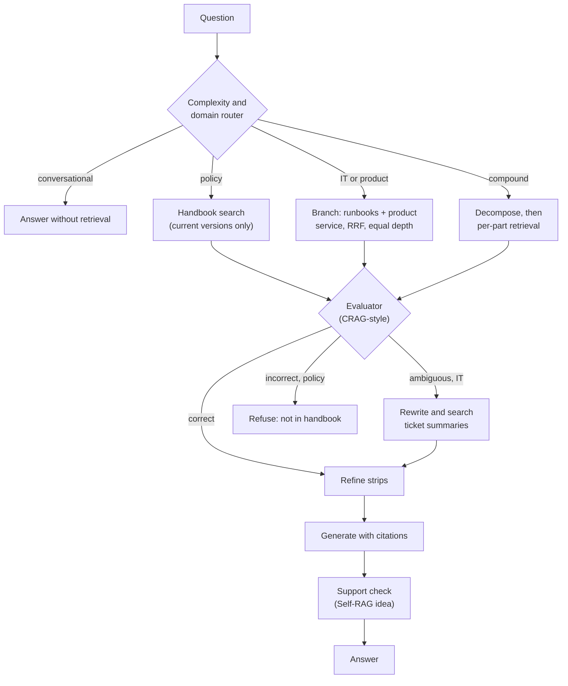

This assessment covers the whole Advanced RAG Patterns module: [Naive RAG](/learn/advanced-rag-patterns/naive-rag), [Advanced RAG](/learn/advanced-rag-patterns/advanced-rag), [Modular RAG](/learn/advanced-rag-patterns/modular-rag), [Corrective RAG](/learn/advanced-rag-patterns/corrective-rag), [Self-RAG](/learn/advanced-rag-patterns/self-rag), [Adaptive RAG](/learn/advanced-rag-patterns/adaptive-rag), [Speculative RAG](/learn/advanced-rag-patterns/speculative-rag) and [Fusion-based RAG](/learn/advanced-rag-patterns/fusion-based-rag). The quiz mixes recall, calculation, code reading and scenarios; aim for at least 14 of 18 (about 75 percent) before moving on. The written sections have hidden model answers: attempt each one before opening it. The coding exercises run with Python and NumPy only.

```quiz
[
  {"q": "Which sequence correctly describes naive RAG's query path?", "options": ["Rewrite, retrieve, rerank, generate, verify", "Embed the question as typed, retrieve top-k from one index, fill the prompt in rank order, generate once", "Classify the question, then choose a retrieval strategy", "Generate a draft, retrieve evidence, then revise"], "answer": 1, "why": "Naive RAG is the fixed retrieve-read flow with no query transformation, no reranking and no checking."},
  {"q": "The gold chunk exists in the corpus but ranks 9th with k = 5. Which failure point is this?", "options": ["Missing content", "Missed top-ranked", "Not in context", "Not extracted"], "answer": 1, "why": "The answer is in the corpus but did not make the top k: a retrieval failure."},
  {"q": "What does this print?\n```python\np_ret, p_ctx, p_gen = 0.8, 0.9, 0.85\nprint(round(p_ret * p_ctx * p_gen, 3))\n```", "options": ["0.85", "0.612", "0.72", "2.55"], "answer": 1, "why": "The first failure points form a chain, so end-to-end success is the product of the stage rates: 0.8 x 0.9 x 0.85 = 0.612."},
  {"q": "A team adds a cross-encoder reranker, but its dominant failure is vocabulary mismatch ('WFH' versus 'work remotely'). What is the most likely result?", "options": ["Large improvement, because rerankers understand synonyms", "Little or no improvement, because the right chunk is rarely among the candidates and the reranker scores the same mismatched query", "Recall drops to zero", "Latency falls"], "answer": 1, "why": "A reranker only reorders candidates it is given, using the query it is given; recall problems from vocabulary must be fixed upstream."},
  {"q": "What most clearly distinguishes advanced RAG from modular RAG?", "options": ["Advanced RAG has more stages", "Advanced RAG's flow is fixed and linear; modular RAG lets the flow route, branch and loop, declared separately from the modules", "Modular RAG cannot use rerankers", "Advanced RAG requires fine-tuning"], "answer": 1, "why": "Both can have many components; the difference is whether the flow itself is configurable and non-linear."},
  {"q": "In a modular RAG system, why should a judge's score threshold live next to the retriever that produces the scores?", "options": ["It makes the code shorter", "Score scales differ between retrievers, so swapping the retriever silently changes what the threshold means", "Thresholds are required by Python", "Judges cannot read scores otherwise"], "answer": 1, "why": "A threshold tuned on cosines is meaningless on BM25 scores; score contracts must travel with the module."},
  {"q": "A loop retries 25 percent of requests; each round takes 2 seconds. What are the mean latency and the latency of a retried request?", "options": ["2.0 s and 2.0 s", "2.5 s and 4.0 s", "2.25 s and 2.5 s", "4.0 s and 4.0 s"], "answer": 1, "why": "Mean is 2 + 0.25 x 2 = 2.5 s, but every retried request pays both rounds, 4 s."},
  {"q": "What does this print?\n```python\nscores = [0.4, 0.05, 0.02]\nupper, lower = 0.5, 0.03\nif max(scores) >= upper: print('CORRECT')\nelif max(scores) < lower: print('INCORRECT')\nelse: print('AMBIGUOUS')\n```", "options": ["CORRECT", "INCORRECT", "AMBIGUOUS", "Nothing"], "answer": 2, "why": "No score reaches 0.5, and not every score is below 0.03, so the CRAG action is Ambiguous."},
  {"q": "For an internal HR assistant using CRAG, what is the best Incorrect action for a policy question?", "options": ["Search the public web", "Answer from the low-scoring handbook passages", "Refuse and direct the user to HR, or search another authoritative internal source", "Lower the thresholds"], "answer": 2, "why": "Only authoritative sources should answer policy questions; the web describes other organisations' policies."},
  {"q": "Which Self-RAG reflection token catches a fluent answer that invents a figure while reading a relevant passage?", "options": ["Retrieve", "IsRel", "IsSup", "IsUse"], "answer": 2, "why": "IsRel would rate the passage relevant; only IsSup judges whether the output is supported by the passage."},
  {"q": "How does a Self-RAG generator learn to produce reflection tokens?", "options": ["From prompts at inference time", "From a corpus annotated offline by a trained critic model, using the standard next-token objective", "From user thumbs-up ratings", "By reinforcement learning against a reward model at inference"], "answer": 1, "why": "A critic distilled from a stronger model labels training data; the generator is then trained on that augmented corpus."},
  {"q": "What does this print?\n```python\np, c, L = (0.5, 0.3, 0.2), (1, 3, 10), 20\nq = (p[1] + p[2], p[2], 0)\nprint('ABC'[min(range(3), key=lambda i: c[i] + L * q[i])])\n```", "options": ["A", "B", "C", "It raises an error"], "answer": 1, "why": "Expected losses are A: 1 + 20 x 0.5 = 11, B: 3 + 20 x 0.2 = 7, C: 10. B is lowest."},
  {"q": "How does Adaptive-RAG label training questions for its complexity classifier?", "options": ["By question length", "By the simplest strategy that answered correctly, with the dataset's single- or multi-hop origin as a fallback", "By asking annotators to rate difficulty", "By the number of retrieved passages"], "answer": 1, "why": "Outcome-based labelling captures what is actually needed with your models, not perceived difficulty."},
  {"q": "In Speculative RAG, which statement is true?", "options": ["The large verifier reads all retrieved passages", "A small drafter writes drafts from passage subsets in parallel; the large verifier scores drafts without seeing the passages", "Every draft sees the same passages", "It guarantees the same output as the large model alone"], "answer": 1, "why": "Keeping passages out of the verifier's input is the source of the speed-up, and also why stale evidence must be filtered before drafting."},
  {"q": "Why does Speculative RAG build passage subsets by clustering rather than consecutive rank slices?", "options": ["Clustering is required to compute probabilities", "Consecutive slices concentrate near-duplicates, so each draft sees one aspect; one passage per cluster gives each draft diverse evidence", "To reduce the number of retrieved passages", "Because the verifier needs clusters"], "answer": 1, "why": "Similar passages get similar retrieval scores and sit together in the ranking; clustering spreads aspects across drafts."},
  {"q": "What does this print?\n```python\ndef rrf(lists, k=60):\n    s = {}\n    for l in lists:\n        for r, d in enumerate(l, 1):\n            s[d] = s.get(d, 0) + 1 / (k + r)\n    return sorted(s, key=lambda d: (-s[d], d))\nprint(rrf([['a', 'b', 'c'], ['b', 'c', 'a'], ['c', 'd']]))\n```", "options": ["['a', 'b', 'c', 'd']", "['c', 'b', 'a', 'd']", "['b', 'c', 'a', 'd']", "['c', 'a', 'b', 'd']"], "answer": 1, "why": "c appears in all three lists (1/63 + 1/62 + 1/61). b scores 1/62 + 1/61, slightly more than a's 1/61 + 1/63. d appears once."},
  {"q": "A fusion grid uses 3 query variants, dense and BM25, and 3 sources. How many retrieval calls per question?", "options": ["8", "9", "18", "6"], "answer": 2, "why": "The grid is the product: 3 x 2 x 3 = 18."},
  {"q": "The handbook and a team wiki give conflicting answers about expenses. Which fusion design best surfaces the conflict?", "options": ["Early fusion with RRF into one prompt", "Late fusion: answer from each source separately, then synthesise with attribution", "Drop the wiki list and never mention it", "Fusion-in-Decoder with a hosted chat model"], "answer": 1, "why": "Late fusion keeps sources apart so that disagreements can be attributed and shown rather than blended."}
]
```

## Conceptual questions

1. Every pattern in this module relaxes one or more of naive RAG's fixed assumptions. List the assumptions and, for each, name a pattern that relaxes it.

<details><summary>Show model answer</summary>

- *Every question needs retrieval*: relaxed by Adaptive RAG (route to no retrieval) and Self-RAG (the Retrieve token).
- *The user's wording is a good query*: relaxed by advanced RAG's query rewriting and by Fusion-based RAG's query variants.
- *Similarity equals relevance*: relaxed by advanced RAG's reranking and by Corrective RAG's evaluator.
- *A fixed k suits every question*: relaxed by Adaptive RAG (single-step versus multi-step) and by CRAG's refinement, which keeps only relevant strips.
- *One retrieval is enough*: relaxed by modular loops, CRAG's fallback search and Adaptive RAG's multi-step strategy.
- *The model uses the context correctly*: relaxed by Self-RAG's support critique and by Speculative RAG's verification of drafts.

</details>

2. Explain why CRAG and Self-RAG are complementary rather than competing, and what each one cannot detect on its own.

<details><summary>Show model answer</summary>

CRAG judges retrieved documents *before* generation: it can discard irrelevant results and fetch from elsewhere, but it never looks at the output, so it cannot detect a model that misuses a relevant passage or invents a detail. Self-RAG judges the output against each passage *during* generation (IsSup), so it catches unsupported claims, but its retrieval comes from one source and it has no fallback to another source when nothing relevant is found. The CRAG paper indeed evaluated CRAG on top of Self-RAG. In a production approximation, a CRAG-style evaluator in front of generation and a support check after it address different failure points and can be combined.

</details>

3. A colleague says, "Adaptive RAG is just query routing." Explain what is the same and what is different.

<details><summary>Show model answer</summary>

Both are conditional flows driven by a classifier over the question. Topic or source routing chooses *where* to search (which index or tool). Adaptive RAG chooses *how much* to search (none, once or iteratively), based on predicted complexity, with labels derived from which strategy actually succeeded. The cost structure differs too: in Adaptive RAG, errors are asymmetric (under-routing gives wrong answers, over-routing costs money), which motivates expected-loss decisions. A system can do both: route by complexity, then by source.

</details>

4. Speculative RAG reports lower latency than standard RAG, yet its drafters together read as many passage tokens as the standard prompt. Explain where the saving comes from and when it disappears.

<details><summary>Show model answer</summary>

The saving comes from *which* model reads the tokens. Drafters are small and cheap, and they run in parallel, so the long-context reading happens at small-model speed and price. The large model reads only short drafts and rationales. If the drafter and verifier are the same model, or drafts are run sequentially, or retrieval returns only a few passages so there is nothing to split, the saving disappears and the extra calls make it slower and more expensive than standard RAG.

</details>

5. Why can adding more lists to a Reciprocal Rank Fusion lower the quality of the top results, and what should you do about it?

<details><summary>Show model answer</summary>

RRF gives every list a vote proportional to rank, regardless of how good the list is. Recall over the union can only grow, but a list that consistently ranks irrelevant chunks highly (for example BM25 matching on common words for paraphrase-heavy questions) adds votes for them and can push the right chunk down. The remedy is measurement: ablate each list or fusion level, drop lists that do not help, down-weight lists that help only sometimes, cap all lists at the same depth, and break ties deterministically.

</details>

## Coding exercises

### Exercise 1: CRAG decisions with a policy-aware fallback

Write `crag_action(scores, upper=0.6, lower=0.1)` that returns `"CORRECT"`, `"INCORRECT"` or `"AMBIGUOUS"` using the CRAG rule (an empty list counts as incorrect), and `route(action, policy_question)` that returns the list of steps to run: correct refines the primary results; incorrect refuses for policy questions and otherwise rewrites the query, searches the secondary source and refines it; ambiguous refines the primary results and, for non-policy questions only, also searches and refines the secondary source. Test it on the five cases in the solution.

<details><summary>Show solution</summary>

```python
def crag_action(scores, upper=0.6, lower=0.1):
    if not scores:
        return "INCORRECT"
    if max(scores) >= upper:
        return "CORRECT"
    if all(s < lower for s in scores):
        return "INCORRECT"
    return "AMBIGUOUS"

def route(action, policy_question):
    if action == "CORRECT":
        return ["refine primary"]
    if action == "INCORRECT":
        return ["refuse"] if policy_question else ["rewrite query", "search secondary", "refine secondary"]
    return ["refine primary"] + ([] if policy_question else ["search secondary", "refine secondary"])

CASES = [([0.82, 0.10, 0.02], True), ([0.05, 0.03], True), ([0.05, 0.03], False),
         ([0.30, 0.20, 0.01], False), ([], False)]
for scores, policy in CASES:
    a = crag_action(scores)
    print(f"{str(scores):<20} policy={policy!s:<5} {a:<9} {route(a, policy)}")
```

```output
[0.82, 0.1, 0.02]    policy=True  CORRECT   ['refine primary']
[0.05, 0.03]         policy=True  INCORRECT ['refuse']
[0.05, 0.03]         policy=False INCORRECT ['rewrite query', 'search secondary', 'refine secondary']
[0.3, 0.2, 0.01]     policy=False AMBIGUOUS ['refine primary', 'search secondary', 'refine secondary']
[]                   policy=False INCORRECT ['rewrite query', 'search secondary', 'refine secondary']
```

Note the boundary conventions: the upper threshold is inclusive (`>=`) and the lower is strict (`<`), and an empty result list is treated as incorrect rather than crashing on `max([])`. In the fourth case, a top score of 0.3 is below the upper threshold and 0.01 is below the lower one, but not *all* scores are, so the action is ambiguous.

</details>

### Exercise 2: How the wrong-answer penalty shapes an adaptive router

Implement expected-loss routing for strategies A, B and C with costs 1, 3 and 10. Simulate 200 questions with true labels drawn with probabilities 0.3, 0.5 and 0.2, and a noisy classifier whose probability vectors are drawn from a Dirichlet distribution centred on the true label. For penalties 0, 5, 20 and 50, report total cost and the number of under-routed questions. Use `numpy.random.default_rng(7)`.

<details><summary>Show solution</summary>

```python
import numpy as np

COST = {"A": 1.0, "B": 3.0, "C": 10.0}

def route(p, penalty):
    need_more = {"A": p[1] + p[2], "B": p[2], "C": 0.0}
    return min(COST, key=lambda s: COST[s] + penalty * need_more[s])

def simulate(probs, true_labels, penalty):
    order = "ABC"
    cost = wrong = 0
    for p, t in zip(probs, true_labels):
        s = route(p, penalty)
        cost += COST[s]
        wrong += order.index(s) < order.index(t)     # under-routed
    return cost, wrong

rng = np.random.default_rng(7)
true = rng.choice(list("ABC"), size=200, p=[0.3, 0.5, 0.2])
probs = []
for t in true:                                    # a noisy but informative classifier
    base = np.full(3, 0.15)
    base["ABC".index(t)] = 0.7
    probs.append(rng.dirichlet(base * 20))
for penalty in (0, 5, 20, 50):
    cost, wrong = simulate(probs, true, penalty)
    print(f"penalty {penalty:>3}: total cost {cost:>6.0f}  under-routed {wrong:>3}/200")
```

```output
penalty   0: total cost    200  under-routed 143/200
penalty   5: total cost    400  under-routed  44/200
penalty  20: total cost    905  under-routed   0/200
penalty  50: total cost   1394  under-routed   0/200
```

With no penalty, the router always picks the cheapest strategy (cost 200, one unit per question) and under-routes 143 questions: every B and C question. As the penalty rises, the router hedges towards retrieval: at 5 it under-routes 44; at 20 and above it under-routes none, at the price of sending many questions to a more expensive strategy than they need (cost 905, then 1,394). The right penalty is a business decision: what a wrong answer costs relative to the strategies. The simulated classifier is only a stand-in; with a real one, check calibration before trusting these trade-offs.

</details>

## Architecture design challenge

Meridian wants a new version of AskMeridian with these requirements:

- It answers from three sources: the employee handbook (HR, authoritative for policy), the IT runbooks with resolved-ticket summaries (IT), and Meridian Reports product documentation (served by a separate search service with its own ranking).
- Policy answers must never come from anything but the current handbook; if the handbook does not answer, the assistant must say so.
- Unsupported claims must be rare, because answers are sometimes forwarded to managers as guidance.
- The 95th-percentile latency must stay under 5 seconds; most traffic is simple lookups and conversational turns.
- Costs must not more than double compared with the current single-step pipeline.

Design the query-side architecture using patterns from this module. Draw the flow, say which pattern each part comes from, and discuss the main trade-offs.

<details><summary>Show reference design</summary>



**Components and their origins.**

- *Router* (Adaptive RAG plus source routing): a small classifier over the question decides conversational, policy, IT/product or compound. Conversational turns skip retrieval, which removes cost and latency from a large share of traffic. Labels come from offline runs of each strategy; the decision rule requires high confidence before skipping retrieval.
- *Policy path*: handbook only, with superseded versions filtered at retrieval time. No fusion with other sources, because only the handbook is authoritative.
- *IT and product path* (Fusion-based RAG): a branch searches the runbook index and the product service in parallel, caps both lists at the same depth and fuses with RRF, since their scores are not comparable.
- *Compound path* (multi-step): decomposition with per-part retrieval, used only for the minority of questions the router marks compound.
- *Evaluator* (Corrective RAG): a cross-encoder grades retrieved passages against thresholds fitted on labelled data. For policy, *incorrect* means refuse. For IT, *ambiguous* or *incorrect* triggers a rewrite and a search of ticket summaries (older than the current runbook version filtered out).
- *Refinement*: strip-level filtering with sentence windows wide enough to keep qualifiers.
- *Support check* (Self-RAG, approximated): one structured grading call checks each sentence of the answer against its cited passage; unsupported sentences are removed or flagged.

**Trade-offs.**

- *Latency.* The common path is router (milliseconds) + retrieval + evaluator (tens of milliseconds) + generation + support check. The support check adds a model call to every retrieved answer; with a smaller grading model it can stay within budget, but it must be measured at the 95th percentile. The fallback search and compound path are the tail: their share must stay small enough (well under 5 percent if they push requests past 5 seconds).
- *Cost.* Skipping retrieval and generation for conversational turns offsets much of the cost of the support check. Speculative RAG is not used: most passage sets are small and there is no cheaper drafter to exploit; Self-RAG's per-passage candidates are too expensive for the latency target.
- *Correctness versus helpfulness.* Policy refusals will frustrate some users; the refusal should point to HR. The thresholds trade fallback cost against false trust, and must be recalibrated when any model or the corpus changes.
- *Operability.* The flow has routes, a branch and a conditional fallback, so every request must log its trace (route, evaluator scores, action, support-check results), and flow tests must assert the expected path for representative questions.

</details>

## Troubleshooting scenarios

### Scenario 1: Corrective RAG suddenly sends everything to the fallback

After an upgrade of the embedding model and the reranker library, the share of AskMeridian questions on CRAG's *ambiguous* or *incorrect* path jumped from about a fifth to nearly all of them. Retrieval recall on the test set is unchanged. Latency has risen sharply.

<details><summary>Show diagnosis and fix</summary>

Recall is unchanged, so retrieval is not the problem; the evaluator's decisions are. The most likely cause is a change in the evaluator's *score scale*: some cross-encoder versions or configurations return raw logits (unbounded, often negative) rather than probabilities between 0 and 1, so thresholds of, say, 0.5 and 0.01 no longer mean what they did. Confirm by printing evaluator scores for a few known-good question-passage pairs before and after the upgrade. Fix by restoring the expected output activation (or applying a sigmoid explicitly), then refit both thresholds on the labelled set, since even a correct scale may shift with a new model version. Add a monitoring alert on the action mix, which is the earliest signal of this kind of drift, and keep thresholds versioned with the evaluator.

</details>

### Scenario 2: A fusion upgrade made answers worse

The team added BM25 to every query variant and source in AskMeridian's RAG-Fusion pipeline (three variants, two retrievers, three sources: 18 lists). Recall@20 rose slightly, but users report more irrelevant answers, and hit@1 on the evaluation set fell. Product-documentation pages appear at the top of many HR questions.

<details><summary>Show diagnosis and fix</summary>

Two problems, both from the fusion grid. First, the BM25 lists add votes for chunks sharing common words with the question; on a paraphrase-heavy question set they add noise, and RRF gives them equal weight, which is exactly the "recall up, precision at the top down" signature. Second, the product-documentation service probably returns deeper lists than the other sources, giving its pages more chances to collect votes. Fix: cap every list at the same depth; ablate the grid by level (variants, retriever, source) and keep only what improves hit@1 or MRR; down-weight BM25 (or apply it only when the query contains identifiers such as error codes); consider hierarchical fusion so that sources are fused after retrievers within each source; and route clearly HR questions to the handbook only. Re-run the evaluation after each change.

</details>

### Scenario 3: The adaptive router saves money but complaints rise

Three weeks after launching an Adaptive-RAG router, model spend has fallen substantially, but HR reports more wrong answers about leave and expenses, mostly for questions such as "I'm a contractor; can I claim the equipment budget?" and "since I started in January, how much leave do I have?". The router's offline accuracy was high.

<details><summary>Show diagnosis and fix</summary>

These are under-routing errors: questions with a hidden condition (contractor status, start date) that look like single-fact lookups or even general questions, sent to no retrieval or single-step retrieval when they need several facts. High overall accuracy hides them because under- and over-routing were not reported separately, and the training set probably contained few such questions. Fix: sample live routed questions, run the more thorough strategy on them, and measure the under-routing rate directly; add the misrouted questions to the training data with outcome-based labels; switch to expected-loss routing with a penalty that reflects the cost of a wrong policy answer, so that doubtful questions go to the more thorough strategy; and add a rule or feature for conditional phrases ("as a contractor", "since I started"). Keep a shadow comparison running so that under-routing is tracked continuously.

</details>
