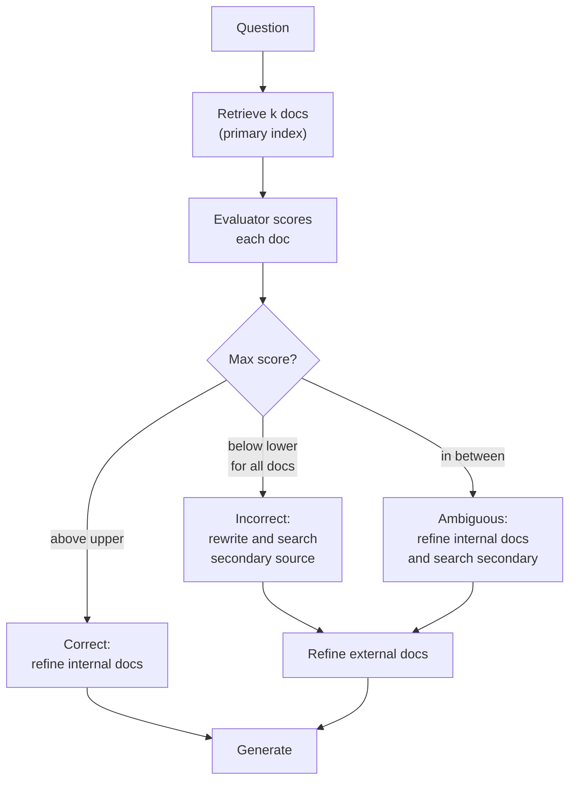

[Naive RAG](/learn/advanced-rag-patterns/naive-rag) trusts its retriever completely: whatever comes back in the top $k$ goes into the prompt, relevant or not. When retrieval fails, the model is handed irrelevant text and either answers from it or guesses. **Corrective Retrieval-Augmented Generation** (CRAG), introduced by Yan and colleagues in 2024, adds a step that naive RAG lacks: before generating, a lightweight **retrieval evaluator** grades the retrieved documents, and the system takes a different *corrective action* depending on the grade. Good results are cleaned up; bad results are discarded in favour of a second source; uncertain results get both.

This lesson explains the CRAG design from the paper, the three actions and the thresholds that choose between them, the "decompose-then-recompose" refinement step, and what changes when you build CRAG for an internal assistant instead of an open-domain benchmark. You will implement it with a local cross-encoder as the evaluator and watch it take all three actions.

## Learning objectives

- Describe the CRAG pipeline: retrieval evaluator, three confidence-based actions, knowledge refinement and fallback search.
- Choose upper and lower thresholds from labelled data and explain the trade-off each one controls.
- Implement knowledge refinement by splitting passages into strips and filtering them with the evaluator.
- Decide what the fallback source should be for a given system, including when the right fallback is a refusal.
- Estimate the added latency and cost of CRAG from the number of passages, strips and fallback rate.

## Prerequisites

- [Naive RAG](/learn/advanced-rag-patterns/naive-rag): the *missing content* and *not extracted* failure points.
- [Modular RAG](/learn/advanced-rag-patterns/modular-rag): judges and conditional flows.
- [Cross-encoders](/learn/reranking-fundamentals/cross-encoders): the model family used as the evaluator below.
- [Retrieval thresholding](/learn/advanced-retrieval-optimisation/retrieval-thresholding): cutting off low scores.

## Why this matters

A retriever always returns $k$ results. When the question has a good answer in the index, the top results usually contain it. When it does not (the topic is not covered, the user's words do not match, the index is stale), the top results are simply the least bad matches, and naive RAG passes them on. Language models are inclined to use what they are given, so irrelevant context produces confident wrong answers, and the user cannot tell them apart from right ones.

Two simpler fixes are common and both are incomplete. A **similarity threshold** on the retriever's own score is cheap but crude: embedding similarity measures topical closeness, not whether the passage answers the question, and its scale shifts from query to query. A **refusal instruction** in the prompt helps, but it asks the generator to notice irrelevance while also trying to be helpful, and it cannot recover the answer from anywhere else. CRAG separates the two jobs: a dedicated component judges relevance, and the pipeline acts on that judgement, including fetching knowledge from elsewhere when the index has failed.

## The intuition

Imagine a researcher's assistant who brings back an armful of documents for each question. A careless researcher reads whatever arrives. A careful one glances at each document first and sorts the situation into one of three cases:

- **"Yes, this is it."** The answer is clearly here. She still skims, keeping only the paragraphs that matter, so she is not distracted by the rest.
- **"None of this is relevant."** She puts the pile aside and looks somewhere else entirely, perhaps the wider library.
- **"Some of this might be relevant; I am not sure."** She keeps the useful paragraphs from the pile *and* checks the wider library, then works from both.

CRAG is that glance, formalised. The glance is cheap compared with writing the answer, and it changes what the answer is written from.

## How it works

### The CRAG pipeline

Yan, Gu, Zhu and Ling (2024) describe CRAG as a plug-in that can wrap an existing RAG system. The steps:

1. **Retrieve** $k$ documents for the question from the primary index, as usual.
2. **Evaluate** each document with a **retrieval evaluator**: a model that takes the question and one document and outputs a relevance score. In the paper this is a fine-tuned T5-large model, far smaller than the generator.
3. **Decide an action** from the scores, using two thresholds, an upper $\tau_u$ and a lower $\tau_l$:
   - **Correct** if at least one document scores above $\tau_u$.
   - **Incorrect** if every document scores below $\tau_l$.
   - **Ambiguous** otherwise.
4. **Act:**
   - *Correct:* refine the retrieved documents (step 5) and use them.
   - *Incorrect:* discard them and search a different source; in the paper, web search, with the question first rewritten into keyword queries. Refine what comes back.
   - *Ambiguous:* do both and combine the refined internal knowledge with the refined external knowledge.
5. **Refine** ("decompose-then-recompose"): split each document into small **knowledge strips** (a sentence or a few sentences), score each strip with the evaluator, drop the low-scoring ones, and concatenate the rest in order.
6. **Generate** from the refined knowledge.



In the paper's experiments, CRAG improved results when added to both a standard RAG pipeline and to [Self-RAG](/learn/advanced-rag-patterns/self-rag) across several open-domain question-answering and long-form generation benchmarks. Those results come from open-domain tasks with web search available; the size of the benefit on your own corpus is something to measure, not assume.

### The evaluator

The evaluator is the heart of CRAG, and its quality bounds everything else. It must judge *whether this passage helps answer this question*, which is a different question from *is this passage on the same topic*. That is why a **cross-encoder**, which reads the question and passage together, suits the job better than an embedding similarity: it can see that "Staff may work remotely up to 3 days a week" does not answer "Can contractors work from home?", even though the topics are close.

You have three practical choices:

| Evaluator | Strength | Weakness |
| --- | --- | --- |
| Off-the-shelf cross-encoder reranker | Fast, local, no training needed | Trained on web search data; not calibrated for your domain |
| Fine-tuned cross-encoder or small model (the paper's approach) | Accurate on your distribution | Needs labelled question-passage pairs |
| Language model asked to grade relevance | Flexible, no training | A model call per passage; slower and costlier |

The evaluator's errors matter in both directions. A false "irrelevant" on a relevant passage throws away the right answer and triggers an unnecessary fallback. A false "relevant" on a distractor lets noise through. You will see one of each kind of borderline case in the code below.

### Choosing the thresholds

The two thresholds carve the score range into three regions, and each boundary controls a different error:

- Raising $\tau_u$ makes the system less willing to trust its primary results. More questions become *ambiguous*, so more of them trigger the fallback search. This costs latency and money, but reduces the chance of answering from a misleadingly confident distractor.
- Lowering $\tau_l$ makes the system less willing to *discard* primary results. Fewer questions become *incorrect*. This protects against throwing away a relevant passage the evaluator under-scored, but means more irrelevant passages are kept (to be filtered by refinement).

Set the thresholds from data, not by intuition. Take a few hundred labelled questions, record the evaluator's maximum score on the retrieved passages, and mark whether the retrieved set actually contained the answer. Then choose $\tau_u$ so that questions scoring above it almost always contain the answer (high precision for *correct*), and $\tau_l$ so that questions scoring below it almost never do (high precision for *incorrect*). Everything in between is genuinely uncertain and pays for both paths. Recalibrate whenever the evaluator, the retriever or the corpus changes.

### Knowledge refinement

Even a relevant passage is mostly irrelevant to any one question. A 400-token handbook section on leave contains the answer to "how many days?" in one sentence and three other sentences about carry-over, approval and the HR portal. **Decompose-then-recompose** keeps only what matters:

1. Split each passage into strips. The paper uses sentence-level or short multi-sentence segments, depending on passage length.
2. Score every strip against the question with the evaluator.
3. Keep strips above a threshold (or the top few), in their original order.
4. Concatenate them as the knowledge passed to the generator.

This is a form of [context compression](/learn/context-engineering/context-compression) driven by the same evaluator, and it has the same risk: a strip that looks irrelevant on its own may be the qualifier that makes the answer correct ("Contractors are not eligible…"). Strip granularity is a trade-off between precision and context preservation.

### The fallback source for an internal assistant

The paper's fallback is web search, which suits open-domain questions about public facts. For an internal assistant it is usually wrong: the public web does not know Meridian's leave policy, and a confident answer from a random website is worse than no answer. Ask instead: *if the primary index has failed, where is the next most authoritative place to look?* Typical answers:

- A **broader internal source**: the IT wiki, the ticket archive, product documentation, searched with a rewritten query.
- A **different retrieval method** over the same corpus: keyword search when dense retrieval failed, which helps with codes and names.
- **Nothing: refuse.** For policy questions where only the official handbook is authoritative, the right corrective action for *incorrect* is "I could not find this in the handbook", with a pointer to a human.

Label the provenance of fallback knowledge in the prompt and in citations, so that the user can see that an answer came from the wiki rather than the handbook.

## The mathematics

### Expected cost per question

CRAG's cost depends on how often each action fires. Let $n$ be the number of retrieved passages, $m$ the average number of strips per passage, $c_e$ the cost of one evaluator call, $c_s$ the cost of a fallback search (including rewriting and refining its results), and $p_C, p_I, p_A$ the fractions of questions that end up *correct*, *incorrect* and *ambiguous*. Every question pays to grade its passages; correct and ambiguous questions also grade internal strips; incorrect and ambiguous questions pay for the fallback:

$$
\mathbb{E}[\text{added cost}] = n\,c_e + (p_C + p_A)\,n\,m\,c_e + (p_I + p_A)\,c_s
$$

**Worked example.** Suppose $n = 5$, $m = 4$, an evaluator call costs 1 unit, a fallback costs 60 units, and the measured action rates are $p_C = 0.7$, $p_I = 0.1$, $p_A = 0.2$. Grading passages costs $5$. Refining internal strips costs $(0.7 + 0.2) \times 5 \times 4 = 18$. Fallback costs $(0.1 + 0.2) \times 60 = 18$. Total: $5 + 18 + 18 = 41$ units per question. If the thresholds are moved so that ambiguous rises to 0.4 and correct falls to 0.5, the fallback term becomes $(0.1 + 0.4) \times 60 = 30$ and the total is $5 + 18 + 30 = 53$: widening the ambiguous band is expensive.

```python
def crag_cost(n, m, ce, cs, pC, pI, pA):
    return n * ce + (pC + pA) * n * m * ce + (pI + pA) * cs

print(crag_cost(5, 4, 1, 60, 0.7, 0.1, 0.2), crag_cost(5, 4, 1, 60, 0.5, 0.1, 0.4))
```

```output
41.0 53.0
```

The units are abstract; substitute measured milliseconds or currency. The structure tells you where to look: strip grading grows with $n \times m$, so keep $n$ small and strips not too fine; the fallback grows with the width of the ambiguous band.

## In code

The program implements CRAG over Meridian. The primary index is the employee handbook (four sections). The secondary source, used only when the evaluator rejects or doubts the handbook results, is a small IT wiki. Retrieval uses `all-MiniLM-L6-v2`; the evaluator is the `BAAI/bge-reranker-base` cross-encoder, which in the installed version of sentence-transformers returns scores between 0 and 1. The thresholds were chosen by inspecting scores on a handful of questions, which is enough for a demonstration and not enough for production.

```bash
pip install sentence-transformers numpy
```

```python
import re
import numpy as np
from sentence_transformers import SentenceTransformer, CrossEncoder

# Primary index: the employee handbook, one passage per section.
HANDBOOK = [
    "Annual leave is 25 days per year. Up to 5 unused days carry over and must be used by 31 March. "
    "Leave requests are approved by your line manager in the HR portal.",
    "Staff may work remotely up to 3 days a week. The home-office equipment budget is £400. "
    "Contractors are not eligible for the equipment budget.",
    "Expenses must be submitted within 30 days. Anything over £75 needs a receipt. "
    "Expenses belong to the finance department.",
    "The laptop refresh cycle is 3 years. Lost laptops are reported to the support desk at once.",
]
# Secondary source, searched only when the evaluator rejects the primary results.
IT_WIKI = [
    "Error E-4012 means the VPN certificate has expired. Request a new certificate from the IT portal.",
    "Error E-4021 means the VPN client is out of date; update it from the IT portal.",
    "Support desk hours are 08:00 to 18:00 UK time.",
]

embedder = SentenceTransformer("sentence-transformers/all-MiniLM-L6-v2")
judge = CrossEncoder("BAAI/bge-reranker-base")
hb_vecs = embedder.encode(HANDBOOK, normalize_embeddings=True)
wiki_vecs = embedder.encode(IT_WIKI, normalize_embeddings=True)

UPPER, LOWER, STRIP_MIN = 0.5, 0.01, 0.1

def search(q, docs, vecs, k=2):
    s = vecs @ embedder.encode([q], normalize_embeddings=True)[0]
    return [docs[i] for i in np.argsort(-s)[:k]]

def grade(q, passages):
    """Retrieval evaluator: a relevance score in [0, 1] for each passage."""
    return [float(x) for x in judge.predict([(q, p) for p in passages])]

def decide(scores):
    if max(scores) >= UPPER:
        return "CORRECT"
    if max(scores) < LOWER:
        return "INCORRECT"
    return "AMBIGUOUS"

def refine(q, passages):
    """Decompose passages into sentence strips, grade each, keep the relevant ones."""
    strips = [s for p in passages for s in re.split(r"(?<=\.)\s+", p) if s]
    return [s for s, g in zip(strips, grade(q, strips)) if g >= STRIP_MIN]

def secondary_search(q):
    """Stand-in for CRAG's web search: a second, less authoritative source."""
    return search(q, IT_WIKI, wiki_vecs)

def crag(q):
    passages = search(q, HANDBOOK, hb_vecs)
    scores = grade(q, passages)
    action = decide(scores)
    if action == "CORRECT":
        knowledge = refine(q, passages)
    elif action == "INCORRECT":
        knowledge = refine(q, secondary_search(q))
    else:
        knowledge = refine(q, passages) + refine(q, secondary_search(q))
    return action, max(scores), knowledge

for q in ["How many days of annual leave do I get?",
          "What does error E-4012 mean?",
          "Do I need a receipt for a £40 lunch?",
          "When does the support desk open?",
          "Can contractors work from home?"]:
    action, top, knowledge = crag(q)
    print(f"{q}\n  {action:<9} top primary score {top:.3f}")
    for k in knowledge or ["(nothing relevant: answer 'I don't know')"]:
        print(f"    - {k}")
```

```output
How many days of annual leave do I get?
  CORRECT   top primary score 0.988
    - Annual leave is 25 days per year.
    - Staff may work remotely up to 3 days a week.
What does error E-4012 mean?
  INCORRECT top primary score 0.000
    - Error E-4012 means the VPN certificate has expired.
Do I need a receipt for a £40 lunch?
  AMBIGUOUS top primary score 0.045
    - Anything over £75 needs a receipt.
When does the support desk open?
  AMBIGUOUS top primary score 0.012
    - Support desk hours are 08:00 to 18:00 UK time.
Can contractors work from home?
  AMBIGUOUS top primary score 0.014
    - Staff may work remotely up to 3 days a week.
```

### Reading the output

All three actions fire, and the borderline cases are as instructive as the clean ones.

- **Annual leave: CORRECT.** The leave section scores 0.988, well above the upper threshold. Refinement keeps "Annual leave is 25 days per year." and drops the carry-over and approval sentences. But it also keeps "Staff may work remotely up to 3 days a week.", which the evaluator scored 0.621 against this question. The off-the-shelf reranker has been misled by "days" and "a week". This is an evaluator error, and it shows why a domain-tuned evaluator (the paper fine-tunes one) is worth considering. The generator still sees the right sentence first, so the damage here is small.
- **E-4012: INCORRECT.** Every handbook passage scores near 0, below the lower threshold. The handbook results are discarded, the IT wiki is searched, and refinement keeps only the sentence about the expired certificate. Naive RAG would have put two irrelevant handbook sections in the prompt.
- **Receipt for a £40 lunch: AMBIGUOUS, and it shows a weakness of passage-level grading.** The expenses section *does* contain the answer, but as a whole passage it scored only 0.045: the evaluator was unsure because two of its three sentences are about other things. At strip level, "Anything over £75 needs a receipt." is kept. Ambiguous was the safe outcome; an aggressive lower threshold of 0.05 would have discarded the handbook and found nothing in the wiki.
- **Support desk hours: AMBIGUOUS.** The handbook mentions the support desk but not its hours, so it scored low but not zero. The fallback found the hours in the wiki and refinement kept only that strip.
- **Contractors working from home: AMBIGUOUS.** The handbook does not answer this question directly. Refinement keeps the general remote-work rule, and a well-prompted generator should say what the handbook does state (staff may work remotely up to three days a week) and that it says nothing specific about contractors. Notably, "Contractors are not eligible for the equipment budget" was dropped as irrelevant: correct for this question, but exactly the kind of qualifier that strip filtering can lose on a slightly different question.

Key lines: `decide` implements the paper's rule exactly: *correct* needs only one passage above the upper threshold, *incorrect* needs all below the lower. `refine` grades strips with the same evaluator, so it inherits the evaluator's errors. `secondary_search` is the place to put a query rewriter, a keyword search, or a refusal, depending on your system.

**Common errors.** If every question comes out *ambiguous*, your thresholds are on the wrong scale: some cross-encoders return raw logits (unbounded, often negative) rather than probabilities. Check the output range of your model first; in recent sentence-transformers versions you can control this through the cross-encoder's activation function. If strips are empty for a question you know is answered, the strip threshold is too high or your sentence splitter breaks on abbreviations like "e.g.".

**Extending it.** Add a generation step that labels each knowledge strip with its source (handbook or wiki) and instructs the model to cite. Replace the hand-chosen thresholds with ones fitted on labelled data, as described above. Add an LLM query rewriter in front of `secondary_search`, as the paper does for web search.

## A real-world example

AskMeridian's logs showed a recurring pattern: questions about VPN errors were often retrieved against the handbook's general IT-security section, which mentions the VPN but not the error codes, and the model would answer with general VPN advice. The Platform team adopted a CRAG-style evaluator in front of generation, with the IT runbooks and the support team's resolved-ticket summaries as the secondary source.

The first version used web search as the fallback, copying the paper. Within a week, a question about Meridian's expenses limit was answered from a public blog post about another company's expense policy. The team removed web search entirely. The redesigned fallback had two branches: for questions classified as policy questions, *incorrect* led to a refusal ("I could not find this in the employee handbook; HR can help") because only the handbook is authoritative for policy; for IT questions, *incorrect* led to a search of the runbooks and ticket summaries, with answers labelled "from the IT knowledge base".

The team also found that their first thresholds, chosen by eye, sent about a third of questions down the ambiguous path, doubling retrieval load. They labelled 400 questions with whether the handbook results contained the answer and refitted both thresholds; the ambiguous share fell substantially while the false-*correct* rate stayed low.

## Common mistakes

- **Using the retriever's own similarity as the evaluator.** It measures topical closeness on a query-dependent scale, which is the failure CRAG exists to fix.
- **Thresholds on the wrong scale.** Assuming a cross-encoder returns probabilities when it returns logits makes every decision wrong.
- **Web search as the fallback for internal policy.** The web confidently answers questions about someone else's policies.
- **Grading only whole passages.** Mixed passages that contain the answer score low; strip-level grading or smaller chunks are needed.
- **Strips so fine that qualifiers are lost.** Dropping "except contractors" turns a correct answer into a wrong one.
- **Not labelling provenance.** Users cannot tell an answer from the official handbook from one assembled out of a wiki page.

## Best practices

- Use an evaluator that reads question and passage together (a cross-encoder or a tuned small model), and measure its accuracy on labelled pairs from your domain.
- Fit the upper and lower thresholds on labelled data and record the resulting action rates; recalibrate when any model or the corpus changes.
- Choose the fallback by authority: a broader internal source, a different retrieval method, or an explicit refusal, never by default the open web.
- Keep strips large enough to carry their qualifiers, or keep each kept strip's neighbouring sentence.
- Label every piece of knowledge with its source in the prompt, and cite sources in the answer.
- Log the action taken and the evaluator scores for every request; the action mix is an early warning of index drift.

## Performance considerations

CRAG's extra work is the evaluator calls and the fallback. Using the cost formula above: with $n = 5$ passages and $m = 4$ strips each, a question on the *correct* path makes 25 evaluator calls (5 passages plus 20 strips). A small cross-encoder on a CPU can score a batch of 25 short pairs in tens of milliseconds, so this is usually much cheaper than generation; batch the calls rather than making them one at a time. An LLM evaluator is a different matter: 25 model calls per question is prohibitive, so use it for passage grading only, or not at all.

The fallback is the expensive branch, because it adds a whole retrieval (and possibly a rewrite) on the critical path. Its frequency is set by the thresholds, so the share of *incorrect* plus *ambiguous* questions is the number to monitor. Running the fallback speculatively in parallel with grading removes it from the critical path at the cost of always paying for it: worthwhile if the ambiguous share is high and latency matters more than load.

## Security considerations

The evaluator is a gate, and a gate can be gamed. A document crafted to score highly against many questions (for example, stuffed with common question phrasing) passes as *correct* and is fed to the generator; an evaluator is not an injection filter. The fallback source widens the attack surface: anything the fallback searches can reach the prompt, so it must be held to the same access-control and content-trust rules as the primary index. Never let a fallback search ignore the user's permissions, and treat external web content, if you use it at all, as untrusted text that may carry [indirect prompt injection](/learn/rag-security-fundamentals/indirect-prompt-injection).

## Summary

- CRAG adds a retrieval evaluator that grades retrieved documents before generation and chooses one of three actions: correct, incorrect or ambiguous.
- Correct refines the retrieved documents; incorrect discards them and searches a secondary source; ambiguous does both.
- Decompose-then-recompose refinement splits documents into strips, grades them, and keeps the relevant ones, which removes noise but can drop qualifiers.
- Thresholds must be fitted on labelled data and on the evaluator's actual score scale; the width of the ambiguous band drives cost.
- For internal assistants the fallback should be the next most authoritative source, or a refusal, not the open web.

## Exercises

1. For each set of evaluator scores, with $\tau_u = 0.6$ and $\tau_l = 0.1$, give the CRAG action: (a) 0.72, 0.05, 0.03; (b) 0.08, 0.09, 0.02; (c) 0.4, 0.3, 0.1; (d) 0.6, 0.0, 0.0.

<details><summary>Show solution</summary>

(a) Correct: one score is above 0.6. (b) Incorrect: all are below 0.1. (c) Ambiguous: none above 0.6, not all below 0.1 (0.1 is not below 0.1). (d) Correct, if the rule is "at or above" the upper threshold, as in the lesson's code; with a strict "above", it would be ambiguous. Boundary conventions must be written down.

</details>

2. Using the cost formula, compute the expected added cost per question for $n = 4$, $m = 3$, $c_e = 1$, $c_s = 50$, $p_C = 0.6$, $p_I = 0.25$, $p_A = 0.15$. Which term dominates, and what would you change first to reduce it?

<details><summary>Show solution</summary>

Passage grading: $4$. Strip grading: $(0.6 + 0.15) \times 4 \times 3 = 9$. Fallback: $(0.25 + 0.15) \times 50 = 20$. Total $33$. The fallback dominates. A high *incorrect* rate (25 percent) suggests the primary retrieval is often missing: fix that first (better chunking, hybrid search), since every question that moves from *incorrect* to *correct* saves a fallback.

</details>

3. Modify `crag` so that the *incorrect* action for questions that mention leave, expenses or remote work returns a refusal instead of searching the wiki, and labels every kept strip with its source. Show the code.

<details><summary>Show solution</summary>

```python
POLICY = re.compile(r"\b(leave|holiday|expense|receipt|remote|home)\b", re.I)

def crag(q):
    passages = search(q, HANDBOOK, hb_vecs)
    scores = grade(q, passages)
    action = decide(scores)
    knowledge = []
    if action in ("CORRECT", "AMBIGUOUS"):
        knowledge += [("handbook", s) for s in refine(q, passages)]
    if action in ("INCORRECT", "AMBIGUOUS"):
        if action == "INCORRECT" and POLICY.search(q):
            return action, max(scores), []          # policy: refuse rather than guess
        knowledge += [("it-wiki", s) for s in refine(q, secondary_search(q))]
    return action, max(scores), knowledge
```

The keyword rule is a stand-in for a proper classifier; the point is that the fallback depends on what kind of question it is.

</details>

4. Design: you have 300 questions labelled with whether the top-5 handbook results contain the answer, and the evaluator's maximum score for each. Describe how you would set $\tau_u$ and $\tau_l$, and what you would report to justify them.

<details><summary>Show solution</summary>

Sort questions by maximum score. For candidate $\tau_u$ values, compute the precision of *correct* (fraction of questions above $\tau_u$ whose results really contain the answer) and choose the lowest $\tau_u$ meeting a target precision, say 0.95. For $\tau_l$, compute the fraction of questions below it whose results really do *not* contain the answer, and choose the highest $\tau_l$ meeting a similar target. Report the precision of each region, the share of questions falling in each (which sets cost), and the number of answerable questions that fall below $\tau_l$ (answers that would be thrown away). Hold out part of the data to check the thresholds generalise.

</details>

## Check your understanding

```quiz
[
  {"q": "In CRAG, when is the action 'Incorrect' chosen?", "options": ["When the generator refuses", "When at least one document scores below the lower threshold", "When every retrieved document scores below the lower threshold", "When the top document scores below the upper threshold"], "answer": 2, "why": "Incorrect requires all documents to fall below the lower threshold. A single document above the upper threshold makes the action Correct; anything else is Ambiguous."},
  {"q": "Why is a cross-encoder a better retrieval evaluator than the retriever's own cosine similarity?", "options": ["It is faster", "It reads the question and passage together and can judge whether the passage answers the question, not just whether it is on the same topic", "It uses fewer parameters", "It does not need a GPU"], "answer": 1, "why": "Embedding similarity captures topical closeness on a query-dependent scale; a cross-encoder models the question-passage pair jointly, which is what relevance judgement needs."},
  {"q": "What does decompose-then-recompose do?", "options": ["Splits the question into sub-questions", "Splits retrieved documents into strips, keeps the strips the evaluator rates relevant, and joins them", "Re-embeds documents with a larger model", "Generates several answers and merges them"], "answer": 1, "why": "It is CRAG's knowledge refinement step, a form of evaluator-driven compression."},
  {"q": "An internal HR assistant uses CRAG. What is usually the best action when the handbook results are graded Incorrect for a policy question?", "options": ["Search the public web", "Answer from the handbook anyway", "Refuse and point to HR, or search another authoritative internal source", "Lower the threshold until something passes"], "answer": 2, "why": "For policy, only authoritative internal sources should answer; the web knows other companies' policies, not this one's."},
  {"q": "Widening the ambiguous band (raising the upper threshold) mainly increases which cost?", "options": ["Embedding cost at indexing time", "The rate of fallback searches", "The size of the vector index", "The number of passages retrieved"], "answer": 1, "why": "Ambiguous questions run the fallback as well as refinement, so a wider ambiguous band means more fallback searches on the critical path."}
]
```

## Further reading

- Yan, S.-Q., Gu, J.-C., Zhu, Y. and Ling, Z.-H. (2024). *Corrective Retrieval Augmented Generation.* [arXiv:2401.15884](https://arxiv.org/abs/2401.15884).
- Asai, A. et al. (2023). *Self-RAG: Learning to Retrieve, Generate, and Critique through Self-Reflection.* [arXiv:2310.11511](https://arxiv.org/abs/2310.11511). The system CRAG was also evaluated on top of.
- Sentence Transformers documentation on cross-encoders: [sbert.net](https://www.sbert.net/).
- BAAI `bge-reranker-base` model card on the Hugging Face Hub (BAAI/bge-reranker-base).
