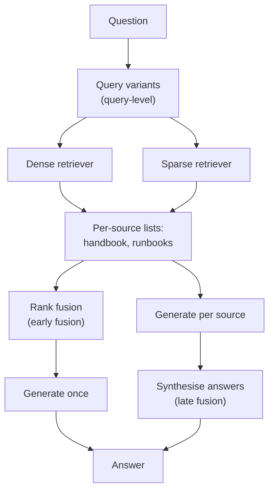

Every pattern so far in this module has, somewhere, more than one of something: several query variants, several retrievers, several sources, several drafts. Whenever a pipeline has more than one of something, it must eventually combine them into one. **Fusion-based RAG** is the family of architectures that make that combination the central design decision. The best-known member is **RAG-Fusion**: generate several versions of the user's question, retrieve for each, merge the result lists with Reciprocal Rank Fusion, and generate from the merged list. But fusion can happen at several other points in a pipeline, and choosing *where* to fuse matters as much as choosing *how*.

This lesson builds on two earlier ones and does not repeat them: [Reciprocal Rank Fusion](/learn/hybrid-search/reciprocal-rank-fusion) covers the RRF formula and its parameter, and [Multi-query retrieval](/learn/advanced-retrieval/multi-query-retrieval) covers generating query variants. Here the subject is the architecture: the levels at which fusion can happen, how they combine into a fusion grid, what each level costs, and the surprising way in which adding more lists to a fusion can make results worse. You will measure that on the Meridian corpus.

## Learning objectives

- Describe RAG-Fusion as an end-to-end pattern and place it among the other levels of fusion: retriever, source, passage-in-model and answer.
- Calculate the number of retrieval calls in a fusion grid and its effect on latency and load.
- Run a fusion ablation and explain why adding a weak result list can lower quality, and how weighting or removing it helps.
- Choose between early fusion (merge ranked lists) and late fusion (merge answers) for a given requirement.
- Explain how Fusion-in-Decoder fuses evidence inside the model and why that differs from prompt concatenation.

## Prerequisites

- [Reciprocal Rank Fusion](/learn/hybrid-search/reciprocal-rank-fusion): the merging formula used throughout.
- [Multi-query retrieval](/learn/advanced-retrieval/multi-query-retrieval): generating query variants.
- [Hybrid retrieval architecture](/learn/hybrid-search/hybrid-retrieval-architecture): fusing dense and sparse retrievers.
- [Modular RAG](/learn/advanced-rag-patterns/modular-rag): the branching flow pattern.

## Why this matters

A single query, sent to a single retriever over a single index, gives one ranked list, and any one of those three can be the weak link. The phrasing may be unusual, the retriever may be blind to exact codes, or the answer may live in a different system. Fusion hedges each of these by asking more than once and combining. Done well, it is one of the most reliable ways to raise recall without training anything.

Done carelessly, it multiplies cost and can reduce quality. A fusion of three query variants across two retrievers and three sources is $3 \times 2 \times 3 = 18$ retrieval calls per question. If one of those lists is systematically noisy, rank fusion treats its top results with the same respect as everyone else's, and they can push the right chunk down. Engineers who adopt "RAG-Fusion" from a blog post often never measure which of their lists are helping. This lesson gives you the map and the measurement.

## The intuition

Imagine you need to find the right page in Meridian's documentation, and you ask three colleagues, each in their own way: one searches the handbook by meaning, one searches the IT wiki by keyword, one asks around. Each comes back with a short ranked list. You do not compare how *confident* each one sounded, because they express confidence differently; you look at where each one *ranked* each page, and favour pages that appear high on several lists. That is rank fusion.

Now notice two refinements. First, you could ask each colleague the question in several phrasings and get more lists: query-level fusion. Second, instead of pooling their *lists*, you could ask each colleague to *answer* the question and then reconcile the answers: answer-level fusion. And there is a caution: if one colleague always returns pages that merely share a word with your question, adding their list to the pool makes your decision worse, unless you trust them less.

## How it works

### RAG-Fusion

RAG-Fusion was described by Adrian Raudaschl in 2023 as an open-source project and article, and later evaluated in a product-information setting by Rackauckas (2024). The pipeline:

1. **Generate query variants.** A language model rewrites the user's question into several related queries (the original is usually kept too).
2. **Retrieve for each variant** independently, usually in parallel.
3. **Fuse** the ranked lists with Reciprocal Rank Fusion into one ranking.
4. **Generate** the answer from the top fused passages, with the original question.

Steps 1 and 2 are multi-query retrieval; what makes it RAG-Fusion is the commitment to RRF as the merge and to the end-to-end pattern. Rackauckas reported that answers were judged more comprehensive, and also noted drawbacks: longer response times from the extra model call and retrievals, and answers that sometimes drifted when generated variants strayed from the original intent. Both observations match what you would predict from the mechanism.

### The levels of fusion

RAG-Fusion fuses at the query level. There are four other places to fuse, and real systems often combine several:

| Level | What is fused | Typical merge | Example |
| --- | --- | --- | --- |
| Query | Lists from several phrasings of the question | RRF | RAG-Fusion, multi-query |
| Retriever | Lists from different retrieval methods | RRF or [weighted score fusion](/learn/hybrid-search/weighted-score-fusion) | Dense plus BM25 hybrid |
| Source | Lists from different indexes or systems | RRF with per-source weights or quotas | Handbook, IT runbooks, product docs |
| Passage, inside the model | Evidence from many passages, inside a neural network | Learned by the model | Fusion-in-Decoder |
| Answer | Answers generated separately from different evidence | A synthesis or selection step | Per-source answers then reconcile; [Speculative RAG](/learn/advanced-rag-patterns/speculative-rag) |

The first three are **early fusion**: ranked lists are merged before generation, and the model sees one combined context. The last is **late fusion**: separate answers are produced first and then combined. Fusion inside the model sits in between.



### The fusion grid

When several levels are combined, every query variant goes to every retriever over every source. The number of ranked lists is the product:

$$
N_{\text{lists}} = N_{\text{queries}} \times N_{\text{retrievers}} \times N_{\text{sources}}
$$

Three variants, two retrievers and three sources give 18 lists. Each list is a retrieval call, and RRF then merges all 18 at once. You can also fuse hierarchically, for example fusing retrievers within each source first and then fusing sources, which lets you apply per-source rules (quotas, weights, permission checks) at the right level.

Two properties of the grid matter. **Recall can only grow** with more lists: a chunk found by any list is in the union. **Precision at the top can fall**: RRF rewards appearing on many lists, so a weak list that consistently ranks some irrelevant chunk highly adds votes for it. That is why per-list weights exist (see [weighted RRF](/learn/hybrid-search/reciprocal-rank-fusion)), and why every list in the grid should earn its place in an ablation.

### Late fusion: merging answers

Sometimes merging lists is the wrong move. If the handbook says one thing and a team wiki says another, a single prompt containing both invites the model to blend them. Late fusion keeps them apart: generate an answer from each source separately, then run a synthesis step that compares the answers, notes agreement and conflict, and attributes each claim to its source. Late fusion costs one generation per source plus the synthesis, and is worth it when sources have different authority, when conflicts must be surfaced rather than blended, or when each source has its own access rules. It is the [multi-document synthesis](/learn/generation-strategies/multi-document-synthesis) problem with the documents grouped by source.

### Fusion inside the model: Fusion-in-Decoder

**Fusion-in-Decoder** (FiD; Izacard and Grave, 2021) is a model architecture rather than a pipeline. An encoder-decoder model (T5 in the paper) encodes each retrieved passage *separately*, each paired with the question. The decoder then attends over all the encoded passages together while generating the answer. Because the encoder's cost grows linearly with the number of passages rather than quadratically with one long concatenated input, FiD could use many passages (up to 100 in the paper), and its accuracy improved as more passages were added. FiD requires training such a model and is not something you can do with a hosted chat model; it matters as the clearest example of evidence fusion done *inside* the network, and as background to the observation that how evidence is combined, not just which evidence is retrieved, shapes answer quality.

## In code

The program runs a fusion ablation over a 20-chunk Meridian corpus and eight questions written in staff vocabulary. Each question has two query variants written by hand, as an LLM rewriter might produce them. Five configurations are compared: a single dense query; RAG-Fusion with three queries over dense retrieval; a single query over hybrid dense plus BM25; the full grid of three queries times two retrievers; and the same grid with the BM25 lists given a weight of 0.3. The metrics are hit@1 and hit@3 (did the gold chunk rank first, or in the top three) and MRR.

```bash
pip install sentence-transformers rank-bm25 numpy
```

```python
import re
import numpy as np
from rank_bm25 import BM25Okapi
from sentence_transformers import SentenceTransformer

CHUNKS = [
    "Annual leave is 25 days per year.",                                    # 0
    "Up to 5 unused leave days carry over and must be used by 31 March.",   # 1
    "Staff may work remotely up to 3 days a week.",                         # 2
    "The home-office equipment budget is £400; contractors are not eligible.",  # 3
    "Expenses must be submitted within 30 days of purchase.",               # 4
    "Any expense over £75 needs a receipt.",                                # 5
    "Passwords must be rotated every 90 days.",                             # 6
    "VPN is required on public Wi-Fi.",                                     # 7
    "Error E-4021 means the VPN client is out of date; update it from the IT portal.",  # 8
    "Error E-4012 means the VPN certificate has expired.",                  # 9
    "The laptop refresh cycle is 3 years.",                                 # 10
    "Support desk hours are 08:00 to 18:00 UK time.",                       # 11
    "Lost laptops must be reported to the support desk at once.",           # 12
    "Meridian Reports exports to PDF and CSV.",                             # 13
    "Leave requests are approved by your line manager in the HR portal.",   # 14
    "Office desks are booked through the facilities app.",                  # 15
    "Taxi fares to client sites are a valid business expense.",             # 16
    "Laptops are encrypted and managed by IT.",                             # 17
    "Remote access to internal tools requires single sign-on.",            # 18
    "Passwords must be at least 14 characters long.",                       # 19
]

# Each question has a gold chunk and two variants, as an LLM rewriter might produce them.
EVAL = [
    ("how many WFH days are allowed", 2,
     ["how many days per week can staff work from home", "remote working allowance days per week"]),
    ("deadline for claiming a taxi fare", 4,
     ["how long do I have to submit an expense claim", "expense submission time limit"]),
    ("money for a desk and chair at home", 3,
     ["home office equipment allowance", "budget for buying home-office furniture"]),
    ("can I roll over unused PTO", 1,
     ["do unused annual leave days carry over", "leave carry-over rules"]),
    ("the VPN says E-4012", 9,
     ["what does VPN error E-4012 mean", "VPN certificate error E-4012"]),
    ("when will I get a new laptop", 10,
     ["how often are laptops replaced", "laptop refresh cycle"]),
    ("what time does the helpdesk close", 11,
     ["support desk opening hours", "when is IT support available"]),
    ("my laptop was nicked on the train", 12,
     ["what to do if my laptop is stolen", "reporting a lost laptop"]),
]

tok = lambda t: re.findall(r"[a-z0-9£\-]+", t.lower())
embedder = SentenceTransformer("sentence-transformers/all-MiniLM-L6-v2")
chunk_vecs = embedder.encode(CHUNKS, normalize_embeddings=True)
bm25 = BM25Okapi([tok(c) for c in CHUNKS])

def dense(q, n=10):
    s = chunk_vecs @ embedder.encode([q], normalize_embeddings=True)[0]
    return [int(i) for i in np.argsort(-s)[:n]]

def sparse(q, n=10):
    s = bm25.get_scores(tok(q))
    return [int(i) for i in np.argsort(-s, kind="stable")[:n] if s[i] > 0]

def rrf(lists, weights, k=60):
    scores = {}
    for lst, w in zip(lists, weights):
        for rank, doc in enumerate(lst, start=1):
            scores[doc] = scores.get(doc, 0.0) + w / (k + rank)
    return sorted(scores, key=lambda d: (-scores[d], d))

def fuse(question, variants, retrievers, use_variants):
    """Fusion grid: every query variant through every (retriever, weight) pair, then RRF."""
    queries = [question] + (variants if use_variants else [])
    pairs = [(r(q), w) for q in queries for r, w in retrievers]
    return rrf([p[0] for p in pairs], [p[1] for p in pairs]), len(pairs)

CONFIGS = [
    ("single query, dense",            [(dense, 1.0)],                False),
    ("RAG-Fusion (3 queries), dense",  [(dense, 1.0)],                True),
    ("single query, hybrid",           [(dense, 1.0), (sparse, 1.0)], False),
    ("3 queries x hybrid",             [(dense, 1.0), (sparse, 1.0)], True),
    ("3 queries x hybrid, BM25 x 0.3", [(dense, 1.0), (sparse, 0.3)], True),
]

print(f"{'configuration':<34}{'lists':>6}{'hit@1':>7}{'hit@3':>7}{'MRR':>6}")
for name, retrievers, use_variants in CONFIGS:
    h1 = h3 = mrr = 0.0
    for question, gold, variants in EVAL:
        ranking, n_lists = fuse(question, variants, retrievers, use_variants)
        pos = ranking.index(gold) + 1 if gold in ranking else None
        h1 += pos == 1
        h3 += pos is not None and pos <= 3
        mrr += 1 / pos if pos else 0
    n = len(EVAL)
    print(f"{name:<34}{n_lists:>6}{h1 / n:>7.2f}{h3 / n:>7.2f}{mrr / n:>6.2f}")
```

```output
configuration                      lists  hit@1  hit@3   MRR
single query, dense                    1   0.75   1.00  0.85
RAG-Fusion (3 queries), dense          3   1.00   1.00  1.00
single query, hybrid                   2   0.50   0.75  0.65
3 queries x hybrid                     6   0.62   0.88  0.77
3 queries x hybrid, BM25 x 0.3         6   0.75   0.88  0.84
```

### Reading the results

- **Single dense query** ranks the gold chunk first for six of eight questions. The two misses are vocabulary problems: "how many WFH days" puts the leave chunks above the remote-work chunk, and "deadline for claiming a taxi fare" puts the taxi-expense chunk (16) above the 30-day rule (4).
- **RAG-Fusion** fixes both. The variants "how many days per week can staff work from home" and "how long do I have to submit an expense claim" retrieve the right chunks first, and RRF lifts them to the top because they appear high on two or three of the lists. Hit@1 reaches 1.00 at the price of three retrievals instead of one, plus, in production, the model call that writes the variants.
- **Adding BM25 makes things worse.** A single hybrid query drops to 0.50 hit@1. BM25 matches on words such as "desk" (pulling in support-desk chunks for the home-desk question) and "laptop" (pulling in the refresh-cycle chunk for the stolen-laptop question), and RRF gives those lists equal votes. The full grid of six lists recovers some ground, because the dense variants outvote BM25, but stays below RAG-Fusion alone.
- **Down-weighting BM25 to 0.3** helps (MRR 0.84 against 0.77) but still does not beat dense RAG-Fusion on this data.

The conclusion is specific to this corpus. These questions are paraphrase problems, which dense retrieval with query variants handles well; there are no part numbers or rare identifiers for BM25 to rescue (the one E-code question was answered by dense retrieval in every configuration). On a corpus full of ticket IDs and product codes, BM25 lists would earn their votes, and the ablation would say so. The general lessons are that **fusion amplifies whatever lists you feed it**, that each list (or level) must be justified by measurement, and that per-list weights are the first tool for a list that helps on some questions but adds noise on others.

Key lines: `fuse` builds the grid explicitly as every query through every (retriever, weight) pair, which makes the cost visible as the `lists` column. `rrf` takes per-list weights and breaks ties by chunk ID (`(-scores[d], d)`), so results are deterministic; without a tie-break, equal RRF scores, which are common, would order arbitrarily between runs. `sparse` drops zero-score BM25 results, for the reason explained in [Advanced RAG](/learn/advanced-rag-patterns/advanced-rag): otherwise a query with no keyword overlap contributes a list of arbitrary chunks.

**Common errors.** Fusing lists of very different lengths (one retriever returns 100, another 10) gives the long list more chances to vote for marginal chunks; cap every list at the same depth. Forgetting the original question in the variant set lets a drifting rewriter take over completely. Generating the answer from the *variants* rather than the original question changes what is being answered.

**Extending it.** Split the corpus into two sources (handbook and IT) with separate indexes, add a third fusion level, and compare flat fusion of all lists against hierarchical fusion (retrievers within each source first, then sources). Replace the hand-written variants with an LLM rewriter as in [Multi-query retrieval](/learn/advanced-retrieval/multi-query-retrieval), and add a column measuring how often a variant retrieves nothing relevant: a direct measure of drift.

## A real-world example

AskMeridian searches three sources: the employee handbook (HR team), the IT runbooks, and Meridian Reports product documentation. The first design put everything in one Qdrant collection with a source field. When the documentation team moved product docs to their own search service with its own ranking, the Platform team had to fuse results across systems whose scores were not comparable, and introduced source-level RRF.

Two problems surfaced. First, the product-docs service returned 50 results per query while the Qdrant searches returned 10, so product pages crowded the fused top ten for questions that had nothing to do with the product. Capping every list at 10 fixed it. Second, for questions such as "can I export my expense report as a CSV?", which sit between HR policy and the product, early fusion put a handbook passage about expense reports next to a product page about CSV export, and the model blended them into a confident answer about a feature the finance team did not use. The team switched such questions, identified by a classifier, to late fusion: one answer from the handbook, one from the product docs, and a synthesis step instructed to present them separately with sources. Late fusion cost an extra generation for those questions, a small share of traffic, and removed the blended answers.

They also tried full RAG-Fusion on everything, three LLM-generated variants per question across all three sources, nine lists. Recall improved slightly on the evaluation set, but the variant-generation call added a fixed delay to every request. They kept query variants only for questions where the first retrieval's top reranker score was low, a [Corrective RAG](/learn/advanced-rag-patterns/corrective-rag)-style trigger, so most questions paid nothing.

## Common mistakes

- **Adding lists without measuring them.** A noisy list adds votes for irrelevant chunks; fusion is not automatically an improvement.
- **Unequal list depths.** A source that returns far more results gets more chances to place marginal chunks in the fused top $k$.
- **Fusing raw scores across systems.** Scores from different retrievers or services are on unrelated scales; use rank-based fusion or calibrate first.
- **Early fusion of conflicting sources.** Putting two authorities that disagree into one prompt invites the model to blend them; use late fusion and surface the conflict.
- **No deterministic tie-breaking.** RRF ties are common, and arbitrary ordering makes results and evaluations flap between runs.
- **Variants without the original question.** A drifting rewriter can steer retrieval away from what was asked.

## Best practices

- Decide the fusion level deliberately: query for phrasing problems, retriever for identifier problems, source for multiple systems, answer for conflicting authorities.
- Ablate the grid: measure each level and each list's contribution, and drop or down-weight lists that do not pay.
- Cap all lists at the same depth before fusing, and break ties deterministically.
- Keep the original question among the variants, and generate from the original question.
- Fuse hierarchically when sources need their own rules (permissions, quotas, weights).
- Trigger expensive fusion (LLM-generated variants) only when a cheaper first pass looks weak.

## Performance considerations

Retrieval calls scale with the grid: $N_{\text{queries}} \times N_{\text{retrievers}} \times N_{\text{sources}}$. If all calls run in parallel, latency is roughly the slowest call plus the fusion step (negligible: RRF over a few hundred items takes microseconds), but load on the back ends multiplies by the grid size. At 20 queries per second, an 18-list grid means 360 retrieval calls per second across the back ends, which may require more replicas than the single-query design.

Query variants add a model call *before* retrieval, on the critical path. If it takes 600 ms and retrieval takes 50 ms, RAG-Fusion's retrieval stage takes about 650 ms instead of 50. Two mitigations: run the original query's retrieval immediately while variants are being generated, and fuse when they arrive; or generate variants with a small, fast model.

Late fusion multiplies *generation*, the most expensive stage: three sources means three generations plus a synthesis, about four times the generation cost of early fusion. Use it for the questions that need it, not as a default.

## Security considerations

Every list in a fusion grid is a path into the prompt, so every retriever and source must apply the user's permissions itself; a fused list is only as safe as its least careful source. Rank fusion also rewards chunks that appear on many lists, so an attacker who can plant several near-copies of a document, or a document stuffed with many phrasings of popular questions, can collect votes across variants and retrievers. De-duplicate near-identical chunks before fusing, and treat sources by trust level, for example by weighting or quota, as in [Retrieval manipulation](/learn/rag-security-fundamentals/retrieval-manipulation).

## Summary

- Fusion-based RAG makes combining multiple result lists or answers the central design decision; RAG-Fusion fuses query variants with RRF and generates once.
- Fusion can happen at the query, retriever, source, in-model (Fusion-in-Decoder) and answer levels; the first three are early fusion, answer-level is late fusion.
- A fusion grid issues $N_{\text{queries}} \times N_{\text{retrievers}} \times N_{\text{sources}}$ retrieval calls; recall can only grow with more lists, but precision at the top can fall.
- Weak lists add votes for irrelevant chunks; measure every list, weight or drop the weak ones, cap depths, and break ties deterministically.
- Use late fusion when sources conflict or differ in authority, at the cost of one generation per source plus synthesis.

## Exercises

1. A system uses four query variants (including the original), dense and BM25 retrievers, and three sources. How many lists are fused per question? At 15 questions per second, how many retrieval calls per second reach the back ends?

<details><summary>Show solution</summary>

$4 \times 2 \times 3 = 24$ lists per question. At 15 questions per second that is $15 \times 24 = 360$ retrieval calls per second.

</details>

2. In the ablation, the single-query hybrid configuration is worse than single-query dense. Using the explanation in the lesson, predict what would happen on a corpus where most questions quote ticket numbers like "INC-20931", and why.

<details><summary>Show solution</summary>

Hybrid would likely beat dense. Embedding models represent arbitrary identifiers poorly, so dense retrieval tends to return chunks about similar tickets, while BM25 matches the exact token "inc-20931" and ranks the right chunk first. The BM25 list would then contribute correct votes rather than noise. The point is that the value of each list depends on the corpus and query mix, which is why the ablation must be run on your own data.

</details>

3. Modify `fuse` to perform hierarchical fusion: for each query, fuse the dense and sparse lists first (with their weights), then fuse the per-query results with equal weights. Compare the output with the flat "3 queries x hybrid" row.

<details><summary>Show solution</summary>

```python
def fuse_hierarchical(question, variants, retrievers, use_variants):
    queries = [question] + (variants if use_variants else [])
    per_query = [rrf([r(q) for r, _ in retrievers], [w for _, w in retrievers]) for q in queries]
    return rrf([lst[:10] for lst in per_query], [1.0] * len(per_query)), len(queries) * len(retrievers)
```

Run it with `[(dense, 1.0), (sparse, 1.0)]` and compare. The ranking can differ from flat fusion because each query's hybrid list now counts as one vote, so a chunk ranked highly by BM25 for one query no longer gets as many separate votes. Whether it is better is an empirical question; note that the per-query lists are truncated to 10 so that every vote list has the same depth.

</details>

4. Design: AskMeridian receives a question about expenses that touches both the handbook (HR policy) and the Meridian Reports documentation (product feature). The two sometimes use the same words with different meanings. Choose early or late fusion and justify, and describe the synthesis prompt's key instruction.

<details><summary>Show solution</summary>

Late fusion. The two sources have different authority and vocabulary, and early fusion would put both in one context where the model may blend a policy rule with a product feature. Generate one answer from each source, each with its own citations, then synthesise. The key instruction for synthesis: present what each source says separately with attribution, state explicitly where they address different things or conflict, and do not combine claims from different sources into a single statement. The cost is two generations plus synthesis for this class of question only.

</details>

## Check your understanding

```quiz
[
  {"q": "What are the steps of RAG-Fusion?", "options": ["Retrieve, rerank, generate", "Generate query variants, retrieve for each, fuse with RRF, generate", "Generate several answers and vote", "Cluster passages and draft in parallel"], "answer": 1, "why": "RAG-Fusion is query-level fusion: variants, separate retrievals, Reciprocal Rank Fusion, then one generation."},
  {"q": "A fusion grid has 3 query variants, 2 retrievers and 2 sources. How many ranked lists are fused?", "options": ["7", "12", "6", "3"], "answer": 1, "why": "The number of lists is the product: 3 x 2 x 2 = 12."},
  {"q": "Why can adding another ranked list to an RRF fusion lower precision at the top?", "options": ["RRF ignores ranks", "A noisy list adds votes for irrelevant chunks, which can push the right chunk down", "More lists always reduce recall", "RRF only works with two lists"], "answer": 1, "why": "Recall can only grow with more lists, but each list votes; a weak list's votes for irrelevant chunks dilute the ranking."},
  {"q": "When is late fusion (merging answers) preferable to early fusion (merging lists)?", "options": ["When latency must be minimal", "When sources conflict or differ in authority and conflicts must be surfaced rather than blended", "When there is only one source", "When using BM25"], "answer": 1, "why": "Late fusion keeps sources apart until synthesis, so disagreements can be attributed and shown; it costs extra generations."},
  {"q": "What distinguishes Fusion-in-Decoder from concatenating passages into a prompt?", "options": ["It uses no retrieval", "Each passage is encoded separately with the question and the decoder attends over all of them, so cost grows linearly with the number of passages", "It fuses answers rather than passages", "It requires BM25"], "answer": 1, "why": "FiD encodes passages independently and fuses evidence in the decoder, which let it scale to many passages; it is a trained architecture, not a prompting technique."}
]
```

## Further reading

- Rackauckas, Z. (2024). *RAG-Fusion: a New Take on Retrieval-Augmented Generation.* [arXiv:2402.03367](https://arxiv.org/abs/2402.03367).
- Cormack, G. V., Clarke, C. L. A. and Büttcher, S. (2009). *Reciprocal Rank Fusion outperforms Condorcet and individual Rank Learning Methods.* SIGIR 2009.
- Izacard, G. and Grave, E. (2021). *Leveraging Passage Retrieval with Generative Models for Open Domain Question Answering* (Fusion-in-Decoder). [arXiv:2007.01282](https://arxiv.org/abs/2007.01282).
- Raudaschl, A. (2023). *RAG-Fusion* project and article, which introduced the pattern (cited by title and author; no link given).
