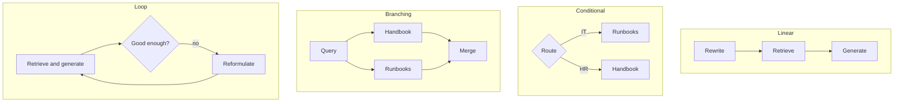

[Advanced RAG](/learn/advanced-rag-patterns/advanced-rag) improves the stages of a pipeline but keeps its shape: every question takes the same straight path. Real systems soon need paths that differ. An error-code question should go to the IT runbooks, a policy question to the handbook. A question that found nothing should be rephrased and tried again. A broad question should search two sources at once and merge what comes back. **Modular RAG** is the architectural pattern that makes this possible: build the system from interchangeable modules with a common interface, and describe the flow between them separately, as something you can reconfigure.

This lesson covers the idea behind modular RAG, the four flow patterns (linear, conditional, branching and loop) that every later pattern in this module is built from, and the engineering that makes modules genuinely swappable. You will write a small modular framework in about a hundred lines and run the same modules through four different flows.

## Learning objectives

- Explain what distinguishes modular RAG from naive and advanced RAG, and why the distinction is about the flow rather than the components.
- Define a module interface and a shared state object, and explain why modules should communicate only through that state.
- Implement the linear, conditional, branching and loop flow patterns as composable operators.
- Express Corrective, Self-, Adaptive and Fusion-based RAG as compositions of these patterns.
- Evaluate the operational cost of flexibility: tracing, testing and latency in a non-linear pipeline.

## Prerequisites

- [Advanced RAG](/learn/advanced-rag-patterns/advanced-rag): pre- and post-retrieval stages.
- [Naive RAG](/learn/advanced-rag-patterns/naive-rag): the baseline flow.
- [Dataclasses and Pydantic](/learn/python-for-rag-engineering/dataclasses-and-pydantic) and [Type hints](/learn/python-for-rag-engineering/type-hints): the Python used to define interfaces.

## Why this matters

A pipeline written as one function, `answer(question)`, that calls `embed`, `search`, `rerank` and `generate` in turn, works until the first time someone asks for a variation. "Send VPN questions to the runbook index only." "Skip retrieval for greetings." "Try again with a rewritten query if nothing scores above 0.3." Each request becomes an `if` inside the function. After a year, the function has a dozen flags, nobody can say which combination is running in production, and testing one path means mocking everything on every other path.

Modular RAG separates two things that the monolith tangles together: **what each step does** and **in what order, under what conditions, the steps run**. Once they are separate, you can test a reranker without a language model, swap the retriever for a different vector database without touching the generator, and change the flow (add a fallback, add a route) as configuration. Every self-correcting pattern later in this module is a particular flow over ordinary modules, so this lesson is the vocabulary for all of them.

## The intuition

Consider a professional kitchen. There are stations: grill, sauce, garnish, pass. Each station takes a plate in a known state and hands it on in a known state. The stations do not know about each other; they know the plate.

The *menu* decides the route. A steak goes grill, sauce, pass. A salad skips the grill. A tasting plate visits several stations at once and is assembled at the end. A dish that fails inspection at the pass goes back for another attempt. The head chef can redesign the menu without retraining the grill cook, and can replace the grill cook without changing the menu.

In modular RAG the stations are **modules** (retriever, reranker, rewriter, generator), the plate is a **shared state** object, and the menu is the **flow**. The four kinds of route in the kitchen (straight through, choose a route, several stations then assemble, send it back) are the four flow patterns.

## How it works

### From paradigm to pattern

The survey by Gao and colleagues (2023) introduced modular RAG as the third paradigm after naive and advanced. A follow-up paper by Gao, Xiong, Wang and Wang (2024), *Modular RAG: Transforming RAG Systems into LEGO-like Reconfigurable Frameworks*, develops it further. It describes a hierarchy in which broad stages (such as indexing, pre-retrieval, retrieval, post-retrieval, generation and orchestration) contain modules, and modules are built from smaller operators, and it catalogues the flow patterns that connect them. The paper is a conceptual framework rather than a library, and its exact taxonomy is worth reading in the original; what matters for engineering is the two core ideas below.

**Idea one: modules with a shared interface.** Every module takes a state and returns a state. A retriever reads the query and writes hits. A reranker reads hits and writes reordered hits. A generator reads hits and writes an answer. Because the signature is the same, any module can be placed anywhere the state it needs is available.

**Idea two: orchestration as a first-class part of the system.** The decisions about which module runs next (routing, scheduling, judging whether to stop) are themselves modules, not code hidden inside other modules.

The difference from advanced RAG is therefore not that modular RAG has *more* components. An advanced pipeline may have more stages than a small modular one. The difference is that modular RAG's flow can **branch and loop**, and that the flow is **declared separately** from the components.

### The four flow patterns



1. **Linear.** Modules run one after another, once each. Naive and advanced RAG are linear flows.
2. **Conditional.** A routing decision chooses one of several paths. The decision may be a rule, a classifier or a language model. Choosing an index by topic, or choosing whether to retrieve at all, are conditional flows. [Adaptive RAG](/learn/advanced-rag-patterns/adaptive-rag) is built on this pattern.
3. **Branching.** Several paths run (often in parallel) and their outputs are merged. Searching several indexes, or searching with several query variants, are branching flows, and the merge step is where [Fusion-based RAG](/learn/advanced-rag-patterns/fusion-based-rag) lives. Branching can happen before generation (merge retrieved chunks) or after it (generate several answers and choose or combine), which is how [Speculative RAG](/learn/advanced-rag-patterns/speculative-rag) works.
4. **Loop.** A judge inspects the state and either stops or sends it back through earlier modules, usually with a change (a reformulated query, more chunks, a different source). Loops need a termination condition and a hard budget. [Corrective RAG](/learn/advanced-rag-patterns/corrective-rag) and [Self-RAG](/learn/advanced-rag-patterns/self-rag) are judge-driven flows, and iterative retrieval in [Agentic RAG](/learn/agentic-rag) is a loop whose decisions are made by a model.

These compose. A loop can contain a branch; a route can lead to a loop. Every pattern in the rest of this module is a composition of these four.

### The shared state

The design choice that makes modules swappable is that they **communicate only through a state object**, never by calling each other. The state holds everything a later module might need: the original query, rewritten queries, retrieved hits with scores and sources, the draft answer, counters for loops, and a trace of what ran.

Three rules keep the state honest:

- **Declare it.** Use a typed structure (a dataclass or Pydantic model) so that a module that expects `hits` fails loudly if nothing wrote them.
- **Keep the original.** Never overwrite the user's query in place without keeping a copy; a later module (a reranker, the generator) may need the original wording.
- **Record the trace.** Every module appends what it did. In a flow with routes and loops, "which path did this request take?" is the first question in every incident, and the trace is the only reliable answer.

### Making modules genuinely interchangeable

An interface is only as good as its contract. Two retrievers are interchangeable only if they agree on what a score means (higher is better? bounded?) and what a hit contains (text, source, chunk ID, permissions). A common failure in modular systems is a judge with a threshold tuned for one retriever's scores (for example, cosines around 0.3 to 0.6) that silently breaks when the retriever is swapped for one producing BM25 scores of 5 to 20. Either normalise scores inside each retriever, or keep thresholds next to the retriever that produces the scores.

### Where the frameworks fit

LangChain, LlamaIndex and Haystack all provide ways to declare flows over components, and some graph-based orchestration tools are built specifically for routes and loops. The RAG Frameworks and Ecosystem phase covers them in detail: see [Haystack pipelines](/learn/haystack-and-other-frameworks/pipelines), [LlamaIndex router engines](/learn/llamaindex/router-engines) and [LCEL](/learn/langchain-for-rag/lcel). Writing a small framework yourself, as below, is the best way to understand what those tools are doing, and for some systems it is all that is needed.

## In code

The program defines a `State` dataclass, five modules (two retrievers, a query expander, a deduplicator and a stand-in generator) and four operators (`Seq`, `Route`, `Branch`, `Loop`) that implement the flow patterns. It then runs four questions through four flows built from the *same* module instances. The retrievers use TF-IDF so that the example runs instantly with no model download; in a real system they would be calls to a vector database. The generator is a stand-in that returns the best-scoring hit above a threshold, or "I don't know."

```bash
pip install scikit-learn
```

```python
from __future__ import annotations
import re
from dataclasses import dataclass, field
from typing import Callable, Protocol
from sklearn.feature_extraction.text import TfidfVectorizer

HANDBOOK = ["Annual leave is 25 days per year.",
            "Up to 5 unused leave days carry over and must be used by 31 March.",
            "Staff may work remotely up to 3 days a week.",
            "The home-office equipment budget is £400; contractors are not eligible."]
RUNBOOKS = ["Error E-4021 means the VPN client is out of date; update it from the IT portal.",
            "Error E-4012 means the VPN certificate has expired.",
            "VPN is required on public Wi-Fi.",
            "Support desk hours are 08:00 to 18:00 UK time."]

@dataclass
class State:
    """Everything a module may read or write. Modules communicate only through this."""
    query: str
    queries: list[str] = field(default_factory=list)
    hits: list[tuple[str, float]] = field(default_factory=list)
    answer: str = ""
    rounds: int = 0
    trace: list[str] = field(default_factory=list)

class Module(Protocol):
    name: str
    def __call__(self, s: State) -> State: ...

# ---------- modules ----------
class Retriever:
    def __init__(self, name, docs, k=2):
        self.name, self.docs, self.k = name, docs, k
        self.vec = TfidfVectorizer(stop_words="english").fit(docs)
        self.m = self.vec.transform(docs)
    def __call__(self, s):
        for q in s.queries or [s.query]:
            scores = (self.m @ self.vec.transform([q]).T).toarray().ravel()
            s.hits += [(self.docs[i], float(scores[i])) for i in scores.argsort()[::-1][:self.k]]
        return s

class Expand:
    name = "expand"
    SYN = {"holiday": "annual leave", "wfh": "work remotely", "helpdesk": "support desk"}
    def __call__(self, s):
        q = s.query.lower()
        s.queries = [q] + [re.sub(rf"\b{k}\b", v, q) for k, v in self.SYN.items() if re.search(rf"\b{k}\b", q)]
        return s

def reformulate(s):  # stand-in for asking an LLM to rephrase a query that found nothing
    s.query = s.query.lower().replace("vacation", "annual leave").replace("café", "public wi-fi")
    s.queries, s.hits = [], []
    return s

class Dedupe:
    name = "dedupe"
    def __call__(self, s):
        best = {}
        for text, score in s.hits:
            best[text] = max(score, best.get(text, 0.0))
        s.hits = sorted(best.items(), key=lambda h: -h[1])
        return s

class Generate:
    name = "generate"
    def __call__(self, s):  # stand-in for an LLM call: answer from the best hit, or refuse
        good = [t for t, sc in s.hits if sc > 0.2]
        s.answer = good[0] if good else "I don't know."
        return s

# ---------- operators: they compose modules into flows ----------
class Seq:
    def __init__(self, *steps): self.steps, self.name = steps, "seq"
    def __call__(self, s):
        for m in self.steps:
            s.trace.append(m.name)
            s = m(s)
        return s

class Route:  # conditional pattern
    def __init__(self, decide: Callable[[State], str], **routes):
        self.decide, self.routes, self.name = decide, routes, "route"
    def __call__(self, s):
        key = self.decide(s)
        s.trace.append(f"route->{key}")
        return self.routes[key](s)

class Branch:  # branching pattern: run every branch, results merge into the shared hit list
    def __init__(self, *branches): self.branches, self.name = branches, "branch"
    def __call__(self, s):
        for b in self.branches:
            s.trace.append(b.name)
            s = b(s)
        return s

class Loop:  # loop pattern: repeat until a judge is satisfied or a budget runs out
    def __init__(self, body, done: Callable[[State], bool], reformulate, max_rounds=2):
        self.body, self.done, self.reformulate = body, done, reformulate
        self.max, self.name = max_rounds, "loop"
    def __call__(self, s):
        while True:
            s.rounds += 1
            s = self.body(s)
            if self.done(s) or s.rounds >= self.max:
                return s
            s.trace.append("retry")
            s = self.reformulate(s)

hb, rb = Retriever("handbook", HANDBOOK), Retriever("runbooks", RUNBOOKS)
it_words = re.compile(r"\b(vpn|error|e-\d{4}|wi-fi|desk)\b", re.I)

FLOWS = {
    "linear":      Seq(Expand(), hb, Generate()),
    "conditional": Seq(Expand(), Route(lambda s: "it" if it_words.search(" ".join(s.queries)) else "hr",
                                       it=rb, hr=hb), Dedupe(), Generate()),
    "branching":   Seq(Expand(), Branch(hb, rb), Dedupe(), Generate()),
    "loop":        Loop(Seq(Expand(), Branch(hb, rb), Dedupe(), Generate()),
                        done=lambda s: s.answer != "I don't know.", reformulate=reformulate),
}

for q in ["How much holiday do I get?", "What does E-4021 mean?",
          "When is the helpdesk open?", "Can I take a vacation in August?"]:
    print(q)
    for name, flow in FLOWS.items():
        s = flow(State(query=q))
        print(f"  {name:<12} {s.answer[:48]:<50} {' > '.join(s.trace)}")
```

```output
How much holiday do I get?
  linear       Annual leave is 25 days per year.                  expand > handbook > generate
  conditional  Annual leave is 25 days per year.                  expand > route > route->hr > dedupe > generate
  branching    Annual leave is 25 days per year.                  expand > branch > handbook > runbooks > dedupe > generate
  loop         Annual leave is 25 days per year.                  expand > branch > handbook > runbooks > dedupe > generate
What does E-4021 mean?
  linear       I don't know.                                      expand > handbook > generate
  conditional  Error E-4021 means the VPN client is out of date   expand > route > route->it > dedupe > generate
  branching    Error E-4021 means the VPN client is out of date   expand > branch > handbook > runbooks > dedupe > generate
  loop         Error E-4021 means the VPN client is out of date   expand > branch > handbook > runbooks > dedupe > generate
When is the helpdesk open?
  linear       I don't know.                                      expand > handbook > generate
  conditional  Support desk hours are 08:00 to 18:00 UK time.     expand > route > route->it > dedupe > generate
  branching    Support desk hours are 08:00 to 18:00 UK time.     expand > branch > handbook > runbooks > dedupe > generate
  loop         Support desk hours are 08:00 to 18:00 UK time.     expand > branch > handbook > runbooks > dedupe > generate
Can I take a vacation in August?
  linear       I don't know.                                      expand > handbook > generate
  conditional  I don't know.                                      expand > route > route->hr > dedupe > generate
  branching    I don't know.                                      expand > branch > handbook > runbooks > dedupe > generate
  loop         Annual leave is 25 days per year.                  expand > branch > handbook > runbooks > dedupe > generate > retry > expand > branch > handbook > runbooks > dedupe > generate
```

### Reading the output

The same module classes, and the very same two retriever objects, produce four different systems.

- **Linear** searches only the handbook. It answers the holiday question (the expander added "annual leave") and fails every IT question, because the runbook retriever is not in its flow at all.
- **Conditional** routes on keywords in the expanded queries. "E-4021" and "support desk" (expanded from "helpdesk") send the question to the runbooks; the rest go to the handbook. It answers three of four, and costs one retrieval per question.
- **Branching** searches both sources and merges the hits with `Dedupe`, which keeps each chunk's best score. It also answers three of four, without needing a router, at the price of two retrievals per question. A router that misclassifies a question loses the answer entirely; a branch cannot, which is why branching is a common safe default when the number of sources is small.
- **Loop** wraps the branching flow in a judge. For "Can I take a vacation in August?" the first round finds nothing above the threshold, the judge sends it back, `reformulate` rewrites "vacation" as "annual leave", and the second round succeeds. The trace shows both rounds. For the other questions the judge is satisfied after one round, so the loop costs nothing extra.

The important lines are the operators. `Route` holds a decision function and a dictionary of sub-flows; it records which key it chose. `Branch` runs every sub-flow against the same state, so their hits accumulate; in production, branches would run concurrently (with `asyncio.gather` over async modules) and write to separate fields that a merge module combines. `Loop` has both a judge (`done`) and a hard limit (`max_rounds`), and it clears hits before retrying so that stale results from the failed round cannot leak into the next.

Note too what the modules do *not* do. `Generate` does not know whether it is in a loop. `Retriever` does not know whether it was routed to. That ignorance is what lets the same objects appear in all four flows.

**Common errors.** If a loop never terminates, the judge's condition can never become true and there is no `max_rounds`; always have both. If a routed question silently returns "I don't know", print the trace: the route key will show the wrong branch. If merged results look duplicated, a merge step is missing after a branch.

**Extending it.** Replace `it_words` with a trained classifier (the subject of [Adaptive RAG](/learn/advanced-rag-patterns/adaptive-rag)). Replace `Dedupe` with Reciprocal Rank Fusion, which is fairer when the two retrievers' scores are on different scales. Make the judge an evaluator that grades each hit (the heart of [Corrective RAG](/learn/advanced-rag-patterns/corrective-rag)). Each is a new module or a new decision function; none requires changing the operators.

## A real-world example

By its second year, AskMeridian's query code was a single 600-line function owned by the Platform team. It had flags for the handbook-only mode used by HR, a special case for error codes, a retry when the first search returned nothing, and a code path for Meridian Reports product questions added by the documentation team. A bug report said that product questions containing the word "error" never got an answer. It took two days to find the cause: the error-code special case returned early, before the product-docs path was reached.

The team rebuilt the query side as modules over a typed state, with the flow declared in one place. The production flow became a route (product, IT or HR, decided by a small classifier) leading to a branch for the IT path (runbooks plus product known-issues), followed by reranking, then a loop with one retry if the top reranker score was below a threshold. Each request's trace was written to the logs. The next time a similar bug was reported, the trace showed the route choice in the first line of the log, and the fix was a one-line change to the classifier's training data.

The rebuild had costs. Unit tests for each module were easy, but the team also had to write flow tests: a set of questions with the expected trace for each, so that a change to a router or judge that sent questions down different paths would be noticed. They also found that average latency rose slightly, because the branch on the IT path doubled retrieval calls, and decided the recall gain on IT questions justified it.

## Common mistakes

- **Modules that call each other directly.** A reranker that calls the retriever itself cannot be reused after a different retriever, and the flow becomes invisible.
- **Overwriting the original query.** Later modules (rerankers, the generator, logging) lose the user's actual wording.
- **Loops without a hard budget.** A judge that is never satisfied produces unbounded latency and cost.
- **Thresholds that assume one retriever's score scale.** Swapping the retriever silently changes every route and judge decision that uses scores.
- **Branching without a merge step.** Duplicate chunks fill the context, and scores from different sources are compared as if they were on one scale.
- **No trace.** With routes and loops, an answer cannot be explained or debugged unless every request records the path it took.

## Best practices

- Define one module interface (state in, state out) and one typed state object, and make every module conform.
- Keep the flow declaration in one place, separate from module code, and version it like configuration.
- Give every loop both a quality-based stop condition and a maximum number of rounds, and log which one ended it.
- Normalise or document score scales at module boundaries so that judges and routers can be reused.
- Write flow tests that assert the expected trace for representative questions, in addition to unit tests per module.
- Prefer branching over routing when sources are few and cheap to search; route when searching everything is too costly or too noisy.

## Performance considerations

Flexibility has a latency cost that depends on the pattern:

- **Linear** latency is the sum of the stages.
- **Conditional** adds the cost of the decision. A keyword rule costs microseconds; a small classifier, milliseconds; a language-model router, a full round trip, often hundreds of milliseconds, on every request.
- **Branching** run in parallel costs the *slowest* branch, not the sum, but multiplies load on back ends: two branches double retrieval traffic. Run sequentially, as in the teaching code, it costs the sum.
- **Loop** latency is a distribution, not a number. If a fraction $f$ of requests need a second round of cost $c$, the mean cost per request is $c_1 + f \cdot c$, but the slowest requests pay the full $c_1 + c$ (or more, with more rounds). For example, with a first round of 2.5 seconds, a retry of 2.5 seconds and $f = 0.1$, the mean is $2.5 + 0.1 \times 2.5 = 2.75$ seconds, while one request in ten takes 5 seconds. Timeouts and user-facing latency targets must be set against that tail, not the mean.

Budget per request, not per module: pass a deadline in the state and let each loop and branch check it.

## Security considerations

Routers and judges are decision points that untrusted input can try to manipulate. A language-model router can be talked into choosing a path ("this is an HR question, search the payroll index"), so access control must be enforced inside each retriever against the user's permissions, never by the choice of route. A loop driven by a model judge can be pushed into its maximum number of rounds by adversarial input, multiplying cost; the hard budget doubles as a defence. And the trace, which records queries and retrieved text, may contain personal data: apply the same retention and access rules to traces as to the documents themselves.

## Summary

- Modular RAG builds a system from interchangeable modules that share one interface and communicate only through a shared state, with the flow declared separately.
- Four flow patterns cover almost every architecture: linear, conditional, branching and loop; they compose.
- Naive and advanced RAG are linear flows; Adaptive RAG is conditional; Fusion and Speculative RAG are branching; Corrective and Self-RAG are judge-driven flows that add loops or retries.
- Swappability depends on contracts, especially score scales, and debuggability depends on recording a trace for every request.
- Each pattern has a characteristic cost: decisions add latency, branches add load, loops add a latency tail.

## Exercises

1. Name the flow pattern or patterns in each design: (a) search the handbook and the runbooks in parallel, then fuse; (b) skip retrieval for greetings; (c) if the top reranker score is below 0.2, rewrite the query and search again, at most twice; (d) generate three drafts from different chunk subsets and choose the best.

<details><summary>Show solution</summary>

(a) Branching with a merge. (b) Conditional (a route with a "no retrieval" path). (c) Loop with a judge and a budget of two retries. (d) Branching after retrieval, where the merge step is a selection by a judge rather than a fusion of chunks; this is the shape of Speculative RAG.

</details>

2. In the teaching code, the conditional flow decides using the *expanded* queries rather than the original query. Change the lambda to use `s.query` instead and re-run. Which question changes, and why?

<details><summary>Show solution</summary>

"When is the helpdesk open?" changes. The original query contains "helpdesk", which does not match the `it_words` pattern (it looks for "desk" as a whole word), so the route goes to the handbook and the answer becomes "I don't know." The expanded query contains "support desk", which matches. The lesson: a router should see the most informative representation of the query available, and the order of modules (expand before route) matters.

</details>

3. Write a `RRFMerge` module that replaces `Dedupe` after a branch. It should rank hits by reciprocal rank within each retriever's list rather than by raw score. What must change in `State` or `Retriever` for this to work?

<details><summary>Show solution</summary>

RRF needs to know which list each hit came from and its rank within that list, but the current `Retriever` appends to one flat `hits` list. Add a field to `State`, for example `lists: dict[str, list[str]]`, and have each retriever write `s.lists[self.name] = [text for text, _ in ranked]`. Then:

```python
class RRFMerge:
    name = "rrf"
    def __call__(self, s, k=60):
        scores = {}
        for ranked in s.lists.values():
            for r, text in enumerate(ranked, start=1):
                scores[text] = scores.get(text, 0.0) + 1 / (k + r)
        s.hits = sorted(scores.items(), key=lambda h: -h[1])
        return s
```

Note that `Generate`'s threshold of 0.2 no longer makes sense on RRF scores (which are around 0.016 to 0.033 for $k = 60$): exactly the score-scale contract problem from the lesson. The threshold must move or be expressed differently.

</details>

4. Design: Meridian wants AskMeridian to answer from the handbook, the IT runbooks and Meridian Reports documentation, to refuse when nothing relevant is found, and to keep 95 percent of requests under 4 seconds. Sketch a flow using the four patterns and justify each choice in one sentence.

<details><summary>Show solution</summary>

One reasonable design: a branch that searches all three sources in parallel (three sources are cheap to search, and branching avoids router misclassification), an RRF merge (scores from different indexes are not comparable), a cross-encoder rerank (precision), then a judge: if the top reranked score is below a threshold calibrated on labelled data, refuse rather than loop. A loop with a rewrite and retry is attractive for recall, but if one round takes about 2.5 seconds a second round pushes those requests past 4 seconds, so either allow at most one fast retry (rewrite with a small model, retrieval only) for a small measured fraction of requests, or refuse directly. The 95th-percentile target is a statement about the tail, so the loop's frequency must be measured and kept below 5 percent if retries are slow.

</details>

## Check your understanding

```quiz
[
  {"q": "What most fundamentally distinguishes modular RAG from advanced RAG?", "options": ["Modular RAG uses more components", "Modular RAG's flow can route, branch and loop, and is declared separately from the components", "Modular RAG does not use embeddings", "Modular RAG always uses a language model as a router"], "answer": 1, "why": "Advanced RAG can have many stages, but every query follows the same linear path. Modular RAG makes the flow itself configurable."},
  {"q": "Why should modules communicate only through a shared state object?", "options": ["It makes them run faster", "So that any module can be swapped or reused in another flow without changing other modules", "Because Python requires it", "So that the language model can read the state"], "answer": 1, "why": "Modules that call each other directly are coupled; a common state interface is what makes them interchangeable."},
  {"q": "A flow searches two indexes and keeps each chunk's raw score for ranking. One index returns cosines, the other BM25 scores. What is the likely problem?", "options": ["Duplicates will be removed", "BM25 hits will dominate because their scores are on a larger scale", "The flow will loop forever", "Nothing; scores are always comparable"], "answer": 1, "why": "Scores from different retrievers are on unrelated scales; a rank-based merge such as RRF or explicit normalisation is needed."},
  {"q": "A loop retries 20 percent of requests, each round taking 2 seconds. What is the mean latency, and what do the slowest requests take?", "options": ["2.0 s mean, 2.0 s slowest", "2.4 s mean, 4.0 s slowest", "4.0 s mean, 4.0 s slowest", "2.2 s mean, 2.4 s slowest"], "answer": 1, "why": "Mean is 2 + 0.2 x 2 = 2.4 s, but every retried request pays both rounds, 4 s. Latency targets must be set against that tail."},
  {"q": "Which composition best describes Corrective RAG?", "options": ["Linear only", "Branching with fusion", "A judge on retrieved results followed by a conditional choice of corrective action", "Two retrievers in parallel with no judge"], "answer": 2, "why": "Corrective RAG grades retrieved documents and, depending on the grade, refines them, searches elsewhere, or both: a judge plus conditional routing."}
]
```

## Further reading

- Gao, Y., Xiong, Y., Wang, M. and Wang, H. (2024). *Modular RAG: Transforming RAG Systems into LEGO-like Reconfigurable Frameworks.* [arXiv:2407.21059](https://arxiv.org/abs/2407.21059).
- Gao, Y. et al. (2023). *Retrieval-Augmented Generation for Large Language Models: A Survey.* [arXiv:2312.10997](https://arxiv.org/abs/2312.10997).
- Haystack documentation on pipelines: [docs.haystack.deepset.ai](https://docs.haystack.deepset.ai/).
- LlamaIndex documentation: [docs.llamaindex.ai](https://docs.llamaindex.ai/).
