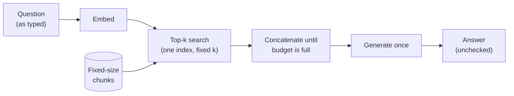
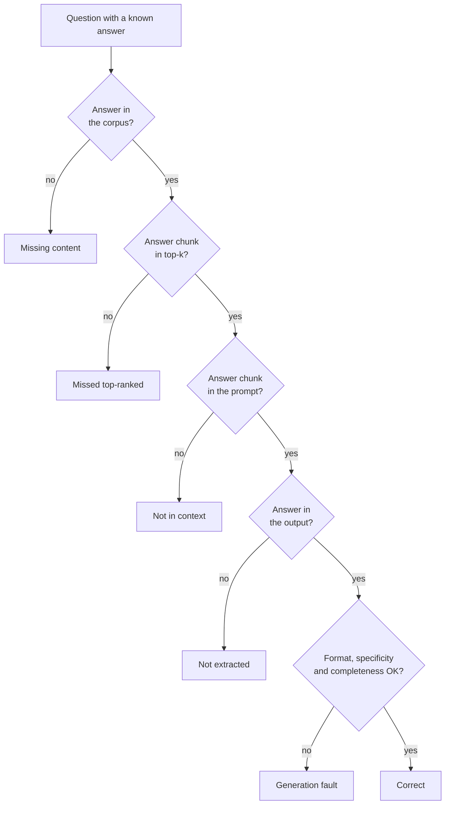

Every architecture in this module starts from the same place: index the documents, retrieve the top few chunks for a question, paste them into a prompt and let the model answer. The research literature calls this baseline **naive RAG**. The name is descriptive, not an insult. Naive RAG is what you should build first, it is what many working systems still are, and every "advanced" pattern in this module is a targeted repair of one of its weaknesses.

This lesson does not re-teach the components; [Traditional RAG architecture](/learn/rag-architecture-fundamentals/traditional-rag-architecture) already drew them. Instead it treats naive RAG as a *pattern* with fixed assumptions, and asks where exactly it breaks. You will build a deliberately plain pipeline over the Meridian handbook, run a test set through it, and write a diagnostic that names the stage at which each wrong answer was lost. That diagnostic is the tool you will use to justify every pattern in the rest of the module.

## Learning objectives

- State the defining assumptions of naive RAG and explain which design decisions it fixes in advance.
- Classify a failed answer by the stage where it was lost: missing content, missed top-ranked, not in context, not extracted, or a generation fault.
- Compute the end-to-end success rate of a pipeline from per-stage success rates and use it to decide where to invest.
- Build a stage-by-stage diagnostic harness for a RAG pipeline and interpret its output.
- Decide whether a failure calls for a fix inside naive RAG or for one of the patterns later in this module.

## Prerequisites

- [Traditional RAG architecture](/learn/rag-architecture-fundamentals/traditional-rag-architecture): the components and the two paths.
- [Context construction](/learn/rag-architecture-fundamentals/context-construction): how chunks become a prompt.
- [Top-K retrieval](/learn/retrieval-fundamentals/top-k-retrieval) and [Recall@K](/learn/retrieval-fundamentals/recall-k): what retrieval returns and how to measure it.
- [Chunk size](/learn/chunking-fundamentals/chunk-size): the trade-off that naive chunking ignores.

## Why this matters

Teams rarely set out to build naive RAG; they build it because it is the first thing that works. A tutorial produces a demo in an afternoon, the demo answers the five questions the team tried, and it ships. Then the complaints arrive: "it told me the wrong budget", "it said it didn't know, but the answer is on page 3", "it answered a question about dogs with something about desks". Without a way to locate the failure, the usual response is to change something at random: a bigger model, a longer prompt, a different embedding model. Some of these changes help one question and break another, and nobody can say why.

The advanced patterns in this module are expensive. [Corrective RAG](/learn/advanced-rag-patterns/corrective-rag) adds an evaluator and a fallback search. [Self-RAG](/learn/advanced-rag-patterns/self-rag) needs a specially trained model. [Speculative RAG](/learn/advanced-rag-patterns/speculative-rag) runs several drafts. Each one fixes a particular failure, and adopting one that fixes a failure you do not have adds latency and cost for nothing. Knowing precisely how naive RAG fails on *your* data is the prerequisite for choosing any of them.

## The intuition

Picture a new intern at Meridian's front desk who has been given one rule: "When someone asks a question, grab the three handbook pages that look most like the question, read only what fits on one index card, and answer from the card."

The rule works surprisingly often. It also fails in ways you can predict without watching him:

- If the handbook has no page on the subject ("can I bring my dog?"), he still grabs three pages, because the rule never says "unless nothing fits". Then he answers from them.
- If the right page uses different words from the question, it does not *look* like the question and he never picks it up.
- If he picks it up but it is the third page and the card is full after two, the answer never makes it onto the card.
- If the answer is on the card but next to something more eye-catching, he reads out the wrong line.

None of these is the intern being stupid. Each is a consequence of the rule: fixed number of pages, judged only by resemblance, a fixed card, one pass, no second look. Naive RAG is that rule written in code.

## How it works

### The pattern and its fixed assumptions

The term "naive RAG" was popularised by the survey by Gao and colleagues (2023), which sorts RAG systems into three paradigms: naive, advanced and modular. The next two lessons cover [Advanced RAG](/learn/advanced-rag-patterns/advanced-rag) and [Modular RAG](/learn/advanced-rag-patterns/modular-rag). In the survey's framing, naive RAG is the "retrieve-read" process: indexing, retrieval and generation, each done once, in that order.

The query path, step by step:

1. **Embed the question** exactly as the user typed it. No rewriting, no expansion, no classification.
2. **Retrieve the top $k$ chunks** by similarity from one index, with $k$ fixed in configuration.
3. **Concatenate the chunks** into the prompt in rank order until a context budget is reached.
4. **Generate once.** The model is asked to answer from the context.
5. **Return the answer.** Nothing checks it.

What makes this pattern *naive* is not any one component but six assumptions baked into the flow:

| Assumption | What it means in practice |
| --- | --- |
| Every question needs retrieval | "Hello" and "what is 2 + 2" trigger a vector search |
| The user's wording is a good query | No rewriting, so vocabulary mismatch goes straight to the index |
| Similarity equals relevance | The top-$k$ are trusted without a second judgement |
| A fixed $k$ suits every question | Simple facts and multi-part questions get the same number of chunks |
| One retrieval is enough | No follow-up search if the first one comes back thin |
| The model will use the context correctly | No check that the answer is supported by what was retrieved |

Each later lesson relaxes one or more of these. Advanced RAG attacks the second and third with query transformation and reranking. [Adaptive RAG](/learn/advanced-rag-patterns/adaptive-rag) drops the first and fourth. Corrective RAG and Self-RAG drop the third and sixth. [Fusion-based RAG](/learn/advanced-rag-patterns/fusion-based-rag) attacks the second by searching with several phrasings at once.



### Where naive RAG fails: the failure points

Barnett and colleagues (2024), in *Seven Failure Points When Engineering a Retrieval Augmented Generation System*, reported on building RAG systems in three domains and named seven places where they failed. The list is the most useful vocabulary available for talking about naive RAG, because each point corresponds to one stage of the pipeline:

1. **Missing content.** The answer is not in the indexed documents at all. The correct behaviour is to say so; naive RAG usually answers anyway from whatever was retrieved.
2. **Missed the top-ranked documents.** The answer is in the corpus but the chunk containing it did not rank within the top $k$.
3. **Not in context.** The chunk was retrieved, but the consolidation step (the context builder) dropped it because the budget was full or it was de-duplicated away.
4. **Not extracted.** The answer is in the prompt but the model failed to pick it out, typically because of noise or contradicting text around it.
5. **Wrong format.** The question asked for a table or a list and the model ignored the instruction.
6. **Incorrect specificity.** The answer is too general or too detailed for the question.
7. **Incomplete.** The answer is right as far as it goes but misses information that was available, common with multi-part questions.

The first four form a chain. A question's answer has to survive each stage in turn, and the first stage that loses it is where the fix belongs. The last three are generation faults that occur even when the answer was in the context.



### How the assumptions produce the failures

Tracing each failure back to an assumption tells you what kind of repair to look for.

**Missing content** comes from the assumption that every question needs retrieval and that the top-$k$ are trustworthy. Retrieval always returns $k$ results, however poor; nothing in the pipeline represents "no good match". The fix is either a relevance threshold or evaluator in front of generation (the idea behind Corrective RAG) or prompting that lets the model refuse, covered in [Refusal behaviour](/learn/prompt-engineering-for-rag/refusal-behaviour).

**Missed top-ranked** usually has one of three causes. *Vocabulary mismatch*: the user says "holiday", the handbook says "annual leave". *Chunk damage*: fixed-size chunking cuts a fact in half, so neither half embeds as being about the whole fact. *Dilution*: a long chunk covering several topics embeds as an average of them and matches none strongly. The repairs (query rewriting, hybrid search, better chunking, reranking) are the content of [Advanced RAG](/learn/advanced-rag-patterns/advanced-rag).

**Not in context** comes from fixed $k$ plus a fixed budget filled in rank order. If the right chunk is ranked third and the budget holds two, it is lost even though retrieval "found" it. Reranking moves it up; compression makes room; a larger budget helps but increases cost and can make extraction harder.

**Not extracted** comes from trusting the model to use the context. The answer competes with distracting neighbours: an outdated policy, a similar-looking figure, a sentence that shares more words with the question. Better ordering, fewer but more relevant chunks, and a stronger model all help; Self-RAG and Corrective RAG attack it by filtering irrelevant passages before or during generation.

> [!KEY]
> Locate before you fix. A failure at stage $n$ cannot be repaired by improving any stage after $n$: no prompt rescues a chunk that was never retrieved, and no reranker rescues an answer that is not in the corpus.

### Why naive RAG remains the right starting point

Despite the list above, naive RAG has real virtues. It has one model call, so latency is low and predictable. It has few moving parts, so it is easy to debug. Its behaviour is deterministic apart from generation, which makes regression testing straightforward. And it sets the baseline that every later improvement must beat on your evaluation set. A team that starts with Self-RAG has no way to know how much of its complexity is paying for itself. Build naive RAG, measure it, then add the smallest change that fixes the largest measured failure.

## The mathematics

### End-to-end success is a product

Because the first four failure points form a chain, the probability that a question with an answer in the corpus is answered correctly is the product of the conditional survival rates at each stage. Write $p_{\text{ret}}$ for the fraction of answerable questions whose answer chunk is in the top $k$, $p_{\text{ctx}}$ for the fraction of those whose chunk survives into the prompt, and $p_{\text{gen}}$ for the fraction of those the model answers correctly. Then

$$
P(\text{correct} \mid \text{answerable}) = p_{\text{ret}} \times p_{\text{ctx}} \times p_{\text{gen}}
$$

The intuition: each stage can only pass on what it received, so losses multiply. The consequence is that the weakest stage dominates, and improving an already strong stage achieves little.

**Worked example.** Suppose a diagnostic run over 200 answerable test questions shows that the answer chunk is in the top 5 for 150 of them, survives into the prompt for 135 of those, and is answered correctly for 121 of those. Then $p_{\text{ret}} = 150/200 = 0.75$, $p_{\text{ctx}} = 135/150 = 0.90$ and $p_{\text{gen}} = 121/135 \approx 0.896$. End-to-end:

$$
0.75 \times 0.90 \times 0.896 \approx 0.605
$$

Now compare two improvements. Raising generation to $0.95$ with a stronger model gives $0.75 \times 0.90 \times 0.95 \approx 0.641$. Raising retrieval to $0.90$ with hybrid search gives $0.90 \times 0.90 \times 0.896 \approx 0.726$. The retrieval fix is worth roughly three times as much, and is often cheaper per query than a larger model.

```python
p_ret, p_ctx, p_gen = 150 / 200, 135 / 150, 121 / 135
base = p_ret * p_ctx * p_gen
better_gen = p_ret * p_ctx * 0.95
better_ret = 0.90 * p_ctx * p_gen
print(f"baseline {base:.3f}  better generator {better_gen:.3f}  better retrieval {better_ret:.3f}")
```

```output
baseline 0.605  better generator 0.641  better retrieval 0.726
```

The numbers here are illustrative, not measurements of any real system. The method is what transfers: measure each stage's conditional rate, multiply, and compute the effect of each candidate fix before building it.

## In code

The program below builds a deliberately naive pipeline over five Meridian documents and then runs a **stage diagnostic**: for each test question with a known answer string, it checks, in order, whether the answer exists in the corpus, whether a retrieved chunk contains it, whether a chunk in the prompt contains it, and whether the final answer contains it. The first check that fails names the failure point.

To keep the example runnable without an API key, the generator is a stand-in: it returns the context sentence that shares the most words with the question. A real language model is far better at extraction than this, but it fails in the same *places*, and the stand-in makes those places visible. The chunk size and context budget are scaled down to match the tiny corpus; in production they would be hundreds of tokens.

Install the dependencies:

```bash
pip install sentence-transformers numpy
```

```python
import re
import numpy as np
from sentence_transformers import SentenceTransformer

DOCS = {
    "handbook-leave": "Annual leave is 25 days per year. Up to 5 unused days carry over "
                      "and must be used by 31 March. Leave requests go through the HR portal.",
    "handbook-remote": "Staff may work remotely up to 3 days a week. The home-office equipment "
                       "budget is £400. Contractors are not eligible for the equipment budget.",
    "handbook-expenses": "Expenses must be submitted within 30 days. Anything over £75 needs a "
                         "receipt. Expenses belong to the finance department.",
    "it-security": "Passwords must be rotated every 90 days. VPN is required on public Wi-Fi. "
                   "Error E-4021 means the VPN client is out of date; update it from the IT portal.",
    "it-hardware": "The laptop refresh cycle is 3 years. Lost laptops are reported to the "
                   "support desk at once. Support desk hours are 08:00 to 18:00 UK time.",
}

def chunk(text, size=80):
    """Naive fixed-size character chunking: no regard for sentences."""
    return [text[i:i + size] for i in range(0, len(text), size)]

chunks, owners = [], []
for doc_id, text in DOCS.items():
    for c in chunk(text):
        chunks.append(c)
        owners.append(doc_id)

model = SentenceTransformer("sentence-transformers/all-MiniLM-L6-v2")
chunk_vecs = model.encode(chunks, normalize_embeddings=True)

def retrieve(question, k=3):
    q = model.encode([question], normalize_embeddings=True)[0]
    scores = chunk_vecs @ q
    order = np.argsort(-scores)[:k]
    return [(int(i), float(scores[i])) for i in order]

def build_context(hits, budget_chars=120):
    """Stuff chunks in rank order until a crude size budget is reached."""
    picked, used = [], 0
    for i, _ in hits:
        if used + len(chunks[i]) > budget_chars:
            break
        picked.append(i)
        used += len(chunks[i])
    return picked

def generate(question, context_ids):
    """Stand-in for the LLM: return the context sentence sharing most words with the question."""
    words = set(re.findall(r"\w+", question.lower()))
    sentences = [s for i in context_ids for s in re.split(r"(?<=[.;])\s+", chunks[i]) if s.strip()]
    if not sentences:
        return "I don't know."
    return max(sentences, key=lambda s: len(words & set(re.findall(r"\w+", s.lower()))))

def diagnose(question, gold):
    """Locate the first stage at which the gold answer string is lost."""
    hits = retrieve(question)
    context = build_context(hits)
    answer = generate(question, context)
    if not any(gold in text for text in DOCS.values()):
        stage = "missing content"
    elif not any(gold in chunks[i] for i, _ in hits):
        stage = "missed top-ranked"
    elif not any(gold in chunks[i] for i in context):
        stage = "not in context"
    elif gold not in answer:
        stage = "not extracted"
    else:
        stage = "ok"
    return stage, answer

TESTS = [
    ("How many days of annual leave do I get?", "25 days"),
    ("When do my leftover holiday days expire?", "31 March"),
    ("Is there a budget for a home desk?", "£400"),
    ("What should I do if I lose my laptop?", "at once"),
    ("What does error E-4021 mean?", "out of date"),
    ("Do I need VPN at the airport?", "public Wi-Fi"),
    ("How often are laptops replaced?", "3 years"),
    ("Can I bring my dog to the office?", "dog"),
]

print(f"{len(chunks)} chunks from {len(DOCS)} documents\n")
for q, gold in TESTS:
    stage, answer = diagnose(q, gold)
    print(f"{stage:<25} | {q}")
    print(f"{'':<25} | -> {answer.strip()[:70]}")
```

```output
10 chunks from 5 documents

ok                        | How many days of annual leave do I get?
                          | -> Annual leave is 25 days per year.
not in context            | When do my leftover holiday days expire?
                          | -> Annual leave is 25 days per year.
not in context            | Is there a budget for a home desk?
                          | -> The home-office equipment budget is
missed top-ranked         | What should I do if I lose my laptop?
                          | -> The laptop refresh cycle is 3 years.
ok                        | What does error E-4021 mean?
                          | -> E-4021 means the VPN client is out of date;
ok                        | Do I need VPN at the airport?
                          | -> VPN is required on public Wi-Fi.
not extracted             | How often are laptops replaced?
                          | -> Lost laptops are reported to the support de
missing content           | Can I bring my dog to the office?
                          | -> The home-office equipment budget is
```

### Reading the output

Three of eight questions succeed. The other five fail at four different stages, and every one of them traces back to a naive assumption:

- **"leftover holiday days"** fails *not in context*. The 80-character chunker split "must be use / d by 31 March" across two chunks. The second chunk is ranked second, but the first chunk already used most of the budget, so the answer never reached the prompt. Two naive choices combine here: blind chunking and rank-order filling.
- **"budget for a home desk"** fails the same way, for the same reason: "budget is / £400" was split. Notice the answer it gives, "The home-office equipment budget is", which is exactly the fragment that fitted. A real model would likely either say it does not know or guess a figure; neither is acceptable.
- **"lose my laptop"** fails *missed top-ranked*. The words "at once" ended up in a chunk that begins "sk at once. Support desk hours…", which embeds as being about desk hours, not about lost laptops.
- **"laptops replaced"** fails *not extracted*. The right chunk is in the prompt, but the stand-in reader prefers the sentence sharing "laptops" and "are" with the question. Language models are much better readers, but they are also distracted by near-miss sentences.
- **"bring my dog"** fails *missing content*, and the system answers anyway with a sentence about the equipment budget. Naive RAG has no state that means "nothing relevant was found".

Three things in the code are worth noting. `diagnose` checks stages in pipeline order and stops at the first loss, so each question gets exactly one label. The checks use a gold answer *string*, which is crude but objective; in a real harness you would label the gold chunk ID per question instead, since answers are paraphrased. And `retrieve` returns scores you never look at: the top score for the dog question is low, and a threshold on it is the simplest possible step away from naive RAG.

**Common errors.** If every question reports `missed top-ranked`, check that the query and the chunks were embedded with the same model and both normalised. If none reports `missing content` on a question you know is unanswerable, your gold string probably appears somewhere by accident; choose a more distinctive one.

**Extending it.** Replace the stand-in generator with a call to Claude using the shape below, then re-run. The failures at the first three stages will not change at all, which is the point of the diagnostic: they are retrieval and context problems, not generation problems.

```python
import anthropic

client = anthropic.Anthropic()  # reads ANTHROPIC_API_KEY from the environment

def generate(question, context_ids):
    context = "\n\n".join(chunks[i] for i in context_ids)
    prompt = f"Context:\n{context}\n\nQuestion: {question}"
    response = client.messages.create(
        model="claude-opus-5-5",
        max_tokens=1024,
        system="Answer only from the provided context. If the answer is not there, say you don't know.",
        messages=[{"role": "user", "content": prompt}],
    )
    return "".join(block.text for block in response.content if block.type == "text")
```

This version was not executed here, because it needs an API key. Expect the dog question to turn into a refusal (the system prompt allows it), which converts a *missing content* failure from a wrong answer into a correct "I don't know". That is a prompt-level mitigation inside naive RAG, and it is worth having before anything more elaborate.

## A real-world example

The Platform team at Meridian launched the first version of AskMeridian as a textbook naive pipeline: 500-token fixed chunks of the employee handbook and IT runbooks, top-5 dense retrieval from the Qdrant cluster, and one model call. Early feedback was positive. After a month, the support desk began forwarding screenshots of wrong answers, and an engineer proposed switching to a larger generation model.

Before approving that, the tech lead asked for a diagnostic run. The team wrote 150 questions from real support tickets, labelled the gold chunk for each by hand, marked a dozen as genuinely unanswerable, and ran the stage diagnostic. The failures were concentrated at the front of the pipeline: most wrong answers were *missed top-ranked* questions using staff vocabulary ("WFH", "holiday", "the VPN thing") that never appeared in the documents, or *missing content* questions about topics the handbook did not cover, which the system answered confidently anyway. *Not extracted* was a small share.

The larger model would have touched only that small share. Instead the team made three changes, each aimed at a measured failure: a relevance threshold with an explicit "I could not find this in the handbook" response, a refusal instruction in the system prompt, and hybrid retrieval to catch abbreviations and codes. They re-ran the diagnostic after each change to confirm it moved the stage it was meant to move. The next lesson, [Advanced RAG](/learn/advanced-rag-patterns/advanced-rag), describes this style of targeted improvement in full.

## Common mistakes

- **Judging the system on a handful of hand-picked questions.** The demo questions are the ones that worked; the failures live in the long tail of real phrasing.
- **Fixing generation first.** A bigger model or a longer prompt cannot recover chunks that were never retrieved or never reached the prompt, so effort goes into the stage that is not failing.
- **Treating the top-$k$ as always relevant.** Retrieval returns $k$ chunks for any question, including unanswerable ones, and the model is then invited to answer from irrelevant text.
- **Using a fixed character chunker without looking at the chunks.** Facts split across boundaries become unretrievable or arrive incomplete, and the cause is invisible unless someone prints the chunks.
- **Filling the context strictly in rank order with no reranking.** A relevant chunk at rank $k$ is the first to be dropped when the budget tightens.
- **Adopting an advanced pattern without a baseline.** Without a measured naive pipeline there is no way to tell whether the added complexity helps.

## Best practices

- Build naive RAG first and keep it as the baseline every later change must beat on the same test set.
- Label test questions with gold chunk IDs and include deliberately unanswerable questions.
- Run a stage diagnostic and report failures by stage, not just an overall accuracy number.
- Give the model permission and instructions to say it does not know, from the very first version.
- Log the retrieval scores and the assembled prompt for every request so that failures can be located after the fact.
- Change one thing at a time and re-run the diagnostic to confirm the change moved the stage it targeted.

## Performance considerations

Naive RAG is the cheapest and fastest pattern in this module, and that is part of its value. Its query-time cost is one embedding of a short query, one approximate nearest-neighbour search, and one model call. The model call dominates: with, say, five chunks of 400 tokens plus a 300-token prompt frame, the input is about $5 \times 400 + 300 = 2{,}300$ tokens per question, and output a few hundred. Embedding and search typically take tens of milliseconds; generation takes seconds. Every pattern later in the module adds to this. Corrective RAG adds an evaluator pass over each retrieved chunk; Speculative RAG adds parallel drafts; Self-RAG adds critique steps. When you consider one, compare its added tokens and latency to this baseline, and to the end-to-end accuracy gain you computed from the stage rates.

Because there is no branching, naive RAG's latency distribution is narrow, which makes capacity planning simple. Patterns with loops and fallbacks have long latency tails, which matters for user-facing timeouts.

## Security considerations

Naive RAG passes retrieved text straight into the prompt without inspection, so any instruction hidden in an indexed document reaches the model unfiltered: the [indirect prompt injection](/learn/rag-security-fundamentals/indirect-prompt-injection) problem. Because it also retrieves for every question with no relevance check, an attacker who can add a document on a popular topic can get it into many prompts. Apply access-control filters at retrieval time so that users only ever retrieve chunks they are allowed to read, and treat the assembled prompt as untrusted input to the model.

## Summary

- Naive RAG is the retrieve-read baseline: embed the question as typed, take the top $k$ from one index, fill the prompt in rank order, generate once, and return the answer unchecked.
- Its weaknesses come from fixed assumptions: retrieval is always needed, the user's wording is a good query, similarity is relevance, $k$ is fixed, one pass suffices and the model uses the context correctly.
- Failures form a chain (missing content, missed top-ranked, not in context, not extracted) followed by generation faults; the first stage that loses the answer is where the fix belongs.
- End-to-end success is the product of per-stage rates, so the weakest stage dominates and should be fixed first.
- Every pattern in this module relaxes one or more naive assumptions; a measured naive baseline is how you choose between them.

## Exercises

1. For each of the following, name the failure point: (a) the answer is in chunk 7, which is ranked 12th with $k = 5$; (b) the model's answer quotes the 2023 handbook's 4-year laptop cycle although the 2025 chunk is also in the prompt; (c) the user asks about parental leave, which the handbook does not cover, and gets an answer about annual leave.

<details><summary>Show solution</summary>

(a) Missed top-ranked: the chunk exists but was not retrieved within $k$. (b) Not extracted, or more precisely a generation fault caused by conflicting context: the right answer was in the prompt but the model used a distractor. Removing superseded documents from the index or filtering by effective date is the real fix. (c) Missing content: the corpus lacks the answer, and naive RAG answered from irrelevant chunks instead of refusing.

</details>

2. A diagnostic over 300 answerable questions gives these counts: 210 have the gold chunk in the top 5; 200 of those have it in the prompt; 170 of those are answered correctly. Compute the per-stage rates and the end-to-end rate. Which single stage would you improve first, and what is the end-to-end rate if you raise that stage's rate to 0.9?

<details><summary>Show solution</summary>

$p_{\text{ret}} = 210/300 = 0.70$, $p_{\text{ctx}} = 200/210 \approx 0.952$, $p_{\text{gen}} = 170/200 = 0.85$. End-to-end is $170/300 \approx 0.567$. Retrieval is weakest. Raising it to 0.9 gives $0.9 \times 0.952 \times 0.85 \approx 0.729$. Raising generation to 0.9 instead would give only $0.70 \times 0.952 \times 0.9 \approx 0.600$.

</details>

3. Modify the code so that `chunk` splits on sentence boundaries (use the same regular expression as `generate`) instead of every 80 characters, and re-run the diagnostic. Which failures disappear, which remain, and why?

<details><summary>Show solution</summary>

Replace the body of `chunk` with `return [s for s in re.split(r"(?<=[.;])\s+", text) if s.strip()]`. You now get 16 chunks. The two *not in context* failures caused by split facts ("31 March", "£400") disappear, because each fact sits whole in its own chunk and short chunks fit the budget. The lost-laptop question moves from *missed top-ranked* to *not extracted*: the right sentence is now retrieved, but the stand-in reader prefers "The laptop refresh cycle is 3 years." The VPN question, which passed before, now fails as *not extracted*, because smaller chunks put the E-4021 sentence into the context beside the right one. The dog question still fails as *missing content*: chunking cannot create content that is not there. The lesson is that a fix at one stage moves failures to the next stage; you must re-run the whole diagnostic after every change.

</details>

4. Design a minimal change to the naive pipeline that converts the *missing content* failure into a correct refusal without calling a language model. Say what you would measure to set its parameter.

<details><summary>Show solution</summary>

Add a similarity threshold: if the top retrieval score is below $\tau$, return "I could not find this in the handbook" instead of generating. Set $\tau$ from data: compute top-1 scores for a labelled set of answerable and unanswerable questions, and choose the value that best separates them, trading false refusals (answerable questions refused) against false answers. Report both rates; a single global threshold is crude because score scales differ by query type, which is part of what [Corrective RAG](/learn/advanced-rag-patterns/corrective-rag) improves on.

</details>

## Check your understanding

```quiz
[
  {"q": "Which of these is a defining assumption of naive RAG?", "options": ["Queries are rewritten before retrieval", "Every question triggers exactly one retrieval with a fixed k", "Retrieved chunks are reranked by a cross-encoder", "The answer is checked against the context before it is returned"], "answer": 1, "why": "Naive RAG retrieves once, with a fixed k, for every question. Rewriting, reranking and answer checking are additions made by later patterns."},
  {"q": "The gold chunk for a question is ranked 3rd, k is 5, but the context budget only holds two chunks. Which failure point is this?", "options": ["Missing content", "Missed top-ranked", "Not in context", "Not extracted"], "answer": 2, "why": "Retrieval found the chunk, but the consolidation step dropped it before it reached the prompt."},
  {"q": "Per-stage rates are retrieval 0.6, context 0.95 and generation 0.9. Which improvement raises end-to-end accuracy most?", "options": ["Generation from 0.9 to 1.0", "Context from 0.95 to 1.0", "Retrieval from 0.6 to 0.75", "All three are equal"], "answer": 2, "why": "The end-to-end rate is a product. Retrieval 0.75 gives 0.75 x 0.95 x 0.9 = 0.641, versus 0.570 for perfect generation and 0.540 for perfect context."},
  {"q": "Why does naive RAG answer questions whose answer is not in the corpus?", "options": ["Because the embedding model hallucinates", "Because top-k retrieval always returns k chunks and nothing represents 'no good match'", "Because the chunk size is too large", "Because the context is filled in rank order"], "answer": 1, "why": "Similarity search ranks everything, so it always returns something. Without a threshold, evaluator or refusal instruction, the model is invited to answer from irrelevant text."},
  {"q": "A team's diagnostic shows most failures are 'missed top-ranked'. Which change is least likely to help?", "options": ["Hybrid search with BM25", "Query rewriting", "Switching to a larger generation model", "Sentence-aware chunking"], "answer": 2, "why": "A larger generator only affects questions whose answer reached the prompt. Missed top-ranked failures happen before generation."}
]
```

## Further reading

- Gao, Y. et al. (2023). *Retrieval-Augmented Generation for Large Language Models: A Survey.* [arXiv:2312.10997](https://arxiv.org/abs/2312.10997). The source of the naive, advanced and modular paradigms.
- Barnett, S. et al. (2024). *Seven Failure Points When Engineering a Retrieval Augmented Generation System.* [arXiv:2401.05856](https://arxiv.org/abs/2401.05856).
- Lewis, P. et al. (2020). *Retrieval-Augmented Generation for Knowledge-Intensive NLP Tasks.* [arXiv:2005.11401](https://arxiv.org/abs/2005.11401).
- Sentence Transformers documentation: [sbert.net](https://www.sbert.net/).
