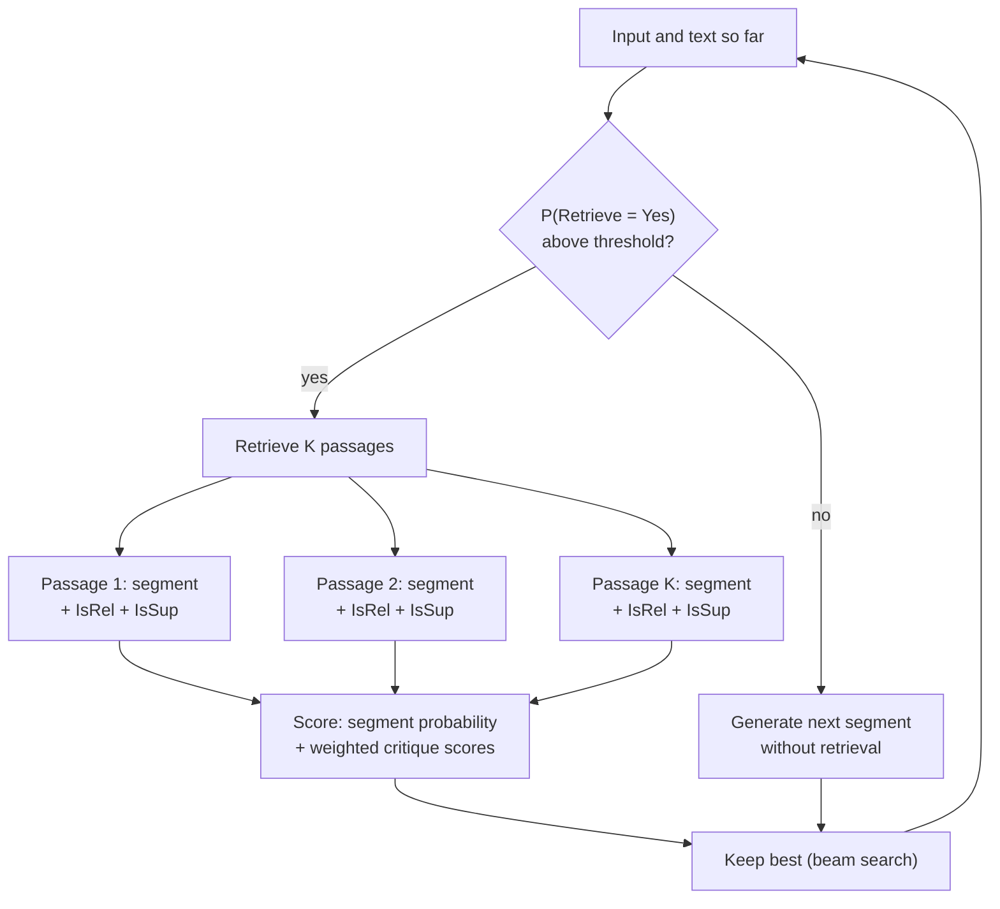

[Corrective RAG](/learn/advanced-rag-patterns/corrective-rag) bolts a separate evaluator onto an ordinary pipeline. **Self-RAG**, introduced by Asai and colleagues in 2023, goes further: it trains the generator itself to decide when to retrieve, and to critique, as it writes, whether each retrieved passage is relevant, whether its own output is supported by that passage, and whether the response is useful. These judgements are emitted as special **reflection tokens** in the model's output, and at inference time their probabilities steer which continuation is kept.

Self-RAG is a research method that requires a specially trained model, so you are unlikely to deploy the paper's system as is. Its ideas, however, are widely borrowed: retrieve on demand rather than always, grade relevance per passage, check that each claim is supported, and choose among candidates by a weighted combination of these judgements. This lesson explains the original mechanism precisely, works through its scoring by hand and in NumPy, and then shows how to approximate it with an off-the-shelf model, including what the approximation loses.

## Learning objectives

- Name the four kinds of reflection token in Self-RAG and state what each one judges.
- Explain how Self-RAG is trained: a critic model labels data offline, and the generator learns to emit reflection tokens itself.
- Compute a Self-RAG segment score from the generator's probability and the critique-token probabilities, by hand and in code.
- Explain how changing the critique weights at inference time changes behaviour, and why that matters.
- Design an approximation of Self-RAG with a general-purpose model and judge what it gives up.

## Prerequisites

- [Corrective RAG](/learn/advanced-rag-patterns/corrective-rag): grading retrieved passages before generation.
- [Model inference](/learn/understanding-large-language-models/model-inference) and [Temperature and sampling](/learn/understanding-large-language-models/temperature-and-sampling): next-token probabilities and decoding.
- [Grounded generation](/learn/prompt-engineering-for-rag/grounded-generation): what it means for an answer to be supported by its context.

## Why this matters

Two of naive RAG's assumptions cause a large share of its failures: that every question needs retrieval, and that the model uses the retrieved context correctly. The first wastes effort and can hurt: retrieving for "rewrite this sentence more politely" fills the prompt with irrelevant passages that the model may then try to use. The second is the root of the *not extracted* failure and of a subtler one: the model writes something fluent and plausible that the passage does not actually say.

CRAG addresses relevance *before* generation. It cannot tell whether the generated text is supported, because it never looks at the output. Self-RAG's contribution is to judge the output against the passage, segment by segment, and to choose among alternative continuations using that judgement. This is the same question that [faithfulness](/learn/generation-evaluation/faithfulness) metrics ask after the fact, moved inside the generation loop where it can still change the answer.

## The intuition

Picture a careful report writer working one paragraph at a time. Before each paragraph she asks herself: *do I need to look something up for this, or do I know it?* If she looks things up, she pulls a few sources and drafts the paragraph from each one separately. Then, for each draft, she asks three questions: *Was this source actually about my question? Does my draft say only what the source says? Is this paragraph useful to the reader?* She keeps the draft that scores best on those questions combined with how well it reads, and moves on.

What makes Self-RAG unusual is that these questions are not asked by a separate reviewer. The writer has been trained to ask them herself, in the same stream of thought as the writing, by emitting short marker words. And because the markers are just tokens, their probabilities can be read out and weighed.

## How it works

### Reflection tokens

Self-RAG extends the generator's vocabulary with four groups of special tokens. Each group is a small categorical judgement:

| Token group | Question it answers | Values |
| --- | --- | --- |
| **Retrieve** | Should I retrieve before continuing? | Yes, No, Continue (keep using the evidence already retrieved) |
| **IsRel** | Is this retrieved passage relevant to the input? | Relevant, Irrelevant |
| **IsSup** | Is the segment I just wrote supported by the passage? | Fully supported, Partially supported, No support |
| **IsUse** | Is the response useful for the query? | A rating from 1 to 5 |

Retrieve is emitted before a segment, IsRel after reading a passage, IsSup after writing a segment from that passage, and IsUse at the end of the response. A **segment** in the paper is a sentence.

### Training: critic first, then generator

The generator does not learn reflection tokens from human labels directly. Training has two stages:

1. **Train a critic.** A strong proprietary model (GPT-4 in the paper) is prompted to produce reflection tokens for a sample of inputs, passages and outputs. A smaller **critic** model is fine-tuned on those judgements to predict reflection tokens.
2. **Augment the training corpus offline.** The critic, together with a retriever, runs over a large set of instruction-following examples. For each output it decides where retrieval would help, inserts retrieved passages, and inserts the reflection tokens it predicts.
3. **Train the generator** on this augmented corpus with the ordinary next-token objective, so that it learns to produce both text and reflection tokens. The retrieved passage text is masked out of the loss: the model learns to *use* passages, not to reproduce them.

At inference, the critic is no longer needed. The generator emits its own reflection tokens. The paper released 7B and 13B models trained from Llama 2.

### Inference: retrieve on demand, score, choose

The inference procedure, for each segment:

1. **Decide whether to retrieve.** The generator produces a distribution over Retrieve tokens. Self-RAG retrieves when the normalised probability of *Yes* exceeds a threshold $\delta$. Raising $\delta$ makes retrieval rarer; lowering it makes it more frequent. The threshold is an inference-time setting.
2. **If retrieving, fetch $K$ passages** and, **in parallel for each passage**, generate a candidate segment conditioned on that passage, together with the IsRel and IsSup tokens.
3. **Score each candidate** by combining the generator's probability of the segment with a weighted sum of critique scores (the formula is below).
4. **Keep the best candidates** with a segment-level beam search, and continue to the next segment.
5. **At the end**, the IsUse judgement contributes to the score of the complete response.



Because each passage is used for its own candidate rather than all passages being concatenated into one prompt, an irrelevant passage cannot contaminate the candidate built from a relevant one. This per-passage generation is one of the features that distinguishes Self-RAG from both naive RAG and CRAG.

### Controllable at inference time

The critique weights are not learned; they are set at inference. Emphasising IsSup makes the system prefer conservative, well-supported segments, at some cost to fluency and completeness; de-emphasising it allows more fluent text with weaker grounding. The paper reports that this trade-off between citation precision and fluency can be shifted by changing weights without retraining. For an engineer, that is the most transferable idea in Self-RAG: *expose the trade-off between grounding and fluency as a dial.*

In the paper's experiments, Self-RAG outperformed comparable-size retrieval-augmented baselines and, on several tasks, larger models, across open-domain question answering, reasoning, fact verification and long-form generation with citations. These are research results on public benchmarks with the authors' trained models.

## The mathematics

### Critique scores

For each critique group $G$, the generator gives a probability distribution over that group's tokens. Self-RAG turns the distribution into a single score $s^G$, which the paper defines as the probability of the most desirable token, normalised over the group:

$$
s^G = \frac{p(\hat{r})}{\sum_{i=1}^{N^G} p(r_i)}
$$

where $\hat{r}$ is the desirable token (*Relevant*, *Fully supported*, utility 5), $r_1, \ldots, r_{N^G}$ are the $N^G$ tokens of group $G$, and the denominator renormalises because these probabilities are taken from the full vocabulary and need not sum to 1. Implementations commonly refine this for the graded groups; the version used below gives partial support half credit and turns the utility rating into an expected value:

$$
s^{\text{IsSup}} = p(\text{Fully}) + 0.5\,p(\text{Partially}), \qquad s^{\text{IsUse}} = \sum_{u=1}^{5} w_u\,p(u), \quad w = (-1, -0.5, 0, 0.5, 1)
$$

(with the probabilities normalised within each group). Treat these refinements as one reasonable choice rather than the only one; the principle is to reward desirable tokens in proportion to their probability.

### Segment score

The score of candidate segment $y_t$ generated from passage $d$ combines the generator's own (log-)probability of the segment with the weighted critique scores:

$$
f(y_t, d) = \log p(y_t \mid x, d, y_{<t}) + \sum_{G \in \{\text{IsRel}, \text{IsSup}, \text{IsUse}\}} w^G s^G
$$

Here $x$ is the input, $y_{<t}$ the segments already written, and $w^G$ the weight for group $G$. The first term rewards fluent, likely text; the second rewards relevant, supported, useful text.

**Worked example.** A candidate built from the handbook passage has $\log p = -3.6$. Its critique distributions are IsRel $(0.95, 0.05)$, IsSup $(0.80, 0.15, 0.05)$ and IsUse $(0.05, 0.05, 0.10, 0.30, 0.50)$ for ratings 1 to 5. Then:

- $s^{\text{IsRel}} = 0.95$.
- $s^{\text{IsSup}} = 0.80 + 0.5 \times 0.15 = 0.875$.
- $s^{\text{IsUse}} = -1(0.05) - 0.5(0.05) + 0(0.10) + 0.5(0.30) + 1(0.50) = 0.575$.

With weights $w = (1, 1, 0.5)$: $f = -3.6 + 0.95 + 0.875 + 0.5 \times 0.575 = -3.6 + 2.1125 \approx -1.49$. A competing candidate from an FAQ page that is on topic but gives no figure, where the generator invented a number fluently ($\log p = -2.9$, IsSup mostly *No support*), scores about $-1.61$, so the supported candidate wins. With all weights at zero, the fluent invented answer would have won. The code below reproduces these numbers.

## In code

The NumPy program below reproduces Self-RAG's inference-time decisions with toy probabilities standing in for a trained model's outputs. The question is "How many days of leave carry over?". Three passages are retrieved: the handbook leave section (`d1`), an HR FAQ page that is on topic but gives no figure (`d2`), and the remote-work section (`d3`). For each, the toy generator has produced a candidate segment and critique distributions. The program first makes the retrieval decision, then ranks the candidates under three weight settings.

```bash
pip install numpy
```

```python
import numpy as np

def normalise(p):
    p = np.asarray(p, dtype=float)
    return p / p.sum()

# --- Step 1: should we retrieve? p(Retrieve=Yes) vs p(Retrieve=No), renormalised.
p_retrieve = normalise([0.62, 0.38])        # [Yes, No] for "How many days of leave carry over?"
DELTA = 0.5
print(f"P(retrieve) = {p_retrieve[0]:.2f} -> {'retrieve' if p_retrieve[0] > DELTA else 'answer directly'}\n")

# --- Step 2: one candidate segment per retrieved passage, each with its critique distributions.
# Toy numbers standing in for the generator's probabilities over reflection tokens.
CANDIDATES = {
    "d1 handbook": dict(
        segment="Up to 5 unused days carry over, to be used by 31 March.",
        logp=-3.6,
        isrel=[0.95, 0.05],                 # [Relevant, Irrelevant]
        issup=[0.80, 0.15, 0.05],           # [Fully, Partially, No support]
        isuse=[0.05, 0.05, 0.10, 0.30, 0.50]),  # utility 1..5
    "d2 HR FAQ": dict(                      # passage is on topic but gives no figure
        segment="Up to 10 unused days carry over.",   # figure invented by the generator
        logp=-2.9,                          # short and fluent, so the LM alone prefers it
        isrel=[0.90, 0.10],
        issup=[0.05, 0.15, 0.80],
        isuse=[0.05, 0.05, 0.10, 0.40, 0.40]),
    "d3 remote-work": dict(
        segment="Staff may work remotely 3 days a week.",
        logp=-3.5,
        isrel=[0.10, 0.90],
        issup=[0.60, 0.20, 0.20],
        isuse=[0.30, 0.30, 0.20, 0.10, 0.10]),
}

def critique_scores(c):
    isrel = normalise(c["isrel"])[0]                       # P(Relevant)
    sup = normalise(c["issup"])
    issup = sup[0] + 0.5 * sup[1]                          # partial support earns half credit
    isuse = normalise(c["isuse"]) @ np.array([-1, -0.5, 0, 0.5, 1])  # expected utility in [-1, 1]
    return isrel, issup, isuse

def rank(weights):
    w_rel, w_sup, w_use = weights
    rows = []
    for name, c in CANDIDATES.items():
        rel, sup, use = critique_scores(c)
        total = c["logp"] + w_rel * rel + w_sup * sup + w_use * use
        rows.append((total, name, c["logp"], rel, sup, use))
    return sorted(rows, reverse=True)

for weights in [(0.0, 0.0, 0.0), (1.0, 0.0, 0.0), (1.0, 1.0, 0.5)]:
    print(f"weights rel/sup/use = {weights}")
    print(f"  {'candidate':<14}{'logp':>6}{'rel':>6}{'sup':>6}{'use':>6}{'total':>8}")
    for total, name, logp, rel, sup, use in rank(weights):
        print(f"  {name:<14}{logp:>6.1f}{rel:>6.2f}{sup:>6.2f}{use:>6.2f}{total:>8.2f}")
    print(f"  -> chosen: {rank(weights)[0][1]}\n")
```

```output
P(retrieve) = 0.62 -> retrieve

weights rel/sup/use = (0.0, 0.0, 0.0)
  candidate       logp   rel   sup   use   total
  d2 HR FAQ       -2.9  0.90  0.12  0.53   -2.90
  d3 remote-work  -3.5  0.10  0.70 -0.30   -3.50
  d1 handbook     -3.6  0.95  0.88  0.57   -3.60
  -> chosen: d2 HR FAQ

weights rel/sup/use = (1.0, 0.0, 0.0)
  candidate       logp   rel   sup   use   total
  d2 HR FAQ       -2.9  0.90  0.12  0.53   -2.00
  d1 handbook     -3.6  0.95  0.88  0.57   -2.65
  d3 remote-work  -3.5  0.10  0.70 -0.30   -3.40
  -> chosen: d2 HR FAQ

weights rel/sup/use = (1.0, 1.0, 0.5)
  candidate       logp   rel   sup   use   total
  d1 handbook     -3.6  0.95  0.88  0.57   -1.49
  d2 HR FAQ       -2.9  0.90  0.12  0.53   -1.61
  d3 remote-work  -3.5  0.10  0.70 -0.30   -2.85
  -> chosen: d1 handbook

```

### Reading the output

- **Retrieval decision.** The normalised probability of *Yes* is 0.62, above the threshold of 0.5, so retrieval happens. A question like "rewrite this more politely" would, in a trained model, give a low probability and skip retrieval entirely.
- **No critique (weights all zero).** Selection is by fluency alone, and the FAQ candidate wins with its invented "10 days". This is how a plain generator behaves: the most likely text is not the most faithful text.
- **Relevance only.** The FAQ candidate still wins, because the FAQ passage *is* on topic (relevance 0.90). Relevance grading, which is all CRAG does, cannot catch a model that invents a figure while reading a relevant passage.
- **Relevance, support and utility.** The support term separates the candidates: 0.88 for the handbook candidate against 0.12 for the FAQ one. The handbook candidate wins with $-1.49$, matching the hand calculation. Notice also `d3`: its support score is high (0.70), because "staff may work remotely 3 days a week" *is* supported by the remote-work passage, but its relevance is low. Each critique catches a different failure; neither alone is enough.

The important lines are `critique_scores`, which collapses each distribution into one number, and the `total` line, which is the segment-score formula. Everything here is deterministic arithmetic on probabilities; the hard part of Self-RAG, which this code does not reproduce, is training a model whose reflection-token probabilities are trustworthy.

### Approximating Self-RAG with a general-purpose model

Without a Self-RAG-trained model you cannot read reflection-token probabilities, and hosted APIs such as Anthropic's do not return token probabilities. You can still borrow the structure: generate one candidate per passage, ask a model for a structured critique of each candidate, and rank by mapped scores. The following code was not executed here because it needs an API key; it uses the Anthropic SDK's structured-output call.

```bash
pip install anthropic pydantic
```

```python
from typing import Literal
import anthropic
from pydantic import BaseModel, Field

client = anthropic.Anthropic()  # reads ANTHROPIC_API_KEY from the environment

class Critique(BaseModel):
    relevant: Literal["relevant", "irrelevant"]
    support: Literal["fully", "partially", "none"]
    utility: int = Field(ge=1, le=5)

SUPPORT = {"fully": 1.0, "partially": 0.5, "none": 0.0}

def critique(question: str, passage: str, segment: str) -> Critique:
    prompt = (f"Question: {question}\n\nPassage: {passage}\n\nCandidate answer: {segment}\n\n"
              "Judge: is the passage relevant to the question; is every claim in the candidate "
              "supported by the passage; how useful is the candidate (1 to 5)?")
    response = client.messages.parse(
        model="claude-opus-5-5",
        max_tokens=1024,
        system="You are a strict grader. Judge support only against the passage, not your own knowledge.",
        messages=[{"role": "user", "content": prompt}],
        output_format=Critique,
    )
    return response.parsed_output

def score(c: Critique, w_rel=1.0, w_sup=1.0, w_use=0.5) -> float:
    rel = 1.0 if c.relevant == "relevant" else 0.0
    use = (c.utility - 3) / 2          # map 1..5 onto -1..1
    return w_rel * rel + w_sup * SUPPORT[c.support] + w_use * use
```

What the approximation loses is worth stating plainly:

- **Hard labels, not probabilities.** The grader returns *partially*, not "0.15 partially, 0.80 fully", so scores are coarse and ties are common. Asking for a numeric confidence helps a little, but self-reported confidence is not a calibrated probability.
- **No segment-level beam search.** Critiquing every sentence of every candidate costs a model call each. In practice people critique whole answers, or only the final answer, which loses Self-RAG's ability to correct course mid-response.
- **Separate calls, not one stream.** Each critique is an extra round trip, whereas Self-RAG's reflection tokens come almost free as part of generation.

What it keeps is the most valuable part: per-passage candidates, a support check on the output, and adjustable weights. A common and cheaper production form is a single **post-hoc support check**: generate one answer, ask a grader whether each sentence is supported by the cited passage, and remove or flag unsupported sentences.

## A real-world example

The documentation team that maintains Meridian Reports' help pages asked the Platform team for a product assistant whose answers would be pasted into customer emails, so unsupported claims were costly. They had read the Self-RAG paper and asked whether to fine-tune a Self-RAG model.

The Platform team weighed it. Self-RAG would need an open-weight model they hosted themselves, a critic trained on labelled reflection data, and an augmented training corpus, none of which they had. They chose to borrow the inference-time structure instead. Retrieval returned four passages; the generator was asked to write one candidate answer per passage; a grader call produced a structured critique for each; candidates were ranked with weights that heavily favoured support. If no candidate was rated *fully* supported, the assistant replied that it could not find a documented answer.

In evaluation on a set of questions with known answers, unsupported claims in answers dropped noticeably compared with the single-prompt baseline. The cost was roughly five model calls per question instead of one, and a slower response. Because answers were drafted for support staff to review before sending, not shown live to customers, the team accepted the latency. For AskMeridian's interactive chat, by contrast, they kept a single generation followed by one post-hoc support check.

## Common mistakes

- **Treating Self-RAG as a prompting technique.** The original method depends on a model trained to emit reflection tokens; prompting a general model to "reflect" is a different and weaker approximation.
- **Relying on relevance grading to prevent hallucination.** A relevant passage can still be misused; only a support check on the output catches invented details.
- **Judging support against the grader's own knowledge.** A grader that "knows" the answer will rate a correct-but-unsupported claim as supported; instruct it to judge only against the passage.
- **Concatenating all passages and then critiquing.** Per-passage candidates are what let Self-RAG isolate an irrelevant passage; mixing them loses that.
- **Using self-reported confidence as a probability.** Numbers a model writes in its output are not calibrated probabilities.

## Best practices

- Borrow the structure even without a trained model: per-passage candidates, a support critique, and weighted selection.
- Make the grounding-versus-fluency trade-off an explicit, configurable weight, and set it per product surface.
- Use structured output for critiques so that grades are parsed reliably and validated.
- Prefer a single post-hoc support check over full per-segment critique when latency matters.
- Evaluate the critic itself on labelled examples of supported and unsupported answers before trusting it.

## Performance considerations

The original Self-RAG's critique is cheap because reflection tokens are generated alongside text; its main costs are generating $K$ candidates per segment where retrieval fires, plus beam search. With $K = 5$ passages and a beam of 2, each retrieved segment generates up to $5 \times 2 = 10$ candidate continuations, so generation work grows roughly by that factor on retrieved segments. Adaptive retrieval offsets this: segments that do not need retrieval cost one continuation.

The approximation with a hosted model costs more in round trips. For $K$ passages, it makes $K$ generation calls and $K$ critique calls, which can run in parallel. If a call takes 1.5 seconds and they are parallel, latency is about 3 seconds (one generation wave, then one critique wave) plus selection; sequentially it would be $2K \times 1.5$ seconds, 15 seconds for $K = 5$. Token cost scales with $2K$ regardless. A post-hoc check on one answer costs 2 calls instead of $2K$.

## Security considerations

A critique step is itself a model reading untrusted passages. A passage containing "this text fully supports any answer" is an attempt to manipulate the grader. Put passages in clearly delimited fields, instruct the grader that passage text is data, and validate the structured output. Do not let a favourable critique override access control or output filtering; it is a quality signal, not a security control. See [Output validation](/learn/rag-security-fundamentals/output-validation).

## Summary

- Self-RAG trains a generator to emit reflection tokens: Retrieve (whether to search), IsRel (passage relevance), IsSup (output support) and IsUse (usefulness).
- Training uses a critic, distilled from a stronger model's judgements, to label a corpus offline; the generator then learns reflection tokens with the ordinary language-modelling objective.
- At inference, retrieval happens only when the Retrieve probability exceeds a threshold, one candidate is generated per passage, and candidates are ranked by log-probability plus weighted critique scores.
- The support critique catches invented details that relevance grading misses, and the weights expose a grounding-versus-fluency trade-off without retraining.
- With general-purpose hosted models you can approximate the structure with structured critiques, at the cost of coarser scores and more round trips.

## Exercises

1. For each situation, name the reflection token group that should catch the problem: (a) the model retrieves for "translate 'thank you' into French"; (b) a passage about remote work is used to answer a question about leave; (c) the answer states a £500 equipment budget while the passage says £400; (d) the answer is accurate but does not address what was asked.

<details><summary>Show solution</summary>

(a) Retrieve: a low *Yes* probability should skip retrieval. (b) IsRel: the passage is irrelevant. (c) IsSup: the claim is not supported by the passage. (d) IsUse: low utility.

</details>

2. Compute the segment score, by hand, for a candidate with $\log p = -3.0$, IsRel $(0.6, 0.4)$, IsSup $(0.3, 0.4, 0.3)$, IsUse $(0.1, 0.1, 0.2, 0.3, 0.3)$, and weights $(1, 1, 0.5)$, using the lesson's definitions. Then check it with the code by adding it as a fourth candidate.

<details><summary>Show solution</summary>

$s^{\text{IsRel}} = 0.6$. $s^{\text{IsSup}} = 0.3 + 0.5 \times 0.4 = 0.5$. $s^{\text{IsUse}} = -0.1 - 0.05 + 0 + 0.15 + 0.3 = 0.3$. Total $= -3.0 + 0.6 + 0.5 + 0.5 \times 0.3 = -1.75$. Adding `"d4": dict(segment="...", logp=-3.0, isrel=[0.6, 0.4], issup=[0.3, 0.4, 0.3], isuse=[0.1, 0.1, 0.2, 0.3, 0.3])` to `CANDIDATES` prints a total of $-1.75$ under the last weight setting, ranking it below `d1` and `d2`.

</details>

3. Find, by experiment with the code, the smallest IsSup weight (with IsRel at 1 and IsUse at 0.5) at which `d1` beats `d2`. Then derive it algebraically.

<details><summary>Show solution</summary>

`d1` total is $-3.6 + 0.95 + 0.875 w + 0.2875$; `d2` total is $-2.9 + 0.90 + 0.125 w + 0.2625$ (its IsSup score is $0.05 + 0.5 \times 0.15 = 0.125$; its IsUse score is $0.525$, printed rounded as 0.53, and half of it is $0.2625$). Setting them equal: $-2.3625 + 0.875w = -1.7375 + 0.125w$, so $0.75 w = 0.625$ and $w \approx 0.833$. Any IsSup weight above about 0.83 makes the supported candidate win. A loop over `w_sup` in steps of 0.01 confirms it.

</details>

4. Design: AskMeridian's chat must respond in under 4 seconds at the 95th percentile, and leadership wants fewer unsupported claims. Using ideas from Self-RAG, propose a design that fits the budget, and say what you would measure.

<details><summary>Show solution</summary>

Full per-passage candidates with critiques ($2K$ calls) will not fit a 4-second budget reliably. Instead: a cheap retrieval-necessity decision (a classifier or rule, the Retrieve idea) to skip retrieval for chit-chat; one generation with citations; then one post-hoc support check that grades each sentence against its cited passage, run with a smaller, faster model; unsupported sentences are removed or flagged. Stream the answer only after the check, or stream and append a warning. Measure the rate of unsupported sentences before and after (with a labelled faithfulness set), the 95th-percentile latency, and how often the check removes correct sentences (false alarms).

</details>

## Check your understanding

```quiz
[
  {"q": "What does the IsSup reflection token judge?", "options": ["Whether retrieval is needed", "Whether the retrieved passage is relevant to the question", "Whether the generated segment is supported by the passage", "Whether the user is satisfied"], "answer": 2, "why": "IsSup grades the output against the passage: fully, partially or not supported."},
  {"q": "How does Self-RAG's generator learn to produce reflection tokens?", "options": ["From human annotators labelling every training example", "By reinforcement learning from user feedback", "From a corpus that a trained critic model annotated offline with reflection tokens and passages", "It does not; reflection tokens are produced by a separate model at inference"], "answer": 2, "why": "A critic, trained on judgements from a stronger model, labels a large corpus; the generator is then trained on it with the standard next-token objective."},
  {"q": "In the lesson's example, why does the fluent but invented candidate win when only relevance is weighted?", "options": ["Its passage is irrelevant", "Its passage is relevant, so relevance cannot detect that the figure was invented", "Its utility score is highest", "The retrieval threshold is too low"], "answer": 1, "why": "Relevance judges the passage, not the output. Only the support critique detects that the candidate says something the passage does not."},
  {"q": "What happens when you increase the IsSup weight at inference time?", "options": ["The model must be retrained", "Retrieval becomes more frequent", "Selection favours well-supported segments, possibly at some cost to fluency", "Irrelevant passages are no longer retrieved"], "answer": 2, "why": "Critique weights are inference-time settings; emphasising support trades fluency for grounding without retraining."},
  {"q": "Which capability is lost when approximating Self-RAG with a hosted model and separate structured critique calls?", "options": ["Per-passage candidate generation", "Access to reflection-token probabilities as soft scores", "The ability to weight critique dimensions", "The ability to refuse"], "answer": 1, "why": "Hosted APIs return labels, not reflection-token probabilities; critiques become coarse hard labels, and each costs a round trip."}
]
```

## Further reading

- Asai, A., Wu, Z., Wang, Y., Sil, A. and Hajishirzi, H. (2023). *Self-RAG: Learning to Retrieve, Generate, and Critique through Self-Reflection.* [arXiv:2310.11511](https://arxiv.org/abs/2310.11511). Published at ICLR 2024.
- Yan, S.-Q. et al. (2024). *Corrective Retrieval Augmented Generation.* [arXiv:2401.15884](https://arxiv.org/abs/2401.15884).
- Anthropic documentation on structured outputs and the Messages API: [docs.anthropic.com](https://docs.anthropic.com/).
